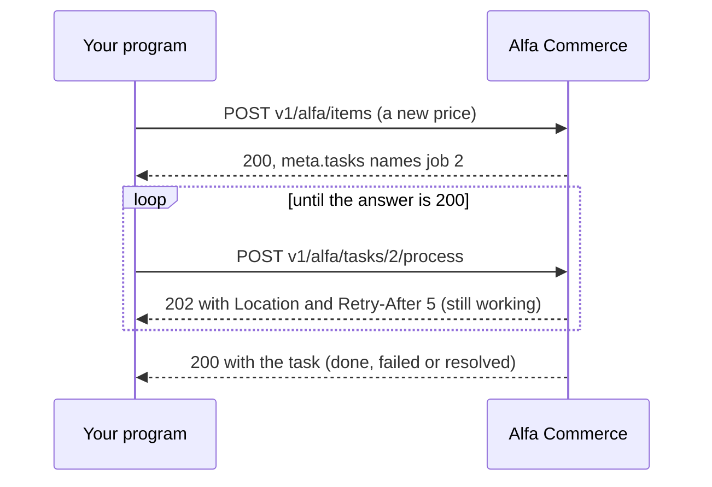

# Documents and tasks

<AlfaVersion verified="2.2.0" />

Read [the overview](./overview.md) first. It has the rules every route follows.

## Documents

A document is an invoice, a credit note or another paper issued for an order. Once issued it is never changed and
never deleted. So the API reads a document, draws it, and voids it. Nothing else. Documents are issued by the
shop itself, for example when an order reaches a status that issues one. See
[Documents](../services/documents.md).

| Method and address | What it does |
|---|---|
| `GET v1/alfa/documents` | Lists documents |
| `GET v1/alfa/documents/:id` | Reads one document |
| `GET v1/alfa/documents/:id/html` | The document as the customer receives it, as HTML |
| `GET v1/alfa/documents/:id/pdf` | The same as a PDF |
| `POST v1/alfa/documents/:id/void` | Voids the document |

Filters of the list: `filter[search]`, `filter[doc_type]`, `filter[status]`, `filter[id_order]`.

**A list row holds:** `id`, `doc_type`, `status`, `number`, `number_formatted`, `issue_date_local`, `id_order`,
`id_shipment`, `id_corrects`, `buyer_name`, `buyer_vat_number`, `currency_code`, `total_tax_excl`, `total_tax`,
`total_tax_incl`, `authority_state`, `authority_mark`, `series_code`, `created`.

**One record holds also:** `is_combined`, `issue_date`, the buyer's and the seller's details (`buyer_...`,
`seller_...`), `currency`, `conversion_rate`, the transport details (`movement_purpose`, `carrier_name`,
`vehicle_number`, `movement_start`, `ship_from`, `ship_to`), `payment_method_name`, `authority_uid`, `qr_url`,
`note`, `print_note`, `voided_at`, `voided_by`, `void_reason`, and the lists `series`, `lines`, `taxes`.

**The PDF** needs the dompdf library (`lib_dompdf`) on the site. Alfa Commerce does not ship it. Without it the
route answers 500 in 2.2.0 ([Known defects](./overview.md#known-defects-in-220), row 9). The HTML route does not
need it.

**Void.** The only correction of an issued document. The document and its number stay; it is marked void with
your reason. A reason is needed (400 without one, 500 characters at most). Only an issued document can be voided:
a second void is refused with 409. The token's user needs the documents' Change State permission.

```json
{"reason": "Issued to the wrong customer"}
```

A shop needs a document series before any document can be issued. A fresh installation has none, so the list is
empty there:

```json
{"links": {"self": ".../v1/alfa/documents?filter[id_order]=1"}, "data": [], "meta": {"total-pages": 0}}
```

With a series in place, an invoice issued by a status change reads like this in the list (shortened):

```json
{
  "type": "documents",
  "id": "1",
  "attributes": {
    "id": 1, "doc_type": "core.invoice", "status": 1, "number": 1, "number_formatted": "INV-000001",
    "issue_date_local": "2026-11-13", "id_order": 2, "currency_code": "EUR", "buyer_name": "Maria Example",
    "total_tax_excl": "24.40", "total_tax": "0.00", "total_tax_incl": "24.40", "series_code": "A"
  }
}
```

After a void, `status` is 2 and `voided_at`, `voided_by` and `void_reason` are filled. The two refusals of a void:

```json
{"errors":[{"title":"reason is required to void a document","code":400}]}
```

```json
{"errors":[{"title":"DocumentIssuer: void failed: document #1 is not issued; only issued documents can be voided.","code":409}]}
```

## Document types

Read only: `GET v1/alfa/documenttypes` and `GET v1/alfa/documenttypes/:id`. A document type says what kind of
paper a document is. Plugins can add types (see [Document events](../events/document-events.md)); the API only
reads them.

**A list row holds:** `id`, `alias`, `name`, `family`, `quantity_pool`, `shows_prices`, `movement_mode`,
`requires_original`, `requires_buyer_tax_id`, `stock_effect`, `icon`, `color`, `ordering`, `state`, `is_core`.

**One record holds also:** `corrects`, `default_layout`, `provider`, `provider_version`, `translations`.

The invoice of a fresh installation has the alias `core.invoice`.

## Tasks

A task is one piece of background work that a save left for later: an e-mail to send, a document to issue, a
price index to rebuild. See [Background work](../architecture/background-work.md) for how tasks work. The API
shows them in two places.

**In the answer of a write.** `meta.tasks` lists the work the request left, each with its state and its own
address:

```json
{
  "meta": {
    "tasks": [{
      "id": 3, "type": "single", "handler": "order.entitlements", "owner": "com_alfa",
      "scope": "order:1", "state": "done", "percent": 100, "merged": false,
      "links": {"self": "https://your-shop.example/api/index.php/v1/alfa/tasks/3"}
    }]
  }
}
```

`type` is `single` for one small piece of work that belongs to one record, and `job` for long work over many
records.

**On routes of their own:**

| Method and address | What it does | Who may |
|---|---|---|
| `GET v1/alfa/tasks` | Lists tasks. Filters: `filter[state]`, `filter[type]`, `filter[owner]`. `page[limit]` is 100 at most. | Users with the Tools permission |
| `GET v1/alfa/tasks/:id` | Reads one task | The user who caused it, or a user with the permission of its work |
| `POST v1/alfa/tasks/:id/process` | Works on a job for up to 2 seconds | Users with the Tools permission |

A task you may not read answers 404, the same as a task that does not exist, so the API never reveals that a
task is there.

**A task holds:** `id`, `type`, `handler`, `owner`, `scope`, `state`, `done_units`, `total_units`, `percent`,
`run_after`, `created_at`, `started_at`, `finished_at`, `updated_at`, `origin`, `last_error`, `result`.

**Waiting for a job.** Call `process` until the job no longer waits:



You do not have to call `process`. The shop does its background work by itself, as described in
[Background work](../architecture/background-work.md). `process` is for a program that wants to wait for the
result.

Only a job can be processed:

```json
{"errors":[{"title":"Only a job can be processed; a single runs after the save that wrote it.","code":409}]}
```

In 2.2.0 only Alfa Commerce itself creates tasks. The API has no route that creates one, and a plugin cannot
register its own.

## Not documented yet

- The fields of a document's `lines`, `taxes` and `series` one by one.
- The values of a task's `state`, `handler` and `origin`. See
  [Background work](../architecture/background-work.md) for the states.
- A 202 answer was not seen for this page: on the test shop the job had finished before `process` was called,
  and the answer was 200. The 202 with `Location` and `Retry-After` is what the route's code and the collection
  state.
