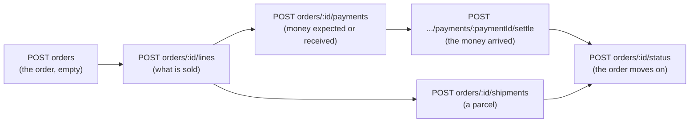

# Orders

<AlfaVersion verified="2.2.0" />

Read [the overview](./overview.md) first. It has the rules every route follows.

An order is changed in two ways. Its customer details are changed with a `PATCH` of the order. Everything that has
rules of its own (lines, money, parcels, the status) is changed with an **operation**: a route of its own that
hands the request to the service that owns those rules. See [Orders](../services/orders.md) and
[Payments and shipments](../services/payments-and-shipments.md) for the services.



## Orders

`v1/alfa/orders`, the five standard routes. The filters of the list are in
[The filters of each list](./overview.md#the-filters-of-each-list); planned for 2.2.1, which is not released, it
gains filters by payment, fulfilment, date, item and customer.

**Create.** An order made through the API has the source `api` and starts empty. Give it a status, a currency and
the customer's details. The details go in `alfa_form_fields`, keyed by the names of the shop's checkout fields. On
a fresh installation `name`, `email` and `country` are needed, and `country` is the id of a published place.

```bash
curl -X POST -H "X-Joomla-Token: YOUR_TOKEN" -H "Content-Type: application/json" \
  "https://your-shop.example/api/index.php/v1/alfa/orders" \
  -d '{
    "id_order_status": 1,
    "id_currency": 47,
    "alfa_form_fields": {"name": "Maria Example", "email": "maria@example.invalid", "country": 84}
  }'
```

The ids are those of a fresh installation: status 1 is "Pending", the status new orders start in, and currency 47
is the euro. Read `v1/alfa/orderstatuses` (the row with `is_initial`), `v1/alfa/currencies` and `v1/alfa/places`
for the ids of your shop.

The answer, status 200, shortened:

```json
{
  "data": {
    "type": "orders",
    "id": "1",
    "attributes": {
      "id": 1,
      "customer_name": "Maria Example",
      "id_order_status": 1,
      "status_name": "Pending",
      "payment_status": "unpaid",
      "order_total": {"amount": "0.00", "formatted": "0,00 €", "minor_units": 0},
      "source": "api",
      "lines": []
    }
  }
}
```

**A list row holds:** `id`, `reference`, `customer_name`, `customer_email`, `id_order_status`, `status_name`,
`id_payment_method`, `payment_method_name`, `id_shipment_method`, `shipment_method_name`, `payment_status`,
`payment_percentage`, `balance`, `overpaid`, `excess`, `still_held`, `fulfillment_status`,
`fulfillment_percentage`, `order_total`, `order_total_tax_excl`, `items_total`, `shipping_total`,
`discount_total`, `total_paid_real`, `total_refunded_real`, `id_currency`, `currency`, `source`, `state`,
`created`, `modified`.

**One record holds also:** `id_user`, `conversion_rate`, `invoice_number`, `invoice_date`, `delivery_date`,
`id_address_delivery`, `id_address_invoice`, `contributions_total`, `customer_note`, and the lists `lines`,
`payments`, `shipments`, `contributions`, `history`, `delivery_address`, `invoice_address`.

**Change.** `PATCH v1/alfa/orders/:id` changes the customer's details. It does not change the status:

```json
{"errors":[{"title":"id_order_status cannot be changed via PATCH; use POST v1/alfa/orders/:id/status.","code":422}]}
```

`customer_note` or `state` in a `PATCH` is answered 200 and not written in 2.2.0
([Known defects](./overview.md#known-defects-in-220), row 7).

Planned for 2.2.1, which is not released: `customer_note` in a `PATCH` is written. The order edit screen neither
shows nor changes it. `state` (the order's trash flag, not its status) is refused:

```json
{"errors":[{"title":"state cannot be changed via PATCH: an order is not trashed; its status changes through POST v1/alfa/orders/:id/status.","code":422}]}
```

**Delete.** 204. An order that has sales documents is refused with 409, and the answer names the documents:
cancel such an order instead. An order cannot be moved to the trash through the API.

## Operations on an order

Nine routes. Each answers 200 with the whole order as it is after the change, so one answer shows the new totals.
An order id that does not exist, or a line, payment or shipment of another order, answers 404.

| Method and address | What it does |
|---|---|
| `POST v1/alfa/orders/:id/lines` | Adds a line |
| `PATCH v1/alfa/orders/:id/lines/:lineId` | Changes a line |
| `DELETE v1/alfa/orders/:id/lines/:lineId` | Removes a line |
| `POST v1/alfa/orders/:id/payments` | Records a payment |
| `POST v1/alfa/orders/:id/payments/:paymentId/settle` | Moves a payment to another state, for example to completed |
| `POST v1/alfa/orders/:id/payments/:paymentId/refund` | Records a refund of a payment |
| `POST v1/alfa/orders/:id/shipments` | Adds a parcel |
| `PATCH v1/alfa/orders/:id/shipments/:shipmentId` | Changes a parcel |
| `POST v1/alfa/orders/:id/status` | Changes the order's status |

### Lines

**Add.** `id_item` and `quantity` (a whole number, 1 or more). An item with combinations also needs
`id_combination`. The line is priced by Alfa Commerce as of now, for this order.

```json
{"id_item": 1, "quantity": 2}
```

The order after it, shortened:

```json
{
  "order_total": {"amount": "39.80", "formatted": "39,80 €", "minor_units": 3980},
  "balance": {"amount": "39.80", "formatted": "39,80 €", "minor_units": 3980},
  "lines": [{
    "id": 1, "id_item": 1, "name": "Cordless drill", "sku": "DRILL-18V", "quantity": 2,
    "unit_price_tax_incl": {"amount": "19.90", "formatted": "19,90 €", "minor_units": 1990},
    "total_price_tax_incl": {"amount": "39.80", "formatted": "39,80 €", "minor_units": 3980},
    "custom_unit_price_tax_incl": null,
    "manual_discount_percent": "0",
    "manual_discount_scope": "exclude_custom_price",
    "tax_rate": "0"
  }]
}
```

You may also send `custom_unit_price_tax_incl` (your own unit price), `manual_discount_percent` (0 to 100) and
`manual_discount_scope` (`exclude_custom_price` or `apply_to_custom_price`).

The calculated figures cannot be sent:

```json
{"errors":[{"title":"unit_price_tax_incl is derived and cannot be written; send custom_unit_price_tax_incl (a number to set, null to clear, omitted to leave unchanged)","code":400}]}
```

An item with a required option cannot be added through this route (409).

**Change.** `quantity`, `custom_unit_price_tax_incl`, `manual_discount_percent`, `manual_discount_scope`. For
`custom_unit_price_tax_incl`: left out keeps the line as it is, `null` removes your price, a number sets it. The
item of a line cannot be swapped (409).

```json
{"quantity": 3, "manual_discount_percent": "10"}
```

**Remove.** Answers 200 with the order, not 204. The order's stock is brought in line with what is left.

### Payments

**Record a payment.** `amount` as text in the order's currency. Optional: `id_payment_method`,
`transaction_status` (for example `pending` or `completed`), `payment_type`, `transaction_id`, `note`.

```json
{"amount": "20.00", "id_payment_method": 1, "transaction_status": "pending", "note": "Deposit"}
```

The amount is limited to what the order still owes. A refund cannot be recorded through this route (409).

**Settle.** Moves a payment to another state exactly once. `to_status` is needed. With `from_status` you say which
state you believe the payment is in, and you are told when it is not:

```json
{"to_status": "completed", "from_status": "pending"}
```

```json
{"errors":[{"title":"payment 1 is completed, not pending","code":409}]}
```

Settling to the state the payment already has answers 200 and changes nothing. `refunded` is refused here (409).

After the payment above was settled, the order read: `payment_status` "partial", `payment_percentage` "50.25",
`balance` 19.80, `total_paid_real` 20.00.

**Refund.** Records money given back against one payment. It does not move money: return the money at the payment
provider first, then record it here. `amount` left out refunds all that is left of the payment. Optional:
`reason`, `id_document`.

```json
{"amount": "5.00", "reason": "Goodwill"}
```

Only a completed payment can be refunded:

```json
{"errors":[{"title":"payment #1 is payment/pending; only a completed payment holds money to return","code":422}]}
```

After a refund of 5.00 the order read: `payment_status` "partially_refunded", `total_refunded_real` 5.00, and a
new entry in `payments` with `payment_type` "refund" and `refund_type` "partial".

### Shipments

**Add a parcel.** `id_shipment_method` is needed. Optional: `tracking_number`, `status`, the charge, and `items`,
the order lines in the parcel with their quantities.

```json
{
  "id_shipment_method": 1,
  "tracking_number": "TRK-1001",
  "shipping_cost_tax_incl": "5.00",
  "items": [{"id_order_item": 1, "quantity": 1}]
}
```

`shipping_cost_tax_incl` alone is a charge without tax. A charge with tax needs all three of
`shipping_cost_tax_incl`, `shipping_cost_tax_excl` and `shipping_tax_rate` (text, at most three decimals), and
they must agree with each other and with the shipping tax that applies to the order.

The order after it, shortened. The parcel's charge is now part of the order's total:

```json
{
  "order_total": {"amount": "44.80", "formatted": "44,80 €", "minor_units": 4480},
  "shipping_total": {"amount": "5.00", "formatted": "5,00 €", "minor_units": 500},
  "shipments": [{
    "id": 1, "id_shipment_method": 1, "tracking_number": "TRK-1001",
    "shipping_cost_tax_incl": {"amount": "5.00", "formatted": "5,00 €", "minor_units": 500},
    "shipping_tax_rate": "0"
  }]
}
```

**Change a parcel.** `status`, `tracking_number`, `carrier`, `weight`, the charge fields, `items`. For `items`:
left out keeps the parcel's lines, `[]` empties the parcel, a list replaces them. The status `cancelled` cancels
the parcel.

```json
{"status": "shipped", "tracking_number": "TRK-1002"}
```

In 2.2.0 each shipment also shows `note` and `created`, which are always null (known defect, row 10). The order's
`fulfillment_status` is not filled by the API in 2.2.0 (row 12), and each payment's `created` is always null
(row 11).

Planned for 2.2.1, which is not released:

- One order carries `fulfillment_status` and `fulfillment_percentage`, worked out as in the list of orders.
- Each payment carries `added` (when the payment was recorded) and `refund_reason` (the reason staff gave for a
  refund). `created` is no longer in a payment's entry, so a program that reads it finds no such field.
- A shipment's `note` and `created` stay as in 2.2.0 (row 10 is open).

### The status

`POST v1/alfa/orders/:id/status` is the only way to change an order's status through the API.

```json
{"id_order_status": 2, "note": "Picked", "silent": true}
```

| Field | Meaning |
|---|---|
| `id_order_status` | The status to move to. An id that is not a status answers 422. |
| `note` | A note for the order's history |
| `silent` | `true` sends no e-mail to the customer. Everything else still happens. |
| `force` | `true` is needed to bring a cancelled order back |

A 200 means the status changed, and that everything the change owes was recorded with it: the stock step, the
e-mails, the documents, the plugins' reactions. That follow-up work is listed in the answer's `meta.tasks`, each
entry with the state it ended in. Work that failed waits for staff under **Tools**, **Tasks**. See
[Background work](../architecture/background-work.md).

A cancelled order is not brought back by accident:

```json
{"errors":[{"title":"Order is in the cancelled family; send \"force\": true to reinstate it","code":409}]}
```

## Order statuses

`v1/alfa/orderstatuses`, the five standard routes. Both `name` (for staff) and `name_customer` (for the shopper)
are needed in the default language.

```json
{
  "name_en_gb": "Packed",
  "name_customer_en_gb": "Being prepared",
  "state": 0,
  "color": "rgba(0, 0, 0, 1)",
  "bg_color": "rgba(214, 214, 214, 1)"
}
```

**A list row holds:** `id`, `name`, `color`, `bg_color`, `stock_operation`, `is_initial`, `is_cancelled`,
`is_completed`, `ordering`, `state`.

**One record holds also:** `name_customer`, `notify_customer`, `translations`.

A status can issue sales documents when an order reaches it. Such a status carries `issues_doc_rules`, and in
2.2.0 the rules are kept only when the body also carries `issues_delivery_note` (known defect, row 6):

```json
{
  "issues_delivery_note": 0,
  "issues_doc_rules": [{"usergroups": [], "series": "core.invoice"}]
}
```

Planned for 2.2.1, which is not released: the rules are kept with or without `issues_delivery_note`.

Deleting a status that orders are in answers 204 in 2.2.0 and deletes nothing (known defect, row 2). Planned for
2.2.1, which is not released: such a delete is refused with 409 and the reason, and so is the delete of the last
status that holds a role. Nothing is deleted.

## Not documented yet

- The entries of `contributions`, `history`, `delivery_address` and `invoice_address` field by field.
- The allowed values of `transaction_status`, `payment_type` and a parcel's `status`.
- `overpaid`, `excess` and `still_held` one by one. See [Orders](../services/orders.md) for the money terms.
- An example of a parcel with tax. The rule above is the collection's; no taxed parcel was sent for this page.
