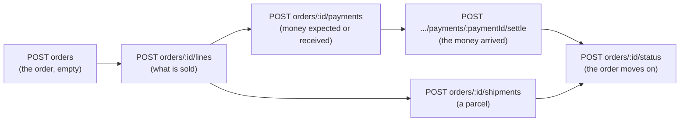

# Orders

<AlfaVersion verified="2.2.1" />

Read [the overview](./overview.md) first. It has the rules every route follows.

An order changes in two ways. Its customer details change with a `PATCH` of the order. Everything that has
rules of its own (lines, money, parcels, the status) is changed with an **operation**: a route of its own that
hands the request to the service that owns those rules. See [Orders](../services/orders.md) and
[Payments and shipments](../services/payments-and-shipments.md) for the services.



## Orders

`v1/alfa/orders`, the five standard routes. The filters of the list are in
[The filters of each list](./overview.md#the-filters-of-each-list): they include filters by payment,
fulfilment, waiting time, reconciliation, overpayment, date, item and customer.

**Create.** An order made through the API has the source `api`, or the one the request names (see
[Where an order comes from](#where-an-order-comes-from)), and starts empty unless the request carries its lines,
its parcel and its payment. Give it a status and the
customer's details; it takes the shop's default currency (see [Known limitations](./overview.md#known-limitations)). The details go in `alfa_form_fields`, keyed by the names of the shop's checkout fields. On
a fresh installation `name`, `email`, `country`, `address`, `city` and `postcode` are needed, unless the shop sets
some of them Optional in Form Fields, and `country` is the id of a published place. A shop that was installed
earlier keeps its own fields (an update adds none), and needs those its own fields require. A `PATCH` of an
existing order does not require them; see [Known limitations](./overview.md#known-limitations) for a shop with a
required delivery field of its own.

```bash
curl -X POST -H "X-Joomla-Token: YOUR_TOKEN" -H "Content-Type: application/json" \
  "https://your-shop.example/api/index.php/v1/alfa/orders" \
  -d '{
    "id_order_status": 1,
    "alfa_form_fields": {"name": "Maria Example", "email": "maria@example.invalid", "country": 84,
                         "address": "1 Example Street", "city": "Example Town", "postcode": "123 45"}
  }'
```

The ids are those of a fresh installation: status 1 is "Pending", the status new orders start in, and place 84 is
Greece. Read `v1/alfa/orderstatuses` (the row with `is_initial`) and `v1/alfa/places` for the ids of your shop.

The answer, status 201, shortened:

```json
{
  "data": {
    "type": "orders",
    "id": "1",
    "attributes": {
      "id": 1,
      "customer_name": "Maria Example",
      "id_order_status": 1,
      "status_name": "Pending",
      "payment_status": "unpaid",
      "order_total": {"amount": "0.00", "formatted": "0,00 €", "minor_units": 0},
      "source": "api",
      "lines": []
    }
  }
}
```

### Where an order comes from

**The source.** `source` names the channel an order comes from: lower-case letters, digits, `_` and `-`, up to 32
characters, for example `base` for a marketplace's connector. Without it the order is `api`. `storefront`, `admin`
and `renewal` are the sources Alfa Commerce writes for its own orders (the shop's checkout, the order screen, a
renewal) and are refused with 422, as is a value in another shape. The source is written when the order is created
and never changed; `filter[source]` lists the orders of one channel.

**The other system's id.** An order that another system made (a marketplace, an ERP, a connector) can carry that
system's name in `external_source` (the same shape as `source`) and its id of the order in `external_reference` (text
of up to 64 characters, compared exactly: letter case counts). Send both or neither; one without the other is refused
with 422.

```json
{"id_order_status": 1, "source": "base", "external_source": "base", "external_reference": "OR-2026-551",
 "alfa_form_fields": {"name": "Maria Example", "email": "maria@example.invalid", "country": 84,
                      "address": "1 Example Street", "city": "Example Town", "postcode": "123 45"}}
```

One pair names one order. A create that sends a pair an order already carries creates nothing and answers 409, with
that order's id in `meta.existing_id`:

```json
{"meta": {"existing_id": 1052},
 "errors": [{"title": "/external_reference: order 1052 already carries external_source \"base\" with this external_reference, and one pair names one order. The order was not created.", "code": 409}]}
```

So a connector that sends an order again after a timeout or a lost answer never makes a second one: it reads the
order with `GET v1/alfa/orders/1052` and goes on. It needs no map of its own of the orders it sent. The database
holds each pair once, so two such requests at the same moment make one order, and the second is answered in the
same way.

`filter[external_source]` lists the orders of one system, and with `filter[external_reference]` it finds the one
order of a pair. An order without a pair can be given one with a `PATCH` of the order, once: a pair another order
carries is refused with 409 and that order's id, and a change of a pair the order already carries with 422.

**A list row holds:** `id`, `reference`, `customer_name`, `customer_email`, `id_order_status`, `status_name`,
`id_payment_method`, `payment_method_name`, `id_shipment_method`, `shipment_method_name`, `payment_status`,
`payment_percentage`, `balance`, `overpaid`, `excess`, `still_held`, `fulfillment_status`,
`fulfillment_percentage`, `order_total`, `order_total_tax_excl`, `items_total`, `shipping_total`,
`discount_total`, `total_paid_real`, `total_refunded_real`, `id_currency`, `currency`, `source`,
`external_source`, `external_reference`, `state`, `created`, `modified`.

**One record holds also:** `id_user`, `conversion_rate`, `delivery_date`, `id_address_delivery`,
`id_address_invoice`, `contributions_total`, `customer_note`, and the lists `lines`, `payments`, `shipments`,
`contributions`, `history`, `delivery_address`, `invoice_address`. The order's number is its `id`.

The lists `payments` and `shipments` are where a program reads an order's payments and parcels. The routes under
[Operations on an order](#operations-on-an-order) write them; none of them reads.

**Change.** `PATCH v1/alfa/orders/:id` changes the customer's details. It does not change the status:

```json
{"errors":[{"title":"id_order_status cannot be changed via PATCH; use POST v1/alfa/orders/:id/status.","code":422}]}
```

`customer_note` in a `PATCH` is written. The order edit screen neither shows nor changes it. `state` (the order's
trash flag, not its status) is refused:

```json
{"errors":[{"title":"state cannot be changed via PATCH: over the API an order has no trash step and is deleted in one call (DELETE v1/alfa/orders/:id); its status changes through POST v1/alfa/orders/:id/status.","code":422}]}
```

A `PATCH` writes the order's `customer_note`, its delivery and invoice details (`alfa_form_fields`, and
`alfa_form_fields_billing` with `invoice_differs`) and, once, `external_source` with `external_reference`, and
nothing else. Each details section is an object of field name to value: a field left out keeps its value, and
`{}` changes nothing. A section sent as `null`, a string or a number is answered 400 naming it, and nothing is saved. A body that
carries any other field the order publishes, such as `customer_email`, `id_address_delivery`, `created` or
`order_total`, is refused with 422 before anything is saved, and the answer names the fields:

```json
{"errors":[{"title":"customer_email cannot be written through the API: an order's update writes its customer_note and its delivery and invoice details (alfa_form_fields, and alfa_form_fields_billing with invoice_differs); its status changes through POST v1/alfa/orders/:id/status, its lines, payments and shipments through the order operations, and the other fields are worked out from them or fixed when the order is placed. Nothing was saved.","code":422}]}
```

Change the delivery details through `alfa_form_fields`, never by the id of an address record.

**Delete.** 204. An order that has sales documents is refused with 409, and the answer names the documents:
cancel such an order instead. An order cannot be moved to the trash through the API.

## Operations on an order

Twelve routes. Each answers 200 with the whole order as it is after the change, so one answer shows the new totals.
An order id that does not exist, or a line, payment or shipment of another order, answers 404. They do what the
order screen does, with its rules, and ask the permission it asks: Orders: Edit, and for the status Orders: Edit
State with Orders: View.

| Method and address | What it does |
|---|---|
| `POST v1/alfa/orders/:id/lines` | Adds a line |
| `PATCH v1/alfa/orders/:id/lines/:lineId` | Changes a line |
| `DELETE v1/alfa/orders/:id/lines/:lineId` | Removes a line |
| `POST v1/alfa/orders/:id/payments` | Records a payment |
| `POST v1/alfa/orders/:id/payments/:paymentId/settle` | Moves a payment to another state, for example to completed |
| `POST v1/alfa/orders/:id/payments/:paymentId/refund` | Records a refund of a payment |
| `PATCH v1/alfa/orders/:id/payments/:paymentId` | Changes a payment's method, reference or note |
| `DELETE v1/alfa/orders/:id/payments/:paymentId` | Removes a payment that moved no money |
| `POST v1/alfa/orders/:id/shipments` | Adds a parcel |
| `PATCH v1/alfa/orders/:id/shipments/:shipmentId` | Changes a parcel |
| `DELETE v1/alfa/orders/:id/shipments/:shipmentId` | Removes a parcel |
| `POST v1/alfa/orders/:id/status` | Changes the order's status |

### Lines

**Add.** `id_item` and `quantity` (a whole number, 1 or more). An item with combinations also needs
`id_combination`. The line is priced by Alfa Commerce at the current prices, for this order.

```json
{"id_item": 1, "quantity": 2}
```

The order after it, shortened:

```json
{
  "order_total": {"amount": "39.80", "formatted": "39,80 €", "minor_units": 3980},
  "balance": {"amount": "39.80", "formatted": "39,80 €", "minor_units": 3980},
  "lines": [{
    "id": 1, "id_item": 1, "name": "Cordless drill", "sku": "DRILL-18V", "quantity": 2,
    "unit_price_tax_incl": {"amount": "19.90", "formatted": "19,90 €", "minor_units": 1990},
    "total_price_tax_incl": {"amount": "39.80", "formatted": "39,80 €", "minor_units": 3980},
    "custom_unit_price_tax_incl": null,
    "manual_discount_percent": "0",
    "manual_discount_scope": "exclude_custom_price",
    "tax_rate": "0"
  }]
}
```

You may also send `custom_unit_price_tax_incl` (your own unit price), `manual_discount_percent` (0 to 100) and
`manual_discount_scope` (`exclude_custom_price` or `apply_to_custom_price`).

The calculated figures cannot be sent:

```json
{"errors":[{"title":"unit_price_tax_incl is derived and cannot be written; send custom_unit_price_tax_incl (a number to set, null to clear, omitted to leave unchanged)","code":400}]}
```

An item with a required option cannot be added through this route (409).

**Change.** `quantity`, `custom_unit_price_tax_incl`, `manual_discount_percent`, `manual_discount_scope`. For
`custom_unit_price_tax_incl`: left out keeps the line as it is, `null` removes your price, a number sets it. The
item of a line cannot be swapped (409).

```json
{"quantity": 3, "manual_discount_percent": "10"}
```

**Remove.** Answers 200 with the order, not 204. The order's stock is brought in line with what is left.

### Payments

**Record a payment.** `amount` as text in the order's currency. Optional: `id_payment_method`,
`transaction_status` (for example `pending` or `completed`), `payment_type`, `transaction_id`, `note`.

```json
{"amount": "20.00", "id_payment_method": 1, "transaction_status": "pending", "note": "Deposit"}
```

The amount is limited to what the order still owes. A refund cannot be recorded through this route (409).

**Settle.** Moves a payment to another state exactly once. `to_status` is needed. With `from_status` you say which
state you believe the payment is in, and you are told when it is not:

```json
{"to_status": "completed", "from_status": "pending"}
```

```json
{"errors":[{"title":"payment 1 is completed, not pending","code":409}]}
```

Settling to the state the payment already has answers 200 and changes nothing. `refunded` is refused here (409).

After the payment above was settled, the order read: `payment_status` "partial", `payment_percentage` "50.25",
`balance` 19.80, `total_paid_real` 20.00.

**Refund.** Records money given back against one payment. It does not move money: return the money at the payment
provider first, then record it here. `amount` left out refunds all that is left of the payment. Optional:
`reason`, `id_document`.

```json
{"amount": "5.00", "reason": "Goodwill"}
```

Only a completed payment can be refunded:

```json
{"errors":[{"title":"payment #1 is payment/pending; only a completed payment holds money to return","code":422}]}
```

After a refund of 5.00 the order read: `payment_status` "partially_refunded", `total_refunded_real` 5.00, and a
new entry in `payments` with `payment_type` "refund" and `refund_type` "partial".

**Change a payment.** `id_payment_method`, `transaction_id` (the payment provider's reference) and `note`, as the
payment window of the order screen changes them. The order's payment method follows its latest payment that is not
failed or cancelled.

```json
{"id_payment_method": 2, "transaction_id": "PSP-77812", "note": "Paid by card at the counter"}
```

A payment its gateway collected keeps its method and its provider's reference, and a payment that refunds or the
provider's reports name keeps its method: such a change is refused with 409 and the reason. The amount and the state
are not changed here; a payment is settled with `settle` and money is returned with `refund`. Any other field is
refused with 422, and so is an `id_payment_method` that is not a payment method of the shop.

**Remove a payment.** `DELETE` removes a payment that moved no money: one that is pending, authorized, failed or
cancelled. A completed or refunded payment, a refund not settled yet (it reserves its amount), a reversal or a
chargeback the provider reported, and a payment one of them names are history: the delete is refused with 409 and
the reason. The order's `history` records the removal.

### Shipments

**Add a parcel.** `id_shipment_method` is needed. Optional: `tracking_number`, `status`, the charge, and `items`,
the order lines in the parcel with their quantities.

```json
{
  "id_shipment_method": 1,
  "tracking_number": "TRK-1001",
  "shipping_cost_tax_incl": "5.00",
  "items": [{"id_order_item": 1, "quantity": 1}]
}
```

`shipping_cost_tax_incl` alone is a charge without tax. A charge with tax needs all three of
`shipping_cost_tax_incl`, `shipping_cost_tax_excl` and `shipping_tax_rate` (text, at most three decimals), and
they must agree with each other and with the shipping tax that applies to the order.

The order after it, shortened. The parcel's charge is now part of the order's total:

```json
{
  "order_total": {"amount": "44.80", "formatted": "44,80 €", "minor_units": 4480},
  "shipping_total": {"amount": "5.00", "formatted": "5,00 €", "minor_units": 500},
  "shipments": [{
    "id": 1, "id_shipment_method": 1, "tracking_number": "TRK-1001",
    "shipping_cost_tax_incl": {"amount": "5.00", "formatted": "5,00 €", "minor_units": 500},
    "shipping_tax_rate": "0"
  }]
}
```

**Change a parcel.** `status`, `tracking_number`, `carrier`, `weight`, the charge fields, `items`. For `items`:
left out keeps the parcel's lines, `[]` empties the parcel, a list replaces them. The status `cancelled` cancels
the parcel.

```json
{"status": "shipped", "tracking_number": "TRK-1002"}
```

**Remove a parcel.** `DELETE` removes a parcel, as the order screen's delete does: its lines are free again for
another parcel, and the order's `history` records the removal. The carrier is not told: a parcel booked with a
carrier is removed from the order only, so cancel the booking with the carrier first.

What a single order carries:

- `fulfillment_status` and `fulfillment_percentage`, worked out as in the list of orders.
- Each payment carries `added` (when the payment was recorded) and `refund_reason` (the reason staff gave for a
  refund).
- Each shipment carries `added` (when the parcel was recorded), `shipping_charge_basis` (what its costs were
  worked out from: `tax_included`, `tax_excluded` or `carrier_stated`) and `shipping_tax_chain` (the tax rates its
  charge was calculated with, in the order they apply, each `{"rate": "24", "name": "VAT"}`, the rate as exact
  decimal text; an older chain may carry the rates with empty names).


### The status

`POST v1/alfa/orders/:id/status` is the only way to change an order's status through the API.

```json
{"id_order_status": 2, "note": "Picked", "silent": true}
```

| Field | Meaning |
|---|---|
| `id_order_status` | The status to move to. An id that is not a status answers 422. |
| `note` | A note for the order's history |
| `silent` | `true` sends no e-mail to the customer. The staff the status tells are still sent theirs, and everything else still happens. |
| `force` | `true` is needed to bring a cancelled order back |

A 200 means the status changed, and that everything the change owes was recorded with it: the stock step, the
e-mails, the documents, the plugins' reactions. That follow-up work is listed in the answer's `meta.tasks`, each
entry with the state it ended in. Work that failed waits for staff under **Tools**, **Tasks**. See
[Background work](../architecture/background-work.md).

A cancelled order is not brought back by accident:

```json
{"errors":[{"title":"Order is in the cancelled family; send \"force\": true to reinstate it","code":409}]}
```

## Order statuses

`v1/alfa/orderstatuses`, the five standard routes. Both `name` (for staff) and `name_customer` (for the shopper)
are needed in the default language.

```json
{
  "name_en_gb": "Packed",
  "name_customer_en_gb": "Being prepared",
  "state": 0,
  "color": "rgba(0, 0, 0, 1)",
  "bg_color": "rgba(214, 214, 214, 1)"
}
```

**A list row holds:** `id`, `name`, `color`, `bg_color`, `stock_operation`, `is_initial`, `is_cancelled`,
`is_completed`, `ordering`, `state`.

**One record holds also:** `name_customer`, `notify_customer`, `translations`.

A status can issue sales documents when an order reaches it. Such a status carries `issues_doc_rules`, with or
without `issues_delivery_note`:

```json
{
  "issues_doc_rules": [{"usergroups": [], "series": "core.invoice"}]
}
```

An order status is deleted only while it is in the trash, as in the administrator. Move it to the trash first with a
`PATCH` of `state` -2, then delete it; a status in any other state answers 409 and nothing is deleted. A status that
orders are in, and the last status that holds a role, are refused with 409 and the reason. A status that holds the
last role of its kind cannot be moved to the trash, so its delete answers 409.

## Not documented yet

- The entries of `contributions`, `history`, `delivery_address` and `invoice_address` field by field.
- The allowed values of `transaction_status`, `payment_type` and a parcel's `status`.
- `overpaid`, `excess` and `still_held` one by one. See [Orders](../services/orders.md) for the money terms.
- An example of a parcel with tax.
