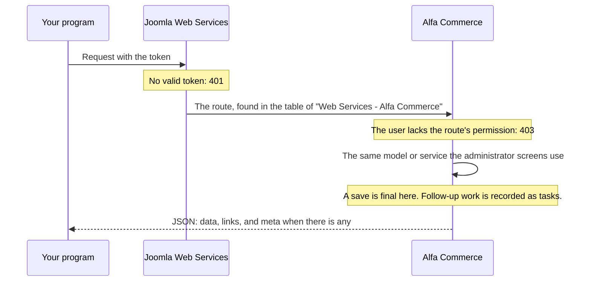

# REST API

<AlfaVersion verified="2.2.0" />

Alfa Commerce has a REST API: other programs read and change the shop's data over HTTP, as JSON. It is built on
Joomla's own Web Services, so the address, the token and the shape of the answers are Joomla's.

This page has the rules that hold for every route. The routes themselves are on four pages:

- [Catalogue](./catalogue.md): items, categories, manufacturers, item fields, and the storefront's view of an item
- [Customers and configuration](./customers-and-configuration.md): customers, customer groups, currencies, taxes,
  discounts, cart rules, places, payment and shipping methods, form fields, stock locations and stock movements
- [Orders](./orders.md): orders, order statuses, and the operations on an order (lines, payments, refunds,
  shipments, status)
- [Documents and tasks](./documents-and-tasks.md): sales documents, document types and background work

## The Postman collection

Every route is also in a public Postman collection, with a test on each request:

<PostmanButton href="https://www.postman.com/alfa-commerce/alfa-commerce/collection/6266p4v/alfa-commerce-rest-api">Alfa Commerce REST API on Postman</PostmanButton>

The collection is generated from the 2.2.0 code. Run it against a test or demo shop only, never a live one: it
creates records, places an order, issues an invoice and voids it.

Planned for 2.2.1, which is not released: some answers change (a create answers 201, see
[Status codes](#status-codes)), so this 2.2.0 collection reports failures when it is run against 2.2.1.

## What you need

| | |
|---|---|
| **The address** | `https://your-shop.example/api/index.php/v1/alfa/...` |
| **The plugin that adds the routes** | "Web Services - Alfa Commerce" (`plugins/webservices/alfa`). The installer enables it. |
| **A token** | A Joomla API token of a user. In the administrator: **Users**, **Manage**, open the user, the tab **Joomla API Token**. Joomla's plugins "User - Joomla API Token" and "API Authentication - Web Services Joomla Token" must be enabled. Joomla installs them enabled. |
| **The permission** | The token's user must hold the Alfa Commerce permission of the route. See [Permissions](#permissions). |

Send the token in one of two headers. Both were tried on 2.2.0:

```bash
curl -H "X-Joomla-Token: YOUR_TOKEN" \
  "https://your-shop.example/api/index.php/v1/alfa/currencies?page[limit]=2"

curl -H "Authorization: Bearer YOUR_TOKEN" \
  "https://your-shop.example/api/index.php/v1/alfa/currencies?page[limit]=2"
```

A request without a token is answered with status 401:

```json
{"errors":[{"title":"Forbidden"}]}
```

## What happens to a request



The API is served by the administrator's models and by the services, the code behind the administrator screens, so
the rules of a save are the same. See
[The services](../services/overview.md).

## The routes at a glance

2.2.0 registers 112 routes (`plugins/webservices/alfa/src/Extension/Alfa.php`).

Eighteen resources have the five standard routes: list, read one, create, change, delete.

| Resource | Address under `v1/alfa/` | Page |
|---|---|---|
| Items | `items` | [Catalogue](./catalogue.md) |
| Categories | `categories` | [Catalogue](./catalogue.md) |
| Manufacturers | `manufacturers` | [Catalogue](./catalogue.md) |
| Item fields | `itemfields` | [Catalogue](./catalogue.md) |
| Customers | `users` | [Customers and configuration](./customers-and-configuration.md) |
| Customer groups | `usergroups` | [Customers and configuration](./customers-and-configuration.md) |
| Currencies | `currencies` | [Customers and configuration](./customers-and-configuration.md) |
| Taxes | `taxes` | [Customers and configuration](./customers-and-configuration.md) |
| Discounts | `discounts` | [Customers and configuration](./customers-and-configuration.md) |
| Cart rules | `cartrules` | [Customers and configuration](./customers-and-configuration.md) |
| Places | `places` | [Customers and configuration](./customers-and-configuration.md) |
| Payment methods | `paymentmethods` | [Customers and configuration](./customers-and-configuration.md) |
| Shipping methods | `shipmentmethods` | [Customers and configuration](./customers-and-configuration.md) |
| Form fields | `formfields` | [Customers and configuration](./customers-and-configuration.md) |
| Form field groups | `formfieldgroups` | [Customers and configuration](./customers-and-configuration.md) |
| Stock locations | `locations` | [Customers and configuration](./customers-and-configuration.md) |
| Orders | `orders` | [Orders](./orders.md) |
| Order statuses | `orderstatuses` | [Orders](./orders.md) |

The five standard routes of a resource, with `items` as the example:

| Method and address | What it does |
|---|---|
| `GET v1/alfa/items` | Lists records |
| `GET v1/alfa/items/:id` | Reads one record |
| `POST v1/alfa/items` | Creates a record |
| `PATCH v1/alfa/items/:id` | Changes a record |
| `DELETE v1/alfa/items/:id` | Deletes a record |

Twenty-two more routes are single purpose:

| Group | Routes | Page |
|---|---|---|
| The storefront's view of an item | 2, read only | [Catalogue](./catalogue.md#the-storefronts-view) |
| Operations on an order | 9 | [Orders](./orders.md#operations-on-an-order) |
| Stock movements | 1, read only | [Customers and configuration](./customers-and-configuration.md#stock-movements) |
| Sales documents | 5 | [Documents and tasks](./documents-and-tasks.md) |
| Document types | 2, read only | [Documents and tasks](./documents-and-tasks.md#document-types) |
| Tasks | 3 | [Documents and tasks](./documents-and-tasks.md#tasks) |

## The shape of an answer

Every answer is a JSON:API document. One record:

```json
{
  "links": {"self": "https://your-shop.example/api/index.php/v1/alfa/categories/1"},
  "data": {
    "type": "categories",
    "id": "1",
    "attributes": {"id": 1, "parent_id": 0, "state": 1, "name": "Tools"}
  }
}
```

A list has `data` as a list, the links `next` and `last` when there are more pages, and the number of pages:

```json
{
  "links": {"self": "...", "next": "...", "last": "..."},
  "data": [{"type": "currencies", "id": "2", "attributes": {"id": 2, "name": "United Arab Emirates dirham", "code": "AED"}}],
  "meta": {"total-pages": 82}
}
```

The examples in these pages are answers of a 2.2.0 test shop, shortened where marked.

## Reading

| You want | Send | Notes |
|---|---|---|
| Pages | `page[limit]` (20 when left out) and `page[offset]` | An offset past the end is answered 404 |
| An order of the rows | `list[ordering]` and `list[direction]` | A column the list does not allow is ignored without an error, and a direction that is not `asc` or `desc` counts as `asc` |
| Some of the rows | `filter[...]` | Each list has its own filters: see [The filters of each list](#the-filters-of-each-list). |
| Texts in one language | `lang=el-GR` | A language the site does not have falls back to the site's default without an error. The response header `Content-Language` says which language you got. |
| Storefront prices in a currency or for a place | `currency=` and `place=` on the storefront routes | Without them the shop's defaults are used |

### The filters of each list

Every list takes `filter[search]`, which searches the list's text columns. The other filters take one value each.
Planned for 2.2.1, which is not released: a list sent where one value is expected (for example
`filter[state][]=1`) is answered 400. The `filter[category]` and `filter[manufacturer]` of `items` take a list.

| List | Filters besides `filter[search]` |
|---|---|
| `items` | `filter[state]`, `filter[category]`, `filter[manufacturer]` |
| `catalog/items` | `filter[category]`, `filter[manufacturer]` |
| `categories`, `manufacturers`, `currencies`, `taxes`, `discounts`, `places`, `paymentmethods`, `shipmentmethods`, `orderstatuses`, `documenttypes`, `formfieldgroups` | `filter[state]` |
| `itemfields` | `filter[state]`, `filter[type]`, `filter[informational]` |
| `formfields` | `filter[state]`, `filter[group_id]` |
| `cartrules` | `filter[state]`, `filter[activation]`, `filter[discount_class]` |
| `locations` | `filter[state]`, `filter[location_type]` |
| `users`, `usergroups` | None |
| `orders` | `filter[id_order_status]`, `filter[id_payment_method]`, `filter[id_shipment_method]`, `filter[show_trashed]` |
| `documents` | `filter[doc_type]`, `filter[status]`, `filter[id_order]` |
| `inventorymovements` | `filter[movement_type]`, `filter[location_id]` |
| `tasks` | `filter[state]`, `filter[type]`, `filter[owner]`, and no `filter[search]` |

`filter[search]` also takes a short form for an exact match:

| In the list | Send | Finds |
|---|---|---|
| `items`, `categories`, `orders`, `documents` | `filter[search]=id:123` | The record with that id |
| `inventorymovements` | `filter[search]=id:123` | The movements of the item with that id |
| `inventorymovements` | `filter[search]=op:...` | The movements of one stock operation |

Two questions that come up often:

- **The payments and the parcels of an order.** Read the order: `GET v1/alfa/orders/:id` holds the lists
  `payments`, `shipments`, `lines` and `history`. There is no separate list of an order's payments or parcels.
- **The stock movements of one item.** `GET v1/alfa/inventorymovements?filter[search]=id:123`, where 123 is the
  item's id. A text in `filter[search]` is matched against the item's SKU, the movement's note and its source.

Not offered by the API in 2.2.0: a filter by date on any list, a filter of orders by customer or by item, and a
filter of items by stock.

**Money.** On orders and documents an amount is an object with exact decimal text, the formatted text and the
amount in the currency's smallest unit:

```json
{"amount": "39.80", "formatted": "39,80 €", "minor_units": 3980}
```

Rates and stored prices are exact decimal text too (`"24"`, `"19.90"`).

## Writing

**Send money and rates as text.** `"19.90"`, not `19.90`. A figure with more decimals than the order's currency
has is refused with 400.

**Texts in several languages.** Translated texts are not columns of the record. Send them with one key for each
language, the field's name followed by the language in lower case with an underscore:

```json
{"name_en_gb": "Cordless drill", "name_el_gr": "Δράπανο μπαταρίας"}
```

A read returns a `translations` object with every language, and you may send that object back instead of the flat
keys.

**The name in the site's default language is needed on every write, a change included.** A `PATCH` that carries
only `{"state": 0}` is refused:

```json
{"errors":[{"title":"Field required: Name"}]}
```

This is a known defect of 2.2.0 ([row 13](#known-defects-in-220)). Until it is fixed, send the required translated
fields again with every `PATCH`. The name may be sent as the flat key or inside the `translations` object.

Planned for 2.2.1, which is not released: a `PATCH` that names a required translated field in no language keeps
the stored texts of that field, so `{"state": 0}` alone is accepted. A create without the name, and a `PATCH` that
sends the name empty, are still refused.

**Lists of related records are kept unless you send them.** Leave out `categories`, `manufacturers`, `prices`,
`values`, `groups`, `allowedUsers` or `allowedUserGroups` and they stay as they were. Send `[]` to empty one.

**Pictures and files of a record.** Send a list named `media`:

```json
{"media": [
  {"type": "image", "path": "images/drill.jpg", "alt": "Cordless drill", "ordering": 1},
  {"type": "url", "url": "https://cdn.example.com/drill-side.jpg", "alt": "Side view"}
]}
```

An entry you do not send stays. To remove one, send it with `"delete": 1`. A `path` must already exist on the
site; to upload a new file, send it to Joomla's own route `v1/media/files` first. An `alt` longer than 75
characters is refused.

Planned for 2.2.1, which is not released: an entry's `thumbnail` must be an image file, of a type Joomla's Media
allows, inside one of the Media folders (or Alfa Commerce's own image folder). Otherwise the write is refused with
400 and the reason, and nothing is written.

**Background work.** When a save leaves work for later (a price rebuild, an e-mail, a document), the answer lists
it under `meta.tasks`, each with its state and its own address. See
[Tasks](./documents-and-tasks.md#tasks).

## Status codes

| Status | Meaning |
|---|---|
| 200 | Done. Also the answer to a create (see [Known defects](#known-defects-in-220)). |
| 201 | Planned for 2.2.1, which is not released: the answer to a create. The body is the new record, and the header `Location` holds its address. The operations on an order keep 200. |
| 202 | A task is still working. See [Tasks](./documents-and-tasks.md#tasks). |
| 204 | Deleted. No body. |
| 400 | The input cannot be used: a required field is missing, an amount is finer than the currency. Planned for 2.2.1, which is not released: also a list sent where one value is expected. |
| 401 | No token, or a token that is not valid. |
| 403 | The token's user lacks the permission. |
| 404 | No such record, no such route, or a page past the end. |
| 409 | A rule of the shop refuses the request. The answer says which. |
| 422 | The request is understood but cannot be carried out: an unknown status, a refund of a payment that holds no money. |
| 500 | A fault. Four cases are known in 2.2.0, below. Planned for 2.2.1, which is not released: none of the four answers 500. |
| 503 | Planned for 2.2.1, which is not released: a PDF is asked for and the dompdf library is not installed. The answer says so in words. |

A refusal carries its reason in words:

```json
{"errors":[{"title":"payment 1 is completed, not pending","code":409}]}
```

Deletes that a rule refuses with 409: a category that still has sub-categories or is the default category of an
item, an order that has sales documents, a record whose removal would widen a discount, a tax or a cart rule.

Planned for 2.2.1, which is not released: these deletes are refused with 409 too, with the reason, and nothing is
deleted:

- an order status that orders are in, or the last status that holds a role;
- a payment or shipping method that orders, payments, parcels or stored payment references use, and a shipping
  method that a payment method's list of shipping methods names;
- a currency that orders, item prices or places use;
- an item field that items still use.

An item that was sold is not removed by a delete. The answer is 204 and the item stays, archived, for the orders
that hold it.

## Permissions

Every route checks an Alfa Commerce permission, set under **Components**, **Alfa Commerce**, **Options**,
**Permissions**. Joomla's general rights do not count. A Super User passes every check; any other user needs the
permission granted. A user without it gets 403, never an empty list.

The permissions are named after the record and the action, for example "Orders: Edit" (`alfa.orders.edit`). The
operations on an order need "Orders: Edit". The status change needs "Orders: Change State" and "Orders: View".
Voiding a document needs the documents' Change State permission.

## Renamed and removed routes

| Old address | Now |
|---|---|
| `v1/alfa/payments` | `v1/alfa/paymentmethods`. The old address answers 404. |
| `v1/alfa/shipments` | `v1/alfa/shipmentmethods`. The old address answers 404. |
| `v1/alfa/itemsprices` | Removed. Prices are part of the item. |
| `v1/alfa/customs` | Removed. Use `v1/alfa/itemfields`. |
| `v1/alfa/coupons` | Removed. Use `v1/alfa/cartrules`. |
| `v1/alfa/settings` | Removed. Use Joomla's `v1/config/com_alfa`. |

The payments and shipments of one order are under that order: see [Orders](./orders.md).

## Known defects in 2.2.0

These are faults of 2.2.0, found by running the collection against the published release. They are listed here so
that a program written today behaves correctly. Rows 1 to 3, 5 to 9 and 11 to 13 are fixed in 2.2.1, which is not
released. Rows 4, 10 and 14 are open and not in 2.2.1. This table will name the release when one ships.

| | What 2.2.0 does | What to do today | Fix |
|---|---|---|---|
| 1 | Reading a tax, a discount or a cart rule that does not exist answers 500, not 404 | Treat a 500 on `GET v1/alfa/taxes/:id`, `discounts/:id` and `cartrules/:id` as "not found" | Fixed in 2.2.1, not yet released: 404 |
| 2 | Deleting an order status that orders are in answers 204, and nothing is deleted. The same happens when deleting a payment or shipping method that an order used, and a currency or an item field that is in use. | Read the record after the delete to see whether it is gone | Fixed in 2.2.1, not yet released: 409 with the reason, and nothing is deleted |
| 3 | A create answers 200, not 201 | Accept 200 | Fixed in 2.2.1, not yet released: 201, with the new record's address in the header `Location` |
| 4 | A delete does not ask for the record to be in the trash first. Cart rules and orders cannot be moved to the trash through the API. | Nothing | Open; not in 2.2.1 |
| 5 | `POST v1/alfa/users` accepts a Joomla user id that does not exist, the id 0, and a second row for the same user | Send only an existing user that has no customer row | Fixed in 2.2.1, not yet released: each is refused with 400 and the reason |
| 6 | Some fields are needed although not declared: `prices_display` on every write of a customer group (a part of it sent alone replaces the whole of it), `color` and `bg_color` on a payment or shipping method, and `issues_delivery_note` whenever an order status carries `issues_doc_rules` | Send them | Fixed in 2.2.1, not yet released: none of them is needed, and a part of `prices_display` sent alone changes only that part |
| 7 | `PATCH v1/alfa/orders/:id` with `customer_note` or with `state` answers 200 and writes nothing | Do not rely on it. Change an order's status through its own route. | Fixed in 2.2.1, not yet released: `customer_note` is written, and `state` is refused with 422 |
| 8 | Ordinary writes of items, form fields, places and currencies write PHP warnings to the server's log | Nothing | Fixed in 2.2.1, not yet released |
| 9 | `GET v1/alfa/documents/:id/pdf` answers 500 when the dompdf library (`lib_dompdf`) is not installed. Alfa Commerce does not ship it. | Install `lib_dompdf`, or use the `html` route | Fixed in 2.2.1, not yet released: a setup warning, and 503 with the reason |
| 10 | Each shipment inside an order carries `note` and `created`, which are always null, and does not carry the shipment's saved tax details | Do not read those two fields | Not decided. Open; not in 2.2.1. |
| 11 | Each payment inside an order carries `created`, which is always null, and a refund's reason is not shown in its entry | Do not read `created` on a payment | Fixed in 2.2.1, not yet released: `created` is gone, and each payment carries `added` and `refund_reason` |
| 12 | `fulfillment_status` of an order is not filled by the API | Do not rely on it. Read the order's `shipments`. | Fixed in 2.2.1, not yet released: one order carries `fulfillment_status` and `fulfillment_percentage` |
| 13 | A `PATCH` that leaves out the name in the default language is refused with 400 "Field required: Name", even when it changes only another field | Send the name with every `PATCH` | Fixed in 2.2.1, not yet released: the stored name is kept |
| 14 | A write of an item that carries its options, combinations or item field values (`fields`, `options`, `combinations`, `informational`, or the item form's keys for them, such as `deleted_option_value_ids`) is not refused. Those values reach the option and combination writers in a shape they do not read: a list of options sent as a read returns it is taken by its positions, so it can change another option of the item, and `deleted_option_value_ids` deletes options. The write answers 200 (row 3), although it was partial and not checked. | Never send them in a write. Set them in the administrator. | Open; not in 2.2.1 |

In the Postman collection, the requests for rows 1, 2 and 9 fail on 2.2.0 on purpose: their tests state what the
route is meant to answer.

## Not documented yet

- Every field of every record with its type. The resource pages name the fields a read returns; the meaning of
  each is in the administrator form of the same record.
- Joomla's own routes that the collection uses for setup (`v1/users`, `v1/users/groups`, `v1/media/files`,
  `v1/config/com_alfa`). See Joomla's documentation.
- Rate limits. They were not looked at for this page.
