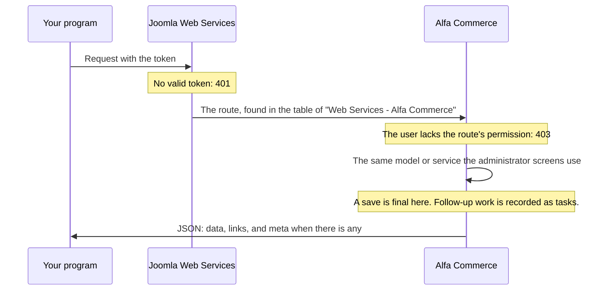

# REST API

<AlfaVersion verified="2.2.1" />

Alfa Commerce has a REST API: other programs read and change the shop's data over HTTP, as JSON. It is built on
Joomla's own Web Services, so the address, the token and the shape of the answers are Joomla's.

This page has the rules that hold for every route. The routes themselves are on four pages:

- [Catalogue](./catalogue.md): items, categories, manufacturers, item fields, and the storefront's view of an item
- [Customers and configuration](./customers-and-configuration.md): customers, customer groups, currencies, taxes,
  discounts, cart rules, places, payment and shipping methods, form fields, stock locations and stock movements
- [Orders](./orders.md): orders, order statuses, and the operations on an order (lines, payments, refunds,
  shipments, status)
- [Documents and tasks](./documents-and-tasks.md): sales documents, document types and background work

The shop can also tell another system of its changes as they happen, without being asked: see
[Outgoing notifications](./notifications.md).

## The Postman collection

Every route is in a Postman collection, with a test on each request. Use it to try the API by hand, or to check a
shop's API route by route.

### Two ways to get it

| | Fork the live collection | Download the file |
|---|---|---|
| What you get | Your own copy in your Postman workspace, linked to Alfa Commerce's public collection | A file on your computer |
| What it needs | A Postman account | Nothing. It works without a Postman account, and in other tools that import Postman collections |
| When the API changes | Postman notifies you, and you pull the changes with one click | Nothing tells you, and the file never changes on its own. Download it again |
| Recommended for | Anyone building on the API | A one-off look, or a tool other than Postman |

Both hold the same requests on the day you take them, because the live collection is updated from this file at
each release.

### Fork the live collection

<PostmanButton href="https://www.postman.com/alfa-commerce/alfa-commerce/collection/c16yukw/alfa-commerce-rest-api">Run in Postman</PostmanButton>

1. Press **Run in Postman**. The collection opens in Alfa Commerce's public workspace on Postman. Sign in: Postman
   asks for an account before you fork.
2. Select **Use** in the upper right, or hover over the collection in the sidebar, select **View more actions**
   and choose **Use / Fork**.
3. Select your own workspace for the fork. Under **Use as**, keep **Fork** selected, and enter a label for your
   fork.
4. Keep **Watch the source collection** selected: Postman then notifies you when the collection changes. You may
   also select **Pull changes from the source collection automatically**, which keeps your fork up to date with no
   step of yours.
5. Select **Use Collection**. The fork appears in your workspace.

To take the changes Postman notified you of: in the sidebar, next to your fork, select **View more actions**,
**Pull changes**. Postman shows what changed; select **Pull Changes**.

### Download the file

<a href="/postman/alfa-commerce.postman_collection.json" download="alfa-commerce.postman_collection.json">Download alfa-commerce.postman_collection.json</a>

In Postman choose **File**, **Import**, and pick the downloaded file. The collection "Alfa Commerce REST API"
appears in your workspace. Another tool that imports Postman collections reads the same file.

### Set it up

Open the collection, then its tab **Variables**, and set two values:

| Variable | Value |
|---|---|
| `baseUrl` | Your shop's API address, `https://your-shop.example/api/index.php` |
| `token` | A Joomla API token (see [What you need](#what-you-need)). It ships empty. |

Type the token as the variable's **local value** only. Postman keeps the local value on your computer, while the
**shared value** is synced to the Postman Cloud and seen by anyone who shares your workspace. Save. The collection
sends the token itself, as the header `X-Joomla-Token`, on every request.

### Run a request, or the whole collection

- **One request.** Open it and press **Send**. The answer is below the request, and the tab **Test Results** shows
  each check of that request as passed or failed.
- **The whole collection.** Select the collection, then **Run** (the Collection Runner). Keep every request
  selected and in its order, and select **Start run**. Postman sends the requests one after the other and shows each
  test as passed or failed as it goes, with the counts of passed and failed tests for the run. Run it in order:
  requests keep the ids of the records they create in collection variables of their own, and later folders read
  what earlier ones made.

Run the collection against a test or demo shop only, never a live one. It creates records and removes them, places
an order, issues its invoice on the shop's default invoice series (the shop needs one) and voids it. What the shop's
rules keep stays on record after a run: that order, cancelled, with its voided invoice, its item, archived, and, in the
trash, the category and the payment and shipping methods the order used.

### How the folders are organised

| Folder | What it holds |
|---|---|
| Catalogue (storefront) | The read-only view the shop shows a shopper: published items only, with their computed prices. |
| Catalogue (back office) | The editable catalogue: items, categories, manufacturers and item fields, every row visible. |
| Customers | Customer records and the price settings of customer groups. |
| Commerce configuration | Currencies, taxes, discounts, cart rules, places, and the payment and shipping methods. |
| Checkout & registration forms | The form fields and their groups. |
| Orders | Orders, order statuses, and the operations on an order. |
| Inventory | Stock locations and stock movements. |
| Documents | Invoices, credit notes and delivery notes. |
| Tasks | The background work a save leaves. |

Each folder and each request has a description in Postman that says what it does and what it expects.

## What you need

| | |
|---|---|
| **The address** | `https://your-shop.example/api/index.php/v1/alfa/...` |
| **The plugin that adds the routes** | "Web Services - Alfa Commerce" (`plugins/webservices/alfa`). The installer enables it. |
| **A token** | A Joomla API token of a user. In the administrator: **Users**, **Manage**, open the user, the tab **Joomla API Token**. Joomla's plugins "User - Joomla API Token" and "API Authentication - Web Services Joomla Token" must be enabled. Joomla installs them enabled. |
| **The permission** | The token's user must hold the Alfa Commerce permission of the route. See [Permissions](#permissions). |

Send the token in one of two headers:

```bash
curl -H "X-Joomla-Token: YOUR_TOKEN" \
  "https://your-shop.example/api/index.php/v1/alfa/currencies?page[limit]=2"

curl -H "Authorization: Bearer YOUR_TOKEN" \
  "https://your-shop.example/api/index.php/v1/alfa/currencies?page[limit]=2"
```

A request without a token is answered with status 401:

```json
{"errors":[{"title":"Forbidden"}]}
```

## What happens to a request



The API is served by the administrator's models and by the services, the code behind the administrator screens, so
the rules of a save are the same. See
[The services](../services/overview.md).

## The routes at a glance

Alfa Commerce registers 112 routes (`plugins/webservices/alfa/src/Extension/Alfa.php`).

Eighteen resources have the five standard routes: list, read one, create, change, delete.

| Resource | Address under `v1/alfa/` | Page |
|---|---|---|
| Items | `items` | [Catalogue](./catalogue.md) |
| Categories | `categories` | [Catalogue](./catalogue.md) |
| Manufacturers | `manufacturers` | [Catalogue](./catalogue.md) |
| Item fields | `itemfields` | [Catalogue](./catalogue.md) |
| Customers | `users` | [Customers and configuration](./customers-and-configuration.md) |
| Customer groups | `usergroups` | [Customers and configuration](./customers-and-configuration.md) |
| Currencies | `currencies` | [Customers and configuration](./customers-and-configuration.md) |
| Taxes | `taxes` | [Customers and configuration](./customers-and-configuration.md) |
| Discounts | `discounts` | [Customers and configuration](./customers-and-configuration.md) |
| Cart rules | `cartrules` | [Customers and configuration](./customers-and-configuration.md) |
| Places | `places` | [Customers and configuration](./customers-and-configuration.md) |
| Payment methods | `paymentmethods` | [Customers and configuration](./customers-and-configuration.md) |
| Shipping methods | `shipmentmethods` | [Customers and configuration](./customers-and-configuration.md) |
| Form fields | `formfields` | [Customers and configuration](./customers-and-configuration.md) |
| Form field groups | `formfieldgroups` | [Customers and configuration](./customers-and-configuration.md) |
| Stock locations | `locations` | [Customers and configuration](./customers-and-configuration.md) |
| Orders | `orders` | [Orders](./orders.md) |
| Order statuses | `orderstatuses` | [Orders](./orders.md) |

The five standard routes of a resource, with `items` as the example:

| Method and address | What it does |
|---|---|
| `GET v1/alfa/items` | Lists records |
| `GET v1/alfa/items/:id` | Reads one record |
| `POST v1/alfa/items` | Creates a record |
| `PATCH v1/alfa/items/:id` | Changes a record |
| `DELETE v1/alfa/items/:id` | Deletes a record |

Twenty-two more routes are single purpose:

| Group | Routes | Page |
|---|---|---|
| The storefront's view of an item | 2, read only | [Catalogue](./catalogue.md#the-storefronts-view) |
| Operations on an order | 9 | [Orders](./orders.md#operations-on-an-order) |
| Stock movements | 1, read only | [Customers and configuration](./customers-and-configuration.md#stock-movements) |
| Sales documents | 5 | [Documents and tasks](./documents-and-tasks.md) |
| Document types | 2, read only | [Documents and tasks](./documents-and-tasks.md#document-types) |
| Tasks | 3 | [Documents and tasks](./documents-and-tasks.md#tasks) |

## The shape of an answer

Every answer is a JSON:API document. One record:

```json
{
  "links": {"self": "https://your-shop.example/api/index.php/v1/alfa/categories/1"},
  "data": {
    "type": "categories",
    "id": "1",
    "attributes": {"id": 1, "parent_id": 0, "state": 1, "name": "Tools"}
  }
}
```

A list has `data` as a list, the links `next` and `last` when there are more pages, and the number of pages:

```json
{
  "links": {"self": "...", "next": "...", "last": "..."},
  "data": [{"type": "currencies", "id": "2", "attributes": {"id": 2, "name": "United Arab Emirates dirham", "code": "AED"}}],
  "meta": {"total-pages": 82}
}
```

The examples in these pages are shortened where marked.

## Reading

| You want | Send | Notes |
|---|---|---|
| Pages | `page[limit]` (20 when left out) and `page[offset]` | An offset past the end is answered 404 |
| An order of the rows | `list[ordering]` and `list[direction]` | A column the list does not allow is ignored without an error, and a direction that is not `asc` or `desc` counts as `asc` |
| Some of the rows | `filter[...]` | Each list has its own filters: see [The filters of each list](#the-filters-of-each-list). |
| Texts in one language | `lang=el-GR` | A language the site does not have falls back to the site's default without an error. The response header `Content-Language` says which language you got. |
| Storefront prices in a currency or for a place | `currency=` and `place=` on the storefront routes | Without them the shop's defaults are used |

### The filters of each list

Every list takes `filter[search]`, which searches the list's text columns. The other filters take one value each. A
list sent where one value is expected (for example `filter[state][]=1`) is answered 400. The
`filter[category]` and `filter[manufacturer]` of `items` take a list, and `filter[fields]` of `items` takes a map
(below).

| List | Filters besides `filter[search]` |
|---|---|
| `items` | `filter[state]`, `filter[category]`, `filter[manufacturer]`, `filter[changed_since]` |
| `catalog/items` | `filter[category]`, `filter[manufacturer]` |
| `categories`, `manufacturers`, `currencies`, `taxes`, `discounts`, `places`, `paymentmethods`, `shipmentmethods`, `orderstatuses`, `documenttypes`, `formfieldgroups` | `filter[state]` |
| `itemfields` | `filter[state]`, `filter[type]`, `filter[informational]` |
| `formfields` | `filter[state]`, `filter[group_id]` |
| `cartrules` | `filter[state]`, `filter[activation]`, `filter[discount_class]` |
| `locations` | `filter[state]`, `filter[location_type]` |
| `users`, `usergroups` | None |
| `orders` | `filter[id_order_status]`, `filter[id_payment_method]`, `filter[id_shipment_method]`, `filter[show_trashed]` |
| `documents` | `filter[doc_type]`, `filter[status]`, `filter[id_order]` |
| `inventorymovements` | `filter[movement_type]`, `filter[location_id]` |
| `tasks` | `filter[state]`, `filter[type]`, `filter[owner]`, and no `filter[search]` |

Four lists also take the filters their administrator screens apply, with the same meaning as there.

| List | Filters added | What they keep |
|---|---|---|
| `orders` | `filter[payment]` | `paid`: a completed payment. `unpaid`: none, and not cancelled. `failed`: a failed or cancelled attempt. `refunded`: a refund that was not reversed. For `failed` and `refunded` the dates below apply to the payment's date. |
| `orders` | `filter[fulfilment]` | `shipped`: in a completed status. `unshipped`: neither completed nor cancelled. |
| `orders` | `filter[waiting]` | `placed_48`: placed more than 48 hours ago. `untouched_48`: not changed for 48 hours. |
| `orders` | `filter[reconciliation]`, `filter[overpaid]` | With `1` or `true`: the orders the order page says need reconciliation (and the orders that name no currency); the orders that hold more than they ask. With `0`, `false` or an empty value: no filter. |
| `orders` | `filter[date_start]`, `filter[date_end]` | The order's date. With `filter[payment]` `failed` or `refunded`, the payment's date. |
| `orders` | `filter[item_id]` | The orders with a line of that item |
| `orders` | `filter[id_user]` | The orders of that Joomla user. `0`: the guests' orders, those placed without an account. |
| `orders` | `filter[email]` | The orders that carry that e-mail address, matched whole, with letter case and accents set aside (a part of an address finds nothing), a guest's included |
| `orders` | `filter[source]` | The orders of one channel: `storefront`, `admin`, `renewal`, `api`, or the source a client named |
| `orders` | `filter[external_source]`, `filter[external_reference]` | The orders of another system, and with both the one order of a pair; each matched whole, letter case counting in the reference |
| `items` | `filter[changed_since]` | The items whose stock, prices or own fields changed at or after that time (`commerce_changed_at`). A time without a zone is UTC; one with `Z` or an offset is read in its zone. A value that is not a date and time answers 400. |
| `documents` | `filter[date_start]`, `filter[date_end]` | The document's legal date, `Y-m-d`, both days included |
| `inventorymovements` | `filter[date_start]`, `filter[date_end]` | The movement's date |
| `inventorymovements` | `filter[item_id]` | The movements of that item |
| `items` | `filter[stock]` | `in`, `low` or `out`, as the dashboard counts them |
| `items` | `filter[fields]` | `filter[fields][<field id>][]=<value id>`. An item must match every field sent, and any one of the values sent for a field. A field sent with no value keeps the items that use it. |

The date bounds are the shop's local time, as the screens' calendars hold them (`Y-m-d` or `Y-m-d H:i:s`). On orders
and stock movements an end given as a day (`Y-m-d`) is that whole day, to its last second, and a start given as a day
is its first second. Documents take days (`Y-m-d`), both days included. A bound that cannot be read (for documents,
anything that is not a calendar day) is left out, so it does not narrow the list. The screens' date presets ("Today",
"This week") are not read by the API. An empty value is no filter, and a value a list does not know narrows nothing,
as on the screen.

`filter[search]` also takes a short form for an exact match:

| In the list | Send | Finds |
|---|---|---|
| `items`, `categories`, `orders`, `documents` | `filter[search]=id:123` | The record with that id |
| `inventorymovements` | `filter[search]=id:123` | The movements of the item with that id |
| `inventorymovements` | `filter[search]=op:...` | The movements of one stock operation |

Two questions that come up often:

- **The payments and the parcels of an order.** Read the order: `GET v1/alfa/orders/:id` holds the lists
  `payments`, `shipments`, `lines` and `history`. There is no separate list of an order's payments or parcels:
  `v1/alfa/orders/:id/payments` and `v1/alfa/orders/:id/shipments` take a `POST` only.
- **The stock movements of one item.** `GET v1/alfa/inventorymovements?filter[search]=id:123`, where 123 is the
  item's id. A text in `filter[search]` is matched against the item's SKU, the movement's note and its source.
  `filter[item_id]=123` does the same.
- **The orders of one customer.** `filter[id_user]` for an account (`0` for the guests' orders), and
  `filter[email]` for the e-mail on the order, which finds a guest's orders too, with letter case and accents set
  aside.

**Money.** On orders and documents an amount is an object with exact decimal text, the formatted text and the
amount in the currency's smallest unit:

```json
{"amount": "39.80", "formatted": "39,80 €", "minor_units": 3980}
```

Rates and stored prices are exact decimal text too (`"24"`, `"19.90"`).

## Writing

**Send money and rates as text.** `"19.90"`, not `19.90`. A figure with more decimals than the order's currency
has is refused with 400.

**Texts in several languages.** Translated texts are not columns of the record. Send them with one key for each
language, the field's name followed by the language in lower case with an underscore:

```json
{"name_en_gb": "Cordless drill", "name_el_gr": "Δράπανο μπαταρίας"}
```

A read returns a `translations` object with every language, and you may send that object back instead of the flat
keys.

**The name in the site's default language is needed on a create.** A `PATCH` that names a required translated field
in no language keeps the stored texts of that field, so `{"state": 0}` alone is accepted. A create without the name,
and a `PATCH` that sends the name empty, are refused:

```json
{"errors":[{"title":"Field required: Name"}]}
```

The name may be sent as the flat key or inside the `translations` object.

**Lists of related records are kept unless you send them.** Leave out `categories`, `manufacturers`, `prices`,
`values`, `groups`, `allowedUsers` or `allowedUserGroups` and they stay as they were. Send `[]` to empty one.
An item field's `values` cannot be sent at all; a write that carries them answers 422. See
[Item fields](./catalogue.md#item-fields).

**Pictures and files of a record.** Send a list named `media`:

```json
{"media": [
  {"type": "image", "path": "images/drill.jpg", "alt": "Cordless drill", "ordering": 1},
  {"type": "url", "url": "https://cdn.example.com/drill-side.jpg", "alt": "Side view"}
]}
```

An entry you do not send stays. To remove one, send it with `"delete": 1`. A `path` must already exist on the
site; to upload a new file, send it to Joomla's own route `v1/media/files` first, or give its address for the shop to
fetch (`{"type": "image", "url": "https://..."}`, see [Images given by their address](./catalogue.md#images-given-by-their-address)).
`"type": "url"` is an outside link, shown from its address and never fetched. An `alt` longer than 75 characters is
refused.

An entry's `thumbnail` must be an image file, of a type Joomla's Media allows, inside one of the Media folders (or
Alfa Commerce's own image folder). Otherwise the write is refused with 400 and the reason, and nothing is written.

**Background work.** When a save leaves work for later (a price rebuild, an e-mail, a document), the answer lists
it under `meta.tasks`, each with its state and its own address. See
[Tasks](./documents-and-tasks.md#tasks).

## Status codes

| Status | Meaning |
|---|---|
| 200 | Done. |
| 201 | Created: the answer to a create. The body is the new record, and the header `Location` holds its address. The operations on an order keep 200. |
| 202 | A task is still working. See [Tasks](./documents-and-tasks.md#tasks). |
| 204 | Deleted. No body. |
| 400 | The input cannot be used: a required field is missing, an amount is finer than the currency, a list is sent where one value is expected. |
| 401 | No token, or a token that is not valid. |
| 403 | The token's user lacks the permission. |
| 404 | No such record, no such route, or a page past the end. |
| 409 | A rule of the shop refuses the request, or a delete names a record that must be in the trash first. The answer says which. |
| 422 | The request is understood but cannot be carried out: an unknown status, a refund of a payment that holds no money, a write of an item that carries its options, combinations, item field values or downloads, a write of an item field that carries its values, a `PATCH` of an order that carries a field its update does not write. |
| 500 | A fault on the server. The server's log says what. |
| 503 | A PDF is asked for and the dompdf library, which ships with Alfa Commerce, or a library it needs, is missing or disabled. The answer says so in words. |

A refusal carries its reason in words:

```json
{"errors":[{"title":"payment 1 is completed, not pending","code":409}]}
```

Deletes that a rule refuses with 409, with the reason, and nothing is deleted:

- a category that still has sub-categories or is the default category of an item, an order that has sales
  documents, a record whose removal would widen a discount, a tax or a cart rule;
- an order status that orders are in, or the last status that holds a role;
- a payment or shipping method that orders, payments, parcels or stored payment references use, and a shipping
  method that a payment method's list of shipping methods names;
- a currency that orders, item prices or places use;
- an item field that items still use.

Two more rules:

- **From the trash only.** An item, a category, a manufacturer, an item field, a currency, a tax, a discount, a
  place, a payment or shipping method, a form field, a form field group and an order status are deleted only while
  they are in the trash (`state` -2), as the administrator deletes them. A record in any other state answers 409
  and nothing is deleted:

  ```json
  {"errors":[{"title":"Only a record in the trash is deleted, as in the administrator: move it to the trash first (PATCH v1/alfa/items/12 with state -2), then delete it. Nothing was deleted.","code":409}]}
  ```

  Send a `PATCH` with `"state": -2` first, then the `DELETE`. The refusals listed above are given once the record
  is in the trash. An id that names no record still answers 404. Cart rules, stock locations, customers, customer
  groups and orders have no trash step and are deleted in one call.
- **A sold item answers 200.** The delete of an item that order lines were sold as answers 200 with the item as it
  now stands, `state` 2 (archived), and `meta.note` saying that it was archived instead of deleted. The item stays,
  for the orders that hold it. An item without order history is deleted and answered 204.

## Permissions

Every route checks an Alfa Commerce permission, set under **Components**, **Alfa Commerce**, **Options**,
**Permissions**. Joomla's general rights do not count. A Super User passes every check; any other user needs the
permission granted. A user without it gets 403, never an empty list.

The permissions are named after the record and the action, for example "Orders: Edit" (`alfa.orders.edit`). The
operations on an order need "Orders: Edit". The status change needs "Orders: Change State" and "Orders: View".
Voiding a document needs the documents' Change State permission.

Tools, Security lists every Alfa Commerce endpoint with the permission it asks, and in its API internals the groups
that hold it and the accounts in them with an enabled token. See
[The REST API's endpoints](../architecture/integrity-and-security.md#the-rest-apis-endpoints).

## Renamed and removed routes

| Old address | Now |
|---|---|
| `v1/alfa/payments` | `v1/alfa/paymentmethods`. The old address answers 404. |
| `v1/alfa/shipments` | `v1/alfa/shipmentmethods`. The old address answers 404. |
| `v1/alfa/itemsprices` | Removed. Prices are part of the item. |
| `v1/alfa/customs` | Removed. Use `v1/alfa/itemfields`. |
| `v1/alfa/coupons` | Removed. Use `v1/alfa/cartrules`. |
| `v1/alfa/settings` | Removed. Use Joomla's `v1/config/com_alfa`. |

The payments and shipments of one order are under that order: see [Orders](./orders.md).

## Known limitations

What Alfa Commerce does today that a program or a shop must allow for.

**Over the REST API**

- An order created over the REST API takes the shop's default currency. The `id_currency` sent with it is not used.
- A `PATCH` of an order that carries only `customer_note` is refused with 400 on a shop that has a required delivery
  field of its own, because the whole order form is validated on a partial update. Send the required fields with the
  note.
- An update of an order that sends part of the delivery details (`alfa_form_fields`) replaces the stored delivery
  details with only the fields sent. Send the whole delivery section when you change any of it.

**On the storefront**

- On the second and later pages of a listing whose search engine
  [tells which results a shopper saw](../plugins/search-plugins.md#telling-which-results-a-shopper-saw), on a page
  without the filters module, the search engine is asked twice for the same result. The output is correct; the
  second request is a cost only.
- The filters module's form does not carry the listing's keyword: applying a filter on a search result drops the
  search word.

For plugin authors, see also the cart area in
[Item field plugin events](../plugins/item-field-plugin-events.md#onitemview).

## Not documented yet

- Every field of every record with its type. The resource pages name the fields a read returns; the meaning of
  each is in the administrator form of the same record.
- Joomla's own routes that the collection uses for setup (`v1/users`, `v1/users/groups`, `v1/media/files`,
  `v1/config/com_alfa`). See Joomla's documentation.
- Rate limits.
