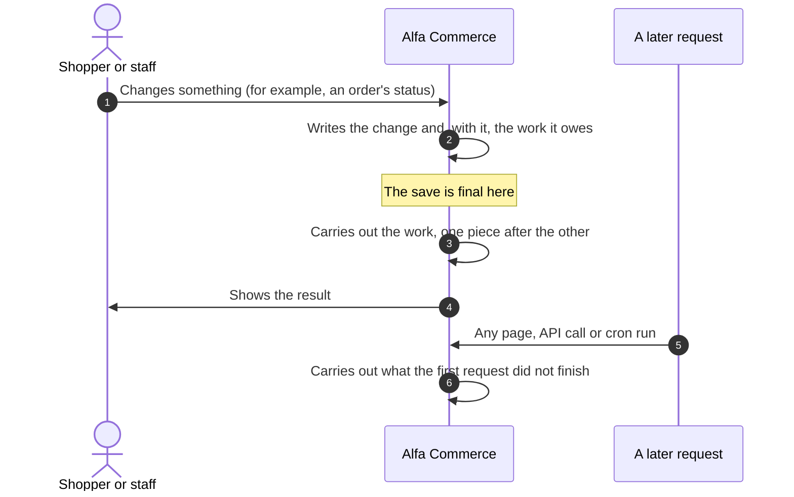
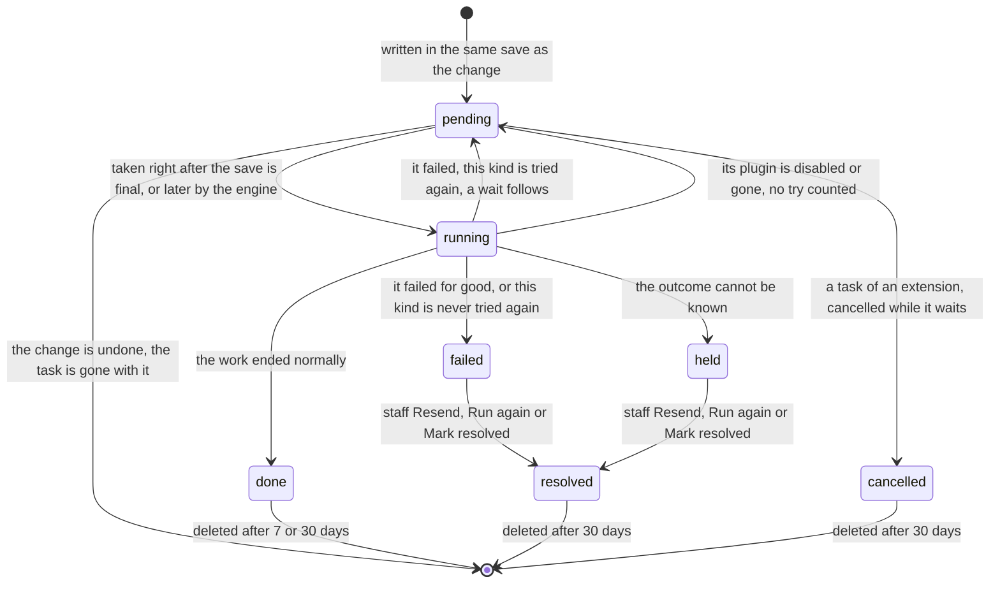
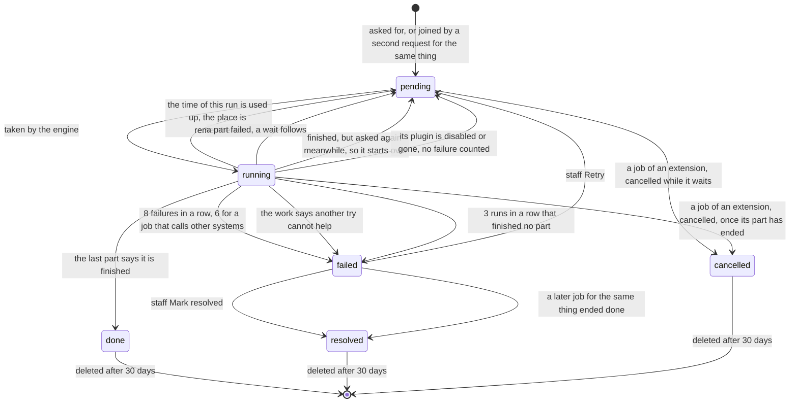

# Background work

<AlfaVersion verified="2.3.0" />

**Background work** is work that Alfa Commerce owes after a change was saved, or long work that cannot fit in one
request. Alfa writes it down in the database first and carries it out afterwards. Staff see it under
**Tools > Tasks**.

Alfa has it for one reason: so that nothing is lost and nothing is done twice. An e-mail must not go out for a change
that was undone. A slow mail server must not hold an order. A closed browser or a server restart must not lose a
document, an e-mail or a plugin's reaction.

The words "the save is final" (the **commit**), "transaction" and "lock" are explained in the
[glossary](../reference/glossary.md).

## What an extension author must know first

**Alfa's own kinds of task and job are fixed. A plugin of an `alfa` group declares tasks and jobs of its own, asks
for them through `BackgroundWork::of($this)` and runs them itself.**

- Alfa's own kinds of work are two fixed lists inside Alfa. A plugin neither adds to them nor asks for them.
- A plugin's own work is what it declares in `onAlfaDeclareWork`, under names of its own. Alfa runs each of its tasks
  with `onAlfaRunTask` and each step of its jobs with `onAlfaRunJob`, on that plugin alone, and tells it in
  `onAlfaWorkSettled` how each one ended. A plugin reaches its own work only, never Alfa's or another plugin's.
- Asking for a name the plugin does not declare, or for a task with `job()` or a job with `task()`, is refused at
  once with an `InvalidArgumentException`.
- Apart from `BackgroundWork`, the classes beside it in `administrator/src/Background/` and the four events of a
  plugin's work, the classes that make up the engine are internal. This page names a few files at the end so that
  you can find them and read them. They are not there to be called, and their methods and arguments can change in
  any release.

What an extension can do is listed under [What an extension can do](#what-an-extension-can-do). In short: its code
can run inside work that Alfa creates, a plugin of an `alfa` group has tasks and jobs of its own, and for work at a
fixed time of day it uses Joomla's Scheduled Tasks.

## What it does

There are two shapes of background work.

| | A task | A job |
|---|---|---|
| In plain words | One small piece of follow-up work that a saved change owes: "this order changed status, so send this e-mail" | Long work over many records, done a part at a time: "rebuild the search entry of every item" |
| The technical name | A **single** (the table says `type = single`) | A **job** (`type = job`) |
| Tied to a save | Yes. It is written in the same save as the change. If the change is undone, the task is gone with it. An extension's task asked for with no save open stands on its own. | Only when it is asked for inside a save: then it is written with that save. Otherwise it stands on its own. |
| When it first runs | In the same request, right after the save is final, or at once when no save is open | When the engine next runs (see [What makes the engine run](#what-makes-the-engine-run)) |
| How it runs | In one go | In parts (**chunks**), each part's progress saved as a whole or not at all |
| How many at once | Any number. An extension's task asked with `once()`: one waiting or running for its key. | One waiting or running job for each thing it covers. A second request for the same thing joins the first. |
| If the outcome cannot be known | It is **held** for staff | Cannot happen: an unfinished part is done again from the last saved place |

Both are rows of one table, `#__alfa_tasks`. The [database page](./database-schema.md) describes the tables.

## When it is used

Alfa creates tasks at these moments:

| Moment | The tasks written with it |
|---|---|
| An order's status changes | Up to five, in this order: the stock movement, the download access, the documents, the status e-mail, the plugins' reaction. Each is written only when it has something to do: no e-mail task for a status that tells nobody, no plugin task when no plugin listens. |
| An order is placed | The download access of its first status, and the order confirmation e-mail |
| A payment that takes money in changes its status | The download access, when the payment became completed. The documents of the status the order is in. And, when the payment method maps that payment status to an order status, the move of the order's status. The status change it makes then writes its own tasks. |
| A shipment changes its status and the shipping method maps that status to an order status | The move of the order's status. The status change it makes then writes its own tasks. |
| A refund of a payment is settled, or a settled refund's amount changes | Marking that payment refunded, when its settled refunds cover it |
| A stock plugin refuses on purpose the stock movement of a document | One task for that document, which waits for staff |
| A notification is raised while something is being saved | The notification, written as soon as the save is final |
| One of an extension's tasks or jobs ends (done, failed, held, resolved or cancelled), and its plugin has `onAlfaWorkSettled` | One task that tells the plugin, written in the same save that ends the work |

Alfa creates jobs for: preparing the list prices of a pricing context that is new to the shop, or its next generation
(`price.set.prepare`, one job a context, its scope `price.set.prepare:<context id>`), removing the generations of the
price index that a newer one replaced and the periods that ended (`price.index.tidy`, once a day and after each
switch), rebuilding catalogue entries of items, rebuilding the search index, applying stock movements that are still
owed, recreating thumbnails, deleting finished tasks, fetching the images a REST API write gave by their address
(`media.fetch`, one job a write; see [Catalogue](../api/catalogue.md#images-given-by-their-address)), and telling each
consumer of the shop's changes what it is owed (`outbound.deliver`, one job a consumer; see
[Outgoing notifications](../api/notifications.md)). The changes a consumer is owed are written in the save of the
change itself, as a task is. A plugin of an `alfa` group asks for the tasks and jobs it declares, and the runner owes
by itself each job a plugin declares with `every()` (see
[Background work of a plugin](../plugins/api-route-plugins.md#background-work-of-a-plugin)).

The picture of a status change, with each task in its place, is on [Event flows](../events/flows.md).

## The life of a task

### The states

The column `state` holds one of these words. Tools > Tasks shows a failed task as **Failed** and a held one as
**Outcome unknown**.

| State | What it means |
|---|---|
| `pending` | Written and waiting: for its first run, or for its next try |
| `running` | One worker has taken it and is doing it now |
| `done` | The work ended normally |
| `failed` | The work failed and Alfa will not try it again by itself. It waits for staff. |
| `held` | Nobody can know whether the work took effect. Alfa will not try it again by itself. It waits for staff. |
| `resolved` | Staff closed it: by Resend, by Run again, or by Mark resolved |
| `cancelled` | An extension's task stopped before it ran: by its plugin (`cancel()`), or because its plugin was uninstalled. Alfa's own tasks are never cancelled. |

### When it first runs

1. The task is written inside the save of the change. It is part of that save.
2. When the save is final, and Alfa's locks are released, the tasks of that save run in the order they
   were written, in the same request. The person who made the change waits for them, and sees the order with its
   stock moved and its documents issued.
3. If the request stops before that (a timeout, a closed connection, a server restart), the tasks stay `pending`.
   The engine picks up a task that never ran once it is 120 seconds old.
4. A request that is still busy with its own tasks keeps them for itself. If that request dies while it holds a
   task, the hold runs out after 15 minutes (900 seconds).

A task is never scheduled for a later time on purpose. Running later is only the rescue.

### If it fails: each kind has its own rule

**Not every task is tried again.** Whether Alfa tries again by itself depends on the kind of task, and on what is
known about the failure:

| What happened | What Alfa does |
|---|---|
| The work failed and it is certain that nothing took effect, and this kind allows another try | Waits, then tries again |
| The same, but this kind never tries again | `failed` |
| The work says that another try cannot help | `failed` |
| Nobody can know whether the work took effect (an e-mail handed to the mail server with no answer) | `held` |
| The request stopped in the middle of the work, and doing this kind twice is harmless | Runs it again |
| The request stopped in the middle of the work, and doing this kind twice is not harmless | `held` |
| The plugin that owns an extension's task is disabled or no longer installed | Waits, with no try counted, until the plugin is enabled |

Where a kind is tried again, the waits are fixed:

| Try that failed | Wait before the next try |
|---|---|
| 1st | 1 minute |
| 2nd | 5 minutes |
| 3rd | 30 minutes |
| 4th | 2 hours |
| 5th | 6 hours |
| 6th | 24 hours |
| 7th | No further try. The task is `failed`. |

So a task of such a kind is tried at most seven times. When the work asks for a longer wait (an extension's
`WorkFailure::retry()` with a number of seconds, for example a receiver's Retry-After), it waits that long instead.

### The kinds of task and their rules

The name in the first column is what Tools > Tasks shows. The name in code style is what the API shows in the field
`handler`.

| Kind of task | What it does | Tried again by itself after a failure | If the request stopped in the middle | What staff can do when it is failed or held | Kept when done |
|---|---|---|---|---|---|
| Stock movement after a status change (`order.stock`) | Applies the stock movement the status change asks for. What it cannot apply is left to the job "Apply outstanding stock movements". | Yes, with the waits above, and a failure that stays raises a notice in Tools > Tasks and the bell. | Run again | Mark resolved | 7 days |
| Stock movement of a document that a stock plugin refused (`order.document_stock`) | Stands for a document whose stock movement a stock plugin refused on purpose. Run again tries the movement once the plugin allows it. | No. Its first run fails with the plugin's words and waits for staff. | Run again | **Run again**, Mark resolved | 30 days |
| Download access after a status change or a payment (`order.entitlements`) | Gives or takes away the order's download access, by the status the order is in when it runs | Yes | Run again | Mark resolved | 7 days |
| Documents after a status change or a payment (`order.documents`) | Issues the documents the status issues | Yes, for a failure such as a busy database. A document the shop's data refuses (no series, a missing tax number) raises its own alert and is not tried again. | Run again | Mark resolved | 7 days |
| Status e-mail (`order.status_email`) | Sends the e-mail of the status the order entered | Only for a recipient the mail server refused. Never for a recipient whose outcome is unknown, and never when Joomla's mail is switched off. | Held | **Resend**, Mark resolved | 30 days |
| Order confirmation e-mail (`order.placement_email`) | Sends the e-mail of the status the order was placed in | The same as the status e-mail | Held | **Resend**, Mark resolved | 30 days |
| Plugin reactions to a status change (`order.status_event`) | Calls each listener of `onOrderStatusChange`, one at a time | **Never** | Held | **Run again**, Mark resolved | 30 days |
| Order status after a payment (`payment.automation`) | Moves the order to the status the payment's state asks for | Yes | Run again | Mark resolved | 7 days |
| Order status after a shipment (`shipment.automation`) | Moves the order to the status the shipment's state asks for | Yes | Run again | Mark resolved | 7 days |
| Payment refunded once its refunds cover it (`payment.refund_flip`) | Marks a payment refunded when its settled refunds cover it | Yes | Run again | Mark resolved | 7 days |
| Notification after a save (`notice`) | Writes a notification raised during a save | Yes. A failure is only written to the log. | Written later by the engine | Mark resolved. It raises no notice, so only Tools > Tasks shows it. | Deleted as soon as it is written |
| An extension told how its task or job ended (`work.settled`) | Hands the plugin its task or job as it ended, through `onAlfaWorkSettled` | Yes, when the plugin cannot be loaded or its method throws | Run again | **Run again**, Mark resolved | 30 days |
| A task of an extension (the plugin's own label, its declared name) | What the plugin's `onAlfaRunTask` does | Yes, for a failure the plugin names with `WorkFailure::retry()`, and for any other error when the task is declared `repeatable()`. `WorkFailure::failed()` fails it at once; any other error of a task that is not repeatable holds it. | Run again when it is declared `repeatable()`, otherwise held | **Run again**, Mark resolved | 30 days |

Why two kinds are never repeated by Alfa itself:

- **An e-mail whose outcome is unknown** may already be in the customer's inbox. Sending it again could deliver it
  twice. See [Order e-mails](./order-emails.md).
- **The plugins' reaction** runs code Alfa does not know. Alfa cannot tell what a listener that failed, or was
  interrupted, has already done. See `onOrderStatusChange` on
  [Order and cart events](../events/order-and-cart-events.md).

### Parts of a task

Two of Alfa's own kinds of task have parts, and each part is recorded on its own as soon as its outcome is known:

- An e-mail task: one part for each recipient.
- The plugins' reaction: one part for each listener.

An extension's task names parts of its own with `part()`, for example one call to another system, and records each
as `done()`, `failed()` or `unknown()` as soon as its outcome is known. A part recorded `unknown()` ends the run, and
the task is held.

A part recorded as done is never done again, not by an automatic try and not by Resend or Run again: Alfa's own kinds
skip it, and an extension's task asks `isDone()` of a part before it does it.

### What staff can do in Tools > Tasks

A task that is `failed` or `held` raises a standing notification that links to Tools > Tasks. It is a danger notice
while an e-mail, a plugin reaction or an extension's work declared `urgent()` is among them, otherwise a warning.

| Button | Offered for | What it does |
|---|---|---|
| **Resend** | A failed or held e-mail task | Writes a new task that sends only to the recipients not recorded as sent. The old task becomes `resolved`. |
| **Run again** | A failed or held task of a kind that offers it: the plugins' reaction, the stock movement of a refused document, a task of an extension, and the news to an extension of how its work ended | Writes a new task that does only the parts not recorded as done (for the plugins' reaction, the listeners). The old task becomes `resolved`. |
| **Mark resolved** | Every failed or held task | Closes the task with no action. A reason must be typed. |

Each button needs the permission to use Tools (`alfa.tools`). Nothing failed or held is ever run again without one of
these buttons.

### How its final state can be understood

**The task's own history.** Every task keeps a list of what happened to it: every try, every part, every button
staff pressed, with the time, what started it and the user. Tools > Tasks shows it. The entries are:

| Entry | Written when |
|---|---|
| `done`, `failed` or `unknown` with the name of a part | A recipient or a listener ended |
| `done` | The whole task ended normally |
| `retry`, with the wait in seconds | The task failed and will be tried again |
| `failed` | The task failed and will not be tried again |
| `held` | The outcome cannot be known |
| `interrupted` | The engine found a task whose request stopped in the middle of it |
| `resent` or `run again`, with the id of the new task | Staff pressed Resend or Run again |
| `resolved`, with the reason | Staff pressed Mark resolved |
| `cancelled`, with the reason when one is given | An extension's task was cancelled while it waited |

**The order's History tab.** For a task about an order, Alfa also writes on the order's own History: an e-mail that
was sent (naming each recipient), an e-mail or a plugin reaction that failed or is held, a Resend, a Run again and a
Mark resolved, with who did it. These entries stay after the task itself is deleted.

**No event announces the end of one of Alfa's own tasks.** A plugin cannot listen for "a task finished". The plugin
that owns a task or job of its own is told how it ended in `onAlfaWorkSettled`, when it has that method.

### How long a finished task is kept

| Task | Deleted |
|---|---|
| `pending` or `running` | Never while it is active |
| `failed` or `held` | Never by age. It stays until staff act. |
| `resolved` or `cancelled` | 30 days after staff acted, or after it was cancelled |
| `done`, of the kinds marked "7 days" in the table above | 7 days after it finished |
| `done`, of every other kind (the e-mails, the plugins' reaction, an extension's tasks) | 30 days after it finished |

The deletion is itself a job, "Delete finished tasks", which runs about once an hour. Staff can also start it from
Tools > Tasks, and a server can run it with the console command `alfa:tasks:prune` (see
[System, console and task plugins](../plugins/system-console-task-plugins.md)).

### Example: a status change with one listener that fails

1. Staff move order 15 to "Shipped". In this example the status moves stock, issues a document, tells the customer,
   and two plugins listen. Alfa writes the new status and four tasks with it: stock, documents, the status e-mail,
   the plugins' reaction.
2. The save is final. The four tasks run in that order, in the same request.
3. The stock moves, the document is issued, the e-mail is sent. Those three tasks are `done`.
4. The first listener of `onOrderStatusChange` ends normally. The second throws an error.
5. The fourth task is `failed`. Its history says: first listener `done`, second listener `failed` with the error.
   The order's History says "Plugin reaction failed". A danger notification appears.
6. Nothing more happens by itself. Staff open Tools > Tasks and press **Run again**. A new task calls the second
   listener only. If it ends normally, the new task is `done`.

## The life of a job

### The states

A job uses `pending`, `running`, `done`, `failed` and `resolved`, and an extension's job also `cancelled`. A job is
never `held`.

### How it is asked for, and joining

Each job covers one thing (its **scope**): "the search index", or "the list prices of this combination of customer
groups". Only one job of an owner for a scope can be waiting or running. A second request for the same scope does not
make a second job. It joins the first. If the first has already started, most kinds, and every extension's job, then
run once more from the start when they finish, so that nothing the second request meant is missed.

An extension's job may be asked for with a moment (`notBefore()`, at most 365 days ahead) and then waits for it. A
request that joins a waiting job keeps the earlier of the two moments, unless that job waits after a failure, so a
short delay gathers a burst of requests into one job.

### Parts, progress and continuing

- The engine first asks the job how many records it expects in all. That is the **total**. An extension's job reports
  its own with `total()`, on any step.
- Then it lets the job do one part (a **chunk**) after the other. The first part of a run has a size fixed for its kind.
  After that the engine measures how long a record takes and aims each part at about 100 milliseconds of work.
- Each part ends with the place the job has reached (its **checkpoint**) and the count of records done, saved in
  one transaction. The search index, the tidy of the price index, the deletion of tasks and an extension's job that
  is not declared `callsOtherSystems()` write their part in that same transaction, so a part that fails is undone as
  a whole. The other kinds write through transactions of their own first (the price lists, the
  catalogue entries, the stock movements, the thumbnails, the images fetched, the deliveries, and an extension's job
  that calls other systems), because their services take locks of their own or call another system. Each of them is
  made so that doing a part a second time does no harm, and an extension's job must be made so too.
- Progress is `done_units` out of `total_units`. The percentage shown is done divided by total, 100 when the job is
  done, and 0 when the total is 0.
- When the time of a run is used up, the job goes back to `pending` and the next run continues from the checkpoint.
- If the server stops in the middle of a part, the job stays `running` for at most 30 seconds. Then the engine takes
  it again. The lost part's checkpoint was never saved, so it still points at the last saved part, and that part is
  done again.
- Jobs marked heavy (price lists, catalogue entries, the search index, thumbnails, and an extension's job declared
  `heavy()`) run one at a time across the whole shop.

### If a part fails

| What happened | What Alfa does |
|---|---|
| A part fails | Undoes what the part wrote in the engine's transaction. Waits 30 seconds, then tries again. Each further failure in a row doubles the wait: 30 seconds, 1, 2, 4, 8, 16 and 32 minutes. |
| The 8th failure in a row | The job is `failed` and waits for staff |
| A part of a job declared `callsOtherSystems()` fails | Waits 1 minute, then 5 minutes, 30 minutes, 2 hours and 6 hours. The 6th failure in a row makes the job `failed`. |
| The work asks for a longer wait (an extension's `WorkFailure::retry()` with a number of seconds) | Waits that long instead, when it is longer than the step above |
| The work says another try cannot help (an extension's `WorkFailure::failed()`, or a step of its job that ends with neither `next()` nor `finished()`, or with both) | The job is `failed` at once |
| The plugin that owns an extension's job is disabled or no longer installed | Back to waiting with its place kept, no failure counted, until the plugin is enabled |
| A part succeeds | The count of failures starts again at zero |
| The process dies inside a part three runs in a row (usually at PHP's memory or time limit), so that nothing could be recorded | The job is `failed` with the error "Stopped after 3 runs that each ended before finishing a step, usually at the server's PHP memory or time limit. Raise the limit, then Retry." The jobs behind it can then run. |

### What staff can do

| Button | Offered for | What it does |
|---|---|---|
| **Process now** | A waiting job | Opens a progress page that works the job in steps of 2 seconds while the page is open, and shows how far it is |
| **Retry** | A failed job | Puts it back in the queue with its failures reset. It continues from where it stopped. Refused when another job for the same thing is already waiting or running. |
| **Mark resolved** | A failed job | Closes it, with a reason |
| **Cancel** | An extension's job that waits or runs | Stops it, with a reason: a waiting job at once, a running one once its current part has ended. That part keeps nothing (for a job that calls other systems, its place does not move). The plugin is told. |

Alfa's own jobs cannot be cancelled.

### How long a finished job is kept

A `done`, `resolved` or `cancelled` job is deleted after 30 days. One exception: for each of Alfa's own jobs that
cover the whole shop (stock movements, catalogue entries, the search index, thumbnails, the deletion of tasks, the
tidy of the price index), the newest finished run is never deleted, so that Tools > Tasks can always show the last
run. A `failed` job stays until staff act, or until a later job for the same thing ends done, which closes it.

### Where a job's state is read

**Tools > Tasks.** The list of jobs shows what each covers, how far it is, when it started and finished, and its
last error.

**The REST API.** Three routes, under `/api/index.php/v1/alfa/tasks`:

| Request | Who may call it | Answer |
|---|---|---|
| `GET v1/alfa/tasks` | A user with the Tools permission. Anyone else: 403. | The tasks and jobs, newest first, 20 to a page, 100 at most (`page[limit]`, `page[offset]`). Filters: `filter[state]`, `filter[type]` (`single` or `job`), `filter[owner]` (`com_alfa`, or a plugin as `group.element`). |
| `GET v1/alfa/tasks/{id}` | The user who created it. For one of Alfa's own tasks about an order: also anyone who may view orders. For anything else: also anyone with the Tools permission. | One task or job. For everyone else, and for a task that no longer exists: 404, so that nobody learns whether a task exists. |
| `POST v1/alfa/tasks/{id}/process` | A user with the Tools permission who may read it | Works that job for up to 2 seconds. **200** with the job when it is no longer waiting or running. **202** with the headers `Location` (the job's address) and `Retry-After: 5` while it still is. **409** when the id is a task and not a job. **403** without the Tools permission. |

The fields of one task in an answer:

| Field | Meaning |
|---|---|
| `id` | Its number |
| `type` | `single` or `job` |
| `handler` | The kind, for example `order.status_email` or `search.rebuild`, or the name an extension declared |
| `owner` | `com_alfa` for Alfa's own work, or the plugin that declared it, as `group.element` |
| `scope` | What it covers: a job's scope, or for a task its subject, for example `order:15` |
| `state` | One of the states above |
| `done_units`, `total_units`, `percent` | Progress |
| `run_after`, `created_at`, `started_at`, `finished_at`, `updated_at` | Times, in UTC |
| `origin` | Where it was created: `admin`, `site`, `api` or `cli` |
| `last_error` | The last error, shortened to 200 characters. Shown only to a caller with the Tools permission, otherwise `null`. |
| `result` | For an extension's task or job that is done, what it reported, as its plugin gave it. For a `media.fetch` job, what became of each image the write gave by its address (see [Catalogue](../api/catalogue.md#images-given-by-their-address)). `null` otherwise. |

The answer of an API request that saves something also lists, under `meta.tasks`, the jobs that request started or
joined. An order's answer lists the order's tasks too, each in the state it is in at that moment.

### Example: rebuilding the search index

1. Staff press the search engine's rebuild button under Tools > Database Sync. Alfa writes one job, `search.rebuild`,
   in state `pending`, and the button's card follows it while the page is open.
2. The page asks for 2 seconds of work at a time. Each call does some parts and reports the new progress.
3. Staff close the page at 40 percent. The job is `pending` with its checkpoint. Nothing is lost.
4. The next shop page, staff page, API call or cron run continues it from 40 percent.
5. The last part says it is finished. The job is `done` and shows 100 percent. `finished_at` holds the time.
6. Had a part failed eight times in a row, the job would be `failed`, a notification would say so, and staff would
   press Retry after fixing the cause.

## What makes the engine run

No cron job is needed. Each of the following gives the engine a short turn with a time limit (its **budget**). In a
turn it first runs the tasks that a stopped request left behind and the tries whose wait is over, then the jobs that
are due. When a job is due, the tasks get at most half of the budget, so that a job always moves forward.

| What starts a turn | When | Budget |
|---|---|---|
| A page of the shop | When work is due, one page in 30 seconds carries a small script that asks for a turn after the page has loaded. The address it calls works at most once in 5 seconds, whoever calls it. | 1 second |
| A page of the administrator | For a user who may manage Alfa Commerce: after the page has loaded, and again every 3 seconds while work remains and the tab is shown, for at most 30 minutes | 1 second each time |
| The notification bell | On Alfa Commerce's own administrator pages, when work is due. It also works while the plugin "System - Alfa Commerce Sync" is disabled. | 1 second |
| An API request | After its answer is sent, when work is due, at most once in 5 seconds | 1 second where the server can finish the answer first, a quarter of a second where it cannot |
| Cron with the console command | `php cli/joomla.php alfa:tasks:run`, for 25 seconds or until nothing is due | 25 seconds |
| Web cron | The address `index.php?option=com_alfa&task=runner.cron&key=` followed by the shop's secret key. A wrong key gets 403. | 20 seconds |
| The progress page and the API's process route | On one job, when staff ask | 2 seconds each time |

Work is also due when a price period stored ahead of time began at least a minute ago and has not been announced
yet: the turn announces it to the listeners of
[`onAlfaPricesChanged`](../events/item-and-catalogue-events.md#onalfapriceschanged). It is due too when a job declared
with a span is owed (Alfa's own deletion of tasks every hour and tidy of the price index every day, and each job an
extension declares with `every()`): none of it waits or runs, and none was created within its span. The turn then
asks for it.

The console command and its exit codes are on
[System, console and task plugins](../plugins/system-console-task-plugins.md).

The turns from shop pages, from administrator pages and from API requests are started by the plugin "System - Alfa
Commerce Sync". While that plugin is disabled, the bell, cron and web cron still work.

**The web cron key.** Staff with the Tools permission make it under Tools > Tasks. The full address is shown once.
Alfa keeps only a fingerprint of the key, never the key. Making a new key stops the old address. The key is part of
the address, so the web server's access log records it.

**A turn does nothing** in four cases: while a save is open on the same database connection, while one of Alfa's
locks is held, while the shop is in maintenance (Clear everything), and while an update has paused the engine.

**The pause during an update.** Before an update of Alfa Commerce starts, the installer pauses the engine for at
most ten minutes. When the update finishes it ends the pause. An update that dies half way leaves the pause to run
out by itself.

**Nobody is logged in during a turn.** For the length of a turn Alfa replaces the request's user with an empty user
and puts the real user back afterwards. Background work never runs with the rights of the visitor or the member of
staff whose request happened to carry it.

**If nothing runs it.** When due work has waited more than 24 hours and no turn has run for 24 hours, a notification
says so and points to Tools > Tasks, which shows the cron line and the web cron address.

## What an extension can do

| You want to | Use | Where it is explained |
|---|---|---|
| React to an order's status change, reliably, after the save is final | Listen to `onOrderStatusChange`. Alfa records each listener as a part of a task, and staff can run a failed one again. | [Order and cart events](../events/order-and-cart-events.md) |
| Keep your own data that is derived from the catalogue in step with it | Add a projection through `onCollectCatalogProjections`. Alfa calls it whenever it rebuilds an item's own entries, in a save and in the job "Rebuild catalogue projections". | [Search engine plugins](../plugins/search-plugins.md) |
| React when stock is set aside, taken, given back, corrected or moved | Listen to the stock events. They are also announced when the job "Apply outstanding stock movements" applies a movement later. | [Stock events](../events/stock-events.md) |
| Do work of your own in the background (tell another system of a change, work that does not fit in a request) | From a plugin of an `alfa` group: declare tasks and jobs in `onAlfaDeclareWork`, ask for them with `BackgroundWork::of($this)`, run them in `onAlfaRunTask` and `onAlfaRunJob`. They are listed in Tools > Tasks under the plugin's own labels, tried again by the rules of a task or of a job, and the plugin is told in `onAlfaWorkSettled` how each ended. | [Background work of a plugin](../plugins/api-route-plugins.md#background-work-of-a-plugin), and [An extension's own work](#an-extensions-own-work) below |
| Do work of your own every so often (a sync with another system every hour) | From a plugin of an `alfa` group: a job declared with `every()`, which the runner owes by itself, every 5 minutes to 30 days | [Background work of a plugin](../plugins/api-route-plugins.md#background-work-of-a-plugin) |
| Do work at a fixed time of day (a nightly export), or timed work from a plugin of another group | Joomla's Scheduled Tasks: a plugin of the `task` group. This is Joomla's feature, not Alfa's. | [System, console and task plugins](../plugins/system-console-task-plugins.md) |

The first three let a plugin's code run inside work that Alfa queues. `BackgroundWork::of($this)` is the one way a
plugin puts work of its own in Alfa's queue.

## What you must provide

For work of its own, a plugin of an `alfa` group provides public methods named as the events, addressed to it alone
and never listed in `getSubscribedEvents()`: `onAlfaDeclareWork()`, which names each task and job and gives each a
label from the plugin's own language file, `onAlfaRunTask()` for its tasks, `onAlfaRunJob()` for its jobs, and, to
be told how each ended, `onAlfaWorkSettled()`. Alfa reads the declarations when the plugin is installed, updated,
saved or enabled, and keeps a copy (`#__alfa_work_declarations`), so that the runner and Tools > Tasks never load
the plugin to read them. The calls and their rules are on
[Background work of a plugin](../plugins/api-route-plugins.md#background-work-of-a-plugin).

What matters then is how your listener, or those methods, behave when they are called from background work.

### An extension's own work

- **Where it runs.** On the plugin alone, loaded for the work whatever its Access, as nobody, outside the transaction
  of the request that asked for it. A step of a job runs inside the runner's transaction, so that its writes and the
  job's place are kept or undone together, unless the job is declared `callsOtherSystems()`. Do not end that
  transaction yourself: a step that does is undone and tried again.
- **A task** is done when `onAlfaRunTask()` returns. It is tried again, and held or failed, as the row "A task of an
  extension" in [The kinds of task and their rules](#the-kinds-of-task-and-their-rules) says.
- **A job's step** walks at most `getUnits()` units from `getCheckpoint()` and ends with exactly one of `next()` and
  `finished()`, after `walked()`. It is tried again as [If a part fails](#if-a-part-fails) says.
- **While its plugin is disabled**, its tasks and jobs wait: none of them is run or counted as a failure, and Tools >
  Tasks says so of each job. They run again once the plugin is enabled. A task or job of a name the plugin no longer
  declares waits in the same way, and Tools > Tasks offers to cancel such a job.
- **Cancel.** The plugin's `cancel()` stops a task or job of its own that waits, and a job that runs once its current
  part has ended. A task that runs cannot be cancelled: it is one go, and stopping it half way would leave its
  effect unknown. Staff cancel an extension's job under Tools > Tasks.
- **When the plugin is uninstalled**, its declarations are removed, its waiting tasks and jobs and its running jobs
  are cancelled with the reason "The extension was uninstalled.", and its failed and held ones stay for staff.
  "Remove extension and its data" under Tools > Extensions deletes every task and job of the plugin.
- **How it ended.** A plugin with a public `onAlfaWorkSettled()` method is told when one of its tasks or jobs ends:
  done, failed, held, resolved or cancelled. The news is a task of its own (`work.settled`), written in the same save
  that ends the work, so the plugin hears it once the end is final, even if the server stops in between. It is tried
  again when the method throws, so make the method safe to repeat. The task or job itself is deleted 30 days after it
  ended: keep what must outlive it in the plugin's own tables. `find()` reads it until then.

### What a listener that runs under background work must expect

1. **It can be called again for the same change.** If your listener of `onOrderStatusChange` fails, or the request
   stops while it runs, staff may press Run again and it is called again. A projection is called every time an item
   is rebuilt. Before you write, check whether you already did.
2. **Nobody may be logged in.** When the engine carries the work, the current user is an empty user with id 0. Take
   who and what from the event you are given, never from the current user.
3. **It can run on any kind of request.** A shopper's page, another member of staff's page, an API call, the web
   cron or the console command. Do not read the request's input, the session or the current menu item, and do not
   redirect or print.
4. **The change is already final.** A listener of `onOrderStatusChange` sees the order as saved. It cannot undo or
   steer the change.
5. **An error is recorded, not shown.** If your listener throws, the person who made the change does not see your
   message. The task's history and the log (category `com_alfa.orders`) hold it.
6. **Be quick.** In the normal case the person who made the change waits for you. Do not make them wait for a slow
   remote system. If you call one, set a short time limit.
7. **The process can be long.** The console command, a scheduler and the web cron run many tasks in one PHP
   process, and Joomla's `Factory::getDate()` keeps the time of its first call for the whole process. Where you
   measure a window (an expiry, an age, a start or an end), read the time again: `new Date('now', 'UTC')`, or
   `UTC_TIMESTAMP()` in SQL where the row is compared with the database's clock. Compare like with like: a row
   stamped by PHP's clock with PHP's, one stamped by the database with the database's. Alfa's own windows do so (document issue dates, entitlement expiries, notifications, the price index and
   the stock outbox).

## What happens next

When one of Alfa's own tasks ends `done`, nothing more happens and nothing depends on it. When a task ends `failed`
or `held`, a notification stands until staff act, and for an order the order's History says so. When one of Alfa's
own jobs ends `done`, what it rebuilt is in use at once: the new search index answers searches, the prepared prices
are read. When an extension's task or job ends, in any way, its plugin is told in `onAlfaWorkSettled`, when it has
that method.

## What can go wrong

| What you see | The usual cause |
|---|---|
| An `InvalidArgumentException` "... declares no background work named ..." | The plugin asked for a name it does not declare: a typo, or a declaration Alfa left out (next row). Alfa reads the plugin's declarations once more in the request before it refuses. "... is a job: ask for it with job()" names the other mistake. |
| A declaration is missing, and the tasks log (`com_alfa_tasks.php`) says "... which is left out: ..." | The declaration breaks a rule: its name, a name declared twice, no `label()`, no public `onAlfaRunTask()` or `onAlfaRunJob()` method to run it, or an `every()` that is not one span of 5 minutes to 30 days. The plugin's other declarations count. |
| A job of an extension waits, and Tools > Tasks says "Waits: the extension is disabled." | Its plugin is disabled. The job runs once the plugin is enabled. |
| A job of an extension fails with "The step of ... ended with neither next() nor finished()." | Each step ends with exactly one of `next()` and `finished()`. Fix the method, then Retry. |
| Your `onAlfaWorkSettled` ran twice for one end | It threw, or the request stopped while it ran, and it was tried again. Make it safe to repeat. |
| Your `onOrderStatusChange` listener ran twice for one change | Staff pressed Run again. Make the listener safe to repeat. |
| Your listener sees a user with id 0 | The engine carried the work on some other request. Take the actor from the event. |
| A task "Plugin reactions to a status change" stays Failed | A listener threw an error. Alfa never repeats this kind by itself. Fix the cause, then Run again or Mark resolved. |
| An e-mail task shows "Outcome unknown" | The mail server took the message and never answered. Staff decide whether to Resend. |
| Tasks stay waiting for hours | Nothing gives the engine a turn: no visits, no staff, no cron. Set up the console command or the web cron. |
| The console command ends with exit code 1 | The shop is in maintenance or an update has paused the engine |
| A job is Failed with "Stopped after 3 runs ..." | PHP's memory or time limit ends the process inside a part. Raise the limit, then Retry. |
| An e-mail task, a plugin reaction or an extension's task does not run from a plain PHP script | These kinds need a Joomla application. The Joomla console command provides one; a bare script does not. |

## Where it lives in the code

For reading only. These classes are internal, apart from those of `administrator/src/Background/` and the events of
`administrator/src/Event/Background/`.

| What | File |
|---|---|
| What an extension calls, and the objects it is handed | `administrator/src/Background/` |
| The events of an extension's work | `administrator/src/Event/Background/` |
| The declarations Alfa keeps | `administrator/src/Service/Task/WorkDeclarations.php` |
| An extension's task and job, as the engine runs them | `administrator/src/Service/Task/PluginTask.php`, `administrator/src/Service/Task/PluginJob.php` |
| Cancelling | `administrator/src/Service/Task/WorkCancel.php` |
| Telling a plugin how its work ended | `administrator/src/Service/Task/WorkSettled.php` |
| Tasks: writing, running, trying again | `administrator/src/Service/Task/Tasks.php` |
| Jobs and the turns of the engine | `administrator/src/Service/Task/Runner.php` |
| The kinds of task about an order | `administrator/src/Service/Order/Task/` |
| The kinds of job | `administrator/src/Service/Task/Job/` |
| How long finished work is kept | `administrator/src/Service/Task/TaskRetention.php` |
| What staff can do | `administrator/src/Service/Task/TaskStaff.php` |
| The REST routes | `api/src/Controller/TasksController.php` |
| The console commands | `plugins/console/alfa/src/Console/` |

## Not documented yet

- The engine's internal PHP classes as something to call. This manual does not describe their methods.
- The data each of Alfa's own kinds of task carries with it (its payload). It is internal and has no stated contract.
- The exact JSON envelope of the three REST routes beyond the fields listed above.
- The order in which jobs of different kinds are taken when several are due, beyond "heavy jobs run one at a time".
