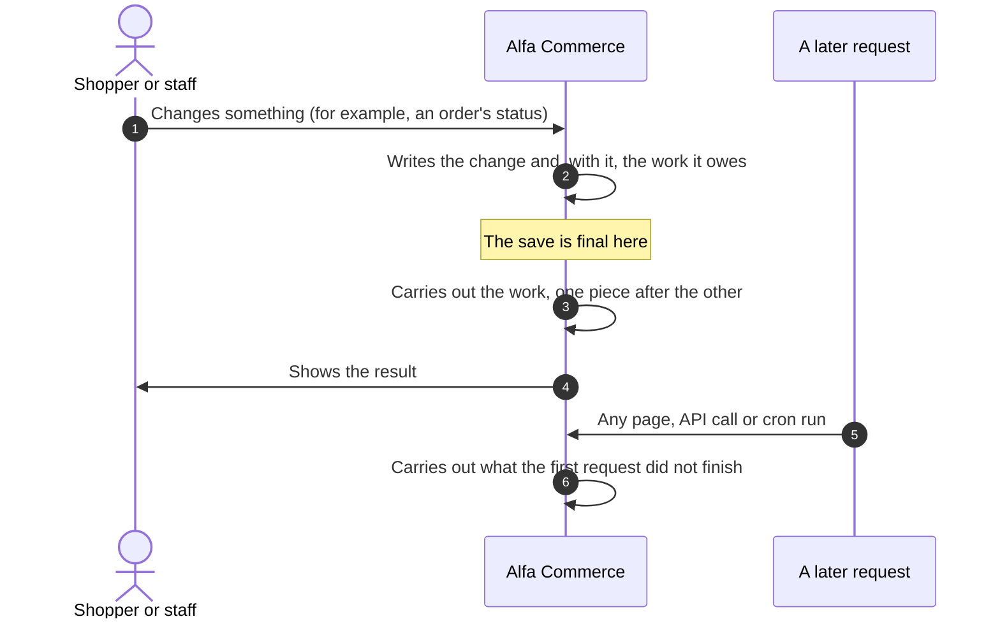
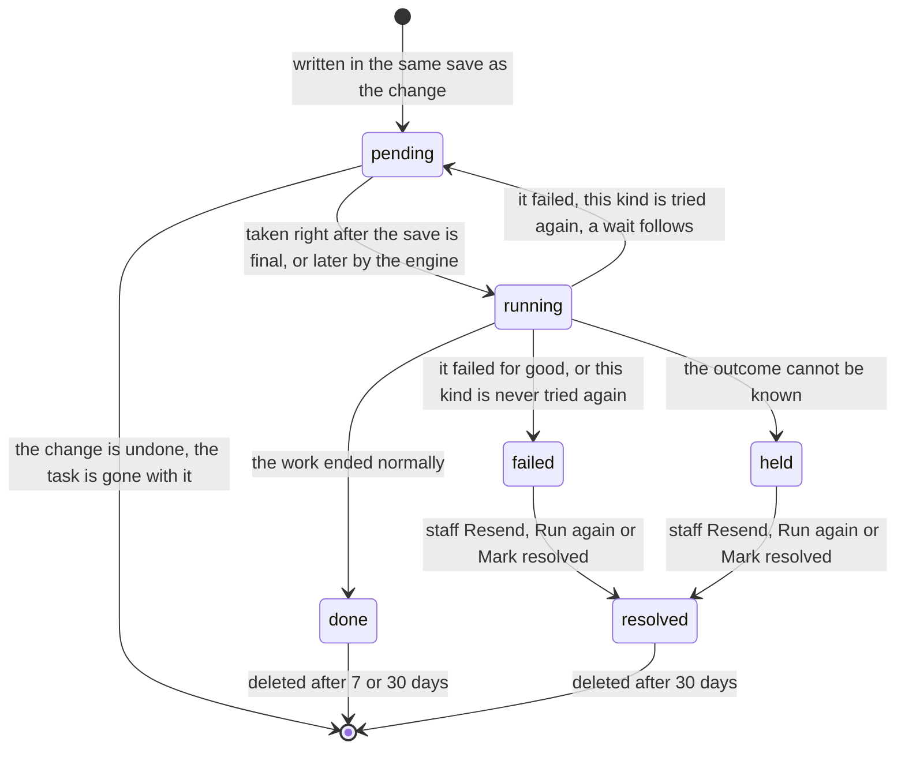
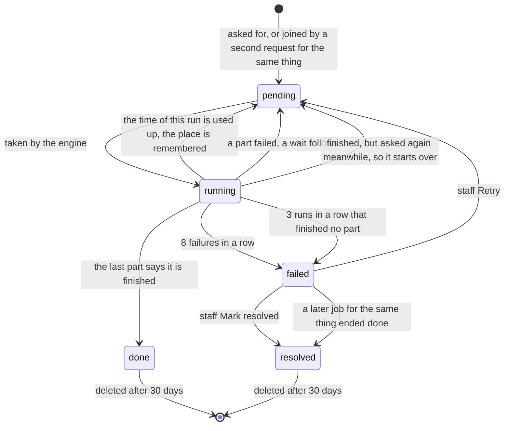

# Background work

<AlfaVersion verified="2.2.0" />

**Background work** is work that Alfa Commerce owes after a change was saved, or long work that cannot fit in one
request. Alfa writes it down in the database first and carries it out afterwards. Staff see it under
**Tools > Tasks**.

Alfa has it for one reason: so that nothing is lost and nothing is done twice. An e-mail must not go out for a change
that was undone. A slow mail server must not hold an order. A closed browser or a server restart must not lose a
document, an e-mail or a plugin's reaction.

The words "the save is final" (the **commit**), "transaction" and "lock" are explained in the
[glossary](../reference/glossary.md).

## What an extension author must know first

**In 2.2.0 only Alfa Commerce itself creates background work. A plugin cannot register a task or a job of its own.**

- The kinds of work that can run are two fixed lists inside Alfa. Nothing adds to them: no event, no setting, no
  naming rule.
- Asking for a kind that is not on the lists is refused at once with an error.
- The classes that make up the engine are internal. This page names a few files at the end so that you can find
  them and read them. They are not there to be called, and their methods and arguments can change in any release.

What an extension can do is listed under [What an extension can do](#what-an-extension-can-do). In short: its code
can run inside work that Alfa creates, and for scheduled work of its own it uses Joomla's Scheduled Tasks.

## What it does

There are two shapes of background work.

| | A task | A job |
|---|---|---|
| In plain words | One small piece of follow-up work that a saved change owes: "this order changed status, so send this e-mail" | Long work over many records, done a part at a time: "rebuild the search entry of every item" |
| The technical name | A **single** (the table says `type = single`) | A **job** (`type = job`) |
| Tied to a save | Yes. It is written in the same save as the change. If the change is undone, the task is gone with it. | Only when it is asked for inside a save: then it is written with that save. Otherwise it stands on its own. |
| When it first runs | In the same request, right after the save is final | When the engine next runs (see [What makes the engine run](#what-makes-the-engine-run)) |
| How it runs | In one go | In parts (**chunks**), each saved as a whole or not at all |
| How many at once | Any number | One waiting or running job for each thing it covers. A second request for the same thing joins the first. |
| If the outcome cannot be known | It is **held** for staff | Cannot happen: an unfinished part is undone and done again |

Both are rows of one table, `#__alfa_tasks`. The [database page](./database-schema.md) describes the tables.

## When it is used

Alfa creates tasks at these moments:

| Moment | The tasks written with it |
|---|---|
| An order's status changes | Up to five, in this order: the stock movement, the download access, the documents, the status e-mail, the plugins' reaction. Each is written only when it has something to do: no e-mail task for a status that tells nobody, no plugin task when no plugin listens. |
| An order is placed | The download access of its first status, and the order confirmation e-mail |
| A payment that takes money in changes its status | The download access, when the payment became completed. The documents of the status the order is in. And, when the payment method maps that payment status to an order status, the move of the order's status. The status change it makes then writes its own tasks. |
| A shipment changes its status and the shipping method maps that status to an order status | The move of the order's status. The status change it makes then writes its own tasks. |
| A refund is settled that completes a payment's refunds | Marking that payment refunded |
| A notification is raised while something is being saved | The notification, written as soon as the save is final |

Alfa creates jobs for: preparing the list prices of a new combination of customer groups, rebuilding catalogue
entries of items, rebuilding the search index, applying stock movements that are still owed, recreating thumbnails,
and deleting finished tasks.

The picture of a status change, with each task in its place, is on [Event flows](../events/flows.md).

## The life of a task

### The states

The column `state` holds one of these words. Tools > Tasks shows a failed task as **Failed** and a held one as
**Outcome unknown**.

| State | What it means |
|---|---|
| `pending` | Written and waiting: for its first run, or for its next try |
| `running` | One worker has taken it and is doing it now |
| `done` | The work ended normally |
| `failed` | The work failed and Alfa will not try it again by itself. It waits for staff. |
| `held` | Nobody can know whether the work took effect. Alfa will not try it again by itself. It waits for staff. |
| `resolved` | Staff closed it: by Resend, by Run again, or by Mark resolved |

A seventh word, `cancelled`, exists in the table's description. Nothing in 2.2.0 sets it.

### When it first runs

1. The task is written inside the save of the change. It is part of that save.
2. When the save is final, and Alfa's locks are released, the tasks of that save run in the order they
   were written, in the same request. The person who made the change waits for them, and sees the order with its
   stock moved and its documents issued.
3. If the request stops before that (a timeout, a closed connection, a server restart), the tasks stay `pending`.
   The engine picks up a task that never ran once it is 120 seconds old.
4. A request that is still busy with its own tasks keeps them for itself. If that request dies while it holds a
   task, the hold runs out after 15 minutes (900 seconds).

A task is never scheduled for a later time on purpose. Running later is only the rescue.

### If it fails: each kind has its own rule

**Not every task is tried again.** Whether Alfa tries again by itself depends on the kind of task, and on what is
known about the failure:

| What happened | What Alfa does |
|---|---|
| The work failed and it is certain that nothing took effect, and this kind allows another try | Waits, then tries again |
| The same, but this kind never tries again | `failed` |
| The work says that another try cannot help | `failed` |
| Nobody can know whether the work took effect (an e-mail handed to the mail server with no answer) | `held` |
| The request stopped in the middle of the work, and doing this kind twice is harmless | Runs it again |
| The request stopped in the middle of the work, and doing this kind twice is not harmless | `held` |

Where a kind is tried again, the waits are fixed:

| Try that failed | Wait before the next try |
|---|---|
| 1st | 1 minute |
| 2nd | 5 minutes |
| 3rd | 30 minutes |
| 4th | 2 hours |
| 5th | 6 hours |
| 6th | 24 hours |
| 7th | No further try. The task is `failed`. |

So a task of such a kind is tried at most seven times.

### The kinds of task and their rules

The name in the first column is what Tools > Tasks shows. The name in code style is what the API shows in the field
`handler`.

| Kind of task | What it does | Tried again by itself after a failure | If the request stopped in the middle | What staff can do when it is failed or held | Kept when done |
|---|---|---|---|---|---|
| Stock movement after a status change (`order.stock`) | Applies the stock movement the status change asks for. What it cannot apply is left to the job "Apply outstanding stock movements". | No. A failure is only written to the log and raises no notice. | Run again | Mark resolved | 7 days |
| Download access after a status change or a payment (`order.entitlements`) | Gives or takes away the order's download access, by the status the order is in when it runs | Yes | Run again | Mark resolved | 7 days |
| Documents after a status change or a payment (`order.documents`) | Issues the documents the status issues | Yes, for a failure such as a busy database. A document the shop's data refuses (no series, a missing tax number) raises its own alert and is not tried again. | Run again | Mark resolved | 7 days |
| Status e-mail (`order.status_email`) | Sends the e-mail of the status the order entered | Only for a recipient the mail server refused. Never for a recipient whose outcome is unknown, and never when Joomla's mail is switched off. | Held | **Resend**, Mark resolved | 30 days |
| Order confirmation e-mail (`order.placement_email`) | Sends the e-mail of the status the order was placed in | The same as the status e-mail | Held | **Resend**, Mark resolved | 30 days |
| Plugin reactions to a status change (`order.status_event`) | Calls each listener of `onOrderStatusChange`, one at a time | **Never** | Held | **Run again**, Mark resolved | 30 days |
| Order status after a payment (`payment.automation`) | Moves the order to the status the payment's state asks for | Yes | Run again | Mark resolved | 7 days |
| Order status after a shipment (`shipment.automation`) | Moves the order to the status the shipment's state asks for | Yes | Run again | Mark resolved | 7 days |
| Payment refunded once its refunds cover it (`payment.refund_flip`) | Marks a payment refunded when its settled refunds cover it | Yes | Run again | Mark resolved | 7 days |
| Notification after a save (`notice`) | Writes a notification raised during a save | Yes. A failure is only written to the log. | Written later by the engine | Nothing: it raises no notice | Deleted as soon as it is written |

Why two kinds are never repeated by Alfa itself:

- **An e-mail whose outcome is unknown** may already be in the customer's inbox. Sending it again could deliver it
  twice. See [Order e-mails](./order-emails.md).
- **The plugins' reaction** runs code Alfa does not know. Alfa cannot tell what a listener that failed, or was
  interrupted, has already done. See `onOrderStatusChange` on
  [Order and cart events](../events/order-and-cart-events.md).

### Parts of a task

Two kinds of task have parts, and each part is recorded on its own as soon as its outcome is known:

- An e-mail task: one part for each recipient.
- The plugins' reaction: one part for each listener.

A part recorded as done is never done again, not by an automatic try and not by Resend or Run again.

### What staff can do in Tools > Tasks

A task that is `failed` or `held` raises a standing notification that links to Tools > Tasks. It is a danger notice
while an e-mail or a plugin reaction is among them, otherwise a warning.

| Button | Offered for | What it does |
|---|---|---|
| **Resend** | A failed or held e-mail task | Writes a new task that sends only to the recipients not recorded as sent. The old task becomes `resolved`. |
| **Run again** | A failed or held plugin reaction | Writes a new task that calls only the listeners not recorded as done. The old task becomes `resolved`. |
| **Mark resolved** | Every failed or held task | Closes the task with no action. A reason must be typed. |

Each button needs the permission to use Tools (`alfa.tools`). Nothing failed or held is ever run again without one of
these buttons.

### How its final state can be understood

**The task's own history.** Every task keeps a list of what happened to it: every try, every part, every button
staff pressed, with the time, what started it and the user. Tools > Tasks shows it. The entries are:

| Entry | Written when |
|---|---|
| `done`, `failed` or `unknown` with the name of a part | A recipient or a listener ended |
| `done` | The whole task ended normally |
| `retry`, with the wait in seconds | The task failed and will be tried again |
| `failed` | The task failed and will not be tried again |
| `held` | The outcome cannot be known |
| `interrupted` | The engine found a task whose request stopped in the middle of it |
| `resent` or `run again`, with the id of the new task | Staff pressed Resend or Run again |
| `resolved`, with the reason | Staff pressed Mark resolved |

**The order's History tab.** For a task about an order, Alfa also writes on the order's own History: an e-mail that
was sent (naming each recipient), an e-mail or a plugin reaction that failed or is held, a Resend, a Run again and a
Mark resolved, with who did it. These entries stay after the task itself is deleted.

**No event announces the end of a task.** In 2.2.0 a plugin cannot listen for "a task finished".

### How long a finished task is kept

| Task | Deleted |
|---|---|
| `pending` or `running` | Never while it is active |
| `failed` or `held` | Never by age. It stays until staff act. |
| `resolved` | 30 days after staff acted |
| `done`, of the kinds marked "7 days" in the table above | 7 days after it finished |
| `done`, of every other kind (the e-mails, the plugins' reaction) | 30 days after it finished |

The deletion is itself a job, "Delete finished tasks", which runs about once an hour. Staff can also start it from
Tools > Tasks, and a server can run it with the console command `alfa:tasks:prune` (see
[System, console and task plugins](../plugins/system-console-task-plugins.md)).

### Example: a status change with one listener that fails

1. Staff move order 15 to "Shipped". In this example the status moves stock, issues a document, tells the customer,
   and two plugins listen. Alfa writes the new status and four tasks with it: stock, documents, the status e-mail,
   the plugins' reaction.
2. The save is final. The four tasks run in that order, in the same request.
3. The stock moves, the document is issued, the e-mail is sent. Those three tasks are `done`.
4. The first listener of `onOrderStatusChange` ends normally. The second throws an error.
5. The fourth task is `failed`. Its history says: first listener `done`, second listener `failed` with the error.
   The order's History says "Plugin reaction failed". A danger notification appears.
6. Nothing more happens by itself. Staff open Tools > Tasks and press **Run again**. A new task calls the second
   listener only. If it ends normally, the new task is `done`.

## The life of a job

### The states

A job uses `pending`, `running`, `done`, `failed` and `resolved`. A job is never `held`.

### How it is asked for, and joining

Each job covers one thing (its **scope**): "the search index", or "the list prices of this combination of customer
groups". Only one job for a scope can be waiting or running. A second request for the same scope does not make a
second job. It joins the first. If the first has already started, most kinds then run once more from the start when
they finish, so that nothing the second request meant is missed.

### Parts, progress and continuing

- The engine first asks the job how many records it expects in all. That is the **total**.
- Then it lets the job do one part (a **chunk**) after the other. The first part of a run has a fixed small size.
  After that the engine measures how long a record takes and aims each part at about 100 milliseconds of work.
- Each part is saved as a whole, together with the place the job has reached (its **checkpoint**) and the count of
  records done. If a part fails, all of it is undone.
- Progress is `done_units` out of `total_units`. The percentage shown is done divided by total, 100 when the job is
  done, and 0 when the total is 0.
- When the time of a run is used up, the job goes back to `pending` and the next run continues from the checkpoint.
- If the server stops in the middle of a part, the job stays `running` for at most 30 seconds. Then the engine takes
  it again. The lost part was never saved, so the checkpoint still points at the last saved part.
- Jobs marked heavy (price lists, catalogue entries, the search index, thumbnails) run one at a time across the
  whole shop.

### If a part fails

| What happened | What Alfa does |
|---|---|
| A part fails | Undoes the part. Waits 30 seconds, then tries again. Each further failure in a row doubles the wait: 30 seconds, 1, 2, 4, 8, 16 and 32 minutes. |
| The 8th failure in a row | The job is `failed` and waits for staff |
| A part succeeds | The count of failures starts again at zero |
| The process dies inside a part three runs in a row (usually at PHP's memory or time limit), so that nothing could be recorded | The job is `failed` with the error "Stopped after 3 runs that each ended before finishing a step, usually at the server's PHP memory or time limit. Raise the limit, then Retry." The jobs behind it can then run. |

### What staff can do

| Button | Offered for | What it does |
|---|---|---|
| **Process now** | A waiting job | Opens a progress page that works the job in steps of 2 seconds while the page is open, and shows how far it is |
| **Retry** | A failed job | Puts it back in the queue with its failures reset. It continues from where it stopped. Refused when another job for the same thing is already waiting or running. |
| **Mark resolved** | A failed job | Closes it, with a reason |

A job cannot be cancelled in 2.2.0.

### How long a finished job is kept

A `done` or `resolved` job is deleted after 30 days. One exception: for each job that covers the whole shop (stock
movements, catalogue entries, the search index, thumbnails, the deletion of tasks), the newest finished run is never
deleted, so that Tools > Tasks can always show the last run. A `failed` job stays until staff act, or until a later
job for the same thing ends done, which closes it.

### Where a job's state is read

**Tools > Tasks.** The list of jobs shows what each covers, how far it is, when it started and finished, and its
last error.

**The REST API.** Three routes, under `/api/index.php/v1/alfa/tasks`:

| Request | Who may call it | Answer |
|---|---|---|
| `GET v1/alfa/tasks` | A user with the Tools permission. Anyone else: 403. | The tasks and jobs, newest first, 20 to a page, 100 at most (`page[limit]`, `page[offset]`). Filters: `filter[state]`, `filter[type]` (`single` or `job`), `filter[owner]`. |
| `GET v1/alfa/tasks/{id}` | The user who created it. For a task about an order: also anyone who may view orders. For anything else: also anyone with the Tools permission. | One task or job. For everyone else, and for a task that no longer exists: 404, so that nobody learns whether a task exists. |
| `POST v1/alfa/tasks/{id}/process` | A user with the Tools permission who may read it | Works that job for up to 2 seconds. **200** with the job when it is no longer waiting or running. **202** with the headers `Location` (the job's address) and `Retry-After: 5` while it still is. **409** when the id is a task and not a job. **403** without the Tools permission. |

The fields of one task in an answer:

| Field | Meaning |
|---|---|
| `id` | Its number |
| `type` | `single` or `job` |
| `handler` | The kind, for example `order.status_email` or `search.rebuild` |
| `owner` | Always `com_alfa` in 2.2.0 |
| `scope` | What it covers: a job's scope, or for a task its subject, for example `order:15` |
| `state` | One of the states above |
| `done_units`, `total_units`, `percent` | Progress |
| `run_after`, `created_at`, `started_at`, `finished_at`, `updated_at` | Times, in UTC |
| `origin` | Where it was created: `admin`, `site`, `api` or `cli` |
| `last_error` | The last error, shortened to 200 characters. Shown only to a caller with the Tools permission, otherwise `null`. |
| `result` | Always `null` in 2.2.0 |

The answer of an API request that saves something also lists, under `meta.tasks`, the jobs that request started or
joined. An order's answer lists the order's tasks too, each in the state it is in at that moment.

### Example: rebuilding the search index

1. Staff press the search engine's rebuild button under Tools > Database Sync. Alfa writes one job, `search.rebuild`,
   in state `pending`, and the button's card follows it while the page is open.
2. The page asks for 2 seconds of work at a time. Each call does some parts and reports the new progress.
3. Staff close the page at 40 percent. The job is `pending` with its checkpoint. Nothing is lost.
4. The next shop page, staff page, API call or cron run continues it from 40 percent.
5. The last part says it is finished. The job is `done` and shows 100 percent. `finished_at` holds the time.
6. Had a part failed eight times in a row, the job would be `failed`, a notification would say so, and staff would
   press Retry after fixing the cause.

## What makes the engine run

No cron job is needed. Each of the following gives the engine a short turn with a time limit (its **budget**). In a
turn it first runs the tasks that a stopped request left behind and the tries whose wait is over, then the jobs that
are due. When a job is due, the tasks get at most half of the budget, so that a job always moves forward.

| What starts a turn | When | Budget |
|---|---|---|
| A page of the shop | When work is due, one page in 30 seconds carries a small script that asks for a turn after the page has loaded. The address it calls works at most once in 5 seconds, whoever calls it. | 1 second |
| A page of the administrator | For a user who may manage Alfa Commerce: after the page has loaded, and again every 3 seconds while work remains and the tab is shown, for at most 30 minutes | 1 second each time |
| The notification bell | On Alfa Commerce's own administrator pages, when work is due. It also works while the plugin "System - Alfa Commerce Sync" is disabled. | 1 second |
| An API request | After its answer is sent, when work is due, at most once in 5 seconds | 1 second where the server can finish the answer first, a quarter of a second where it cannot |
| Cron with the console command | `php cli/joomla.php alfa:tasks:run`, for 25 seconds or until nothing is due | 25 seconds |
| Web cron | The address `index.php?option=com_alfa&task=runner.cron&key=` followed by the shop's secret key. A wrong key gets 403. | 20 seconds |
| The progress page and the API's process route | On one job, when staff ask | 2 seconds each time |

The console command and its exit codes are on
[System, console and task plugins](../plugins/system-console-task-plugins.md).

The turns from shop pages, from administrator pages and from API requests are started by the plugin "System - Alfa
Commerce Sync". While that plugin is disabled, the bell, cron and web cron still work.

**The web cron key.** Staff with the Tools permission make it under Tools > Tasks. The full address is shown once.
Alfa keeps only a fingerprint of the key, never the key. Making a new key stops the old address. The key is part of
the address, so the web server's access log records it.

**A turn does nothing** in four cases: while a save is open on the same database connection, while one of Alfa's
locks is held, while the shop is in maintenance (Clear everything), and while an update has paused the engine.

**The pause during an update.** Before an update of Alfa Commerce starts, the installer pauses the engine for at
most ten minutes. When the update finishes it ends the pause. An update that dies half way leaves the pause to run
out by itself.

**Nobody is logged in during a turn.** For the length of a turn Alfa replaces the request's user with an empty user
and puts the real user back afterwards. Background work never runs with the rights of the visitor or the member of
staff whose request happened to carry it.

**If nothing runs it.** When due work has waited more than 24 hours and no turn has run for 24 hours, a notification
says so and points to Tools > Tasks, which shows the cron line and the web cron address.

## What an extension can do

| You want to | Use | Where it is explained |
|---|---|---|
| React to an order's status change, reliably, after the save is final | Listen to `onOrderStatusChange`. Alfa records each listener as a part of a task, and staff can run a failed one again. | [Order and cart events](../events/order-and-cart-events.md) |
| Keep your own data that is derived from the catalogue in step with it | Add a projection through `onCollectCatalogProjections`. Alfa calls it whenever it rebuilds an item's own entries, in a save and in the job "Rebuild catalogue projections". | [Search engine plugins](../plugins/search-plugins.md) |
| React when stock is set aside, taken, given back, corrected or moved | Listen to the stock events. They are also announced when the job "Apply outstanding stock movements" applies a movement later. | [Stock events](../events/stock-events.md) |
| Do scheduled work of your own (a nightly export, a sync with another system) | Joomla's Scheduled Tasks: a plugin of the `task` group. This is Joomla's feature, not Alfa's. | [System, console and task plugins](../plugins/system-console-task-plugins.md) |

None of these lets a plugin put work of its own in Alfa's queue. They let a plugin's code run inside work that Alfa
queues.

## What you must provide

Nothing is registered, so there is nothing to provide to the engine. What matters is how your listener behaves when
it is called from background work.

### What a listener that runs under background work must expect

1. **It can be called again for the same change.** If your listener of `onOrderStatusChange` fails, or the request
   stops while it runs, staff may press Run again and it is called again. A projection is called every time an item
   is rebuilt. Before you write, check whether you already did.
2. **Nobody may be logged in.** When the engine carries the work, the current user is an empty user with id 0. Take
   who and what from the event you are given, never from the current user.
3. **It can run on any kind of request.** A shopper's page, another member of staff's page, an API call, the web
   cron or the console command. Do not read the request's input, the session or the current menu item, and do not
   redirect or print.
4. **The change is already final.** A listener of `onOrderStatusChange` sees the order as saved. It cannot undo or
   steer the change.
5. **An error is recorded, not shown.** If your listener throws, the person who made the change does not see your
   message. The task's history and the log (category `com_alfa.orders`) hold it.
6. **Be quick.** In the normal case the person who made the change waits for you. Do not make them wait for a slow
   remote system. If you call one, set a short time limit.

## What happens next

When a task ends `done`, nothing more happens and nothing depends on it. When it ends `failed` or `held`, a
notification stands until staff act, and for an order the order's History says so. When a job ends `done`, what it
rebuilt is in use at once: the new search index answers searches, the prepared prices are read.

## What can go wrong

| What you see | The usual cause |
|---|---|
| An error "No task handler is named ..." or "No job handler is named ..." | Code tried to create background work of a kind Alfa does not have. A plugin cannot add kinds in 2.2.0. |
| Your `onOrderStatusChange` listener ran twice for one change | Staff pressed Run again. Make the listener safe to repeat. |
| Your listener sees a user with id 0 | The engine carried the work on some other request. Take the actor from the event. |
| A task "Plugin reactions to a status change" stays Failed | A listener threw an error. Alfa never repeats this kind by itself. Fix the cause, then Run again or Mark resolved. |
| An e-mail task shows "Outcome unknown" | The mail server took the message and never answered. Staff decide whether to Resend. |
| Tasks stay waiting for hours | Nothing gives the engine a turn: no visits, no staff, no cron. Set up the console command or the web cron. |
| The console command ends with exit code 1 | The shop is in maintenance or an update has paused the engine |
| A job is Failed with "Stopped after 3 runs ..." | PHP's memory or time limit ends the process inside a part. Raise the limit, then Retry. |
| An e-mail or plugin task does not run from a plain PHP script | These two kinds need a Joomla application. The Joomla console command provides one; a bare script does not. |

## Where it lives in the code

For reading only. These classes are internal in 2.2.0.

| What | File |
|---|---|
| Tasks: writing, running, trying again | `administrator/src/Service/Task/Tasks.php` |
| Jobs and the turns of the engine | `administrator/src/Service/Task/Runner.php` |
| The kinds of task about an order | `administrator/src/Service/Order/Task/` |
| The kinds of job | `administrator/src/Service/Task/Job/` |
| How long finished work is kept | `administrator/src/Service/Task/TaskRetention.php` |
| What staff can do | `administrator/src/Service/Task/TaskStaff.php` |
| The REST routes | `api/src/Controller/TasksController.php` |
| The console commands | `plugins/console/alfa/src/Console/` |

## Changed in 2.2.0

- **Since 2.2.0.** Jobs exist, and the engine runs from shop pages, staff pages, the bell, API requests, cron and
  web cron. In 2.1.4 only the bell and Tools > Tasks picked up unfinished tasks.
- **Since 2.2.0.** A status change writes only the tasks that have something to do. With no listener of
  `onOrderStatusChange` there is no plugin task.
- **Since 2.2.0.** Each listener of `onOrderStatusChange` is a part of its own, so Run again calls only the ones not
  done.
- **Since 2.2.0.** A payment's or shipment's move of the order is a task written with the payment or shipment.
- **Changed in 2.2.0.** The scheduled task "Alfa - Prepare list prices for customer groups" and its plugin are
  removed. The work is a job. The console commands come with the plugin "Console - Alfa Commerce".
- **Since 2.1.4.** Tasks exist: follow-up work is written with the change and run after the save is final.

## Not documented yet

- A way for an extension to register its own task or job. None exists in 2.2.0. The API fields `owner` and `result`
  and the filter `filter[owner]` are placeholders: they always read `com_alfa` and `null`.
- The engine's PHP classes as something to call. They are internal, and this manual does not describe their methods.
- The data each kind of task carries with it (its payload). It is internal and has no stated contract.
- The exact JSON envelope of the three REST routes beyond the fields listed above.
- The order in which jobs of different kinds are taken when several are due, beyond "heavy jobs run one at a time".
