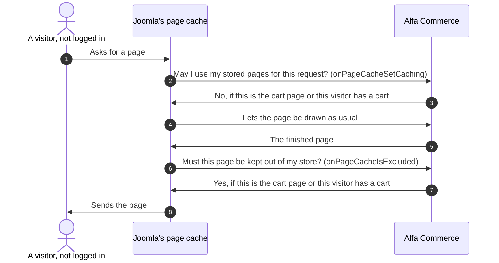

# Caches and the page cache

<AlfaVersion verified="2.2.0" />

A **cache** is a stored copy of something that is slow to work out, kept for a while so that the next request does
not work it out again. The danger of a cache is a copy that is out of date, or a copy made for one visitor that is
shown to another.

This page covers two different things:

- **Alfa Commerce's own caches.** Small stored answers, such as the dashboard's cards.
- **Joomla's page cache.** The plugin "System - Page Cache" stores whole pages for visitors who are not logged in.
  Alfa does not own it, but since 2.2.0 it tells it which pages must never be stored.

## What it does

### Alfa Commerce's own caches

Alfa stores everything through Joomla's cache, so it uses whatever cache storage the site has set up.
Each cache has its own **group**, the name Joomla files it under. The groups can be seen and cleared one
by one under Joomla's System > Clear Cache.

| Group | What is kept | For how long | What clears it before that |
|---|---|---|---|
| `com_alfa.cards` | The dashboard's cards, worked out. One copy for each viewer, administrator language, period and set of permissions, so that one person's figures are never shown to another. | 5 minutes | A save, delete, publish or unpublish, made in the administrator, of an order, an item, a payment method or an order status |
| `com_alfa.setup` | The verdict of the setup checklist | 6 hours | A save, delete, publish or unpublish of a payment method, shipping method, tax, category, item, form field, form field group, document series or currency. Saving Alfa's Options. Saving a payment or shipping plugin. Saving or deleting a site menu item. The Tools action that runs the checklist again. Planned for 2.2.1, which is not released: also a payment or shipping plugin, "System - Page Cache" or "System - Alfa Commerce Sync" enabled or disabled from the Plugins list, a save of "System - Page Cache" or "System - Alfa Commerce Sync", and installing, updating or uninstalling the dompdf library. |
| `com_alfa.categories` | The storefront's category data: each category, its path and the category tree. One copy for each language and for each kind of visitor (who may see what, and how the shop treats items that are out of stock). | 1 year | A save, delete, publish, unpublish, move or reorder of a category. A save, delete, publish or unpublish of an item. The Tools action that fills empty translations of categories. |
| `com_alfa.integrity` | The last answer of the file check under Tools > Security | 24 hours | The button "Recheck now". An update of Alfa Commerce. |
| `com_alfa.tasks` | No data. Three marks that stop a check from running too often: the notice about failed tasks (2 minutes), the notice that background work is not running (10 minutes), the fallback deletion of finished tasks (1 hour). | As stated | Nothing. They run out. |
| `com_alfa.notifications` | No data. The mark that limits the deletion of expired notifications to once an hour. | 1 hour | Nothing |
| `com_alfa.stockeffects` | No data. The mark that limits the check for stock movements still owed to once in 10 minutes. | 10 minutes | Nothing |
| `com_alfa.collation` | No data. The mark that limits the check of the tables' collation to once in 10 minutes. | 10 minutes | Nothing |

The category cache is the only one with a switch. Alfa's Options have a tab **Cache Settings** with "Enable Cache"
and "Cache Categories". Both are on after an installation. With either off, categories are read from the database on
every request.

Two more caches belong to the items module (`mod_alfa_items`), not to the component:

| What is kept | For how long | Notes |
|---|---|---|
| The module's list of items | The module's own cache time, when the module's caching is on | One copy for each module, source, ordering, page, price setting of the visitor and stock setting. A "recently viewed" or random list is never cached. Planned for 2.2.1, which is not released: a page that shows a visitor's own, non-empty "recently viewed" list is also kept out of Joomla's page cache. |
| The ranking of best sellers | Set by the module's field "Refresh the best-sellers ranking every (minutes)", 60 unless changed. 0 switches it off. In 2.2.0 the module hands Joomla's cache that number multiplied by 60, and Joomla's cache counts in minutes, so the ranking is kept 60 times as long as the field says: 60 hours for the value 60. Planned for 2.2.1, which is not released: the ranking is kept for the minutes the field says. | The ranking is the same for every visitor. What a visitor may see is applied when the list is read. |

### What an update cleans

An update of Alfa Commerce cleans, once and by itself:

- Joomla's page cache (the group `page`);
- the eight `com_alfa.` groups of the table above.

So no page or card stored by the earlier version is served by the new one. Nothing has to be cleared by hand. If a
group cannot be cleaned, that is written to the maintenance log and the update goes on; the group's entries then run
out by themselves.

The update does not clean the caches of the items module, and it does not clean other extensions' caches. Planned
for 2.2.1, which is not released: the update also cleans both caches of the items module (the group
`mod_alfa_items`). Other extensions' caches are still not cleaned.

### The page cache rule

Joomla's page cache stores a whole page under its address and gives the same stored page to the next visitor who is
not logged in. That is wrong for a page that shows something personal: a stored copy of one visitor's cart could be
given to the next visitor.

**Who this concerns.** Only a shop that has switched on Joomla's plugin "System - Page Cache". Joomla installs that
plugin disabled. A shop that does not use it stores no whole pages, and nothing in this section applies to it.

**Since 2.2.0:** the cart page, and every page of a visitor whose session holds a cart or typed checkout details,
are never stored. Such a visitor is also never given a stored page. Every other page is cached as before.

Planned for 2.2.1, which is not released: the same holds for a visitor whose session holds a currency or a place of
their own (the session keys `alfa.currency_id` and `alfa.location_id`, which the storefront's prices follow).

Alfa answers two questions that Joomla's page cache asks. Joomla's page cache works only on a GET request of a
visitor who is not logged in, and only while no message is waiting to be shown:



When the first answer is "No", Joomla's page cache is off for the rest of that request and does not ask the second
question: nothing is read from the store and nothing is written to it. The second question decides when the first
answer was not "No", for example when the visitor's cart got its first line while the page was drawn.

Alfa says "this page is the visitor's own" when any one of these is true:

| Test | In plain words |
|---|---|
| The request is for Alfa's cart view | The cart page and the checkout form, at any of their addresses |
| The session holds checkout details | The visitor typed a name, an e-mail or a phone into the checkout form |
| The browser owns a guest cart with at least one line | The cart module would show that cart on every page |
| The cart could not be read | When in doubt, the page is not shared. The log says why. |
| Planned for 2.2.1, which is not released: the session holds a currency or a place of the visitor's own | Every price on the page is worked out for this visitor |

Two more kinds of page keep themselves out of the page cache, whatever the visitor holds:

- **The order-completed page.** It also tells browsers and proxies not to store it, tells search engines not to
  index it, and keeps its address out of the Referer sent to other sites. An error on that page is drawn by the
  page itself, so it is not stored either.
- **A listing whose search engine marked its result as belonging to this visitor alone.** See below.

Planned for 2.2.1, which is not released: these keep themselves out too, whatever the state of "System - Alfa
Commerce Sync":

- **The cart page in every form:** the cart with the checkout form, the empty cart, the order process page (the
  order's page shown before payment, also when it is opened again by a reload or by Try again) and the
  order-completed page.
- **Any page while the cart module on it shows items.** A page whose cart module is empty can still be stored.
- **Alfa's registration page while it shows a refusal**, for example two passwords that differ. The typed passwords
  are not kept at all. The other typed fields re-fill that one page and are then cleared.
- **A page on which the items module shows a visitor's own "recently viewed" list, or the easy articles module a
  visitor's own "recently read" list.** With an empty list the page can still be stored.
- **Any page priced in a currency or a place of the visitor's own** (the session keys `alfa.currency_id` and
  `alfa.location_id`).

:::warning Keep "System - Alfa Commerce Sync" enabled
The rule about the cart lives in the plugin "System - Alfa Commerce Sync" (`plugins/system/alfasync`), and nothing
else in Alfa Commerce replaces it. With the plugin disabled, nobody answers Joomla's two questions, so a shop that
also has Joomla's page cache on would store and serve those pages like any other page. The same holds while the
plugin is enabled with an Access that visitors who are not logged in do not hold (any level other than Public or
Guest): Joomla does not run it for them.

This was tried on a 2.2.0 test shop with Joomla's page cache on. With the plugin enabled, the cart page and the
pages of a visitor with a cart were not stored. With the plugin disabled they were stored, and a new visitor who
asked for the cart page was shown the stored cart of another visitor. It does not arise while the plugin is
enabled or the page cache is off.

Planned for 2.2.1, which is not released: without the plugin (disabled, not installed, or not run for visitors who
are not logged in), the pages listed above still keep themselves out, so no visitor's cart, typed details, order or
own prices reach another visitor. What only the plugin does is the other half: it keeps a visitor with items in the
cart, typed checkout details, or a currency or place of their own from being given a page stored for another
visitor. Without it, such a shopper can be shown a stored page with an empty cart module and the shop's own prices,
until the cache time ends. The advice below stays, for that reason.

What to do:

- Keep "System - Alfa Commerce Sync" enabled, with its Access set to Public. Installing or updating Alfa Commerce
  enables it again.
- If it must be disabled for a time, switch "System - Page Cache" off for that time.

The warning that Alfa shows on its administrator pages while the plugin is disabled does not mention the page cache
in 2.2.0.

Planned for 2.2.1, which is not released: that warning, and a warning of its own for a plugin enabled with an Access
that visitors who are not logged in do not hold, say first what still keeps itself out of the page cache and what is
lost. The setup checklist gains the recommended row "Joomla page cache": it passes while "System - Page Cache" is off,
and warns while it is on, with or without "System - Alfa Commerce Sync", saying what Alfa keeps out and what the page
cache can still store or serve.
:::

## When it is used

- You write a module, a template override or a plugin whose output differs from one visitor to the next.
- A figure on the dashboard, or a category in the menu, does not change right after you changed your data.
- You are asked why a shopper saw somebody else's cart. On 2.1 with the page cache on, that could happen. 2.2.0
  closes it while "System - Alfa Commerce Sync" runs for visitors who are not logged in. Planned for 2.2.1, which is
  not released: closed for Alfa's own pages whatever the plugin's state.

## What you must provide

### If your output shows the visitor's cart or checkout details

Nothing. A visitor with a cart or typed checkout details is already kept out of the page cache on every page, so a
module or template that shows the cart is safe.

That holds while "System - Alfa Commerce Sync" runs for visitors who are not logged in. Planned for 2.2.1, which is
not released: without it, Alfa's cart page and cart module still keep themselves out, but your own output that shows
the cart is kept out only when the page also carries Alfa's cart module showing items, or when you tell the page
cache yourself, as below.

### If your output is personal for another reason

Alfa's rule covers the cart and the checkout details, nothing else. If your plugin shows a visitor who is not logged
in something of their own (a wish list, a recently viewed strip kept in the session, a personal price), the page
cache does not know. You must tell it, the same way Alfa does: with a **system plugin** that answers Joomla's two
page cache events.

Planned for 2.2.1, which is not released: Alfa's rule also covers a currency or a place set in the session under
`alfa.currency_id` or `alfa.location_id`, and a page priced that way keeps itself out whatever the plugin's state. A
personal price kept anywhere else is still yours to report.

```php
namespace Acme\Plugin\System\Wishlist\Extension;

use Joomla\CMS\Event\PageCache\IsExcludedEvent;
use Joomla\CMS\Event\PageCache\SetCachingEvent;
use Joomla\CMS\Plugin\CMSPlugin;
use Joomla\Event\SubscriberInterface;

final class Wishlist extends CMSPlugin implements SubscriberInterface
{
    public static function getSubscribedEvents(): array
    {
        return [
            'onPageCacheSetCaching' => 'onPageCacheSetCaching',
            'onPageCacheIsExcluded' => 'onPageCacheIsExcluded',
        ];
    }

    // Before the page is drawn: false means "do not use stored pages for this request".
    public function onPageCacheSetCaching(SetCachingEvent $event): void
    {
        if ($this->visitorHasOwnContent()) {
            $event->addResult(false);
        }
    }

    // After the page is drawn: true means "do not store this page".
    public function onPageCacheIsExcluded(IsExcludedEvent $event): void
    {
        if ($this->visitorHasOwnContent()) {
            $event->addResult(true);
        }
    }

    private function visitorHasOwnContent(): bool
    {
        // Your own test. Keep it cheap: it runs on every page of every visitor who is not logged in.
        return !empty($this->getApplication()->getUserState('acme.wishlist'));
    }
}
```

The two events and their classes are Joomla's. The sample follows Alfa's own handlers in
`plugins/system/alfasync/src/Extension/Alfasync.php`. Answer both events with the same test. The first protects the
visitor from being given a stored page. The second protects the store from the visitor's page.

Two things that do not work:

- **Calling `allowCache(false)` on the application is not enough.** It tells browsers and proxies not to store the
  answer. Joomla's page cache does not read it.
- **Joomla's own exclusion options of the page cache plugin do not help** for content that follows the visitor
  rather than the address. The cart module is on every page.

### If you write a search engine plugin

When the handle your engine gives a result set belongs to one visitor or one answer only, say so on the result
(`responseSpecific`). Alfa then keeps that listing out of the page cache and tells proxies not to store the JSON
answer. See [Search engine plugins](../plugins/search-plugins.md).

### If your data changes and a cached Alfa view must follow

2.2.0 has no event with which a plugin tells Alfa "clear your cache". What exists:

| Cached view | What a plugin can do in 2.2.0 |
|---|---|
| A dashboard card of your own | Mark it `live()` when it must be current on every request. A live card is worked out every time and never read from the 5 minute copy. Use it only where needed: its work is then done on every request of the dashboard. See [Notification and setup events](../events/notification-and-setup-events.md). |
| A dashboard card that may be up to 5 minutes old | Nothing. It refreshes by itself. |
| A setup check of your own | Nothing to call. The verdict is worked out again when Alfa's Options are saved, when a payment or shipping plugin is saved, when the records listed in the table above are saved, when staff run the checklist again from Tools, and after 6 hours. Planned for 2.2.1, which is not released: also on the plugin and library changes listed for `com_alfa.setup` above. |
| The storefront's category tree | Nothing to call. Change categories and items through Alfa's own administrator screens, which clear it. A plugin that writes to Alfa's category tables directly leaves a stale tree for up to a year. |
| A whole page in Joomla's page cache | That is Joomla's cache. Alfa does not clear it when a record is saved. |

## What happens next

- A cleared group is filled again by the next request that needs it. Nothing has to be warmed up.
- A visitor who empties the cart, and has typed no checkout details, is served stored pages again. Planned for 2.2.1,
  which is not released: without "System - Alfa Commerce Sync" running for them, every visitor can be served stored
  pages.
- After an update, the first request for each page draws it fresh.

## What can go wrong

| What you see | The usual cause |
|---|---|
| A shopper sees another shopper's cart or details | The shop is on 2.1 with the page cache on, or on 2.2.0 with "System - Alfa Commerce Sync" disabled or with an Access that visitors who are not logged in do not hold. Or the content is your own extension's and you have not answered the two page cache events. Planned for 2.2.1, which is not released: not through Alfa's own pages and modules, whatever the plugin's state. |
| Planned for 2.2.1, which is not released: a shopper with items in the cart is shown a page whose cart module is empty | "System - Alfa Commerce Sync" is disabled, not installed, or not run for visitors who are not logged in, so the page cache gave that shopper a page stored for another visitor. Enable it with its Access set to Public, or switch "System - Page Cache" off. |
| Your module shows the same personal content to everybody | Joomla's page cache or the module's own cache stored it. Answer the two events, and do not cache personal output in the module. |
| A new category does not appear in the storefront's menu | It was written to the database directly, past Alfa's own save. Clear the group `com_alfa.categories` under System > Clear Cache. |
| A figure on the dashboard is a few minutes old | The cards are kept for 5 minutes. Use `live()` only if that is not acceptable. |
| The setup checklist still shows a step as open | Its verdict is kept for up to 6 hours when nothing it watches was saved. Run the checklist again from Tools. |
| The cart page is slow under load | It is never served from the page cache. That is on purpose. |
| After an update the log has "the cache group ... could not be cleaned" | The cache storage refused. The entries run out by themselves, or clear them under System > Clear Cache. |

## Changed in 2.2.0

- **Since 2.2.0.** The page cache rule above. On 2.1, a shop with "System - Page Cache" on could show one visitor's
  cart page, cart module and order-completed page to another visitor.
- **Since 2.2.0.** The update cleans the page cache and Alfa's own caches once.
- **Since 2.2.0.** `live()` on a dashboard card, and `responseSpecific` on a search result.

## Not documented yet

- A supported way for a plugin to clear one of Alfa's cache groups. The classes that own the groups have public
  methods that clear them, but 2.2.0 does not present them as something for extensions to call, so they are not
  described here.
- The exact keys under which each group files its entries.
- How Joomla's page cache itself works, and its options. See Joomla's own documentation.
- Caches outside Joomla, such as a reverse proxy or a content delivery network that stores whole pages. They do not
  ask Joomla's two questions. Which of Alfa's pages tell such a cache not to store them was read only for the
  order-completed page, so set such a cache up to pass the cart, the checkout and every page of a visitor with a
  session cookie through to the site. Planned for 2.2.1, which is not released: the "Joomla page cache" row of the
  setup checklist names what such a cache must keep out: the cart, the checkout, the order pages and the
  registration page of Alfa Commerce, and every page of a visitor with items in the cart, typed checkout details, or
  a currency or place of their own.
- The caching settings of the filters module and the search module. Their forms have Joomla's standard caching
  fields; what they store was not read for this page.
