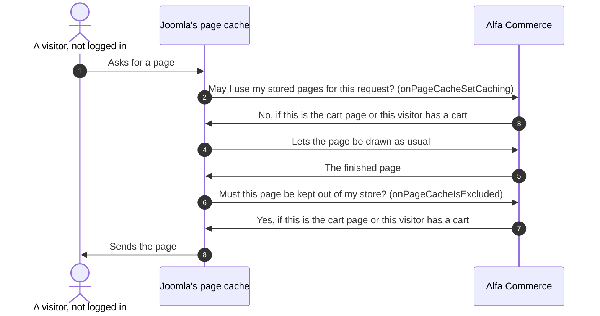

# Caches and the page cache

<AlfaVersion verified="2.3.0" />

A **cache** is a stored copy of something that is slow to work out, kept for a while so that the next request does
not work it out again. The danger of a cache is a copy that is out of date, or a copy made for one visitor that is
shown to another.

This page covers two different things:

- **Alfa Commerce's own caches.** Small stored answers, such as the dashboard's cards.
- **Joomla's page cache.** The plugin "System - Page Cache" stores whole pages for visitors who are not logged in.
  Alfa does not own it, but it tells it which pages must never be stored.

## What it does

### Alfa Commerce's own caches

Alfa stores everything through Joomla's cache, so it uses whatever cache storage the site has set up.
Each cache has its own **group**, the name Joomla files it under. The groups can be seen and cleared one
by one under Joomla's System > Clear Cache.

| Group | What is kept | For how long | What clears it before that |
|---|---|---|---|
| `com_alfa.cards` | The dashboard's cards, worked out. One copy for each viewer, administrator language, period and set of permissions, so that one person's figures are never shown to another. | 5 minutes | A save, delete, publish or unpublish, made in the administrator or through the REST API, of an order, an item, a payment method or an order status. Installing, updating, uninstalling, enabling or disabling an Alfa extension (in the Plugins list, in Extensions: Manage, or saved in its own form). |
| `com_alfa.setup` | The verdict of the setup checklist | 6 hours | A save, delete, publish or unpublish of a payment method, shipping method, tax, category, item, form field, form field group, document series or currency. Saving Alfa's Options. Saving a payment or shipping plugin. Saving or deleting a site menu item. The Tools action that runs the checklist again, and the checklist card's own refresh, its set-up actions and its Ignore and Show again. A payment or shipping plugin enabled or disabled from the Plugins list. The state of an Alfa Commerce guided tour saved. A run of Clear everything. Installing, updating, uninstalling, enabling or disabling an Alfa extension, "System - Alfa Commerce Sync" among them (in the Plugins list, in Extensions: Manage, or saved in its own form). |
| `com_alfa.categories` | The storefront's category data: each category, its path and the category tree. One copy for each language and for each kind of visitor (who may see what, and how the shop treats items that are out of stock). | 1 year | A save, delete, publish, unpublish, move or reorder of a category. A save, delete, publish, unpublish, archive or restore of an item, and a batch move of items to another category. The Tools action that fills empty translations of categories. |
| `com_alfa.integrity` | The last answer of the file check under Tools > Security | 24 hours | The button "Recheck now". An update of Alfa Commerce. |
| `com_alfa.tasks` | No data. Three marks that stop a check from running too often: the notice about failed tasks (2 minutes), the notice that background work is not running (10 minutes), the fallback deletion of finished tasks (1 hour). | As stated | Nothing. They run out. |
| `com_alfa.notifications` | No data. The mark that limits the deletion of expired notifications to once an hour. | 1 hour | Nothing |
| `com_alfa.stockeffects` | No data. The mark that limits the check for stock movements still owed to once in 10 minutes. | 10 minutes | Nothing |
| `com_alfa.notices` | No data. Two marks that stop a look of the notification bell's refresh from running too often: at the products that sell from a quantity no price covers (10 minutes), and at the Alfa extensions not built for this version (1 hour). | As stated | Nothing |

The category cache is the only one with a switch. Alfa's Options have a tab **Cache Settings** with "Enable Cache"
and "Cache Categories". Both are on after an installation. With either off, categories are read from the database on
every request.

More caches belong to the modules the package ships, not to the component. The items module keeps two in its group
`mod_alfa_items`, the easy articles module one in `mod_easy_articles`, and Joomla itself keeps the whole output of the
search module in `mod_alfa_search`. The filters module is never cached: what it draws depends on the page it is on.

| What is kept | For how long | Notes |
|---|---|---|
| The items module's list of items | The module's own cache time, when the module's caching and Joomla's caching are on, for a visitor who is not logged in | One copy for each module, source, ordering, page, price setting of the visitor, stock setting and online selling setting, and new copies after each change of stock. A "recently viewed" or random list is never cached. A page that shows a visitor's own, non-empty "recently viewed" list is also kept out of Joomla's page cache. |
| The items module's ranking of best sellers | Set by the module's field "Refresh the best-sellers ranking every (minutes)", 60 unless changed. 0 switches it off. The ranking is kept for the minutes the field says. | The ranking is the same for every visitor. What a visitor may see is applied when the list is read. |
| The easy articles module's list of articles | The module's own cache time, 900 seconds unless changed, when the module's caching and Joomla's caching are on, for a visitor who is not logged in | One copy for each module and query. A "recently read" or random list is never cached. A page that shows a visitor's own, non-empty "recently read" list is also kept out of Joomla's page cache. |
| The whole output of the search module | The module's Cache Time, 900 seconds unless changed, when Joomla's caching is on and the module's Caching is left at Use Global, for a visitor who is not logged in | Joomla's own module cache, in its static mode: one copy for each module and language, served on every page. |

### What an update cleans

An update of Alfa Commerce cleans, once and by itself:

- Joomla's page cache (the group `page`);
- the eight `com_alfa.` groups of the table above;
- the items module's group `mod_alfa_items` (its best sellers ranking and its lists).

So no page or card stored before the update is served after it. Nothing has to be cleared by hand. If a
group cannot be cleaned, that is written to the maintenance log and the update goes on; the group's entries then run
out by themselves.

The update also cleans both caches of the items module. It does not clean the caches of the easy articles and search
modules, or other extensions' caches. It takes a cache setting off every filters module, so that module is never
cached.

### The page cache rule

Joomla's page cache stores a whole page under its address and gives the same stored page to the next visitor who is
not logged in. That is wrong for a page that shows something personal: a stored copy of one visitor's cart could be
given to the next visitor.

**Who this concerns.** Only a shop that has switched on Joomla's plugin "System - Page Cache". Joomla installs that
plugin disabled. A shop that does not use it stores no whole pages, and nothing in this section applies to it.

The cart page (and with it the order completed page), the customer's own orders (My orders, an order's page and an
order's document; see [The customer's account](../services/customer-account.md)), and every page of a visitor whose
browser holds a cart with items, whose session holds typed checkout details, or who has a currency or a place of their
own (the session keys `alfa.currency_id` and `alfa.location_id`, which the storefront's prices follow), are never
stored. Such a visitor is also never given a stored page. Every other page is cached.

Alfa answers two questions that Joomla's page cache asks. Joomla's page cache works only on a GET request of a
visitor who is not logged in, and only while no message is waiting to be shown:



When the first answer is "No", Joomla's page cache is off for the rest of that request and does not ask the second
question: nothing is read from the store and nothing is written to it. The second question decides when the first
answer was not "No", for example when the visitor's cart got its first line while the page was drawn.

Alfa says "this page is the visitor's own" when any one of these is true:

| Test | In plain words |
|---|---|
| The request is for Alfa's cart view | The cart page and the checkout form, at any of their addresses |
| The session holds checkout details | The visitor typed a name, an e-mail or a phone into the checkout form |
| The browser owns a guest cart with at least one line | The cart module would show that cart on every page |
| The cart could not be read | When in doubt, the page is not shared. The log says why. |
| The session holds a currency or a place of the visitor's own | Every price on the page is worked out for this visitor |

Two more kinds of page keep themselves out of the page cache, whatever the visitor holds:

- **The order-completed page.** It also tells browsers and proxies not to store it, tells search engines not to
  index it, and keeps its address out of the Referer sent to other sites. An error on that page is drawn by the
  page itself, so it is not stored either.
- **A listing whose search engine marked its result as belonging to this visitor alone.** See below.

These keep themselves out too, whatever the state of "System - Alfa Commerce Sync":

- **The cart page in every form:** the cart with the checkout form, the empty cart, the sentence it shows while the
  shop sells nothing online, the order process page (the order's page shown before payment, also when it is opened
  again by a reload or by Try again) and the order-completed page.
- **The item page opened to change a line of the cart** (the address with `edit_line`, linked from each line of the
  cart). It shows that line's choices and the Update form, so it is never stored, whichever line it names.
- **Any page while the cart module on it shows items.** A page whose cart module is empty can still be stored.
- **Alfa's registration page while it shows a refusal**, for example two passwords that differ. The typed passwords
  are not kept at all. The other typed fields re-fill that one page and are then cleared.
- **A page on which the items module shows a visitor's own "recently viewed" list, or the easy articles module a
  visitor's own "recently read" list.** With an empty list the page can still be stored.
- **Any page priced in a currency or a place of the visitor's own** (the session keys `alfa.currency_id` and
  `alfa.location_id`).
- **The customer's own orders:** My orders, an order's page and the download of an order's document. They also tell
  browsers and proxies not to store them and search engines not to index them.

:::warning Keep "System - Alfa Commerce Sync" enabled
Joomla's two questions are answered by the plugin "System - Alfa Commerce Sync" (`plugins/system/alfasync`).
Without the plugin (disabled, not installed, or enabled with an Access that visitors who are not logged in do not
hold, any level other than Public or Guest, so that Joomla does not run it for them), the pages listed above still
keep themselves out, so no visitor's cart, typed details, order or own prices reach another visitor. What only the
plugin does is the other half: it keeps a visitor with items in the cart, typed checkout details, or a currency or
place of their own from being given a page stored for another visitor. Without it, such a shopper can be shown a
stored page with an empty cart module and the shop's own prices, until the cache time ends.

What to do:

- Keep "System - Alfa Commerce Sync" enabled, with its Access set to Public. A new installation of Alfa Commerce
  enables it; an update keeps it in the state staff left it.
- If it must be disabled for a time, switch "System - Page Cache" off for that time.

The warning that Alfa shows on its administrator pages while the plugin is disabled, and a warning of its own for a
plugin enabled with an Access that visitors who are not logged in do not hold, say first what still keeps itself
out of the page cache and what is lost. The warning for a plugin that is disabled or not installed then says that
the storefront and the administrator pages outside Alfa Commerce no longer start the background work, which then
runs only from Alfa Commerce's own administrator pages, Tools > Tasks, the cron command and the web-cron address.
The notification centre has the notice "Joomla page cache" while "System - Page Cache" is on: a note while
"System - Alfa Commerce Sync" runs for visitors who are not logged in, a warning while it is disabled, missing or set
to an Access they do not hold, saying what Alfa keeps out and what the page cache can still store or serve.
:::

## When it is used

- You write a module, a template override or a plugin whose output differs from one visitor to the next.
- A figure on the dashboard, or a category in the menu, does not change right after you changed your data.
- You are asked why a shopper saw somebody else's cart. Alfa's own pages and modules never show one visitor's cart
  to another, whatever the state of "System - Alfa Commerce Sync"; see "What can go wrong" below.

## What you must provide

### If your output shows the visitor's cart or checkout details

Nothing. A visitor with a cart or typed checkout details is already kept out of the page cache on every page, so a
module or template that shows the cart is safe.

That holds while "System - Alfa Commerce Sync" runs for visitors who are not logged in. Without it, Alfa's cart page
and cart module still keep themselves out, but your own output that shows
the cart is kept out only when the page also carries Alfa's cart module showing items, or when you tell the page
cache yourself, as below.

### If your output is personal for another reason

Alfa's rule covers the cart, the checkout details, and a currency or a place set in the session under
`alfa.currency_id` or `alfa.location_id` (a page priced that way keeps itself out whatever the plugin's state),
nothing else. If your plugin shows a visitor who is not logged in something of their own (a wish list, a recently
viewed strip kept in the session, a personal price kept anywhere else), the page cache does not know. You must tell
it, the same way Alfa does: with a **system plugin** that answers Joomla's two page cache events.

```php
namespace Acme\Plugin\System\Wishlist\Extension;

use Joomla\CMS\Event\PageCache\IsExcludedEvent;
use Joomla\CMS\Event\PageCache\SetCachingEvent;
use Joomla\CMS\Plugin\CMSPlugin;
use Joomla\Event\SubscriberInterface;

final class Wishlist extends CMSPlugin implements SubscriberInterface
{
    public static function getSubscribedEvents(): array
    {
        return [
            'onPageCacheSetCaching' => 'onPageCacheSetCaching',
            'onPageCacheIsExcluded' => 'onPageCacheIsExcluded',
        ];
    }

    // Before the page is drawn: false means "do not use stored pages for this request".
    public function onPageCacheSetCaching(SetCachingEvent $event): void
    {
        if ($this->visitorHasOwnContent()) {
            $event->addResult(false);
        }
    }

    // After the page is drawn: true means "do not store this page".
    public function onPageCacheIsExcluded(IsExcludedEvent $event): void
    {
        if ($this->visitorHasOwnContent()) {
            $event->addResult(true);
        }
    }

    private function visitorHasOwnContent(): bool
    {
        // Your own test. Keep it cheap: it runs on every page of every visitor who is not logged in.
        return !empty($this->getApplication()->getUserState('acme.wishlist'));
    }
}
```

The two events and their classes are Joomla's. The sample follows Alfa's own handlers in
`plugins/system/alfasync/src/Extension/Alfasync.php`. Answer both events with the same test. The first protects the
visitor from being given a stored page. The second protects the store from the visitor's page.

Two things that do not work:

- **Calling `allowCache(false)` on the application is not enough.** It tells browsers and proxies not to store the
  answer. Joomla's page cache does not read it.
- **Joomla's own exclusion options of the page cache plugin do not help** for content that follows the visitor
  rather than the address. The cart module is on every page. Once the checkout holds a delivery place, the cart
  module shows the cart's totals at that place on every page, without the cart page's sentence that names the place.

### If you write a search engine plugin

When the handle your engine gives a result set belongs to one visitor or one answer only, say so on the result
(`responseSpecific`). Alfa then keeps that listing out of the page cache and tells proxies not to store the JSON
answer. See [Search engine plugins](../plugins/search-plugins.md).

### If your data changes and a cached Alfa view must follow

No event lets a plugin tell Alfa "clear your cache". What exists:

| Cached view | What a plugin can do |
|---|---|
| A dashboard card of your own | Mark it `live()` when it must be current on every request. A live card is worked out every time and never read from the 5 minute copy. Use it only where needed: its work is then done on every request of the dashboard. See [Notification and setup events](../events/notification-and-setup-events.md). |
| A dashboard card that may be up to 5 minutes old | Nothing. It refreshes by itself. |
| A setup check of your own | Nothing to call. The verdict is worked out again when Alfa's Options are saved, when a payment or shipping plugin is saved, when the records listed in the table above are saved, when staff run the checklist again from Tools, on the plugin changes listed for `com_alfa.setup` above, when an Alfa extension is installed, updated, uninstalled, enabled or disabled, and after 6 hours. |
| The storefront's category tree | Nothing to call. Change categories and items through Alfa's own administrator screens, which clear it. A plugin that writes to Alfa's category tables directly leaves a stale tree for up to a year. |
| A whole page in Joomla's page cache | That is Joomla's cache. Alfa does not clear it when a record is saved. It drops every stored page when Online sales is switched in Alfa's Options. |

## What happens next

- A cleared group is filled again by the next request that needs it. Nothing has to be warmed up.
- A visitor who empties the cart, and has typed no checkout details, is served stored pages again. Without
  "System - Alfa Commerce Sync" running for them, every visitor can be served stored pages.
- After an update, the first request for each page draws it fresh.

## What can go wrong

| What you see | The usual cause |
|---|---|
| A shopper sees another shopper's cart or details | The content is your own extension's and you have not answered the two page cache events. Alfa's own pages and modules keep themselves out, whatever the state of "System - Alfa Commerce Sync". |
| A shopper with items in the cart is shown a page whose cart module is empty | "System - Alfa Commerce Sync" is disabled, not installed, or not run for visitors who are not logged in, so the page cache gave that shopper a page stored for another visitor. Enable it with its Access set to Public, or switch "System - Page Cache" off. |
| Your module shows the same personal content to everybody | Joomla's page cache or the module's own cache stored it. Answer the two events, and do not cache personal output in the module. |
| A new category does not appear in the storefront's menu | It was written to the database directly, past Alfa's own save. Clear the group `com_alfa.categories` under System > Clear Cache. |
| A figure on the dashboard is a few minutes old | The cards are kept for 5 minutes. Use `live()` only if that is not acceptable. |
| The setup checklist still shows a step as open | Its verdict is kept for up to 6 hours when nothing it watches was saved. Run the checklist again from Tools. |
| The cart page is slow under load | It is never served from the page cache. That is on purpose. |
| After an update the log has "the cache group ... could not be cleaned" | The cache storage refused. The entries run out by themselves, or clear them under System > Clear Cache. |

## Not documented yet

- A supported way for a plugin to clear one of Alfa's cache groups. The classes that own the groups have public
  methods that clear them, but Alfa does not present them as something for extensions to call, so they are not
  described here.
- The exact keys under which each group files its entries.
- How Joomla's page cache itself works, and its options. See Joomla's own documentation.
- Caches outside Joomla, such as a reverse proxy or a content delivery network that stores whole pages. They do not
  ask Joomla's two questions. Which of Alfa's pages tell such a cache not to store them was read only for the
  order-completed page and the customer's own orders, so set such a cache up to pass the cart, the checkout and every
  page of a visitor with a session cookie through to the site. While "System - Page Cache" is on and "System - Alfa Commerce Sync" runs, the
  "Joomla page cache" notice names what such a cache must keep out: the cart, the checkout, the order pages and the
  registration page of Alfa Commerce, and every page of a visitor with items in the cart, typed checkout details, or a
  currency or place of their own.
