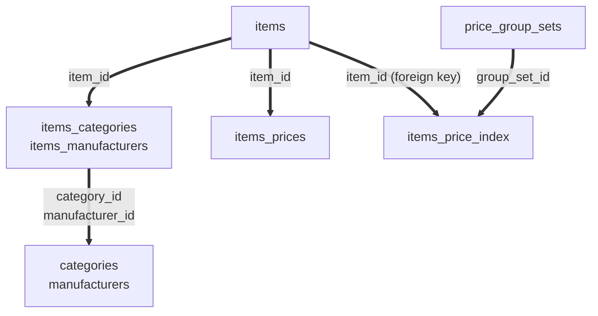
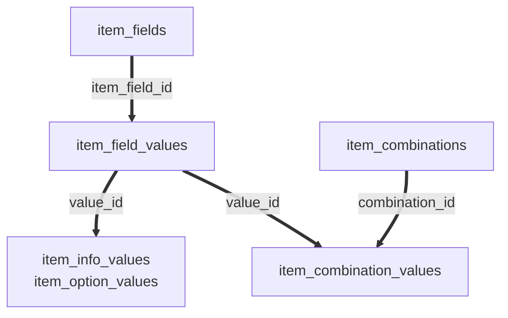
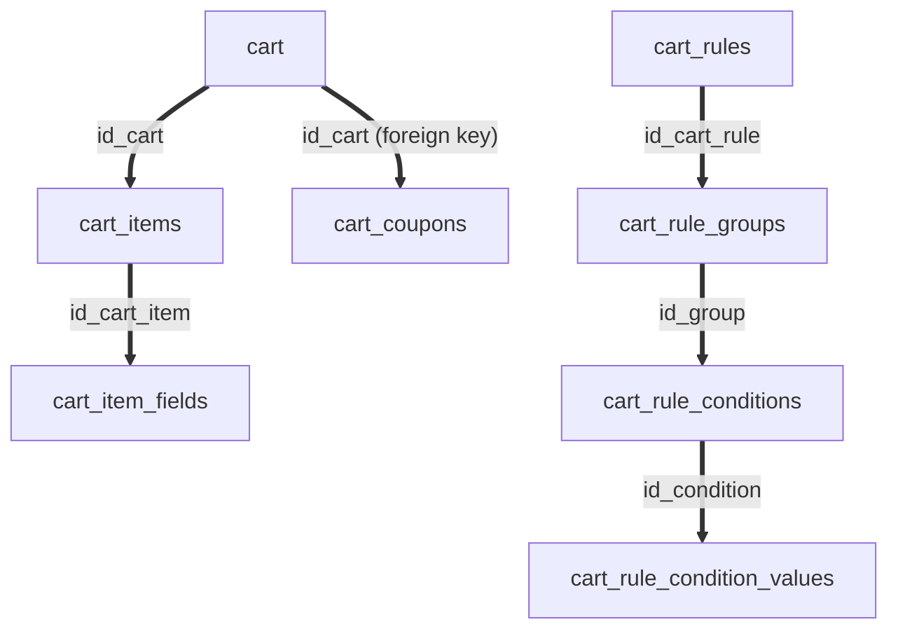
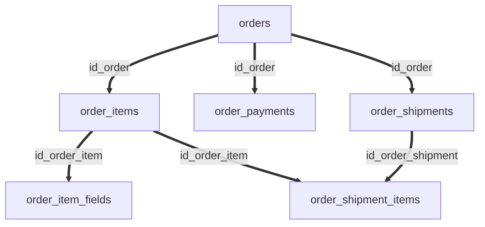
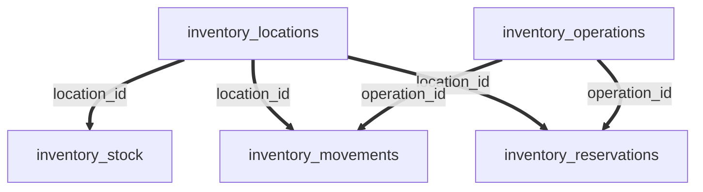
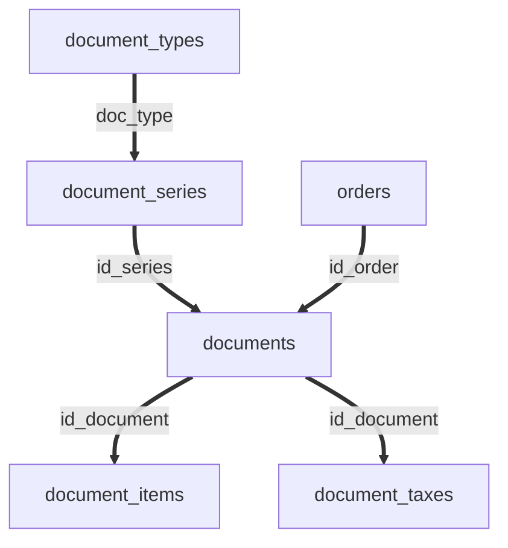

# Database Schema

<AlfaVersion verified="2.2.0" />

This page is a map of the database, not a copy of it. It groups the tables by area, says in one line what each table
holds, and shows the main relations in small diagrams.

The source of truth for every column, key and default is the install file:
[`administrator/sql/install.mysql.utf8.sql`](https://github.com/Easylogic-CO-LP/Alfa-Commerce/blob/main/administrator/sql/install.mysql.utf8.sql).
Its comments explain most columns. When a line below says "see the SQL", read the table there.

## What it does

The install file creates **111 tables**. Every name starts with `#__alfa_` (Joomla replaces `#__` with the site's
table prefix). On top of these come the per-language tables, made at run time, and one log table that a shipped
plugin makes for itself. Both are described after the groups.

How to read the diagrams: an arrow goes from a record to the rows that belong to it, and the label names the column
that holds the link. The database enforces only three of these links with a foreign key (they are marked "foreign
key" in the text). All the others are id columns that the code keeps in step.

## Catalogue

The item, the categories and manufacturers it belongs to, and its prices. An item's name, texts and address (alias)
are not here: they are in the per-language tables. A price is a row of `#__alfa_items_prices`. The price index is a
prepared copy of the final prices, so that listings can sort and filter by price without working each price out.

| Table | What it holds |
|---|---|
| `#__alfa_items` | The item: SKU, GTIN, MPN, size and weight, quantity rules, stock settings, default category, publish window. Its `stock` and `available_quantity` are figures kept up to date by the stock service, for display only |
| `#__alfa_items_categories` | Which categories an item is in (pair key) |
| `#__alfa_items_manufacturers` | Which manufacturers an item has (pair key) |
| `#__alfa_items_usergroups` | The user groups allowed to see an item (pair key) |
| `#__alfa_items_users` | The users allowed to see an item (pair key) |
| `#__alfa_categories` | The category tree (`parent_id`), with layouts, listing options and a publish window |
| `#__alfa_categories_usergroups` | The user groups allowed to see a category (pair key) |
| `#__alfa_categories_users` | The users allowed to see a category (pair key) |
| `#__alfa_manufacturers` | Manufacturers: website and meta data |
| `#__alfa_items_prices` | Price rows of an item. A row can be limited to a combination, a currency, a user group, a user, a country, a quantity range and a publish window. A row is a full price or an adjustment |
| `#__alfa_items_price_index` | The price index: one row per item, combination, currency, place, set of pricing groups and validity period, with the prepared price figures |
| `#__alfa_price_group_sets` | The sets of pricing groups that customers hold. The price index is keyed by them. A set is read only once it is fully prepared |

## Item fields, values and combinations

A field describes items (Size, Colour). Its values live in one shared pool. An item uses values in three ways: as
information, as options the shopper picks, or as the values that make up a variant (a combination).

| Table | What it holds |
|---|---|
| `#__alfa_item_fields` | Field definitions: the plugin type, whether the field is informational, required, used in filters, searched, shown on listings |
| `#__alfa_item_field_values` | The shared pool of values of each field (S, M, L or Red, Blue) |
| `#__alfa_item_field_categories` | The categories a field is offered in (pair key). No row means every category |
| `#__alfa_item_field_overrides` | Per item: the settings of a field that differ from its global ones, and the order of the fields on that item |
| `#__alfa_item_info_values` | The informational values of an item (specifications, filters) |
| `#__alfa_item_option_values` | The option values an item offers, each with an optional price change on the cart line |
| `#__alfa_item_combinations` | The variants of an item, each with its own SKU, GTIN, MPN and stock figures. An empty value means "as the item" |
| `#__alfa_item_combination_values` | Which values make up a combination (pair key) |
| `#__alfa_item_combination_field_params` | Field plugin settings for one combination or one option |

## Customers and form fields

Alfa keeps one row for each Joomla user and each Joomla user group. A customer's details (delivery or invoice) are
rows of `#__alfa_user_info`. The columns of that table are the form fields: when a merchant adds a field, the table
gets a column.

| Table | What it holds |
|---|---|
| `#__alfa_users` | One row per Joomla user (`id_user`), with a note |
| `#__alfa_usergroups` | One row per Joomla user group (`usergroup_id`), with its price display settings |
| `#__alfa_user_info` | One row is one set of customer details. Every column except `id` and `id_user` is a form field |
| `#__alfa_form_field_groups` | Groups of form fields, with their order |
| `#__alfa_form_fields` | The definitions of the customer detail fields: type, settings, machine name, role (name, email, phone), and where each is asked (registration, billing, shipping) |
| `#__alfa_form_fields_en_gb` | The English labels of the fields the installation creates. One of the two language tables the install file makes itself |
| `#__alfa_form_fields_usergroups` | The user groups a field is limited to (pair key) |
| `#__alfa_form_fields_users` | The users a field is limited to (pair key) |

## Cart

A cart is working data, never a record. When a cart becomes an order, the cart is deleted in the same transaction
and the order keeps no link to it. A coupon is a cart rule that is switched on by a code.

| Table | What it holds |
|---|---|
| `#__alfa_cart` | The live carts: the customer or the browser that owns it, the chosen payment and shipping method, the chosen details, the currency |
| `#__alfa_cart_items` | The lines of a cart: item, combination, quantity |
| `#__alfa_cart_item_fields` | The field choices of a cart line |
| `#__alfa_cart_coupons` | The codes a shopper entered on a cart. Only the code is stored |
| `#__alfa_cart_rules` | Cart rules: coupons and automatic discounts, as one kind of record |
| `#__alfa_cart_rule_groups` | Condition groups of a rule. All groups must be met |
| `#__alfa_cart_rule_conditions` | The conditions of a group. All rows of a group must match |
| `#__alfa_cart_rule_condition_values` | The values of a condition (pair key). Any one value is enough |
| `#__alfa_cart_rules_users` | The users a rule is limited to (pair key). Empty means everyone |
| `#__alfa_cart_rules_usergroups` | The user groups a rule is limited to (pair key). Empty means every group |

## Orders

An order is self-contained: it keeps its own copy of the customer's name and e-mail, the names of the methods, and
on each line the name, the prices and the tax as they were when it was placed. Later changes to the catalogue do not
change an order. Payments, refunds and shipments are rows that belong to the order.

| Table | What it holds |
|---|---|
| `#__alfa_orders` | The order header: reference, customer and a copy of the name and e-mail, currency and its scale, the chosen methods with a copy of their names, status, language, notes |
| `#__alfa_order_items` | The order lines, with the name, SKU, prices, discount and tax frozen on the line, and the quantities refunded and returned |
| `#__alfa_order_item_fields` | The field choices of an order line, copied at purchase so that they survive later changes to fields and values |
| `#__alfa_order_cart_rule` | The cart rules applied to an order, frozen with their amounts |
| `#__alfa_order_contributions` | The amounts that plugins added to the order's totals, frozen |
| `#__alfa_orders_statuses` | The order statuses: colours, what the status does to stock, flags (initial, cancelled, completed), e-mail layouts, document and payment rules |
| `#__alfa_orders_statuses_en_gb` | The English names and e-mail texts of the statuses the installation creates. The other language table the install file makes itself |
| `#__alfa_orderstatus_recipients` | Which users receive the staff e-mail when an order enters a status (pair key) |
| `#__alfa_order_activity_log` | The order's history: one row per event, with who did it, the status at that moment and a summary |
| `#__alfa_order_payments` | The money rows of an order: payment, refund, authorization, reversal, chargeback. The amount is always positive and the type gives the direction |
| `#__alfa_payment_references` | Stored payment credentials of a customer, for charges the merchant starts later |
| `#__alfa_refund_report_outcomes` | The outcome of each refund a payment provider reported as made outside Alfa: recorded, reconciled, or duplicate or invalid |
| `#__alfa_order_shipments` | The parcels of an order: method, cost and tax, tracking number, status |
| `#__alfa_order_shipment_items` | Which order lines are in which parcel, and how many of each |

## Payment and shipping methods

A method is a record that names its plugin (`type`) and holds its settings. The link tables around a method limit
where it is offered.

| Table | What it holds |
|---|---|
| `#__alfa_payments` | The payment methods: plugin type, settings, colours |
| `#__alfa_payment_categories` | Scope of a payment method by category (pair key) |
| `#__alfa_payment_manufacturers` | Scope of a payment method by manufacturer (pair key) |
| `#__alfa_payment_places` | Scope of a payment method by place (pair key) |
| `#__alfa_payment_shipments` | Links a payment method to shipping methods (pair key) |
| `#__alfa_payment_usergroups` | Scope of a payment method by user group (pair key) |
| `#__alfa_payment_users` | Scope of a payment method by user (pair key) |
| `#__alfa_payments_standard_logs` | The log table of the standard payment plugin |
| `#__alfa_shipments` | The shipping methods: plugin type, settings, colours, and whether an entered price includes tax |
| `#__alfa_shipment_categories` | Scope of a shipping method by category (pair key) |
| `#__alfa_shipment_manufacturers` | Scope of a shipping method by manufacturer (pair key) |
| `#__alfa_shipment_places` | Scope of a shipping method by place (pair key) |
| `#__alfa_shipment_usergroups` | Scope of a shipping method by user group (pair key) |
| `#__alfa_shipment_users` | Scope of a shipping method by user (pair key) |
| `#__alfa_shipment_taxes` | The tax rules a shipping method's charge is taxed with (pair key). No row means no shipping tax |

## Stock

Stock is counted per location. `#__alfa_inventory_stock` is the stock of record. Every change of a quantity is also
written as a movement that is never edited afterwards, and every command of the stock service is written as an
operation. The stock figures on an item or a combination are copies of these rows.

| Table | What it holds |
|---|---|
| `#__alfa_inventory_locations` | The stock locations. One default location is created by the installation |
| `#__alfa_inventory_stock` | The stock of record: quantity and reserved quantity per item, combination and location |
| `#__alfa_inventory_movements` | The stock ledger: one added row for every change of a quantity |
| `#__alfa_inventory_operations` | One row per command the stock service ran, for audit |
| `#__alfa_inventory_reservations` | Stock held for orders: quantity, how much was fulfilled and released, state |
| `#__alfa_inventory_transfers` | Transfers between two locations. Each owns one movement out and one movement in |
| `#__alfa_inventory_effect_outbox` | Stock changes that a saved order or document still owes, kept until the movement exists |
| `#__alfa_inventory_line_resolutions` | Staff decisions about order lines whose item or combination no longer exists, or that staff classified. Rows are only added |
| `#__alfa_inventory_line_provenance` | For each order line, whether its stock was tracked when it was placed. Removed with its order line (foreign key on `order_item_id`) |
| `#__alfa_inventory_integrity_holds` | Units kept out of sale until their stock figures are repaired |

## Documents

Invoices, credit notes, delivery notes and the other sales documents share one set of tables. A document type says
how a kind of document behaves, a series gives it its numbers, and an issued document keeps frozen copies of the
buyer, the seller, its lines and its tax totals.

| Table | What it holds |
|---|---|
| `#__alfa_document_types` | The document types and how each behaves. Extended by packages, not by the merchant |
| `#__alfa_document_series` | The numbering series of each type: prefix, next number, the seller's details |
| `#__alfa_documents` | The document headers. An issued document is not changed afterwards |
| `#__alfa_document_items` | The lines of a document, frozen at issue |
| `#__alfa_document_taxes` | The tax summary of a document per rate, written at issue |

## Customer credit

Store credit of a customer. The transactions are the truth: the balance is their sum. The account row holds a copy
of the balance and is the row the code locks while it writes.

| Table | What it holds |
|---|---|
| `#__alfa_customer_credit_accounts` | One row per customer: the lock point and a copy of the balance |
| `#__alfa_customer_credit_transactions` | The credit ledger. Rows are only added |

## Downloads

Files sold with an item. One table says what a future buyer gets, the other records what each buyer was given.

| Table | What it holds |
|---|---|
| `#__alfa_item_downloads` | The files attached to an item, with the limits for future buyers (number of downloads, days valid) |
| `#__alfa_order_downloads` | The download right a purchase gave: one row per order line and file, with the terms frozen when it was granted |

## Media

| Table | What it holds |
|---|---|
| `#__alfa_media` | Pictures and other media: path, thumbnail, alt text, colour, order. `origin` and `item_id` say what a row belongs to; see the SQL |

## Search and projections

A projection is a prepared copy of catalogue data that makes reading fast. The price index in the catalogue group is
one. The filter index is another. The two rebuild tables let a search engine plugin rebuild its index over many
requests.

| Table | What it holds |
|---|---|
| `#__alfa_item_field_value_index` | The filter index: flat rows of item, field and value, used by the catalogue filters |
| `#__alfa_search_rebuilds` | An index rebuild in progress: one row per search engine, with its position |
| `#__alfa_search_rebuild_items` | Items saved while a rebuild is walking, so that they are written again before the new index is used |

## Tasks and jobs

Work that runs after a save or in the background. See [Background work](background-work.md).

| Table | What it holds |
|---|---|
| `#__alfa_tasks` | Tasks of two kinds. A single is one thing a change owes after its commit (an e-mail, a plugin's reaction, a notice). A job is long work done in steps |
| `#__alfa_task_slots` | Named slots that limit how many jobs run at once (one heavy job at a time) |

## Notifications

| Table | What it holds |
|---|---|
| `#__alfa_notifications` | The notifications shown to staff in the back office: text as a language key with its parameters, severity, link, who may see it, read and dismissed marks |

## Maintenance and setup

| Table | What it holds |
|---|---|
| `#__alfa_meta` | Facts Alfa keeps about its own database, by name. `schema_version` is one of them |
| `#__alfa_maintenance` | One row: the state of Clear everything (running, paused, failed) and what the last run left on record |
| `#__alfa_action_once` | Keys of one-time actions already used, per user, so that the same action cannot run twice |

## Places, currencies, taxes and discounts

The shop's reference data. A tax rule or a discount applies everywhere unless its link tables limit it to
categories, manufacturers, places, user groups or users.

| Table | What it holds |
|---|---|
| `#__alfa_places` | Places (countries and their parts, through `parent_id`), each with its codes and default currency |
| `#__alfa_currencies` | Currencies: code, symbol, decimal places, separators, format |
| `#__alfa_taxes` | Tax rules: rate, how the rule combines with others, publish window |
| `#__alfa_tax_categories` | Scope of a tax rule by category (pair key) |
| `#__alfa_tax_manufacturers` | Scope of a tax rule by manufacturer (pair key) |
| `#__alfa_tax_places` | Scope of a tax rule by place (pair key) |
| `#__alfa_tax_usergroups` | Scope of a tax rule by user group (pair key) |
| `#__alfa_tax_users` | Scope of a tax rule by user (pair key) |
| `#__alfa_discounts` | Discounts: a percentage or an amount, whether it applies before tax, publish window, and how its tag is shown |
| `#__alfa_discount_categories` | Scope of a discount by category (pair key) |
| `#__alfa_discount_manufacturers` | Scope of a discount by manufacturer (pair key) |
| `#__alfa_discount_places` | Scope of a discount by place (pair key) |
| `#__alfa_discount_usergroups` | Scope of a discount by user group (pair key) |
| `#__alfa_discount_users` | Scope of a discount by user (pair key) |

## Tables made at run time

### The per-language tables

Text that can be translated is not stored in the tables above. For each translatable table Alfa makes one more
table per published content language, named `<base table>_<language>`, for example `#__alfa_items_en_gb` and
`#__alfa_items_el_gr`. Each has the id of the base record and one column per translated field.

In 2.2.0 sixteen base tables have language tables: `cart_rules`, `categories`, `discounts`, `document_types`,
`form_field_groups`, `form_fields`, `inventory_locations`, `item_combinations`, `item_field_values`, `item_fields`,
`items`, `manufacturers`, `orders_statuses`, `payments`, `shipments` and `taxes`.

The install file itself makes only two of them, `#__alfa_form_fields_en_gb` and `#__alfa_orders_statuses_en_gb`, so
that the fields and statuses it creates have English names from the first minute. All the others are made by code.
[Multilingual](multilingual.md) explains when, and how they are read.

### A plugin's log table

A payment or shipping plugin may keep a log table named `#__alfa_{family}_{name}_logs`. The standard payment
plugin's table, `#__alfa_payments_standard_logs`, is in the component's install file and is counted in the 111. The
standard shipping plugin makes its own, `#__alfa_shipments_standard_logs`, from
`plugins/alfa-shipments/standard/sql/install.mysql.utf8.sql`. It is the one table a shipped plugin creates itself.
A plugin declares the columns of its log in its `params/logs.xml` file. The plugin types are introduced in
[Plugins overview](../plugins/overview.md).

## Rules that hold for every table

### Pair keys on the link tables

A link table has two id columns and one row per link. Since 2.0.1 the primary key of every link table is the pair
of ids, so the database itself refuses the same link twice. The tables above marked "pair key" are these tables.
An insert of a pair that is already there is refused by the database.

### One collation

Since 2.1.1 every table is `utf8mb4_unicode_ci`, as Joomla's own tables are, so a text column of one table can be
compared with a text column of any other. Only a few hash and key columns that must compare bytes carry a binary
collation of their own. If your plugin creates a table, give it the same collation, or a query that joins it to an
Alfa table can fail with "Illegal mix of collations".

### Wider record numbers in 2.2.0

The tables that grow fastest have a `bigint` id since 2.2.0: `#__alfa_inventory_movements`,
`#__alfa_inventory_operations` and `#__alfa_order_activity_log`. `#__alfa_tasks` has had one since it was added in
2.1.4. Do not store these ids in a 32-bit integer column or variable.

## How the schema changes between releases

### What it does

Joomla records the schema version of the component. On an update it runs every file in
`administrator/sql/updates/mysql/` that is newer than the recorded version, in order. A change to the schema is
therefore written twice: in the install file, for new shops, and in a new update file, for shops that already exist.

| File | What it changes |
|---|---|
| `2.0.0.sql` | Empty. 2.0.0 is the starting point |
| `2.0.1.sql` | The pair keys on the link tables |
| `2.1.0.sql` | Adds `#__alfa_maintenance` and `#__alfa_refund_report_outcomes`, indexes for the back office pages, and `shipments.price_entry_mode` |
| `2.1.1.sql` | Converts the tables that had another collation to `utf8mb4_unicode_ci` |
| `2.1.4.sql` | Adds `#__alfa_tasks` and `#__alfa_task_slots` |
| `2.2.0.sql` | The wider ids, `items.projection_dirty_at`, `document_items.tax_name`, `media.thumbnail_origin`, text columns for the tax name of an order line and the tax chain of a parcel, a new index on the tasks, and the rows of the job runner's slots |

The installer's own script, `script.php`, works beside these files. For example, before `2.0.1.sql` adds the pair
keys it reduces any link written twice to one row.

### What can go wrong

| What happens | Why |
|---|---|
| The installer refuses to update a 1.x shop | There is no update file older than 2.0.0. An Alfa Commerce older than 2.0.0 cannot be updated in place |
| The installer refuses to install over kept tables | The tables are at another schema version than the one this install file creates. The version is read from `#__alfa_meta` before anything is changed |
| A statement in an update file fails and the update goes on | The statement carries Joomla's marker `/** CAN FAIL **/`. It is used where a second run must not stop, for example a key that already exists |

### Uninstalling keeps the tables

There is no uninstall SQL, on purpose. Uninstalling Alfa Commerce keeps every Alfa table and its rows, and
installing the same schema again connects to them. For that reason the install file can run over kept tables: every
table is created only if it does not exist, with its keys inside the statement, and every starting row is written
only into an empty table. Removing the shop's data is a separate action that staff start themselves, Clear
everything under Tools. The standard shipping plugin follows the same rule for its log table.

## Not documented yet

- The columns of each table. The install file is the reference, and its comments explain them.
- What each `origin` value of `#__alfa_media` means.
