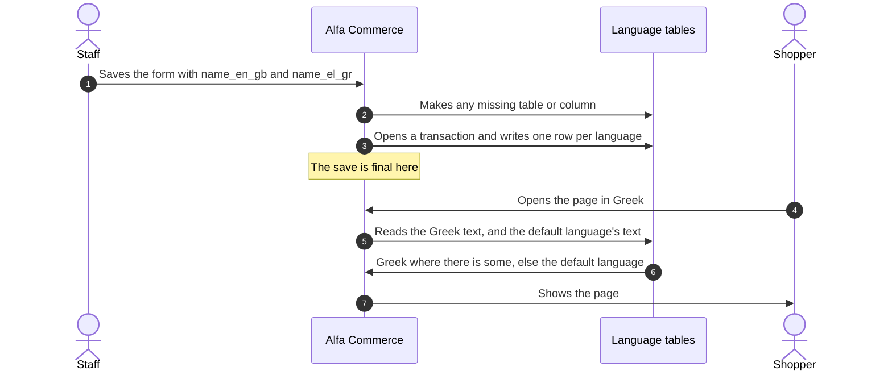

# Multilingual and Translations

<AlfaVersion verified="2.2.0" />

A shop can show its items, categories and other records in several languages. This page explains where the
translated text is stored, which language a reader sees, and what your code must do to read and write it.

Two different things are called "language" in a Joomla site. Keep them apart:

- **Content** is what the shop wrote: an item's name, a category's description, an order status's name. This page is
  mostly about content.
- **Interface text** is what the software says: labels, buttons, messages. It comes from language files. See
  [Language files and language packs](#language-files-and-language-packs).

## What it does

### Where translated content is stored

A translatable record is split in two. The main table keeps what is the same in every language (the SKU, the
price rows, the state). The text is kept in one extra table per **published content language** (a language
published in Joomla under Content Languages), named `<base table>_<language>`:

```text
#__alfa_items            id, sku, weight, state ...      no name, no alias
#__alfa_items_en_gb      id_item, name, alias, short_desc, full_desc, meta_title ...
#__alfa_items_el_gr      id_item, name, alias, short_desc, full_desc, meta_title ...
```

The language part is Joomla's language tag in lower case with an underscore: `en-GB` becomes `en_gb`. Each
language table has one key column that holds the id of the base record (`id_item` above) and one column per
translated field.

Sixteen base tables have language tables in 2.2.0.

| Base table | Key column in its language tables |
|---|---|
| `#__alfa_items` | `id_item` |
| `#__alfa_categories` | `id_category` |
| `#__alfa_manufacturers` | `id_manufacturer` |
| `#__alfa_item_fields` | `id_item_field` |
| `#__alfa_item_field_values` | `id_item_field_value` |
| `#__alfa_item_combinations` | `id_item_combination` |
| `#__alfa_orders_statuses` | `id_orderstatus` |
| `#__alfa_payments` | `id_payment` |
| `#__alfa_shipments` | `id_shipment` |
| `#__alfa_taxes` | `id_tax` |
| `#__alfa_discounts` | `id_discount` |
| `#__alfa_cart_rules` | `id_cart_rule` |
| `#__alfa_document_types` | `id_document_type` |
| `#__alfa_inventory_locations` | `id_inventory_location` |
| `#__alfa_form_fields` | `id_formfield` |
| `#__alfa_form_field_groups` | `id_form_field_group` |

Fourteen of them are found by reading the component's form files: a form field that carries the attributes
`multilingual_table` and `multilingual_pk` is a translated field of that table. Two have no form and are declared
in code: the values of an item field and the variants of an item. A variant keeps a language row only while it
overrides the item's own text.

### How a translated field travels



- **In the form** each translated field appears once per language, named `field_language`: `name_en_gb`,
  `alias_el_gr`. The field types `MultilingualText`, `MultilingualTextarea` and `MultilingualEditor` produce these
  names.
- **On save** `MultilingualHelper::saveMultilingualData()` sorts the posted values by language and writes one row
  into each language table.
- **Empty stays empty.** Each language stores only what was entered for it. A field left empty is not filled with
  another language's text. The reader sees the default language meanwhile, and the edit form keeps showing
  translators what is still missing.
- **On delete** `MultilingualHelper::deleteMultilingualData()` removes the record's rows from every language table.

All of this is in `administrator/src/Helper/MultilingualHelper.php`. It writes its log lines under the category
`com_alfa.multilingual`.

### Which language is shown when a translation is missing

A read looks in the reader's language first. Where that language has no text, it shows the text of the **default
content language**. In a list query this is one expression per field:
`COALESCE(NULLIF(current, ''), NULLIF(default, ''), '')`. A record without a translation still appears in the list.

The default content language is decided in one place, `MultilingualHelper::getDefaultLanguageTag()`. Since 2.1.1
the rule is:

1. It is the site language set in Joomla's Language Manager, when that language is also a published content
   language.
2. It is never the language of the current request. The visitor's language and the administrator's language play no
   part.
3. If the configuration is not valid (no site language is set, or the one set is not a published content language),
   it is the published content language that was created first. Administrators are warned through the notifications
   bell until the setting is fixed.

`getDefaultLanguageTag()` returns the table form (`en_gb`). `getDefaultLanguageCode()` returns Joomla's form
(`en-GB`).

### Aliases

The alias is the part of an address that names a record (`blue-shirt`). In Alfa it is a translated field like any
other: each language has its own alias in its language table, and the main table has no alias column.

The alias rule since 2.1.1:

- **An empty alias is generated.** Alfa builds it from the name in the same language and makes it unique in that
  language by adding `-2`, `-3` and so on.
- **A typed alias is never renamed.** Alfa stores it as typed.
- **A save that would give two records one address is refused.** Before anything is written, the model asks
  `MultilingualHelper::aliasClashes()`. If the save would create a clash in any language, the save stops with a
  message that names the alias, the language and the other record. The administrator models of items, categories
  and manufacturers do this.
- **A clash that already existed is kept.** The save goes ahead, nothing is renamed, and a warning names it.

A record answers in each language at its own alias, or at its default language alias when it has none in that
language. Both count when Alfa looks for a clash.

Where an alias must be unique is set in `administrator/src/Helper/MultilingualAliasConfig.php`:

| Table | Unique within |
|---|---|
| `#__alfa_items` | The whole language (an item can be in many categories) |
| `#__alfa_manufacturers` | The whole language |
| `#__alfa_categories` | The same parent category (`parent_id`) |
| `#__alfa_item_field_values` | The same field (`item_field_id`) |

## When it is used

### When the language tables are created

The language tables exist for the content languages that are **published now**. One routine makes them all,
`SyncHelper::syncLanguageSchema()`: it creates missing tables, adds missing columns and never drops anything. It
then gives the records the installation created (the order statuses and the system form fields) their names in the
new language.

It runs:

- when Alfa Commerce is installed or updated,
- when a content language is saved, or published from the Content Languages list (the `alfasync` system plugin,
  `plugins/system/alfasync`, listens for both),
- after an Alfa Commerce language pack is installed or updated,
- during Clear everything, when it makes Alfa's tables again,
- when staff press **Language tables** under Tools > Database Sync.

A save can also be the first write in a language the routine has not reached. For that case
`saveMultilingualData()` makes the tables and columns it is about to write, before it opens its transaction.

Keep the `alfasync` plugin enabled. Without it a newly published language gets its tables only at the next update,
when staff run **Language tables**, or one table at a time as records are saved.

### The two tools

Both are under **Tools > Database Sync** in the back office.

| Tool | What it does |
|---|---|
| **Language tables** | Creates any missing language table and column for every translatable table. Safe to run again |
| **Backfill empty translations** | Fills empty translation fields from a language that already has content. It never overwrites a translation, makes copied aliases unique per language, and works in chunks. It makes missing language tables first |

When a content language is published after the shop has content, a notification tells staff how many records have
no text in it yet and links to the backfill tool.

## What you must provide

### To make a field of your form translatable

Declare it in the form XML with one of the multilingual field types, the base table and the key column of its
language tables. This is the item's short description, from `administrator/forms/item.xml`:

```xml
<field name="short_desc" type="MultilingualEditor"
       multilingual_table="#__alfa_items" multilingual_pk="id_item"
       cols="30" rows="3" editor="|" buttons="true" filter="Joomla\CMS\Component\ComponentHelper::filterText"
       label="COM_ALFA_FORM_LBL_ITEM_SHORT_DESC"
       description="COM_ALFA_FORM_DESC_ITEM_SHORT_DESC"/>
```

### To read translated content

| You want to | Use |
|---|---|
| Fill an edit form with every language's values | `MultilingualHelper::bindMultilingualToItem($item, $id, $primaryColumnName, $tableName)` |
| Add translated columns to a list query, with the fallback to the default language | `MultilingualHelper::addMultilingualJoinToQuery()` |
| Read one field of one record in one language | `MultilingualHelper::getTranslatedValue($id, $tableName, $primaryColumnName, $field, $langTag)` |
| Know the reader's content language | `MultilingualHelper::getCurrentLanguageTag()` |
| Know the default content language | `MultilingualHelper::getDefaultLanguageTag()` |

Never read a name or an alias from the main table. It is not there.

### If you save inside your own transaction

Making a table or adding a column cannot be part of a transaction: MySQL commits the open transaction first. So
Alfa refuses to change a language table while a transaction is open, with an exception. If your code opens a
transaction and then calls `saveMultilingualData()`, make the tables first:

```php
use Alfa\Component\Alfa\Administrator\Helper\MultilingualAliasConfig;
use Alfa\Component\Alfa\Administrator\Helper\MultilingualHelper;
use Alfa\Component\Alfa\Administrator\Helper\TransactionState;

// 1. Before any transaction: make the language tables and columns this save needs.
MultilingualHelper::ensureLangSchemaForData(
    tableName:         '#__alfa_categories',
    primaryColumnName: 'id_category',
    data:              $data,
);

// 2. Now open the transaction and save.
$db->transactionStart(true);

try {
    // ... your other writes ...

    MultilingualHelper::saveMultilingualData(
        currentId:         $categoryId,
        primaryColumnName: 'id_category',
        tableName:         '#__alfa_categories',
        data:              $data,
        aliasFields:       MultilingualAliasConfig::FIELDS['#__alfa_categories'],
        aliasUniqueScope:  MultilingualAliasConfig::SCOPE['#__alfa_categories'],
    );
} catch (\Throwable $e) {
    TransactionState::rollBackLevel(db: $db, failure: $e);

    throw $e;
}

TransactionState::commitLevel($db);
```

`$data` is the form data with its `field_language` keys, `$categoryId` the id of the saved record and `$db` the
database driver. The transaction rules are explained in [Architecture overview](overview.md).

## What happens next

### Language switching and associations

Joomla's language switcher asks the component for the address of the same page in each language. Alfa answers
through `AssociationsHelper` (registered in `administrator/services/provider.php`), which hands the question to
`site/src/Helper/AssociationHelper.php`. Only the detail pages and the category listing take part. When an address
is built for another language (it carries `lang`), the storefront router reads the alias in that language, so each
language's link uses its own alias.

### The API

The REST API accepts a `lang` parameter in the address. It chooses the content language of the answer and leaves the
language of the API's own messages alone.

### Documents and e-mails

An order remembers the language it was placed in. Since 2.1.1 the e-mails of an order that has no language of its
own, and the documents issued in the back office, are in the default content language. It is never the language of
the staff member who sends or issues them. In an order e-mail each
status text that is empty in the order's language is taken from the default content language. See
[Order e-mails](order-emails.md) and [Documents](../services/documents.md).

### Notifications in each reader's language

Since 2.1.4 a notification is stored as a language key with its parameters, not as finished text. It is translated
when it is shown, so a staff member working in Greek and one working in English read the same notification, each in
their own language. The row also keeps the text as first written, in the shop's default administrator language.
That copy is shown only when the reader's language can no longer resolve the key, for example after the extension
that owns it was removed. A plugin builds such a text with `NotificationText`
(`administrator/src/Helper/NotificationText.php`).

## Language files and language packs

- **Core ships English only** (since 2.1.1). Every other language is a separate language pack, a Joomla package
  named `pkg_alfacommerce_<tag>`, for example `pkg_alfacommerce_el-GR`.
- **Language files live in Joomla's own language folders** (since 2.1.2): `administrator/language/<tag>/` for the
  component, its guided tours and its plugins, and `language/<tag>/` for the storefront and the modules. The
  component keeps no language folder of its own on an installed site.
- **The component's files** are `com_alfa.ini` and `com_alfa.sys.ini`, plus `com_alfa.tours.ini`, which holds the
  texts of all the guided tours in one file per language.
- **Each extension owns its strings.** A plugin or a module carries every string it shows in its own language
  files. The component's files hold only the component's strings. Do the same in your plugin: do not rely on a
  string of `com_alfa.ini`.
- **After a language pack is installed or updated**, Alfa updates its language tables itself. A pack's install
  script does not have to.
- **Uninstalling Alfa Commerce** also uninstalls its language packs, through Joomla's installer. Joomla's own
  language packages are not touched.

## What can go wrong

| What happens | Why |
|---|---|
| An exception says a language table "is not changed inside an open transaction" | A table or column was missing and a transaction was open. Call `ensureLangSchemaForData()` before you open it |
| A save is refused with a message about an alias | The typed alias, or the alias the record falls back to, is already another record's address in that language. Type another alias, or clear the field to let Alfa generate one |
| Text shows in another language than expected | The reader's language has no text for that field, so the default content language is shown. Translate it, or run **Backfill empty translations** |
| Untranslated text shows in an unexpected language and the bell shows a warning | Joomla's site language is not a published content language. Fix it in the Language Manager |
| The order statuses and system fields have no names in a new language | Its language tables were not made by the language routine, usually because the `alfasync` plugin is disabled. Enable it and run **Language tables** |
| A query that joins a language table fails with "Illegal mix of collations" | A table of yours has another collation. Every Alfa table, the language tables included, is `utf8mb4_unicode_ci` |
