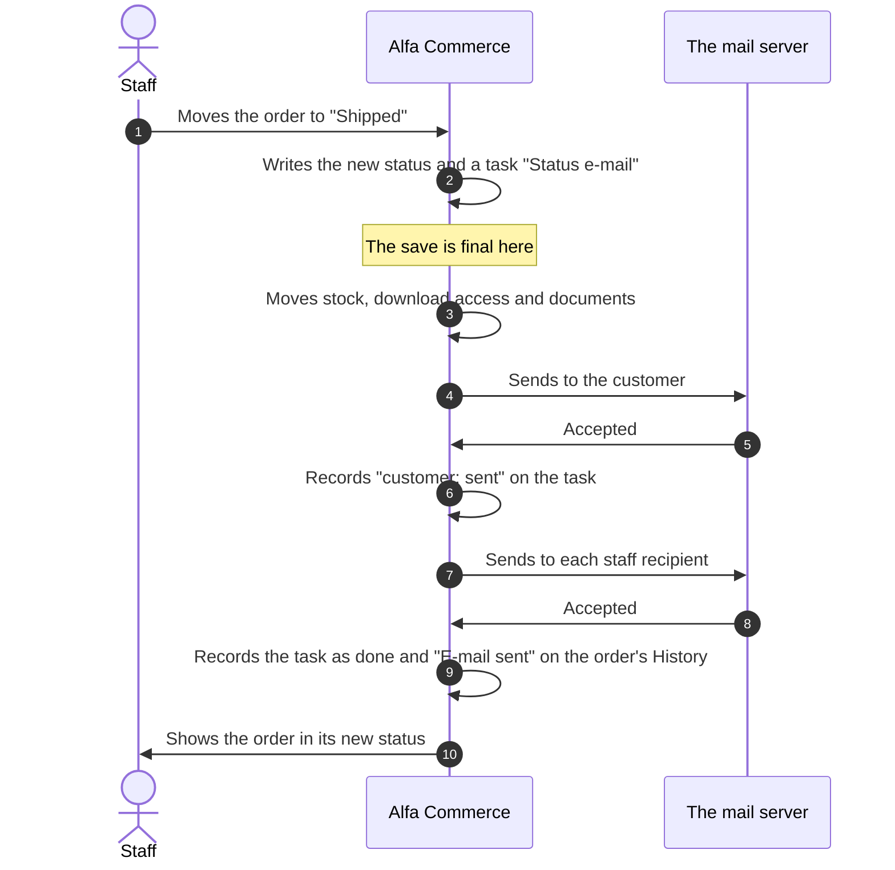

# Order e-mails

<AlfaVersion verified="2.3.0" />

Alfa Commerce sends an e-mail when an order is placed, when an order enters a status that is set to tell somebody,
when staff send an order's payment link, and to the shop about a card dispute on an order's payment. The e-mail of a
placement, a status change or a dispute is never sent inside the save. Alfa writes down "this e-mail is owed"
together with the change, and sends it once the save is final (the commit). That piece of owed work is a **task**.
Read [Background work](./background-work.md) first: it explains tasks, their states and Tools > Tasks.

## What it does

### Which e-mails exist

There are three kinds of e-mail task. The first two can go to the customer, to staff, or to both; the dispute e-mail
goes to staff only.

| E-mail | What triggers it | Kind of task |
|---|---|---|
| **Order confirmation e-mail** | An order is placed, at checkout or from the order builder in the administrator, or is created with its lines through the REST API. It is the e-mail of the status the order is placed in. | `order.placement_email` |
| **Status e-mail** | An order enters a status, by any route: staff, a payment, a shipment, the API | `order.status_email` |
| **Dispute e-mail** (staff only) | A card dispute is recorded or first reported; at its outcome; and three days before its deadline while no evidence is marked sent (the reminder, written by the job `order.dispute.remind`) | `order.dispute_email` |

Who receives a confirmation or a status e-mail is set on the order status, not in code:

| Recipient | When it is sent | The address |
|---|---|---|
| The customer | When the status has **notify the customer** switched on (`notify_customer`) | A registered customer's present account address while the account exists. Otherwise the address kept on the order. |
| Staff recipients | When the status lists users to tell. Blocked users and users with no address are left out. | Each listed user's account address |

A status change into a status that tells nobody creates no e-mail task at all. A new order always has its
confirmation task, which sends nothing when the status tells nobody.

The dispute e-mail goes to the shop's own address (Options, General, **Store contact email**), the task's one
recipient, named `store:shop@example.com`. It says what the dispute's notice says, in the shop's default administrator
language, with the link to the order below it; it uses no layout, positions or tokens. With no such address there is no
dispute e-mail task, and the notification bell still tells staff. The customer gets no e-mail about a dispute. See
[Card disputes](../services/disputes.md#telling-staff).

One more e-mail is not a task: the **payment link** that staff send from the order screen (Send payment link, on the
payments panel of an order its customer may pay again). It goes to the customer alone, at once, and the operator reads
its outcome on the screen; nothing is tried again by itself. It is drawn with the same layout as the confirmation and
status e-mails, with a subject and an opening of its own. See
[Sending the payment link](../services/payments-and-shipments.md#sending-the-payment-link).

The notification bell in the administrator is a separate thing. It is not e-mail.

### The payment link

**Send payment link**, in the payments panel of the order screen (Orders: Edit), e-mails the customer the link to pay
the order again (see [Paying an order again](../services/payments-and-shipments.md#paying-an-order-again)). It is
sent only while the order may be paid again, and it is not a task: it is sent at once, and the order screen says
whether it was sent, handed over with no answer, or not sent and why. A link sent, or handed over with no answer, is
written to Joomla's User Actions Log, not to the order's History. Nothing sends it again by itself.

It is drawn with the layout `emails.order.default` (or its override), whatever layout the status picks, in the
order's language. Its subject and opening are its own (`COM_ALFA_ORDEREMAIL_PAYLINK_SUBJECT`,
`COM_ALFA_ORDEREMAIL_PAYLINK_INTRO`); the other positions show the default texts of the language file, not the texts
typed on the order status. It carries **Pay now** and no download links or attachments. Staff get no copy.

### The order of things

Three things follow from this order:

- If the status change is undone, the task is undone with it. No e-mail goes out for a change that did not happen.
- A slow mail server does not hold the order. The status is already saved when the sending starts.
- If the request stops after the save, the e-mail is not lost. The engine sends it later.

The e-mails of one order go out in the order their statuses were entered. The plugins' reaction
(`onOrderStatusChange`) runs after the e-mail.

## When it is used

- At checkout, at a placement from the order builder, and when an order is created with its lines through the REST
  API, for the status the new order opens in.
- At every status change, when the new status tells somebody.
- Not when the code that makes the change asks for no e-mail. Code that calls `Transition::silent()` sends nothing,
  to the customer or to staff, and `Transition::silentCustomer()` leaves out the customer alone. The REST API's
  status change accepts `"silent": true`, which leaves out the customer's e-mail only: the staff the status tells
  are still sent theirs. An order created through the REST API takes the same `silent` for its confirmation.
  Everything else still happens.

## What happens next

### One outcome for each recipient

Every recipient is a part of the task, named by role and address: `customer:anna@example.com`,
`admin:orders@example.com`. Alfa records each part as soon as its outcome is known.

| Outcome | What it means | What Alfa does |
|---|---|---|
| Sent | The mail server accepted the message | Records it. This recipient is never sent to again. |
| Failed | The message was refused before it was handed over (no connection, the sender or the recipient refused), or the server answered with a refusal. Nothing was delivered. | Tries this recipient again by itself: after 1 minute, 5 minutes, 30 minutes, 2 hours, 6 hours and 24 hours. Then the task is Failed. |
| Outcome unknown | The message was handed over and no answer came (a timeout, a lost connection). It may have arrived. | **Holds** the task. It is never sent again by itself. |
| Mail switched off | Joomla's Global Configuration has Send Mail set to No | Sends nothing. The task is Failed at once and is never sent later by itself. |

Alfa can tell "refused" from "handed over with no answer" only when Joomla sends through SMTP, because it reads
the conversation with the mail server. With another sending method a failed send counts as Failed.

Joomla's mailer normally makes a second attempt after a failed one. Once a message was handed over, Alfa stops that
second attempt, so that the same message cannot arrive twice.

### What staff do with a failed or held e-mail

Tools > Tasks lists it, and a danger notification points there.

| Button | What it does |
|---|---|
| **Resend** | Writes a new task that sends only to the recipients not recorded as sent. The old task is closed. |
| **Mark resolved** | Closes the task with no sending. A reason must be typed. |

Use Resend after switching Joomla's mail back on. An e-mail that failed because mail was off is never sent later by
itself, so a copy of a shop kept with mail off does not send old e-mails when mail is switched on.

### The entries on the order's History

| Entry | Written when | What it names |
|---|---|---|
| E-mail sent | The task ended done. | Each recipient it reached and when the message was handed over. Saved in the same save that marks the task done, so it stays after the task is deleted. |
| E-mail failed | The task ended Failed | The recipients it could not reach, and the ones it had already reached |
| E-mail held | The task is held | The recipients whose outcome is unknown, and the ones it had already reached |
| E-mail resent | Staff pressed Resend | The new task, who pressed it, and to whom it is sent |
| Task marked resolved | Staff pressed Mark resolved | Who, and the reason |

Each entry reads in the language of the administrator who reads it.

## The language of an e-mail

An e-mail is written in **the order's language**: the language the order was placed in. If the order has no
language, it is written in the **default content language**. It is never the language of the administrator who
happens to change the status. The staff copy uses the same language as the customer's. The dispute e-mail is the one
exception: it goes to the shop alone, in the shop's default administrator language (see above).

Each of the status's texts is taken on its own from the default content language when the order's language has none
stored: its name, the customer's e-mail and the staff e-mail. Its name for the customer is the customer-facing name
in the order's language, else the internal name in that language, then the default content language the same way. An
e-mail's subject and content blocks are stored together, so they come from one language. So an e-mail does not go
out blank in a language whose texts were never saved for the status.

## Layouts, and how a template changes them

### What an e-mail is made of

| Piece | What it is | Where it comes from |
|---|---|---|
| The layout | A PHP file that draws the frame of the e-mail | `administrator/components/com_alfa/layouts/emails/order/default.php`. The layout's id is `emails.order.default`. |
| Positions | Named places in the layout that staff fill with text, for each language: `header`, `intro`, `outro`, `legal` in the shipped layout | Typed on the order status form, one editor for each position and language, with a Subject above them |
| Blocks | The order's items, totals, payments, shipments and download links | Five small layouts under `layouts/emails/partials/`: `order_items`, `order_totals`, `order_payments`, `order_shipments`, `order_downloads`. Staff can only show or hide each. |
| Pay now | The link to pay the order again, on the customer's e-mail while the order may be paid again | Drawn by the shipped layout from `$payUrl`, which is empty when the order may not be paid again, and on the staff copy, a preview and a test |
| Tokens | Words in curly brackets that are replaced when the e-mail is made | See below |

A status picks two layouts: one for the customer's e-mail (`email_layout_customer`) and one for the staff e-mail
(`email_layout_admin`). Both default to `emails.order.default`.

### Tokens

| Group | Tokens |
|---|---|
| Order | `{order_id}`, `{order_number}`, `{order_date}`, `{status}`, `{status_customer}`, `{order_total}`, `{payment_method}`, `{shipment_method}` |
| Customer | `{user_id}`, `{user_name}`, `{user_username}`, `{user_email}`, `{user_registered}`. `{user_name}` and `{user_email}` are the customer's name and address as kept on the order; the other three are the account's, empty for a guest. |
| Checkout fields | `{field_<name>}`, one for each active form field. The field's own plugin draws its value. |
| Site | `{site_name}`, `{site_url}` |

`{order_number}` is the order's id. `{status}` is the status's internal name; `{status_customer}` is the name customers
read: the status's customer-facing name in the e-mail's language, else its internal name in that language, then the
default content language the same way (see
[The customer's account](../services/customer-account.md#the-name-of-a-status)).

On the customer's own e-mail (never a staff e-mail, a preview or a test) the layout is also given `$orderUrl`, the
order's page: an account's order in the customer's account, a guest's order on its keyed page. The shipped layout
prints it as **View your order**; a layout of your own prints it where it likes.

Tokens are replaced once, over the whole finished e-mail, so they work in staff's text, in the blocks and in the
layout's own text. In the body the customer's name, address and username are made safe for HTML, and a
`{field_<name>}` token is the HTML its plugin drew; the other values go in as they are. The subject gets the plain
values, a field token's HTML reduced to its text.

### Overriding from a template

The shipped layouts are always read from the **administrator** side of the component
(`administrator/components/com_alfa/layouts/`), also when the e-mail starts from a shopper's request at checkout.

A template override is read from one place, whatever sends the e-mail (an administrator request, the storefront,
the REST API or the console command). Alfa Commerce looks in this order:

1. `administrator/templates/<the default administrator template>/html/layouts/com_alfa/`
2. The same folder of the template that the default administrator template inherits from, if it has one
3. The shipped layouts, `administrator/components/com_alfa/layouts/`

The layout picker of the order status lists from the same folders. The site template's `html/layouts/com_alfa/` is
not read for e-mails, and neither is an administrator template style that is not the default one.

| You want to | Do this |
|---|---|
| Change the frame of the shipped e-mail | Copy `administrator/components/com_alfa/layouts/emails/order/default.php` to `html/layouts/com_alfa/emails/order/default.php` in the default administrator template, and edit the copy |
| Add a second layout to choose from | Add a new file in the default administrator template's override folder, for example `emails/order/compact.php`. It appears in the layout picker of the order status as Compact (the text of `COM_ALFA_ORDEREMAIL_LAYOUT_COMPACT` when a language file has it) and is stored as `emails.order.compact`. A file whose name starts with `_` is not listed. |
| Restyle the items, totals, payments, shipments or downloads | Override the matching file under `html/layouts/com_alfa/emails/partials/` in the default administrator template |

An override kept in a site template's `html/layouts/com_alfa/emails` is not read: copy it into the default
administrator template. When you update Alfa Commerce, the update names every PHP file it finds under a site
template's `html/layouts/com_alfa/emails` in one warning, with the folder to copy each one into (the same subfolder,
`order` or `partials`, under the default administrator template's `html/layouts/com_alfa/emails`), and writes one line
per file to the maintenance log. It moves and deletes nothing.

Inside a layout three helpers are available:

| Helper | What it gives |
|---|---|
| `$position('intro')` | The text staff typed for that position, in the e-mail's language |
| `$hasPosition('intro')` | `true` when that position has text, so that an empty frame is not drawn |
| `$render('emails.partials.order_items', ['items' => $items])` | Another layout, drawn in place |

The positions a layout asks for are found by Alfa itself. Add `$position('promo')` to your layout and the order
status form shows an editor named for it.

Never edit the files inside `administrator/components/com_alfa/`. An update replaces them, and the
[integrity check](./integrity-and-security.md) reports them as changed.

## Where the texts are stored

| What | Table and column |
|---|---|
| Tell the customer, yes or no | `#__alfa_orders_statuses.notify_customer` |
| The two layouts | `#__alfa_orders_statuses.email_layout_customer`, `email_layout_admin` |
| Attach the documents, yes or no | `#__alfa_orders_statuses.attach_document_pdf` |
| The staff recipients | `#__alfa_orderstatus_recipients` (one row for each status and user) |
| The subject and the positions, for each language | `#__alfa_orders_statuses_<langtag>` (for example `#__alfa_orders_statuses_en_gb`), columns `email_positions_customer` and `email_positions_admin`. Each holds one JSON object: `subject`, one entry for each position, and the show or hide setting of each block (`_show_<block>`), the same in every language. |

If the subject is left empty, Alfa uses a general subject with the order's number (its id) and the status's name for
the customer.

The tables are described on the [database page](./database-schema.md).

## PDF attachments

When a status has **attach the documents** switched on (`attach_document_pdf`), the customer's e-mail carries a PDF
of every issued document of the order. Voided documents are left out. The PDFs are made at the moment of sending
and are not stored as files. If one PDF cannot be made, that is written to the log and the e-mail still goes out
with the others. The staff copy never carries attachments. Download links, too, are put only in the customer's
e-mail. Documents themselves are explained on [Documents](../services/documents.md).

## When Joomla's mail is switched off

With Send Mail set to No in Joomla's Global Configuration:

- Nothing is sent and no download link is made.
- Each recipient is recorded as not sent, and the task is Failed at once.
- The order's History says the e-mail was not sent because mail is switched off.
- The task is never sent later by itself. Staff press Resend once mail is on.

## Preview and Send test

The order status form has two buttons beside each e-mail, **Preview** and **Send test**. They appear only for a
status that is already saved, and only for a user who may view orders. Both also need the permission to edit order
statuses.

| Button | What it does |
|---|---|
| Preview | Draws the e-mail for the language tab you are editing. It uses the newest order that has items, or failing that the newest order. If the shop has no order yet, it uses a made-up sample order. Nothing is sent. |
| Send test | Sends the e-mail for an order you pick, among the 25 newest, to an address you type. The subject starts with `[TEST]`. It ignores the "tell the customer" switch, creates no task and writes nothing on the order's History. With Joomla's mail switched off it sends nothing and shows Joomla's message that the mail function has been disabled. |

## What you must provide

For a template author: only the override files described above.

For a plugin author: **nothing, because Alfa Commerce offers no hook into order e-mails.**

| Can a plugin... | Answer |
|---|---|
| Add a recipient | No. Recipients come from the order status only. |
| Change the subject or the content | No event is announced while an e-mail is made. What can be changed is the layout, by a template override, and the texts, on the order status form. |
| Stop an e-mail | No. Only the code that makes the status change can ask for a silent change. |
| Learn that an e-mail was sent, failed or is held | No event. The order's History and Tools > Tasks hold it. |
| Draw its own checkout field in an e-mail | Yes. A form field plugin draws the value of its `{field_<name>}` token. See [Form field plugins](../plugins/form-field-plugins.md). |

A plugin that wants to send a message of its own after a status change listens to `onOrderStatusChange` and sends
it itself. See [Order and cart events](../events/order-and-cart-events.md).

## What can go wrong

| What you see | The usual cause |
|---|---|
| No e-mail and no task | The status tells nobody: "notify the customer" is off and no staff recipient is listed. Or the change was made silent by code (`Transition::silent()`). A silent change through the REST API still has an e-mail task when the status tells staff. |
| A task but no e-mail to the customer | The order has no e-mail address. The log (category `com_alfa.orders`) says so. |
| The task is done but a recipient got nothing | No subject and no text is stored for that recipient's e-mail, in the order's language or in the default content language. Nothing is sent to that recipient and no outcome is recorded for it. |
| The task is Failed at once | Joomla's Send Mail is No, or the order names no currency, so no amount can be stated |
| The task is "Outcome unknown" | The mail server took the message and did not answer. Check the mailbox, then Resend or Mark resolved. |
| The e-mail is in the wrong language | It follows the order's language, not the administrator's. An order without a language uses the default content language. |
| Your override is ignored | The override is not in the default administrator template (or the template it inherits from), or it sits only in the site template, which is not read for e-mails. |
| Raw language keys in the e-mail | Your layout uses a key that is not in Alfa's administrator language file. Alfa loads that file, and the order's language, before drawing. |
| A send error | Look in the log, category `com_alfa.orderemail` |

## Not documented yet

- The data a layout receives besides the three helpers (the order, its items, totals, payments, shipments and
  downloads): the exact shape of each is not described here. Read the shipped layout and its five blocks.
- A hook for plugins to add recipients, change content or stop an e-mail. None exists.
- E-mails about anything other than an order (for example a document on its own). The code has only the folder
  `layouts/emails/order/`.
