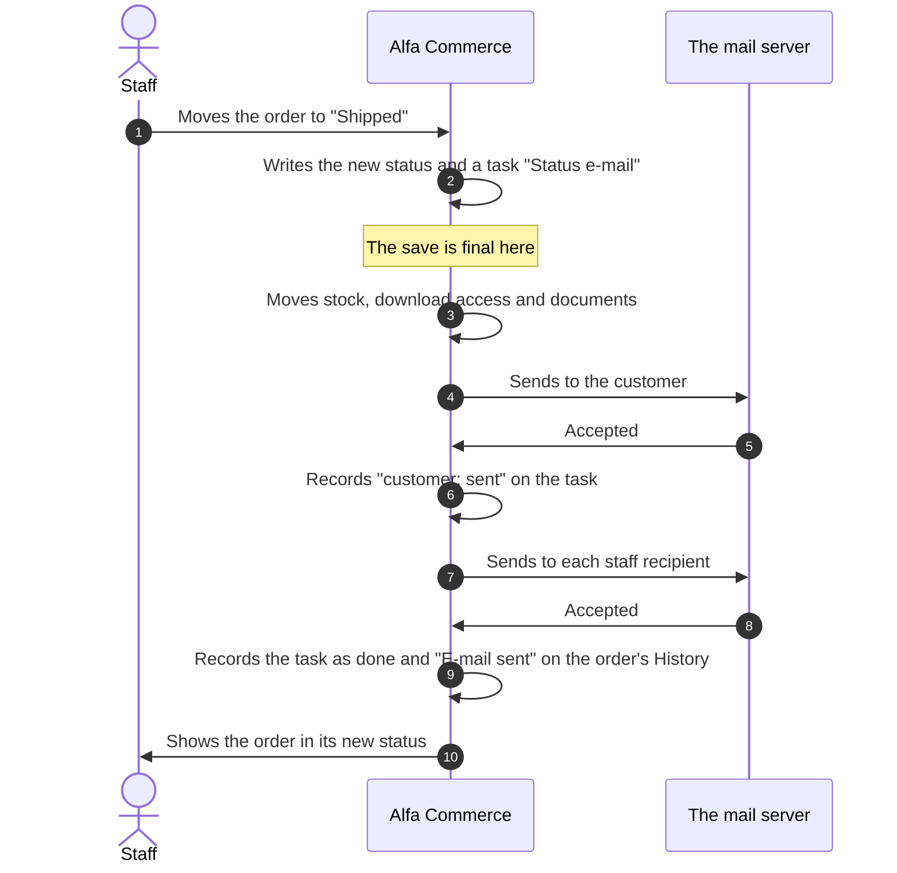

# Order e-mails

<AlfaVersion verified="2.2.0" />

Alfa Commerce sends an e-mail when an order is placed and when an order enters a status that is set to tell
somebody. The e-mail is never sent inside the save. Alfa writes down "this e-mail is owed" together with the change,
and sends it once the save is final (the commit). That piece of owed work is a **task**. Read
[Background work](./background-work.md) first: it explains tasks, their states and Tools > Tasks.

## What it does

### Which e-mails exist

There are two kinds of e-mail task. Each can go to the customer, to staff, or to both.

| E-mail | What triggers it | Kind of task |
|---|---|---|
| **Order confirmation e-mail** | An order is placed. It is the e-mail of the status the order is placed in. | `order.placement_email` |
| **Status e-mail** | An order enters a status, by any route: staff, a payment, a shipment, the API | `order.status_email` |

Who receives it is set on the order status, not in code:

| Recipient | When it is sent | The address |
|---|---|---|
| The customer | When the status has **notify the customer** switched on (`notify_customer`) | A registered customer's present account address while the account exists. Otherwise the address kept on the order. |
| Staff recipients | When the status lists users to tell. Blocked users and users with no address are left out. | Each listed user's account address |

A status that tells nobody creates no e-mail task at all.

The notification bell in the administrator is a separate thing. It is not e-mail.

### The order of things

Three things follow from this order:

- If the status change is undone, the task is undone with it. No e-mail goes out for a change that did not happen.
- A slow mail server does not hold the order. The status is already saved when the sending starts.
- If the request stops after the save, the e-mail is not lost. The engine sends it later.

The e-mails of one order go out in the order their statuses were entered. The plugins' reaction
(`onOrderStatusChange`) runs after the e-mail.

## When it is used

- At checkout, for the first status of the new order.
- At every status change, when the new status tells somebody.
- Not when the code that makes the change asks for no e-mail. The REST API's status change accepts `"silent": true`
  for this. A silent change sends nothing, to the customer or to staff. Everything else still happens.

## What happens next

### One outcome for each recipient

Every recipient is a part of the task, named by role and address: `customer:anna@example.com`,
`admin:orders@example.com`. Alfa records each part as soon as its outcome is known.

| Outcome | What it means | What Alfa does |
|---|---|---|
| Sent | The mail server accepted the message | Records it. This recipient is never sent to again. |
| Failed | The message was refused before it was handed over (no connection, the sender or the recipient refused), or the server answered with a refusal. Nothing was delivered. | Tries this recipient again by itself: after 1 minute, 5 minutes, 30 minutes, 2 hours, 6 hours and 24 hours. Then the task is Failed. |
| Outcome unknown | The message was handed over and no answer came (a timeout, a lost connection). It may have arrived. | **Holds** the task. It is never sent again by itself. |
| Mail switched off | Joomla's Global Configuration has Send Mail set to No | Sends nothing. The task is Failed at once and is never sent later by itself. |

Alfa can tell "refused" from "handed over with no answer" only when Joomla sends through SMTP, because it reads
the conversation with the mail server. With another sending method a failed send counts as Failed.

Joomla's mailer normally makes a second attempt after a failed one. Once a message was handed over, Alfa stops that
second attempt, so that the same message cannot arrive twice.

### What staff do with a failed or held e-mail

Tools > Tasks lists it, and a danger notification points there.

| Button | What it does |
|---|---|
| **Resend** | Writes a new task that sends only to the recipients not recorded as sent. The old task is closed. |
| **Mark resolved** | Closes the task with no sending. A reason must be typed. |

Use Resend after switching Joomla's mail back on. An e-mail that failed because mail was off is never sent later by
itself, so a copy of a shop kept with mail off does not send old e-mails when mail is switched on.

### The entries on the order's History

| Entry | Written when | What it names |
|---|---|---|
| E-mail sent | The task ended done. **Since 2.2.0.** | Each recipient it reached and when the message was handed over. Saved in the same save that marks the task done, so it stays after the task is deleted. |
| E-mail failed | The task ended Failed | The recipients it could not reach, and since 2.2.0 the ones it had already reached |
| E-mail held | The task is held | The recipients whose outcome is unknown, and since 2.2.0 the ones it had already reached |
| E-mail resent | Staff pressed Resend | The new task, who pressed it, and to whom it is sent |
| Task marked resolved | Staff pressed Mark resolved | Who, and the reason |

Each entry reads in the language of the administrator who reads it.

## The language of an e-mail

An e-mail is written in **the order's language**: the language the order was placed in. If the order has no
language, it is written in the **default content language**. It is never the language of the administrator who
happens to change the status. The staff copy uses the same language as the customer's.

Each text of the status (its names, the subject, each content block) is taken on its own from the default content
language when the order's language has none. So an e-mail does not go out blank because only one language was
filled in.

## Layouts, and how a template changes them

### What an e-mail is made of

| Piece | What it is | Where it comes from |
|---|---|---|
| The layout | A PHP file that draws the frame of the e-mail | `administrator/components/com_alfa/layouts/emails/order/default.php`. The layout's id is `emails.order.default`. |
| Positions | Named places in the layout that staff fill with text, for each language: `header`, `intro`, `outro`, `legal` in the shipped layout | Typed on the order status form, one editor for each position and language, with a Subject above them |
| Blocks | The order's items, totals, payments, shipments and download links | Five small layouts under `layouts/emails/partials/`: `order_items`, `order_totals`, `order_payments`, `order_shipments`, `order_downloads`. Staff can only show or hide each. |
| Tokens | Words in curly brackets that are replaced when the e-mail is made | See below |

A status picks two layouts: one for the customer's e-mail (`email_layout_customer`) and one for the staff e-mail
(`email_layout_admin`). Both default to `emails.order.default`.

### Tokens

| Group | Tokens |
|---|---|
| Order | `{order_id}`, `{order_number}`, `{order_date}`, `{status}`, `{status_customer}`, `{order_total}`, `{payment_method}`, `{shipment_method}` |
| Customer | `{user_id}`, `{user_name}`, `{user_username}`, `{user_email}`, `{user_registered}`. Empty for a guest. |
| Checkout fields | `{field_<name>}`, one for each active form field. The field's own plugin draws its value. |
| Site | `{site_name}`, `{site_url}` |

Tokens are replaced once, over the whole finished e-mail, so they work in staff's text, in the blocks and in the
layout's own text. In the body their values are made safe for HTML. The subject gets the plain values.

### Overriding from a template

The shipped layouts are always read from the **administrator** side of the component
(`administrator/components/com_alfa/layouts/`), also when the e-mail starts from a shopper's request at checkout.

A template override is different. It is looked for in the active template of the application that handles the
request that sends the e-mail:

| The request that sends the e-mail | Where an override is looked for |
|---|---|
| An administrator request: staff change a status, staff press Resend, Preview, Send test, a turn of the engine from an administrator page or the bell | `administrator/templates/<the active administrator template>/html/layouts/com_alfa/` |
| A storefront request: the order confirmation e-mail at checkout, a turn of the engine from a shop page or the web cron | `templates/<the active site template>/html/layouts/com_alfa/` |
| An API request or the console command | Nowhere. Only the shipped layouts are used. |

So an override that must apply to every e-mail is put in both templates, as the same file. The layout picker of
the order status and the editors of the positions read the administrator side only.

| You want to | Do this |
|---|---|
| Change the frame of the shipped e-mail | Copy `administrator/components/com_alfa/layouts/emails/order/default.php` to `html/layouts/com_alfa/emails/order/default.php` in the administrator template and in the site template, and edit the copies |
| Add a second layout to choose from | Add a new file in the administrator template's override folder, for example `emails/order/compact.php`. It appears in the layout picker of the order status as `emails.order.compact`. A file whose name starts with `_` is not listed. Put the same file in the site template too. A layout that exists only in a template is not found on an API request or under the console command. |
| Restyle the items, totals, payments, shipments or downloads | Override the matching file under `html/layouts/com_alfa/emails/partials/`, in both templates |

Inside a layout three helpers are available:

| Helper | What it gives |
|---|---|
| `$position('intro')` | The text staff typed for that position, in the e-mail's language |
| `$hasPosition('intro')` | `true` when that position has text, so that an empty frame is not drawn |
| `$render('emails.partials.order_items', ['items' => $items])` | Another layout, drawn in place |

The positions a layout asks for are found by Alfa itself. Add `$position('promo')` to your layout and the order
status form shows an editor named for it.

Never edit the files inside `administrator/components/com_alfa/`. An update replaces them, and the
[integrity check](./integrity-and-security.md) reports them as changed.

## Where the texts are stored

| What | Table and column |
|---|---|
| Tell the customer, yes or no | `#__alfa_orders_statuses.notify_customer` |
| The two layouts | `#__alfa_orders_statuses.email_layout_customer`, `email_layout_admin` |
| Attach the documents, yes or no | `#__alfa_orders_statuses.attach_document_pdf` |
| The staff recipients | `#__alfa_orderstatus_recipients` (one row for each status and user) |
| The subject and the positions, for each language | `#__alfa_orders_statuses_<langtag>` (for example `#__alfa_orders_statuses_en_gb`), columns `email_positions_customer` and `email_positions_admin`. Each holds one JSON object: `subject` plus one entry for each position. |

The language tables also still have the columns `email_subject_customer`, `email_body_customer`,
`email_subject_admin` and `email_body_admin`. The sending code of 2.2.0 does not read them.

If the subject is left empty, Alfa uses a general subject with the order's id (not its order number) and the
status's name for the customer.

The tables are described on the [database page](./database-schema.md).

## PDF attachments

When a status has **attach the documents** switched on (`attach_document_pdf`), the customer's e-mail carries a PDF
of every issued document of the order. Voided documents are left out. The PDFs are made at the moment of sending
and are not stored as files. If one PDF cannot be made, that is written to the log and the e-mail still goes out
with the others. The staff copy never carries attachments. Download links, too, are put only in the customer's
e-mail. Documents themselves are explained on [Documents](../services/documents.md).

## When Joomla's mail is switched off

With Send Mail set to No in Joomla's Global Configuration:

- Nothing is sent and no download link is made.
- Each recipient is recorded as not sent, and the task is Failed at once.
- The order's History says the e-mail was not sent because mail is switched off.
- The task is never sent later by itself. Staff press Resend once mail is on.

## Preview and Send test

The order status form has two buttons beside each e-mail, **Preview** and **Send test**. They appear only for a
status that is already saved, and only for a user who may view orders. Both also need the permission to edit order
statuses.

| Button | What it does |
|---|---|
| Preview | Draws the e-mail for the language tab you are editing. It uses the newest order that has items, or failing that the newest order. If the shop has no order yet, it uses a made-up sample order. Nothing is sent. |
| Send test | Sends the e-mail for an order you pick to an address you type. The subject starts with `[TEST]`. It ignores the "tell the customer" switch, creates no task and writes nothing on the order's History. |

## What you must provide

For a template author: only the override files described above.

For a plugin author: **nothing, because 2.2.0 offers no hook into order e-mails.**

| Can a plugin... | In 2.2.0 |
|---|---|
| Add a recipient | No. Recipients come from the order status only. |
| Change the subject or the content | No event is announced while an e-mail is made. What can be changed is the layout, by a template override, and the texts, on the order status form. |
| Stop an e-mail | No. Only the code that makes the status change can ask for a silent change. |
| Learn that an e-mail was sent, failed or is held | No event. The order's History and Tools > Tasks hold it. |
| Draw its own checkout field in an e-mail | Yes. A form field plugin draws the value of its `{field_<name>}` token. See [Form field plugins](../plugins/form-field-plugins.md). |

A plugin that wants to send a message of its own after a status change listens to `onOrderStatusChange` and sends
it itself. See [Order and cart events](../events/order-and-cart-events.md).

## What can go wrong

| What you see | The usual cause |
|---|---|
| No e-mail and no task | The status tells nobody: "notify the customer" is off and no staff recipient is listed. Or the change was made silent. |
| A task but no e-mail to the customer | The order has no e-mail address. The log (category `com_alfa.orders`) says so. |
| The task is done but a recipient got nothing | No subject and no text is stored for that recipient's e-mail, in the order's language or in the default content language. Nothing is sent to that recipient and no outcome is recorded for it. |
| The task is Failed at once | Joomla's Send Mail is No, or the order names no currency, so no amount can be stated |
| The task is "Outcome unknown" | The mail server took the message and did not answer. Check the mailbox, then Resend or Mark resolved. |
| The e-mail is in the wrong language | It follows the order's language, not the administrator's. An order without a language uses the default content language. |
| Your override is ignored | The e-mail was sent by a request of the other application. An override is read from the administrator template on an administrator request and from the site template on a storefront request. An API request and the console command read no override. |
| Raw language keys in the e-mail | Your layout uses a key that is not in Alfa's administrator language file. Alfa loads that file, and the order's language, before drawing. |
| A send error | Look in the log, category `com_alfa.orderemail` |

## Changed in 2.2.0

- **Since 2.2.0.** Every e-mail that is sent leaves "E-mail sent" on the order's History, naming each recipient.
- **Since 2.2.0.** No e-mail task is written for a status that tells nobody.
- **Since 2.1.4.** E-mails are tasks: recorded with the change, sent after the save is final, with an outcome for
  each recipient, automatic tries, hold and Resend.
- **Changed in 2.1.1.** An e-mail for an order without a language is written in the default content language, no
  longer in the language of the administrator.
- The class is `EmailService` (`administrator/src/Service/Order/EmailService.php`). Earlier versions of this page
  named a class that does not exist.

## Not documented yet

- The data a layout receives besides the three helpers (the order, its items, totals, payments, shipments and
  downloads): the exact shape of each is not described here. Read the shipped layout and its five blocks.
- A hook for plugins to add recipients, change content or stop an e-mail. None exists in 2.2.0.
- E-mails for anything other than an order's placement and status (for example a document on its own). The code of
  2.2.0 has only the folder `layouts/emails/order/`.
- What the test send does when Joomla's mail is switched off.
