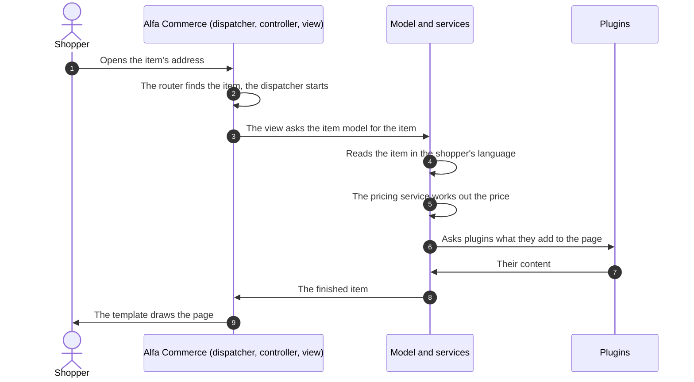
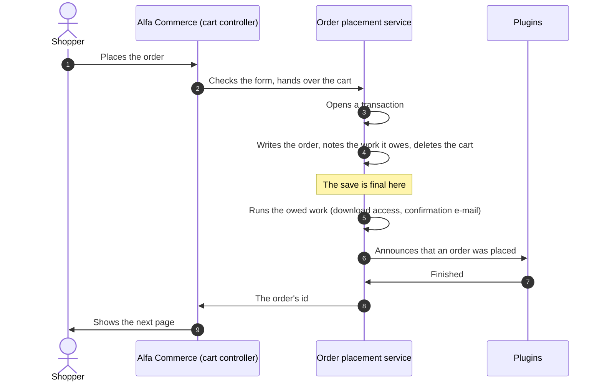

# Architecture Overview

<AlfaVersion verified="2.2.0" />

Alfa Commerce is one Joomla component, `com_alfa`, with plugins and modules around it. This page is the map: what the
parts are, which part does what, and in which order they run. Read it once before you write your first extension.

## What it does

The component has three sides. Joomla calls them applications. All three use the same database tables and the same
shop rules.

| Side | Folder | What it holds |
|---|---|---|
| Storefront (site) | `site/` | What the shopper sees: listings, the item page, the cart and checkout, the customer's details, downloads |
| Back office (administrator) | `administrator/` | What staff use: the catalogue, orders, stock, documents, settings, Tools. Most of the code lives here, and the other two sides use it |
| REST API | `api/` | The same data for other programs, as JSON. Its addresses are registered by the `webservices` plugin in `plugins/webservices/alfa`. See [REST API](../api/overview.md). |

Each side has its own entry class, `src/Dispatcher/Dispatcher.php`, which Joomla calls first. Around the component
the package ships plugins (`plugins/`), modules (`modules/`) and two libraries (`libraries/`). The folder by folder
tour is in [Project structure](../getting-started/project-structure.md).

### The layers

Inside each side the code is in layers. A layer only does its own job and hands the rest to the layer below.

| Layer | Where | Its job |
|---|---|---|
| Controllers | `src/Controller` on each side | Read the request, check the security token and the permission, call a model or a service, answer |
| Models | `src/Model` on each side | Load and save the records one screen works with |
| Services | `administrator/src/Service` and `site/src/Service` | The shop's rules. Everything that must give the same answer wherever it is asked |
| Helpers | `administrator/src/Helper` and `site/src/Helper` | Small shared tools: languages, notifications, order labels, the tools for saving safely |
| Tables | `administrator/src/Table` | One class per main record type, the Joomla way of writing a row |
| Events | `administrator/src/Event` | The typed messages Alfa sends to plugins |
| The plugin boundary | `administrator/src/Plugin` | The one place that talks to Joomla's plugin system, and the base classes plugins extend |

**The services are where the shop's rules live.** A controller or a model never works out a price, moves stock or
changes an order's status by itself. It asks a service, so the storefront, the back office, the API and a plugin
all get the same result.

| You want to | The service that does it |
|---|---|
| Read or change a cart | `CartService` in `site/src/Service/Cart` |
| Work out a price | `PriceCalculator` and the classes beside it in `site/src/Service/Pricing` |
| Turn a cart into an order | `OrderPlacement` in `site/src/Service/Checkout` |
| Write an order without a shopper's session | `OrderCreator` in `administrator/src/Service/Order` |
| Change an order's status | `Transition` in `administrator/src/Service/Order` |
| Record a payment or a refund | `PaymentLedger` in `administrator/src/Service/Order` |
| Record a shipment | `ShipmentLedger` in `administrator/src/Service/Order` |
| Move or reserve stock | `InventoryService` in `administrator/src/Service/Inventory` |
| Issue a document | The classes in `administrator/src/Service/Document` |
| Run work later | `Tasks` in `administrator/src/Service/Task` |

The folders under `administrator/src/Service` in 2.2.0 are Card, Cart, Catalog, ClearData, Credit, Document,
DocumentTypes, Download, Inventory, ItemFields, Log, Maintenance, Media, Order, Projection, Search, Setup, Stats,
Task, Tools and ValuePool, plus the file `PriceIndexSyncService.php`. The folders under `site/src/Service` are Cart,
CartRules, Checkout, Data, Facet, FieldState, Order, Place, Pricing, Shipping, ShowOn, Summary and Variant, plus the
storefront router `Router.php`. The services a developer calls are described in
[Services](../services/overview.md).

:::note Changed in 2.x
Code written for 1.x used the classes `CartHelper`, `OrderPlaceHelper`, `OrderPaymentHelper` and
`OrderShipmentHelper`. None of them exists in 2.2.0. Use `CartService`, `OrderPlacement`, `PaymentLedger` and
`ShipmentLedger` from the table above. `OrderHelper`, `OrderStatusHelper`, `OrderTotalHelper`, `OrderHistoryHelper`
and `OrderLabels` still exist in `administrator/src/Helper`.
:::

## When it is used

Two examples show the layers at work: a page that only reads, and a request that saves.

### A storefront page

A shopper opens an item page.



In the code: `site/src/Service/Router.php` turns the address into a view and an id. `site/src/Dispatcher/Dispatcher.php`
stops the request if the shop is in maintenance, loads the item field plugins and runs the controller. The view
`site/src/View/Item/HtmlView.php` calls `getItem()` on `site/src/Model/ItemModel.php`. The model reads the tables,
prices the item through `Pricing\PriceCalculator`, sends each item field plugin its own events and then announces
`onItemDisplay` to the feature plugins. Nothing is saved, so there is no transaction.

The back office works the same way, with one more check: `administrator/src/Dispatcher/Dispatcher.php` opens a
screen only for a user who holds that screen's own Alfa permission. The API ends in a JSON view instead of a
template, and its dispatcher accepts a `lang` parameter in the address to choose the content language of the answer.

### A request that saves

A shopper presses the button that places the order.



In the code: `placeOrder()` in `site/src/Controller/CartController.php` checks the security token and the form, then
calls `OrderPlacement`. The service opens a database transaction, writes the order through `OrderCreator`, writes one
task row for each thing the order owes (`Tasks::single()`), and commits. Only after the commit does it run those
tasks and announce `onAlfaOrderPlaced`. If anything fails before the commit, nothing was saved: no order, no
e-mail, and the cart is still there.

Every save of the shop follows this shape. The full flows, with the events of each step, are in
[Flows](../events/flows.md).

## How it starts

Joomla builds the component from two files.

**The service provider**, `administrator/services/provider.php`, tells Joomla how to build the component. It
registers Joomla's standard factories for models and views (the MVC factory), for the dispatcher and for the router,
the helper that gives the language switcher the address of the same page in another language, and one
`AlfaPluginHelper` for the whole request. Then it builds the component class and hands it these parts.

**The component class**, `administrator/src/Extension/AlfaComponent.php`, has a `boot()` method that Joomla runs
once per request, before any controller, on all three sides. It does four things, in this order:

1. It registers Alfa's log categories (`AlfaLog::register()`), so that every later log line is written.
2. If the shop is in maintenance mode (a run of Clear everything under Tools is running, paused or failed), it stops
   here. No plugin is loaded and no menu is placed.
3. It loads the plugins of the `alfa` group through the plugin helper, one plugin at a time. A plugin whose class
   cannot be loaded is logged by name and the others still load.
4. In the back office, it asks for the Alfa menu to be placed in Joomla's side menu.

The component also keeps two objects that the rest of the code asks it for: the plugin helper
(`getPluginHelper()`, which `AlfaPluginHelper::get()` reads) and the registry of search engines
(`getSearchEngineRegistry()`).

## How plugins extend it

Alfa never asks you to change its files. At fixed moments it sends an event, and a plugin that named that event is
called. Every call to a plugin goes through one class, `AlfaPluginHelper`, either announced to everyone or addressed
to one plugin: read [How events reach a plugin](../events/how-events-reach-a-plugin.md) first, then
[Plugins overview](../plugins/overview.md) for the plugin types and the [Event index](../events/event-index.md) for
the full list.

## How changes are saved

### What it does

A save that touches more than one table runs inside a database **transaction**: either every write is kept, or none
is. The moment the database keeps them is called the **commit**. Before it, a failure undoes everything (a
rollback). After it, the save is final and nothing can undo it.

Some work must only happen once the save is final: sending an e-mail, telling a plugin, moving stock, writing a log
line that claims something happened. If that work ran inside the transaction and a later step failed, the customer
would hold an e-mail about an order that does not exist. So Alfa keeps such work waiting until the commit.

Two classes in `administrator/src/Helper` do this.

| Class | In plain words |
|---|---|
| `TransactionState` | Knows whether a transaction is open on the connection and how deep. Closes one level, by a commit (`commitLevel()`) or after a failure (`rollBackLevel()`) |
| `PostCommit` | Holds the work that waits for the commit (`defer()`). Runs it when the outermost transaction has committed, and throws it away on a rollback |

### What "after the commit" means in the code

- **Nested saves count as one.** A service that opens a transaction while another is already open only makes a
  savepoint, a marker inside the outer one. Its waiting work is handed to the level around it. The work runs when
  the outermost transaction commits, not before.
- **A rollback discards the waiting work** of the level that was rolled back. Nothing is sent for a save that did
  not happen.
- **With no transaction open, the work runs at once.**
- **Locks count too.** While Alfa holds one of its named locks (an order's money lock, a shipment's booking lock),
  waiting work stays waiting until the lock is released, so that it does not run while another request is being
  refused as busy.
- **A failure in the waiting work never undoes the save.** It is logged under its label and the caller is not told,
  because the save it follows is already final.
- **Work that must survive a crash is written down first.** An e-mail or a plugin's reaction is stored as a row in
  the tasks table inside the same transaction, so it is kept or dropped together with the save. If the request dies
  after the commit, the row is still there and is run later. See [Background work](background-work.md).

### What you must provide

For most plugins: nothing. You only need to know which side of the commit your code runs on.

- A broadcast event that reports something done, such as `onOrderStatusChange` or `onAlfaOrderPlaced`, reaches you
  after the commit. You see the final data. Throwing an error does not cancel the change.
- If your own code opens a transaction on Alfa's connection, close it through `TransactionState`, never with the
  driver's own commit or rollback. A plain commit leaves waiting work in the queue.

```php
use Alfa\Component\Alfa\Administrator\Helper\PostCommit;
use Alfa\Component\Alfa\Administrator\Helper\TransactionState;
use Joomla\CMS\Factory;

$db = Factory::getContainer()->get('DatabaseDriver');

// Open one level: the outermost transaction, or a savepoint inside the caller's.
$db->transactionStart(true);

try {
    // ... your writes ...

    // Runs only once the outermost transaction has committed.
    PostCommit::defer(
        db:    $db,
        label: 'tell the warehouse about the change',
        work:  static function (): void {
            // ... work that cannot be undone ...
        },
    );
} catch (\Throwable $e) {
    // Undo this level and discard its waiting work, then pass the failure on.
    TransactionState::rollBackLevel(db: $db, failure: $e);

    throw $e;
}

// Keep this level. At the outermost level this commits and then runs the waiting work.
TransactionState::commitLevel($db);
```

### What can go wrong

| What happens | Why |
|---|---|
| Your waiting work does not run when your save is final | The transaction was closed with the driver's own commit, which leaves the work waiting. Close it with `TransactionState::commitLevel()` |
| Your work runs later than you expect | Your code was called inside someone else's transaction or lock. The work runs when the outermost one ends |
| An exception "is not changed inside an open transaction" | You asked for a table or column to be made while a transaction was open. MySQL would commit the transaction first, so Alfa refuses. Make the schema before you open the transaction. [Multilingual](multilingual.md) explains the common case |
| `commitLevel()` throws "No transaction is open to commit" | An inner failure already rolled the whole transaction back, for example a deadlock |

## The platform floors

The installer checks the site before it copies any file (`script.php`, lines 74 to 123, enforced in `preflight()`),
and refuses with a message when a floor is not met.

| Requirement | Value in 2.2.0 |
|---|---|
| Joomla | 6.1.0 or a later 6.x. Joomla 7 is refused as not tested yet |
| PHP | 8.3.0 or newer. The release is tested on 8.3, 8.4 and 8.5, and 8.4 is recommended |
| PHP extensions | bcmath, intl, mbstring, gd, openssl |
| An existing Alfa Commerce | 2.0.0 or newer. A 1.x install is refused, because 1.x has no schema to update from |

Write your extension for these floors. You may use PHP 8.3 syntax and Joomla 6.1 classes.

## What is documented where

| You want to know | Read |
|---|---|
| Which folder holds what | [Project structure](../getting-started/project-structure.md) |
| How a plugin is called, and what happens when it fails | [How events reach a plugin](../events/how-events-reach-a-plugin.md) |
| The order of events in checkout, payment, shipping and the other flows | [Flows](../events/flows.md) |
| Every event with its class | [Event index](../events/event-index.md) |
| The plugin types and a minimal plugin of each | [Plugins overview](../plugins/overview.md) |
| The services you may call | [Services](../services/overview.md), then [Orders](../services/orders.md), [Pricing](../services/pricing.md), [Stock](../services/stock.md), [Documents](../services/documents.md) |
| The tables | [Database schema](database-schema.md) |
| How translated content is stored and read | [Multilingual](multilingual.md) |
| Work that runs after a save or in the background | [Background work](background-work.md) |
| The e-mails an order sends | [Order e-mails](order-emails.md) |
| What Alfa caches and when it clears it | [Caches](caches.md) |
| File integrity, permissions and the security tools | [Integrity and security](integrity-and-security.md) |
| What a word on these pages means | [Glossary](../reference/glossary.md) |
