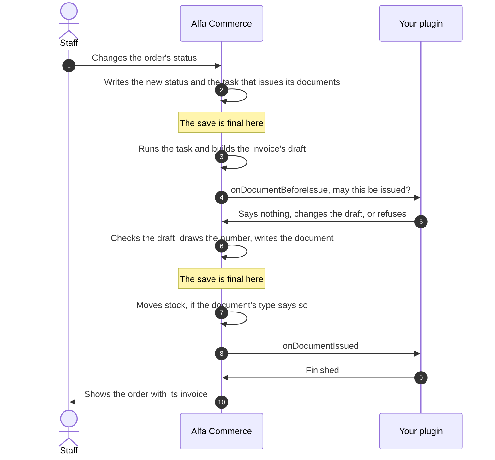

# Document events

<AlfaVersion verified="2.2.0" />

Alfa Commerce tells plugins when a sales document is about to be issued, when it has been issued and when it has been
voided. A plugin can also add document types of its own. This page explains the words first, then each event, then
how to add a type.

Read [How events reach a plugin](./how-events-reach-a-plugin.md) first. The words **document**, **document type** and
**series** are in the [glossary](../reference/glossary.md#documents-and-languages).

## What it does

### The words

| Word | In plain words | In the code |
|---|---|---|
| **Document** | An invoice, a receipt, a credit note or a delivery note issued for an order. It has a number and it is kept as issued. | A row of `#__alfa_documents` with its lines in `#__alfa_document_items` |
| **Document type** | The kind of document. Alfa ships five: `core.invoice`, `core.retail_receipt`, `core.credit_invoice`, `core.credit_receipt` and `core.delivery_note`. | The `DocumentHelper::TYPE_*` constants, and a row of `#__alfa_document_types` |
| **Series** | The numbered sequence a document is issued in. Each type has a default series. | A row of `#__alfa_document_series` |
| **Draft** | The document as it is about to be issued: its type, its order, its buyer and its lines, as a plain array | The argument of `DocumentIssuer::issue()` |

### Kept as issued

Once a document has its number, its content never changes. It can only be **voided**: the document keeps its number
and its content, and only its status and the record of who voided it and why are written. A voided document is never
brought back. A mistake is corrected with a new document.

### One way in

Every document is issued by one method, `DocumentIssuer::issue()`, whoever asked for it. So the events on this page
fire the same way for a document issued by staff and for one issued automatically.

If the shop's setting says an outside system issues its documents (`documents_issuer` set to `external`), Alfa issues
nothing automatically, and the order screen's own issue, correction and void and replace actions do nothing either.
None of these events fire for a status change. See [Documents](../services/documents.md).

## When it is used

| Who asks | When |
|---|---|
| Staff | From the order's screen: issue a document, issue a credit note, void a document, void and replace a document |
| Alfa Commerce, automatically | When an order enters a status whose settings say "issue a document" or "issue a delivery note" |
| Alfa Commerce, automatically | When a payment settles on an order whose status issues only once the order is paid |

The automatic issue is background work: the task `order.documents` is saved together with the status change and runs
right after the status is final. It never blocks the status change. If a document cannot be issued, the status stays
changed and staff are told in the notification bell.

## The events at a glance

All of them are announced to everyone (broadcast). Alfa loads the `alfa` plugin group before it announces them.

| Event | Fires | Can it refuse? | If your listener throws |
|---|---|---|---|
| `onDocumentBeforeIssue` | Before a document is issued, before anything is saved | Yes | The document is not issued |
| `onDocumentIssued` | After the document is saved and the save is final | No | Logged, the others still run |
| `onDocumentVoided` | After the void is saved and the save is final | No | Logged, the others still run |
| `onCollectDocumentTypeProviders` | On the Document Types screen, when it is shown and when staff press its sync button | No | Logged, the others still run |

There is no "before void" event. A plugin cannot refuse a void.

No plugin that handles these events ships with Alfa Commerce. The samples on this page were checked line by line
against the event classes and the interface, and there is no shipped plugin to copy from.

## An automatic invoice on a status change



There are two saves. The status is final before your plugin is asked about the invoice, so a refusal at step 5 leaves
the status changed and the order without that invoice. The invoice is final before `onDocumentIssued`, so nothing
your listener does at step 9 can take the invoice back.

## The event that can refuse

### onDocumentBeforeIssue

**When it fires.** Each time a document is about to be issued, before Alfa opens the save. No number has been drawn,
so a refusal uses no number. It does not fire for a preview of a document.

**Who receives it.** Announced to everyone. Event class
`Alfa\Component\Alfa\Administrator\Event\Documents\DocumentBeforeIssueEvent`.

**What you are given.**

| Method | What it gives |
|---|---|
| `getDraft(): array` | The draft |
| `updateDraft(array $draft): void` | Replaces the draft |

The draft's main keys:

| Key | Meaning |
|---|---|
| `doc_type` | The document type, for example `core.invoice` |
| `id_order` | The order |
| `id_series` | The series. 0 or absent means the type's default series. |
| `id_corrects` | The document a credit note corrects |
| `language` | The document's language tag |
| `buyer_name`, `buyer_vat_number`, `buyer_tax_office`, `buyer_activity`, `buyer_country`, `buyer_email`, `buyer_address` | The buyer as printed on the document |
| `note`, `print_note` | Notes |
| `lines` | The document's lines, a list of arrays. Each has a `line_type` (`item`, `shipping`, `fee` or `adjustment`), a `name`, a `quantity`, its prices and its tax. |

The full list is in the comment above `DocumentIssuer::issue()`
(`administrator/src/Service/Document/DocumentIssuer.php`).

**What you are expected to do.** Nothing, if you have no objection. To change the document, change the array and hand
it back with `updateDraft()`. To refuse, throw an exception. Alfa announces this event with
`AlfaPluginHelper::dispatch()`, so your exception travels back to the issue and stops it.

Leave these alone:

- `id_replaces`. Only Alfa's own "void and replace" may set it. A draft that arrives with it from anywhere else is
  refused.
- The database. Do not open a save of your own (a transaction) and leave it open. Alfa undoes it and refuses the
  issue.

**What happens next.** Alfa takes the draft as the last listener left it and checks it with all of its own rules, as
if staff had typed it. A change that breaks a rule is refused like any other draft. Then Alfa draws the number and
writes the document.

**If you are missing or you fail.** With no listener the document is issued as drafted. If your listener throws:

| Who asked | What happens |
|---|---|
| Staff, on the order's screen | Nothing is issued. Staff see your exception's message as the error. |
| The automatic issue after a status change | Nothing is issued and the status stays changed. Your message is written to the log (category `com_alfa.documents`), staff get a notice that the automatic issue failed for that order and type, and Alfa does not try again by itself. |

To show staff a translated sentence, throw
`Alfa\Component\Alfa\Administrator\Service\Document\DocumentRefusedException`. Its constructor takes the technical
message, a language key and the key's values. The order's screen shows the translated key and the log keeps the
message.

Planned for 2.2.1, which is not released: the notice of an automatic issue that failed says why. It reads "The
document could not be issued: ... Correct the cause, then issue it from the order.", with your
`DocumentRefusedException`'s translated sentence in place of the dots. Without one, it says that a database error
stopped it, or gives the first line of the failure, or says that the reason is in the documents log.

## The events that only report

Alfa announces both with `AlfaPluginHelper::dispatchIsolated()`, only after the whole save the document belongs to is
final (`PostCommit::defer()`). If that save is undone, the event is never announced. Both event classes are
read-only: they have getters and nothing to set.

If your listener throws, the error is written to Joomla's log (categories `com_alfa.plugins` and
`com_alfa.documents`) with your listener's name, the next listener runs, and the document stays as saved.

The request that announces the event may be background work, where nobody may be signed in. Do not rely on the
current user or the session.

### onDocumentIssued

**When it fires.** After a document was issued and the save is final. If the document's type moves stock, Alfa has
already tried that movement when your listener runs.

**Who receives it.** Announced to everyone. Event class
`Alfa\Component\Alfa\Administrator\Event\Documents\DocumentIssuedEvent`.

**What you are given.**

| Method | What it gives |
|---|---|
| `getDocument(): object` | The document's row, read after the save: for example `id`, `doc_type`, `number_formatted`, `id_order`, `total_tax_incl` |
| `getLines(): array` | The document's line rows, in their printed order |
| `getOrderId(): int` | The order the document belongs to |

**What you are expected to do.** React: send the document to another system, notify someone. Do not change the
document.

**What happens next.** Nothing depends on your listener. The person sees the issued document.

**If you are missing or you fail.** The document is issued either way.

### onDocumentVoided

**When it fires.** After a document was voided and the save is final.

**Who receives it.** Announced to everyone. Event class
`Alfa\Component\Alfa\Administrator\Event\Documents\DocumentVoidedEvent`.

**What you are given.**

| Method | What it gives |
|---|---|
| `getDocument(): object` | The document's row as it is after the void. Its number and content are unchanged. |
| `getReason(): string` | The reason staff gave |
| `getActorId(): int` | The user id of the member of staff who voided it |

**What you are expected to do.** React, for example tell another system that the document was cancelled.

**What happens next.** Nothing depends on your listener.

**If you are missing or you fail.** The document is voided either way.

## What you must provide: a listener

A feature plugin (group `alfa`) that refuses an invoice without a tax number, adds a printed note, and reacts once a
document is issued:

```php
namespace Acme\Plugin\Alfa\Docwatch\Extension;

use Alfa\Component\Alfa\Administrator\Event\Documents\DocumentBeforeIssueEvent;
use Alfa\Component\Alfa\Administrator\Event\Documents\DocumentIssuedEvent;
use Alfa\Component\Alfa\Administrator\Helper\DocumentHelper;
use Joomla\CMS\Plugin\CMSPlugin;
use Joomla\Event\SubscriberInterface;
use RuntimeException;

final class Docwatch extends CMSPlugin implements SubscriberInterface
{
    public static function getSubscribedEvents(): array
    {
        return [
            'onDocumentBeforeIssue' => 'onDocumentBeforeIssue',
            'onDocumentIssued' => 'onDocumentIssued',
        ];
    }

    // A "before" event: nothing is saved yet. Throwing refuses the issue.
    public function onDocumentBeforeIssue(DocumentBeforeIssueEvent $event): void
    {
        $draft = $event->getDraft();

        if (($draft['doc_type'] ?? '') !== DocumentHelper::TYPE_INVOICE) {
            return;
        }

        if (trim((string) ($draft['buyer_vat_number'] ?? '')) === '') {
            throw new RuntimeException('An invoice needs the buyer\'s tax number.');
        }

        $draft['print_note'] = 'Thank you for your order.';
        $event->updateDraft($draft);
    }

    // An "after" event: the document is saved for good. Only react.
    public function onDocumentIssued(DocumentIssuedEvent $event): void
    {
        $document = $event->getDocument();
        $orderId = $event->getOrderId();

        // Your own work, for example with $document->number_formatted and $orderId.
    }
}
```

## The provider contract: adding a document type

### What it does

A plugin can add document types beside the five that ship, for example a pro forma invoice. The object that declares
them is a **document type provider**: a class that implements
`Alfa\Component\Alfa\Administrator\Provider\DocumentTypeProviderInterface`. The types it declares are stored in the
shop's list of types and belong to the plugin that offered the provider.

### When it is used

Types are stored data, and Alfa writes them only when staff ask. On the Document Types screen staff press the sync
button. Alfa then collects the providers with the event `onCollectDocumentTypeProviders` and lets each one declare
its types. When the screen is shown, Alfa collects the providers the same way without storing anything, to count how
many are waiting to be synced: a provider with no stored types, or one whose version differs from the stored one.

### onCollectDocumentTypeProviders

**When it fires.** When the Document Types screen is shown, and when staff press its sync button.

**Who receives it.** Announced to everyone. Alfa loads the `alfa` plugin group first. Event class
`Alfa\Component\Alfa\Administrator\Event\Documents\CollectDocumentTypeProvidersEvent`.

**What you are given.**

| Method | What it does |
|---|---|
| `addProvider(DocumentTypeProviderInterface $provider, string $contributor, string $version = ''): void` | Offers your provider. The provider comes first. `$contributor` comes second and is your plugin's name as group.element, for example `alfa.proforma`. `$version` is your plugin's version. |
| `getProviders(): array` | The providers offered so far. Alfa reads it; a plugin has no need to. |

**What you are expected to do.** Call `addProvider()` once for each provider you offer. Pass your version: when it
changes, the screen tells staff that your types need syncing again.

**What happens next.** On a sync, Alfa calls each provider's `register()` and stores the types under Joomla's name
for your plugin, `plg_<group>_<element>` (for `alfa.proforma`: `plg_alfa_proforma`). Staff see how many types were
registered and each provider's error, if any.

**If you are missing or you fail.** A contributor name that is not group.element makes `addProvider()` throw
`InvalidArgumentException`. A listener that throws is logged (category `com_alfa.documents`), shown to staff as a
warning on a sync, and the other providers still run.

Changed in 2.2.0: `$contributor` is the plugin's name as group.element. Earlier versions took the extension's name
there. A provider that passed another name before must move its stored types itself in its own update.

### The interface

It has one method:

```php
public function register(DocumentTypeRegistry $registry): void;
```

Alfa hands you the registry (`Alfa\Component\Alfa\Administrator\Service\DocumentTypes\DocumentTypeRegistry`). For each
type, start a definition with `$registry->type('vendor.alias')`, describe it, and end with `register()`. Inside your
provider that last call takes no arguments: the registry already knows which plugin it is talking to.

The methods of the definition (`DocumentTypeBuilder`), each returning the definition so that calls can be chained:

| Method | Meaning |
|---|---|
| `family(string $family)` | Required. What kind of document it is: `DocumentHelper::FAMILY_SALES`, `FAMILY_CREDIT`, `FAMILY_LOGISTICS` or `FAMILY_INFORMATIONAL`. |
| `pool(string $pool)` | Required. How its quantities count against the order: `DocumentHelper::POOL_SALES`, `POOL_CREDIT`, `POOL_INDEPENDENT` or `POOL_NONE`. |
| `showsPrices(bool $show = true)` | Whether prices and totals are printed. Printed when never called. |
| `movement(string $mode)` | Whether it carries delivery details: `none`, `optional` or `required` |
| `requiresOriginal(string $strictness = 'required')` | Whether it must name the document it corrects: `no`, `optional` or `required` |
| `corrects(string ...$salesTypes)` | For a credit type: the sales types it corrects. Register those first. |
| `requiresBuyerTaxId(bool $required = true)` | Whether the buyer's tax number is required |
| `stockEffect(string $effect)` | What issuing it does to stock: `none`, `deduct` or `restore` |
| `layout(string $layoutId)` | Another layout id. Empty keeps `documents.<alias>.default`. |
| `icon(string $icon)`, `color(string $color)`, `ordering(int $ordering)` | How the type looks and where it sorts in the picker |
| `name(string $language, string $text)` | The type's name in one language. Call it once per language. |
| `param(string $key, mixed $value)` | Extra data of your own. Never one of the settings above. |
| `register()` | Stores the type and returns its row |

Which pool goes with which family:

| Family | Allowed pools |
|---|---|
| Sales | `POOL_SALES`, `POOL_NONE` |
| Credit | `POOL_CREDIT` |
| Logistics | `POOL_INDEPENDENT`, `POOL_NONE` |
| Informational | `POOL_NONE` |

### What happens next

The type appears in the shop's list of document types, owned by your plugin. Syncing again updates it. A type is
never deleted, so documents already issued keep their type.

### What can go wrong

The registry refuses a definition by throwing, and nothing of that type is written:

| The definition | Refused because |
|---|---|
| An alias that is not lower case with a dot, such as `Proforma` | The alias must look like `vendor.type`: lower case letters, digits and underscores, in at least two parts joined by dots |
| An alias longer than 60 characters | It would not fit where aliases are stored |
| An alias that starts with `core.` | That namespace belongs to Alfa Commerce |
| An unknown family, or a pool the family does not allow | See the table above |
| An alias another plugin already registered | A type belongs to the plugin that first registered it |
| Another family or pool for a type that already has documents | The meaning of issued documents may never change. Register a new alias. |
| A credit type that corrects a type that is not a registered sales type | Only sales documents are corrected |

An error that leaves your `register()` stops your provider only. The types it registered before the error stay, the
other providers still run, and staff see your error as a warning.

### A minimal provider

The plugin (group `alfa`, element `proforma`):

```php
namespace Acme\Plugin\Alfa\Proforma\Extension;

use Acme\Plugin\Alfa\Proforma\Documents\ProformaTypes;
use Alfa\Component\Alfa\Administrator\Event\Documents\CollectDocumentTypeProvidersEvent;
use Joomla\CMS\Plugin\CMSPlugin;
use Joomla\Event\SubscriberInterface;

final class Proforma extends CMSPlugin implements SubscriberInterface
{
    public static function getSubscribedEvents(): array
    {
        return [
            'onCollectDocumentTypeProviders' => 'onCollectDocumentTypeProviders',
        ];
    }

    public function onCollectDocumentTypeProviders(CollectDocumentTypeProvidersEvent $event): void
    {
        // The provider first, then this plugin's name, then its version.
        $event->addProvider(new ProformaTypes(), 'alfa.proforma', '1.0.0');
    }
}
```

The provider:

```php
namespace Acme\Plugin\Alfa\Proforma\Documents;

use Alfa\Component\Alfa\Administrator\Helper\DocumentHelper;
use Alfa\Component\Alfa\Administrator\Provider\DocumentTypeProviderInterface;
use Alfa\Component\Alfa\Administrator\Service\DocumentTypes\DocumentTypeRegistry;

final class ProformaTypes implements DocumentTypeProviderInterface
{
    public function register(DocumentTypeRegistry $registry): void
    {
        $registry->type('acme.proforma')
            ->family(DocumentHelper::FAMILY_INFORMATIONAL)
            ->pool(DocumentHelper::POOL_NONE)
            ->name('en-GB', 'Pro forma invoice')
            ->register();
    }
}
```

## Not documented yet

- How a type added by a plugin is printed: its layout file and where it goes.
- Creating a series for a new type. A type without a default series cannot be issued automatically, and staff get a
  notice that says so.
- Switching a plugin's types off when the plugin is uninstalled (`DocumentTypeRegistry::disableByProvider()` exists,
  and nothing in Alfa Commerce 2.2.0 calls it).
- The full list of draft and line keys, with the rules each must pass.
- Issuing or voiding a document from a plugin.
