# Event flows

<AlfaVersion verified="2.2.0" />

One thing a person does in a shop, such as placing an order, makes Alfa Commerce call several plugins, one after the
other. This page shows the **order** of those calls, across all plugin types, for the nine things that happen most.

It does not explain what each event carries. Every flow ends with a table that links each event to the page that
explains it. For one list of every event, see the [Event index](./event-index.md).

Read [How events reach a plugin](./how-events-reach-a-plugin.md) first. Words such as "commit", "background work" and
"plugin of record" are explained in the [Glossary](../reference/glossary.md).

## What it does

Each flow below has the same four parts:

1. Two or three sentences that say what the flow is and when it happens.
2. One or two pictures. Read them from top to bottom. Each numbered arrow is one step.
3. Notes on what the picture means for a plugin.
4. A table: the event, who receives it, and the page that documents it.

## How to read the pictures

| In the picture | What it means |
|---|---|
| **Shopper**, **Staff** | The person who starts the flow |
| **Alfa Commerce** | The component itself |
| **Plugins that listen** | Every plugin that listed the event in `getSubscribedEvents()`. The event is announced to everyone (broadcast). |
| **The payment plugin**, **the shipping plugin**, **the field's plugin** | The one plugin the event is addressed to (targeted). No other plugin sees it. |
| **The provider**, **the carrier** | The outside service a plugin talks to |
| An arrow from Alfa Commerce to itself | Work Alfa does alone. No plugin is called. |
| The line **The save is final here** | The moment the change is stored for good (the commit). Before it, a refusal undoes everything. After it, nothing a plugin does can undo it. |

Three rules hold in every flow:

- A step that says **may refuse** is a "before" step. An error thrown there, or the event's own refusal method, stops
  what the person asked for.
- Every other step is isolated. An error in a plugin is written to Joomla's log and the next plugin is called.
- A step drawn after the line "The save is final here" is never called for a change that was undone.

## When it is used

Use this page when you need to know **where your plugin stands** among the others: what is already saved when your
handler runs, what runs after it, and whether a refusal still can stop the change.

| You are writing | Start with |
|---|---|
| A payment plugin | [Placing an order](#placing-an-order), then [Payment and refund](#payment-and-refund) |
| A shipping plugin | [Placing an order](#placing-an-order), then [Booking a shipment](#booking-a-shipment) |
| A plugin that reacts to orders | [Placing an order](#placing-an-order) and [Changing an order's status](#changing-an-orders-status) |
| A plugin that follows stock | [Stock](#stock) |
| A plugin that sends documents elsewhere | [Documents](#documents) |
| A plugin that keeps a copy of the catalogue or of prices | [Catalogue and price rebuild](#catalogue-and-price-rebuild) |
| A media plugin | [Media](#media) |
| A search engine plugin | [Search](#search) |

## Placing an order

A shopper presses the button that places the order, or a member of staff places it for a customer. Alfa checks the
cart, asks the plugins that may refuse, saves the order as one unit, and then tells everyone that it exists. The
class that does this is `OrderPlacement` (`site/src/Service/Checkout/OrderPlacement.php`).

### Before the save, and the save

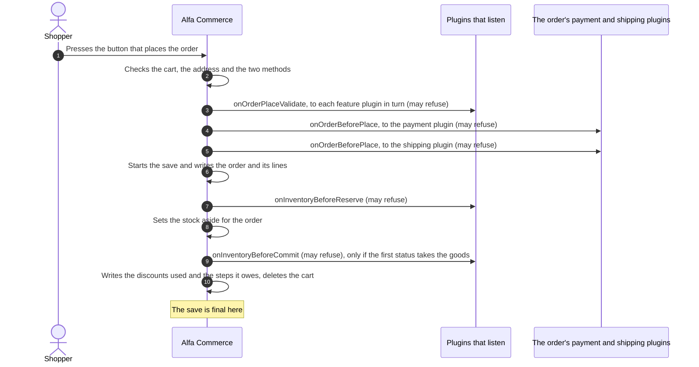

What the picture means:

- **Steps 3, 4 and 5 run before anything is written.** A refusal there costs one failed checkout and leaves no
  order.
- **Steps 7 and 9 run inside the save.** A refusal there undoes the order and its lines. Nothing is left.
- **Step 3 is not announced to everyone.** `onOrderPlaceValidate` is handed to each enabled plugin of the `alfa`
  group that the customer's access levels admit, in their order, each once.
- **Step 9 is skipped** when the order's first status only sets the stock aside. Most shops work that way.
- While it sets the stock aside (step 8), Alfa may ask `onCollectStockAllocationProviders` which location the stock
  comes from. It asks once for each stock service object it works with, so the event can be announced more than
  once in a request.
- The cart's own events (`onCartTotals`, `onCalculateShippingCost`, `onCartView`) belong to drawing and totalling
  the cart. They are not part of this picture.

### After the save

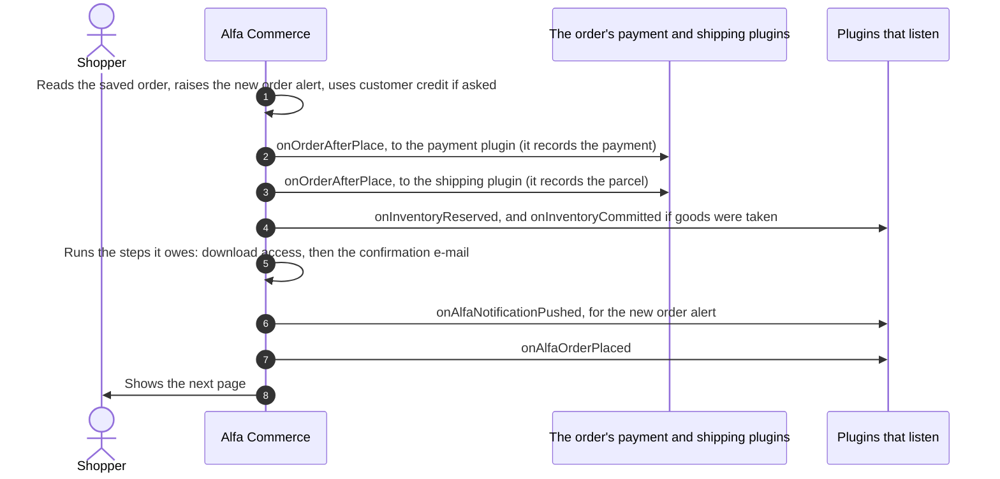

What the picture means:

- **The order exists for good in every step.** A plugin that fails in step 2 or 3 does not undo the order. The order
  stays without a payment row or without a parcel, and the shopper is told that part of the order could not be set
  up.
- **Each row a plugin writes in step 2 or 3 is a save of its own**, final when the plugin's `save()` returns.
- **Steps 4, 5 and 6 wait for steps 2 and 3.** Alfa holds its own after-work until both plugins are done, so the
  confirmation e-mail shows the order with its payment and its parcel.
- **If the payment is completed already in step 2** (customer credit paid it, or the plugin settled it), the order's
  move to the status that the method's settings name runs inside step 5, before the confirmation e-mail. That move
  is the flow [Changing an order's status](#changing-an-orders-status).
- **Step 7 is the last step on purpose.** A listener of `onAlfaOrderPlaced` sees the order as the shopper completed
  it.

| Event | Who receives it | Documented on |
|---|---|---|
| `onOrderPlaceValidate` | Each admitted plugin of the `alfa` group in turn | [Order and cart events](./order-and-cart-events.md) |
| `onOrderBeforePlace` | The payment plugin of the chosen method, then the shipping plugin of the chosen method | [Payment plugins](../plugins/payment-plugins.md#onorderbeforeplace), [Shipping plugins](../plugins/shipment-plugins.md#onorderbeforeplace) |
| `onInventoryBeforeReserve`, `onInventoryBeforeCommit` | Everyone who listens | [Stock events](./stock-events.md) |
| `onCollectStockAllocationProviders` | Everyone who listens | [Stock events](./stock-events.md) |
| `onOrderAfterPlace` | The payment plugin, then the shipping plugin | [Payment plugins](../plugins/payment-plugins.md#onorderafterplace), [Shipping plugins](../plugins/shipment-plugins.md#onorderafterplace) |
| `onInventoryReserved`, `onInventoryCommitted` | Everyone who listens | [Stock events](./stock-events.md) |
| `onAlfaNotificationPushed` | Everyone who listens | [Notification and setup events](./notification-and-setup-events.md) |
| `onAlfaOrderPlaced` | Everyone who listens | [Order and cart events](./order-and-cart-events.md) |

## Changing an order's status

Staff change the status on the order page, or a payment or a parcel changes it through the method's settings. Alfa
saves the new status first, together with a list of the steps the change owes. Then it carries out those steps one
by one, as [background work](../reference/glossary.md#background-work): in the same request when it can, later when
the request stops. The class is `Transition` (`administrator/src/Service/Order/Transition.php`).

There is no "before" event for a status change. A plugin cannot refuse it.

### The status is saved, then the stock follows

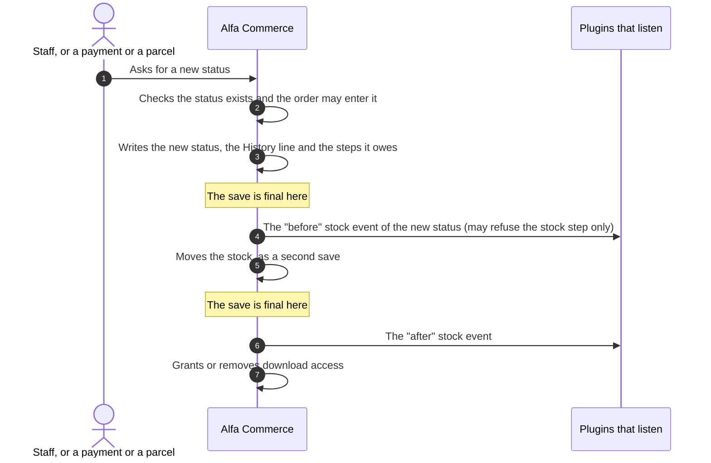

### Then the documents, the e-mail and the announcement

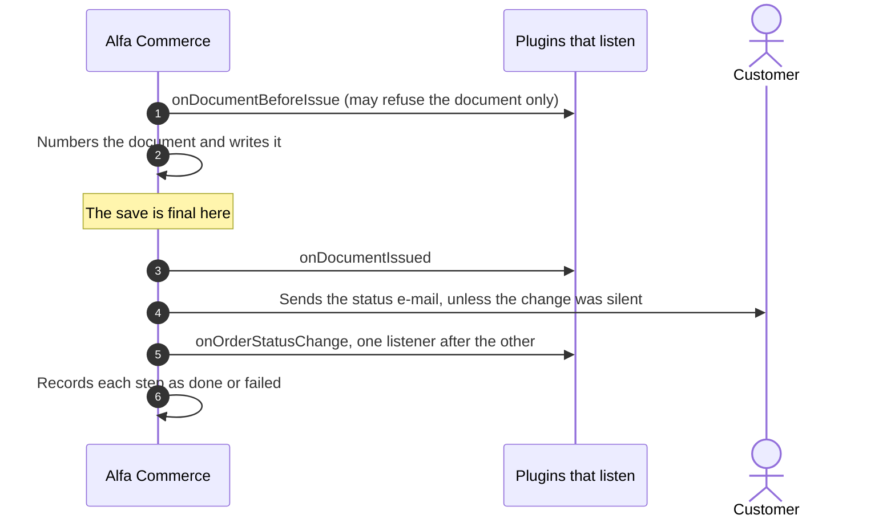

What the two pictures mean:

- **The status is final at step 3 of the first picture.** Everything after it is a step of its own. A step that
  fails leaves the status as saved.
- **A step is carried out only when the status owes it.** The stock moves only when the new status asks something
  else of the stock than the old one. Documents are issued only when the status issues documents. The e-mail is sent
  only when the status notifies. `onOrderStatusChange` is announced only when something listens.
- **The steps run in this order:** stock, download access, documents, e-mail, `onOrderStatusChange`.
- **Which stock events fire** depends on what the new status asks of the stock. See [Stock](#stock).
- **A refusal in a stock or document "before" event stops that step only.** The stock movement stays owed and is
  tried again. A refused document raises an alert for staff.
- **`onOrderStatusChange` is delivered listener by listener.** Each listener's result is recorded. A listener that
  failed can be run again by staff, alone, without the others running twice. It is never run again automatically.
- **When the change comes from inside another save** (a payment being settled, for example), the steps wait until
  that save is final and Alfa's locks are released.

| Event | Who receives it | Documented on |
|---|---|---|
| `onInventoryBeforeReserve`, `onInventoryBeforeCommit`, `onInventoryBeforeRelease` | Everyone who listens | [Stock events](./stock-events.md) |
| `onInventoryReserved`, `onInventoryCommitted`, `onInventoryReleased` | Everyone who listens | [Stock events](./stock-events.md) |
| `onDocumentBeforeIssue`, `onDocumentIssued` | Everyone who listens | [Document events](./document-events.md) |
| `onOrderStatusChange` | Everyone who listens | [Order and cart events](./order-and-cart-events.md) |

## Payment and refund

After an order is placed, its payment plugin records a payment, sends the shopper to the provider if there is one,
and settles the payment when the provider confirms it. Later, staff may refund it. Every event here is addressed to
one plugin: the payment plugin of the order, of the payment row, or the one named in the address the provider calls.
The two pictures agree with the ones on [Payment plugins](../plugins/payment-plugins.md), and add what Alfa does
around each call.

### A payment through a provider

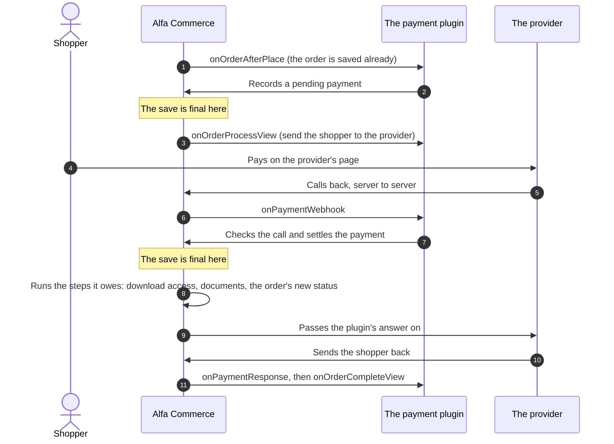

What the picture means:

- **Two saves, both made by the ledger** (`PaymentLedger`, the class that keeps the payment rows) when the plugin
  calls `save()`: the pending row at step 2 and the settled row at step 7.
- **Step 8 follows only a change.** A row that changes to a status the method's settings name moves the order.
  A new row never moves the order. The move is the flow [Changing an order's status](#changing-an-orders-status),
  with its stock, documents, e-mail and `onOrderStatusChange`.
- **Step 8 runs after the payment's save is final and Alfa's locks are released**, and normally before step 9.
  If the request stops in between, background work carries it out.
- **Steps 5 and 10 can arrive in either order**, and each can arrive twice.
- **An offline method stops after step 3.** Staff settle the payment later with a button of the plugin. That is
  `onExecuteAction`, as in the next picture.

### A refund through a provider

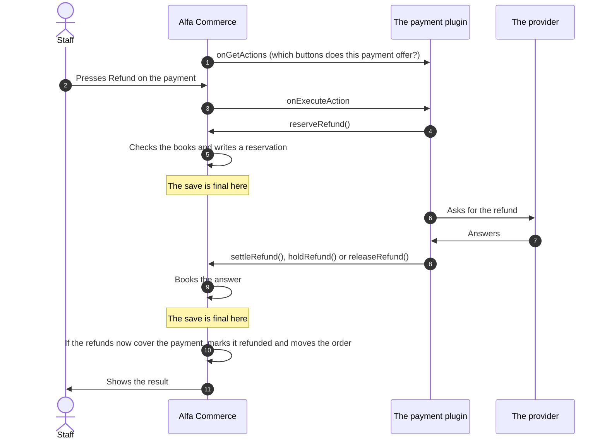

What the picture means:

- **The reservation is saved before the provider is asked** (step 5), so a second click cannot start the same refund
  twice. The provider is called with no lock and no database transaction open.
- **Step 10 only happens when the settled refunds cover the whole payment.** The payment then becomes "refunded",
  and the order moves if the method's settings name a status for it. A partial refund does not move the order.
- **No event is announced to everyone in this flow.** A plugin that wants to hear about a refund listens to
  `onOrderStatusChange`, which fires when the order moves.

| Event | Who receives it | Documented on |
|---|---|---|
| `onOrderAfterPlace` | The payment plugin of the order's method | [Payment plugins](../plugins/payment-plugins.md#onorderafterplace) |
| `onOrderProcessView`, `onOrderCompleteView` | The payment plugin recorded on the order | [Payment plugins](../plugins/payment-plugins.md#onorderprocessview) |
| `onPaymentWebhook`, `onPaymentResponse` | The payment plugin named in the address | [Payment plugins](../plugins/payment-plugins.md#onpaymentwebhook) |
| `onGetActions`, `onExecuteAction` | The payment plugin recorded on the payment row | [Payment plugins](../plugins/payment-plugins.md#ongetactions) |
| `onOrderStatusChange` | Everyone who listens, when the order moves | [Order and cart events](./order-and-cart-events.md) |

## Booking a shipment

The shipping plugin of the order's method records the order's first parcel right after the order is saved. If the
carrier takes bookings, the plugin books the parcel with the carrier first. Later the carrier reports progress, or
staff press one of the plugin's buttons on the order page. Every event here is addressed to one shipping plugin.
The pictures agree with the one on [Shipping plugins](../plugins/shipment-plugins.md).

### At the placement, and when the carrier calls back

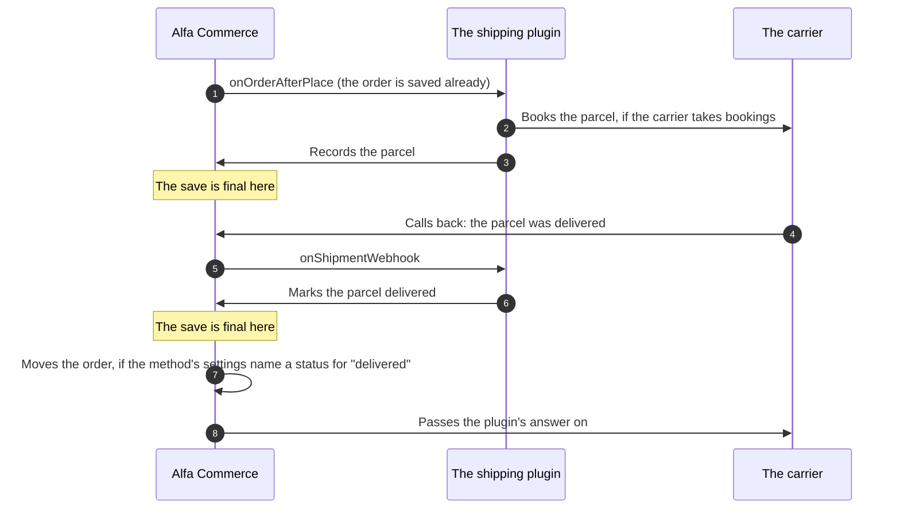

### When staff press a button of the plugin

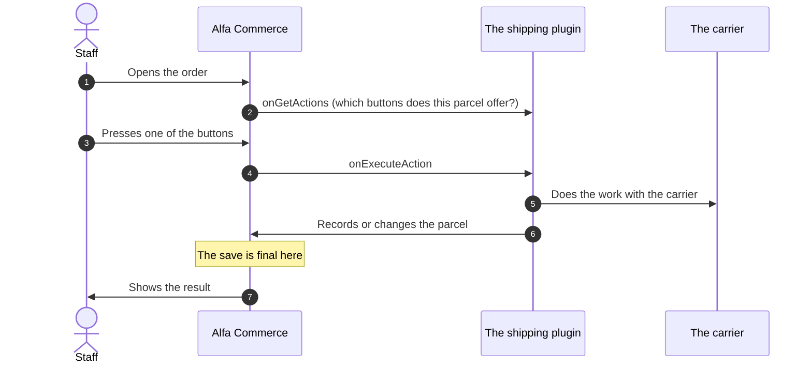

What the two pictures mean:

- **Each write to a parcel is a save of its own**, made by the ledger (`ShipmentLedger`) when the plugin calls
  `save()`.
- **A new parcel never moves the order.** Only a change that gives a parcel a new status does, and only when the
  method's settings name an order status for it. The move is recorded in the same save as the parcel and carried out
  after that save is final. It is the flow [Changing an order's status](#changing-an-orders-status).
- **Before the order exists**, the same plugin was asked `onCalculateShippingCost` (the price in the cart) and
  `onOrderBeforePlace`. See [Placing an order](#placing-an-order).
- **`onShipmentResponse`** fires when a shopper comes back from a carrier's own page. It is not in the pictures
  because it changes nothing by itself.

| Event | Who receives it | Documented on |
|---|---|---|
| `onCalculateShippingCost` | The shipping plugin of the method chosen in the cart | [Shipping plugins](../plugins/shipment-plugins.md#oncalculateshippingcost) |
| `onOrderBeforePlace`, `onOrderAfterPlace` | The shipping plugin of the order's method | [Shipping plugins](../plugins/shipment-plugins.md#onorderafterplace) |
| `onShipmentWebhook`, `onShipmentResponse` | The shipping plugin named in the address | [Shipping plugins](../plugins/shipment-plugins.md#onshipmentwebhook) |
| `onGetActions`, `onExecuteAction` | The shipping plugin recorded on the parcel | [Shipping plugins](../plugins/shipment-plugins.md#ongetactions) |

## Stock

Stock moves when an order is placed, when an order's status changes, when a document that moves stock is issued, and
when staff correct a figure or move goods between locations. Each movement is one command of `InventoryService`
(`administrator/src/Service/Inventory/InventoryService.php`). What an order's status asks of the stock is decided by
`StockPolicy::claimFor()` (`administrator/src/Service/Order/StockPolicy.php`). Every command follows the same
order.

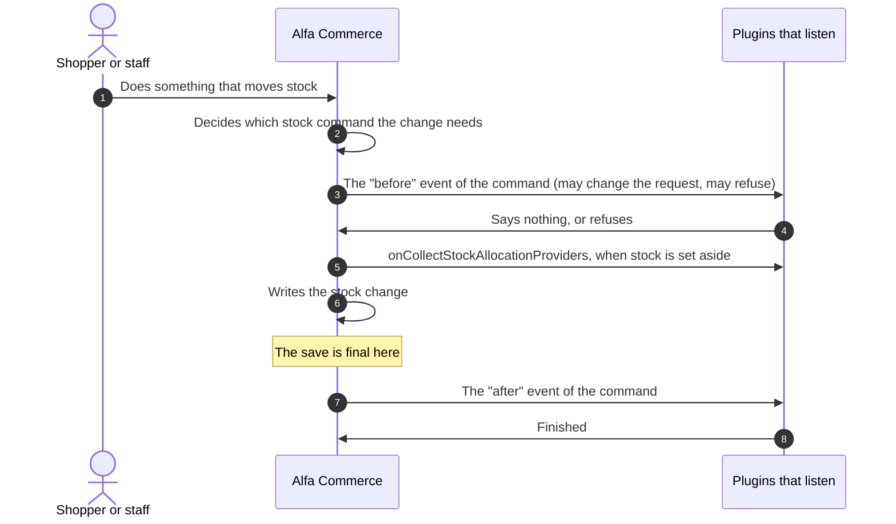

Which events a command announces:

| What happens | The command | "Before" event | "After" event |
|---|---|---|---|
| Stock is set aside for an order | `reserve()` | `onInventoryBeforeReserve` | `onInventoryReserved` |
| Goods are taken from stock | `commitReservation()` | `onInventoryBeforeCommit` | `onInventoryCommitted` |
| All reservations of an order are let go | `release()` | `onInventoryBeforeRelease` | `onInventoryReleased` |
| Reservations that ran out of time are let go | `expireDueReservations()` | None | `onInventoryReleased` |
| Staff correct a figure | `adjustTo()` | None | `onInventoryAdjusted` |
| Goods move between locations | `transfer()` | None | `onInventoryTransferred` |

What the picture means:

- **The "before" event is announced before the command writes anything.** A listener refuses by throwing an error.
  Nothing of the command is written then.
- **The "after" event waits for the outermost save.** When the command runs inside a bigger save, such as the
  placement of an order, its own save is only a part of that one. The line "The save is final here" is then the
  bigger save's, and the "after" event is announced after it. If the bigger save is undone, the "after" event is
  never announced.
- **Three statuses, three outcomes.** A status that takes the goods runs `commitReservation()`. A status that keeps
  them set aside puts back what was taken. A cancelled status puts back what was taken and runs `release()`.
- **Putting goods back announces nothing in 2.2.0.** `restore()` and `releaseLine()` have no event.
- **`onCollectStockAllocationProviders` is asked while the command writes**, the first time a stock service object
  (`InventoryService`) must choose a location. One object keeps the answer. A request that uses several objects
  announces the event several times.

| Event | Who receives it | Documented on |
|---|---|---|
| `onInventoryBeforeReserve`, `onInventoryBeforeCommit`, `onInventoryBeforeRelease` | Everyone who listens | [Stock events](./stock-events.md) |
| `onInventoryReserved`, `onInventoryCommitted`, `onInventoryReleased`, `onInventoryAdjusted`, `onInventoryTransferred` | Everyone who listens | [Stock events](./stock-events.md) |
| `onCollectStockAllocationProviders` | Everyone who listens, after the group `alfa-inventory` is loaded | [Stock events](./stock-events.md) |

## Documents

A document (an invoice, a credit note, a delivery note) is issued when staff issue it on the order page, or when an
order enters a status that issues documents. It can later be voided. Both go through `DocumentIssuer`
(`administrator/src/Service/Document/DocumentIssuer.php`). An issued document is never edited.

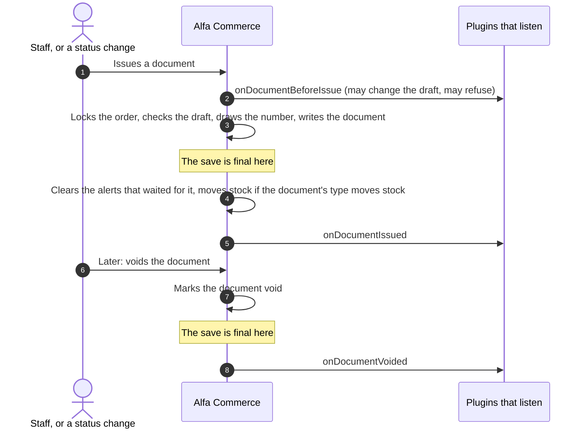

What the picture means:

- **`onDocumentBeforeIssue` is asked before any save is open.** A refusal burns no document number.
- **`onDocumentIssued` and `onDocumentVoided` are announced only when the document is stored for good.** When the
  issue is part of a bigger save, they wait for that save.
- **The stock step (step 4) comes before `onDocumentIssued`.** It runs the [Stock](#stock) flow, with its own
  events.
- **Void and replace is one save.** `onDocumentBeforeIssue` is asked about the replacement first. Then the old
  document is voided and the new one issued together. After that save is final, `onDocumentVoided` is announced, then
  `onDocumentIssued`.
- **The list of document types** is collected with `onCollectDocumentTypeProviders` on the Document Types screen,
  when it is shown and when staff press its sync button. It is not a step of issuing.

| Event | Who receives it | Documented on |
|---|---|---|
| `onDocumentBeforeIssue` | Everyone who listens | [Document events](./document-events.md) |
| `onDocumentIssued`, `onDocumentVoided` | Everyone who listens | [Document events](./document-events.md) |
| `onCollectDocumentTypeProviders` | Everyone who listens | [Document events](./document-events.md) |

## Catalogue and price rebuild

Alfa keeps ready-made copies of what the storefront needs: the price of every item for every group of customers
(the price index), the item field values used by filters, and the search entry. When staff save an item, a discount,
a tax or a category, Alfa writes the record and then rebuilds those copies for the items the change touches. A plugin
that keeps a copy of its own follows the same events.

### An item is saved

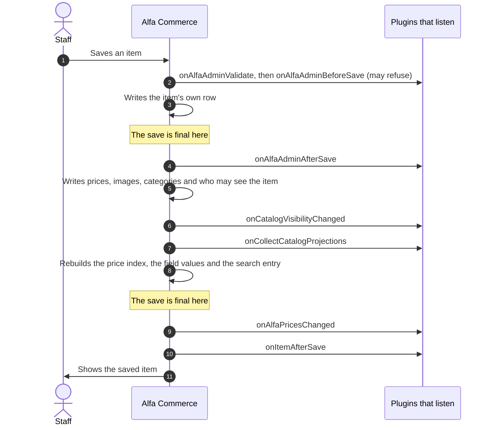

What the picture means:

- **An item is not saved as one unit.** The item's row is final at step 3. The prices, images and categories of
  step 5 are each written after it, each final when written. The rebuilt copies are final at step 8.
- **`onAlfaAdminAfterSave` (step 4) fires right after the item's row.** The item's new prices, images and
  categories are not written yet. A plugin that needs the whole saved item listens to `onItemAfterSave` (step 10).
- **Step 5 runs the [Media](#media) flow** for each new image.
- **A changed stock figure is its own save.** When staff changed the item's stock tracking or a stock figure on the
  form, Alfa writes it through the stock service, before step 7, and announces `onInventoryAdjusted` for it. See
  [Stock](#stock).
- **`onAlfaPricesChanged` is announced only when a price row really changed**, and only when something listens.
  It carries the cause `item`.
- **If the rebuild cannot run now** (another rebuild holds the item, or a part of it fails), the item is marked and
  the background job `catalogue.rebuild` rebuilds it later. `onAlfaPricesChanged` then carries the cause `rebuild`.
- Joomla's own `onContentBeforeSave` and `onContentAfterSave` fire inside step 3, as for any Joomla record.

### A discount, a tax or a category changes

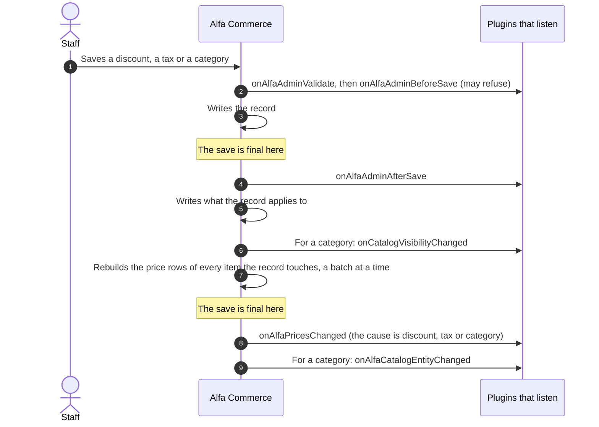

What the picture means:

- **The record's own row is final at step 3**, and `onAlfaAdminAfterSave` (step 4) fires right after it. What the
  record applies to (its categories, manufacturers, customers and so on) is written after that, at step 5.
- **Each batch of the rebuild (step 7) is a save of its own.** What changed in all batches is announced together,
  in one `onAlfaPricesChanged`, after the last one. A very large rebuild is announced in parts.
- **For a category, step 7 rebuilds every copy** of the items assigned to it (prices, field values and the search
  entry), not only the price rows. Alfa announces `onCollectCatalogProjections` first, as in step 7 of an item save.
- **Publishing, unpublishing or deleting** a discount or a tax runs steps 7 and 8 as well.
- **A manufacturer** announces `onAlfaCatalogEntityChanged` when it is saved, renamed, published or deleted.

| Event | Who receives it | Documented on |
|---|---|---|
| `onAlfaAdminValidate`, `onAlfaAdminBeforeSave`, `onAlfaAdminAfterSave` | Everyone who listens | [Extending Admin Screens](../plugins/admin-screen-plugins.md#the-save-and-delete-events) |
| `onCatalogVisibilityChanged`, `onAlfaCatalogEntityChanged` | Everyone who listens | [Search engine plugins](../plugins/search-plugins.md#oncatalogvisibilitychanged) |
| `onCollectCatalogProjections` | Everyone who listens | [Search engine plugins](../plugins/search-plugins.md#oncollectcatalogprojections) |
| `onAlfaPricesChanged` | Everyone who listens | [Item and catalogue events](./item-and-catalogue-events.md) |
| `onItemAfterSave` | Everyone who listens | [Item and catalogue events](./item-and-catalogue-events.md) |
| `onInventoryAdjusted` | Everyone who listens, when a stock figure changed | [Stock events](./stock-events.md) |

## Media

When staff save a record with a new image (an item, a category, a manufacturer or a combination), Alfa checks the
file, lets media plugins change or store it, makes a thumbnail and writes the image's row. All five media events are
announced to everyone, after the plugins of the group `alfa-media` are loaded. The code is `MediaHelper`
(`administrator/src/Helper/MediaHelper.php`). The picture is the same as on
[Media plugins](../plugins/media-plugins.md).

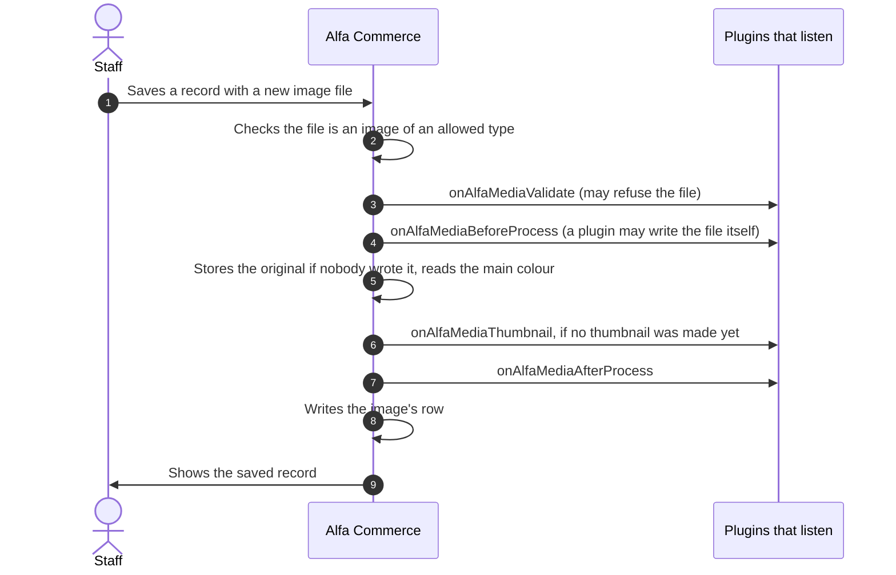

What the picture means:

- **The line "The save is final here" is left out on purpose.** `MediaHelper` writes the image's row at step 8 as one
  plain write and opens no save of its own. Whether that write is final at once depends on the screen that called
  it. So a media event does not tell a plugin whether the record's own save is final.
- **A refusal in step 3** (`setValid(false)`) skips that one file. The record is still saved.
- **An image that arrives with a thumbnail picture named** fires `onAlfaMediaThumbnail` first, before step 2, and
  not again at step 6.
- **When an image is deleted**, `onAlfaMediaBeforeDelete` is announced before the files and the rows are removed.

| Event | Who receives it | Documented on |
|---|---|---|
| `onAlfaMediaValidate` | Everyone who listens | [Media plugins](../plugins/media-plugins.md#onalfamediavalidate) |
| `onAlfaMediaBeforeProcess` | Everyone who listens | [Media plugins](../plugins/media-plugins.md#onalfamediabeforeprocess) |
| `onAlfaMediaThumbnail` | Everyone who listens | [Media plugins](../plugins/media-plugins.md#onalfamediathumbnail) |
| `onAlfaMediaAfterProcess` | Everyone who listens | [Media plugins](../plugins/media-plugins.md#onalfamediaafterprocess) |
| `onAlfaMediaBeforeDelete` | Everyone who listens | [Media plugins](../plugins/media-plugins.md#onalfamediabeforedelete) |

## Search

Search has two sides. A shopper searches, and Alfa asks the engine that Options names. Staff change the catalogue,
and Alfa tells the engine what to write. Most of the work is done by calling the engine's own methods, which are not
events. The events are the few moments around them. The first picture follows the one on
[Search engine plugins](../plugins/search-plugins.md) and adds the events around it. That page has no picture for
the second.

### A shopper searches

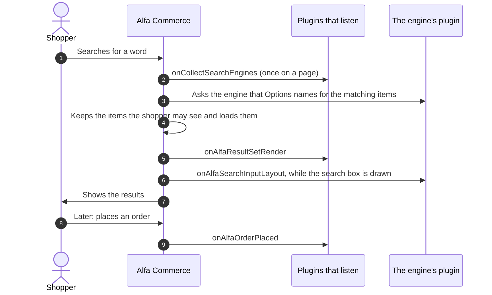

What the picture means:

- **Step 3 is not an event.** Alfa calls the engine's reader. If the engine is not ready, Alfa searches its own
  tables. It never asks another engine.
- **Step 6 is addressed to one plugin**, the plugin of the engine that Options names. If it does not answer, Alfa
  draws its own search box.
- **Steps 8 and 9** are how an engine learns that a search led to an order. `onAlfaOrderPlaced` is announced in the
  shopper's own request, after the plugins of `alfa-search` are loaded.
- Nothing is saved in this picture, so it has no line "The save is final here".

### The catalogue changes

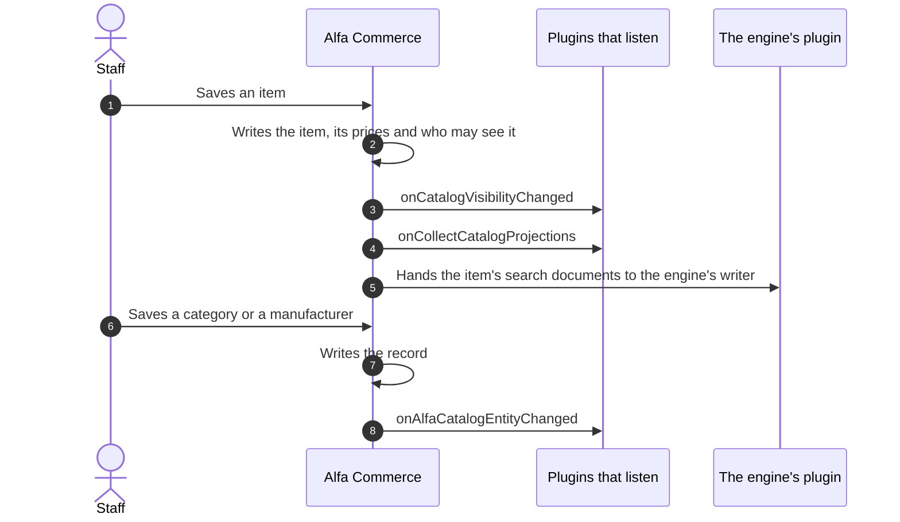

What the picture means:

- **Step 5 is not an event.** Alfa builds the item's search documents and calls the writer of the engine that
  Options names. A failure there is recorded and does not stop the save.
- **Steps 3, 4 and 8 are announced to everyone**, after the plugins of `alfa-search` and `alfa` are loaded.
  Steps 3 and 8 are announced at once, right after the writes of steps 2 and 7. They do not wait for a bigger save
  around them.
- **Where each write becomes final** is marked in the two pictures of
  [Catalogue and price rebuild](#catalogue-and-price-rebuild). This picture leaves the line out so that it is not
  marked twice.
- **The full rebuild of the index** (the background job `search.rebuild`) calls the engine's writer only. It
  announces no event.
- The whole item save, with its price events, is the flow
  [Catalogue and price rebuild](#catalogue-and-price-rebuild).

| Event | Who receives it | Documented on |
|---|---|---|
| `onCollectSearchEngines` | Everyone who listens, after `alfa-search` is loaded | [Search engine plugins](../plugins/search-plugins.md#oncollectsearchengines) |
| `onAlfaSearchInputLayout` | The plugin of the engine that Options names | [Search engine plugins](../plugins/search-plugins.md#onalfasearchinputlayout) |
| `onAlfaResultSetRender` | Everyone who listens, after `alfa-search` is loaded | [Search engine plugins](../plugins/search-plugins.md#onalfaresultsetrender) |
| `onAlfaOrderPlaced` | Everyone who listens | [Order and cart events](./order-and-cart-events.md) |
| `onCatalogVisibilityChanged` | Everyone who listens | [Search engine plugins](../plugins/search-plugins.md#oncatalogvisibilitychanged) |
| `onCollectCatalogProjections` | Everyone who listens | [Search engine plugins](../plugins/search-plugins.md#oncollectcatalogprojections) |
| `onAlfaCatalogEntityChanged` | Everyone who listens | [Search engine plugins](../plugins/search-plugins.md#onalfacatalogentitychanged) |

## What you must provide

Nothing new. This page adds no event and no method. Declare each event as its own page says: an event announced to
everyone in `getSubscribedEvents()`, an event addressed to one plugin as a targeted handler. Both are explained on
[How events reach a plugin](./how-events-reach-a-plugin.md).

## What happens next

When you know your place in a flow, open the page linked in the flow's table. It says what the event hands you and
what you may set.

## What can go wrong

| What you see | The usual cause |
|---|---|
| Your "after" listener reads old data | It runs before a later step of the same flow. On an item save, `onAlfaAdminAfterSave` comes before the prices are written. Listen to `onItemAfterSave` or `onAlfaPricesChanged`. |
| Your refusal did not stop the order's status | A status change has no "before" event. A refusal in a stock or document event stops that step only. |
| Your listener of `onOrderStatusChange` ran in a later request | The steps of a status change are background work. They run later when the request that saved the status stopped early. |
| Your "after" stock listener was not called | The save around the stock command was undone. "After" events are never announced for a change that was undone. |
| The order moved before your payment plugin returned | The order moves as soon as the payment's save is final and Alfa's locks are released. Write everything you need before you call `save()`. |
| A confirmation e-mail was sent without your plugin's row | Your plugin failed in `onOrderAfterPlace`. The order stays, the e-mail is sent, and the shopper is told that part of the order could not be set up. |

## Not documented yet

- The cart: the order of `onCartViewAssets`, `onCartView`, `onCalculateShippingCost`, `onCartTotals`,
  `onCartItemView` and `onCartItemDisplay` while a cart is drawn and totalled.
- The item page and the listing: the order of the item field events with `onItemDisplay`.
- Adding an item to the cart: `onValidateCartAdd`, `onPrepareForCart` and `onCalculateItemPrice`.
- Deleting an order: `onAdminOrderDelete` with the admin delete events.
- The administrator's list and edit screens. Their order is on
  [Extending Admin Screens](../plugins/admin-screen-plugins.md) and
  [Creating an Admin Panel](../plugins/admin-panels.md).
- An order placed by other code than the checkout (for example by an import): which of the events above it fires.
