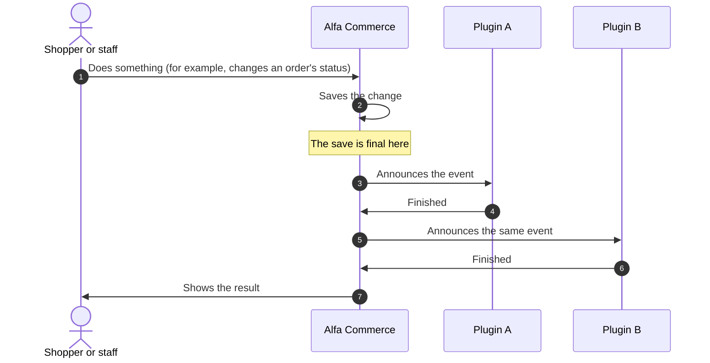
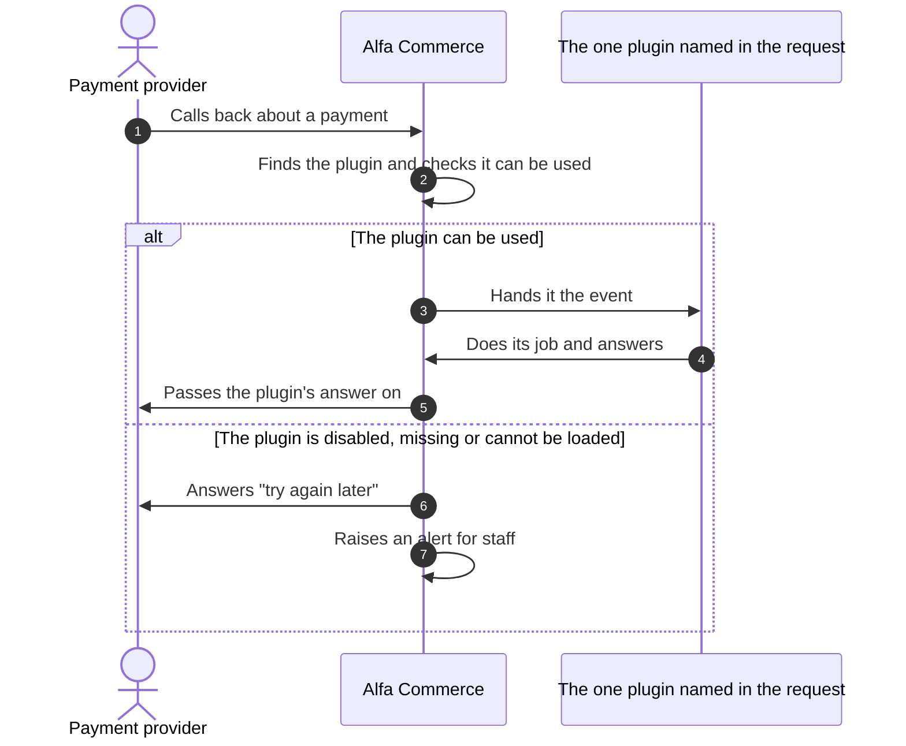
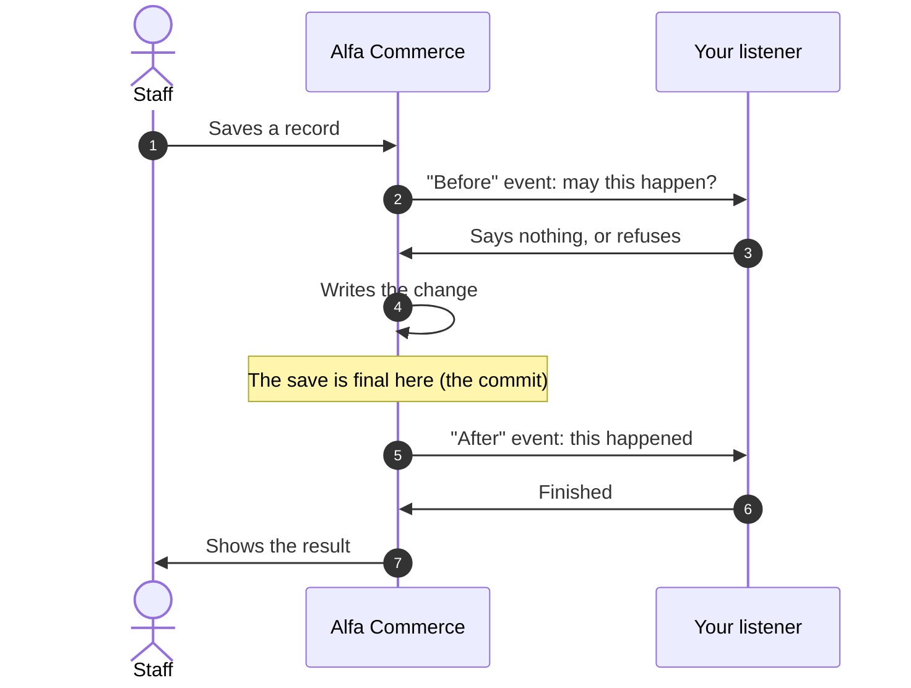

# How events reach a plugin

<AlfaVersion verified="2.2.0" />

An **event** is Alfa Commerce telling plugins that something is happening: an order changed status, a page is being
drawn, a payment provider called back. A plugin that wants to take part names the events it handles, and Alfa calls it
at the right moment.

Read this page before any other page about plugins. Every plugin type follows the rules explained here.

## What it does

Alfa calls plugins in one of two ways, and every event uses exactly one of them.

| | Announced to everyone | Addressed to one plugin |
|---|---|---|
| The technical name | A **broadcast** event | A **targeted** event |
| In plain words | "This happened. Anyone who cares may react." | "This job is yours. Please do it." |
| Who is called | Every enabled plugin that asked to hear the event, whatever its group | One named plugin, and nobody else |
| Typical use | An order changed status, a list is being drawn, stock moved | Take this payment, price this parcel, draw your own panel |
| If the plugin is missing | Nothing special. The others still hear it. | The request is refused and staff are told. No other plugin is asked instead. |
| Where the plugin names the event | `getSubscribedEvents()` | Its targeted declaration (see below) |

Both ways go through one class, `AlfaPluginHelper` (`administrator/src/Plugin/AlfaPluginHelper.php`). A plugin never
calls it; it is named here so that you can find the rules in the code.

## Announced to everyone (broadcast)

### What happens



Alfa calls the listeners one after the other, in Joomla's priority order, and hands each the same event object.

### When it is used

For anything more than one plugin may care about: the administrator's list, form and save events, the menu and
permissions events, media, the item page and listing events, orders placed, status changes, stock, catalogue,
document and notification events.

### Who hears it

Every enabled plugin that is **loaded** in the request and **listed the event** in `getSubscribedEvents()`, whatever
its plugin group.

| Plugin group | When it is loaded |
|---|---|
| `alfa` (feature plugins) | By Alfa Commerce, every time the component runs, on the storefront and in the administrator |
| `system` | By Joomla, on every request |
| The Alfa families (`alfa-payments`, `alfa-shipments`, `alfa-item-fields`, `alfa-form-fields`, `alfa-search`, `alfa-media`, `alfa-inventory`) | By Alfa Commerce, when the work at hand needs that family |
| Other Joomla groups (`content`, `user`, `task` and the others) | By Joomla, when Joomla itself needs them |

If your plugin exists to react to shop events, put it in the `alfa` group: it is loaded whenever the shop runs and
only then.

### What you must provide

Your plugin class implements Joomla's `SubscriberInterface` and lists every broadcast event it handles:

```php
namespace Acme\Plugin\Alfa\Thanks\Extension;

use Alfa\Component\Alfa\Administrator\Event\Orders\OrderStatusChangeEvent;
use Joomla\CMS\Plugin\CMSPlugin;
use Joomla\Event\SubscriberInterface;

final class Thanks extends CMSPlugin implements SubscriberInterface
{
    public static function getSubscribedEvents(): array
    {
        return [
            'onOrderStatusChange' => 'onOrderStatusChange',
        ];
    }

    public function onOrderStatusChange(OrderStatusChangeEvent $event): void
    {
        if (!$event->enteredCompleted()) {
            return;
        }

        $order = $event->getOrder();

        // Your own work, for example with $order->id() and $order->reference().
    }
}
```

A method that is not listed is never called, even when it has the event's name.

### What happens next, and what can go wrong

It depends on what the event is for.

| The event | If your listener throws an error |
|---|---|
| **Asks whether something may happen** (a "before" event) | The operation stops and the error reaches the person. This is how a plugin refuses something. |
| **Reports what already happened, or collects what a page shows** (an "after" or display event) | The error is written to Joomla's log (category `com_alfa.plugins`) with the event and your listener's name. The next listener still runs, and the page is still shown. |

So a broken plugin cannot blank a screen or silence the plugins after it. It also means that an error in an "after"
listener is easy to miss: look in the log.

## Addressed to one plugin (targeted)

### What happens



The picture shows a payment provider's callback. Every targeted event has the same shape: Alfa selects one plugin,
checks it, and calls the one method that plugin declared for the event. Other plugins never see it.

### When it is used

For work that belongs to one plugin:

- a payment or shipping plugin's part of the cart, the checkout and the order pages, its provider's return and
  callback, and its staff actions;
- an item field's part of the item page, the cart line and the price;
- a search engine's own input;
- a panel a plugin owns, a tool it runs, and clearing the data it owns.

### What you must provide

How you declare a targeted event depends on what your plugin extends.

**A payment, shipping, item-field or search plugin** extends its family's base class. The base class holds the list
of targeted events of that family (its `TARGETED_EVENTS`). You declare one by writing a public method with the
event's name. Nothing else is needed:

```php
use Alfa\Component\Alfa\Administrator\Plugin\PaymentsPlugin;

final class Mygateway extends PaymentsPlugin
{
    // Declared by having the method: the base class reports it to Alfa.
    public function onPaymentWebhook($event): void
    {
        // Handle your provider's callback.
    }
}
```

**Any other plugin of the Alfa groups** (a feature plugin in `alfa`, for example) implements
`TargetedHandlersInterface` and returns each targeted event with the method that handles it:

```php
use Alfa\Component\Alfa\Administrator\Event\Tools\ClearDataEvent;
use Alfa\Component\Alfa\Administrator\Plugin\TargetedHandlersInterface;
use Joomla\CMS\Plugin\CMSPlugin;
use Joomla\Event\SubscriberInterface;

final class Thanks extends CMSPlugin implements SubscriberInterface, TargetedHandlersInterface
{
    public static function getSubscribedEvents(): array
    {
        return ['onOrderStatusChange' => 'onOrderStatusChange'];
    }

    public function getTargetedHandlers(): array
    {
        return ['onClearData' => 'onClearData'];
    }

    public function onClearData(ClearDataEvent $event): void
    {
        // Remove the data this plugin owns.
    }

    // onOrderStatusChange() as in the example above.
}
```

**A plugin of a group Joomla loads itself** (`system`, `task`, `user`, `content` and the others) writes the same
public `getTargetedHandlers()` method but does not name the interface, or any other Alfa class, in its class line.
That way the plugin still loads on a site where Alfa Commerce was uninstalled.

Three rules apply to all of them:

1. A plugin with targeted handlers is a `SubscriberInterface` plugin, even when its `getSubscribedEvents()` returns an
   empty list.
2. An event name goes in **one** of the two lists, never in both. A name in both is reported as an error in the log.
3. A method that is not declared is never called because of its name.

### What happens next

Whatever your method does is your plugin's answer: Alfa passes it on (to the provider, to the page, to the member of
staff). An error that leaves your method is treated as your plugin's failure, and what follows depends on the
request, as the next table shows.

### What can go wrong

Before calling a targeted handler Alfa checks that the plugin can be used. These are the reasons it cannot
(`PluginUnavailable` in the code):

| Reason | What it means |
|---|---|
| `missing` | No plugin of that name is installed, or its files are gone |
| `disabled` | Installed but not enabled. A disabled plugin is never started. |
| `not_loaded` | Enabled, but its Access is a level the current user does not hold, so Joomla does not load it for this request |
| `unloadable` | Enabled, but it failed while starting |
| `wrong_family` | It does not extend the base class its group requires |
| `no_handler` | It did not declare a handler for this event |

Alfa never falls back to another plugin. What the person sees depends on what was asked:

| What was asked | What Alfa does when the plugin cannot be used |
|---|---|
| A new order with that payment or shipping plugin | Refuses the order before anything is saved |
| An order page that shows the plugin's part | Shows a neutral line in its place and changes nothing |
| A staff action on a payment or shipment | Refuses it, names the plugin as Extensions: Plugins does, and says how to restore it |
| A provider's or carrier's callback | Answers "503 Service Unavailable" with Retry-After, so the provider tries again, and raises one alert per plugin in the notification bell |

:::warning Callbacks need Access Public
A payment provider or a carrier calls your plugin as a guest. A payment or shipping plugin whose Access (Extensions:
Plugins) is anything but Public is not loaded for those calls, and they are answered "try again later".
:::

## Addressed to several plugins in turn

Three events about the cart are handed to each feature plugin in turn, on one event for the whole cart:
`onCartTotals` (add a charge), `onOrderPlaceValidate` (check the order before it is placed) and `onCartItemDisplay`.

- They go to the enabled plugins of the `alfa` group that the **customer's** access levels admit, in their order,
  each once.
- Each plugin declares them as targeted handlers, as above.
- A `system` plugin cannot add a charge or refuse a placement.

When staff operate a customer's cart and one of those plugins has an Access the customer holds but the staff account
does not, Joomla does not load it for the staff member. The cart then shows its totals without that plugin's part,
says so, and the order cannot be placed from that screen.

## Where the save becomes final

Many mistakes come from assuming that a change is already saved when it is not, or the other way round. Alfa saves a
change as one unit: either all of it is stored, or none of it. The moment it is stored for good is called the
**commit**. In this manual's diagrams it is the line "The save is final here".



| Your listener runs | What it can rely on |
|---|---|
| In a "before" event | Nothing is saved yet. Refusing here stops the change. |
| In an "after" event | The change is saved for good, and the locks Alfa holds on an order are released. It is never called for a change that was undone. |

These events are announced only after the save is final: `onAlfaAdminAfterSave`, `onAlfaAdminAfterDelete`,
`onOrderStatusChange`, `onAlfaNotificationPushed` and `onAlfaPricesChanged`.

:::note What "saved" covers for an item, a discount and a tax
`onAlfaAdminAfterSave` is announced when the record's own row is saved. For an item, a discount and a tax, Alfa writes
the rest afterwards (an item's prices, images and categories, the scope of a discount or a tax, and the stored
prices). For an item, a listener that needs those uses `onItemAfterSave`. A discount and a tax have no later event
of their own: `onAlfaPricesChanged` follows only when a stored price changed. See
[Item and catalogue events](./item-and-catalogue-events.md).
:::

An "after" listener can be called a second time for the same change, for example when staff run a failed step again.
Write it so that running it twice does no harm.

## Naming your plugin

Whenever a plugin adds something to Alfa (a column, a row action, a menu entry, a dashboard card, a permission), it
names itself first, as **group.element**: the plugin's group (its folder under `plugins/`) and its element, in lower
case, joined by a dot. For example `alfa.thanks` or `alfa-payments.standard`.

Alfa uses the name to say in its logs and messages which plugin added what. It is a label, not a permission. A
contribution without it is refused.

## If nothing happens

| What you see | The usual cause |
|---|---|
| Your method is never called | The event is not listed in `getSubscribedEvents()` (broadcast) or not declared as a targeted handler |
| A targeted event never arrives | It was listed in `getSubscribedEvents()`. A targeted event is never delivered from there. |
| It works for you and not for guests or providers | The plugin's Access is not Public |
| A page shows without your part and without an error | Your listener threw an error in an "after" or display event. Look in Joomla's log, category `com_alfa.plugins`. |
| An order page shows a neutral line where your part was | Your plugin is disabled, missing or failed to start |

## Where to go next

- [Event flows](./flows.md) shows the order of events in nine flows, from placing an order to a search.
- [Event index](./event-index.md) lists every event with its way of delivery and the page that documents it.
- The events of one plugin type are on that type's page under Plugin Development.
