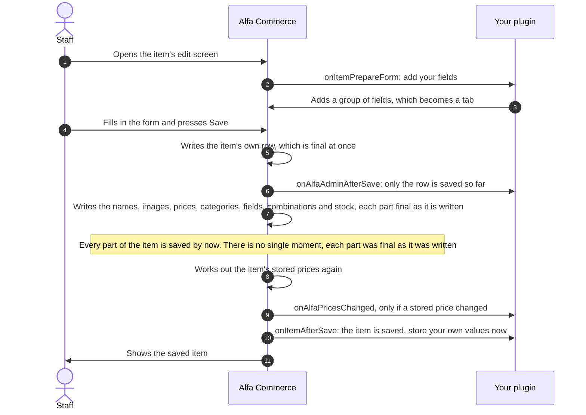

# Item and catalogue events

<AlfaVersion verified="2.2.0" />

These events let a **feature plugin** (a plugin of the `alfa` group) take part in an item's edit screen, its save and
its page in the shop, and hear when the catalogue or its stored prices change.

Read [How events reach a plugin](./how-events-reach-a-plugin.md) first. The
[Glossary](../reference/glossary.md) explains **item**, **price index**, **projection** and **customer group**.

No feature plugin ships with Alfa Commerce, so there is no shipped plugin to copy from. The samples on this page were
checked line by line against the event classes of 2.2.0.

## What it does

| Event | In plain words | Before or after the save is final |
|---|---|---|
| `onItemPrepareForm` | "The item's edit form is being built. Add your fields." | Nothing is saved. A screen is being drawn. |
| `onItemAfterSave` | "This item was saved, all of it." | After |
| `onItemDisplay` | "The item's page is being drawn in the shop. Add your part." | Nothing is saved. |
| `onAlfaPricesChanged` | "The stored prices of these items changed." | After |
| `onAlfaCatalogEntityChanged`, `onCatalogVisibilityChanged`, `onCollectCatalogProjections` | For a plugin that keeps its own copy of catalogue data | See "Keeping your own copy of the catalogue" |

All of them are **announced to everyone** (broadcast events): list them in `getSubscribedEvents()`. A `system` plugin
that lists them hears them too. In all of them an error in your listener is written to Joomla's log (category
`com_alfa.plugins`) with your listener's name, the next listener still runs, and the save or the page is not
affected (`dispatchIsolated()` in the code).

## When it is used

- Your plugin keeps something of its own for each item (a note, a subscription setting) and staff edit it on the
  item's own screen.
- Your plugin shows something on the item's page in the shop: a badge, a line of text.
- Your plugin keeps a copy of prices or of catalogue data somewhere else (a feed, a cache, another system) and must
  know when to refresh it.

## What you must provide

```php
namespace Acme\Plugin\Alfa\Thanks\Extension;

use Alfa\Component\Alfa\Administrator\Event\Catalog\PricesChangedEvent;
use Joomla\CMS\Plugin\CMSPlugin;
use Joomla\Event\SubscriberInterface;

final class Thanks extends CMSPlugin implements SubscriberInterface
{
    public static function getSubscribedEvents(): array
    {
        return [
            'onItemPrepareForm'       => 'onItemPrepareForm',
            'onItemAfterSave'         => 'onItemAfterSave',
            'onItemDisplay'           => 'onItemDisplay',
            PricesChangedEvent::NAME  => 'onAlfaPricesChanged',
        ];
    }

    // The four methods are shown one by one below.
}
```

`PricesChangedEvent::NAME` is the text `onAlfaPricesChanged`.

## Saving an item

### What happens



An item is not saved as one unit. It is saved in parts, one after the other: the item's own row first, then its
names in each language, its images, its prices, its categories and manufacturers, who may see it, its fields, its
combinations and its stock. Each part is final as soon as it is written, so there is no single moment at which the
whole item becomes final. The mark in the picture is the point after the last part: from there on, everything that
was written for the item is final. By the time `onItemAfterSave` is announced, every part that was written is final.

Three things follow from this:

- `onAlfaAdminAfterSave` (step 6) is announced right after the row, before the other parts are written. A listener
  of it does not yet see the new prices, images or categories.
- A part that Alfa refuses, a change of combinations or of stock for example, is shown to staff as an error and the
  save goes on. `onItemAfterSave` is still announced.
- If a part fails with an error that stops the save, the parts written before it stay saved, and `onItemAfterSave`
  is not announced.

Notice the order of steps 9 and 10: when a save changes a stored price, `onAlfaPricesChanged` is heard **before**
`onItemAfterSave`.

### onItemPrepareForm

**When it fires.** Whenever the item's edit form is built in the administrator: when the screen opens, and again
during the save, because Alfa builds the form a second time to check what was posted. Your listener can run more than
once in a request.

**Who receives it.** Announced to everyone. Alfa loads the `alfa` group first.

**What you are given.** `ItemPrepareFormEvent` (`administrator/src/Event/Items/ItemPrepareFormEvent.php`).

| Method | Meaning |
|---|---|
| `getForm()` | The form, as Joomla's `Form` object. This is the one thing you change. |
| `getData()` | The data the form is being filled with, as an array or an object. Read only. |
| `getItemId()` | The id of the item being edited, 0 for a new item. |

**What you are expected to do.** Add your fields to the form with Joomla's form methods, in a group (a `fieldset`) of
your own. Leave Alfa's own fields alone. Add the same fields every time, because the form built during the save must
have them too.

```php
use Alfa\Component\Alfa\Administrator\Event\Items\ItemPrepareFormEvent;

public function onItemPrepareForm(ItemPrepareFormEvent $event): void
{
    $event->getForm()->load(
        '<form>'
        . '<fieldset name="thanks" label="PLG_ALFA_THANKS_TAB">'
        . '<field name="thanks_note" type="text" label="PLG_ALFA_THANKS_NOTE" />'
        . '</fieldset>'
        . '</form>'
    );
}
```

**What happens next.** Every group of fields that is not one of Alfa's own is drawn as a tab of its own on the
item's edit screen, with the group's label as the tab's title. When staff save, the values of your fields are checked
with the rest of the form and handed to you in `onItemAfterSave`.

**If you are missing or you fail.** The form is shown without your tab.

### onItemAfterSave

**When it fires.** At the very end of an item's save in the administrator, after every part of the item was written
and its stored prices were worked out again. One exception: when another piece of work is working out the same
item's stored data at that moment, Alfa leaves this to its background catalogue job, and the stored prices are
worked out after `onItemAfterSave`.

**Who receives it.** Announced to everyone. Alfa loads the `alfa` group first.

**What you are given.** `ItemAfterSaveEvent` (`administrator/src/Event/Items/ItemAfterSaveEvent.php`).

| Method | Meaning |
|---|---|
| `getItemId()` | The id of the saved item. |
| `getData()` | The checked form data that was saved, as an array. It includes the values of the fields your plugin added. |
| `isNew()` | `true` when this save created the item. |

The event has no setters.

**What you are expected to do.** Store the values of your own fields in your own table. Alfa does not store them
for you. You cannot change or undo the item's save.

```php
use Alfa\Component\Alfa\Administrator\Event\Items\ItemAfterSaveEvent;

public function onItemAfterSave(ItemAfterSaveEvent $event): void
{
    $note = (string) ($event->getData()['thanks_note'] ?? '');

    // Store $note for the item $event->getItemId() in your own table.
}
```

**What happens next.** Nothing depends on your answer. Staff see the saved item.

**If you are missing or you fail.** The item is saved all the same, and your values are not stored. The event is not
repeated.

There is a second "after" event on an item's save, `onAlfaAdminAfterSave`, which every administrator screen has. For
an item it is announced right after the item itself is written, before its prices and the rest. A listener that needs
the finished item uses `onItemAfterSave`. See
[Extending Admin Screens](../plugins/admin-screen-events.md#onalfaadminaftersave).

## Showing an item

### onItemDisplay

**When it fires.** When the item's page is prepared in the shop, once, after the item's fields have added their
parts.

**Who receives it.** Announced to everyone. Alfa loads the `alfa` group first. Since 2.2.0 every listener
contributes to the same event object.

**What you are given.** `ItemDisplayEvent` (`administrator/src/Event/Items/ItemDisplayEvent.php`).

| Method | Meaning |
|---|---|
| `getItem()` | The loaded item, as an object. |
| `addSurface($contributor, ItemSurface $surface)` | Starts one part on a place of the page and returns its builder. Since 2.2.0. |
| `answering()`, `harvestInto()` | For Alfa. Do not call them. |

The places are the cases of `ItemSurface`: `Title`, `Image`, `ShortDescription`, `FullDescription`, `BuyForm`,
`PaymentMethods`, `ShipmentMethods`, `NearAddToCart` and `Specifications`. They are the same places an item field
uses, see [Item field plugins](../plugins/item-field-plugin-events.md#onitemview).

**What you are expected to do.** Name yourself, choose a place, name a layout and hand it its data. The layout is a
file of your plugin, `tmpl/<name>.php`. Never return HTML from the handler.

```php
use Alfa\Component\Alfa\Administrator\Event\ItemFields\ItemSurface;
use Alfa\Component\Alfa\Administrator\Event\Items\ItemDisplayEvent;
use Joomla\CMS\Language\Text;

public function onItemDisplay(ItemDisplayEvent $event): void
{
    $event->addSurface('alfa.thanks', ItemSurface::Title)
        ->setLayout('item_badge')
        ->setData(['text' => Text::_('PLG_ALFA_THANKS_BADGE')]);
}
```

**What happens next.** The item's template draws your layout in that place, after the parts of the item's fields. A
part without a layout is not drawn.

**If you are missing or you fail.** The page is shown without your part.

### onItemsListPrepare

The event for a whole list of items is described with the item fields, whose base class subscribes to it:
[Item field plugins](../plugins/item-field-plugin-events.md#onitemslistprepare).

## When stored prices change

Alfa works out the prices of every item in advance and stores them, so that lists and filters need not calculate
them on each page. This store is the **price index**. Since 2.2.0 Alfa announces every change of it.

### onAlfaPricesChanged

**When it fires.** After a write to the price index is final (after the commit), once for the whole write, not once
for each row. A change that was undone is never announced.

A **write** is one piece of work that rewrote stored prices. Why it was done is the **cause**:

| `cause()` | The constant | What happened | `causeId()` |
|---|---|---|---|
| `item` | `CAUSE_ITEM` | An item was saved, published, unpublished, trashed or deleted. Also a batch change of items' categories or manufacturer, and a change of an item field that rebuilds its items. | The item when one was named, otherwise 0 |
| `discount` | `CAUSE_DISCOUNT` | A discount was saved, published, unpublished or deleted | The discount, 0 when several were deleted |
| `tax` | `CAUSE_TAX` | A tax was saved, published, unpublished or deleted | The tax, 0 when several were deleted |
| `category` | `CAUSE_CATEGORY` | A category was saved, renamed, changed state or was deleted | The category, 0 for several |
| `manufacturer` | `CAUSE_MANUFACTURER` | A manufacturer was saved, renamed, changed state or was deleted | The manufacturer, 0 for several |
| `set` | `CAUSE_SET` | A customer group set is being prepared (see below) | The set |
| `rebuild` | `CAUSE_REBUILD` | The index was rebuilt | 0 |

A **customer group set** (in the code, a set of pricing groups) is one list of the customer groups that prices,
discounts or taxes name and that some customers hold together. Alfa stores prices for each set, not for each
customer: every customer with the same list reads the same rows (table `#__alfa_price_group_sets`). A set that
customers hold for the first time is prepared in the background, a part of the items at a time, and each part is a
write with the cause `set`.

**Who receives it.** Announced to everyone: every loaded plugin that lists it in `getSubscribedEvents()`, a `system`
plugin included. Alfa loads the `alfa` group first.

**What you are given.** `PricesChangedEvent` (`administrator/src/Event/Catalog/PricesChangedEvent.php`).

| Method | Meaning |
|---|---|
| `itemIds()` | The ids of the items whose stored rows changed, in ascending order. |
| `cause()` | Why, one of the `CAUSE_` constants above. |
| `causeId()` | The id of what caused it, as in the table above. |
| `groupSetIds()` | The ids of the customer group sets that were written, in ascending order. |
| `changes()` | One `PriceChange` object for each row that changed. |

A row counts as changed when its final price or the end of its period differs, when it is new, or when it was
removed. Each `PriceChange` (`administrator/src/Event/Catalog/PriceChange.php`) has these public properties, which
cannot be changed:

| Property | Meaning |
|---|---|
| `itemId` | The item. |
| `combinationId` | The combination, 0 for the item's own row. |
| `currencyId` | The currency, 0 for any. |
| `placeId` | The place, 0 for any. |
| `groupSetId` | The customer group set. |
| `validFrom` | When the row's period starts. `1000-01-01 00:00:00` marks the row with no start date (the "live" period). |
| `validUntil` | When the period ends, `null` when it has no end. For a removed row, the value it had. |
| `oldFinalPrice` | The final price before, as exact decimal text. `null` for a new row. |
| `newFinalPrice` | The final price after, as exact decimal text. `null` for a removed row. |

The event has no setters.

**What you are expected to do.** Refresh your own copy for the rows or the items named. Do it quickly, or note what
changed and do the work from your own queue. Compare prices as text or with an exact decimal library, not as
floating point numbers.

```php
use Alfa\Component\Alfa\Administrator\Event\Catalog\PricesChangedEvent;

public function onAlfaPricesChanged(PricesChangedEvent $event): void
{
    foreach ($event->changes() as $change) {
        if ($change->newFinalPrice === null) {
            // The row was removed: forget your copy of it.
            continue;
        }

        // Refresh your copy of $change->itemId, $change->combinationId and $change->groupSetId
        // with $change->newFinalPrice. $change->oldFinalPrice is null for a new row.
    }
}
```

**What a listener may assume.**

- Every row in the event is saved for good.
- Each event is exact for the rows it carries, and no row is in two events.
- A large write is announced by several events with the same cause and cause id: a write that changes more than
  5,000 rows (`PriceIndexSyncService::ANNOUNCE_LIMIT`) and is not inside a larger save. Inside a larger save the
  rows wait for that save to become final.
- One request can raise two events. For example, a save that also archives the item: its rows change, then they are
  removed.
- Events are heard in the order their writes became final.
- If your listener writes prices itself, that write raises an event of its own, which is heard after the one you are
  handling ends. A listener that writes prices on every event it hears never stops. Preventing that is yours.

**What it does not tell you.**

- A stored price period that starts by itself when its date arrives. Nothing is written then. Read `validFrom` and
  `validUntil` to know of future periods.
- The prices the item page and the cart calculate live from their rules.
- Whether a place may buy.
- The rows of a deleted place. Learn of the place from `onAlfaAdminAfterDelete`
  ([Extending Admin Screens](../plugins/admin-screen-events.md#onalfaadminafterdelete)).
- The rows of a customer group set that no customer holds any more.

**What happens next.** Nothing depends on your answer.

**If you are missing or you fail.** The prices are stored all the same. An error you throw is written to the log
and the next listener runs. The event is a notice: it is sent once and is not repeated, and there is no record of
it under Tools > Tasks. When no plugin listens at all, Alfa does not even compare the rows, so the shop pays nothing
for the event.

## Keeping your own copy of the catalogue

Three more events exist for a plugin that stores data derived from the catalogue. They are described card by card on
the search page, because a search engine is their first user, but any plugin may listen. Alfa loads the
`alfa-search` and `alfa` groups before each of them.

| Event | Listen when | The card |
|---|---|---|
| `onAlfaCatalogEntityChanged` | You keep a copy of categories or manufacturers. It tells you which rows changed or were deleted. | [Search engine plugins](../plugins/search-plugins.md#onalfacatalogentitychanged) |
| `onCatalogVisibilityChanged` | You keep a copy of who may see an item. It tells you which items are affected when the allowed users or user groups of an item or a category change. | [Search engine plugins](../plugins/search-plugins.md#oncatalogvisibilitychanged) |
| `onCollectCatalogProjections` | You keep data for each item and want Alfa to tell you to rebuild it at the same moments, and with the same item ids, as its own stored data. You hand Alfa an object that implements `ProjectionInterface`. | [Search engine plugins](../plugins/search-plugins.md#oncollectcatalogprojections) |

Which one to choose:

- For **prices**, listen to `onAlfaPricesChanged`.
- For **everything else about an item**, register a projection with `onCollectCatalogProjections`. Items are not
  announced by `onAlfaCatalogEntityChanged`.
- For **categories and manufacturers**, listen to `onAlfaCatalogEntityChanged`.

The first two are notices: sent once, not repeated.

The events about an item's stock have a page of their own: [Stock events](./stock-events.md).

## What can go wrong

| What you see | The usual cause |
|---|---|
| Your tab is on the edit screen and your value is empty in `onItemAfterSave` | Your listener added the fields only some of the time. The form is built again during the save and must have them. |
| Your value is not shown again when the item is reopened | Alfa does not store or load the values of your fields. See "Not documented yet". |
| `onItemAfterSave` did not run and staff saw no error | Your listener threw an error. Look in the log, category `com_alfa.plugins`. |
| `onAlfaPricesChanged` did not run after a save | No stored price changed, or the save was undone, or the stored prices were left to the background catalogue job and are announced when it runs. |
| `onAlfaPricesChanged` runs without end | Your listener writes prices on every event. |

## Changed in 2.2.0

- **Since 2.2.0.** `onAlfaPricesChanged` exists.
- **Changed in 2.2.0.** `onItemDisplay` is one event for all listeners, and a part is added with
  `addSurface('group.element', ItemSurface::...)`, the plugin's name first.
- **Changed in 2.2.0.** A handler is called only when its event is listed in `getSubscribedEvents()`.
- **Changed in 2.2.0.** `addProjection()` of `onCollectCatalogProjections` takes the plugin's name as its second
  argument.

## Not documented yet

- How a plugin puts its own stored value back into the item's form when the item is opened again.
- The data your layout receives for `onItemDisplay`, and every property of the item object.
- Whether `onAlfaCatalogEntityChanged` and `onCatalogVisibilityChanged` are announced before or after their save is
  final.
- Deleting an item: which event a feature plugin uses to remove its own rows for the item.
