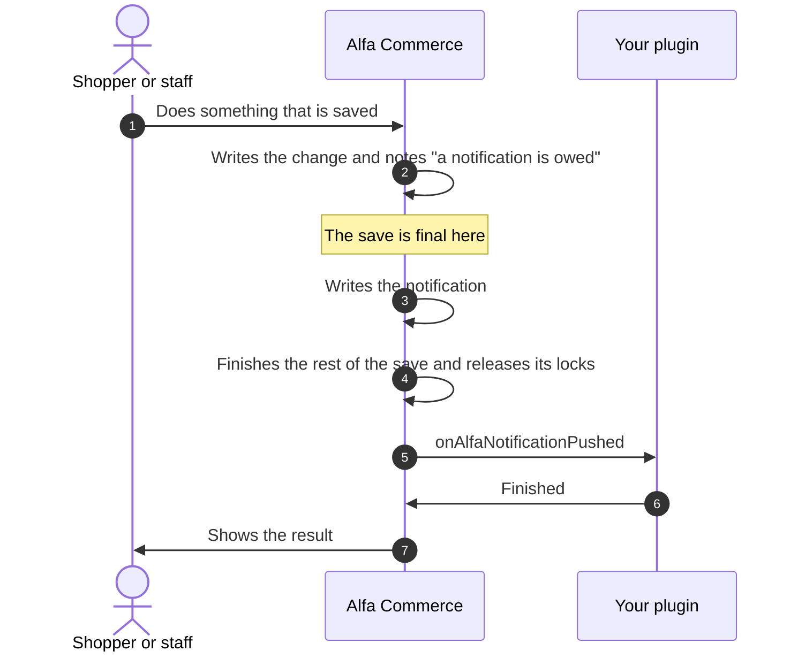

# Notification and setup events

<AlfaVersion verified="2.2.0" />

This page covers what a plugin can do around the administrator's notification bell, the dashboard and the store
setup checklist. It ends with pointers to the other "collecting" events, which are described on the administrator
pages.

Read [How events reach a plugin](./how-events-reach-a-plugin.md) first. All the events on this page are **announced
to everyone** (broadcast events): list them in `getSubscribedEvents()`.

No feature plugin ships with Alfa Commerce, so there is no shipped plugin to copy from. The samples on this page were
checked line by line against the classes of 2.2.0.

## What it does

| Event | In plain words | Before or after the save is final |
|---|---|---|
| `onAlfaNotificationPushed` | "A notification for staff was written." | After |
| `onAlfaCollectCards` | "The dashboard is being built. Which cards do you add?" | Nothing is saved. A screen is being drawn. |
| `onAlfaCollectSetupChecks` | "The setup checklist is being worked out. Which checks do you add?" | Nothing is saved. |

In all three an error in your listener is logged, the next listener still runs and the screen is still shown
(`dispatchIsolated()` in the code).

## Notifications

A **notification** is a line in the bell at the top of Alfa Commerce's administrator screens: a new order, low stock,
a plugin that cannot be used. Notifications are stored in one table and written by one helper, `NotificationHelper`
(`administrator/src/Helper/NotificationHelper.php`).

### What happens



A notification raised in the middle of a save is not written at once. Alfa notes it with the save. If the save is
undone, the note is undone with it: no notification, no event. If the save becomes final, the notification is
written, and plugins hear of it only when the whole save is finished, its payment steps included, and Alfa's locks
are released.

A notification raised outside any save is written at once. It is announced at once too, unless Alfa still holds one
of its locks or is finishing the follow-up work of a save (as it is right after an order is placed). The event then
waits for that to end.

### onAlfaNotificationPushed

**When it fires.** Once for every notification that is written, after it is written and with no save in progress.

**Who receives it.** Announced to everyone: every loaded plugin that lists it in `getSubscribedEvents()`, a `system`
plugin included. Alfa loads the `alfa` group first.

**What you are given.** `NotificationPushedEvent`
(`administrator/src/Event/Notifications/NotificationPushedEvent.php`). Its methods have no `get` in front.

| Method | Meaning |
|---|---|
| `id()` | The id of the notification. |
| `dedupKey()` | The key its producer gave it, for example `order:123`. One key is one notification. |
| `group()` | The group it is listed under: a language key such as `COM_ALFA_NOTIFY_GROUP_ORDERS` for Alfa's own, or plain text another extension gave. |
| `severity()` | `success`, `info`, `warning` or `danger`. |
| `title()` | The headline as stored: the text in the shop's default administrator language, or the plain text that was given. |
| `message()` | The message as stored, or an empty string. |
| `url()` | The link as stored, or an empty string when there is none or it was not safe. |
| `change()` | What the write did: `NotificationPushedEvent::CHANGE_NEW` (a new notification), `CHANGE_UPDATED` (an existing one was updated and keeps its read and dismissed state) or `CHANGE_REALERTED` (an existing one was raised again and is unread once more). |
| `titleKey()` | The language key of the headline, or an empty string for plain text. Since 2.1.4. |
| `messageKey()` | The language key of the message, or an empty string. Since 2.1.4. |
| `arguments()` | The values that fill the keys: an array with the entries `title` and `message`. Empty for plain text. Since 2.1.4. |
| `textDomain()` | The extension whose language files hold the keys, for example `com_alfa`. Empty for plain text. Since 2.1.4. |

The values are the notification as it was written, not as the producer passed them. The event has no setters.

**What you are expected to do.** Your own work: pass the notification on by e-mail or to a chat tool, count it. You
cannot change or remove the notification from here.

```php
use Alfa\Component\Alfa\Administrator\Event\Notifications\NotificationPushedEvent;

public static function getSubscribedEvents(): array
{
    return [NotificationPushedEvent::NAME => 'onAlfaNotificationPushed'];
}

public function onAlfaNotificationPushed(NotificationPushedEvent $event): void
{
    if ($event->severity() !== 'danger' || $event->change() === NotificationPushedEvent::CHANGE_UPDATED) {
        return;
    }

    // Pass on $event->title(), $event->message() and $event->url() in your own way.
}
```

`NotificationPushedEvent::NAME` is the text `onAlfaNotificationPushed`.

**What happens next.** Nothing depends on your answer.

**If you are missing or you fail.** The notification stays written and staff see it in the bell. An error you throw
is written to the log (categories `com_alfa.plugins` and `com_alfa`) with your listener's name, and the next listener
runs. The event is sent once and is not repeated.

One case to know: work that runs with no Joomla application cannot load plugins. The event then reaches only the
listeners that are already registered.

### Raising a notification of your own

**What it does.** `NotificationHelper::push()` writes a notification, or updates the one that has the same key.

```php
public static function push(string $dedupKey, NotificationText|string $title, array $options = []): void
```

**When it is used.** For something staff must know that lasts longer than one request: your provider's keys stopped
working, an import failed. For a message about the click a person has just made, use Joomla's own message instead.

**What you must provide.**

| Argument | Meaning |
|---|---|
| `$dedupKey` | A key of your own that stays the same for the same matter, for example `alfa.thanks:keys`. Pushing the same key again updates the same notification. |
| `$title` | The headline: a `NotificationText`, or plain text. |
| `$options['message']` | A longer text: a `NotificationText`, or plain text. |
| `$options['severity']` | `success`, `info`, `warning` or `danger`. Anything else becomes `info`. |
| `$options['group']` | The group it is listed under: one of the `NotificationHelper::GROUP_...` constants, a language key of your own, or plain text. Without it, `GROUP_GENERAL`. |
| `$options['url']` | A link, relative or absolute http or https. |
| `$options['dismissible']` | `false` when staff may not dismiss it. Without it, `true`. |
| `$options['constant']` | `true` to show it as unread again each time it is pushed. Without it, a push of the same key keeps its read and dismissed state. |
| `$options['view']` | Who may see it: `['action' => ..., 'asset' => ...]`, a permission and what it is checked on. |
| `$options['link']` | Who may follow the link, in the same form. |
| `$options['expires']` | A date and time in SQL format after which it is gone. |

Write the title and the message as a **language key with its values**, so that each member of staff reads them in
their own language. `NotificationText::from($domain, $key, ...$values)` names the extension whose language files
hold the key. Plain text is accepted too, and is shown as written to every reader. When both the title and the
message are keys, they must be keys of the same extension.

```php
use Alfa\Component\Alfa\Administrator\Helper\NotificationHelper;
use Alfa\Component\Alfa\Administrator\Helper\NotificationText;

NotificationHelper::push(
    'alfa.thanks:keys',
    NotificationText::from('plg_alfa_thanks', 'PLG_ALFA_THANKS_NOTIFY_KEYS_TITLE'),
    [
        'severity' => 'warning',
        'message'  => NotificationText::from('plg_alfa_thanks', 'PLG_ALFA_THANKS_NOTIFY_KEYS_MESSAGE', $providerName),
        'url'      => 'index.php?option=com_plugins&view=plugins&filter[folder]=alfa&filter[element]=thanks',
    ],
);
```

`$providerName` stands for a value of your own that fills the `%s` of the message.

**What happens next.** Staff who may see it find it in the bell. `onAlfaNotificationPushed` is announced for it as
for any other notification, so your own listener hears your own notifications too. When the matter is over, call
`NotificationHelper::clear($dedupKey)` to move it to the history.

**What can go wrong.** If the notification cannot be written, the error reaches your code: decide there whether
your work goes on without it. If you push from inside a save that is later undone, nothing is written.

## Dashboard cards

A **card** is a box on Alfa Commerce's dashboard: a figure, a list, a chart. Alfa's own cards are declared through
the same event as a plugin's.

### onAlfaCollectCards

**When it fires.** When the dashboard's cards are collected. The result is kept for five minutes for each viewer, so
your handler does not run on every page.

**Who receives it.** Announced to everyone. Alfa loads the `alfa` group first.

**What you are given.** `CollectCardsEvent` (`administrator/src/Event/Card/CollectCardsEvent.php`).

| Method | Meaning |
|---|---|
| `screen()` | The screen being built. In 2.2.0 it is `dashboard` (`CardRegistry::SCREEN_DASHBOARD`). |
| `top($contributor, $id, $title)` | A card across the full width, above everything. |
| `metrics($contributor, $id, $title)` | A card in the row of figures. |
| `main($contributor, $id, $title)` | A card in the wide column. |
| `side($contributor, $id, $title)` | A card in the narrow column beside it. |
| `bottom($contributor, $id, $title)` | A card across the full width, at the end. |
| `addCard($contributor, DashboardSurface $surface, $id, $title)` | The same, with the place held in a variable. The places are the cases of `DashboardSurface`: `Top`, `Metrics`, `Main`, `Side`, `Bottom`. Since 2.2.0. |
| `getCards()` | For Alfa. Do not call it. |

`$contributor` is your plugin's name, `group.element`. `$id` is a name of your own for the card. `$title` is a
language key. Each of these methods returns the card, an `AdminCard` (`administrator/src/Card/AdminCard.php`), and
you go on with:

| Method on the card | Meaning |
|---|---|
| `setLayout($name)` | The layout that draws the card. Required: a card without a layout is dropped. `card.metric` is Alfa's own figure tile, which you may use. A layout of your own is a file under your plugin's `layouts` folder: `cards.notes` is `layouts/cards/notes.php`. |
| `setLayoutData($data)` | What the layout draws from: an array, or a function that returns one. Prefer a function, so that the queries run only when the card is drawn. |
| `ordering($number)` | The position in its place, lower first. Alfa's own cards use numbers between 90 and 400. Without it, 500. |
| `width($percent)` | How much of the row the card asks for, 5 to 100. Without it, 25. |
| `subtitle($key)` | A language key for the line under the heading. |
| `icon($name)` | An icon the layout knows. `card.metric` knows `receipt`, `clock`, `coins`, `box` and `list`. |
| `url($url)` | Where the card links. |
| `when($function)` | A function that returns `false` to hide the card from the current viewer, for example by a permission. |
| `live()` | Work the card out on every request and never from the five minute copy. Since 2.2.0. |

**What you are expected to do.** Return at once when the screen is not one you know. Otherwise declare your cards.

```php
use Alfa\Component\Alfa\Administrator\Card\CardRegistry;
use Alfa\Component\Alfa\Administrator\Event\Card\CollectCardsEvent;

public function onAlfaCollectCards(CollectCardsEvent $event): void
{
    if ($event->screen() !== CardRegistry::SCREEN_DASHBOARD) {
        return;
    }

    $event->metrics('alfa.thanks', 'thanks.sent', 'PLG_ALFA_THANKS_CARD_TITLE')
        ->ordering(600)
        ->setLayout('card.metric')
        ->subtitle('PLG_ALFA_THANKS_CARD_SUB')
        ->setLayoutData(fn (): array => ['value' => (string) $this->countThanks()]);
}
```

`countThanks()` stands for a method of your own. The layout `card.metric` shows the entry `value` as the figure.

**What happens next.** Alfa drops the cards the viewer may not see, sorts the rest and draws each with its layout.
It loads your plugin's language file when it draws your card.

**If you are missing or you fail.**

| What happened | What Alfa does |
|---|---|
| Your handler throws an error | Logs it (categories `com_alfa.plugins` and `com_alfa.cards`). The other cards are drawn. |
| Your data function throws an error | Hides your card and logs it (category `com_alfa.cards`). |
| Your data function returns an empty array | Does not draw the card. This is how a card says "nothing to show". |
| The card has no layout | Drops the card. |

## Setup checks

The **setup checklist** is the card on the dashboard that tells a new shop owner what is still missing before the
shop can take an order. A **check** is one line of it. A check does not remember that it was done: each time the
list is worked out, the check looks at what is true now.

### onAlfaCollectSetupChecks

**When it fires.** When the checklist is worked out: when its stored result is older than six hours, after a save in
the administrator that may change it, and when staff refresh the card. Planned for 2.2.1, which is not released:
also after a payment or shipping plugin, "System - Page Cache" or "System - Alfa Commerce Sync" is enabled or
disabled from the Plugins list, after "System - Page Cache" or "System - Alfa Commerce Sync" is saved, and after
the dompdf library, or one of the four libraries it needs, is installed, updated or uninstalled.

**Who receives it.** Announced to everyone. Alfa loads the `alfa` group first. Alfa's own checks are already in the
event when you receive it.

**What you are given.** `CollectSetupChecksEvent` (`administrator/src/Event/Setup/CollectSetupChecksEvent.php`).

| Method | Meaning |
|---|---|
| `add($contributor, $id, $label)` | Adds one check and returns it. `$contributor` is your plugin's name, `$id` a name of your own such as `thanks.message`, `$label` a language key. |
| `getChecks()` | For Alfa. Do not call it. |

On the check, a `SetupCheck` (`administrator/src/Setup/SetupCheck.php`), you go on with:

| Method on the check | Meaning |
|---|---|
| `probe($function)` | The test. Required: a check without one is dropped. The function returns `true` (done) or `false` (missing), or one of `SetupCheck::STATE_PASS`, `STATE_FAIL`, `STATE_WARN`. Keep it cheap. |
| `tier($tier)` | `SetupCheck::TIER_REQUIRED` (the shop cannot take an order without it), `TIER_RECOMMENDED` or `TIER_OPTIONAL`. Without it, required. |
| `reason($key)` | A language key that says why it is missing and what to do. |
| `cta($url)` | The administrator address where the task is done, as a plain `index.php?...` address. |
| `priority($number)` | The position in the list, higher first. |
| `tour($uid)` | The id of a guided tour that teaches the task. |
| `provision($function)` and `choice($name, $label, $options)` | A one-click fix and the questions it asks first. See "Not documented yet". |
| `reasonArguments($arguments, $unnamed)` | Planned for 2.2.1, which is not released. Names what the reason is about. `$arguments` is a function that returns the values for the placeholders of the reason's language string, as plain text; the checklist escapes them. `$unnamed` is a language key without placeholders, said instead when the values cannot be read. `reasonFor()` and `reasonArgumentsNow()` are for Alfa: do not call them. |

**What you are expected to do.** Add a check only for something the shop owner must set up for your plugin to work.

```php
use Alfa\Component\Alfa\Administrator\Event\Setup\CollectSetupChecksEvent;
use Alfa\Component\Alfa\Administrator\Setup\SetupCheck;

public function onAlfaCollectSetupChecks(CollectSetupChecksEvent $event): void
{
    $event->add('alfa.thanks', 'thanks.message', 'PLG_ALFA_THANKS_SETUP_LABEL')
        ->tier(SetupCheck::TIER_RECOMMENDED)
        ->reason('PLG_ALFA_THANKS_SETUP_REASON')
        ->cta('index.php?option=com_plugins&view=plugins&filter[folder]=alfa&filter[element]=thanks')
        ->probe(fn (): bool => trim((string) $this->params->get('message', '')) !== '');
}
```

The sample tests one of the plugin's own settings, `message`.

**What happens next.** Alfa runs every test, sorts the lines and stores the result. The checklist card shows your
line as done or as missing, with your reason and a link to your address.

**If you are missing or you fail.**

| What happened | What Alfa does |
|---|---|
| Your handler throws an error | Logs it (categories `com_alfa.plugins` and `com_alfa.setup`). The other checks are collected. |
| Your test throws an error | Gives the check the state `warn`. It never counts as done. |
| The check has no test | Drops the check. |

## The other collecting events

These events also ask "who adds something?". Each is described where it is used.

| Event | What a plugin adds | Where it is described |
|---|---|---|
| `onAlfaBuildMenu` | An entry or a heading in the Alfa Commerce menu | [Creating an Admin Panel](../plugins/admin-panels.md#onalfabuildmenu) |
| `onAlfaGetAccessActions` | A permission on the Permissions tab | [Creating an Admin Panel](../plugins/admin-panels.md#onalfagetaccessactions) |
| `onGetToolActions` | A tool on the Tools screen | [Extending Admin Screens](../plugins/admin-screen-plugins.md#other-things-a-plugin-can-add) |
| `onExecuteToolAction` | Runs that tool. Addressed to your plugin alone. | [Extending Admin Screens](../plugins/admin-screen-plugins.md#other-things-a-plugin-can-add) |
| `onClearData` | Removes the data your plugin owns. Addressed to your plugin alone. | [How events reach a plugin](./how-events-reach-a-plugin.md#addressed-to-one-plugin-targeted) |
| `onCollectDocumentTypeProviders` | Document types | [Document events](./document-events.md#oncollectdocumenttypeproviders) |

## What can go wrong

| What you see | The usual cause |
|---|---|
| `onAlfaNotificationPushed` arrives later than the push | The push was made inside a save. The event waits for the whole save to finish. |
| Your card or your check shows `PLG_...` | Your plugin's language file does not hold the key, or is not loaded. See [Extending Admin Screens](../plugins/admin-screen-plugins.md#your-own-language-file). |
| Your card does not change for some minutes | The dashboard keeps its cards for five minutes. Use `live()` only for a card that must be current. |
| Your card is missing and there is no error on the page | Its data failed or was empty, or it has no layout. Look in the log, category `com_alfa.cards`. |

## Changed in 2.2.0 and 2.1.4

- **Changed in 2.2.0.** A card and a setup check take the plugin's name, `group.element`, as their first argument.
- **Since 2.2.0.** `addCard()` and `live()` exist. A card whose data is empty is not drawn.
- **Changed in 2.1.4.** A notification is stored as a language key with its values. `push()` accepts a
  `NotificationText`. The event gained `titleKey()`, `messageKey()`, `arguments()` and `textDomain()`, and `group()`
  returns a language key for Alfa's own notifications.
- **Changed in 2.1.4.** `onAlfaNotificationPushed` is announced for a notification raised during a save only once
  the whole save is finished, and never for a change that was undone.
- **Since 2.1.1.** `onAlfaNotificationPushed` exists.

## Not documented yet

- The other methods of `NotificationHelper` (reading, dismissing, the bell itself) and the other builders of
  `NotificationText` (`key()`, `plural()`, `number()`, `date()`, `content()`, `join()`, `sentences()`).
- The data a card layout of your own receives, beyond the entry `value` that `card.metric` reads.
- The one-click fix of a setup check (`provision()`, `choice()`) and guided tours.
- Tools in full (`onGetToolActions`, `onExecuteToolAction`) and `onClearData` in full.
