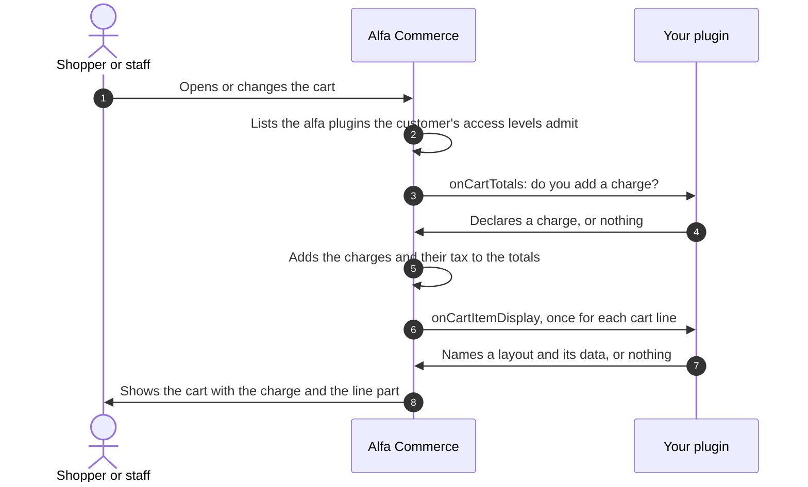
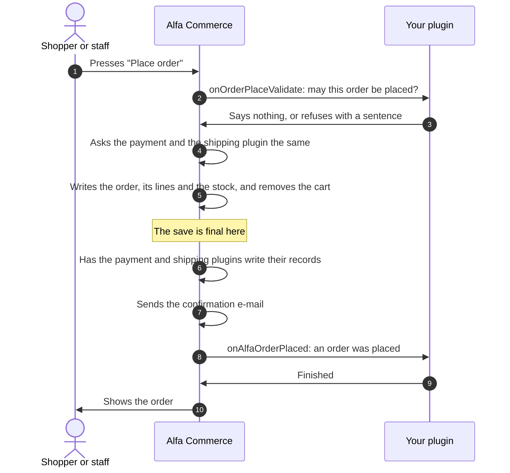
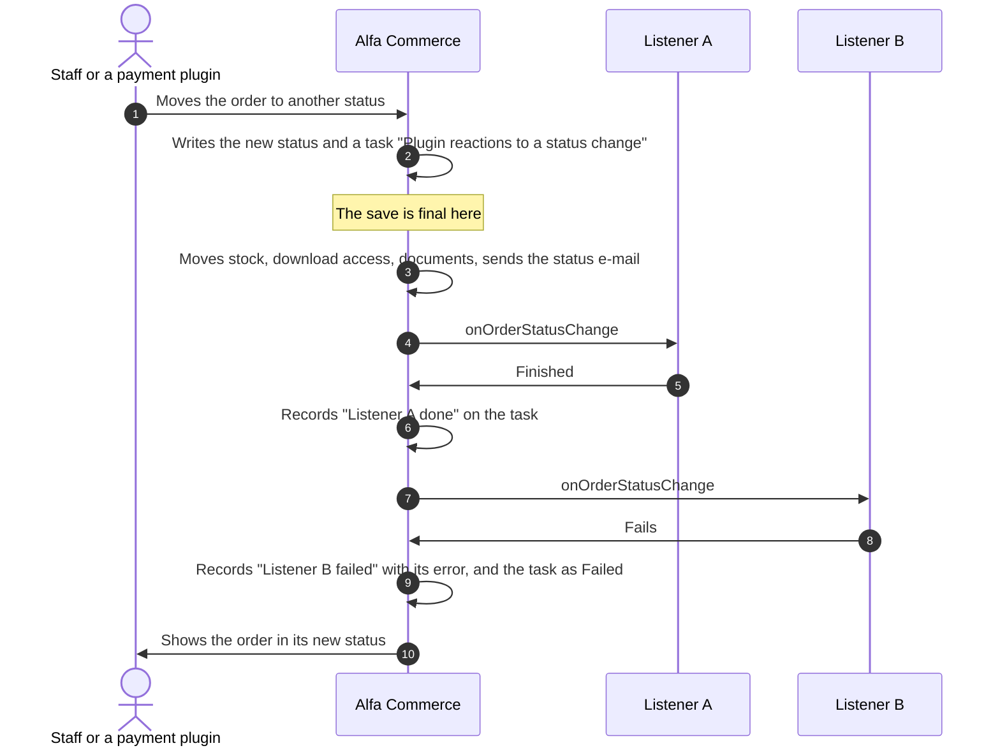

# Order and cart events

<AlfaVersion verified="2.2.0" />

These are the events around the cart and the order that belong to no single plugin family. A payment plugin, a
shipping plugin and an item field each have events of their own, described on their own pages. The five events here
are for a **feature plugin** (a plugin of the `alfa` group), and two of them can also be heard by a `system` plugin.

Read [How events reach a plugin](./how-events-reach-a-plugin.md) first. This page uses its words: **announced to
everyone** (a broadcast event), **addressed** (a targeted event) and **the save is final** (the commit). The
[Glossary](../reference/glossary.md) explains the others.

No feature plugin ships with Alfa Commerce, so there is no shipped plugin to copy from. The samples on this page were
checked line by line against the event classes of 2.2.0.

## What it does

| Event | In plain words | How it is delivered | Before or after the save is final |
|---|---|---|---|
| `onCartTotals` | "Does anyone add a charge to this cart?" | Addressed, to each admitted `alfa` plugin in turn | Nothing is saved. The cart is being calculated. |
| `onCartItemDisplay` | "Does anyone show something on this cart line?" | Addressed, to each admitted `alfa` plugin in turn | Nothing is saved. The cart is being drawn. |
| `onOrderPlaceValidate` | "May this order be placed?" | Addressed, to each admitted `alfa` plugin in turn | Before. Nothing is written yet. |
| `onAlfaOrderPlaced` | "An order was placed." | Announced to everyone | After |
| `onOrderStatusChange` | "An order changed status." | Announced to everyone, each listener as a recorded step | After |

**Admitted** means: the plugin is enabled, and its Access (Extensions: Plugins) is a level the **customer** of the
cart holds. It is the customer's access levels that decide, whoever operates the cart (`AlfaPluginHelper::admitted()`).

## When it is used

- You add a cart charge that is not a price, a tax, a discount or a shipping cost: gift wrapping, a sign-up fee.
- You show your own line of information under a cart line.
- You refuse an order that breaks a rule of yours, with a sentence the shopper reads.
- You react to a new order or to a status change: write to your own tables, tell another system.

## What you must provide

The first three events are addressed, so a feature plugin declares them in `getTargetedHandlers()`. The last two are
announced to everyone, so they go in `getSubscribedEvents()`. An event name is in one list, never in both.

```php
namespace Acme\Plugin\Alfa\Thanks\Extension;

use Alfa\Component\Alfa\Administrator\Plugin\TargetedHandlersInterface;
use Joomla\CMS\Plugin\CMSPlugin;
use Joomla\Event\SubscriberInterface;

final class Thanks extends CMSPlugin implements SubscriberInterface, TargetedHandlersInterface
{
    public static function getSubscribedEvents(): array
    {
        return [
            'onAlfaOrderPlaced'   => 'onAlfaOrderPlaced',
            'onOrderStatusChange' => 'onOrderStatusChange',
        ];
    }

    public function getTargetedHandlers(): array
    {
        return [
            'onCartTotals'         => 'onCartTotals',
            'onCartItemDisplay'    => 'onCartItemDisplay',
            'onOrderPlaceValidate' => 'onOrderPlaceValidate',
        ];
    }

    // The five methods are shown one by one below.
}
```

Every time your plugin adds a charge, a refusal or a cart line part, it names itself first as `group.element`, here
`alfa.thanks`. Alfa knows which plugin it is calling. If you give another plugin's name, the contribution is dropped
and a warning is written to the log.

The plugin's other files (the manifest, `services/provider.php`, the language files) are the same as for any
feature plugin. A complete one is printed in
[Extending Admin Screens](../plugins/admin-screen-example.md).

The texts in the samples are language keys of the plugin's own language file. Your plugin loads that file itself, see
[Plugin overview](../plugins/overview.md#each-extension-owns-its-language).

:::warning A system plugin cannot do the first three
`onCartTotals`, `onCartItemDisplay` and `onOrderPlaceValidate` go only to plugins of the `alfa` group. A plugin of the
`system` group cannot add a charge, draw on a cart line or refuse a placement, even when it has a method of that name.
:::

## The cart events

### What happens



Nothing is saved in this picture. The cart is calculated and drawn again on every request that shows it, so your
handlers run often. Keep them fast.

### onCartTotals

**When it fires.** Each time Alfa calculates a cart's totals: on the cart, at checkout, and when the order is
placed.

**Who receives it.** Addressed to each admitted plugin of the `alfa` group, in Joomla's plugin order, each once. All
of them receive the same event object (`dispatchToEachIsolated()` in the code).

**What you are given.** `CartTotalsEvent` (`administrator/src/Event/Cart/CartTotalsEvent.php`).

| Method | Meaning |
|---|---|
| `getLines()` | The cart lines that are charged for, as `ContributionLine` objects with three public properties: `lineId`, `itemId` and `taxRate` (the line's tax rate in percent). A line marked unavailable is not in the list. |
| `getCart()` | The cart to read: `isVirtual()`, `quantity()`, `itemCount()`, `lines()`, `customer()`, `delivery()`, `currency()` and the others of `Cart` (`site/src/Service/Cart/Cart.php`). `getSubtotal()` gives the sum of the line prices. `getTotal()` throws an error here, because the total is what is being decided. |
| `getRequest()` | The same two things as one object (`lines` and `cart`). |
| `contribution($contributor, $code)` | Starts one charge and returns its builder, see below. |
| `addTotalAdjustment($contributor, $contribution)` | Adds a ready `CartContribution` object. Since 2.2.0. |
| `getContributions()`, `answering()` | For Alfa. Do not call them. |

The builder returned by `contribution()`:

| Method | Meaning |
|---|---|
| `label($text)` | The translated text shown in the totals. Required. |
| `amount($amount)` | A fixed amount without tax, greater than 0. |
| `percent($percent)` | A percentage, above 0 and up to 100, of the goods after the cart rules plus the shipping after the shipping rules, both without tax. |
| `taxRate($rate)` | The charge's own tax rate in percent, 0 to 100. Without it the rate is 0. |
| `sortOrder($number)` | The order among the charges, lower first. |

Use `amount()` or `percent()`, one of the two. Calling both, or a value outside its range, throws an error at once.

**What you are expected to do.** Declare the charge and return. Never calculate a total, never return HTML. A charge
only adds. To lower what the customer pays, use a cart rule.

```php
use Alfa\Component\Alfa\Administrator\Event\Cart\CartTotalsEvent;
use Joomla\CMS\Language\Text;

public function onCartTotals(CartTotalsEvent $event): void
{
    if ($event->getCart()->isVirtual()) {
        return;                                    // nothing to wrap
    }

    $event->contribution('alfa.thanks', 'gift_wrap')
        ->label(Text::_('PLG_ALFA_THANKS_GIFT_WRAP'))
        ->amount(2.00)
        ->taxRate(24.0);
}
```

**What happens next.** Alfa adds the charge and its tax to the totals and shows it as a line of its own with your
label. When the order is placed, the charge is stored with the order (table `#__alfa_order_contributions`), so the
order keeps it whatever your plugin does later.

**If you are missing or you fail.**

| What happened | What Alfa does |
|---|---|
| Your plugin is disabled or not installed | The cart costs what it costs without you. |
| Your handler throws an error | It is logged (categories `com_alfa.plugins` and `com_alfa.cart`), the next plugin runs and the cart is shown without your charge. With Joomla's debug mode on, the error is thrown again so that you see it while developing. |
| A charge has no label, or neither `amount()` nor `percent()` | All the charges of your plugin are dropped for that calculation, with an error in the log (category `com_alfa.cart`) naming your plugin and the charge. |
| Your plugin is admitted for the customer but not loaded for the member of staff | See "When staff operate a customer's cart" below. |

### onCartItemDisplay

**When it fires.** Each time a cart line is prepared for display, after the line's item fields have added their
parts.

**Who receives it.** Addressed to each admitted plugin of the `alfa` group, in turn, each once for the line
(`dispatchToEachIsolated()`).

**What you are given.** `CartItemDisplayEvent` (`administrator/src/Event/Items/CartItemDisplayEvent.php`).

| Method | Meaning |
|---|---|
| `getLine()` | The cart line as an object (its item id, quantity, name and so on). |
| `getItem()` | The loaded item behind the line. |
| `addSurface($contributor, CartSurface $surface)` | Starts one part on the cart line and returns its builder. `CartSurface::Main` is the only place in 2.2.0: under the line's name. Since 2.2.0. |
| `answering()`, `harvestInto()` | For Alfa. Do not call them. |

On the builder you call `setLayout($name)` and `setData($data)`. The layout is a file of your plugin,
`tmpl/<name>.php`, which a template can override. The item field page describes layouts:
[Item field plugins](../plugins/item-field-plugins.md#layouts).

**What you are expected to do.** Name a layout and hand it its data. Never return HTML from the handler. Do not
change the line or the item.

```php
use Alfa\Component\Alfa\Administrator\Event\ItemFields\CartSurface;
use Alfa\Component\Alfa\Administrator\Event\Items\CartItemDisplayEvent;
use Joomla\CMS\Language\Text;

public function onCartItemDisplay(CartItemDisplayEvent $event): void
{
    $event->addSurface('alfa.thanks', CartSurface::Main)
        ->setLayout('cart_note')
        ->setData(['text' => Text::_('PLG_ALFA_THANKS_CART_NOTE')]);
}
```

**What happens next.** The cart template draws your layout with the other parts of the line. A part without a
layout is not drawn.

**If you are missing or you fail.** The line is shown without your part. An error you throw is written to the log
(category `com_alfa.plugins`) and the next plugin runs.

## When staff operate a customer's cart

Staff can build a cart for a customer in the administrator. The plugins that take part are still the ones the
**customer's** access levels admit, so that a cart costs the same whoever operates it. Joomla, however, loads a
plugin only for a user whose own access levels include the plugin's Access.

So this can happen: a plugin has an Access the customer holds and the member of staff does not. The plugin should
take part, and Joomla does not load it for the request (the reason `not_loaded`, see
[How events reach a plugin](./how-events-reach-a-plugin.md#what-can-go-wrong)). Alfa does not pretend the cart is
complete:

| Where | What staff see |
|---|---|
| The cart's totals | The totals without that plugin's charges, and under them a line naming the plugin as Extensions: Plugins names it |
| Placing the order | Refused before anything is saved, with the same message |

The message is: "(plugin name) adds charges or checks to this customer's cart, but your account's Access does not
include the plugin's, so it cannot run here. These totals lack its part, and the order cannot be placed from this
screen. Give the plugin an Access your account holds, or let the customer place the order."

A plugin that does not declare the event in question takes no part and causes no refusal.

## Placing an order

### What happens



If step 3 refuses, nothing after it happens: no order, no stock movement, no e-mail, and the cart stays as it was.

Step 7 is the event `onOrderAfterPlace`. It is addressed to the one payment plugin and the one shipping plugin of the
order, never to a feature plugin. See [Payment plugins](../plugins/payment-plugins.md) and
[Shipping plugins](../plugins/shipment-plugins.md).

:::note Names that do not exist in 2.2.0
The event announced after a placement is `onAlfaOrderPlaced`. No event named `onOrderPlaced` or
`onAlfaOrderAfterSave` is dispatched.
:::

### onOrderPlaceValidate

**When it fires.** When an order is about to be placed, after Alfa's own checks of the cart and before the payment
and shipping plugins are asked. Nothing is written yet.

**Who receives it.** Addressed to each admitted plugin of the `alfa` group, in turn, each once. All receive the same
event object, so refusals add up (`dispatchToEach()` in the code).

**What you are given.** `OrderPlaceValidateEvent` (`administrator/src/Event/Orders/OrderPlaceValidateEvent.php`).

| Method | Meaning |
|---|---|
| `getContext()` | What you may know about the placement, as a `PlacementEventContext` with four public properties: `cartId`, `customerId` (0 for a guest), `shipmentMethodId` (0 for none) and `lines`. Each line is a `PlacementLine` with `lineId`, `itemId`, `quantity` and `combinationId` (null when the item has no combinations). No price is given. |
| `reject($contributor, $message)` | Refuses the placement. The message is a translated sentence for the customer. |
| `isRejected()`, `getMessages()`, `answering()` | For Alfa. Do not call them. |

**What you are expected to do.** Read the context. Call `reject()` if the order must not be placed, otherwise do
nothing. Do not write anything of your own here: the order does not exist yet and may still be refused by someone
else.

```php
use Alfa\Component\Alfa\Administrator\Event\Orders\OrderPlaceValidateEvent;
use Joomla\CMS\Language\Text;

public function onOrderPlaceValidate(OrderPlaceValidateEvent $event): void
{
    $context = $event->getContext();
    $units   = 0;

    foreach ($context->lines as $line) {
        $units += $line->quantity;
    }

    if ($context->customerId === 0 && $units > 10) {
        $event->reject('alfa.thanks', Text::_('PLG_ALFA_THANKS_LOGIN_FOR_LARGE_ORDERS'));
    }
}
```

**What happens next.** If nobody refused, the placement goes on. If anyone refused, the placement stops before
anything is saved, and the person sees every sentence that was collected, each as its plugin wrote it. Each refusal
is also written to the log (category `com_alfa.orders`) with the plugin's name.

**If you are missing or you fail.**

| What happened | What Alfa does |
|---|---|
| Your plugin is disabled or not installed | The order is placed without your check. |
| Your handler throws an error | The placement is refused, nothing is saved, the plugins after you are not asked, and the error is written to the log (category `com_alfa.orders`). This is a "before" event: a failure stops the operation. To refuse with a sentence the customer can read, call `reject()`. |
| Your plugin is admitted for the customer but not loaded for the member of staff | The placement is refused with the message of "When staff operate a customer's cart". |

### onAlfaOrderPlaced

**When it fires.** Once, at the very end of a successful placement: after the save is final, after the payment and
shipping plugins wrote their records and after the confirmation e-mail was handled. It fires in the same request
that placed the order, so the person who placed it is still the current user.

**Who receives it.** Announced to everyone: every loaded plugin that lists it in `getSubscribedEvents()`, a
`system` plugin included. Alfa loads the `alfa-search` and `alfa` groups first.

**What you are given.** `OrderPlacedEvent` (`administrator/src/Event/Orders/OrderPlacedEvent.php`).

| Method | Meaning |
|---|---|
| `getOrderId()` | The id of the new order. |
| `getOrder()` | The order as an `Order` object (`site/src/Service/Order/Order.php`): `id()`, `reference()`, `customerId()`, `isGuest()`, `getEmail()`, `total()`, `currency()`, `items()` and the others. |

The event has no setters.

**What you are expected to do.** Your own work for a new order. You cannot change or undo the placement.

```php
use Alfa\Component\Alfa\Administrator\Event\Orders\OrderPlacedEvent;

public function onAlfaOrderPlaced(OrderPlacedEvent $event): void
{
    $order = $event->getOrder();

    // Your own work, for example with $event->getOrderId(), $order->reference() and $order->isGuest().
}
```

**What happens next.** Nothing depends on your answer. The person sees the order.

**If you are missing or you fail.** The order is placed all the same. An error you throw is written to the log
(category `com_alfa.plugins`) and the next listener runs. This event is announced once and is not repeated: there is
no record of it under Tools > Tasks and nobody can run it again. If your work must not be lost, save what you need
quickly and do the slow part from your own queue.

`onAlfaOrderPlaced` is not `onOrderStatusChange`. Placing an order gives it its first status without announcing a
status change.

## A status change

### What happens



The reactions of plugins are **background work**: Alfa records a **task** together with the status change, in the
same save, and carries it out once the save is final and its locks are released. The task is written only when at
least one plugin listens. If the status change is undone, the task is undone with it and no listener is called.

### onOrderStatusChange

**When it fires.** After an order moved from one status to another and that save is final, and after Alfa's own
follow-up work for the change (stock, download access, documents, the status e-mail). Every status change goes
through one class, `Transition` (`administrator/src/Service/Order/Transition.php`), so the event fires the same way
whether staff, a payment plugin or an automatic rule moved the order.

**Who receives it.** Announced to everyone: every loaded plugin that lists it in `getSubscribedEvents()`, a `system`
plugin included. Alfa loads the `alfa` group first. Each listener is called on its own, as one recorded step of the
task (`administrator/src/Service/Order/Task/OrderStatusEvent.php`).

**What you are given.** `OrderStatusChangeEvent` (`administrator/src/Event/Orders/OrderStatusChangeEvent.php`).

| Method | Meaning |
|---|---|
| `getOrder()` | The order as it is after the change, as an `Order` object. |
| `getPreviousStatusId()` | The id of the status the order left. |
| `getNewStatusId()` | The id of the status the order entered. |
| `enteredCompleted()` | `true` when the order has just become completed and was not before. |
| `enteredCancelled()` | `true` when the order has just become cancelled. |
| `leftCompleted()` | `true` when the order was completed and no longer is. |
| `leftCancelled()` | `true` when a cancelled order was brought back. |
| `getActor()` | Who moved it: `user:<id>` or `plugin:<element>`. |
| `getNote()` | The note given with the change, or an empty string. |
| `getTransitionTime()` | When the change was made, as a UTC date and time in SQL format. |

The event has no setters. A listener watches the change; it cannot alter it.

**What you are expected to do.** Your own work. Follow these three rules:

1. **Be safe to repeat.** Your listener can be called again for the same change, as the next section explains. Before
   you write, check whether you already did: for example, look for your own row for this order and this status.
2. **Do not rely on a logged-in user.** The work can run on any request that carries background work: a visit to the
   shop, a page of another member of staff, an API call or the scheduled command. The current user may then be an
   empty user with id 0. Take everything you need from the event.
3. **Do not move the order from inside the listener to steer this change.** The change is already final.

```php
use Alfa\Component\Alfa\Administrator\Event\Orders\OrderStatusChangeEvent;

public function onOrderStatusChange(OrderStatusChangeEvent $event): void
{
    if (!$event->enteredCompleted()) {
        return;
    }

    $order = $event->getOrder();

    if ($this->alreadyThanked($order->id())) {      // your own check, so that a second call does no harm
        return;
    }

    // Your own work, for example with $order->id(), $order->reference() and $event->getNewStatusId().
}
```

`alreadyThanked()` stands for a method of your own.

**What happens next.** Alfa writes the outcome of each listener on the task as it goes. When all are done the task is
done. Nothing else depends on your answer.

**If you are missing or you fail.**

| What happened | What Alfa does | What staff see |
|---|---|---|
| Your listener throws an error | Records the step as failed with the error, writes it to the log (category `com_alfa.orders`), and still calls the listeners after you. The status change stands. | The task "Plugin reactions to a status change" as **Failed** under Tools > Tasks, and "Plugin reaction failed" on the order's History tab |
| The request stopped in the middle of the listeners | Holds the task | The task as **Outcome unknown**, and "Plugin reaction held" on the order's History tab |
| No plugin listens | Writes no task and calls nobody | Nothing |

Alfa never runs this task again by itself, because it cannot know what a half-finished listener already did. Staff
decide: under Tools > Tasks they press **Run again**, or **Mark resolved**. Run again calls only the listeners that
are not recorded as done. That includes a listener that failed, and a listener that was in the middle of its work
when the request stopped. This is why rule 1 matters.

The events about stock and about documents (invoices, credit notes) that follow an order have pages of their own:
[Stock events](./stock-events.md) and [Document events](./document-events.md).

## What can go wrong

| What you see | The usual cause |
|---|---|
| `onCartTotals`, `onCartItemDisplay` or `onOrderPlaceValidate` is never called | It is listed in `getSubscribedEvents()`. These three are declared in `getTargetedHandlers()`. Or the plugin is not in the `alfa` group. |
| It works for one customer and not for another | The plugin's Access is a level the second customer does not hold. |
| Staff cannot place a customer's cart | A plugin is admitted for the customer and not loaded for the member of staff. See "When staff operate a customer's cart". |
| Your charge is missing and there is no error on the page | The charge was incomplete, or it named another plugin. Look in the log, category `com_alfa.cart`. |
| `onOrderStatusChange` ran twice for one change | Staff pressed Run again. Make the listener safe to repeat. |
| `onOrderStatusChange` did not run after a placement | A placement announces `onAlfaOrderPlaced`, not a status change. |

## Changed in 2.2.0

- **Changed in 2.2.0.** `onCartTotals`, `onOrderPlaceValidate` and `onCartItemDisplay` are addressed to the admitted
  plugins of the `alfa` group and are declared in `getTargetedHandlers()`. A method with the event's name, or an
  entry in `getSubscribedEvents()`, is no longer enough.
- **Changed in 2.2.0.** `contribution()`, `reject()` and `addSurface()` take the plugin's name, `group.element`, as
  their first argument.
- **Since 2.2.0.** `addTotalAdjustment()` and `addSurface()` exist.
- **Changed in 2.2.0.** Each listener of `onOrderStatusChange` is a step of its own, so Run again calls only the
  ones that are not done. The task is written only when a plugin listens.
- **Changed in 2.1.4.** `onOrderStatusChange` is announced after the save is final, from a recorded task.

## Not documented yet

- The data your layout receives for `onCartItemDisplay`, and every property of the cart line and the item objects.
- The exact message a shopper sees when a handler of `onOrderPlaceValidate` throws an error. Use `reject()`.
- The other values of a `CartContribution` object passed to `addTotalAdjustment()` beyond what the builder sets.
- How a charge appears on documents and in e-mails.
