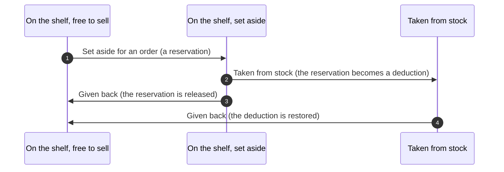
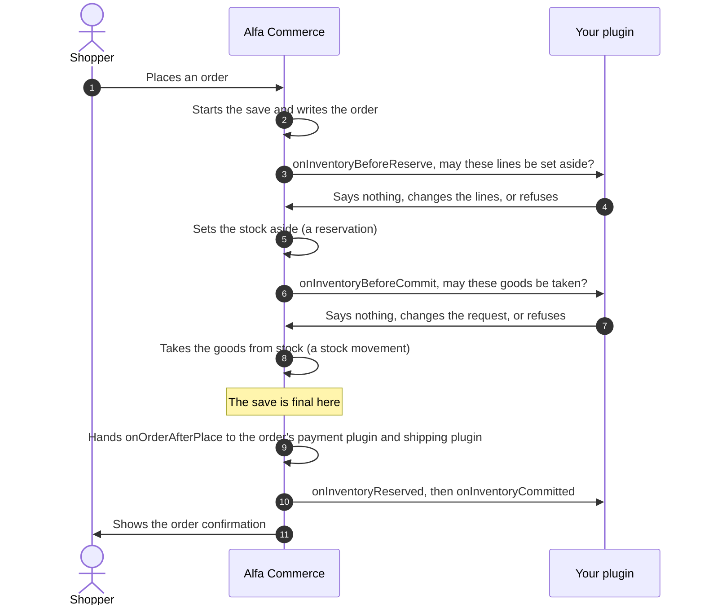
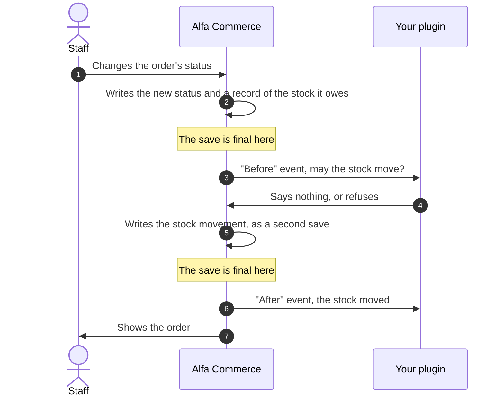

# Stock events

<AlfaVersion verified="2.2.0" />

Alfa Commerce tells plugins when stock is about to move and when it has moved. This page explains, in plain words
first, what can happen to stock, then each event, then how a plugin can decide which location an order's stock comes
from.

Read [How events reach a plugin](./how-events-reach-a-plugin.md) first. The words **reservation**, **claim** and
**stock movement** are explained in the [glossary](../reference/glossary.md#stock).

## What it does

### The five things that can happen to stock

Stock of an item sits at a **location** (a warehouse, a shop). For an order, three things can happen to it:

| In plain words | The name in the code | What it means |
|---|---|---|
| **Set aside** | A reservation (`reserve`) | The goods stay on the shelf, but they are kept for this order and no longer offered to others |
| **Taken from stock** | A deduction (`commitReservation`) | The goods leave the shelf for this order. The reservation becomes a stock movement. |
| **Given back** | A release (`release`) or a restore (`restore`) | A reservation is let go, or goods that were taken are put back on the shelf |

Two more things happen without an order:

| In plain words | The name in the code | What it means |
|---|---|---|
| **A manual adjustment** | `adjustTo`, `adjust`, `receive` | Staff correct the quantity of an item at a location |
| **A transfer** | `transfer` | A quantity moves from one location to another |



:::warning "Commit" has two meanings
In the stock code, "commit" means **take the goods from stock** (`commitReservation`, `onInventoryBeforeCommit`,
`onInventoryCommitted`). Everywhere else in this manual "the commit" is the moment a save becomes final. This page
says "taken from stock" for the first and "the save is final" for the second.
:::

### What decides which of them happens

Every order status carries a **claim**: what an order in that status asks of the stock
(`StockPolicy::claimFor()`).

| The status | Its claim | What Alfa does when an order enters it |
|---|---|---|
| A cancelled status | Nothing (`StockPolicy::CLAIM_NONE`) | Puts back what was taken and lets every reservation go |
| A status that keeps the goods in stock | A reservation (`StockPolicy::CLAIM_RESERVATION`) | Puts back what was taken and keeps the goods set aside |
| A status that removes the goods from stock | The goods themselves (`StockPolicy::CLAIM_PHYSICAL`) | Takes the goods from stock |

A document type can also move stock when a document of that type is issued. See
[Document events](./document-events.md).

## When it is used

| What a person does | What Alfa does with the stock | In the same save as the person's change? |
|---|---|---|
| A shopper or staff place an order | Sets the lines aside. If the order's first status removes goods from stock, takes them at once. | Yes. If the stock step fails, the order is not placed. |
| Staff or a payment plugin change an order's status to one with another claim | Moves the stock to match the new claim | No. The status is saved first. The stock moves right afterwards, as background work. |
| Staff issue a document whose type moves stock | Takes from stock or puts back, as the type says | No. The document is saved first. The stock moves right afterwards. |
| Staff change the stock figure of an item | Writes one adjustment | It is its own save |

The second and third rows matter for a plugin. When a status change or a document owes a stock movement, Alfa records
what is owed together with the change, then applies it. If applying it fails, the status or the document stays as
saved, staff are told in the notification bell, and the background job `stock.effects.drain` tries again later
(Tools > Database Sync applies it too). So a stock event can reach your plugin in a later request than the one in
which staff pressed the button.

Planned for 2.2.1, which is not released: a movement that a stock plugin refuses on purpose (see
[The events that can refuse](#the-events-that-can-refuse)) is not tried again. Any other failure is tried again after
1 minute, 5 minutes, 30 minutes, 2 hours, 6 hours and 24 hours, then waits for staff with a notice that says so.
A new status of the order tries that order's failed movement at once, and "Apply outstanding stock movements" in
Tools > Database Sync tries every failed movement at once.

## The events at a glance

All of them are announced to everyone (broadcast). Alfa loads the `alfa` plugin group before it announces them.

| Event | Fires | Can it refuse? | If your listener throws |
|---|---|---|---|
| `onInventoryBeforeReserve` | Before stock is set aside | Yes | The step stops |
| `onInventoryBeforeCommit` | Before goods are taken from stock | Yes | The step stops |
| `onInventoryBeforeRelease` | Before all reservations of an order are let go | Yes | The step stops |
| `onInventoryReserved` | After stock was set aside and the save is final | No | Logged, the others still run |
| `onInventoryCommitted` | After goods were taken from stock and the save is final | No | Logged, the others still run |
| `onInventoryReleased` | After reservations were let go and the save is final | No | Logged, the others still run |
| `onInventoryAdjusted` | After a manual adjustment and the save is final | No | Logged, the others still run |
| `onInventoryTransferred` | After a transfer and the save is final | No | Logged, the others still run |
| `onInventoryRestored` | Planned for 2.2.1, which is not released: after stock was put back, or taken off again when a credit note is voided, and the save is final | No | Logged, the others still run |
| `onCollectStockAllocationProviders` | When Alfa needs to know where a reservation's stock comes from | No | Logged, the others still run |

Put a plugin that listens to the first eight (nine from 2.2.1, which is not released) in the `alfa` group. The group
`alfa-inventory` is loaded only when Alfa
asks for allocation providers, so a plugin of that group is not always loaded when the other stock events are
announced.

No plugin that handles these events ships with Alfa Commerce, and no plugin of the group `alfa-inventory` ships. The
samples on this page were checked line by line against the event classes and the interface, and there is no shipped
plugin to copy from.

## An order line is set aside and taken from stock

The picture shows an order placed into a status that removes goods from stock. Both steps and the order itself are
one save.



If your plugin refuses at step 4 or step 7, nothing of the order is saved and the placement fails. The person sees a
general message that the order was not placed. Your message is not shown. It is written to Joomla's log (category
`com_alfa.orders`).

Planned for 2.2.1, which is not released: when your plugin refuses with `InventoryRefusedException`, the person who
places the order reads your sentence: the shopper at checkout, staff in the administrator. Any other exception keeps
the general message, and its words stay in the log. So write the sentence for a shopper: no warehouse codes or
internal states.

The two "after" events do not follow the save at once. Alfa first hands `onOrderAfterPlace` to the order's payment
plugin and shipping plugin (step 9), and announces the stock events (step 10) when both are done. The whole order of
a placement is on [Event flows](./flows.md#placing-an-order).

When the stock moves because a status changed, there are two saves, and the status is final before your plugin is
asked:



If your plugin refuses at step 4, the status stays changed. The stock movement stays owed, staff see a notice, and
the background job asks your plugin again when it tries the movement again.

Planned for 2.2.1, which is not released: that holds for an ordinary exception, within the seven tries. A refusal
with `InventoryRefusedException` is final for the movement: it is recorded as refused, not tried again, and its notice
carries your sentence (without markup, on one line, at most 300 characters). For an order, staff decide on the order:
a new status that changes the order's stock claim tries it again. For a document, a task "Stock movement of a
document that a stock plugin refused" stands in Tools > Tasks and the bell, and only its Run again tries it, once your
plugin allows it.

## The events that can refuse

These three are "before" events. Alfa announces them with `AlfaPluginHelper::dispatch()`, so an error thrown by a
listener travels back to the stock step and stops it. That is how a listener refuses: it throws an exception. There
is no "refuse" method.

Alfa has written nothing for the step when it asks. The step can still be part of a larger save, as when an order is
placed. A refusal then undoes that larger save.

Planned for 2.2.1, which is not released: a refusal on purpose is an exception of its own,
`Alfa\Component\Alfa\Administrator\Service\Inventory\InventoryRefusedException`, thrown with the sentence people are
to read. Any other exception is a failure, which is tried again.

### onInventoryBeforeReserve

**When it fires.** At the start of every "set aside" step (`InventoryService::reserve()`), before anything is
written.

**Who receives it.** Announced to everyone. Event class
`Alfa\Component\Alfa\Administrator\Event\Inventory\InventoryBeforeReserveEvent`.

**What you are given.**

| Method | What it gives |
|---|---|
| `getLines(): array` | The lines to set aside. Each line is an array with `item_id` (int), `combination_id` (int or null), `quantity` (float) and `line_id` (int, the order line). |
| `getSourceType(): string` | What asks for the reservation. For an order it is `'order'`. |
| `getSourceId(): int` | The id of that source. For an order, the order's id. |
| `getContext(): ?InventoryContext` | Who is acting: `userId` (0 means the system), `correlationId`, `note` and `metadata`. All four are read-only properties. |
| `updateLines(array $lines): void` | Replaces the lines. Alfa sets aside the lines you leave. |

**What you are expected to do.** Nothing, if you have no objection. To change what is set aside, call `updateLines()`
with lines of the same shape. To refuse, throw an exception with a message staff can understand. Do not write to
stock tables yourself. Planned for 2.2.1, which is not released: to refuse, throw `InventoryRefusedException` with a
sentence a shopper can read; at checkout the shopper sees it.

**What happens next.** Alfa takes the lines as the last listener left them and sets them aside. Each line is still
checked by Alfa's own rules after you, for example the item's backorder setting.

**If you are missing or you fail.** If no plugin listens, the lines are set aside as asked. If your listener throws,
the step stops:

| Where the step ran | What the person sees |
|---|---|
| While an order is placed | The order is not placed and nothing is saved. The person sees a general message. Your message is written to the log (category `com_alfa.orders`). |
| After a status change | The status stays changed. The movement stays owed, a notice is raised for staff, and the step is tried again later. |
| Planned for 2.2.1, which is not released: while an order is placed, with `InventoryRefusedException` | The order is not placed and nothing is saved. The person reads your sentence. |
| Planned for 2.2.1, which is not released: after a status change, with `InventoryRefusedException` | The status stays changed. The movement is refused and not tried again. The notice carries your sentence, and a new status that changes the order's stock claim tries it again. |

### onInventoryBeforeCommit

**When it fires.** At the start of every "take from stock" step (`InventoryService::commitReservation()`), before
anything is deducted. Orders and documents both come through here.

**Who receives it.** Announced to everyone. Event class
`Alfa\Component\Alfa\Administrator\Event\Inventory\InventoryBeforeCommitEvent`.

**What you are given.**

| Method | What it gives |
|---|---|
| `getRequest(): CommitmentRequest` | What is to be taken. A `CommitmentRequest` has three read-only properties: `sourceType` (`'order'` or `'document'`), `sourceId` and `lines`. |
| `updateRequest(CommitmentRequest $request): void` | Replaces the request. A `CommitmentRequest` cannot be changed, so build a new one. |

Each entry of `lines` is an array:

| Key | Meaning |
|---|---|
| `item_id` | The item |
| `combination_id` | The line's combination, or null |
| `quantity` | How much to take (see `mode`) |
| `ordered` | The total ordered quantity of the line |
| `line_id` | The order line, or null |
| `mode` | `'target'`: `quantity` is the total the line should have out of stock. `'increment'`: `quantity` is what this step adds. |
| `location_id` | A fixed location, or null to use the locations the reservation was placed on |

**What you are expected to do.** Nothing, or replace the request, or refuse by throwing.

**What happens next.** Alfa takes the goods the final request names. The reservations of those lines become stock
movements.

**If you are missing or you fail.** As for `onInventoryBeforeReserve`: with no listener the goods are taken as asked;
a listener that throws stops the step, with the same two outcomes as in the table above. When the step came from a
document, the document stays issued and its stock movement stays owed. Planned for 2.2.1, which is not released: when
the refusal is `InventoryRefusedException`, the document's movement waits for staff as a task with Run again (see
above).

### onInventoryBeforeRelease

**When it fires.** Before all reservations of one source are let go (`InventoryService::release()`). Alfa does this
when an order enters a cancelled status and when an order is deleted.

**Who receives it.** Announced to everyone. Event class
`Alfa\Component\Alfa\Administrator\Event\Inventory\InventoryBeforeReleaseEvent`.

**What you are given.**

| Method | What it gives |
|---|---|
| `getSourceType(): string` | What held the reservations. For an order it is `'order'`. |
| `getSourceId(): int` | The id of that source |
| `getToState(): string` | The state the reservations will end in: `released`, `cancelled` or `expired` |

**What you are expected to do.** Nothing, or refuse by throwing. This event has nothing you can change.

**What happens next.** Alfa lets the reservations go. The stock is free to sell again.

**If you are missing or you fail.** With no listener the reservations are let go. A listener that throws stops the
step, and the reservations stay. Planned for 2.2.1, which is not released: an owed movement refused with
`InventoryRefusedException` is not tried again; any other exception is tried again with the waits above.

## The events that only report

These five are "after" events (six from 2.2.1, which is not released, with `onInventoryRestored`). They all share one
base class,
`Alfa\Component\Alfa\Administrator\Event\Inventory\InventoryAfterEvent`, with two methods:

| Method | What it gives |
|---|---|
| `getResult(): array` | A short summary of what the step did |
| `argument(string $key, mixed $default = null): mixed` | One named value of the event (the tables below list the names) |

**Who receives them.** Each is announced to everyone. The cards below give, for each event, when it fires and what
it carries. Everything else is the same for all five and is said here once.

**When they fire, exactly.** Alfa does not announce them when the step finishes. It waits until the whole save the
step belongs to is final (`PostCommit::defer()`). So:

- if the step ran alone, the event follows at once, or as soon as a lock Alfa holds is released;
- if the step was part of a larger save (an order being placed), the event waits for that save and follows it. At
  a placement it also waits until the order's payment and shipping plugins have handled `onOrderAfterPlace`;
- if that save is undone, the event is never announced.

**If your listener throws.** Alfa announces these with `AlfaPluginHelper::dispatchIsolated()`. The error is written
to Joomla's log (category `com_alfa.plugins`) with the event and your listener's name, the next listener runs, and
the person sees nothing. The stock stays as it was moved.

**What you are expected to do.** React: notify someone, update another system. You cannot change or undo the
movement from here, and you must not write to stock tables.

**What to keep in mind.**

- The request that announces the event may not be the one in which a person acted. After a status change the stock
  can move in background work, where nobody may be signed in. Do not rely on the current user or the session.
- The same step can be tried more than once. Write the listener so that hearing about one movement twice does no
  harm. `operation_id` in the result names one step.

### onInventoryReserved

**When it fires.** After stock was set aside and the save is final. Event class `InventoryReservedEvent`.

| Name for `argument()` | Meaning |
|---|---|
| `lines` | The lines that were asked, as the "before" listeners left them |
| `sourceType`, `sourceId` | What asked, as in `onInventoryBeforeReserve` |
| `result` | `reserved` (lines set aside), `skipped` (lines left alone), `operation_id` |

### onInventoryCommitted

**When it fires.** After goods were taken from stock and the save is final. Event class `InventoryCommittedEvent`.

| Name for `argument()` | Meaning |
|---|---|
| `request` | The `CommitmentRequest` that was carried out |
| `result` | `deducted_quantity`, `over_shipment`, `lines` (how many lines), `operation_id` |

### onInventoryReleased

**When it fires.** After all reservations of a source were let go and the save is final. Event class
`InventoryReleasedEvent`.

| Name for `argument()` | Meaning |
|---|---|
| `sourceType`, `sourceId` | What held the reservations |
| `toState` | `released`, `cancelled` or `expired` |
| `result` | `released_quantity`, `reservations` (how many), `operation_id` |

### onInventoryAdjusted

**When it fires.** After a manual adjustment and the save is final: staff changed the stock figure of an item or of a
combination, or an item's stock tracking was changed with opening quantities (`changeTracking()`). Event class
`InventoryAdjustedEvent`.

| Name for `argument()` | Meaning |
|---|---|
| `itemId` | The item |
| `combinationId` | The combination, or 0 for the item itself |
| `locationId` | The location |
| `quantityDelta` | The change: positive adds stock, negative removes it |
| `movementType` | `adjust` or `receive` |
| `sourceType`, `sourceId` | What made the change |
| `result` | `operation_id`, and `delta` when the change came from a stock figure |

### onInventoryTransferred

**When it fires.** After a quantity moved between two locations (`InventoryService::transfer()`) and the save is
final. Event class `InventoryTransferredEvent`.

| Name for `argument()` | Meaning |
|---|---|
| `itemId`, `combinationId` | What moved |
| `quantity` | How much |
| `sourceLocationId`, `destinationLocationId` | From where, to where |
| `result` | `transfer_id`, `operation_id` |

### onInventoryRestored

Planned for 2.2.1, which is not released.

**When it fires.** After stock was put back on the shelf and the save is final: an order cancelled or a line cut, or
the return of a credit note (`InventoryService::restore()`). Also when a credit note is voided and what it put back is
taken off again (`InventoryService::reverseRestores()`). Event class `InventoryRestoredEvent`. Side effects only, like
the other "after" events.

| Name for `argument()` | Meaning |
|---|---|
| `sourceType`, `sourceId` | What put the stock back |
| `reversal` | `true` when a voided credit note took back an earlier return. `isReversal()` reads it. |
| `movements` | One entry for each item, combination and location: `itemId`, `combinationId`, `locationId` and `quantity`, positive when stock came back, negative for a reversal. `movements()` reads it. |
| `result` | The summary of the step, with `operation_id` |

## What you must provide: a listener

A feature plugin (group `alfa`) that refuses large reservations and reacts when stock was set aside:

```php
namespace Acme\Plugin\Alfa\Stockwatch\Extension;

use Alfa\Component\Alfa\Administrator\Event\Inventory\InventoryBeforeReserveEvent;
use Alfa\Component\Alfa\Administrator\Event\Inventory\InventoryReservedEvent;
use Joomla\CMS\Plugin\CMSPlugin;
use Joomla\Event\SubscriberInterface;
use RuntimeException;

final class Stockwatch extends CMSPlugin implements SubscriberInterface
{
    public static function getSubscribedEvents(): array
    {
        return [
            'onInventoryBeforeReserve' => 'onInventoryBeforeReserve',
            'onInventoryReserved' => 'onInventoryReserved',
        ];
    }

    // A "before" event: throwing refuses the step.
    public function onInventoryBeforeReserve(InventoryBeforeReserveEvent $event): void
    {
        foreach ($event->getLines() as $line) {
            if ((float) ($line['quantity'] ?? 0) > 100) {
                throw new RuntimeException('No more than 100 units of one item can be set aside for one order.');
            }
        }
    }

    // An "after" event: the save is final, only react.
    public function onInventoryReserved(InventoryReservedEvent $event): void
    {
        if ($event->argument('sourceType') !== 'order') {
            return;
        }

        $orderId = (int) $event->argument('sourceId');
        $result = $event->getResult();

        // Your own work, for example with $orderId and $result['operation_id'].
    }
}
```

Planned for 2.2.1, which is not released: to refuse in words a shopper reads at checkout, throw
`InventoryRefusedException` instead of `RuntimeException`. The sample keeps `RuntimeException`, which 2.2.0 needs.

## The provider contract: where the stock comes from

### What it does

When Alfa sets a quantity aside, it must decide at which location. By default it draws from the enabled locations
that hold the goods, and puts what cannot be covered on the default location. A plugin can replace that decision with
its own rule, for example "always the location nearest to the customer". The object that holds such a rule is a
**stock allocation provider**: a class that implements
`Alfa\Component\Alfa\Administrator\Provider\StockAllocationProviderInterface`.

### When it is used

Only when stock is set aside. Taking goods from stock later uses the locations the reservation was placed on and does
not ask again.

Alfa collects the providers with the event `onCollectStockAllocationProviders`, then asks them one after the other,
the highest priority first. The first usable answer wins.

### onCollectStockAllocationProviders

**When it fires.** When a "set aside" step first needs to place a quantity.

**Who receives it.** Announced to everyone. Alfa loads the plugin group `alfa-inventory` just before it. Event class
`Alfa\Component\Alfa\Administrator\Event\Inventory\CollectStockAllocationProvidersEvent`.

**What you are given.**

| Method | What it does |
|---|---|
| `addProvider(StockAllocationProviderInterface $provider, string $contributor, int $priority = 0): void` | Offers your provider. `$contributor` is your plugin's name as group.element, for example `alfa-inventory.mainstore`. A higher `$priority` is asked earlier. |
| `getProviders(): array` | The providers offered so far. Alfa reads it; a plugin has no need to. |

**What you are expected to do.** Call `addProvider()` once for each provider you offer.

**What happens next.** Alfa sorts the providers by priority and asks them for each quantity it sets aside.

**If you are missing or you fail.** With no provider, Alfa uses its own rule. A contributor name that is not
group.element makes `addProvider()` throw `InvalidArgumentException`. A listener that throws is logged (category
`com_alfa.inventory`) and skipped, and the other providers still answer.

Since 2.2.0 `$contributor` is the plugin's name as group.element. Earlier versions took the extension's name there.

### The interface

It has one method:

```php
public function allocate(array $unit, float $quantity, InventoryContext $context): ?array;
```

| Argument | Meaning |
|---|---|
| `$unit` | What is set aside: `['item' => int, 'combination' => int]`. A combination of 0 means the item itself. |
| `$quantity` | How much is set aside |
| `$context` | An `InventoryContext`. In 2.2.0 Alfa passes an empty one here: user 0, no note, no metadata. Planned for 2.2.1, which is not released: the reservation's own context. |

What your method may do:

| Your answer | How | What Alfa does |
|---|---|---|
| **Answer** | Return an array of location id to quantity, each quantity above zero, adding up to `$quantity` | Places the reservation on those locations |
| **Pass** | Return `null` | Asks the next provider, and uses its own rule when all pass |
| **Refuse** | Throw `Alfa\Component\Alfa\Administrator\Service\Inventory\AllocationRefusedException` | Stops the whole "set aside" step. It does not fall back to another location. |

### What can go wrong

| What happened | What Alfa does |
|---|---|
| Your answer names a location that is disabled or has an id of 0 or less | Drops that part. The quantities then no longer add up, so the answer is discarded. |
| The quantities do not add up to what was asked | Writes a warning to the log (category `com_alfa.inventory`), discards the answer and asks the next provider |
| Your method throws any other error | Writes a warning to the log, skips your provider and asks the next one |

Your method runs while Alfa holds the stock records of the unit. Keep it quick and do not write to the database in
it.

### A minimal provider

The plugin (group `alfa-inventory`, element `mainstore`). The setting `location_id` is this sample's own:

```php
namespace Acme\Plugin\AlfaInventory\Mainstore\Extension;

use Acme\Plugin\AlfaInventory\Mainstore\Allocation\MainStoreAllocation;
use Alfa\Component\Alfa\Administrator\Event\Inventory\CollectStockAllocationProvidersEvent;
use Joomla\CMS\Plugin\CMSPlugin;
use Joomla\Event\SubscriberInterface;

final class Mainstore extends CMSPlugin implements SubscriberInterface
{
    public static function getSubscribedEvents(): array
    {
        return [
            'onCollectStockAllocationProviders' => 'onCollectStockAllocationProviders',
        ];
    }

    public function onCollectStockAllocationProviders(CollectStockAllocationProvidersEvent $event): void
    {
        $event->addProvider(
            new MainStoreAllocation((int) $this->params->get('location_id', 0)),
            'alfa-inventory.mainstore',
            100,
        );
    }
}
```

The provider:

```php
namespace Acme\Plugin\AlfaInventory\Mainstore\Allocation;

use Alfa\Component\Alfa\Administrator\Provider\StockAllocationProviderInterface;
use Alfa\Component\Alfa\Administrator\Service\Inventory\InventoryContext;

final class MainStoreAllocation implements StockAllocationProviderInterface
{
    public function __construct(private readonly int $locationId)
    {
    }

    public function allocate(array $unit, float $quantity, InventoryContext $context): ?array
    {
        // No location chosen in the plugin's settings: pass, Alfa asks the next provider.
        if ($this->locationId <= 0) {
            return null;
        }

        // The whole quantity from one location.
        return [$this->locationId => $quantity];
    }
}
```

## Not documented yet

- Putting goods back on the shelf after they were taken (`restore`), letting go the reservation of a single order
  line, writing stock off and resolving an order line announce no event in 2.2.0. A plugin cannot hear them.
- No screen of Alfa Commerce 2.2.0 calls the transfer step, so `onInventoryTransferred` is announced only when other
  code calls `InventoryService::transfer()`. The same is true of `receive()` and `adjust()`: every screen corrects a
  stock figure with `adjustTo()`. It is also true of reservations that expire by time
  (`expireDueReservations()`): core orders carry no expiry. An `onInventoryReleased` from that step has an empty
  source, and its result holds `expired` and `released_quantity` only.
- `ReservationPolicyInterface` (decide when an order sets stock aside) exists in the code, but 2.2.0 always uses its
  own rule, "set aside when the order is placed". A plugin cannot supply another.
- What staff see when a "before" listener refuses while an order's lines are edited or an order is deleted.
- Calling `InventoryService` from a plugin to move stock.
