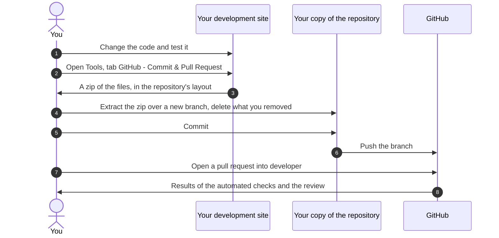

import Tabs from '@theme/Tabs';
import TabItem from '@theme/TabItem';

# Contributing

<AlfaVersion verified="2.2.0" />

This page is the contribution guide of Alfa Commerce. The file `CONTRIBUTING.md` in the code repository only points
here. For how the code is organised, see [Project Structure](./project-structure).

:::note
By contributing you agree to the
[Code of Conduct](https://github.com/Easylogic-CO-LP/Alfa-Commerce/blob/main/CODE_OF_CONDUCT.md). A security problem
is never reported in a public issue, see [Reporting a security problem](#reporting-a-security-problem).
:::

## What it does

You change Alfa Commerce on a development site, where you can see the change work. The administrator then gives you
those changed files as a zip, laid out like the code repository. You extract the zip over your copy of the
repository, commit, and open a pull request. Automated checks and a reviewer look at the pull request before it is
merged.



## When it is used

For every change to the code that ships in the core package: the component, its plugins, its modules and its bundled
libraries. A one line fix and a new feature follow the same path.

## What you must provide

### A development site

| You need | Why |
|---|---|
| PHP 8.3 or newer | The installer refuses an older PHP. 8.3, 8.4 and 8.5 are tested, 8.4 is recommended. |
| Joomla 6.1 or a later Joomla 6 release | The installer refuses Joomla 6.0 and older. It also refuses Joomla 7, which this release is not tested on. In both cases nothing is installed. |
| MySQL 8.0.13 or newer, or MariaDB 10.6 or newer | The database requirement of the release. |
| Git and a GitHub account | To commit and to open the pull request. |
| GitHub Desktop (optional) | For the path below that needs no terminal. |
| The permission "Use Maintenance Tools" on that site | The download of your changed files is refused without it. |

### Branches

| Branch | Use |
|---|---|
| `main` | Stable releases. Never commit to it and never open a pull request into it. |
| `developer` | Active development. Start every branch from it and open every pull request into it. |
| `feat/*` | A new feature, for example `feat/free-shipping-threshold`. |
| `fix/*` | A bug fix, for example `fix/cart-total-rounding`. |

What the repository shows about these branches: the automated checks run for pull requests into `main` and into
`developer`, and again when either branch receives new commits. The latest commit on `main` is a merge of
`developer`. The rules that protect the two branches are set on GitHub, not in the code:
see [Branch rules](../tooling/workflows#branch-rules).

### Changes that need more than the code

Do these before you download your files. The download only carries what the manifest declares.

#### You added a plugin, a module or a library

Declare it in `alfa.xml`, under `<plugins>`, `<modules>` or `<libraries>`. An extension that is not declared there
is left out of the zip without a warning, and it will not install.

#### You changed the database

Make the change in two places:

1. `administrator/sql/install.mysql.utf8.sql`, the complete schema that a fresh installation creates.
2. A new file `administrator/sql/updates/mysql/<new-version>.sql`, named by the version that ships the change, for
   the sites that already run Alfa Commerce. There is one such file for each release that changes the database.
   2.2.0 ships `2.0.0.sql`, `2.0.1.sql`, `2.1.0.sql`, `2.1.1.sql`, `2.1.4.sql` and `2.2.0.sql`.

Joomla records the schema version when the component is installed. On an update it runs every update file newer than
that version, in version order.

Rules for an update file:

- Write the table prefix as `#__`, never the prefix of your own site. Joomla puts in each site's real prefix.
- Change one column in each `ALTER` statement. Joomla's database check reads only the first column of a statement.
- Write statements that are safe to run twice, with `IF EXISTS` and `IF NOT EXISTS` where the statement allows it.
- An index change that a second run would stop on ends with Joomla's marker `/** CAN FAIL **/` right before the
  semicolon. Never put the marker on a statement that fills in data: Joomla records the file as applied even when
  such a statement failed, so it never runs again.
- Do not add an uninstall SQL file. Uninstalling keeps every Alfa table and its data, on purpose.
- 2.0.0 is the starting point. The installer refuses to install over anything older than 2.0.0, so no update file
  has to bring an older schema forward.

Two statements from the shipped `2.2.0.sql`, as a model:

```sql
ALTER TABLE `#__alfa_tasks` ADD INDEX `idx_handler_state_finished` (`handler`, `state`, `finished_at`) /** CAN FAIL **/;
ALTER TABLE `#__alfa_inventory_movements` MODIFY `id` bigint UNSIGNED NOT NULL AUTO_INCREMENT;
```

#### You deleted or moved a file

What you do:

1. Delete the old file in the repository as well. Extracting the zip never deletes anything.
2. Say in the pull request which files you removed or moved.

Why step 2 matters: an update does not remove the old file from sites that already have it. Joomla copies the new
folders over the old ones and leaves every other file where it was. The release that ships your change therefore
lists each removed file in `script.php`, and the update deletes it from the sites.

The two lists are constants of the installer class in `script.php`, each grouped by the version that first removes
the paths.

| List | What one entry is |
|---|---|
| `OBSOLETE_FILES` | The path of the removed file as it is on an installed site, relative to the site root, with the content hashes of every copy of that file a release installed. |
| `OBSOLETE_FOLDERS` | The path of a folder that the removed files leave empty, written deepest first. |

This is the 2.2.0 group of `OBSOLETE_FILES`, shortened to two of its three entries:

```php
'2.2.0' => [
    // Its events go through the plugin helper (src/Plugin/AlfaPluginHelper.php).
    'administrator/components/com_alfa/src/Event/Admin/AlfaAdminDispatcher.php' => [
        'cc0cd06974294fb3856f05e4c1b3c54d8231cab2b5bc3ba9c55096aac534b3d4',
        'eca4a3b0575420a1cc78ed69e4c63f601f21d8872ae4ce226261a9a441b35c46',
    ],
    'administrator/components/com_alfa/forms/price.xml' => ['74af1fca867e1535090b791e348a19700ca2fcadda1de7f0c6dc093475dd3b4f'],
],
```

What an entry must respect, and what the update does with it:

- The path is exact: no wildcard, and no `.` or `..` part.
- The path is inside an extension's own folder: a component folder (site, administrator or API), a folder under
  `media`, a module folder or a plugin folder. A language folder other than `en-GB` is never accepted, because it
  belongs to the site's language packs.
- The hash is the one `PackageHelper::contentHash()` gives. For a text file it ignores differences in spaces, tabs
  and line endings, so it is not the plain SHA-256 of the file.
- On every update, a listed file is deleted only when it is a regular file, the new package does not install it, and
  its content matches one of the listed hashes. A file whose content was changed on the site is kept and named.
- A listed folder is removed only when this update removed something inside it and it is now empty.
- Every removal, every file kept and every failure is named on the installation page and in the log
  `com_alfa_maintenance.php`.

Since 2.1.1 removed files are declared in these two lists. 2.2.0 reads no `files/removed/<version>.json` file,
although the reviewer rulebook still names one.

#### You added or changed a text people read

- Every text a person reads is a language key, shown with Joomla's `Text` class. Logs, array keys and HTML
  attributes are not texts.
- Each extension owns its strings. A plugin or a module carries every string it shows in its own language files, in
  its `language/en-GB/` folder. It does not use a key from the component's file. The component's files
  (`administrator/languages/en-GB/` and `site/languages/en-GB/`) hold only the component's strings.
- The core ships English only. Other languages are separate language packs. Do not add another language to the core
  repository.
- In a language file, write one `KEY="text"` on each line, and `&quot;` for a quotation mark inside the text.

#### Every change: the version and the changelog

- Set `<version>` in `alfa.xml` to the new number.
- Set the same number as `"version"` in `media/joomla.asset.json` (on an installed site this file is
  `media/com_alfa/joomla.asset.json`). Browsers fetch the CSS and JavaScript again only when this number changes.
- Add your change to `changelog.xml`, in the entry of that version. The download carries the file as it is and
  never writes it for you.
- Never change a version that is already published. Its files are signed, and a change breaks the check under
  Tools, Security.

The version number is also the name of your update SQL file, and it is what makes Joomla run that file.

### Code conventions

Formatting is not your job: [PHP CS Fixer](../tooling/php-cs-fixer) formats the PHP of a pull request and commits
the result. These rules are yours.

**Rules the reviewer applies** (from the [reviewer rulebook](#the-reviewer-rulebook) and `SECURITY.md`):

- Database access goes through Joomla's database driver, with quoted names and bound or quoted values. Never build
  SQL from request data.
- Clean all input with Joomla's input filter. Check the session token on every task that changes something, and the
  permission on every privileged action.
- Never commit a secret, an API key or a password.
- Files under `tmpl/` and `layouts/` only present: they loop, escape and format. Queries and price logic belong in
  models, helpers and services.
- Name classes as the rest of the code does: `ItemController`, `ItemModel`, `Items\HtmlView`, events as context,
  action and the word Event, in `src/Event/`.
- House style: named arguments on calls, careful PHPDoc, Joomla's own building blocks only. A new plugin needs a
  `services/provider.php`.

**Rules a check enforces: clean comments and texts (Copy-clean).** This check fails the pull request. It reads
every file the package ships (never tests, never the bundled libraries) and judges only comments and texts a person
reads: string literals, template text, XML text and attribute values, SQL comments and seed strings, language
values. Code itself is never judged.

| Rule | What is refused | Where |
|---|---|---|
| R1 | A box or banner comment: a box drawing or block character, a line made only of decoration such as `=====`, or a heading framed by such a run. | Comments |
| R2 | An em dash or an en dash. | Comments and texts |
| R3 | A typographic character: arrows, the ellipsis character, curly quotes, primes, angle quotes, pointers, the multiplication, division, minus, plus-minus, comparison and approximately signs, bullets, middle dots, section signs, and non-breaking, thin, narrow, en and em spaces. | Comments and texts |
| R5 | The name of a carrier, a payment gateway, another shop system or another product. The names are listed in the gate's file. A name inside a path or an identifier quoted in a comment or a text counts too. | Comments and texts |
| R6 | A reference to how the code came about: a decision, ruling or finding id, a mention of an owner's ruling or of a decision register, a review reference, or a date of the years 2023 to 2027 written as year, month, day. A comment states the reason, never the process. Lines with `@since`, `@deprecated` or `@version` are not judged. | Comments |

In `.json` and `.txt` files only the characters of R2 and R3 are looked for.

An exception is one entry in `scripts/copy-clean/copy-clean-allow.json`: the file, the rule, and the exact string
or the exact line, with a class and a reason. A whole file can never be excepted. An entry that no longer matches
anything fails the check too. 2.2.0 holds 44 entries.

How to run it yourself is on [Automated checks](../tooling/workflows#copy-clean).

## The steps

<Tabs>
<TabItem value="desktop" label="GitHub Desktop (easiest)" default>

No terminal needed.

<details>
<summary>Outside contributor with no push access? Open for the fork steps</summary>

Fork the repository on GitHub, then in Desktop clone **your** fork instead of step 1. When asked "How are you
planning to use this fork?", choose **To contribute to the parent project**. Steps 2 to 8 are unchanged. Your pull
request targets the parent's `developer`.

</details>

1. **Clone the repository (once).** File, Clone repository. On the **GitHub.com** tab pick
   `Easylogic-CO-LP/Alfa-Commerce`, choose a local folder, then **Clone**.
2. **Branch off `developer`.** Click **Current Branch**, select `developer`, then **Fetch origin**. Click
   **Current Branch**, **New Branch**, name it `feat/short-description`, base it on `developer`, then
   **Create Branch** and **Publish branch**.
3. **Get your changed files into the branch.** See [Downloading your files](#downloading-your-files) below. Extract
   the zip over the repository folder. Then delete by hand the files you removed or renamed on your site. Desktop
   shows them under **Changes** as deletions.
4. **Review.** The **Changes** tab lists every file: green is added, yellow is modified, red is removed. Click a
   file to see its changes.
5. **Commit.** Bottom left, fill in the **Summary** (short, starting with a verb such as Add or Fix) and the
   optional **Description**, then **Commit to feat/short-description**.
6. **Catch up to `developer`.** **Current Branch**, **Choose a branch to merge into feat/short-description**, pick
   `developer`, then merge. Resolve any conflicts now, not inside the pull request.
7. **Push.** Click **Push origin**.
8. **Open the pull request.** **Preview Pull Request**, confirm that **base** is `developer` and never `main`, then
   **Create Pull Request**. On GitHub add a short title and a description: what changed, why, and how to test it.
   Link an issue with `Closes #123`.

</TabItem>
<TabItem value="cli" label="Git commands">

<details>
<summary>Outside contributor with no push access? Open for the fork steps</summary>

Fork the repository on GitHub, then change steps 1, 2 and 6:

```bash
# 1. Clone your fork and add the upstream remote
git clone https://github.com/YOUR-USERNAME/Alfa-Commerce.git
cd Alfa-Commerce
git remote add upstream https://github.com/Easylogic-CO-LP/Alfa-Commerce.git

# 2. Branch off the upstream developer
git fetch upstream
git checkout -b feat/short-description upstream/developer

# 6. Catch up from upstream
git fetch upstream
git merge upstream/developer
```

Steps 3 to 5 and 7 are unchanged; your push goes to your fork. In step 8, open the pull request from your fork into
`developer` of `Easylogic-CO-LP/Alfa-Commerce`.

</details>

```bash
# 1. Clone (once)
git clone https://github.com/Easylogic-CO-LP/Alfa-Commerce.git
cd Alfa-Commerce

# 2. Branch off developer
git checkout developer
git pull
git checkout -b feat/short-description        # or fix/short-description

# 3. Get your changed files into the branch: download the zip (see below),
#    extract it over this folder, then remove the files you deleted or renamed yourself
git status
git rm path/to/old-file

# 4. Review what changed
git status
git diff

# 5. Commit (short, starting with a verb)
git add -A
git commit -m "Add free-shipping threshold to cart"

# 6. Catch up to developer before the pull request
git fetch origin
git merge origin/developer

# 7. Push
git push -u origin feat/short-description
```

8\. **Open the pull request** on GitHub with **Compare & pull request**. Set **base** to `developer` (switch it from
`main`), add a short title and a description: what changed, why, and how to test it. Link an issue with
`Closes #123`.

</TabItem>
</Tabs>

### Downloading your files

In the administrator of your development site open Alfa Commerce's **Tools** screen and its tab
**GitHub - Commit & Pull Request**. The card of the same name holds **Open the step-by-step guide**, which is the
same guide as this page. Step 3 of that guide checks your site and offers two buttons.

What the screen checks for you before you download:

| It tells you | What it means |
|---|---|
| Manifest problems that will break the install | Something a manifest declares is missing on disk, or a plugin lacks its `plugin` attribute. Fix the manifest first. |
| Files on disk are not declared in any manifest | These files will not be packaged or installed. Declare them if they are needed. |
| No manifest drift | Every declared path exists and nothing required is undeclared. |
| The asset file still declares another version | `joomla.asset.json` and `alfa.xml` carry different version numbers. Set them to the same number. |
| The package would install files the source does not have | Your site still carries a file that the source moved or deleted. Remove it from the site. |
| You have verified file changes but the version is still the released one | Raise the version, see above. |
| Version already bumped | Your files differ from the official release and the version is no longer the released one. Nothing to do. |
| Remember to record this version's changes in `changelog.xml` | Always shown. |

The two buttons:

| Button | What you get |
|---|---|
| **Download package zip** | The whole component, with its plugins and modules, in the repository's layout. |
| **Download changed files only** | Only the files that differ from the official release, for a small pull request. |

**Download changed files only** compares your site with the signed checksums of the official release, which it
fetches online. The button is switched off, with the reason beside it, in two cases: your site matches the official
release, so there is nothing to download, or the checksums could not be verified (the site is offline, or the
validation failed). A file that the release has and your site does not is never in the zip: that is a deletion you
make in the repository yourself. When files changed but none of them belongs to the Alfa Commerce package, the
screen says so and downloads nothing.

What the zip is, and is not:

- It is made for a pull request. It is not a backup of the site: it holds no database data, only the schema and SQL
  files that ship with the code.
- It holds no tests.
- It holds nothing under `libraries/`. If you changed a bundled library, copy those files into the repository's
  `libraries/` folder by hand and commit them, or they are missing from your pull request.
- It cannot be installed as it is. To install or test it, first copy each library folder from the repository into
  the extracted package and zip it again. Without them the component installs, but the phone number features do not
  work.

:::caution Extracting never deletes
Extracting the zip only adds and overwrites. Delete only what you removed on purpose. Do not delete a file just
because your site does not have it: the repository keeps files your site may lack.
:::

## What happens next

### The automated checks

GitHub runs these on your pull request. Each has its own page.

| Check | What it does | Can it fail the pull request |
|---|---|---|
| [PHP CS Fixer](../tooling/php-cs-fixer) | Formats the PHP code and commits the fixes to your branch. | Only when the tool or its commit step breaks. |
| [Copy-clean](../tooling/workflows#copy-clean) | Refuses unclean comments and texts, see the rules above. | Yes. |
| [PHPStan](../tooling/phpstan) | Reads the code for likely bugs and prints its findings on the run's page. | On `main` (2.2.0) it reports and does not fail the check. On `developer`, since 13 November 2026, a finding fails it. Open the run and read what it found. |
| [Security Scan](../tooling/workflows#security-scan) | Scans the JavaScript for security problems and the history for secrets that are live. | Yes, when it finds a live secret or one of its steps breaks. |
| [AI review](../tooling/workflows#the-ai-review) | Reads the reviewer rulebook, then comments on the changed lines. | It posts comments. Nothing in its file fails a pull request because of a finding. |

Code Quality and Security Scan run only for pull requests into `main` or `developer`. Which checks must be green
before a merge is set in the repository's branch rules on GitHub, which are not part of the code. All details are on
[Automated checks](../tooling/workflows).

After PHP CS Fixer commits to your branch, pull before you commit again.

### The reviewer rulebook

The file
[`.github/review-guidelines.md`](https://github.com/Easylogic-CO-LP/Alfa-Commerce/blob/main/.github/review-guidelines.md)
is the project's list of review rules. The AI review is told to read it first and to judge only the changes of your
pull request against it. Reading it before you open a pull request tells you what will be looked at: releases and
database updates, database access, known Joomla pitfalls, multilingual fields, security, naming and texts. It marks
each finding as one that breaks installations, data or security, as a likely bug, or as minor.

### The pull request form

A new pull request opens with the project's form: a description (what changed and why) and a checklist.

- Follow your own test steps and confirm the result.
- Check Joomla's log for PHP errors.
- Check the browser console for JavaScript errors.
- Test the affected pages on desktop and on mobile.
- Open related pages and confirm nothing is broken.
- Add an entry to `changelog.xml` for a change people will notice.

Before you open it, also confirm:

- The branch started from `developer` and the pull request targets `developer`.
- It holds one change. Unrelated edits go in their own pull request.
- A new plugin, module or library is declared in `alfa.xml`.
- A database change is in the install schema and in an update file.
- Removed and moved files are deleted in the repository and named in the description.
- The version is raised in `alfa.xml` and in `media/joomla.asset.json`.
- Every text a person reads is a language key in the right extension's file.

## What can go wrong

| What you see | Why | What to do |
|---|---|---|
| Your new plugin is not in the zip | It is not declared in `alfa.xml`. | Declare it and download again. |
| **Download changed files only** is switched off | The site matches the official release, or the checksums could not be verified. | Read the reason beside the button. Go online and reload, or use **Download package zip**. |
| The download is refused | Your account lacks the permission "Use Maintenance Tools", or the session expired. | Ask for the permission, or reload the Tools screen and try again. |
| "The package export failed" | The export stopped. | The reason is in the log `com_alfa_tools.php` in Joomla's log folder. |
| A file you deleted is still in the pull request's branch | Extracting never deletes. | Delete it in the repository and commit. |
| Copy-clean fails | A comment or a text breaks one of the rules above. The run names the file, the line and the rule. | Reword it, or add an exception with its reason if the text must stay. |
| Your branch has a commit you did not make | PHP CS Fixer formatted your code. | Pull, then continue. |
| Browsers still show the old CSS or JavaScript | The version in `joomla.asset.json` was not raised. | Set it to the version in `alfa.xml`. |

## Reporting a security problem

Do not open a public issue. Send an email to **info@easylogic.gr** with the subject
`[SECURITY] Alfa Commerce Vulnerability Report`. Describe the problem, the steps to reproduce it, what it could
lead to, and a fix if you have one. The security policy
([SECURITY.md](https://github.com/Easylogic-CO-LP/Alfa-Commerce/blob/main/SECURITY.md)) promises an acknowledgement
within 48 hours, an assessment within 7 days and aims at a fix within 30 days of confirming the problem. Problems in
Joomla itself are reported to Joomla's security team.

## Getting help

- **Found a bug?** Open an issue with the Bug Report form. It asks for the steps to reproduce, what you expected,
  what happened, and your versions.
- **Have an idea?** Open an issue with the Feature Request form. It gets the label `enhancement`.
- **Want another AI review?** A comment that contains `@claude` starts the AI review workflow again.
- **Contact:** info@easylogic.gr, [easylogic.gr](https://easylogic.gr)

## Not documented yet

- Whether PHP CS Fixer can commit its fixes to a pull request that comes from a fork, and whether the AI review runs
  for one. The workflow files do not settle it.
- How the `developer` branch becomes a release. The code holds `main` only.
- A style rule for JavaScript. The repository has no JavaScript formatter or linter configuration.
