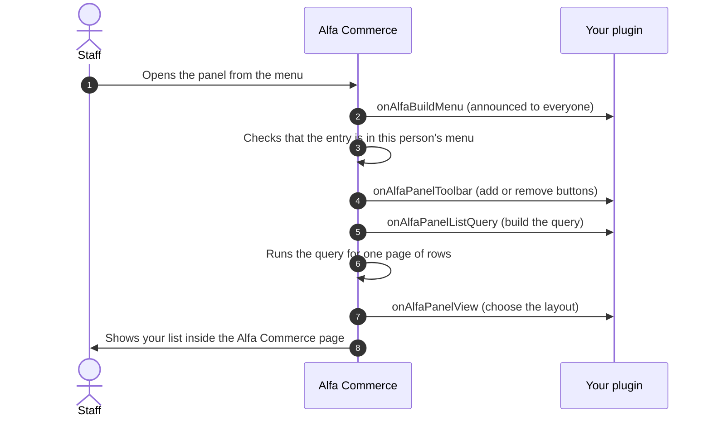
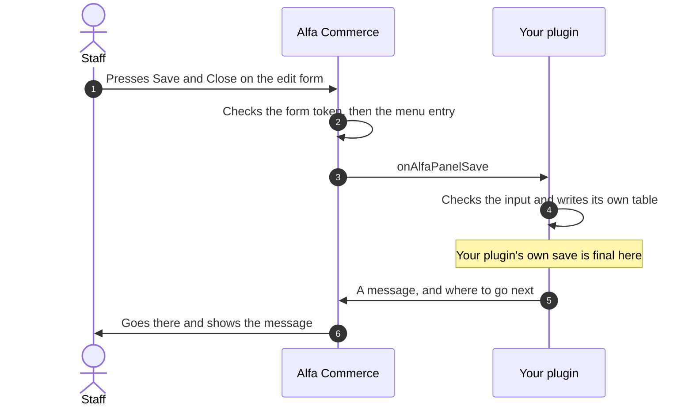

# Creating an Admin Panel

<CreatePluginButton type="adminpanel" />

<AlfaVersion verified="2.2.0" />

**The pages of this guide:**

- **Creating an Admin Panel** (this page)
- [A complete admin panel plugin](./admin-panel-example.md)

A **panel** is a whole administrator screen that your plugin owns: a list, an edit form, a toolbar, a menu entry and
a permission. Alfa Commerce supplies the frame (the page, the menu, the toolbar, the paging, the form token). Your
plugin supplies the data and a few small files.

Read [How events reach a plugin](../events/how-events-reach-a-plugin.md) first. This page uses its two ways of
delivery, "announced to everyone" and "addressed to one plugin", without explaining them again. To add something to a
screen Alfa Commerce already has, see [Extending Admin Screens](./admin-screen-plugins.md).

## What it does

A panel is reached by an address that names the plugin and the screen:

```
index.php?option=com_alfa&view=panel&group=alfa&element=<your plugin>&panel=<your screen>
```

One controller, one model and one view of Alfa Commerce serve every panel. At each step they hand the work to the
plugin that owns the panel, through six events:

| Event | Your job |
|---|---|
| `onAlfaPanelToolbar` | Add buttons, or remove the ones Alfa draws |
| `onAlfaPanelListQuery` | Build the database query of the list |
| `onAlfaPanelView` | Say which layout or which form draws the screen |
| `onAlfaPanelSave` | Save the record that was submitted |
| `onAlfaPanelDelete` | Delete the checked records |
| `onAlfaPanelTask` | Run any other button of your own |

Two more events make the panel reachable: `onAlfaBuildMenu` (its menu entry) and `onAlfaGetAccessActions` (its
permission).

## When it is used

Use a panel when your feature needs a screen of its own, with its own table. A panel can be owned only by a plugin of
the **`alfa`** group. A payment, shipping or search plugin that needs a screen ships a second, small plugin in the
`alfa` group for it.

The set of classes a panel plugin uses is versioned on its own: `PanelFramework::VERSION` is `1` in 2.2.0.

## What you must provide

### The two lists of events

The six panel events are **addressed to one plugin** (targeted): only the owner of the panel is called. They are
declared in `getTargetedHandlers()`, from `TargetedHandlersInterface`, each event with the method that handles it.
The menu and permission events are **announced to everyone** (broadcast) and are listed in `getSubscribedEvents()`.

```php
public static function getSubscribedEvents(): array
{
    return [
        'onAlfaBuildMenu'        => 'onAlfaBuildMenu',
        'onAlfaGetAccessActions' => 'onAlfaGetAccessActions',
    ];
}

public function getTargetedHandlers(): array
{
    return [
        'onAlfaPanelToolbar'   => 'onAlfaPanelToolbar',
        'onAlfaPanelListQuery' => 'onAlfaPanelListQuery',
        'onAlfaPanelView'      => 'onAlfaPanelView',
        'onAlfaPanelSave'      => 'onAlfaPanelSave',
        'onAlfaPanelDelete'    => 'onAlfaPanelDelete',
        'onAlfaPanelTask'      => 'onAlfaPanelTask',
    ];
}
```

Declare only the events you handle. A panel event is never called because a method has its name, and it is never
delivered from `getSubscribedEvents()`. A name in both lists is written to Joomla's log as an error.

### A menu entry, which is also the gate

A panel **must** have an entry in the Alfa Commerce menu. The entry is how staff reach it, and it is also the access
check: Alfa lets a person open the panel, save in it or delete in it only if the entry is in the menu **as that
person sees it**. No entry means a "not authorised" answer (403) for everyone.

Name a permission on the entry with `access()`. Without it, the entry and the panel are open to everyone who may
enter Alfa Commerce.

### The panel check in every handler

One plugin may own several panels, and every panel event of that plugin arrives at the same methods. Each handler
starts by checking which panel it was called for:

```php
if ($event->getIdentity()->panel !== 'notes') {
    return;
}
```

### The files

```
plugins/alfa/<yourplugin>/
├── <yourplugin>.xml               the manifest, group="alfa"
├── services/provider.php          starts the plugin
├── src/Extension/<YourPlugin>.php the two lists and the handlers
├── forms/filter_<panel>.xml       the list's search, filters and sort order (found by its name)
├── forms/<record>.xml             the edit form
├── layouts/<panel>/list.php       your list screen
├── sql/                           your table
└── language/en-GB/                every text the screens print
```

### Your own language file

When a panel is opened, Alfa loads its owner's language file. It does not do so on other pages, and your menu entry
and your permission's row are drawn on other pages. Set `protected $autoloadLanguage = true;` on the plugin class so
that those show their texts too.

## What happens next

### Opening the list



Mind the order: the toolbar event comes **before** any row is loaded. A toolbar handler cannot look at the rows. It
can read the list's filters from `$event->getState()`.

### Saving a record



In a panel the table is yours, so the save becomes final inside your handler, not inside Alfa Commerce: each query
your handler runs is stored at once, unless your handler opens a transaction of its own. Alfa saves nothing itself
and opens no transaction around your handler. It only carries your message and your redirect.

## What can go wrong

Alfa treats the display events and the write events differently.

| The event | Not declared in `getTargetedHandlers()` | Your handler throws an error |
|---|---|---|
| `onAlfaPanelToolbar`, `onAlfaPanelListQuery`, `onAlfaPanelView` (display) | Skipped, without a message | Written to Joomla's log (category `com_alfa.panel`). The page is still drawn, without that part. |
| `onAlfaPanelSave`, `onAlfaPanelDelete`, `onAlfaPanelTask` (writes) | Staff see: "This screen's extension does not support this action, so nothing was changed. Update the extension, or ask its developer." | Staff see: "The action could not be completed. Please try again, and if it keeps failing contact your administrator." The error is logged. |

In both cases a save sends staff back to the edit screen and keeps what was typed, which your `onAlfaPanelView`
finds in `getData()['form']`. A delete or a task sends them back to the list.

A write handler must also **answer**. If it sets neither a message nor a redirect, staff are told that the action
could not be completed, even when your code did its work.

| What you see | The usual cause |
|---|---|
| "Not authorised" (403) on the panel's address | No menu entry for this exact group, element and panel (compare `->panel('alfa', 'storenotes', 'notes')` with the address), `onAlfaBuildMenu` is not in `getSubscribedEvents()`, the `group.element` argument of `item()` is missing, or the person lacks the entry's permission |
| "This panel does not exist" (404) | The group in the address is not `alfa`, or the plugin is disabled or not installed |
| A title and a toolbar with nothing under them | `onAlfaPanelView` is not declared, it returned early (wrong panel name), or `setLayout('notes.list')` names a file that is not at `layouts/notes/list.php` |
| The list does not show your rows | `onAlfaPanelListQuery` is not declared, or it returned before building the query |
| An error about an undefined variable in your layout | The layout did not take its values out of `$displayData` first |
| The edit screen has no fields | `useForm('note')` names a file that is not at `forms/note.xml` |
| Saving makes a copy instead of updating | The form has no hidden `id` field |
| The search box and the filters do nothing | No `forms/filter_<panel>.xml`, or your query does not read `filter.<name>` from the state |
| A column header does not sort | The column is not an option of the `fullordering` field in the filter form |
| "This action is accepted only from its own button on its screen" | A button of yours was reached by a link (GET). See "Tasks arrive by POST". |
| "Unknown panel action" | The task reached `onAlfaPanelTask` and no handler called `markHandled()` |
| The menu shows `PLG_...` in place of your text | The plugin does not load its language file |

## The menu entry and the permission

### onAlfaBuildMenu

- **When it fires.** Whenever Alfa builds its administrator menu: on every Alfa Commerce administrator page that
  shows the menu, and as the access check of every panel request. It is built once for each request.
- **Who receives it.** Announced to everyone: every loaded plugin that listed the event.
- **What you are given.** The event, with `item()`, `add()` and `section()`.
- **What you are expected to do.** Declare your entry. `item('group.element', $id)` returns the entry, and you chain
  the rest:

| Method on the entry | Meaning |
|---|---|
| `title($languageKey)` | The text of the entry. It is also the title of the panel's page. Required. |
| `panel($group, $element, $panel)` | Point the entry at your panel. (`view($view)` points at a screen of Alfa Commerce, `link($url, $activeWhen)` at any address.) |
| `section($languageKey)` | The heading the entry sits under. Leave it out for the group at the top, which has no heading. |
| `ordering($number)` | The position under the heading. Alfa's own entries are spaced by 100. |
| `icon($path)` | The path of an SVG file, from the site's root. Not an icon class. |
| `access($action, $asset = 'com_alfa')` | The permission needed to see the entry and to use the panel |
| `lookups(...$tasks)` | The tasks of the panel that only read, which may arrive by GET (see "Tasks arrive by POST") |

- **What happens next.** Alfa drops the entries the person may not see, sorts the rest and draws the menu.
- **If you are missing or you fail.** There is no entry, and the panel answers "not authorised". An error in your
  handler is written to the log (category `com_alfa.plugins`) and the rest of the menu is drawn.

To put your entry under one of Alfa's headings, pass that heading's key: `COM_ALFA_MENU_SALES` (ordering 100),
`COM_ALFA_MENU_PROMOTIONS` (200), `COM_ALFA_MENU_INVENTORY` (300), `COM_ALFA_MENU_MARKET` (500),
`COM_ALFA_MENU_CONFIG` (600) or `COM_ALFA_MENU_SYSTEM` (900). To have a heading of your own, name it on your entries
and place it among the others:

```php
$event->section('alfa.storenotes', 'PLG_ALFA_STORENOTES_HEADING', 450);   // between Inventory and Market
```

A heading that nobody places is drawn after all the placed ones. A plugin cannot move one of Alfa's headings.

### onAlfaGetAccessActions

- **When it fires.** When the Options screen of Alfa Commerce builds its Permissions tab.
- **Who receives it.** Announced to everyone: every loaded plugin that listed the event.
- **What you are given.** The event, with `action($contributor, $name, $title, $description = '')`.
- **What you are expected to do.** Declare the permission your menu entry names:
  `$event->action('alfa.storenotes', 'alfa.storenotes.manage', 'PLG_ALFA_STORENOTES_ACCESS', 'PLG_ALFA_STORENOTES_ACCESS_DESC')`.
- **What happens next.** The permission is a row on the Permissions tab, placed where your menu entry sits in the
  menu. A Super User grants it to the groups that may use the panel.
- **If you are missing or you fail.** The row is missing, nobody can be granted the permission, and only Super
  Users can open the panel.

:::note A new permission starts as "not allowed"
Nothing is granted when your plugin is installed. Until a Super User grants the permission, only Super Users see the
menu entry and the panel. Give each panel its own permission if staff should be granted the panels one by one.
:::

## The six panel events

All six are addressed to the plugin that owns the panel. No other plugin sees them. Every one of them has
`getIdentity()`, which returns the panel's identity (below).

### onAlfaPanelToolbar

- **When it fires.** On every screen of the panel, before the rows or the form are loaded.
- **Who receives it.** The owner of the panel, through `getTargetedHandlers()`.
- **What you are given.** `getToolbar()` (the panel toolbar), `getScreen()` (`'list'`, `'edit'` or a name of your
  own), `getState()` (the list's state on the list screen, `null` elsewhere) and `getIdentity()`.
- **What you are expected to do.** Add your buttons and, if needed, remove Alfa's (see "The toolbar").
- **What happens next.** Alfa draws its own buttons that you did not remove (New and Delete on a list, Save and
  Close and Cancel on an edit form), to the left of yours.
- **If you are missing or you fail.** The screen has Alfa's buttons only.

### onAlfaPanelListQuery

- **When it fires.** On the list screen, when the rows are needed.
- **Who receives it.** The owner of the panel.
- **What you are given.** `getQuery()` (a query with no table and no columns yet), `getState()` (read a filter as
  `->get('filter.<name>')`) and `getIdentity()`.
- **What you are expected to do.** Build the whole query against your own table: `select()`, `from()`, `where()`,
  `order()`. Select the columns your list layout prints.
- **What happens next.** Alfa runs the query one page at a time and hands the rows to your list layout as `items`,
  with the page numbers as `pagination`.
- **If you are missing or you fail.** There is no query to run, and the list cannot show your rows.

### onAlfaPanelView

- **When it fires.** On every screen of the panel, after the toolbar and, on a list, after the rows are loaded.
- **Who receives it.** The owner of the panel.
- **What you are given.**

| Getter | Meaning |
|---|---|
| `getScreen()` | `'list'`, `'edit'`, or any other word in the address's `screen` parameter |
| `getData()` | What Alfa prepared. On a list: `identity`, `screen`, `token`, `items`, `pagination`, `state`, `filterForm`, `activeFilters`. On any other screen: `identity`, `screen`, `token`, `id` (from the address), and `form` when a refused save kept what was typed. |
| `getInput()` | The request, for a screen of your own that reads its own parameters |
| `getIdentity()` | The panel's identity |

- **What you are expected to do.** Say how the screen is drawn:

| Setter | Meaning |
|---|---|
| `setLayout($name)` | Draw the screen with your own file. `'notes.list'` is `layouts/notes/list.php` in your plugin. |
| `useForm($name)` | Load `forms/<name>.xml` from your plugin and draw it as an edit form |
| `setLayoutData(array $data)` | Your own data. It is added to what Alfa prepared, it is handed to your layout, and it fills the form. |

- **What happens next.** With a layout, Alfa draws your file. With a form and no layout, Alfa draws the form in its
  own edit page. With neither, the body of the page is empty.
- **If you are missing or you fail.** The page shows its title and toolbar with nothing under them.

The screen name is open. `list` and `edit` are what Alfa's own buttons use. Your plugin may answer
`&screen=import` with a layout of its own, and it simply sets nothing for a screen it does not know.

### onAlfaPanelSave

- **When it fires.** When the edit form is submitted with Save and Close, after Alfa has checked the form token and
  the menu entry.
- **Who receives it.** The owner of the panel.
- **What you are given.** `getInput()` (the submitted fields, under their plain names: `getString('title')`,
  `getInt('id')`) and `getIdentity()`.
- **What you are expected to do.** Check the input, write your table, then answer:

| Method | Meaning |
|---|---|
| `addMessage($text, $type = 'message')` | A message for staff. The type is `message`, `error`, `warning` or `notice`. |
| `setRedirect($url)` | Where to go next. Without it, Alfa goes to the panel's list. |
| `keepInput()` | After a refused save: keep what was typed and hand it back to `onAlfaPanelView` as `getData()['form']` |
| `markHandled()` | Say that you handled the request. Needed in `onAlfaPanelTask`. |

- **What happens next.** Alfa shows your messages and goes where you said.
- **If you are missing or you fail.** See "What can go wrong". Staff are sent back to the edit screen, and what
  they typed is kept for `onAlfaPanelView`.

### onAlfaPanelDelete

- **When it fires.** When Delete is pressed on the list, after the form token and the menu entry are checked.
- **Who receives it.** The owner of the panel.
- **What you are given.** `getIds()` (the ids of the checked rows), `getInput()` and `getIdentity()`.
- **What you are expected to do.** Delete those rows from your table, with your own rules, then answer with
  `addMessage()` and, if you wish, `setRedirect()`.
- **What happens next.** Alfa shows your message on the list.
- **If you are missing or you fail.** See "What can go wrong". Staff are sent back to the list.

### onAlfaPanelTask

- **When it fires.** For every task of the panel that Alfa does not own: `panel.publish`, `panel.unpublish`, and
  every button you added with `custom()`. Alfa owns `display`, `add`, `edit`, `cancel`, `save`, `apply` and
  `delete`.
- **Who receives it.** The owner of the panel.
- **What you are given.** `getTask()` (the bare word, `'publish'`), `getInput()` (the checked rows are
  `->get('cid', [], 'array')`) and `getIdentity()`.
- **What you are expected to do.** If the task is not one of yours, return. Otherwise do the work, call
  `markHandled()`, and add a message or a redirect.
- **What happens next.** Alfa shows your message and goes to your redirect, or to the list.
- **If you are missing or you fail.** A task nobody marked as handled is reported as "Unknown panel action".

```php
public function onAlfaPanelTask(PanelTaskEvent $event): void
{
    if ($event->getIdentity()->panel !== 'notes' || $event->getTask() !== 'publish') {
        return;                                   // not mine: leave it unhandled
    }

    $ids = array_map('intval', (array) $event->getInput()->get('cid', [], 'array'));

    // Your own work with $ids.

    $event->markHandled()->addMessage(Text::_('PLG_ALFA_STORENOTES_PUBLISHED'));
}
```

### Tasks arrive by POST

A task of your own is accepted only when it comes from a form (a POST) with the form token. Reached by a link, it is
refused with a message and nothing is changed. A task that only **reads** (a search as staff type, an export) may
come by GET if the menu entry names it:

```php
$event->item('alfa.storenotes', 'storenotes-notes')
    ->title('PLG_ALFA_STORENOTES_MENU')
    ->panel('alfa', 'storenotes', 'notes')
    ->access('alfa.storenotes.manage')
    ->lookups('search', 'export');                // these two may arrive by GET, still with the token
```

## The panel's identity

`$event->getIdentity()` returns a small read only object, `PanelIdentity`, with the public properties `group`,
`element` and `panel`. Use its methods so that your code never writes Alfa's addresses by hand:

| Method | Returns |
|---|---|
| `listUrl()` | The address of the panel's list |
| `editUrl($id = 0)` | The address of the edit screen of a record (`0` for a new one) |
| `pluginPath()` | The folder of your plugin |
| `key()` | A text that names the panel, `alfa/storenotes:notes`, for logs |
| `stateKey($suffix)` | A key for the user's session that belongs to this panel alone |
| `mutationFields($verb, $token)` | The hidden fields a form of yours needs to post **one** task to this panel: `option`, `task` (your verb, with `panel.` put before it), `group`, `element`, `panel` and the form token |

## The list screen

### The filter form

Put the search box, the filters and the sort order in `forms/filter_<panel>.xml`. Alfa finds the file by its name.
It has a `filter` group and a `list` group, like the filter form of any Joomla list. What staff choose is remembered
for that panel alone, and reaches your query as `filter.<name>` in the state.

### Sorting

The columns staff may sort by are the options of the **`fullordering`** field in the `list` group of your filter
form. Each option's value is a column and a direction, such as `a.title ASC`. A panel whose filter form has no such
field has no sortable column.

When staff choose an order, Alfa adds it to the query **before** your handler runs. The order you add yourself in
`onAlfaPanelListQuery` then comes second: it decides between rows that are equal in the chosen column, and it is the
order of the list when staff have chosen none.

### Your list layout

The layout you name in `onAlfaPanelView` is a Joomla layout file. It receives **one array, `$displayData`**, and
starts by taking out what it needs:

```php
/** @var \Alfa\Component\Alfa\Administrator\View\Panel\HtmlView $view */
$view       = $displayData['view'];        // for the search and filter bar
$identity   = $displayData['identity'];    // addresses
$items      = $displayData['items'] ?? [];
$pagination = $displayData['pagination'] ?? null;
$state      = $displayData['state'] ?? null;
$token      = $displayData['token'] ?? '';
```

Using `$identity` or `$items` without these lines is an error about an undefined variable. `$displayData` also
carries `screen`, `filterForm`, `activeFilters`, `form` (`null` on a list) and everything you passed to
`setLayoutData()`.

The layout draws a form named `adminForm`, because the toolbar buttons submit that form. The plugin of
[A complete admin panel plugin](./admin-panel-example.md) has a full list layout.

## The toolbar

Alfa draws the usual buttons itself: **New** and **Delete** on a list, **Save and Close** and **Cancel** on an edit
form. A plain panel needs no toolbar handler at all. `onAlfaPanelToolbar` is for adding buttons and for removing the
ones you do not want.

### What you can add

| Method on `PanelToolbar` | Draws | Goes to |
|---|---|---|
| `addNew($verb = 'add')` | New | `panel.add`, which opens the edit screen |
| `edit($verb = 'edit')` | Edit (needs a checked row) | `panel.edit` |
| `delete($verb = 'delete', $message = 'JGLOBAL_CONFIRM_DELETE')` | Delete, with a question first | `panel.delete`, then `onAlfaPanelDelete` |
| `publish()`, `unpublish()` | Joomla's Publish and Unpublish buttons (need a checked row) | `onAlfaPanelTask` |
| `custom($verb, $icon, $label, $listCheck = false)` | A button of your own. With `$listCheck = true` it needs a checked row. | `onAlfaPanelTask` |
| `link($label, $url, $icon = '')` | A link. Only for going somewhere, never for changing data. | The address |
| `joomla()` | Joomla's own toolbar object | For anything the methods above do not cover |

Icon names are **bare**: `'loop'`, `'undo'`, `'trash'`. Alfa puts `icon-` before them. Passing `'icon-trash'` gives
`icon-icon-trash` and no picture.

Two rules that Alfa enforces:

- **You write the bare word.** Write `'reseed'`; the button posts `panel.reseed`. A word with a dot in it throws an
  error.
- **A button of your own cannot take one of Alfa's words.** `display`, `add`, `edit`, `cancel`, `save`, `apply` and
  `delete` are taken. `custom('save', ...)` throws an error.

### What you can remove

```php
$event->getToolbar()->suppressNative();                          // no New, no Delete, no Save and Close
$event->getToolbar()->suppressNative(PanelToolbar::NATIVE_NEW);  // only New goes; Delete stays
```

The names are the buttons' names: `PanelToolbar::NATIVE_NEW`, `NATIVE_DELETE`, `NATIVE_SAVE` and `NATIVE_CANCEL`
(`'new'`, `'delete'`, `'save'`, `'cancel'`). Any other word throws an error. A call with no name removes New, Delete
and Save and Close, but never Cancel: on an edit screen Cancel is the only way out, so removing it must be asked for
by name.

### Both together, following the active filter

`$event->getState()` carries the list's filters, so the toolbar can follow what staff are looking at. This handler
is for a panel whose rows have a state and whose filter form has a `state` filter:

```php
public function onAlfaPanelToolbar(PanelToolbarEvent $event): void
{
    if ($event->getIdentity()->panel !== 'notes' || $event->getScreen() !== 'list') {
        return;                                   // the edit screen keeps Save and Close, and Cancel
    }

    $toolbar = $event->getToolbar();

    if ((string) $event->getState()?->get('filter.state', '') === '-2') {   // staff look at the trash
        $toolbar->suppressNative(PanelToolbar::NATIVE_NEW)                  // remove New
            ->custom('restore', 'undo', 'PLG_ALFA_STORENOTES_RESTORE', true);
    } else {
        $toolbar->suppressNative(PanelToolbar::NATIVE_DELETE)               // remove Delete
            ->publish()
            ->unpublish()
            ->custom('trash', 'trash', 'JTOOLBAR_TRASH', true);
    }
}
```

On the ordinary list staff see New, Publish, Unpublish and Trash. With the filter on "Trashed" they see Delete and
Restore. The four tasks `publish`, `unpublish`, `trash` and `restore` arrive in `onAlfaPanelTask`.

:::warning Removing a button is not security
Alfa keeps accepting `panel.save` and `panel.delete` whether or not a button points at them. Your
`onAlfaPanelSave` and `onAlfaPanelDelete` are the real guard. A panel that is read only still declares them and
answers with a message.
:::

## The edit screen

### The simple way: name a form

Name a form in `onAlfaPanelView` and ship no edit layout at all:

```php
$data = $event->getData();                        // id, and what was typed if a save was refused
$kept = \is_array($data['form'] ?? null) ? $data['form'] : null;

$event->useForm('note')                           // forms/note.xml in your plugin
    ->setLayoutData($kept ?? $this->loadNote((int) ($data['id'] ?? 0)));
```

Alfa loads `forms/note.xml`, puts your data into it and draws it in its own edit page, with Save and Close, Cancel
and Joomla's form checks. The field types of Alfa Commerce can be used in the form. The fields are posted under
their **plain names**, which is why the save handler reads `$event->getInput()->getString('title')`.

:::danger Your form must have a hidden `id` field
Alfa's edit page posts the address of the panel and the form token. It posts no record id of its own. The id reaches
the browser only if your form has a field for it. Without a hidden `id` field your save handler reads `0` every
time and **adds a copy instead of updating**.

```xml
<?xml version="1.0" encoding="UTF-8"?>
<form>
    <fieldset name="default">
        <field name="id" type="hidden" default="0" />
        <field name="title" type="text" label="JGLOBAL_TITLE" required="true" />
        <field name="note" type="textarea" label="PLG_ALFA_STORENOTES_NOTE" rows="6" />
    </fieldset>
</form>
```

The save handler reads it back with `$event->getInput()->getInt('id', 0)`. `0` means a new record.
:::

:::note In a panel, a fieldset is a section, not a tab
Alfa's edit page puts the whole form in one tab, "General", and draws every fieldset inside it, one under the other.
Three fieldsets give three sections in one tab, not three tabs. On the edit screens of Alfa Commerce itself
([Extending Admin Screens](./admin-screen-plugins.md)) a contributed fieldset does become a tab. The same word, two
different results.
:::

### Your own edit layout

When you want tabs, or any other arrangement, name a layout as well as the form:

```php
$event->useForm('note')->setLayout('notes.edit');   // layouts/notes/edit.php draws the form
```

The layout receives the loaded form in `$displayData['form']`. It draws the whole body, so it must also write the
form element and the hidden fields that Alfa's own edit page writes:

```php
<?php

\defined('_JEXEC') or die;

use Joomla\CMS\HTML\HTMLHelper;
use Joomla\CMS\Language\Text;

/** @var array $displayData */
$form     = $displayData['form'];
$identity = $displayData['identity'];
$token    = $displayData['token'] ?? '';
$e        = static fn (string $text): string => htmlspecialchars($text, ENT_QUOTES, 'UTF-8');
?>
<form action="index.php" method="post" name="adminForm" id="adminForm" class="form-validate">
    <?php echo HTMLHelper::_('uitab.startTabSet', 'noteTab', ['active' => 'general', 'recall' => true]); ?>

    <?php echo HTMLHelper::_('uitab.addTab', 'noteTab', 'general', Text::_('PLG_ALFA_STORENOTES_TAB_GENERAL')); ?>
    <?php echo $form->renderFieldset('general'); ?>
    <?php echo HTMLHelper::_('uitab.endTab'); ?>

    <?php echo HTMLHelper::_('uitab.addTab', 'noteTab', 'advanced', Text::_('PLG_ALFA_STORENOTES_TAB_ADVANCED')); ?>
    <?php echo $form->renderFieldset('advanced'); ?>
    <?php echo HTMLHelper::_('uitab.endTab'); ?>

    <?php echo HTMLHelper::_('uitab.endTabSet'); ?>

    <input type="hidden" name="option" value="com_alfa">
    <input type="hidden" name="group" value="<?php echo $e($identity->group); ?>">
    <input type="hidden" name="element" value="<?php echo $e($identity->element); ?>">
    <input type="hidden" name="panel" value="<?php echo $e($identity->panel); ?>">
    <input type="hidden" name="task" value="">
    <input type="hidden" name="<?php echo $e($token); ?>" value="1">
</form>
```

This layout expects a form with two fieldsets, `general` and `advanced`, and the hidden `id` field in one of them.
The file it replaces is `administrator/components/com_alfa/layouts/panel/form.php`.

## Changed in 2.2.0

- **Changed in 2.2.0.** The six panel events are delivered only through `getTargetedHandlers()`. A method with the
  event's name is no longer enough.
- **Changed in 2.2.0.** `onAlfaBuildMenu` and `onAlfaGetAccessActions` must be listed in `getSubscribedEvents()`.
- **Changed in 2.2.0.** `item()`, `add()`, `section()` on the menu event and `action()` on the permission event take
  the plugin's name, `group.element`, as their first argument.
- **Changed in 2.2.0.** A save, a delete or a task sent to a plugin that declares no handler for it is an error
  staff see.
- **Changed in 2.2.0.** Alfa no longer loads a plugin's language file for its menu entry or its permission's row.

## Not documented yet

- The date range filter a panel's filter form can ask for (a field named `date_range` in its `filter` group).
- Joomla's published and unpublished switch on a row of a panel's list.
- What the list shows when `onAlfaPanelListQuery` leaves the query empty.
- How a menu entry without an icon is drawn.
