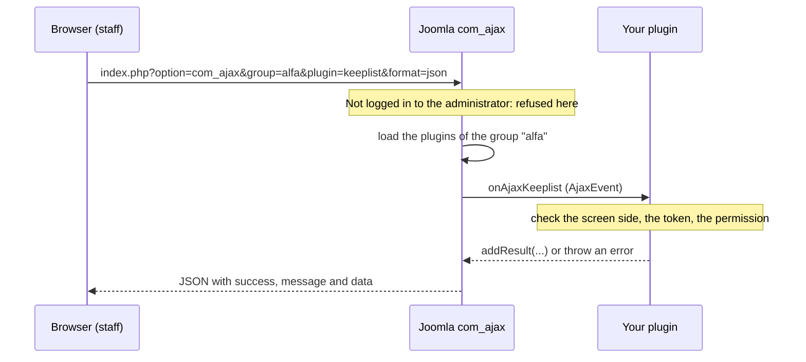

# Calling your plugin from the browser

<CreatePluginButton type="adminscreen" />

<AlfaVersion verified="2.2.0" />

**The pages of this guide:**

- [Extending Admin Screens](./admin-screen-plugins.md): start here
- [Admin screen events](./admin-screen-events.md)
- [A complete feature plugin](./admin-screen-example.md)
- **Calling your plugin from the browser** (this page)

Sometimes a script on an admin screen needs a small answer from your plugin without loading a page: is this row
kept, what does this code look up to. Joomla has an entry point for that, the component `com_ajax`. It is part of
Joomla, not of Alfa Commerce, and Alfa Commerce adds no entry point of its own for feature plugins. With it your
plugin answers a request without a controller, a view or a route of its own.

## How the request reaches your plugin

The browser calls this address in the administrator:

```
administrator/index.php?option=com_ajax&group=alfa&plugin=keeplist&format=json
```

| Part | Meaning |
|---|---|
| `group` | The plugin group Joomla loads for the request. Without it Joomla loads the group `ajax`, and your plugin is never asked. |
| `plugin` | The second half of the event's name. Joomla announces `onAjax` followed by this value with a capital first letter: `onAjaxKeeplist`. |
| `format` | `json` wraps the answer as shown below. `raw` prints it as plain text. Leave it out and Joomla draws a whole admin page around the answer. |

Joomla then loads every enabled plugin of the group and announces the event. Your plugin hears it only if the event
is in its `getSubscribedEvents()`. A method with the right name that is not listed there is never called.



## What Joomla checks, and what it leaves to you

Joomla checks one thing. In the administrator, a person who is not logged in is refused before your handler runs.

Everything else is yours to check:

- **The side of the site.** The same address works on the storefront (`index.php?option=com_ajax...`), for any
  visitor. If the answer is for staff, refuse when the request is not in the administrator.
- **The form token.** `com_ajax` checks none. Check it yourself with `Session::checkToken('get')` for a request
  that carries it in the address, or `Session::checkToken()` for a posted form. Do this for every request that
  changes something, and for every answer that is not public.
- **The permission.** Being logged in to the administrator is not a permission. Ask for the one your answer needs,
  for example `core.manage` on `com_alfa`, or a permission of your own (see [Permissions](./admin-screen-plugins.md#permissions)).

## Answering

The handler receives Joomla's `AjaxEvent`. Give your answer with `addResult()`. What the method returns is ignored.

Add this to the plugin of [A complete plugin](./admin-screen-example.md). Two more `use` lines at the top of the class
file:

```php
use Joomla\CMS\Event\Plugin\AjaxEvent;
use Joomla\CMS\Session\Session;
```

One more line in `getSubscribedEvents()`:

```php
            'onAjaxKeeplist'          => 'onAjaxKeeplist',
```

And the handler:

```php
    /** Answers the browser: which manufacturers are kept. Reached through com_ajax. */
    public function onAjaxKeeplist(AjaxEvent $event): void
    {
        $app = $this->getApplication();

        // The same address exists on the storefront. This answer is for staff only.
        if (!$app->isClient('administrator')) {
            throw new \RuntimeException(Text::_('JERROR_ALERTNOAUTHOR'), 403);
        }

        // com_ajax checks no form token. The page's script sends it in the address.
        if (!Session::checkToken('get')) {
            throw new \RuntimeException(Text::_('JINVALID_TOKEN_NOTICE'), 403);
        }

        // com_ajax checks no permission either.
        if (!$app->getIdentity()->authorise('core.manage', 'com_alfa')) {
            throw new \RuntimeException(Text::_('JERROR_ALERTNOAUTHOR'), 403);
        }

        $event->addResult(['kept' => $this->keptIds()]);
    }
```

The script that asks. Build the address from the page's own options, not from a relative path, and send the form
token with it:

```js
const paths = Joomla.getOptions('system.paths');
const token = Joomla.getOptions('csrf.token');
const url = paths.baseFull + 'index.php?option=com_ajax&group=alfa&plugin=keeplist&format=json&' + token + '=1';

const response = await fetch(url, {headers: {'X-Requested-With': 'XMLHttpRequest'}});
const answer = await response.json();

if (!response.ok || !answer.success) {
    throw new Error(answer.message || 'The request failed.');
}

const kept = answer.data[0].kept;
```

`csrf.token` is in the page's options on the Manufacturers list of 2.2.0, where this was tried. If a screen you
work on does not carry it, `HTMLHelper::_('form.csrf')` adds it.

## What comes back

With `format=json` the answer is always this envelope:

```json
{"success":true,"message":null,"messages":null,"data":[{"kept":[1]}]}
```

`data` is a list with one entry for each `addResult()` call, so your answer is `data[0]`.

When the handler throws, or Joomla refuses the request, the envelope carries the error's message:

```json
{"success":false,"message":"The security token did not match. The request was cancelled to prevent any security breach. Please try again.","messages":null,"data":null}
```

Three things to know about errors:

- **With `format=json` the HTTP status stays 200**, whatever code the error carries. Read `success`, not the status.
  With `format=raw` the status is the error's code (403 in the handler above) and the body is the error's class and
  message as text.
- **A request nobody answered looks like a success.** If the event is not in `getSubscribedEvents()`, the plugin is
  disabled, or the `plugin` value is misspelled, the answer is `{"success":true,"message":null,"messages":null,"data":[]}`.
  An empty `data` list means your handler did not run.
- **While the shop is paused, Alfa Commerce answers for you.** During **Tools**, **Reset and clear**, "Clear
  everything", a `com_ajax` request whose `group` starts with `alfa` is refused with status 503 before it reaches
  any plugin.

The handler and the script above were run on a fresh Alfa Commerce 2.2.0 (Joomla 6.1.4, PHP 8.3): staff with the
token got the kept ids, staff without the token got the token error, and a visitor who was not logged in and a
request on the storefront were both refused.
