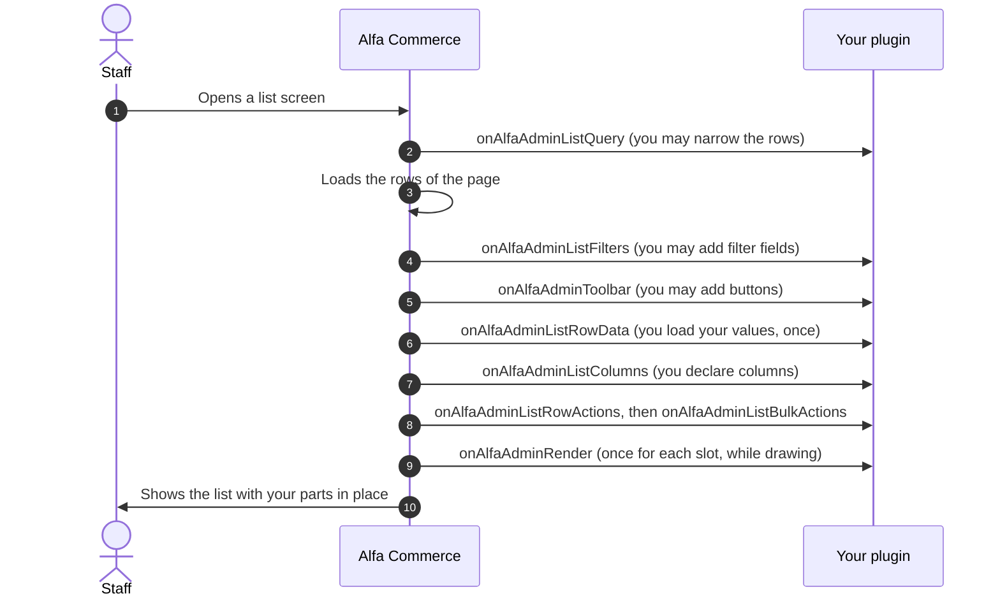
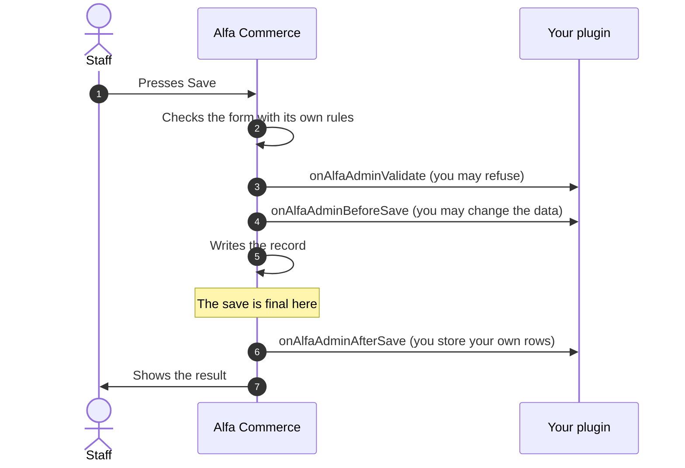
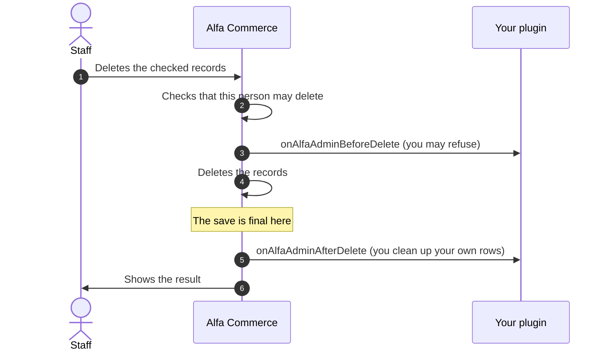
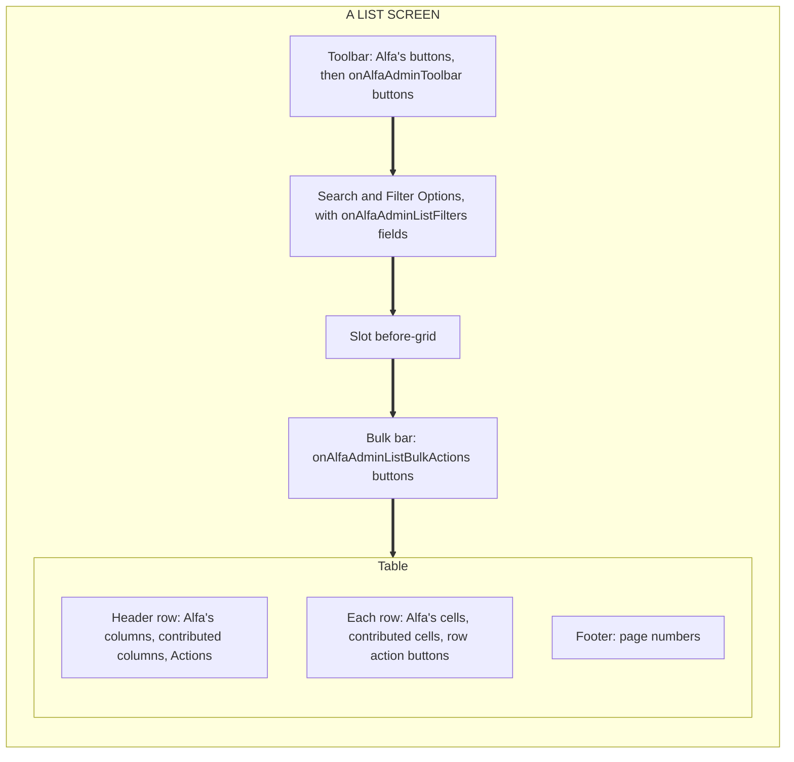
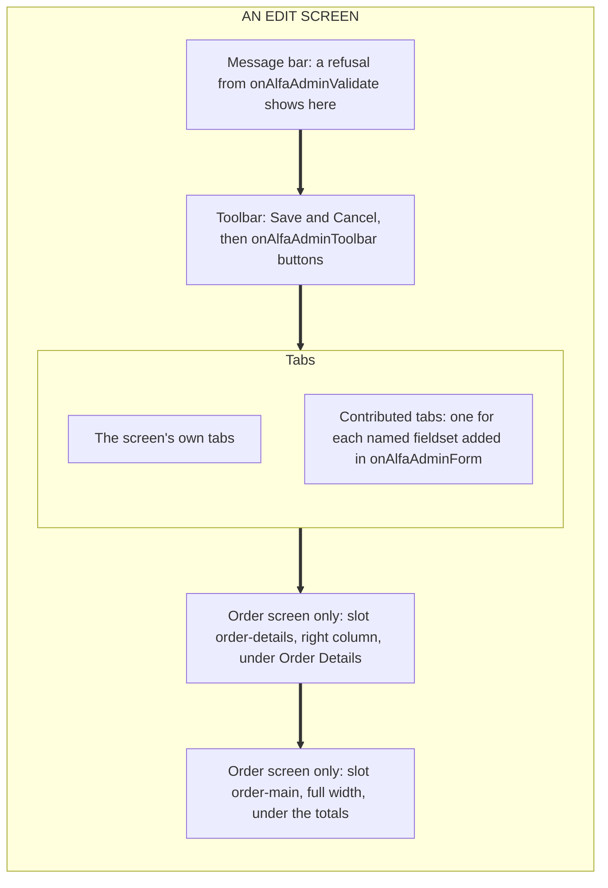

# Extending Admin Screens

<AlfaVersion verified="2.2.0" />

Every list and every edit form in the Alfa Commerce administrator can be extended by a plugin. One family of fifteen
events does it, all named `onAlfaAdmin...`. The same fifteen events serve every kind of record (orders, items,
currencies and the rest), so what you learn for one screen works on all of them.

Read [How events reach a plugin](../events/how-events-reach-a-plugin.md) first. This page builds on it and does not
repeat it. Words such as "broadcast" and "targeted" are explained there and in the
[glossary](../reference/glossary.md).

## What it does

| You want to | The event | What staff see |
|---|---|---|
| Show fewer rows in a list | `onAlfaAdminListQuery` | The list, filtered |
| Add a filter field | `onAlfaAdminListFilters` | A new field under Filter Options |
| Load your values for the rows on the page | `onAlfaAdminListRowData` | Nothing by itself. Your column reads the values. |
| Add a column | `onAlfaAdminListColumns` | A new column in the list |
| Add a button on every row | `onAlfaAdminListRowActions` | A button in the Actions column, at the end of the row |
| Add a button for the checked rows | `onAlfaAdminListBulkActions` | A button in a bar above the table |
| Add a toolbar button | `onAlfaAdminToolbar` | A button in the toolbar of a list or of an edit form |
| Add fields or a tab to an edit form | `onAlfaAdminForm` | A new tab on the edit form |
| Fill your fields when the form opens | `onAlfaAdminPrepareData` | Your fields show their stored values |
| Refuse a save | `onAlfaAdminValidate` | Your message, and the form opens again with what was typed |
| Change the data just before it is written | `onAlfaAdminBeforeSave` | Nothing. The record is saved with your change. |
| React to a finished save | `onAlfaAdminAfterSave` | Nothing. You store your own rows. |
| Refuse a delete | `onAlfaAdminBeforeDelete` | Your message, and nothing is deleted |
| React to a finished delete | `onAlfaAdminAfterDelete` | Nothing. You clean up your own rows. |
| Put your own markup at a named place | `onAlfaAdminRender` | Your markup at that place (a "slot") |

## When it is used

Use these events when your feature belongs **inside a screen Alfa Commerce already has**. If your feature needs a
whole screen of its own, build a panel instead: see [Creating an Admin Panel](./admin-panels.md).

All fifteen events are announced to everyone (they are broadcast events). Put your plugin in the `alfa` group: Alfa
loads that group on every administrator screen, so your plugin is always there to hear them. A plugin of another Alfa
family (a payment or a shipping plugin, for example) is not loaded for these screens. If such a plugin also needs a
column or a tab, ship a second, small plugin in the `alfa` group next to it.

## What you must provide

### The two lists of events

Your plugin class implements Joomla's `SubscriberInterface` and lists **every event of this page** in
`getSubscribedEvents()`. A method that is not listed is never called, even when it has the event's name.

```php
public static function getSubscribedEvents(): array
{
    return [
        'onAlfaAdminListRowData'  => 'onAlfaAdminListRowData',
        'onAlfaAdminListColumns'  => 'onAlfaAdminListColumns',
        'onAlfaAdminBeforeDelete' => 'onAlfaAdminBeforeDelete',
    ];
}
```

These events go in that list:

| Listed in `getSubscribedEvents()` (announced to everyone) |
|---|
| The fifteen `onAlfaAdmin...` events of this page |
| `onAlfaBuildMenu`, `onAlfaGetAccessActions` (menu entries and permissions, below) |
| `onAlfaCollectCards`, `onAlfaCollectSetupChecks`, `onGetToolActions`, `onCollectDocumentTypeProviders` |
| Joomla's own `onAjax...` event, when you use it (see "Calling your own PHP from the browser") |

A few events are addressed to one plugin (they are targeted events). They never go in `getSubscribedEvents()`. A
plugin of the `alfa` group declares them in a second list, `getTargetedHandlers()`, from
`TargetedHandlersInterface`:

| Declared in `getTargetedHandlers()` (addressed to one plugin) |
|---|
| The six `onAlfaPanel...` events of a panel your plugin owns ([Creating an Admin Panel](./admin-panels.md)) |
| `onExecuteToolAction` (a tool your plugin runs) and `onClearData` (clearing the data your plugin owns) |

An event name is in one list or in the other, never in both. A name in both is written to Joomla's log as an error.
The plugin on this page handles no targeted event, so it has no second list.

### Naming your plugin

Every time your plugin adds something, it names itself first, as **group.element**. For a plugin in
`plugins/alfa/keeplist` that is `alfa.keeplist`. It is the first argument of each of these calls:

| What you add | The call |
|---|---|
| A column | `$context->columns->column('alfa.keeplist', 'kept')` |
| A row action or a bulk action | `$context->actions->action('alfa.keeplist', 'open')` |
| Values for the rows | `$event->value('alfa.keeplist', 'kept', $valuesById)` |
| Markup in a slot | `$context->append('alfa.keeplist', $html)` |
| A menu entry, a menu heading | `$event->item('alfa.keeplist', 'keeplist')`, `$event->section('alfa.keeplist', $key, $ordering)` |
| A permission | `$event->action('alfa.keeplist', 'alfa.keeplist.manage', $titleKey)` |
| A dashboard card | `$event->main('alfa.keeplist', 'kept', $titleKey)` |

The name is a label that tells Alfa which plugin added what. It is not a permission. A name that is not exactly two
parts joined by one dot, in lower case letters, digits, underscores or hyphens, is refused with an
`InvalidArgumentException`. On a display event that error is written to the log and your part is missing from the
screen.

### Your own language file

Alfa Commerce does not load your plugin's language file. Your plugin loads its own. The simplest way is Joomla's
switch on the plugin class:

```php
protected $autoloadLanguage = true;
```

Without it, staff see the bare keys (`PLG_ALFA_KEEPLIST_COLUMN`) where your texts should be: in column titles, on
buttons, in the menu and on the Permissions tab.

### Checking which screen you are on

Each handler is called for **every** screen of that kind. The first thing it does is check whether the screen is one
it cares about, and return if not. Every event has these checks (guards):

| Method on every event | Returns | Use |
|---|---|---|
| `targets(string $entity, string ...$more)` | `bool` | Is this screen about one of these kinds of record? Give at least one name. Several names mean "any of these". |
| `isListScreen()`, `isEditScreen()`, `isSaveScreen()`, `isDeleteScreen()` | `bool` | Which kind of screen or operation this is |
| `at(string $slot)` | `bool` | Is this the slot being filled? Only for `onAlfaAdminRender`. |
| `is(string ...$phases)` | `bool` | Is this one of these phases? For one method shared by several events. The names are the `PHASE_...` constants of `AlfaAdminContext`. |
| `getContext()` | `string` | The text `com_alfa.<entity>.<screen>`, for example `com_alfa.order.list`. Good for logs. |
| `getAdminContext()` | `AlfaAdminContext` | The object that carries everything you read and write (next section) |

```php
public function onAlfaAdminListColumns(AdminListColumnsEvent $event): void
{
    if (!$event->targets('currency', 'place')) {   // the currencies list or the places list
        return;
    }

    // Your work.
}
```

`targets()` takes the names of kinds of record (Alfa calls a kind of record an **entity**). If you pass it a screen
name by mistake (`list`, `edit`, `save` or `delete`) it throws an error that names the method to use instead.

:::warning A wrong entity name fails silently
`targets('orders')` (plural) never matches and never complains. Your handler simply does nothing. These are the 25
entity names, exactly as written:

`cart`, `cartrule`, `category`, `currency`, `discount`, `document`, `documenttype`, `formfield`, `formfieldgroup`,
`inventorymovement`, `item`, `itemfield`, `location`, `manufacturer`, `notification`, `order`, `orderstatus`,
`payment`, `place`, `reservation`, `series`, `shipment`, `tax`, `user`, `usergroup`

They are singular and lower case. Each is the value of `protected string $alfaEntity` on a model in
`administrator/src/Model/`. While developing, `$event->getContext()` shows the one you are on.
:::

### The context object

`$event->getAdminContext()` returns one object, `AlfaAdminContext`. It tells you where you are, hands you what the
event is about, and takes your answer.

**Always set, read only:**

| Property | Meaning |
|---|---|
| `entity` | The kind of record: `'currency'`, `'order'` and so on |
| `view` | The Joomla view being shown, for example `'currencies'` or `'currency'` |
| `screen` | `'list'`, `'edit'`, `'save'` or `'delete'` |
| `phase` | Which of the fifteen events this is |
| `user` | The member of staff who is acting |
| `token` | The name of the session's form token, for markup of yours that posts a form |

**Set only for some events, otherwise `null`, read only:**

| Property | Meaning |
|---|---|
| `state` | The list's state. Read a filter value as `$context->state->get('filter.<name>')`. |
| `query` | The list's database query (`onAlfaAdminListQuery`) |
| `form` | The edit form, or the filter form of a list |
| `toolbar` | Joomla's toolbar of the screen (`onAlfaAdminToolbar`) |
| `item` | The single record in play |
| `items` | The rows of the current page of a list |
| `ids` | The ids of the rows on the page, or of the records being deleted |
| `isNew` | Whether a save creates a record |
| `layout`, `slot` | The screen's layout name, and the slot being filled |
| `columns`, `actions`, `bulkActions` | The builders for columns, row actions and bulk actions (below) |

**What you may write:**

| You write | With | In which events |
|---|---|---|
| The record's data | `$context->data` (an array you may change) | `onAlfaAdminPrepareData`, `onAlfaAdminBeforeSave` |
| A refusal | `$context->addError($message)` | `onAlfaAdminValidate`, `onAlfaAdminBeforeDelete` |
| Values for the rows | `$event->value('group.element', $key, $valuesById)` | `onAlfaAdminListRowData` |
| Markup | `$context->append('group.element', $html)` | `onAlfaAdminRender` |

The row values and the markup can be written only through `value()` and `append()`. Read them back with
`$context->rowData()` (all rows, `[id => [key => value]]`), `$context->rowValues($id)` (one row, or `null`) and
`$context->html()`.

Three helpers complete the object: `isMutating()` (true in the save and delete events), `key()` (a text such as
`currency.list.listcolumns`, for logs) and `contentContext()` (`com_alfa.currency`, the same on every screen of the
entity, useful as a key for your own stored rows).

## What happens next

### On a list screen



Two things follow from this order. The toolbar event comes **before** the row values are loaded, so a toolbar handler
cannot read them. And the row values are loaded **before** the columns are declared, so a column only looks its
value up.

### On a save



### On a delete



## What can go wrong

What happens when your handler throws an error depends on the event.

| The event | If your handler throws an error |
|---|---|
| A list, toolbar, form, data or slot event, and the two "after" events | The error is written to Joomla's log (category `com_alfa.plugins`) with the event and your method. The next plugin still runs and the screen is still shown, without your part. |
| `onAlfaAdminValidate`, `onAlfaAdminBeforeSave`, `onAlfaAdminBeforeDelete` | The save or the delete is refused. Staff see the text of your error as the message, on the normal screen, not on an error page. The error is also written to the log (category `com_alfa.admin`). Plugins after yours are not asked. |

To refuse on purpose, do not throw: call `addError()` in `onAlfaAdminValidate` or `onAlfaAdminBeforeDelete`. That
lets the other plugins have their say too.

:::warning Two pieces of your code run later, without this protection
The function you hand to `setData()` and the layout file you name with `setLayout()` run while the page is being
drawn, after your handler has returned. An error there is not caught and can break the page. Keep the function to a
simple lookup and keep logic out of the layout.
:::

| What you see | The usual cause |
|---|---|
| Your method is never called | The event is not listed in `getSubscribedEvents()` |
| Nothing appears and there is no error on screen | Your handler threw an error on a display event. Look in the log, category `com_alfa.plugins`. Common causes: the `group.element` argument is missing, or you wrote to `$context->rowData` or `$context->html` directly. |
| The guard never matches | A wrong entity name (see the list above) |
| Your column is missing | No `setLayout()`. A column without a layout is dropped. |
| Your column is there, but its cells are empty | The function given to `setData()` returned `null`, or the layout file was not found |
| Your row or bulk button is missing | Staff lack the permission, or the button needs `access()` (see below) |
| Staff see `PLG_...` keys in place of texts | Your plugin does not load its language file |
| Your contributed tab is missing | The screen has no place for extra tabs, or your fieldset uses a name the screen already uses (see `onAlfaAdminForm`) |
| Your plugin is ignored for a whole request | It failed while loading. Joomla's log has a warning that names it (category `com_alfa.plugins`). |

## The list screen events

All eight events below are announced to everyone. Each card says "you" for your handler.

### onAlfaAdminListQuery

- **When it fires.** When the list's database query has been built and before it runs.
- **Who receives it.** Every loaded plugin that listed the event.
- **What you are given.** `state` (the filters) and `query` (the real query object).
- **What you are expected to do.** Add a condition to `query` when your filter is in use, and nothing otherwise.
  Add an `EXISTS (...)` condition, not a join: a join can repeat rows and change the count. Never remove rows after
  the query has run, because the page numbers and the total come from this same query.
- **What happens next.** Alfa runs the query. Staff see only the rows that match.
- **If you are missing or you fail.** The list shows all rows. Your error is logged.

### onAlfaAdminListFilters

- **When it fires.** When the list's filter form is being prepared.
- **Who receives it.** Every loaded plugin that listed the event.
- **What you are given.** `state` and `form` (the filter form).
- **What you are expected to do.** Add your field under the `filter` group:
  `$context->form->load('<form><fields name="filter"><field name="risk" type="list" label="...">...</field></fields></form>')`.
- **What happens next.** The field appears under Filter Options. What staff choose arrives in the state as
  `filter.risk`, where your `onAlfaAdminListQuery` reads it. You need no other code to carry the value.
- **If you are missing or you fail.** The field is not shown. Your error is logged.

### onAlfaAdminListRowData

- **When it fires.** Once for each page of a list, after the rows are loaded and before the columns are declared.
- **Who receives it.** Every loaded plugin that listed the event.
- **What you are given.** `items` (the rows), `ids` (their ids, all at once) and `state`.
- **What you are expected to do.** Load your values for all the ids in **one** query, then hand them over:
  `$event->value('alfa.keeplist', 'kept', [12 => true, 15 => true])`. The array is keyed by row id.
- **What happens next.** The values are kept for the page. Your column and your row actions read them with
  `$context->rowValues($id)`. A key belongs to the first plugin that writes it. A second plugin writing the same key
  is refused and a warning is logged, so choose a key that is clearly yours.
- **If you are missing or you fail.** No values are stored and your column shows empty cells. Your error is logged.

### onAlfaAdminListColumns

- **When it fires.** Right after `onAlfaAdminListRowData`.
- **Who receives it.** Every loaded plugin that listed the event.
- **What you are given.** `columns` (the column builder), `items`, `ids`, `state`, and the row values through
  `rowData()` and `rowValues()`.
- **What you are expected to do.** Declare your column (see "Declaring a column" below). Do not run a query for each
  row. Read what `onAlfaAdminListRowData` stored.
- **What happens next.** The list gets one more header cell and one more cell on every row.
- **If you are missing or you fail.** The column is not shown. Your error is logged.

### onAlfaAdminListRowActions

- **When it fires.** After the columns, before the list is drawn.
- **Who receives it.** Every loaded plugin that listed the event.
- **What you are given.** `actions` (the action builder), `items`, `ids`, `state`, `token` and the row values.
- **What you are expected to do.** Declare a button (see "Declaring a row or bulk action" below). Change nothing in
  the database here: the list is only being drawn.
- **What happens next.** Staff who hold the button's permission see it in an Actions column at the end of each row.
- **If you are missing or you fail.** The button is not shown. Your error is logged.

### onAlfaAdminListBulkActions

- **When it fires.** Right after `onAlfaAdminListRowActions`.
- **Who receives it.** Every loaded plugin that listed the event.
- **What you are given.** `bulkActions` (the same builder), `items`, `ids`, `state`, `token`.
- **What you are expected to do.** Declare a button for the checked rows, the same way as a row action.
- **What happens next.** Staff who hold the permission see a labelled button in a bar above the table. It refuses to
  run when no row is checked.
- **If you are missing or you fail.** The button is not shown. Your error is logged.

### onAlfaAdminToolbar

- **When it fires.** On a list screen and on an edit screen, when Alfa has put its own buttons in the toolbar and
  before the page is drawn.
- **Who receives it.** Every loaded plugin that listed the event.
- **What you are given.** `toolbar` (Joomla's toolbar of the screen), `state`, `layout`, `token`, and on an edit
  screen `item` (the record). There is no `items` and there are no row values here.
- **What you are expected to do.** Add buttons with Joomla's toolbar methods. Do not remove Alfa's buttons.
- **What happens next.** Your button is shown after Alfa's.
- **If you are missing or you fail.** The button is not shown. Your error is logged.

```php
public function onAlfaAdminToolbar(AdminToolbarEvent $event): void
{
    if (!$event->isListScreen() || !$event->targets('manufacturer')) {
        return;                                   // one list only
    }

    $event->getAdminContext()->toolbar
        ->linkButton('keeplist-options', 'PLG_ALFA_KEEPLIST_TOOLBAR')
        ->icon('icon-pencil')
        ->url('index.php?option=com_plugins&view=plugins&filter[search]=keeplist');
}
```

Combine the guards as you need: a button on one list, on every list, or on one entity's edit form only. If only
some staff may have the button, check their permission first (see "Permissions").

### onAlfaAdminRender

- **When it fires.** While the page is being drawn, once for each named place (slot) the screen offers.
- **Who receives it.** Every loaded plugin that listed the event.
- **What you are given.** `slot`, `layout`, `state`, `token`, `item` and `items` when the screen has them.
- **What you are expected to do.** Check the slot with `at()`, then add your markup:
  `$context->append('alfa.keeplist', $html)`. Return markup only. Do not redirect, send headers or stop the request.
- **What happens next.** Every plugin's markup is joined in order and printed at the slot. Nobody replaces anybody.
- **If you are missing or you fail.** The slot prints nothing from you. Your error is logged.

These slots exist in 2.2.0:

| Slot | Where | Guard |
|---|---|---|
| `before-grid` | Above the table, on 24 of the 25 list screens. The carts list has none. | `$event->isListScreen() && $event->at('before-grid')` |
| `order-details` | Order edit screen, right column, under Order Details | `$event->targets('order') && $event->at('order-details')` |
| `order-main` | Order edit screen, full width, under the totals | `$event->targets('order') && $event->at('order-main')` |
| `cartrule-sidebar` | Cart rule edit screen, in the side column | `$event->targets('cartrule') && $event->at('cartrule-sidebar')` |
| `cart-main` | The screen of one cart, under its tabs | `$event->targets('cart') && $event->at('cart-main')` |

The screen of one cart answers `isListScreen()` with true, like the carts list. Tell the two apart with
`$context->view`: `'cart'` for one cart, `'carts'` for the list.

### Declaring a column

`$context->columns->column('group.element', 'key')` returns a column builder. Chain these on it:

| Method | Meaning |
|---|---|
| `title($languageKey)` | The header text |
| `setLayout($name)` | **Required.** The file that draws one cell: `tmpl/<name>.php` in your plugin. |
| `setData($function)` | A function that takes the row (an object) and returns an array, an object or `null`. It is called once for each row while the page is drawn. What it returns is handed to the layout as `$displayData`. `null` leaves the cell empty. |
| `after($coreColumnKey)` | Put the column right after one of the screen's own columns |
| `setPluginType($group)`, `setPluginName($element)` | Only to use a layout file of another plugin |

The function returns **data**, never HTML. The layout file turns the data into HTML. A site's administrator template
can replace your layout with its own file in `html/plg_<group>_<element>/<name>.php`.

:::note Where `after()` works
A screen honours `after()` only for the column keys its template declares. Everywhere else, and for a key the screen
does not know, your column is placed after the last column. Five lists declare keys in 2.2.0:

| List | Keys you may pass to `after()` |
|---|---|
| Orders | `id`, `customer`, `amount`, `date`, `payment`, `shipment`, `status` |
| Currencies | `state`, `name`, `code`, `id` |
| Cart rules | `priority` |
| Manufacturers | `item_count` |
| Items | `available` |
:::

### Declaring a row or bulk action

`$context->actions->action('group.element', 'key')` (or `$context->bulkActions->action(...)`) returns an action
builder:

| Method | Meaning |
|---|---|
| `title($languageKey)` | The button's text |
| `icon($cssClass)` | The full icon class, for example `'icon-mail'` |
| `task($task)` | A controller task of Alfa Commerce, for example `'orders.publish'`. The list's own form is posted, with its form token. Use it for anything that changes data. |
| `url($url)` | A link. Only for going somewhere, never for changing data. |
| `confirm($languageKey)` | Ask before running |
| `cssClass($classes)` | Extra CSS classes |
| `access($action, $asset = 'com_alfa')` | The permission staff need to see the button |
| `setLayout($name)`, `setData(fn)` | Draw the button yourself, with a file in your `tmpl/` folder |

An action with no task, no link and no layout is dropped.

**Who sees the button.** Alfa shows an action only to staff who hold its permission, and it works the permission out
like this:

1. If you called `access()`, that permission.
2. Otherwise, for a task of one of Alfa's own screens (`orders.publish`), the permission that task needs.
3. Otherwise, for a link to one of Alfa's own screens, the permission to open that screen. A link that leaves the
   administrator or Alfa Commerce needs nothing.
4. For anything else Alfa cannot tell, and **the button is shown to no one**. This is the case for a link to a panel,
   for a task Alfa does not know, and for an action that has only a layout. Call `access()` for these.

This row action links to a panel named `kept` that the Keep list plugin of this page would own (the plugin printed
below has no panel; panels are on [Creating an Admin Panel](./admin-panels.md)):

```php
$context->actions->action('alfa.keeplist', 'open')
    ->title('PLG_ALFA_KEEPLIST_OPEN')
    ->icon('icon-file')
    ->url('index.php?option=com_alfa&view=panel&group=alfa&element=keeplist&panel=kept')
    ->access('alfa.keeplist.manage');             // a link to a panel is hidden without this
```

Hiding a button is not security. Whatever the button reaches must check the permission again.

With `setLayout()` on a row action, the function given to `setData()` decides row by row: `null` shows nothing on
that row. A bulk action has no row, so its layout receives the action's own description instead (an array with
`key`, `title`, `icon`, `task`, `url`, `confirm`, `cssClass`).

:::note Two folders for layouts
`setLayout()` on a column or an action reads from your plugin's **`tmpl/`** folder. `setLayout()` on a panel event
([Creating an Admin Panel](./admin-panels.md)) reads from your plugin's **`layouts/`** folder. A cell is a fragment,
a panel screen is a page.
:::

## The edit screen events

### onAlfaAdminForm

- **When it fires.** When the edit form of a record has been loaded, before its values are put in.
- **Who receives it.** Every loaded plugin that listed the event.
- **What you are given.** `form` (the edit form), `item`, `isNew` and `data` (the record's values, to read).
- **What you are expected to do.** Add fields. Describe fields only, and set no values here:

```php
$event->getAdminContext()->form->load(
    '<form><fieldset name="keeplist" label="PLG_ALFA_KEEPLIST_TAB">'
    . '<field name="keeplist_months" type="number" label="PLG_ALFA_KEEPLIST_MONTHS" default="24" />'
    . '</fieldset></form>'
);
```

- **What happens next.** A fieldset with a name of its own becomes a tab of its own, after the screen's tabs. Your
  fields are posted with the form like any other field and arrive in `$context->data` in the save events.
- **If you are missing or you fail.** The fields are not shown. Your error is logged.

Three things to know:

- **Alfa does not store your field.** The record's table has no column for it, so the value is dropped when the
  record is written, without a message. Store it yourself: read it from `$context->data` in `onAlfaAdminAfterSave`
  and write it to your own table, then put it back in `onAlfaAdminPrepareData` when the form opens.
- **A name that is taken.** A fieldset that uses a name the screen already uses is not drawn as a tab. On the item
  screen those names are `general`, `identity`, `inventory`, `prices`, `Images`, `publish` and `meta`. On the order
  screen they are `user_details` and `order_details`. Give your fieldset a name that is clearly yours.
- **Two screens show no extra tabs.** Contributed tabs are drawn on 18 edit screens and on the screen of one cart.
  The edit screens of **Document Types** and **Stock Locations** do not draw them. There your fields are still part
  of the form and still arrive in the save events, but staff cannot see them.

### onAlfaAdminPrepareData

- **When it fires.** Right after `onAlfaAdminForm`, before the values are put into the form.
- **Who receives it.** Every loaded plugin that listed the event.
- **What you are given.** `item`, `isNew`, and `data` (the record's values, which you may change).
- **What you are expected to do.** Put the stored value of each of your fields into `$context->data`. If a value is
  already there, leave it: it can be what staff typed in a save that was refused.
- **What happens next.** The form opens with your values in your fields.
- **If you are missing or you fail.** Your fields open with their default values. Your error is logged.

## The save and delete events

### onAlfaAdminValidate

- **When it fires.** When staff save, after the form has passed Alfa's own checks and before anything is written.
  It does not fire when Alfa's own checks already failed.
- **Who receives it.** Every loaded plugin that listed the event.
- **What you are given.** `data` (what was submitted), `form`, `isNew`, and `item` (the record as it is stored now,
  or `null` for a new one).
- **What you are expected to do.** Check, and if the save must not happen call `$context->addError($message)` with a
  translated message. Do not write to the database and do not change the data here.
- **What happens next.** With no error from any plugin, the save goes on. With an error, nothing is saved, staff see
  the message and the form opens again with what they typed.
- **If you are missing or you fail.** If you are missing, the save goes on. If you throw an error, the save is
  refused with the error's text.

### onAlfaAdminBeforeSave

- **When it fires.** Just before the record is written.
- **Who receives it.** Every loaded plugin that listed the event.
- **What you are given.** `data` (which you may change), `isNew`, and `item` (the record as stored now, `null` for a
  new one).
- **What you are expected to do.** Adjust `$context->data` if you need to, for example tidy a value.
- **What happens next.** Alfa writes the record with the data as you left it.
- **If you are missing or you fail.** If you are missing, the record is written unchanged. If you throw an error,
  the save is refused with the error's text.

:::warning `addError()` does nothing here
Alfa does not read the errors after this event. Refuse a save in `onAlfaAdminValidate`. A new record has no id yet at
this point, so write your own rows in `onAlfaAdminAfterSave`.
:::

### onAlfaAdminAfterSave

- **When it fires.** After the save is final (the commit) and Alfa's locks are released. It never fires for a save
  that was undone.
- **Who receives it.** Every loaded plugin that listed the event.
- **What you are given.** `ids` (one id, the saved record's, also for a new record), `isNew`, `data` (what was
  saved) and `item` (the record read again from the database, or `null` if it could not be read). Use `ids[0]` as
  the key.
- **What you are expected to do.** Your own side of the save: store your rows, notify, index. Do not print,
  redirect or stop the request. The answer to staff belongs to Alfa.
- **What happens next.** Alfa shows the result of the save.
- **If you are missing or you fail.** The record stays saved either way. Your error is logged, and nothing tells
  staff, so check the log while developing.

### onAlfaAdminBeforeDelete

- **When it fires.** Once for a delete, with all the ids together, before anything is deleted. Alfa first checks
  that the person may delete. If not, this event does not fire at all.
- **Who receives it.** Every loaded plugin that listed the event.
- **What you are given.** `ids`, the records about to be deleted.
- **What you are expected to do.** If they must stay, call `$context->addError($message)`. This is also the last
  moment the records can still be read.
- **What happens next.** With no error, the delete goes on. With an error, **none** of the records is deleted and
  staff see a message.
- **If you are missing or you fail.** If you are missing, the delete goes on. If you throw an error, the delete is
  refused with the error's text.

### onAlfaAdminAfterDelete

- **When it fires.** After the delete is final (the commit). It never fires for a delete that was refused or undone.
- **Who receives it.** Every loaded plugin that listed the event.
- **What you are given.** `ids`, the records the delete finished with.
- **What you are expected to do.** Delete your own rows for those ids. Write it so that running it twice does no
  harm.
- **What happens next.** Alfa shows the result of the delete.
- **If you are missing or you fail.** The records stay deleted either way. Your error is logged.

:::note Orders
A new order made in the administrator is not saved through the edit form's save. The three save events fire when
staff save an **existing** order.
:::

## Permissions

### What is already checked

By the time your handler runs, the person has passed two checks: Joomla's permission to enter the component
(`core.manage`) and Alfa's own permission to open that screen (for example `alfa.orders.view`).

Alfa Commerce uses only two of Joomla's permissions, `core.admin` and `core.manage`. Everything else is one of
Alfa's own, named `alfa.<section>.<action>`, such as `alfa.orders.edit` or `alfa.items.delete`. Joomla's `core.edit`
and `core.delete` are never asked, so do not check them.

### A permission of your own

Your plugin can add a row to the Permissions tab (Options, on any Alfa Commerce screen):

```php
public function onAlfaGetAccessActions(GetAccessActionsEvent $event): void
{
    $event->action(
        'alfa.keeplist',                          // your plugin, group.element
        'alfa.keeplist.manage',                   // the permission's name
        'PLG_ALFA_KEEPLIST_ACCESS_MANAGE',        // its label
        'PLG_ALFA_KEEPLIST_ACCESS_MANAGE_DESC',   // its tooltip (optional)
    );
}
```

The event is announced to everyone, so list `onAlfaGetAccessActions` in `getSubscribedEvents()`. It fires when the
Options screen builds its Permissions tab. The rows are drawn in the order of the administrator menu: a row named
`alfa.keeplist.manage` sits where the menu entry that asks for an `alfa.keeplist...` permission sits. Rows that no
menu entry leads to are placed just before Tools.

:::note A new permission starts as "not allowed"
Nothing is granted when your plugin is installed. Until a Super User grants your permission to a group, only Super
Users pass it. Say so in your plugin's description. If a permission of your own is more than the feature needs, check
one of Alfa's instead, for example `alfa.orders.edit`.
:::

### Where it is checked

| What | Who checks |
|---|---|
| A row action or a bulk action | Alfa, from `access()` or from where the action goes (see "Declaring a row or bulk action") |
| A menu entry and the panel behind it | Alfa, from `access()` on the menu entry ([Creating an Admin Panel](./admin-panels.md)) |
| A column, a filter, a toolbar button, a tab, a slot | You, in your handler |

```php
if (!$event->getAdminContext()->user->authorise('alfa.keeplist.manage', 'com_alfa')) {
    return;   // for this person, the column, button or tab does not exist
}
```

## A complete plugin

No feature plugin ships with Alfa Commerce 2.2.0, so there is none to copy. The plugin below is complete and small.
Every line of it was checked against the event and framework classes of 2.2.0 (`administrator/src/Event/Admin`,
`administrator/src/Plugin`, `administrator/src/Helper/Columns.php`); its manifest and provider follow the plugins
that do ship.

What it does: the shop owner types the ids of the manufacturers that must never be deleted into the plugin's
options. The Manufacturers list shows a "Kept" badge on those rows, and a delete that includes one of them is
refused.

```
plugins/alfa/keeplist/
├── keeplist.xml
├── services/provider.php
├── src/Extension/Keeplist.php
├── tmpl/kept_badge.php
└── language/en-GB/
    ├── plg_alfa_keeplist.ini
    └── plg_alfa_keeplist.sys.ini
```

**`keeplist.xml`** (the manifest)

```xml
<?xml version="1.0" encoding="UTF-8"?>
<extension type="plugin" group="alfa" method="upgrade">
    <name>plg_alfa_keeplist</name>
    <author>Acme</author>
    <creationDate>2026-11</creationDate>
    <copyright>(C) 2026 Acme</copyright>
    <license>GNU General Public License version 3 or later</license>
    <version>1.0.0</version>
    <description>PLG_ALFA_KEEPLIST_XML_DESCRIPTION</description>
    <namespace path="src">Acme\Plugin\Alfa\Keeplist</namespace>
    <files>
        <folder plugin="keeplist">services</folder>
        <folder>src</folder>
        <folder>tmpl</folder>
    </files>
    <languages folder="language">
        <language tag="en-GB">en-GB/plg_alfa_keeplist.ini</language>
        <language tag="en-GB">en-GB/plg_alfa_keeplist.sys.ini</language>
    </languages>
    <config>
        <fields name="params">
            <fieldset name="basic">
                <field
                    name="kept_ids"
                    type="text"
                    label="PLG_ALFA_KEEPLIST_KEPT_IDS_LABEL"
                    description="PLG_ALFA_KEEPLIST_KEPT_IDS_DESC"
                    default=""
                />
            </fieldset>
        </fields>
    </config>
</extension>
```

**`services/provider.php`**

```php
<?php

\defined('_JEXEC') or die;

use Acme\Plugin\Alfa\Keeplist\Extension\Keeplist;
use Joomla\CMS\Extension\PluginInterface;
use Joomla\CMS\Factory;
use Joomla\CMS\Plugin\PluginHelper;
use Joomla\DI\Container;
use Joomla\DI\ServiceProviderInterface;

return new class () implements ServiceProviderInterface {
    public function register(Container $container)
    {
        $container->set(
            PluginInterface::class,
            function (Container $container) {
                $plugin = new Keeplist((array) PluginHelper::getPlugin('alfa', 'keeplist'));
                $plugin->setApplication(Factory::getApplication());

                return $plugin;
            },
        );
    }
};
```

**`src/Extension/Keeplist.php`**

```php
<?php

namespace Acme\Plugin\Alfa\Keeplist\Extension;

\defined('_JEXEC') or die;

use Alfa\Component\Alfa\Administrator\Event\Admin\AdminBeforeDeleteEvent;
use Alfa\Component\Alfa\Administrator\Event\Admin\AdminListColumnsEvent;
use Alfa\Component\Alfa\Administrator\Event\Admin\AdminListRowDataEvent;
use Joomla\CMS\Language\Text;
use Joomla\CMS\Plugin\CMSPlugin;
use Joomla\Event\SubscriberInterface;

final class Keeplist extends CMSPlugin implements SubscriberInterface
{
    /** This plugin's name, group.element: the first argument of everything it adds. */
    private const ID = 'alfa.keeplist';

    /** Joomla loads the plugin's own language file. Alfa Commerce does not. */
    protected $autoloadLanguage = true;

    public static function getSubscribedEvents(): array
    {
        return [
            'onAlfaAdminListRowData'  => 'onAlfaAdminListRowData',
            'onAlfaAdminListColumns'  => 'onAlfaAdminListColumns',
            'onAlfaAdminBeforeDelete' => 'onAlfaAdminBeforeDelete',
        ];
    }

    /** Once for the page: which of its rows are kept. */
    public function onAlfaAdminListRowData(AdminListRowDataEvent $event): void
    {
        if (!$event->targets('manufacturer')) {
            return;
        }

        $kept = array_intersect($event->getAdminContext()->ids ?? [], $this->keptIds());

        if ($kept === []) {
            return;
        }

        $event->value(self::ID, 'kept', array_fill_keys($kept, true));
    }

    /** The column: it only looks up what the handler above stored. */
    public function onAlfaAdminListColumns(AdminListColumnsEvent $event): void
    {
        if (!$event->targets('manufacturer')) {
            return;
        }

        $context = $event->getAdminContext();

        $context->columns->column(self::ID, 'kept')
            ->title('PLG_ALFA_KEEPLIST_COLUMN')
            ->after('item_count')
            ->setLayout('kept_badge')
            ->setData(
                fn (object $row): ?array => isset($context->rowValues((int) $row->id)['kept'])
                    ? ['kept' => true]
                    : null
            );
    }

    /** Refuse a delete that includes a kept manufacturer. */
    public function onAlfaAdminBeforeDelete(AdminBeforeDeleteEvent $event): void
    {
        if (!$event->targets('manufacturer')) {
            return;
        }

        $context = $event->getAdminContext();

        if (array_intersect($context->ids ?? [], $this->keptIds()) !== []) {
            $context->addError(Text::_('PLG_ALFA_KEEPLIST_REFUSED'));
        }
    }

    /**
     * The ids typed in the plugin's options, for example "3, 7, 12".
     *
     * @return int[]
     */
    private function keptIds(): array
    {
        $ids = array_map('intval', explode(',', (string) $this->params->get('kept_ids', '')));

        return array_values(array_filter($ids, static fn (int $id): bool => $id > 0));
    }
}
```

**`tmpl/kept_badge.php`** (draws one cell; it is called only for rows where the function returned data)

```php
<?php

\defined('_JEXEC') or die;

use Joomla\CMS\Language\Text;

/** @var array $displayData What the column's data function returned for this row. */
?>
<span class="badge bg-info"><?php echo Text::_('PLG_ALFA_KEEPLIST_BADGE'); ?></span>
```

**`language/en-GB/plg_alfa_keeplist.ini`**

```ini
PLG_ALFA_KEEPLIST="Alfa Commerce: Keep list"
PLG_ALFA_KEEPLIST_XML_DESCRIPTION="Marks manufacturers that must never be deleted."
PLG_ALFA_KEEPLIST_KEPT_IDS_LABEL="Kept manufacturers"
PLG_ALFA_KEEPLIST_KEPT_IDS_DESC="The ids of the manufacturers to keep, separated by commas."
PLG_ALFA_KEEPLIST_COLUMN="Kept"
PLG_ALFA_KEEPLIST_BADGE="Kept"
PLG_ALFA_KEEPLIST_REFUSED="One of the selected manufacturers is on the keep list. Nothing was deleted."
```

**`language/en-GB/plg_alfa_keeplist.sys.ini`**

```ini
PLG_ALFA_KEEPLIST="Alfa Commerce: Keep list"
PLG_ALFA_KEEPLIST_XML_DESCRIPTION="Marks manufacturers that must never be deleted."
```

The shorter samples earlier on this page use more language keys of this plugin (`PLG_ALFA_KEEPLIST_TOOLBAR`,
`PLG_ALFA_KEEPLIST_OPEN`, `PLG_ALFA_KEEPLIST_TAB`, `PLG_ALFA_KEEPLIST_MONTHS`, `PLG_ALFA_KEEPLIST_ACCESS_MANAGE`,
`PLG_ALFA_KEEPLIST_ACCESS_MANAGE_DESC`) and the permission `alfa.keeplist.manage`. They are not in the files above.
Add each one when you use its sample.

Install the plugin, enable it, and type an id in its options. Open Components, Alfa Commerce, Manufacturers: the
column is there, after the item count. Check a kept row and press Delete: the message appears and the row stays.

## Calling your own PHP from the browser

For a small request from the browser to your plugin, Joomla has its own entry point, `com_ajax`. It is part of
Joomla, not of Alfa Commerce: it announces the event `onAjax` followed by the plugin's element with a capital first
letter, you list that event in `getSubscribedEvents()`, and your handler checks the form token and the person's
permission itself.

## Where everything lands on the screen





## Other things a plugin can add

A plugin can add more than parts of a screen. Each line gives the event and the call as they are in 2.2.0. The first
six are announced to everyone and go in `getSubscribedEvents()`.

| What | Event | The call |
|---|---|---|
| An entry or a heading in the Alfa Commerce menu | `onAlfaBuildMenu` | `$event->item('group.element', $id)`, then `section()`, `title()`, `view()` or `panel()` or `link()`, `icon()`, `ordering()`, `access()`. `$event->section('group.element', $headingKey, $ordering)` places a heading. See [Creating an Admin Panel](./admin-panels.md). |
| A permission | `onAlfaGetAccessActions` | `$event->action('group.element', $name, $titleKey, $descriptionKey)` |
| A dashboard card | `onAlfaCollectCards` | `$event->top()`, `metrics()`, `main()`, `side()` or `bottom()`, each `('group.element', $id, $titleKey)` |
| A line in the setup checklist | `onAlfaCollectSetupChecks` | `$event->add('group.element', $id, $labelKey)` |
| A tool on the Tools screen | `onGetToolActions` | `$event->add('group.element', $id, $labelKey)`, then `->meta('surface', $tab)` to name the tab of Tools it is drawn on: a tool without a surface is not drawn. The tool is then run by `onExecuteToolAction`, which is addressed to your plugin alone and goes in `getTargetedHandlers()`. |
| Document types | `onCollectDocumentTypeProviders` | `$event->addProvider($provider, 'group.element')`. Here the plugin's name is the second argument. |
| Clearing your plugin's data | `onClearData` | Addressed to your plugin alone. Declared in `getTargetedHandlers()`. |
| A whole screen | The six `onAlfaPanel...` events | See [Creating an Admin Panel](./admin-panels.md) |

How stock is allocated is not one of these. It belongs to a plugin family of its own, `alfa-inventory`.

## Changed in 2.2.0 and 2.1.4

- **Changed in 2.2.0.** A handler is called only when its event is listed in `getSubscribedEvents()`. Before, a
  method with the event's name was enough.
- **Changed in 2.2.0.** Every contribution takes the plugin's name, `group.element`, as its first argument:
  `column()`, `action()`, `append()`, `item()`, `add()`, `section()`, the permission's `action()`, the cards, the
  setup checks and the tools.
- **Changed in 2.2.0.** `$context->rowData` and `$context->html` are private. Write with `$event->value()` and
  `$context->append()`, read with `rowData()`, `rowValues()` and `html()`.
- **Changed in 2.2.0.** Alfa no longer loads a contributing plugin's language file.
- **Since 2.2.0.** Targeted events (`onExecuteToolAction`, `onClearData`, the panel events) are declared in
  `getTargetedHandlers()`.
- **Changed in 2.1.4.** `onAlfaAdminAfterSave` and `onAlfaAdminAfterDelete` are announced after the save is final
  and Alfa's locks are released, no longer in the middle of the save. `onAlfaAdminBeforeDelete` is asked before the
  record is locked.

## Not documented yet

- How a row action or a bulk action can run code of your **own** plugin through `task()`. The task is posted to a
  controller of Alfa Commerce, and this page documents only tasks Alfa Commerce itself has.
- The details of dashboard cards, setup checks, tools, document types and clearing data. This page gives only their
  events and calls.
- A sample of a `com_ajax` handler. `com_ajax` is Joomla's mechanism and is described in Joomla's documentation.
- How many refusal messages staff see when several plugins refuse the same save or delete.
- The exact moment `onAlfaAdminAfterSave` is announced for a **new item**, compared with the rest of the item's
  save.
