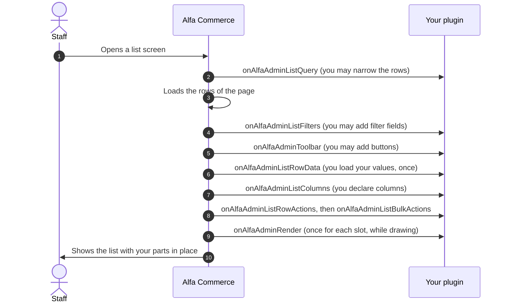
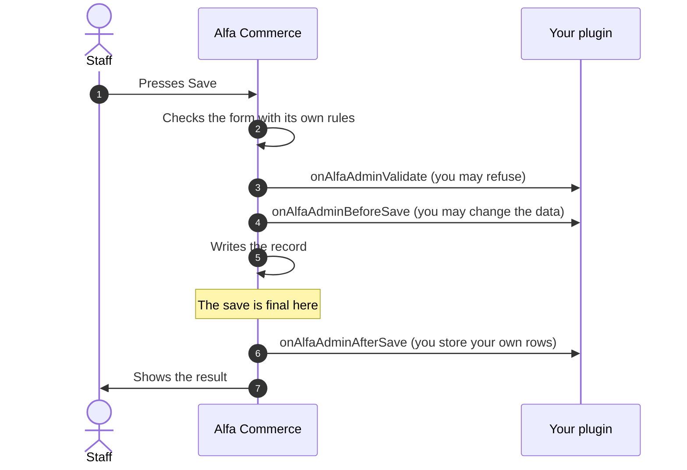
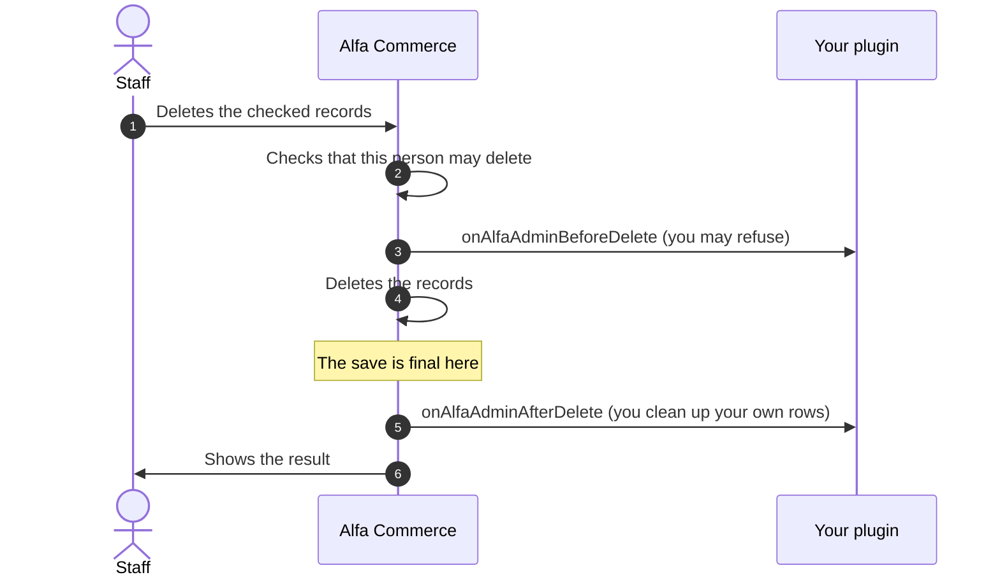
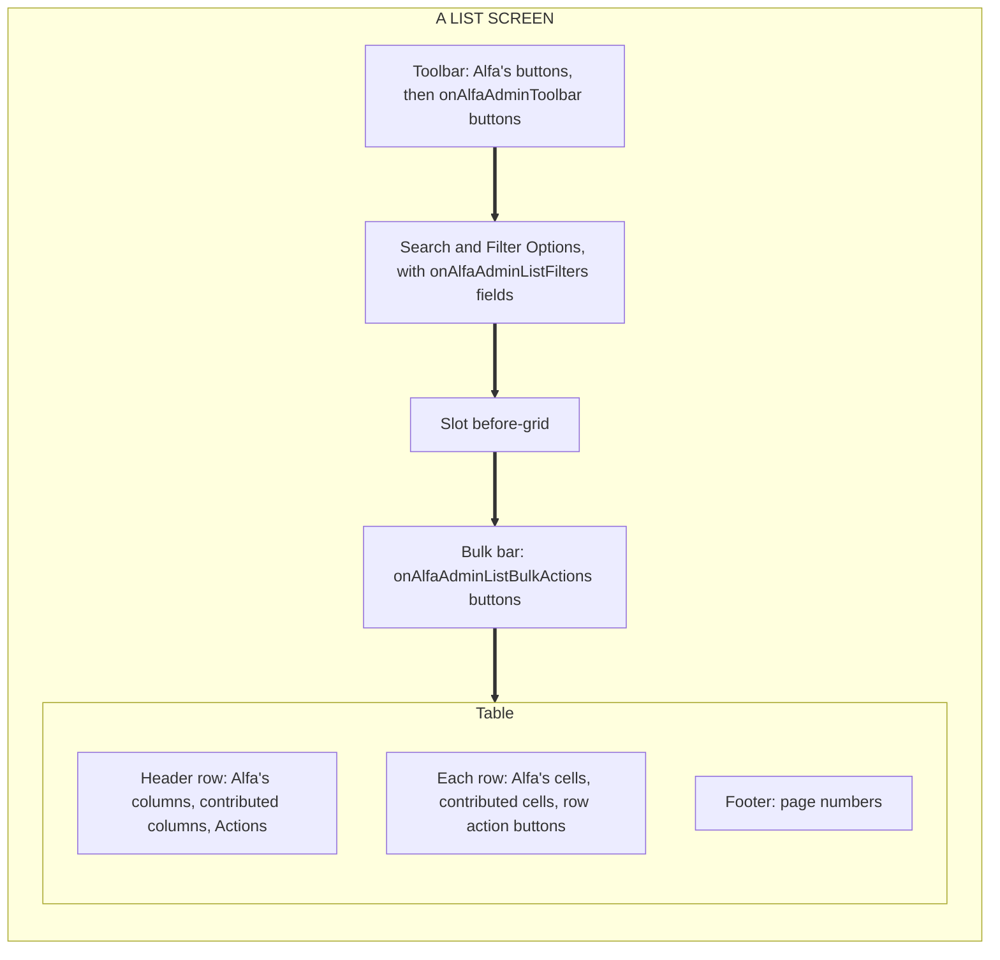
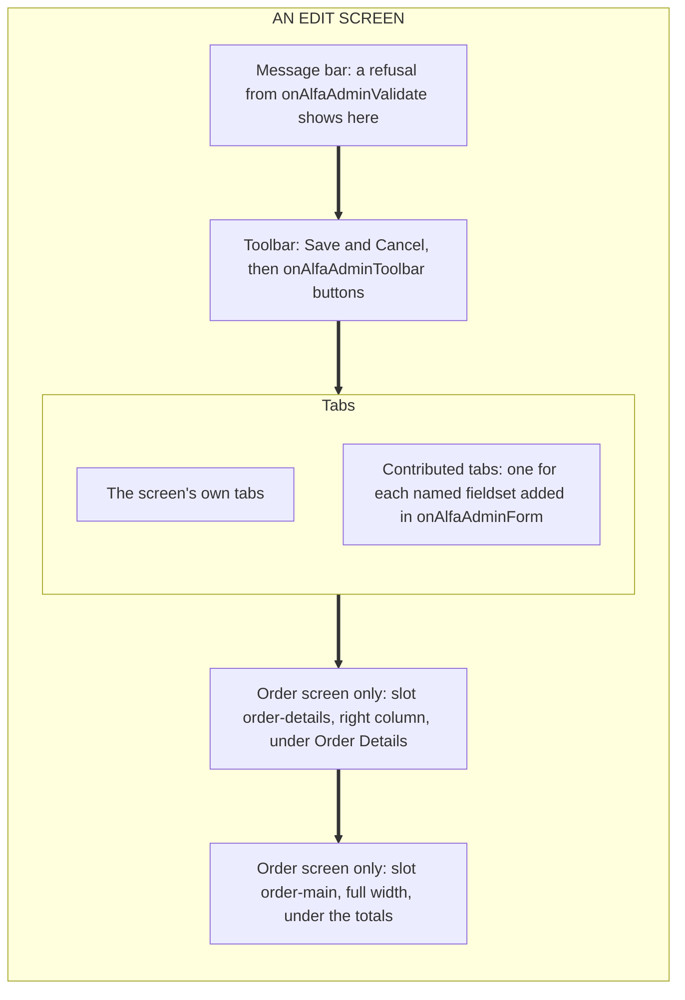

# Extending Admin Screens

<AlfaVersion verified="2.2.0" />

**The pages of this guide:**

- [Extending Admin Screens](./admin-screen-plugins.md): the guide itself
- [Admin screen events](./admin-screen-events.md)
- [A complete feature plugin](./admin-screen-example.md)
- [Calling your plugin from the browser](./admin-screen-ajax.md)

Every list and every edit form in the Alfa Commerce administrator can be extended by a plugin. One family of fifteen
events does it, all named `onAlfaAdmin...`. The same fifteen events serve every kind of record (orders, items,
currencies and the rest), so what you learn for one screen works on all of them.

Read [How events reach a plugin](../events/how-events-reach-a-plugin.md) first. This page builds on it and does not
repeat it. Words such as "broadcast" and "targeted" are explained there and in the
[glossary](../reference/glossary.md).

## What it does

| You want to | The event | What staff see |
|---|---|---|
| Show fewer rows in a list | `onAlfaAdminListQuery` | The list, filtered |
| Add a filter field | `onAlfaAdminListFilters` | A new field under Filter Options |
| Load your values for the rows on the page | `onAlfaAdminListRowData` | Nothing by itself. Your column reads the values. |
| Add a column | `onAlfaAdminListColumns` | A new column in the list |
| Add a button on every row | `onAlfaAdminListRowActions` | A button in the Actions column, at the end of the row |
| Add a button for the checked rows | `onAlfaAdminListBulkActions` | A button in a bar above the table |
| Add a toolbar button | `onAlfaAdminToolbar` | A button in the toolbar of a list or of an edit form |
| Add fields or a tab to an edit form | `onAlfaAdminForm` | A new tab on the edit form |
| Fill your fields when the form opens | `onAlfaAdminPrepareData` | Your fields show their stored values |
| Refuse a save | `onAlfaAdminValidate` | Your message, and the form opens again with what was typed |
| Change the data just before it is written | `onAlfaAdminBeforeSave` | Nothing. The record is saved with your change. |
| React to a finished save | `onAlfaAdminAfterSave` | Nothing. You store your own rows. |
| Refuse a delete | `onAlfaAdminBeforeDelete` | Your message, and nothing is deleted |
| React to a finished delete | `onAlfaAdminAfterDelete` | Nothing. You clean up your own rows. |
| Put your own markup at a named place | `onAlfaAdminRender` | Your markup at that place (a "slot") |

## When it is used

Use these events when your feature belongs **inside a screen Alfa Commerce already has**. If your feature needs a
whole screen of its own, build a panel instead: see [Creating an Admin Panel](./admin-panels.md).

All fifteen events are announced to everyone (they are broadcast events). Put your plugin in the `alfa` group: Alfa
loads that group on every administrator screen, so your plugin is always there to hear them. A plugin of another Alfa
family (a payment or a shipping plugin, for example) is not loaded for these screens. If such a plugin also needs a
column or a tab, ship a second, small plugin in the `alfa` group next to it.

## What you must provide

### The two lists of events

Your plugin class implements Joomla's `SubscriberInterface` and lists **every event of this page** in
`getSubscribedEvents()`. A method that is not listed is never called, even when it has the event's name.

```php
public static function getSubscribedEvents(): array
{
    return [
        'onAlfaAdminListRowData'  => 'onAlfaAdminListRowData',
        'onAlfaAdminListColumns'  => 'onAlfaAdminListColumns',
        'onAlfaAdminBeforeDelete' => 'onAlfaAdminBeforeDelete',
    ];
}
```

These events go in that list:

| Listed in `getSubscribedEvents()` (announced to everyone) |
|---|
| The fifteen `onAlfaAdmin...` events of this page |
| `onAlfaBuildMenu`, `onAlfaGetAccessActions` (menu entries and permissions, below) |
| `onAlfaCollectCards`, `onAlfaCollectSetupChecks`, `onGetToolActions`, `onCollectDocumentTypeProviders` |
| Joomla's own `onAjax...` event, when you use it (see "Calling your own PHP from the browser") |

A few events are addressed to one plugin (they are targeted events). They never go in `getSubscribedEvents()`. A
plugin of the `alfa` group declares them in a second list, `getTargetedHandlers()`, from
`TargetedHandlersInterface`:

| Declared in `getTargetedHandlers()` (addressed to one plugin) |
|---|
| The six `onAlfaPanel...` events of a panel your plugin owns ([Creating an Admin Panel](./admin-panels.md)) |
| `onExecuteToolAction` (a tool your plugin runs) and `onClearData` (clearing the data your plugin owns) |

An event name is in one list or in the other, never in both. A name in both is written to Joomla's log as an error.
The plugin on this page handles no targeted event, so it has no second list.

### Naming your plugin

Every time your plugin adds something, it names itself first, as **group.element**. For a plugin in
`plugins/alfa/keeplist` that is `alfa.keeplist`. It is the first argument of each of these calls:

| What you add | The call |
|---|---|
| A column | `$context->columns->column('alfa.keeplist', 'kept')` |
| A row action or a bulk action | `$context->actions->action('alfa.keeplist', 'open')` |
| Values for the rows | `$event->value('alfa.keeplist', 'kept', $valuesById)` |
| Markup in a slot | `$context->append('alfa.keeplist', $html)` |
| A menu entry, a menu heading | `$event->item('alfa.keeplist', 'keeplist')`, `$event->section('alfa.keeplist', $key, $ordering)` |
| A permission | `$event->action('alfa.keeplist', 'alfa.keeplist.manage', $titleKey)` |
| A dashboard card | `$event->main('alfa.keeplist', 'kept', $titleKey)` |

The name is a label that tells Alfa which plugin added what. It is not a permission. A name that is not exactly two
parts joined by one dot, in lower case letters, digits, underscores or hyphens, is refused with an
`InvalidArgumentException`. On a display event that error is written to the log and your part is missing from the
screen.

### Your own language file

Alfa Commerce does not load your plugin's language file. Your plugin loads its own. The simplest way is Joomla's
switch on the plugin class:

```php
protected $autoloadLanguage = true;
```

Without it, staff see the bare keys (`PLG_ALFA_KEEPLIST_COLUMN`) where your texts should be: in column titles, on
buttons, in the menu and on the Permissions tab.

### Checking which screen you are on

Each handler is called for **every** screen of that kind. The first thing it does is check whether the screen is one
it cares about, and return if not. Every event has these checks (guards):

| Method on every event | Returns | Use |
|---|---|---|
| `targets(string $entity, string ...$more)` | `bool` | Is this screen about one of these kinds of record? Give at least one name. Several names mean "any of these". |
| `isListScreen()`, `isEditScreen()`, `isSaveScreen()`, `isDeleteScreen()` | `bool` | Which kind of screen or operation this is |
| `at(string $slot)` | `bool` | Is this the slot being filled? Only for `onAlfaAdminRender`. |
| `is(string ...$phases)` | `bool` | Is this one of these phases? For one method shared by several events. The names are the `PHASE_...` constants of `AlfaAdminContext`. |
| `getContext()` | `string` | The text `com_alfa.<entity>.<screen>`, for example `com_alfa.order.list`. Good for logs. |
| `getAdminContext()` | `AlfaAdminContext` | The object that carries everything you read and write (next section) |

```php
public function onAlfaAdminListColumns(AdminListColumnsEvent $event): void
{
    if (!$event->targets('currency', 'place')) {   // the currencies list or the places list
        return;
    }

    // Your work.
}
```

`targets()` takes the names of kinds of record (Alfa calls a kind of record an **entity**). If you pass it a screen
name by mistake (`list`, `edit`, `save` or `delete`) it throws an error that names the method to use instead.

:::warning A wrong entity name fails silently
`targets('orders')` (plural) never matches and never complains. Your handler simply does nothing. These are the 25
entity names, exactly as written:

`cart`, `cartrule`, `category`, `currency`, `discount`, `document`, `documenttype`, `formfield`, `formfieldgroup`,
`inventorymovement`, `item`, `itemfield`, `location`, `manufacturer`, `notification`, `order`, `orderstatus`,
`payment`, `place`, `reservation`, `series`, `shipment`, `tax`, `user`, `usergroup`

They are singular and lower case. Each is the value of `protected string $alfaEntity` on a model in
`administrator/src/Model/`. While developing, `$event->getContext()` shows the one you are on.
:::

### The context object

`$event->getAdminContext()` returns one object, `AlfaAdminContext`. It tells you where you are, hands you what the
event is about, and takes your answer.

**Always set, read only:**

| Property | Meaning |
|---|---|
| `entity` | The kind of record: `'currency'`, `'order'` and so on |
| `view` | The Joomla view being shown, for example `'currencies'` or `'currency'` |
| `screen` | `'list'`, `'edit'`, `'save'` or `'delete'` |
| `phase` | Which of the fifteen events this is |
| `user` | The member of staff who is acting |
| `token` | The name of the session's form token, for markup of yours that posts a form |

**Set only for some events, otherwise `null`, read only:**

| Property | Meaning |
|---|---|
| `state` | The list's state. Read a filter value as `$context->state->get('filter.<name>')`. |
| `query` | The list's database query (`onAlfaAdminListQuery`) |
| `form` | The edit form, or the filter form of a list |
| `toolbar` | Joomla's toolbar of the screen (`onAlfaAdminToolbar`) |
| `item` | The single record in play |
| `items` | The rows of the current page of a list |
| `ids` | The ids of the rows on the page, or of the records being deleted |
| `isNew` | Whether a save creates a record |
| `layout`, `slot` | The screen's layout name, and the slot being filled |
| `columns`, `actions`, `bulkActions` | The builders for columns, row actions and bulk actions (below) |

**What you may write:**

| You write | With | In which events |
|---|---|---|
| The record's data | `$context->data` (an array you may change) | `onAlfaAdminPrepareData`, `onAlfaAdminBeforeSave` |
| A refusal | `$context->addError($message)` | `onAlfaAdminValidate`, `onAlfaAdminBeforeDelete` |
| Values for the rows | `$event->value('group.element', $key, $valuesById)` | `onAlfaAdminListRowData` |
| Markup | `$context->append('group.element', $html)` | `onAlfaAdminRender` |

The row values and the markup can be written only through `value()` and `append()`. Read them back with
`$context->rowData()` (all rows, `[id => [key => value]]`), `$context->rowValues($id)` (one row, or `null`) and
`$context->html()`.

Three helpers complete the object: `isMutating()` (true in the save and delete events), `key()` (a text such as
`currency.list.listcolumns`, for logs) and `contentContext()` (`com_alfa.currency`, the same on every screen of the
entity, useful as a key for your own stored rows).

## What happens next

### On a list screen



Two things follow from this order. The toolbar event comes **before** the row values are loaded, so a toolbar handler
cannot read them. And the row values are loaded **before** the columns are declared, so a column only looks its
value up.

### On a save



### On a delete



## What can go wrong

What happens when your handler throws an error depends on the event.

| The event | If your handler throws an error |
|---|---|
| A list, toolbar, form, data or slot event, and the two "after" events | The error is written to Joomla's log (category `com_alfa.plugins`) with the event and your method. The next plugin still runs and the screen is still shown, without your part. |
| `onAlfaAdminValidate`, `onAlfaAdminBeforeSave`, `onAlfaAdminBeforeDelete` | The save or the delete is refused. Staff see the text of your error as the message, on the normal screen, not on an error page. The error is also written to the log (category `com_alfa.admin`). Plugins after yours are not asked. |

To refuse on purpose, do not throw: call `addError()` in `onAlfaAdminValidate` or `onAlfaAdminBeforeDelete`. That
lets the other plugins have their say too.

:::warning Two pieces of your code run later, without this protection
The function you hand to `setData()` and the layout file you name with `setLayout()` run while the page is being
drawn, after your handler has returned. An error there is not caught and can break the page. Keep the function to a
simple lookup and keep logic out of the layout.
:::

| What you see | The usual cause |
|---|---|
| Your method is never called | The event is not listed in `getSubscribedEvents()` |
| Nothing appears and there is no error on screen | Your handler threw an error on a display event. Look in the log, category `com_alfa.plugins`. Common causes: the `group.element` argument is missing, or you wrote to `$context->rowData` or `$context->html` directly. |
| The guard never matches | A wrong entity name (see the list above) |
| Your column is missing | No `setLayout()`. A column without a layout is dropped. |
| Your column is there, but its cells are empty | The function given to `setData()` returned `null`, or the layout file was not found |
| Your row or bulk button is missing | Staff lack the permission, or the button needs `access()` (see below) |
| Staff see `PLG_...` keys in place of texts | Your plugin does not load its language file |
| Your contributed tab is missing | The screen has no place for extra tabs, or your fieldset uses a name the screen already uses (see `onAlfaAdminForm`) |
| Your plugin is ignored for a whole request | It failed while loading. Joomla's log has a warning that names it (category `com_alfa.plugins`). |

## Permissions

### What is already checked

By the time your handler runs, the person has passed two checks: Joomla's permission to enter the component
(`core.manage`) and Alfa's own permission to open that screen (for example `alfa.orders.view`).

Alfa Commerce uses only two of Joomla's permissions, `core.admin` and `core.manage`. Everything else is one of
Alfa's own, named `alfa.<section>.<action>`, such as `alfa.orders.edit` or `alfa.items.delete`. Joomla's `core.edit`
and `core.delete` are never asked, so do not check them.

### A permission of your own

Your plugin can add a row to the Permissions tab (Options, on any Alfa Commerce screen):

```php
public function onAlfaGetAccessActions(GetAccessActionsEvent $event): void
{
    $event->action(
        'alfa.keeplist',                          // your plugin, group.element
        'alfa.keeplist.manage',                   // the permission's name
        'PLG_ALFA_KEEPLIST_ACCESS_MANAGE',        // its label
        'PLG_ALFA_KEEPLIST_ACCESS_MANAGE_DESC',   // its tooltip (optional)
    );
}
```

The event is announced to everyone, so list `onAlfaGetAccessActions` in `getSubscribedEvents()`. It fires when the
Options screen builds its Permissions tab. The rows are drawn in the order of the administrator menu: a row named
`alfa.keeplist.manage` sits where the menu entry that asks for an `alfa.keeplist...` permission sits. Rows that no
menu entry leads to are placed just before Tools.

:::note A new permission starts as "not allowed"
Nothing is granted when your plugin is installed. Until a Super User grants your permission to a group, only Super
Users pass it. Say so in your plugin's description. If a permission of your own is more than the feature needs, check
one of Alfa's instead, for example `alfa.orders.edit`.
:::

### Where it is checked

| What | Who checks |
|---|---|
| A row action or a bulk action | Alfa, from `access()` or from where the action goes (see "Declaring a row or bulk action") |
| A menu entry and the panel behind it | Alfa, from `access()` on the menu entry ([Creating an Admin Panel](./admin-panels.md)) |
| A column, a filter, a toolbar button, a tab, a slot | You, in your handler |

```php
if (!$event->getAdminContext()->user->authorise('alfa.keeplist.manage', 'com_alfa')) {
    return;   // for this person, the column, button or tab does not exist
}
```

## Where everything lands on the screen





## Other things a plugin can add

A plugin can add more than parts of a screen. Each line gives the event and the call as they are in 2.2.0. The first
six are announced to everyone and go in `getSubscribedEvents()`.

| What | Event | The call |
|---|---|---|
| An entry or a heading in the Alfa Commerce menu | `onAlfaBuildMenu` | `$event->item('group.element', $id)`, then `section()`, `title()`, `view()` or `panel()` or `link()`, `icon()`, `ordering()`, `access()`. `$event->section('group.element', $headingKey, $ordering)` places a heading. See [Creating an Admin Panel](./admin-panels.md). |
| A permission | `onAlfaGetAccessActions` | `$event->action('group.element', $name, $titleKey, $descriptionKey)` |
| A dashboard card | `onAlfaCollectCards` | `$event->top()`, `metrics()`, `main()`, `side()` or `bottom()`, each `('group.element', $id, $titleKey)` |
| A line in the setup checklist | `onAlfaCollectSetupChecks` | `$event->add('group.element', $id, $labelKey)` |
| A tool on the Tools screen | `onGetToolActions` | `$event->add('group.element', $id, $labelKey)`, then `->meta('surface', $tab)` to name the tab of Tools it is drawn on: a tool without a surface is not drawn. The tool is then run by `onExecuteToolAction`, which is addressed to your plugin alone and goes in `getTargetedHandlers()`. |
| Document types | `onCollectDocumentTypeProviders` | `$event->addProvider($provider, 'group.element')`. Here the plugin's name is the second argument. |
| Clearing your plugin's data | `onClearData` | Addressed to your plugin alone. Declared in `getTargetedHandlers()`. |
| A whole screen | The six `onAlfaPanel...` events | See [Creating an Admin Panel](./admin-panels.md) |

How stock is allocated is not one of these. It belongs to a plugin family of its own, `alfa-inventory`.

## Changed in 2.2.0 and 2.1.4

- **Changed in 2.2.0.** A handler is called only when its event is listed in `getSubscribedEvents()`. Before, a
  method with the event's name was enough.
- **Changed in 2.2.0.** Every contribution takes the plugin's name, `group.element`, as its first argument:
  `column()`, `action()`, `append()`, `item()`, `add()`, `section()`, the permission's `action()`, the cards, the
  setup checks and the tools.
- **Changed in 2.2.0.** `$context->rowData` and `$context->html` are private. Write with `$event->value()` and
  `$context->append()`, read with `rowData()`, `rowValues()` and `html()`.
- **Changed in 2.2.0.** Alfa no longer loads a contributing plugin's language file.
- **Since 2.2.0.** Targeted events (`onExecuteToolAction`, `onClearData`, the panel events) are declared in
  `getTargetedHandlers()`.
- **Changed in 2.1.4.** `onAlfaAdminAfterSave` and `onAlfaAdminAfterDelete` are announced after the save is final
  and Alfa's locks are released, no longer in the middle of the save. `onAlfaAdminBeforeDelete` is asked before the
  record is locked.

## Not documented yet

- How a row action or a bulk action can run code of your **own** plugin through `task()`. The task is posted to a
  controller of Alfa Commerce, and this page documents only tasks Alfa Commerce itself has.
- The details of dashboard cards, setup checks, tools, document types and clearing data. This page gives only their
  events and calls.
- How many refusal messages staff see when several plugins refuse the same save or delete.
- The exact moment `onAlfaAdminAfterSave` is announced for a **new item**, compared with the rest of the item's
  save.
