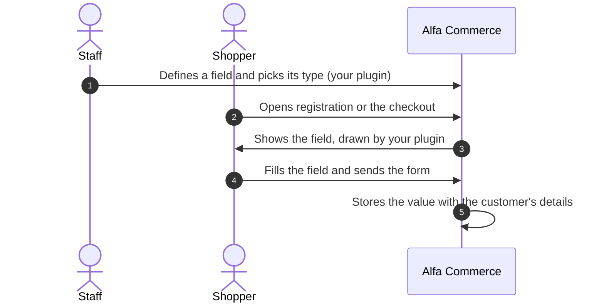
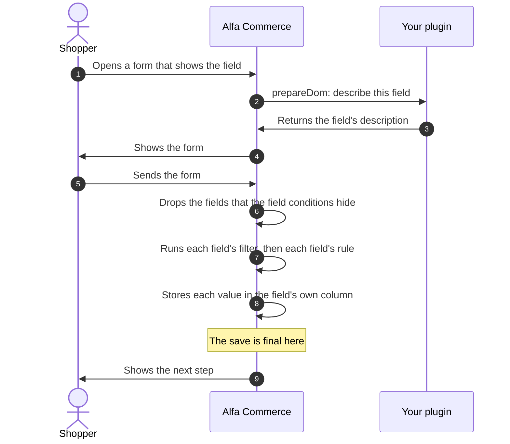

# Form field plugins

<CreatePluginButton type="formfield" />

<AlfaVersion verified="2.2.0" />

A **form field** is one field of the customer's details: a name, a phone number, a country, a tax office. Staff
define the fields of their shop, and each field has a **type**. A form field plugin adds one type.

Do not confuse a form field with an [item field](./item-field-plugins.md), which is a property of an item such as a
size. The two are separate plugin families. Both words are in the [glossary](../reference/glossary.md).

Read [How events reach a plugin](../events/how-events-reach-a-plugin.md) first. This page uses its words.

## What it does

A form field plugin answers one question for Alfa Commerce: "how is a field of this type drawn in a form?". Alfa
does the rest: it decides who sees the field and where, whether it is required, where the value is stored and what
happens when the form is sent.



The plugin group is `alfa-form-fields`. There is one plugin per type, and the plugin's element is the type's name.
Alfa Commerce ships five:

| Type (element) | What it draws |
|---|---|
| `text` | A one line input. Its Validation setting can turn it into an e-mail or a web address input. |
| `textarea` | A multi line input |
| `tel` | A telephone input with a country selector. The number is stored in one international shape. |
| `choice` | A list, radio buttons, checkboxes or buttons to pick from |
| `country` | A list of places, whose value is the id of a place |

The types staff can pick from are the enabled plugins of the group. There is no event for this: Alfa reads Joomla's
list of enabled plugins, and the Type list of the field's edit screen shows each plugin's element.

## When it is used

Staff set, per field, where it shows: at **registration**, in the **delivery** section of the checkout and in the
**invoice** section of the checkout. For each of the three the field is hidden, optional or required. Required is
therefore a property of the place, not of the field: a phone can be required at checkout and optional at
registration.

Alfa builds these forms with the shop's form fields, and calls your plugin for each field of your type:

| Form | The fields it shows |
|---|---|
| The registration form | Fields shown at registration |
| The checkout, delivery section | Fields shown in the delivery section |
| The checkout, invoice section | Fields shown in the invoice section |
| The customer's saved details on the storefront | Fields shown in either checkout section |
| The order screen and the cart builder in the administrator | The delivery fields and the invoice fields, as at checkout |
| The saved details popup in the administrator | Fields shown in either checkout section |

A field can also be limited to some users or user groups, and it can belong to a **field group**, which is drawn as
a titled block. A field of a disabled group is not shown, except a system field (see below), which is then shown
without a group.

## The life of a form field



Your plugin is called at step 2 only. The filter and the rule of step 7 are ordinary Joomla form classes; your
plugin names them at step 3 and may ship its own.

If a rule refuses a value at step 7, the form is not accepted and Joomla reports the rule's message.

When step 8 becomes final (the commit) depends on the form:

| Form | When the stored values are final |
|---|---|
| The checkout | The customer's details are written inside the same database transaction as the order. They become final together with the order, and a failed order takes them back. |
| The order screen in the administrator | The same: they are written inside the transaction of the order's save. |
| The customer's saved details on the storefront, and registration | The row is written on its own, outside any transaction. It is final as soon as it is written. |

At registration, steps 6 and 7 decide whether the form is accepted, but in 2.2.0 the values that are stored are
the ones the browser sent, not the ones the filters returned. A value sent for a field that a condition hides is
stored there too.

Planned for 2.2.1, which is not released: registration stores what the filters returned, as the other forms do, and
nothing for a field that a condition hides. "System - Alfa Commerce Sync" no longer reads customer details from the
request when a Joomla account is saved. Details stored before stay as they are.

## What you must provide

### The folder

```text
plugins/alfa-form-fields/reference/
    reference.xml                 the manifest
    services/provider.php         starts the plugin
    src/Extension/Reference.php   the plugin class
    params/params.xml             the settings staff fill in for a field of this type
    tmpl/default.php              draws a stored value
    language/en-GB/plg_alfa-form-fields_reference.ini
    language/en-GB/plg_alfa-form-fields_reference.sys.ini
```

### The base class

Your class extends `Alfa\Component\Alfa\Administrator\Plugin\FormFieldsPlugin`
(`administrator/src/Plugin/FormFieldsPlugin.php`). A plugin in this group that does not extend it is never called.

What the base class gives you:

| It gives you | In plain words |
|---|---|
| `prepareDom()` | A complete, working description of the field. A type that needs nothing special can be an empty class, as the shipped `textarea` is. |
| `getSubscribedEvents()` returning an empty list | Your plugin listens to nothing unless you add events |
| `$autoloadLanguage = true` | Your language file is loaded when the plugin starts |

What you must write: nothing, for a plain type. To change how the field is drawn, override `prepareDom()`.

### The operation: prepareDom

**When it fires.** Each time Alfa builds one of the forms listed above, once for every field of your type that the
form shows.

**Who receives it.** It is addressed to one plugin (targeted): the plugin whose element equals the field's type.
It is not an event that travels through Joomla's dispatcher. Alfa starts your plugin and calls the method
directly, as an **operation** of the base class, the only one this family has. The object you receive is named
`onAlfaFormFieldsPrepareDom`, but no listener is ever called with that name: listing it in
`getSubscribedEvents()` does nothing.

**What you are given.** One `PrepareDomEvent`
(`Alfa\Component\Alfa\Administrator\Event\Fields\PrepareDomEvent`). It has getters only.

| Getter | What it returns |
|---|---|
| `getField(): object` | The field as staff defined it. The properties the base class reads are `field_name`, `type`, `params` (the field's settings, as JSON text), `field_label`, `field_description`, `default_value` and `role`. |
| `getFieldset(): DOMElement` | The XML element of the form that your field's description is added to |
| `getForm(): Form` | The Joomla form being built |
| `getContext(): string` | Which form is being built, for example `cart.shipping` or `user.register`. An empty string means unknown. |
| `getUserId(): int` | The customer the form is built for. 0 means a guest or unknown. |

**What you are expected to do.** Call `parent::prepareDom($event)` first. It returns the field's description as
an XML `<field>` element, already added to the form, or `null` when the field is not shown in this form. If it
is `null`, return `null`. Otherwise change attributes of the element and return it.

The base class has already set these on the element:

| Attribute | Where it comes from |
|---|---|
| `name` | The field's `field_name` |
| `type` | The field's type, which is your plugin's element |
| `label`, `description` | The field's label and description in the current language |
| `required` | Whether the field is required in the form being built |
| A `<default>` child | The field's default value, when it has one |
| `class`, `labelclass`, `hint`, `layout` | The settings of those names, when filled |
| One attribute per other setting | Every setting of your `params.xml`, by its name. A list of plain values is joined with commas. Empty settings are skipped. |
| `showonname`, `showontype`, `showonrule` | What the field conditions need (see below) |

Leave `name`, `required` and the three `showon` attributes alone.

Joomla draws the element with the form field class that matches `type`. If Joomla has no form field of that
name it draws a plain text input. Set `type` yourself when you want a specific one, and register your own form
field class with `FormHelper::addFieldPrefix()` when you ship one, as the shipped `tel` plugin does.

**What happens next.** Alfa loads the finished XML into the form and the form is shown. On submit, Joomla applies
the `filter` and the `validate` attributes you left on the element.

**If you are missing or you fail.**

| What is wrong | What Alfa does |
|---|---|
| The plugin is disabled, not installed, or its Access is a level the current visitor does not hold | The field is left out of the form. Nothing is shown in its place and nothing is written to the log. |
| The same, for one of the two fields every shop must have (see System fields) | The field is left out, an error is written to Joomla's log (category `com_alfa`), and in the administrator the message is also shown on screen |
| Your `prepareDom()` throws an error | The error is written to Joomla's log (category `com_alfa.cart`) with your plugin's name, the field and the form. The form is still shown. If the error came after `parent::prepareDom()` returned, the field is in the form as the base class described it, without your changes. If it came before, the field is missing. |

A field that is left out is not asked for and not stored, even when staff marked it required.

Planned for 2.2.1, which is not released: a field whose plugin cannot be used (missing, disabled, not loaded for the
visitor because of its Access, failing to start, or a `prepareDom()` that threw before the field was added) is
handled by whether the form must ask for it:

| The field | What Alfa does |
|---|---|
| Required in that form and shown to that customer (system fields included) | It is added as a hidden field whose rule refuses every submission, naming the field: "... cannot be filled in right now, so this form cannot be sent. Please try again later." The log (category `com_alfa`, level ERROR) names the plugin and the reason, and an administrator screen shows the message too. |
| Optional | It is left out, as in 2.2.0, and a warning is written to the log (category `com_alfa`) once for each field type in the request |

This holds for the checkout, registration, the customer's saved details, and the customer and order forms staff use.
The setup checklist's row "Required form fields can be filled in" fails while such a required field has no enabled
plugin of Public access.

:::warning Access must be Public
A guest fills the checkout. A form field plugin whose Access (Extensions: Plugins) is not Public is not loaded
for guests, and its fields silently disappear from their forms. Planned for 2.2.1, which is not released: a required
field of such a plugin stops the form with a message instead, and an optional one is left out and logged.
:::

### Assets and other events

A plugin that needs a script or a stylesheet on the page lists Joomla's own `onBeforeCompileHead` in
`getSubscribedEvents()`, merged with the parent's list, and adds its assets there. The shipped `choice` plugin
does this. Alfa starts your plugin while it builds the form, which is before the page head is compiled, so the
listener is in place in time.

### The settings file: params/params.xml

The settings staff see under a field of your type come from `params/params.xml`. The fields must sit inside
`<fields name="formfieldsparams">`. The values are saved with the field, as JSON, and reach `prepareDom()` in
`$event->getField()->params`.

Always include a hidden field named `sql_type`. It says which database column type holds the value. Without it
the column is created as `text`. See "Where the value is stored".

### The layout for a stored value: tmpl/default.php

When Alfa prints a stored value outside a form, it renders your `tmpl/default.php`. In 2.2.0 this is used for the
`{field_<field name>}` placeholders of the order e-mails. The layout receives `$field` (with the value in
`$field->value`), `$fieldParams` (the field's settings as a `Registry`), `$item` and `$context`.

A template can override your layout by placing a `default.php` in
`templates/<template>/html/plg_alfa-form-fields_<type>/`.

## What happens next

### Where the value is stored

Every form field is one column of the table `#__alfa_user_info`. One row of that table is one set of customer
details: a delivery record or an invoice record. The column's name is the field's `field_name`.

| When staff | Alfa |
|---|---|
| Save a new field | Saves the field, then adds a column of the `sql_type` your settings name |
| Rename a field | Saves the field, then renames the column |
| Delete a field | Deletes the field. The column is dropped only when no placed order holds a value in it. Otherwise the column stays, so that old orders keep their data. |

The column is added only after the field itself is saved, because a column change cannot be undone.

`sql_type` must be one of the types Alfa accepts, written exactly:

- `tinyint`, `smallint`, `mediumint`, `int`, `bigint`, each also with a length such as `int(11)`
- `float`, `double`, `real`, `decimal(M,N)`, `numeric(M,N)`
- `date`, `datetime`, `timestamp`, `time`, `year`
- `char(N)`, `varchar(N)`, `binary(N)`, `varbinary(N)`
- `tinytext`, `text`, `mediumtext`, `longtext`, `json`
- `tinyblob`, `blob`, `mediumblob`, `longblob`, `boolean`, `bool`

Any other value stops the save with the error "Invalid sql_type for form field". Once a field exists, its type
and its `sql_type` are locked on the edit screen.

In a submitted form the values of the delivery fields arrive under `alfa_form_fields` and those of the invoice
fields under `alfa_form_fields_billing`, each keyed by `field_name`.

### Checking and cleaning the value: a rule checks, a filter changes

Joomla offers two tools, and they do different jobs:

| Tool | Attribute on the element | What it can do |
|---|---|---|
| A **rule** (`FormRule`) | `validate="name"` | Accept or refuse the value. It cannot change what is stored. |
| A **filter** (`FormFilterInterface`) | `filter="name"` | Change the value. What the filter returns is what is stored. |

Joomla runs the filters first and the rules second, and keeps what the filters returned (registration is the
exception in 2.2.0, see "The life of a form field"; planned for 2.2.1, which is not released, it is no exception). A
rule that rewrites the
value therefore checks correctly and stores the value exactly as it was typed. If your type has one right shape
for storage, put the reshaping in a filter and let the rule beside it only say yes or no.

The shipped `tel` plugin is the model. In `prepareDom()` it sets `filter="telephone"` and calls
`FormHelper::addFilterPrefix('Alfa\\Component\\Alfa\\Administrator\\Filter')`, so that Joomla finds Alfa's
`TelephoneFilter`. It sets `validate="alfatel"` and calls `FormHelper::addRulePrefix()` with its own rule
namespace. A filter should never refuse: what it cannot read it passes on untouched, and the rule refuses it.

Two more things to know:

- Joomla's script that checks a form in the browser finds a rule by the CSS class `validate-<name>`, not by the
  `validate` attribute. Add that class to the element when you want the browser to check too.
- If your widget keeps part of the value outside the `<input>`, the browser sends only what the input holds.
  Complete the value in the form's `formdata` event, and skip an input that is disabled.

### Field conditions (showon)

Staff can give a field a condition: "show this field only when another field has this value". The code calls it
**showon**. Your plugin does not evaluate conditions. It only has to keep the three attributes the base class sets.

The condition is stored with the field's settings, under the key `showon`, as JSON of this shape:

```json
{
    "match": "all",
    "action": "show",
    "rules": [
        { "operand": "country.value", "operator": "in", "value": [84, 12] },
        {
            "match": "any",
            "rules": [
                { "operand": "phone.value", "operator": "!empty" },
                { "operand": "company.value", "operator": "starts_with", "value": "A" }
            ]
        }
    ]
}
```

| Key | Meaning |
|---|---|
| `match` | `all`: every rule of the list must hold. `any`: one is enough. |
| `action` | `show`: the field is shown when the rules hold. `hide`: it is hidden when they hold. Only on the outer level. |
| `rules` | A list. Each entry is one comparison, or a nested group with its own `match` and `rules`. |
| `operand` | What is compared: the other field's `field_name`, a dot, and `value` |
| `operator` | One of the operators below |
| `value` | What it is compared with. A list for `in`, `!in` and `between`. Not used by `empty` and `!empty`. |

The operators of 2.2.0. An operator that is not in this list never matches.

| Operator | Holds when the other field's value |
|---|---|
| `=`, `!=` | Is, or is not, the given value. Compared as text. |
| `in`, `!in` | Is, or is not, one of the given values |
| `empty`, `!empty` | Has no value, or has one |
| `contains`, `starts_with`, `ends_with` | Contains, starts with or ends with the given text |
| `<`, `<=`, `>`, `>=` | Is below or above the given number |
| `between` | Lies between the two given numbers, both included |

How it behaves:

- The same rules are evaluated twice: in the browser, which shows and hides fields as the shopper types, and on
  the server, which has the last word when the form is sent.
- A field that a condition hides is taken out of the form on the server before filters and rules run. A hidden
  required field therefore does not block the form, and a value sent for a hidden field is not stored
  (registration is the exception in 2.2.0, see "The life of a form field"; planned for 2.2.1, which is not
  released, it is no exception).
- In the browser, the inputs of a hidden field are disabled.
- The delivery section and the invoice section are separate. A condition reads only the fields of its own section.
- A comparison whose other field is not part of the form is skipped. If every comparison is skipped, the field
  is shown.

If your type draws a widget whose value cannot be read from an ordinary input, tell the browser side how to read
it, and announce changes:

```js
// Once, when your script loads: how to read the value of a field of your type.
(window.alfaShowOn = window.alfaShowOn || []).push({
    type: 'reference',
    value: function (name, form, surface) {
        var input = surface.querySelector('input');

        return input && input.value !== '' ? input.value : null;
    }
});

// Each time your widget changes the value, on the input element it changed.
input.dispatchEvent(new CustomEvent('alfa:field-change', { bubbles: true }));
```

`type` is your plugin's element. The function receives the field's name, the form (or the section) being read
and the element that wraps this field. It returns the current value, a list of values, or `null` for none. The
shipped `tel` plugin does both in `media/js/tel.js`.

### System fields

A new installation creates four fields:

| Field | Type | Kind |
|---|---|---|
| `name` | `text` | A **system field**: it cannot be deleted, unpublished or limited to users, and it is always required at registration and in the delivery section |
| `email` | `text` with the e-mail validation | A system field, with the same limits |
| `phone` | `tel` | An ordinary field that staff may change or delete |
| `country` | `country` | An ordinary field that staff may change or delete |

Two consequences for a form built for a customer:

- The e-mail field is not shown to a logged in customer outside registration. The account's own address is used.
- On the registration form the `name` and `email` fields are not shown, because Joomla's own inputs ask for them.

In both cases `parent::prepareDom()` returns `null`. This is why your override must handle `null`.

## A complete minimal plugin

This plugin adds a type named `reference`: a one line text input. It is modelled on the shipped `text` plugin.
Every file is printed in full.

`plugins/alfa-form-fields/reference/reference.xml`

```xml
<?xml version="1.0" encoding="UTF-8"?>
<extension type="plugin" group="alfa-form-fields" method="upgrade">
    <name>PLG_ALFA_FORM_FIELDS_REFERENCE</name>
    <author>Acme</author>
    <creationDate>2026-11-12</creationDate>
    <copyright>(C) 2026 Acme</copyright>
    <license>GNU General Public License version 3 or later; see LICENSE</license>
    <version>1.0.0</version>
    <description>PLG_ALFA_FORM_FIELDS_REFERENCE_XML_DESCRIPTION</description>
    <namespace path="src">Acme\Plugin\AlfaFormFields\Reference</namespace>
    <files>
        <folder>params</folder>
        <folder plugin="reference">services</folder>
        <folder>src</folder>
        <folder>tmpl</folder>
    </files>
    <languages folder="language">
        <language tag="en-GB">en-GB/plg_alfa-form-fields_reference.ini</language>
        <language tag="en-GB">en-GB/plg_alfa-form-fields_reference.sys.ini</language>
    </languages>
</extension>
```

`plugins/alfa-form-fields/reference/services/provider.php`

```php
<?php

\defined('_JEXEC') or die;

use Acme\Plugin\AlfaFormFields\Reference\Extension\Reference;
use Joomla\CMS\Extension\PluginInterface;
use Joomla\CMS\Factory;
use Joomla\CMS\Plugin\PluginHelper;
use Joomla\DI\Container;
use Joomla\DI\ServiceProviderInterface;

return new class () implements ServiceProviderInterface {
    public function register(Container $container): void
    {
        $container->set(
            PluginInterface::class,
            function (Container $container) {
                $plugin = new Reference(
                    (array) PluginHelper::getPlugin('alfa-form-fields', 'reference'),
                );
                $plugin->setApplication(Factory::getApplication());

                return $plugin;
            },
        );
    }
};
```

`plugins/alfa-form-fields/reference/src/Extension/Reference.php`

```php
<?php

namespace Acme\Plugin\AlfaFormFields\Reference\Extension;

use Alfa\Component\Alfa\Administrator\Event\Fields\PrepareDomEvent;
use Alfa\Component\Alfa\Administrator\Plugin\FormFieldsPlugin;
use DOMElement;

\defined('_JEXEC') or die;

final class Reference extends FormFieldsPlugin
{
    public function prepareDom(PrepareDomEvent $event): ?DOMElement
    {
        // The base class builds the whole field. Null means: not shown in this form.
        $node = parent::prepareDom($event);

        if ($node === null) {
            return null;
        }

        // Joomla has no form field named "reference". Ask for its plain text input.
        $node->setAttribute('type', 'text');

        if (!$node->getAttribute('autocomplete')) {
            $node->setAttribute('autocomplete', 'off');
        }

        return $node;
    }
}
```

`plugins/alfa-form-fields/reference/params/params.xml`

```xml
<?xml version="1.0" encoding="UTF-8"?>
<form>
    <fields name="formfieldsparams">
        <fieldset name="fieldparams" label="PLG_ALFA_FORM_FIELDS_REFERENCE_PARAMS_TAB">
            <field
                name="filter"
                type="list"
                label="PLG_ALFA_FORM_FIELDS_REFERENCE_PARAMS_FILTER_LABEL"
                validate="options"
                default="string"
                >
                <option value="string">PLG_ALFA_FORM_FIELDS_REFERENCE_PARAMS_FILTER_STRING</option>
                <option value="alnum">JLIB_FILTER_PARAMS_ALNUM</option>
            </field>

            <field
                name="maxlength"
                type="number"
                label="PLG_ALFA_FORM_FIELDS_REFERENCE_PARAMS_MAXLENGTH_LABEL"
                filter="integer"
                default="64"
            />

            <field name="sql_type" type="hidden" default="varchar(64)"/>
        </fieldset>
    </fields>
</form>
```

The base class copies `filter` and `maxlength` onto the element as attributes of the same names, so Joomla's
text input applies them. `sql_type` creates a `varchar(64)` column.

`plugins/alfa-form-fields/reference/tmpl/default.php`

```php
<?php

defined('_JEXEC') or die;

extract($displayData);

$value = $field->value ?? '';

if ($value === '' || $value === null) {
    return;
}

if (is_array($value)) {
    $value = implode(', ', $value);
}

echo htmlspecialchars((string) $value, ENT_QUOTES | ENT_SUBSTITUTE, 'UTF-8');
```

`plugins/alfa-form-fields/reference/language/en-GB/plg_alfa-form-fields_reference.ini`

```ini
PLG_ALFA_FORM_FIELDS_REFERENCE="Alfa Fields - Reference"
PLG_ALFA_FORM_FIELDS_REFERENCE_XML_DESCRIPTION="Adds the field type 'reference' to the form fields of Alfa Commerce."
PLG_ALFA_FORM_FIELDS_REFERENCE_PARAMS_TAB="Field settings"
PLG_ALFA_FORM_FIELDS_REFERENCE_PARAMS_FILTER_LABEL="Filter"
PLG_ALFA_FORM_FIELDS_REFERENCE_PARAMS_FILTER_STRING="Plain text"
PLG_ALFA_FORM_FIELDS_REFERENCE_PARAMS_MAXLENGTH_LABEL="Maximum length (characters)"
```

`plugins/alfa-form-fields/reference/language/en-GB/plg_alfa-form-fields_reference.sys.ini`

```ini
PLG_ALFA_FORM_FIELDS_REFERENCE="Alfa Fields - Reference"
PLG_ALFA_FORM_FIELDS_REFERENCE_XML_DESCRIPTION="Adds the field type 'reference' to the form fields of Alfa Commerce."
```

Install the plugin, enable it, and leave its Access on Public. The type `reference` then appears in the Type list
of a new form field.

## Language: the plugin carries its own strings

Every text your plugin shows is a key in its own language files: the plugin's name and description, the labels
of its settings, the messages of its rules. Alfa Commerce's own language files do not hold them and must not be
edited for them.

- `plg_alfa-form-fields_<element>.sys.ini` holds the name and the description shown in Extensions: Plugins.
- `plg_alfa-form-fields_<element>.ini` holds everything else.
- The base class loads the file when the plugin starts, and Alfa loads it before it shows your settings in the
  field's edit screen.
- An installed copy in `administrator/language/<tag>/` wins over the copy in the plugin's folder. Edit the
  installed copy, or reinstall, when a changed text does not appear.

The label, the description and the group title of a field are not the plugin's. Staff type them per language.

## What can go wrong

| What you see | The usual cause |
|---|---|
| The type is not in the Type list | The plugin is not enabled, or its Access is a level the member of staff does not hold |
| The class is never called | It does not extend `FormFieldsPlugin` |
| The field shows for staff and not for guests | The plugin's Access is not Public |
| The field is in the form without your changes, or is missing, with no message | Your `prepareDom()` threw an error. Look in Joomla's log, category `com_alfa.cart`. |
| An error in the log for the e-mail field of logged in customers, or for `name` and `email` at registration | The override used the result of `parent::prepareDom()` without checking for `null`. Those fields are left out there on purpose (see System fields). |
| The field is missing from a form and the log says nothing | The plugin is unavailable. Alfa logs this only for the two system fields. |
| Saving a field fails with "Invalid sql_type for form field" | `sql_type` in `params.xml` is not one of the accepted types |
| The column of a new field is `text` | `params.xml` has no `sql_type` field |
| The settings do not appear under the field | They are not inside `<fields name="formfieldsparams">` |
| The value is stored as typed, although the rule "normalised" it | Reshaping was put in a rule. Put it in a filter. |
| The browser does not check the field before sending | The element lacks the class `validate-<rule>` |
| A condition never reacts to your widget | The widget does not send `alfa:field-change`, or did not register a value reader |
| `onAlfaFormFieldsPrepareDom` in `getSubscribedEvents()` is never called | It is not an event. Override `prepareDom()`. |
| A setting named `layout` breaks the drawing | `layout` is an attribute Joomla reads itself. Name your setting differently. |

Notes for authors of plugins written for earlier versions:

- Changed in 2.2.0: `prepareDom()` is called through Alfa's plugin helper as an operation of the base class. A
  plugin that does not extend `FormFieldsPlugin` is not called at all.
- Changed in 2.2.0: a disabled form field plugin is never started.
- The field condition format is `{match, action, rules}` with the operators listed above. Earlier formats are
  not read.
- Do not pass a dispatcher to the plugin's constructor in `services/provider.php`. Joomla marks it as deprecated.

## Not documented yet

- The screens and the code that write the customer's details row for each form (registration, checkout, saved
  details, the order screen) are not described here, beyond when the write becomes final.
- The "Unique" switch of a field.
- The settings of the shipped `tel`, `choice` and `country` types, and the `country` type's place list.
- The condition builder of the field's edit screen and the plain language summary it shows.
- The validation engine of the storefront (`media/js/site/validate`) and how a plugin adds a browser side check
  to it.
- How the delivery place of an order is read from a `country` field.
