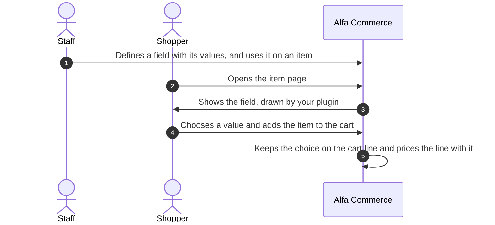
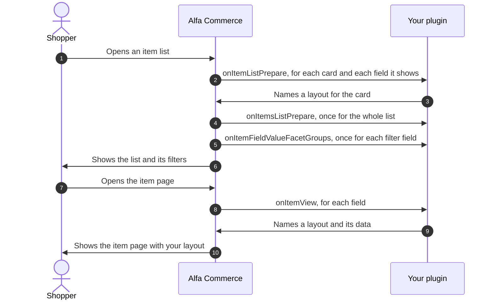
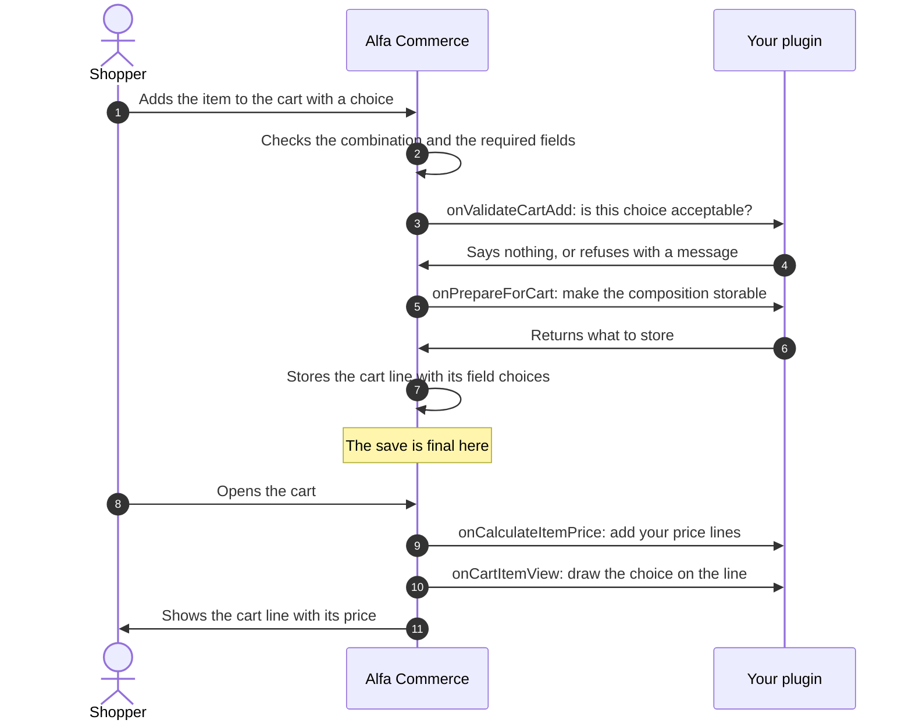

# Item field plugins

<AlfaVersion verified="2.2.0" />

An **item field** is a property of an item that the shopper sees or chooses: a size, a colour, an engraving.
Staff define the fields of their shop, and each field has a **type**. An item field plugin adds one type and
decides how a field of that type looks and behaves.

Do not confuse an item field with a [form field](./form-field-plugins.md), which is a field of the customer's
details. Both words are in the [glossary](../reference/glossary.md).

Read [How events reach a plugin](../events/how-events-reach-a-plugin.md) first. This page uses its words.

## What it does



The plugin group is `alfa-item-fields`. There is one plugin per type, and the plugin's element is the type's
name. Alfa Commerce ships one: `choice`, which draws a field's values as a list, radio buttons, buttons, swatches
or cards. One type can serve many fields: "Size" and "Colour" are both fields of the type `choice`.

Every field has a pool of **values** ("S", "M", "L"). Alfa Commerce owns the fields, the values and how an item
uses them. An item can use a field's values in three ways:

| Use | In plain words | The technical name |
|---|---|---|
| As a dimension of the item's combinations | The shopper must pick one value. Each allowed set of picks is one sellable **combination** with its own code and stock. | A **variant** field |
| As an extra | The shopper may pick a value the item offers. Staff can give each offered value a price change. | An **option** |
| As information | The value is shown as a specification. Nothing is chosen. | An **informational** field |

Alfa works out which combination the shopper's picks lead to, and the price changes of combinations and options,
without the plugin. The plugin is asked to **draw**, and may also **check**, **store its own data** and **add
price lines**.

A field's plugin can also take a **composition**: free data the shopper builds for the field, such as a text or
uploaded files, instead of one value of the pool. The code calls it the **payload**.

## When it is used

| Where | What your plugin does there | The event |
|---|---|---|
| The item page | Draws the field | `onItemView` |
| A card of an item list, for fields with "Show on listings" | Draws the field on the card | `onItemListPrepare` |
| The whole item list, once | Anything across the cards | `onItemsListPrepare` |
| The filters of an item list | Says how the field's values group together | `onItemFieldValueFacetGroups` |
| Adding to the cart | Checks the shopper's choice | `onValidateCartAdd` |
| Adding to the cart | Prepares a composition for storage | `onPrepareForCart` |
| The price of an item that was given a composition | Adds price lines | `onCalculateItemPrice` |
| A line of the cart | Draws the choice on the line | `onCartItemView` |
| The item's edit screen in the administrator | Offers buttons and runs them | `onGetFieldActions`, `onExecuteFieldAction` |
| Tools: Extensions | Removes the data the plugin owns | `onClearData` |

Ten of these eleven events are addressed to one plugin (targeted): Alfa sends them to the plugin of the field's
type and to nobody else. One, `onItemsListPrepare`, is announced to everyone (broadcast).

## The life of an item field

Showing the field:



Buying:



Steps 5 and 6 happen only for a field that takes a composition and was sent one. Step 10 happens only when the
line carries a composition.

At step 7 the storefront writes the cart line's row and then one row for each field choice, one statement after
the other, with no database transaction around them. Each write is final as soon as it is made, so there is no
later commit to wait for. If the write of a field choice fails, the shopper is told that the item could not be
added, and the line's row that was already written is not taken back.

## What you must provide

### The folder

The shipped `choice` plugin has this layout. Only the first four entries and the language files are needed.

```text
plugins/alfa-item-fields/choice/
    choice.xml                    the manifest
    services/provider.php         starts the plugin
    src/Extension/Choice.php      the plugin class
    tmpl/                         the layouts the class names: item-select.php, item-radio.php,
                                  item-buttons.php, item-swatches.php, item-cards.php, item-text.php,
                                  spec-default.php, facet-chip.php, default.php
    params/params.xml             settings of a field of this type
    params/value.xml              settings of one value of such a field
    src/Color/ChoiceColors.php    a helper class of this plugin
    language/en-GB/plg_alfa-item-fields_choice.ini
    language/en-GB/plg_alfa-item-fields_choice.sys.ini
```

### The base class

Your class extends `Alfa\Component\Alfa\Administrator\Plugin\ItemFieldsPlugin`
(`administrator/src/Plugin/ItemFieldsPlugin.php`). A plugin in this group that does not extend it is never called.

**How you declare an event.** You write a public method with the event's name. The base class holds the list of
the family's targeted events (`TARGETED_EVENTS`) and reports to Alfa each one your class has a method for. Do not
list them in `getSubscribedEvents()`.

The base class already has a method for eight of the eleven events, so you only override the ones you need:

| Event | The base class's own method |
|---|---|
| `onItemView`, `onItemListPrepare`, `onCartItemView`, `onCalculateItemPrice`, `onValidateCartAdd`, `onGetFieldActions` | Does nothing |
| `onExecuteFieldAction` | Answers with the error "Action ... is not implemented by ..." |
| `onItemsListPrepare` (broadcast) | Does nothing. The base class already lists it in `getSubscribedEvents()`. |
| `onItemFieldValueFacetGroups`, `onPrepareForCart`, `onClearData` | No method. Alfa treats your plugin as not handling them until you write one. |

The base class also gives you these helpers:

| Helper | What it does |
|---|---|
| `getItemConfig(int $itemId, int $fieldId): Registry` | Reads the settings your plugin stored for a field on one item |
| `editItemConfig(int $itemId, int $fieldId)` | Starts a change of those settings. Chain `set()` or `merge()`, end with `save()`. |
| `getEffectiveConfig(string $scope, int $scopeId, int $fieldId, int $itemId): Registry` | Reads the settings for one combination (`'combination'`) or one option (`'option'`), laid over the item's settings |
| `editVariantConfig(string $scope, int $scopeId, int $fieldId, int $itemId)` | Starts a change of those settings |
| `getConfig($event): Registry` and `saveConfig($event, array $config): bool` | Read and write the settings of the row an administrator action is about |
| `getLayoutPath(string $layout = 'default'): string` | The file of one of your layouts: the template's override when there is one, else your `tmpl` file |
| `fieldIds(): int[]` | The ids of every field of your type |

Your language file is loaded when the plugin starts.

### Layouts

Your plugin never returns HTML. It names a **layout**, a PHP file in its `tmpl` folder, and hands it data. Alfa
renders the file in the right place of the page. A template can override a layout by placing a file of the same
name in `templates/<template>/html/plg_alfa-item-fields_<element>/`.

The layout receives what you passed, as `$displayData`. If you pass no data, it receives the item.

### Settings

Both files are optional.

| File | Wrapper it must use | Where the values are stored | Where you read them |
|---|---|---|---|
| `params/params.xml` | `<fields name="itemfieldsparams">` | With the field | `$event->getField()->params_decoded` (an array) |
| `params/value.xml` | `<fields name="valueparams">` | With each value of the field | Each value's `params_decoded` |

Alfa stores both as JSON and never reads their content.

## The events

In every card, "the field" is the field as staff defined it, with these properties among others: `id`, `type`,
`field_name`, `display_name`, `informational`, `params_decoded` and `values` (the values of the pool, each with
`id`, `display_name` and `params_decoded`).

### onItemView

**When it fires.** When Alfa prepares an item page, once for each field of the item. Also when staff open the
popup that configures an item for an order in the administrator.

**Who receives it.** One plugin (targeted): the plugin of the field's type.

**What you are given.** An `ItemViewEvent` (`Alfa\Component\Alfa\Administrator\Event\ItemFields\ItemViewEvent`).

| Getter | What it returns |
|---|---|
| `getItem()` | The item. Among its properties: `variant` (what the shopper's picks led to, see the sample), `options` (the values the item offers as extras), `selectedOptionValueIds`, `informational`. |
| `getField(): object` | The field |
| `getConfig(): Registry` | The settings your plugin stored for this field on this item. Empty when none. |
| `getCurrentValue()` | The composition already stored for this field, when the shopper or staff edit an existing line. `null` otherwise. |
| `getSelections(): array` | What is chosen across all fields now: `['sel' => [field id => value id], 'opt' => [value ids]]` |
| `getSelectedValueIds(): int[]` | The same, as one flat list of value ids |

**What you are expected to do.** Pick the place of the page, name a layout, pass its data:

```php
$event->buyForm()
    ->setLayout('item-radio')
    ->variantSelector($fieldId)
    ->setData(['field' => $field, 'values' => $field->values]);
```

The places of the item page, each returning a builder:

| Method | Place |
|---|---|
| `buyForm()` | Inside the buy form. This is where a control the shopper answers goes. |
| `specifications()` | The read only specifications block |
| `title()`, `image()` | Beside the title, on the image |
| `shortDescription()`, `fullDescription()` | In the description blocks |
| `nearAddToCart()` | Next to the add to cart button |

The builder's methods:

| Method | Meaning |
|---|---|
| `setLayout(string $layout)` | The layout file's name, without `.php` |
| `setData(array\|object $data)` | The data the layout receives |
| `variantSelector(int $fieldId)` | "This place holds the control of a variant field." Alfa adds `inputName` (`sel[<field id>]`) and `reloadScope` (`item`) to the layout's data. A change reloads the whole item. |
| `optionSelector(int $fieldId)` | "This place holds the control of an option." Alfa adds `inputName` (`opt[<field id>]`) and `reloadScope` (`price`). A change only prices again. |
| `setPluginType()`, `setPluginName()` | Rarely needed: render another plugin's layout |

Your layout must give its input the name in `$inputName` and the attribute `data-item-reload` with
`$reloadScope`. Declare `variantSelector()` only for a field that is a dimension of the item's combinations, and
`optionSelector()` only for one that is not.

You may also replace the add to cart area of the page with `setCartLayout(string $layout)` and
`setCartLayoutData(array|object $data)`, or add a block beside it with `setCartChildLayout()` and
`setCartChildLayoutData()`. When several fields replace the area, the last one wins.

**What happens next.** Alfa collects the places of every field in order, and the item template renders them. A
[field condition](./form-field-plugins.md#field-conditions-showon) set on the item field is applied around your
layout by Alfa.

**If you are missing or you fail.**

| What is wrong | What Alfa does |
|---|---|
| The plugin is disabled, missing or cannot be loaded | The field is not drawn. The page shows without it. |
| The selector kind does not match the field's use | On a site in debug mode, an error. Otherwise a warning in Joomla's log, category `alfa-item-fields`. |
| The layout file does not exist | Your layout is not drawn. Alfa falls back to a default layout of its own or to nothing. In debug mode a warning names the missing file. |
| Your method throws an error | Alfa does not catch it at this point. Do not let an error leave `onItemView`. |

### onItemListPrepare

**When it fires.** When Alfa builds a card of an item list, once for each field of the item that has "Show on
listings" on. A card can be built twice in one request, so act only through the event.

**Who receives it.** One plugin (targeted): the plugin of the field's type.

**What you are given.** An `ItemListPrepareEvent`.

| Getter | What it returns |
|---|---|
| `getItem(): object` | The item of the card |
| `getField(): object` | The field |

**What you are expected to do.** The same as on the item page, with the places a card has: `buyForm()`,
`specifications()`, `title()` and `image()`. The builder and the cart area methods are the same.

**What happens next.** The card renders your layout. If a field the shopper must answer drew no control on the
card, Alfa turns the card's button into a "Choose options" link to the item page. A cart area your plugin set is
never replaced by that link.

**If you are missing or you fail.** A missing plugin draws nothing, and the same log line is written for it. An
error you throw is written to Joomla's log (category `com_alfa`) with the field's type, and the card keeps its
normal add to cart area.

### onItemsListPrepare

**When it fires.** Once per item list, after every card is fully built. Also after a single card is reloaded.

**Who receives it.** Everyone (broadcast). The base class already subscribes your plugin. It arrives whether or
not the list contains a field of your type.

**What you are given.** An `ItemsListPrepareEvent` with one getter, `getItems(): array`, the items of the page.

**What you are expected to do.** Change the items directly when you need something across cards. The event has
no setters.

**What happens next.** The list is rendered with the items as you left them.

**If you are missing or you fail.** An error you throw is written to Joomla's log (category `com_alfa.plugins`).
The other listeners still run and the list is shown.

### onItemFieldValueFacetGroups

**When it fires.** When Alfa builds the filters of an item list, once for each field, never once per value.

**Who receives it.** One plugin (targeted), and only when your class has this method.

**What you are given.** A `ValueFacetGroupsEvent`.

| Getter | What it returns |
|---|---|
| `getField(): object` | The field |
| `getValues(): array` | The field's values, keyed by value id. Each is an array with at least `id`, `name` and `params`. |

**What you are expected to do.** Say which **groups** a value belongs to, when several values should be offered
as one filter entry. The shipped `choice` plugin uses it to offer "Blue", "Navy Blue" and "Blue and Red" under
one colour.

| Method | Meaning |
|---|---|
| `putValueGroups(int $valueId, array $groups)` | The groups of one value. Each group is an array: `type` and `id` (yours to choose, Alfa only compares them), `label`, and optionally `layout`, `layoutData` and `ordering`. A value can be in several groups. |
| `putValueLayout(int $valueId, string $layout, array $data = [])` | How one value draws itself when it is listed alone |
| `putFieldGrouping(bool $grouping)` | Whether this field wants its values grouped |

**What happens next.** Alfa builds the filter entries, the counts and the query from your answer. You never write
SQL or HTML for a filter.

**If you are missing or you fail.** Each value is offered alone. An error you throw is written to Joomla's log
(category `com_alfa`) and has the same result.

### onValidateCartAdd

**When it fires.** When an item is added to the cart, and when staff save an order line, after Alfa's own checks:
a combination is chosen, and every required field has an answer. Once for each field of the item.

**Who receives it.** One plugin (targeted).

**What you are given.** A `ValidateCartAddEvent`.

| Getter | What it returns |
|---|---|
| `getItem(): object`, `getField(): object` | The item and the field |
| `getPayload(): string` | The composition sent for this field, as text, exactly as the browser sent it. Never trust it. Empty when none. |
| `getConfig(): Registry` | The settings of this field on this item |
| `getQuantity(): float` | The quantity asked for |
| `getSelections()`, `getSelectedValueIds()` | What is chosen across all fields |

**What you are expected to do.** If the choice is not acceptable, call `setError(string $message)` with a
translated sentence for the shopper. Otherwise do nothing.

**What happens next.** With an error, the item is not added and the shopper sees your sentence. Without one, Alfa
goes on.

**If you are missing or you fail.** A missing plugin takes no part, except for a required field: an item with a
required field whose plugin is unavailable cannot be added, and the shopper is told. An error you throw is
written to Joomla's log (category `com_alfa.cart`), the item is not added, and the shopper sees a general
"invalid selection" message.

:::note
`ValidateCartAddEvent` also has `setSnapshot()` and `setPriceImpact()`. In 2.2.0 nothing reads what they set.
Store data with `onPrepareForCart` and change the price with `onCalculateItemPrice`.
:::

### onPrepareForCart

**When it fires.** After the checks above and before the cart line or the order line is written, for a field
that takes a composition and was sent one.

**Who receives it.** One plugin (targeted), and only when your class has this method. Having the method is also
how your plugin says that its fields take a composition at all. A composition sent for a field whose plugin has
no such method is refused before anything is stored.

**What you are given.** A `PrepareForCartEvent`.

| Getter | What it returns |
|---|---|
| `getItem(): object`, `getField(): object` | The item and the field |
| `getPayload(): string` | The full composition as the browser sent it. Never trust it. |
| `getFiles(): array` | The files uploaded for this field: slot to one file array (`name`, `type`, `tmp_name`, `error`, `size`) |
| `getConfig(): Registry` | The settings of this field on this item |
| `getSelections()`, `getSelectedValueIds()` | What is chosen across all fields |

**What you are expected to do.** Check the composition, move uploaded files to where you keep them, and call
`setStoredPayload(array|string $payload)` with what should be stored. An array is stored as JSON. To refuse, call
`setError(string $message)`.

**What happens next.** Alfa stores your answer on the cart line (`#__alfa_cart_item_fields.payload`). It comes
back to you as `getPayload()` in `onCalculateItemPrice`, as `getSnapshot()` in `onCartItemView` and as
`getCurrentValue()` in `onItemView`. If you set nothing, the composition is stored as sent.

**If you are missing or you fail.** With `setError()`, the line is not written and the shopper sees your sentence.
An error you throw is written to Joomla's log (category `com_alfa.cart`) and the shopper sees a general "invalid
selection" message.

On the storefront the browser sends a composition as `conf[<field id>]`.

### onCalculateItemPrice

**When it fires.** Each time Alfa works out the price of an item for which at least one composition exists: on
the item page while the shopper builds one, and for a cart line that carries one. It then fires once for each
field of the item, also for the fields without a composition. It does not fire when there is no composition at
all, which is the case for the cards of an item list.

**Who receives it.** One plugin (targeted).

**What you are given.** A `CalculateItemPriceEvent`.

| Getter | What it returns |
|---|---|
| `getItem(): object`, `getField(): object` | The item and the field |
| `getPayload(): mixed` | The composition for this field. `null` when this field has none. |
| `getConfig(): Registry` | The settings of this field on this item |
| `getContext(): ?object` | The pricing context (currency, place, customer group, quantity), when there is one |
| `getSelections()`, `getSelectedValueIds()` | What is chosen across all fields |

**What you are expected to do.** Add price lines. A line says what to do, not what the result is:

```php
$event->contribution('engraving.text')
    ->label('Engraving')
    ->add(5.00)
    ->onGross();
```

| Method of the line | Meaning |
|---|---|
| `label(string $label)` | The text shown in the price breakdown. Required. |
| `add(float $amount)`, `subtract(float $amount)` | Add or take off an amount of money |
| `percent(float $percent)`, `subtractPercent(float $percent)` | Add or take off a percentage |
| `onNet()`, `onGross()` | Apply to the price before tax, or to the price with tax |
| `sortOrder(int $sortOrder)` | Lines with a lower number are applied first |

The first argument of `contribution()` is a code of your own that identifies the line. Work the amount out on the
server from `getConfig()` and the composition. Never take an amount from the browser.

**What happens next.** Alfa applies the lines of all fields in order, and each appears as a step of the price
breakdown.

**If you are missing or you fail.** An error you throw is written to Joomla's log (category `com_alfa.pricing`)
and the price is worked out without your lines. On a site in debug mode the error is shown instead. When the
plugin is unavailable, see "When the plugin is unavailable" below.

:::note
`CalculateItemPriceEvent` also has `setOverrideFinal()`. In 2.2.0 nothing reads what it sets.
:::

### onCartItemView

**When it fires.** When Alfa prepares a cart line for display, once for each field choice the line carries.

**Who receives it.** One plugin (targeted).

**What you are given.** A `CartItemViewEvent`.

| Getter | What it returns |
|---|---|
| `getLine()` | The cart line |
| `getField(): object` | The field |
| `getSnapshot(): array` | The composition stored for this field on this line. Empty when none. |
| `getConfig(): Registry` | The settings of this field on this item |

**What you are expected to do.** Only if you want your own look: `$event->main()->setLayout(...)->setData(...)`.
`main()` is the one place a cart line has.

**What happens next.** If you set no layout, Alfa draws the field as "label: value" itself.

**If you are missing or you fail.** A missing plugin gets the standard "label: value". Alfa does not catch an
error you throw at this point. Do not let an error leave `onCartItemView`.

### onGetFieldActions

**When it fires.** When the administrator draws a row that your field belongs to: a combination or an option on
the item's edit screen.

**Who receives it.** One plugin (targeted).

**What you are given.** A `GetFieldActionsEvent`.

| Getter | What it returns |
|---|---|
| `getScope(): string` | Which kind of row: `item`, `combination`, `option` or `order` |
| `getScopeId(): int` | The row's id |
| `getItemId(): int` | The item |
| `getField(): object` | The field |

**What you are expected to do.** Offer buttons:

```php
$event->add('configure', 'Configure')->icon('cog')->readOnly();
```

`add(string $id, string $label)` returns the button. Its methods include `icon()`, `css()`, `confirm()`,
`tooltip()`, `priority()`, `disabled()`, `readOnly()` and `mutating()`. A button changes data unless you mark it
`readOnly()`. A button that only opens a popup is read only.

**What happens next.** Alfa draws the buttons on the row. A click runs `onExecuteFieldAction`.

**If you are missing or you fail.** No buttons, and staff see a warning on the screen. An error you throw is
shown to staff the same way.

### onExecuteFieldAction

**When it fires.** When staff click one of your buttons, or a button inside your popup.

**Who receives it.** One plugin (targeted). Staff need the permission to edit items, and for an order row the
permission to edit orders.

**What you are given.** An `ExecuteFieldActionEvent`.

| Getter | What it returns |
|---|---|
| `getAction(): string` | The id of the action |
| `getScope()`, `getScopeId()`, `getItemId()`, `getField()` | The row, as in `onGetFieldActions` |
| `getData(): array` | What the browser sent with the click, for example the values of your popup's form |

**What you are expected to do.** Produce an outcome on the event:

| Method | Outcome |
|---|---|
| `setLayout(string $layout)`, `setLayoutData(array $data)` | Show one of your layouts in a popup |
| `setModalTitle(string $title)` | The popup's title |
| `addButton(string $label, array $opts = [])` | A footer button of the popup. Without options it closes. `['reload' => true]` closes and reloads. `['action' => 'id']` runs another of your actions in the same popup. |
| `setMessage(string $message)` | Report a result |
| `setError(string $message)` | Report a failure |
| `setRefresh(bool $refresh)` | Reload the screen afterwards |
| `setRedirectUrl(string $url)` | Send staff to another page |
| `setPayload(array $payload)` | Data for your own script |

Read and write the row's settings with `$this->getConfig($event)` and `$this->saveConfig($event, $config)`.

**What happens next.** Alfa shows your outcome. An action that changes data runs only from a POST request, and on
the action page only with a one time key, so a reloaded page cannot run it twice.

**If you are missing or you fail.** Staff see an error saying that the plugin is not available. An error you
throw is shown to staff as the action's failure.

### onClearData

**When it fires.** When staff use Clear Data or "Remove extension and its data" for your plugin under Tools:
Extensions, or "Clear everything".

**Who receives it.** One plugin (targeted), and only when your class has this method. Alfa may call it while the
plugin is disabled.

**What you are given.** A `ClearDataEvent` (`Alfa\Component\Alfa\Administrator\Event\Tools\ClearDataEvent`) with
`getSource(): string`, which says which of the three actions asked.

**What you are expected to do.** Remove the data your plugin owns outside Alfa's tables, for example uploaded
files. Then call `setMessage(string $message)` with one line about what was removed. If something could not be
removed, call `setError(string $error)`.

**What happens next.** Staff see your message or your error.

**If you are missing or you fail.** Without the method, staff are told that automatic Clear Data is not supported
and nothing is touched. An error you throw is logged and reported as a failure.

## What happens next

### Where everything is stored

Alfa Commerce owns all of these tables. A plugin reads and writes its own settings through the base class's
helpers, never with its own SQL.

| Table | What it holds |
|---|---|
| `#__alfa_item_fields` | The fields. `type` is the plugin's element. `params` holds your `params.xml` values. |
| `#__alfa_item_field_values` | The values of each field. `params` holds your `value.xml` values. |
| `#__alfa_item_combinations`, `#__alfa_item_combination_values` | An item's combinations, and the values each is made of |
| `#__alfa_item_option_values` | The values an item offers as options, each with its price change |
| `#__alfa_item_field_overrides` | Your plugin's settings for a field on one item |
| `#__alfa_item_combination_field_params` | Your plugin's settings for a field on one combination or option |
| `#__alfa_cart_item_fields` | The choices of a cart line: the value, and your composition in `payload` |
| `#__alfa_order_item_fields` | The choices of an order line, kept as they were when the order was placed |

### When the plugin is unavailable

A plugin is unavailable when it is disabled, not installed, cannot be loaded, or its Access is a level the
current visitor does not hold. Alfa never asks another plugin instead.

| Where | What Alfa does |
|---|---|
| The item page, the cards, the filters | The field is not drawn. Nothing is shown in its place. |
| Adding to the cart an item with a required field of that type | Refused. The shopper is told that the field cannot be chosen right now. |
| A cart line that carries a composition of that type, or whose item has a required field of that type | The line stays in the cart, marked with the reason and without a price. Its money is in no total. The order cannot be placed until the plugin is back or the shopper removes the line. |
| Other cart lines of the item | Priced without the plugin's price lines |
| Orders already placed | They keep their amounts |
| An administrator action of the plugin | Refused with a message |

Alfa writes one warning per plugin and request to Joomla's log, category `com_alfa.pricing`.

:::warning Access must be Public
A guest sees item pages and fills carts. An item field plugin whose Access (Extensions: Plugins) is not Public is
unavailable for guests, with every consequence above.
:::

## A complete minimal plugin

This plugin adds a type named `picker`. It draws a field as radio buttons on the item page, for a variant field
and for an option, and nothing else. It is the shipped `choice` plugin reduced to one layout: every call in it
is one that `choice` makes. Every file is printed in full.

`plugins/alfa-item-fields/picker/picker.xml`

```xml
<?xml version="1.0" encoding="UTF-8"?>
<extension type="plugin" group="alfa-item-fields" method="upgrade">
    <name>PLG_ALFA_ITEM_FIELDS_PICKER</name>
    <author>Acme</author>
    <creationDate>2026-11-12</creationDate>
    <copyright>(C) 2026 Acme</copyright>
    <license>GNU General Public License version 3 or later; see LICENSE</license>
    <version>1.0.0</version>
    <description>PLG_ALFA_ITEM_FIELDS_PICKER_XML_DESCRIPTION</description>
    <namespace path="src">Acme\Plugin\AlfaItemFields\Picker</namespace>
    <files>
        <folder plugin="picker">services</folder>
        <folder>src</folder>
        <folder>tmpl</folder>
    </files>
    <languages folder="language">
        <language tag="en-GB">en-GB/plg_alfa-item-fields_picker.ini</language>
        <language tag="en-GB">en-GB/plg_alfa-item-fields_picker.sys.ini</language>
    </languages>
</extension>
```

`plugins/alfa-item-fields/picker/services/provider.php`

```php
<?php

defined('_JEXEC') or die;

use Acme\Plugin\AlfaItemFields\Picker\Extension\Picker;
use Joomla\CMS\Extension\PluginInterface;
use Joomla\CMS\Factory;
use Joomla\CMS\Plugin\PluginHelper;
use Joomla\DI\Container;
use Joomla\DI\ServiceProviderInterface;

return new class () implements ServiceProviderInterface {
    public function register(Container $container): void
    {
        $container->set(
            PluginInterface::class,
            function (Container $container) {
                $plugin = new Picker(
                    (array) PluginHelper::getPlugin('alfa-item-fields', 'picker'),
                );
                $plugin->setApplication(Factory::getApplication());

                return $plugin;
            },
        );
    }
};
```

`plugins/alfa-item-fields/picker/src/Extension/Picker.php`

```php
<?php

namespace Acme\Plugin\AlfaItemFields\Picker\Extension;

defined('_JEXEC') or die;

use Alfa\Component\Alfa\Administrator\Event\ItemFields\ItemViewEvent;
use Alfa\Component\Alfa\Administrator\Plugin\ItemFieldsPlugin;

final class Picker extends ItemFieldsPlugin
{
    // Declared by having the method: the base class reports it to Alfa.
    public function onItemView($event): void
    {
        if (!$event instanceof ItemViewEvent) {
            return;
        }

        $field = $event->getField();
        $item = $event->getItem();
        $fieldId = (int) $field->id;
        $variant = $item->variant ?? null;

        // A variant field: one dimension of the item's combinations.
        if ($variant && in_array($fieldId, $variant->variantFieldIds ?? [], true)) {
            $event->buyForm()
                ->setLayout('item-radio')
                ->variantSelector($fieldId)
                ->setData([
                    'field' => $field,
                    'values' => $field->values ?? [],
                    'selected' => (int) ($variant->selection[$fieldId] ?? 0),
                    'available' => $variant->availableValueIds[$fieldId] ?? [],
                ]);

            return;
        }

        // An informational field has nothing to choose. This plugin does not draw it.
        if (!empty($field->informational)) {
            return;
        }

        // An option: only the values this item offers as extras.
        $offered = [];

        foreach ($item->options ?? [] as $option) {
            $offered[(int) $option->value_id] = true;
        }

        $values = [];

        foreach ($field->values ?? [] as $value) {
            if (isset($offered[(int) $value->id])) {
                $values[] = $value;
            }
        }

        if ($values === []) {
            return;
        }

        $chosen = array_flip(array_map('intval', $item->selectedOptionValueIds ?? []));
        $selected = 0;
        $available = [];

        foreach ($values as $value) {
            $available[(int) $value->id] = true;

            if ($selected === 0 && isset($chosen[(int) $value->id])) {
                $selected = (int) $value->id;
            }
        }

        $event->buyForm()
            ->setLayout('item-radio')
            ->optionSelector($fieldId)
            ->setData([
                'field' => $field,
                'values' => $values,
                'selected' => $selected,
                'available' => $available,
            ]);
    }
}
```

`plugins/alfa-item-fields/picker/tmpl/item-radio.php`

```php
<?php

defined('_JEXEC') or die;

// $field, $values, $selected and $available come from setData().
// $inputName and $reloadScope are added by Alfa for the declared selector.
extract($displayData);

$esc = static fn ($v) => htmlspecialchars((string) $v, ENT_QUOTES, 'UTF-8');
?>
<div class="variant-field">
    <span class="variant-field-label"><?php echo $esc($field->display_name); ?></span>
    <div class="variant-options" role="radiogroup" aria-label="<?php echo $esc($field->display_name); ?>">
        <?php foreach ($values as $value) :
            $valueId = (int) $value->id;
            $isAvailable = isset($available[$valueId]);
            ?>
            <label class="variant-option<?php echo $isAvailable ? '' : ' is-unavailable'; ?>">
                <input type="radio" name="<?php echo $esc($inputName); ?>"
                       value="<?php echo $valueId; ?>" data-item-reload="<?php echo $esc($reloadScope); ?>"
                    <?php echo $selected === $valueId ? 'checked' : ''; ?>
                    <?php echo $isAvailable ? '' : 'disabled'; ?>>
                <span class="variant-option-label"><?php echo $esc($value->display_name); ?></span>
            </label>
        <?php endforeach; ?>
    </div>
</div>
```

`plugins/alfa-item-fields/picker/language/en-GB/plg_alfa-item-fields_picker.ini`

```ini
PLG_ALFA_ITEM_FIELDS_PICKER="Alfa Item Fields - Picker"
PLG_ALFA_ITEM_FIELDS_PICKER_XML_DESCRIPTION="Adds the item field type 'picker' to Alfa Commerce: the values of a field as radio buttons."
```

`plugins/alfa-item-fields/picker/language/en-GB/plg_alfa-item-fields_picker.sys.ini`

```ini
PLG_ALFA_ITEM_FIELDS_PICKER="Alfa Item Fields - Picker"
PLG_ALFA_ITEM_FIELDS_PICKER_XML_DESCRIPTION="Adds the item field type 'picker' to Alfa Commerce: the values of a field as radio buttons."
```

What the sample relies on:

- `$item->variant` is what the shopper's picks led to. `variantFieldIds` lists the fields that are dimensions of
  the item's combinations, `selection` holds the chosen value per field, and `availableValueIds` holds, per
  field, the values that can still be reached with the other picks, as `[value id => true]`.
- `$item->options` lists the values the item offers as extras (`value_id`), and `selectedOptionValueIds` the ones
  chosen now.

Install the plugin, enable it, and leave its Access on Public. The type `picker` can then be chosen for a new
item field.

## Language: the plugin carries its own strings

Every text your plugin shows is a key in its own language files: its name and description, the labels of its
settings, the texts of its layouts, the messages it sets on events. Alfa Commerce's own language files do not hold
them and must not be edited for them.

- `plg_alfa-item-fields_<element>.sys.ini` holds the name and the description shown in Extensions: Plugins.
- `plg_alfa-item-fields_<element>.ini` holds everything else.
- The file is loaded when the plugin starts, and before Alfa shows your settings in the field's edit screen.
- A message you pass to `setError()` or `setMessage()` must already be translated.

The names of fields and values are not the plugin's. Staff type them per language.

## What can go wrong

| What you see | The usual cause |
|---|---|
| Your method is never called | The class does not extend `ItemFieldsPlugin`, the method's name is not exactly the event's, or the method is not public |
| A targeted event never arrives | It was listed in `getSubscribedEvents()`. Targeted events are never delivered from there. |
| The field shows for staff and not for guests | The plugin's Access is not Public |
| "declared a variant selector ... but the field is NOT a combination dimension" | `variantSelector()` was used for an option, or `optionSelector()` for a variant field |
| Picking a value does nothing | The input does not use `$inputName`, or lacks `data-item-reload` |
| The field is on the item page and not on the cards | "Show on listings" is off for the field, or `onItemListPrepare` is not written |
| A composition is refused with "cannot take a custom design" | The plugin has no `onPrepareForCart` method |
| The price ignores your line | No composition exists, so the event did not fire. Or the line has no label or no operation, and the error went to the log, category `com_alfa.pricing`. |
| A cart line shows without a price and cannot be ordered | The plugin of one of its fields is unavailable |
| A button's action is refused | The action changes data and was not sent as a POST, or it was not offered by `onGetFieldActions` for that row |
| A fatal error: `onItemView` must be compatible | The method's signature differs from the base class. Write `public function onItemView($event): void`. |

Notes for authors of plugins written for earlier versions:

- Changed in 2.2.0: every event of this family except `onItemsListPrepare` is addressed to the field's own
  plugin through `TARGETED_EVENTS`. A plugin that extends the base class needs no change.
- Changed in 2.2.0: a disabled item field plugin is never started.
- Changed in 2.2.0: a cart line that needs an unavailable plugin is no longer priced without it. It stays in the
  cart without a price and cannot be ordered.

## Not documented yet

- The screens where staff define fields and values and build an item's combinations and options.
- How Alfa finds the combination for a set of picks, and how stock and price follow it.
- Field conditions on item fields beyond the reference above, and how a plugin publishes its own state for
  them.
- The full list of properties of the item, the field and the cart line that the events carry.
- How the admin order line editor sends compositions and files, and how the storefront sends full compositions
  and uploads.
- The remaining methods of an action button, and custom button layouts and popups declared on the button.
- How an order line keeps the field choices and the plugin's price lines after the order is placed.
- Search and filter indexing of field values.
