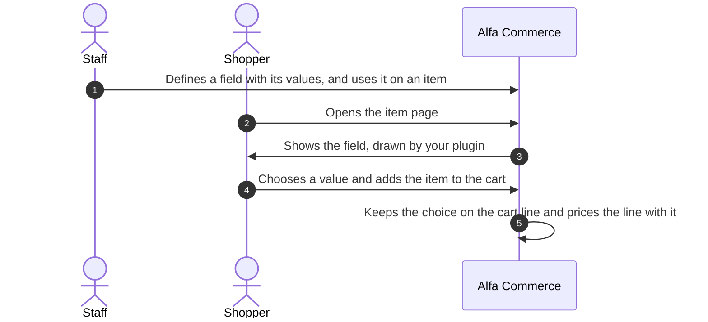
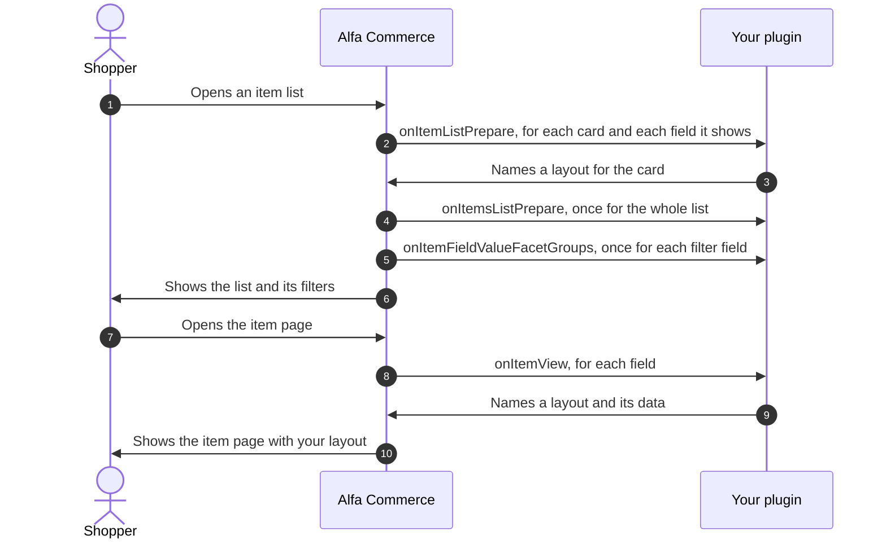
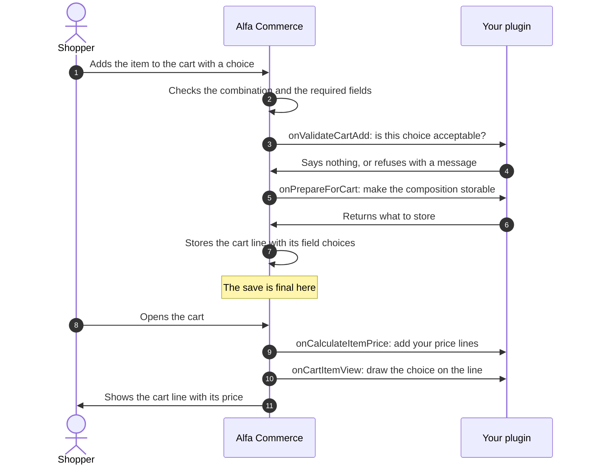

# Item field plugins

<CreatePluginButton type="itemfield" />

<AlfaVersion verified="2.2.0" />

**The pages of this guide:**

- **Item field plugins** (this page)
- [Item field plugin events](./item-field-plugin-events.md)
- [A complete item field plugin](./item-field-plugin-example.md)

An **item field** is a property of an item that the shopper sees or chooses: a size, a colour, an engraving.
Staff define the fields of their shop, and each field has a **type**. An item field plugin adds one type and
decides how a field of that type looks and behaves.

Do not confuse an item field with a [form field](./form-field-plugins.md), which is a field of the customer's
details. Both words are in the [glossary](../reference/glossary.md).

Read [How events reach a plugin](../events/how-events-reach-a-plugin.md) first. This page uses its words.

## What it does



The plugin group is `alfa-item-fields`. There is one plugin per type, and the plugin's element is the type's
name. Alfa Commerce ships one: `choice`, which draws a field's values as a list, radio buttons, buttons, swatches
or cards. One type can serve many fields: "Size" and "Colour" are both fields of the type `choice`.

Every field has a pool of **values** ("S", "M", "L"). Alfa Commerce owns the fields, the values and how an item
uses them. An item can use a field's values in three ways:

| Use | In plain words | The technical name |
|---|---|---|
| As a dimension of the item's combinations | The shopper must pick one value. Each allowed set of picks is one sellable **combination** with its own code and stock. | A **variant** field |
| As an extra | The shopper may pick a value the item offers. Staff can give each offered value a price change. | An **option** |
| As information | The value is shown as a specification. Nothing is chosen. | An **informational** field |

Alfa works out which combination the shopper's picks lead to, and the price changes of combinations and options,
without the plugin. The plugin is asked to **draw**, and may also **check**, **store its own data** and **add
price lines**.

A field's plugin can also take a **composition**: free data the shopper builds for the field, such as a text or
uploaded files, instead of one value of the pool. The code calls it the **payload**.

## When it is used

| Where | What your plugin does there | The event |
|---|---|---|
| The item page | Draws the field | `onItemView` |
| A card of an item list, for fields with "Show on listings" | Draws the field on the card | `onItemListPrepare` |
| The whole item list, once | Anything across the cards | `onItemsListPrepare` |
| The filters of an item list | Says how the field's values group together | `onItemFieldValueFacetGroups` |
| Adding to the cart | Checks the shopper's choice | `onValidateCartAdd` |
| Adding to the cart | Prepares a composition for storage | `onPrepareForCart` |
| The price of an item that was given a composition | Adds price lines | `onCalculateItemPrice` |
| A line of the cart | Draws the choice on the line | `onCartItemView` |
| The item's edit screen in the administrator | Offers buttons and runs them | `onGetFieldActions`, `onExecuteFieldAction` |
| Tools: Extensions | Removes the data the plugin owns | `onClearData` |

Ten of these eleven events are addressed to one plugin (targeted): Alfa sends them to the plugin of the field's
type and to nobody else. One, `onItemsListPrepare`, is announced to everyone (broadcast).

## The life of an item field

Showing the field:



Buying:



Steps 5 and 6 happen only for a field that takes a composition and was sent one. Step 10 happens only when the
line carries a composition.

At step 7 the storefront writes the cart line's row and then one row for each field choice, one statement after
the other, with no database transaction around them. Each write is final as soon as it is made, so there is no
later commit to wait for. If the write of a field choice fails, the shopper is told that the item could not be
added, and the line's row that was already written is not taken back.

## What you must provide

### The folder

The shipped `choice` plugin has this layout. Only the first four entries and the language files are needed.

```text
plugins/alfa-item-fields/choice/
    choice.xml                    the manifest
    services/provider.php         starts the plugin
    src/Extension/Choice.php      the plugin class
    tmpl/                         the layouts the class names: item-select.php, item-radio.php,
                                  item-buttons.php, item-swatches.php, item-cards.php, item-text.php,
                                  spec-default.php, facet-chip.php, default.php
    params/params.xml             settings of a field of this type
    params/value.xml              settings of one value of such a field
    src/Color/ChoiceColors.php    a helper class of this plugin
    language/en-GB/plg_alfa-item-fields_choice.ini
    language/en-GB/plg_alfa-item-fields_choice.sys.ini
```

### The base class

Your class extends `Alfa\Component\Alfa\Administrator\Plugin\ItemFieldsPlugin`
(`administrator/src/Plugin/ItemFieldsPlugin.php`). A plugin in this group that does not extend it is never called.

**How you declare an event.** You write a public method with the event's name. The base class holds the list of
the family's targeted events (`TARGETED_EVENTS`) and reports to Alfa each one your class has a method for. Do not
list them in `getSubscribedEvents()`.

The base class already has a method for eight of the eleven events, so you only override the ones you need:

| Event | The base class's own method |
|---|---|
| `onItemView`, `onItemListPrepare`, `onCartItemView`, `onCalculateItemPrice`, `onValidateCartAdd`, `onGetFieldActions` | Does nothing |
| `onExecuteFieldAction` | Answers with the error "Action ... is not implemented by ..." |
| `onItemsListPrepare` (broadcast) | Does nothing. The base class already lists it in `getSubscribedEvents()`. |
| `onItemFieldValueFacetGroups`, `onPrepareForCart`, `onClearData` | No method. Alfa treats your plugin as not handling them until you write one. |

The base class also gives you these helpers:

| Helper | What it does |
|---|---|
| `getItemConfig(int $itemId, int $fieldId): Registry` | Reads the settings your plugin stored for a field on one item |
| `editItemConfig(int $itemId, int $fieldId)` | Starts a change of those settings. Chain `set()` or `merge()`, end with `save()`. |
| `getEffectiveConfig(string $scope, int $scopeId, int $fieldId, int $itemId): Registry` | Reads the settings for one combination (`'combination'`) or one option (`'option'`), laid over the item's settings |
| `editVariantConfig(string $scope, int $scopeId, int $fieldId, int $itemId)` | Starts a change of those settings |
| `getConfig($event): Registry` and `saveConfig($event, array $config): bool` | Read and write the settings of the row an administrator action is about |
| `getLayoutPath(string $layout = 'default'): string` | The file of one of your layouts: the template's override when there is one, else your `tmpl` file |
| `fieldIds(): int[]` | The ids of every field of your type |

Your language file is loaded when the plugin starts.

### Layouts

Your plugin never returns HTML. It names a **layout**, a PHP file in its `tmpl` folder, and hands it data. Alfa
renders the file in the right place of the page. A template can override a layout by placing a file of the same
name in `templates/<template>/html/plg_alfa-item-fields_<element>/`.

The layout receives what you passed, as `$displayData`. If you pass no data, it receives the item.

### Settings

Both files are optional.

| File | Wrapper it must use | Where the values are stored | Where you read them |
|---|---|---|---|
| `params/params.xml` | `<fields name="itemfieldsparams">` | With the field | `$event->getField()->params_decoded` (an array) |
| `params/value.xml` | `<fields name="valueparams">` | With each value of the field | Each value's `params_decoded` |

Alfa stores both as JSON and never reads their content.

## What happens next

### Where everything is stored

Alfa Commerce owns all of these tables. A plugin reads and writes its own settings through the base class's
helpers, never with its own SQL.

| Table | What it holds |
|---|---|
| `#__alfa_item_fields` | The fields. `type` is the plugin's element. `params` holds your `params.xml` values. |
| `#__alfa_item_field_values` | The values of each field. `params` holds your `value.xml` values. |
| `#__alfa_item_combinations`, `#__alfa_item_combination_values` | An item's combinations, and the values each is made of |
| `#__alfa_item_option_values` | The values an item offers as options, each with its price change |
| `#__alfa_item_field_overrides` | Your plugin's settings for a field on one item |
| `#__alfa_item_combination_field_params` | Your plugin's settings for a field on one combination or option |
| `#__alfa_cart_item_fields` | The choices of a cart line: the value, and your composition in `payload` |
| `#__alfa_order_item_fields` | The choices of an order line, kept as they were when the order was placed |

### When the plugin is unavailable

A plugin is unavailable when it is disabled, not installed, cannot be loaded, or its Access is a level the
current visitor does not hold. Alfa never asks another plugin instead.

| Where | What Alfa does |
|---|---|
| The item page, the cards, the filters | The field is not drawn. Nothing is shown in its place. |
| Adding to the cart an item with a required field of that type | Refused. The shopper is told that the field cannot be chosen right now. |
| A cart line that carries a composition of that type, or whose item has a required field of that type | The line stays in the cart, marked with the reason and without a price. Its money is in no total. The order cannot be placed until the plugin is back or the shopper removes the line. |
| Other cart lines of the item | Priced without the plugin's price lines |
| Orders already placed | They keep their amounts |
| An administrator action of the plugin | Refused with a message |

Alfa writes one warning per plugin and request to Joomla's log, category `com_alfa.pricing`.

:::warning Access must be Public
A guest sees item pages and fills carts. An item field plugin whose Access (Extensions: Plugins) is not Public is
unavailable for guests, with every consequence above.
:::

## Language: the plugin carries its own strings

Every text your plugin shows is a key in its own language files: its name and description, the labels of its
settings, the texts of its layouts, the messages it sets on events. Alfa Commerce's own language files do not hold
them and must not be edited for them.

- `plg_alfa-item-fields_<element>.sys.ini` holds the name and the description shown in Extensions: Plugins.
- `plg_alfa-item-fields_<element>.ini` holds everything else.
- The file is loaded when the plugin starts, and before Alfa shows your settings in the field's edit screen.
- A message you pass to `setError()` or `setMessage()` must already be translated.

The names of fields and values are not the plugin's. Staff type them per language.

## What can go wrong

| What you see | The usual cause |
|---|---|
| Your method is never called | The class does not extend `ItemFieldsPlugin`, the method's name is not exactly the event's, or the method is not public |
| A targeted event never arrives | It was listed in `getSubscribedEvents()`. Targeted events are never delivered from there. |
| The field shows for staff and not for guests | The plugin's Access is not Public |
| "declared a variant selector ... but the field is NOT a combination dimension" | `variantSelector()` was used for an option, or `optionSelector()` for a variant field |
| Picking a value does nothing | The input does not use `$inputName`, or lacks `data-item-reload` |
| The field is on the item page and not on the cards | "Show on listings" is off for the field, or `onItemListPrepare` is not written |
| A composition is refused with "cannot take a custom design" | The plugin has no `onPrepareForCart` method |
| The price ignores your line | No composition exists, so the event did not fire. Or the line has no label or no operation, and the error went to the log, category `com_alfa.pricing`. |
| A cart line shows without a price and cannot be ordered | The plugin of one of its fields is unavailable |
| A button's action is refused | The action changes data and was not sent as a POST, or it was not offered by `onGetFieldActions` for that row |
| A fatal error: `onItemView` must be compatible | The method's signature differs from the base class. Write `public function onItemView($event): void`. |

Notes for authors of plugins written for earlier versions:

- Changed in 2.2.0: every event of this family except `onItemsListPrepare` is addressed to the field's own
  plugin through `TARGETED_EVENTS`. A plugin that extends the base class needs no change.
- Changed in 2.2.0: a disabled item field plugin is never started.
- Changed in 2.2.0: a cart line that needs an unavailable plugin is no longer priced without it. It stays in the
  cart without a price and cannot be ordered.

## Not documented yet

- The screens where staff define fields and values and build an item's combinations and options.
- How Alfa finds the combination for a set of picks, and how stock and price follow it.
- Field conditions on item fields beyond the reference above, and how a plugin publishes its own state for
  them.
- The full list of properties of the item, the field and the cart line that the events carry.
- How the admin order line editor sends compositions and files, and how the storefront sends full compositions
  and uploads.
- The remaining methods of an action button, and custom button layouts and popups declared on the button.
- How an order line keeps the field choices and the plugin's price lines after the order is placed.
- Search and filter indexing of field values.
