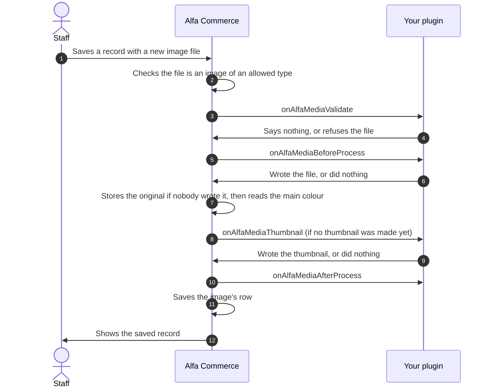

# Media plugins

<CreatePluginButton type="media" />

<AlfaVersion verified="2.2.0" />

A **media plugin** takes part when staff add an image to an item, a category, a manufacturer or a combination. It can
refuse a file, write the image in another format or size, write the thumbnail, and tidy up its own files.

No media plugin ships with Alfa Commerce 2.2.0. Everything on this page, the sample included, is taken from the
event classes and from the code that raises them. It could not be compared with a shipped plugin, because there is
none.

Read [How events reach a plugin](../events/how-events-reach-a-plugin.md) first. The words used here are explained in
the [Glossary](../reference/glossary.md).

## What it does

Alfa Commerce and a media plugin share the work on an image:

| Alfa Commerce always does this | A media plugin may do this |
|---|---|
| Checks that the file really is an image of an allowed type | Refuse a file for its own reasons |
| Chooses the folder and a file name nobody else uses | Write the image itself, in another format or size |
| Stores the file as it is when no plugin wrote it | Write the thumbnail in its own format and quality |
| Works out the image's main colour and stores it | Clean up extra files it made |
| Makes a thumbnail at the size set in Options when no plugin wrote one | |

So a shop without a media plugin works: images are stored unchanged and thumbnails are resized by Alfa.

## When it is used

- When staff save a record with a **new** image that is a file: one dropped on the page, or one picked from Joomla's
  media library. An image given as a web address is stored as that address and no media event is raised for it.
- When a thumbnail is made: for a new image, when staff pick another picture as an image's thumbnail, and when the
  background work started from Tools > Media makes thumbnails again.
- When staff delete rows on Tools > Media.

## Who receives the events

All five media events are **announced to everyone** (broadcast). Alfa first loads the enabled plugins of the group
`alfa-media`, then announces the event. Every loaded plugin that listed the event hears it, whatever its group.

There is no base class for this group. A media plugin extends Joomla's `CMSPlugin`, implements `SubscriberInterface`
and lists its events in `getSubscribedEvents()`.

The listeners are called one after the other with the **same event object**. What one listener sets, the next one
reads. If two media plugins are enabled, the second can see that the first already wrote the file.

A listener that throws an error does not stop the save. The error is written to Joomla's log (category
`com_alfa.plugins`) and the next listener runs.

## The order of events for a new image



Two things differ from what many expect:

- Alfa's own check comes **before** `onAlfaMediaValidate`. A file that is not an image of an allowed type never
  reaches `onAlfaMediaValidate`, `onAlfaMediaBeforeProcess` or `onAlfaMediaAfterProcess`.
- For a dropped file, and for any new image that arrives without a thumbnail picture, the thumbnail is made
  **after** the main image is stored, from the stored file. This is the order in the diagram. When the image arrives
  with a thumbnail picture named (a file picked from the media library names itself, or staff chose another picture
  on the image's tile), `onAlfaMediaThumbnail` fires first, before `onAlfaMediaValidate`, and not again afterwards.
  In that case it also fires before Alfa's own check of the file, so check the source yourself before you read it.

Planned for 2.2.1, which is not released: Alfa checks a thumbnail's source before it hands it to
`onAlfaMediaThumbnail`, resizes it or copies it. The source must lie inside one of the Media folders (Joomla's
Media file and image paths, and Alfa's own save folder, `images/commerce` unless Options say otherwise), carry one of
Media's image extensions, and be an image of that type. A source that fails never reaches the event. This rule is
not the main image's check, which uses the types allowed in Alfa's Options. A save of an item, category,
manufacturer or variant that names such a thumbnail is refused before anything is written, and the REST API answers
400 with the reason.

The events run while the record is being saved. A media event does not tell you whether the record's own save is
final.

Planned for 2.2.1, which is not released: an item's save is one transaction, and the media events of its images
(`onAlfaMediaValidate`, `onAlfaMediaBeforeProcess`, `onAlfaMediaAfterProcess`, and `onAlfaMediaThumbnail` for a
thumbnail made in that save) run inside it. What your listener writes to the shop's database there is undone with a
save that fails, and your listener is not told. A file you write, or a call to another service, stays. Work that
must not be undone belongs in an event heard after the save is final: `onContentAfterSave`, `onAlfaAdminAfterSave`
or `onItemAfterSave`.

## What all media events carry

Four of the five events share these getters (`MediaEvent`). `onAlfaMediaBeforeDelete` has none of them.

| Getter | Meaning |
|---|---|
| `getSource()` | The full path of the file to read. For a dropped file it is PHP's temporary upload file. |
| `getDest()` | The full path Alfa proposes for the stored file. Read it, never change it. Empty on `onAlfaMediaValidate`. |
| `getOrigin()` | What the image belongs to: `item`, `category`, `manufacturer` or `combination`. On the thumbnail event it is `thumbnail`. |
| `getField()` | `image` for the main image, `thumbnail` for the thumbnail event. |

## onAlfaMediaValidate

**When it fires.** For each new image file, after Alfa's own check passed and before anything is stored.

**Who receives it.** Announced to everyone.

**What you are given.** Event class `ValidateEvent`.

| Getter | Meaning |
|---|---|
| `getSource()`, `getOrigin()`, `getField()` | As in the table above. `getField()` is `image`. |
| `getAllowedMimes()` | The image types the shop allows (Options, Allowed Image Types). When the option is empty these are JPEG, GIF, PNG, BMP, WebP and AVIF. |
| `isValid()` | Whether the file is still accepted. `true` unless a listener refused it. |
| `getError()` | The message a listener set, or an empty text. |

**What you are expected to do.** Nothing, when the file is fine. To refuse it, call `setValid(false)` and
`setError()` with a message already in the reader's language.

**What happens next.** If the file was refused, Alfa skips it, shows your message to staff as an error, and goes on
with the other images of the record. Nothing is stored for the refused file. If the message is empty, the file is
skipped without a message.

**If you are missing or you fail.** The file is accepted.

## onAlfaMediaBeforeProcess

**When it fires.** For each new image file that passed validation, before it is stored.

**Who receives it.** Announced to everyone.

**What you are given.** Event class `BeforeProcessEvent`.

| Getter | Meaning |
|---|---|
| `getSource()`, `getDest()`, `getOrigin()`, `getField()` | As in the table above. `getField()` is `image`. |
| `getAllowedMimes()` | The image types the shop allows. |
| `isProcessed()` | `true` when a listener before you already wrote the file. |
| `getFinalPath()` | The path a listener set, otherwise the same as `getDest()`. |
| `getFormat()`, `getQuality()`, `getMaxWidth()`, `getMaxHeight()` | Not filled for the main image. They return an empty text, 80, 0 and 0. Do not size or convert by them. |

Alfa Commerce passes no format, quality or size for the main image. Your plugin decides those from its own settings.

**What you are expected to do.** Either leave the event alone, or write the image yourself:

1. Read `getSource()`.
2. Write your file into the folder of `getDest()`. You may change the extension, for example to `.webp`. Keep the
   rest of the file name: Alfa chose a name that no other file and no other image uses, in any extension.
3. Call `setFinalPath()` with the full path of the file you wrote.
4. Call `setProcessed(true)`.

Call `setProcessed(true)` only after your file exists.

**What happens next.** When a listener set `processed`, Alfa does not copy the original. It stores the path from
`getFinalPath()` on the image's row and reads the main colour from that file. When no listener did, Alfa copies the
original to `getDest()` unchanged.

**If you are missing or you fail.** The original is stored unchanged.

## onAlfaMediaThumbnail

**When it fires.** Whenever Alfa makes a thumbnail: for a new image, when staff chose another picture as the
thumbnail, and for each image the Tools > Media thumbnail jobs handle. The jobs run as background work, so this
event can fire with no member of staff on the page.

**Who receives it.** Announced to everyone.

**What you are given.** Event class `ThumbnailEvent`. It extends `BeforeProcessEvent`, so it has the same getters
and setters, with these differences:

| Getter | Meaning |
|---|---|
| `getSource()` | The image the thumbnail is made from. |
| `getDest()` | The proposed thumbnail file: the image's name with `-thumb` added. |
| `getOrigin()`, `getField()` | Both `thumbnail`. |
| `getMaxWidth()`, `getMaxHeight()` | The thumbnail size from Options. A new installation uses 500 by 500. The thumbnail must fit inside this box. |
| `getFormat()`, `getQuality()` | Not filled. The format and the quality are yours to choose. |

**What you are expected to do.** Alfa owns the size, you own the format and the quality. Either leave the event
alone, or write a thumbnail that fits the box, then call `setFinalPath()` and `setProcessed(true)`, as for the main
image.

**What happens next.** When a listener set `processed`, Alfa uses the file at `getFinalPath()` if that file exists.
If it does not exist, the image gets no thumbnail. When no listener did, Alfa resizes the image itself, in the
source's own format, and falls back to a plain copy only when the server cannot resize it. Planned for 2.2.1, which
is not released: the plain copy is made only of a source that passed the thumbnail check above.

**If you are missing or you fail.** Alfa's own resize makes the thumbnail.

## onAlfaMediaAfterProcess

**When it fires.** After a new image file was stored and its main colour was read, just before its row is saved.

**Who receives it.** Announced to everyone.

**What you are given.** Event class `AfterProcessEvent`.

| Getter | Meaning |
|---|---|
| `getSource()`, `getOrigin()`, `getField()` | As in the shared table. `getField()` is `image`. |
| `getDest()` | The full path of the file that was stored (the plugin's file when one wrote it). |
| `getColor()` | The image's main colour as Alfa read it, for example `rgb(120,80,40)`. Empty when it could not be read. |
| `isProcessed()` | Whether a plugin wrote the file. |

**What you are expected to do.** Your own follow-up work, if any. The event has no setters.

**What happens next.** Alfa saves the image's row. Nothing you do here changes it.

**If you are missing or you fail.** Nothing changes.

## onAlfaMediaBeforeDelete

**When it fires.** In 2.2.0, when staff delete image rows on Tools > Media, just before the rows and their files are
removed. Up to 500 rows are announced at a time.

It does **not** fire when staff remove one image from a record's gallery, or when an item, a category, a
manufacturer or a combination is deleted with its images.

**Who receives it.** Announced to everyone.

**What you are given.** Event class `BeforeDeleteEvent`. It carries no source, destination, origin or field.

| Getter | Meaning |
|---|---|
| `getRows()` | The rows about to be deleted. Each is an object with `id`, `path` and `thumbnail`. |
| `getPaths()` | The same paths and thumbnails as one flat list of texts, without a leading slash. A row that holds a web address appears as that address. |

**What you are expected to do.** Remove the extra files your plugin made for these images. Leave the image file and
its thumbnail alone: Alfa deletes them itself, and only when no other image uses the same file.

**What happens next.** Alfa deletes the files and the rows.

**If you are missing or you fail.** The rows and files are deleted all the same.

## What can go wrong

| What you see | The cause |
|---|---|
| A saved image whose file does not exist | The plugin called `setProcessed(true)` on `onAlfaMediaBeforeProcess` without writing the file. Alfa then stores the path and copies nothing. |
| An image with no thumbnail | The plugin called `setProcessed(true)` on `onAlfaMediaThumbnail` and the file at `getFinalPath()` does not exist. |
| Images of 0 by 0 pixels, or an error while resizing | The plugin sized the main image by `getMaxWidth()` and `getMaxHeight()`, which are 0 there. |
| The path on the row looks wrong | `setFinalPath()` was given a path that is not a full path inside the site. |
| The plugin seems to do nothing, without any message | Its listener threw an error. Look in Joomla's log, category `com_alfa.plugins`. |
| Extra files stay behind after an image is removed from a record | `onAlfaMediaBeforeDelete` is not raised there in 2.2.0. |

## A complete media plugin

This plugin refuses very large pictures, stores every image as WebP and writes WebP thumbnails. It uses PHP's GD
functions for the image work. Every Alfa Commerce class and method in it is one of those described above.

The files:

```text
plugins/alfa-media/webp/
    webp.xml
    services/provider.php
    src/Extension/Webp.php
    language/en-GB/plg_alfa-media_webp.ini
    language/en-GB/plg_alfa-media_webp.sys.ini
```

### webp.xml

```xml
<?xml version="1.0" encoding="UTF-8"?>
<extension type="plugin" group="alfa-media" method="upgrade">
    <name>PLG_ALFA_MEDIA_WEBP</name>
    <author>Acme</author>
    <creationDate>2026-11-12</creationDate>
    <copyright>(C) 2026 Acme</copyright>
    <license>GNU General Public License version 3 or later; see LICENSE</license>
    <version>1.0.0</version>
    <description>PLG_ALFA_MEDIA_WEBP_XML_DESCRIPTION</description>
    <namespace path="src">Acme\Plugin\AlfaMedia\Webp</namespace>
    <files>
        <folder plugin="webp">services</folder>
        <folder>src</folder>
    </files>
    <languages folder="language">
        <language tag="en-GB">en-GB/plg_alfa-media_webp.ini</language>
        <language tag="en-GB">en-GB/plg_alfa-media_webp.sys.ini</language>
    </languages>
    <config>
        <fields name="params">
            <fieldset name="basic">
                <field name="quality" type="number" default="82" min="1" max="100"
                       label="PLG_ALFA_MEDIA_WEBP_QUALITY_LABEL" />
                <field name="max_side" type="number" default="6000" min="1"
                       label="PLG_ALFA_MEDIA_WEBP_MAX_SIDE_LABEL" />
            </fieldset>
        </fields>
    </config>
</extension>
```

### services/provider.php

```php
<?php

\defined('_JEXEC') or die;

use Acme\Plugin\AlfaMedia\Webp\Extension\Webp;
use Joomla\CMS\Extension\PluginInterface;
use Joomla\CMS\Factory;
use Joomla\CMS\Plugin\PluginHelper;
use Joomla\DI\Container;
use Joomla\DI\ServiceProviderInterface;

return new class () implements ServiceProviderInterface {
    public function register(Container $container)
    {
        $container->set(
            PluginInterface::class,
            function (Container $container) {
                $plugin = new Webp(
                    (array) PluginHelper::getPlugin('alfa-media', 'webp'),
                );
                $plugin->setApplication(Factory::getApplication());

                return $plugin;
            },
        );
    }
};
```

### src/Extension/Webp.php

```php
<?php

namespace Acme\Plugin\AlfaMedia\Webp\Extension;

use Alfa\Component\Alfa\Administrator\Event\Media\BeforeProcessEvent;
use Alfa\Component\Alfa\Administrator\Event\Media\ThumbnailEvent;
use Alfa\Component\Alfa\Administrator\Event\Media\ValidateEvent;
use Joomla\CMS\Language\Text;
use Joomla\CMS\Plugin\CMSPlugin;
use Joomla\Event\SubscriberInterface;

\defined('_JEXEC') or die;

final class Webp extends CMSPlugin implements SubscriberInterface
{
    protected $autoloadLanguage = true;

    public static function getSubscribedEvents(): array
    {
        return [
            'onAlfaMediaValidate' => 'onAlfaMediaValidate',
            'onAlfaMediaBeforeProcess' => 'onAlfaMediaBeforeProcess',
            'onAlfaMediaThumbnail' => 'onAlfaMediaThumbnail',
        ];
    }

    public function onAlfaMediaValidate(ValidateEvent $event): void
    {
        $size = @getimagesize($event->getSource());
        $limit = (int) $this->params->get('max_side', 6000);

        if ($size !== false && max($size[0], $size[1]) > $limit) {
            $event->setValid(false);
            $event->setError(Text::sprintf('PLG_ALFA_MEDIA_WEBP_TOO_LARGE', $limit));
        }
    }

    public function onAlfaMediaBeforeProcess(BeforeProcessEvent $event): void
    {
        // Another media plugin already wrote the file.
        if ($event->isProcessed()) {
            return;
        }

        // The main image: no size comes with the event, so the picture keeps its own.
        $written = $this->write($event->getSource(), $event->getDest(), 0, 0);

        if ($written !== '') {
            $event->setFinalPath($written);
            $event->setProcessed(true);
        }
    }

    public function onAlfaMediaThumbnail(ThumbnailEvent $event): void
    {
        if ($event->isProcessed()) {
            return;
        }

        // The thumbnail: Alfa Commerce gives the box it must fit in.
        $written = $this->write($event->getSource(), $event->getDest(), $event->getMaxWidth(), $event->getMaxHeight());

        if ($written !== '') {
            $event->setFinalPath($written);
            $event->setProcessed(true);
        }
    }

    /**
     * Write $source as WebP beside $dest and return the path written, or '' when nothing was written.
     */
    private function write(string $source, string $dest, int $maxWidth, int $maxHeight): string
    {
        if (!\function_exists('imagewebp') || !is_file($source)) {
            return '';
        }

        $image = @imagecreatefromstring((string) file_get_contents($source));

        if ($image === false) {
            return '';
        }

        imagepalettetotruecolor($image);

        if ($maxWidth > 0 && $maxHeight > 0) {
            $ratio = min($maxWidth / imagesx($image), $maxHeight / imagesy($image), 1);

            if ($ratio < 1) {
                $scaled = imagescale(
                    $image,
                    max(1, (int) round(imagesx($image) * $ratio)),
                    max(1, (int) round(imagesy($image) * $ratio)),
                );

                if ($scaled !== false) {
                    $image = $scaled;
                }
            }
        }

        imagealphablending($image, false);
        imagesavealpha($image, true);

        // The name Alfa Commerce proposed, with the extension changed.
        $target = \dirname($dest) . '/' . pathinfo($dest, PATHINFO_FILENAME) . '.webp';
        $quality = (int) $this->params->get('quality', 82);

        return imagewebp($image, $target, $quality) && is_file($target) ? $target : '';
    }
}
```

When the server cannot write WebP, `write()` returns an empty text, the event is left alone, and Alfa stores the
original and makes its own thumbnail.

This plugin makes no extra files: the WebP file is the image itself, and Alfa deletes it with the image. So it does
not listen to `onAlfaMediaBeforeDelete`.

### language/en-GB/plg_alfa-media_webp.ini

```ini
PLG_ALFA_MEDIA_WEBP="Alfa Media - WebP"
PLG_ALFA_MEDIA_WEBP_XML_DESCRIPTION="Stores gallery images and their thumbnails as WebP."
PLG_ALFA_MEDIA_WEBP_QUALITY_LABEL="WebP quality (1 to 100)"
PLG_ALFA_MEDIA_WEBP_MAX_SIDE_LABEL="Largest side accepted, in pixels"
PLG_ALFA_MEDIA_WEBP_TOO_LARGE="The image is larger than %d pixels on one side and was not added."
```

### language/en-GB/plg_alfa-media_webp.sys.ini

```ini
PLG_ALFA_MEDIA_WEBP="Alfa Media - WebP"
PLG_ALFA_MEDIA_WEBP_XML_DESCRIPTION="Stores gallery images and their thumbnails as WebP."
```

Install the plugin through Joomla's Extensions: Install and enable it under Extensions: Plugins. The conventions of
the manifest are explained in the [Plugin overview](./overview.md#the-manifest).

## Changed in 2.2.0

- Every image gets a real thumbnail at the size set in Options. Before, an uploaded image used its full file as its
  thumbnail. So `onAlfaMediaThumbnail` now fires for uploads too.
- Tools > Media can make thumbnails again in the background. `onAlfaMediaThumbnail` fires there as well.
- A file name is free only when no file and no image row uses it in any extension. A plugin that changes the
  extension no longer risks overwriting another item's image.
- A plugin that claims a thumbnail and writes no file leaves the image without a thumbnail, instead of a thumbnail
  path that points at nothing.
- Two images never share one file, and deleting an image removes only files no other image uses.
- An image's description holds at most 75 characters (`MediaHelper::ALT_MAX_LENGTH`). A longer one is shortened at
  save and staff are told. The REST API refuses a longer one.

## Not documented yet

- Settings that differ by what the image belongs to (a different size for items than for categories, for example).
  The event gives `getOrigin()`, but no shipped plugin shows a settings layout for it.
- How a media plugin behaves for images written through the REST API.
- A sample checked against a shipped media plugin. None ships in 2.2.0.
