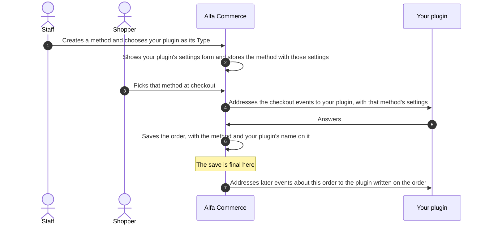

# Plugin overview

<AlfaVersion verified="2.2.0" />

Alfa Commerce is extended with Joomla plugins. A plugin adds to the shop without changing Alfa's own files, so an
update of Alfa Commerce does not undo it.

This page is the way in to the plugin pages. It lists the plugin types, helps you choose one, and collects the rules
that hold for all of them. The words used here are explained in the [Glossary](../reference/glossary.md).

## What it does

A plugin can:

- take payments, and handle a payment provider's answers and refunds;
- price a delivery, book it with a carrier and follow the parcel;
- add a kind of field to the customer's details (a phone number, a country);
- add a kind of field to items (a size, a colour) that shoppers see or choose;
- check, convert and resize the images staff add;
- answer the shop's searches from a search engine of its own;
- add columns, buttons, menu entries, dashboard cards, permissions, tools and whole screens to the administrator;
- add a charge to the cart, or refuse an order before it is placed;
- react when something happens in the shop: an order changed status, stock moved, prices changed;
- add commands to Joomla's command line.

Alfa tells plugins what is happening through **events**. How an event gets to a plugin is the same for every type
and is explained once, in [How events reach a plugin](../events/how-events-reach-a-plugin.md). Read that page before
any page listed below.

## The plugin types in 2.2.0

A plugin's **group** is the folder it lives in under `plugins/`. It says what kind of plugin it is. A **base class**
is the class a plugin of that group extends; the base classes are in `administrator/src/Plugin`.

| Type | Group | Base class | Ships with Alfa Commerce | Page |
|---|---|---|---|---|
| Payment | `alfa-payments` | `PaymentsPlugin` | `standard` | [Payment plugins](./payment-plugins.md) |
| Shipping | `alfa-shipments` | `ShipmentsPlugin` | `standard` | [Shipping plugins](./shipment-plugins.md) |
| Form fields | `alfa-form-fields` | `FormFieldsPlugin` | `tel`, `text`, `textarea`, `choice`, `country` | [Form field plugins](./form-field-plugins.md) |
| Item fields | `alfa-item-fields` | `ItemFieldsPlugin` | `choice` | [Item field plugins](./item-field-plugins.md) |
| Media | `alfa-media` | None. Joomla's `CMSPlugin`. | Nothing | [Media plugins](./media-plugins.md) |
| Search engines | `alfa-search` | `SearchEnginePlugin` | Nothing, on purpose | [Search engine plugins](./search-plugins.md) |
| Feature plugins | `alfa` | None. Joomla's `CMSPlugin`. | Nothing | [Admin screens](./admin-screen-plugins.md) and [Admin panels](./admin-panels.md) |
| System, console and task (Joomla's own plugin types) | `system`, `console`, `task` | None. Joomla's `CMSPlugin`. | `system`: `alfasync`. `console`: `alfa`. `task`: nothing. | [System, console and task plugins](./system-console-task-plugins.md) |

For the five groups with a base class, Alfa checks that the plugin really extends it. A plugin in `alfa-payments`
that does not extend `PaymentsPlugin` is refused.

Alfa Commerce also ships one `webservices` plugin, which registers the addresses of the REST API. It is not a type
you write.

## Plugin and method

Payment and shipping plugins have one idea the other types do not have.

- The **plugin** is the code. It is installed once.
- A **method** is a record that staff create in the administrator and that a shopper picks at checkout: "Bank
  transfer", "Courier". Each method belongs to one plugin, chosen as the method's Type, and carries that plugin's
  settings.

One plugin can serve several methods. A carrier plugin could serve "Courier, next day" and "Courier, economy", each
a method with its own name, price settings and limits, both handled by the same code.



What this asks of you:

- The settings a method carries come from the file `params/params.xml` in your plugin's folder. Alfa loads that form
  into the method's edit screen when staff choose your plugin as the Type.
- Your plugin is always told which method it is working for. Never assume there is only one.
- An order keeps the name of the plugin that took its payment or shipment (the **plugin of record**). Alfa keeps
  using that plugin for the order, even if staff later delete the method or change its settings.

Form field and item field plugins work in a similar way: staff create a field, choose your plugin as its type, and
the field carries your plugin's settings. Their pages explain it.

## Which type do I need

| You want to | Write a |
|---|---|
| Take money through a gateway or a provider | Payment plugin |
| Charge for delivery, book a parcel, show tracking | Shipping plugin |
| Offer a new kind of field in the customer's details at registration and checkout | Form field plugin |
| Offer a new kind of item property, with its own look on the item page | Item field plugin |
| Convert or compress item images | Media plugin |
| Answer searches from your own index | Search engine plugin |
| Add a column, a button, a menu entry, a dashboard card, a tool or a screen to the administrator | Feature plugin |
| Add a fee or a discount line to the cart, or stop an order that breaks a rule of yours | Feature plugin |
| React to orders, stock or prices, for example to pass them to another system | Feature plugin |
| Do any of the reacting above from a plugin that must also run outside the shop's pages | System plugin |
| Add a command to Joomla's command line | Console plugin |
| Run your own work on a timetable | Task plugin, with Joomla's Scheduled Tasks |

System, console and task plugins are Joomla's own plugin types, not Alfa Commerce's. Joomla has more of them
(content, user, authentication, fields and others): choose the one that fits your purpose from
[Joomla's documentation on plugins](https://manual.joomla.org/docs/building-extensions/plugins/).

When in doubt between a feature plugin and a system plugin, choose the feature plugin. Alfa loads the `alfa` group
whenever the shop runs and only then, and some events go only to that group.

## The rules every plugin shares

Each rule is explained in full on [How events reach a plugin](../events/how-events-reach-a-plugin.md). In short:

### Two ways an event reaches a plugin

An event is either **announced to everyone** (broadcast) or **addressed to one plugin** (targeted). You list the
first kind in `getSubscribedEvents()`. You declare the second kind through your base class, or through
`getTargetedHandlers()`. An event name goes in one of the two, never in both, and a method that is not declared is
never called. See
[Announced to everyone](../events/how-events-reach-a-plugin.md#announced-to-everyone-broadcast) and
[Addressed to one plugin](../events/how-events-reach-a-plugin.md#addressed-to-one-plugin-targeted).

### Naming yourself

Whenever your plugin adds something to Alfa (a column, a card, a tool, a cart charge, a search engine), it names
itself first as **group.element**, for example `alfa-payments.standard`. It is a label for logs and messages, not a permission.
A contribution without it is refused. See
[Naming your plugin](../events/how-events-reach-a-plugin.md#naming-your-plugin).

### The plugin of record

Alfa writes on each order, payment and shipment which plugin handled it, and keeps calling that plugin. If that
plugin is disabled or removed, Alfa refuses the request and tells staff. It never asks another plugin instead. See
[What can go wrong](../events/how-events-reach-a-plugin.md#what-can-go-wrong).

### The save is final

A change is stored as one unit. The moment it is stored for good is the **commit**; this manual's diagrams mark it
"The save is final here". In a "before" event nothing is saved yet and you may refuse. In an "after" event the
change is saved and cannot be undone by you. Write "after" listeners so that running them twice does no harm. See
[Where the save becomes final](../events/how-events-reach-a-plugin.md#where-the-save-becomes-final).

### Each extension owns its language

Every extension carries its own texts in its own language files. Alfa's files hold only Alfa's own texts, and your
plugin's texts are in your plugin's files (since 2.1.1). All of these files are in Joomla's language folders (since
2.1.2): `administrator/language/` followed by the language tag for the component and for plugins, `language/`
followed by the tag for the storefront and for modules. Joomla's installer puts them there from your package.

Since 2.2.0 Alfa does not load your plugin's language when your plugin adds something to a screen. Your plugin loads
its own. The Alfa base classes do that for you (`$autoloadLanguage`); a plugin that extends `CMSPlugin` directly
sets `protected $autoloadLanguage = true;` itself.

Alfa Commerce ships in English only. Other languages are separate language packs.

## The manifest

Every shipped plugin has a manifest of the same shape. This is the Standard payment plugin's
(`plugins/alfa-payments/standard/standard.xml`), shortened by its empty `config` block:

```xml
<?xml version="1.0" encoding="UTF-8"?>
<extension type="plugin" group="alfa-payments" method="upgrade">
	<name>PLG_ALFA_PAYMENTS_STANDARD</name>
	<copyright>(C) 2024-2026 Easylogic CO LP / Agamemnon Fakas. All rights reserved.</copyright>
	<license>GNU General Public License version 3 or later; see LICENSE</license>
	<author>Agamemnon Fakas</author>
	<creationDate>2025-03-04</creationDate>
	<authorEmail>info@easylogic.gr</authorEmail>
	<authorUrl>http://easylogic.gr</authorUrl>
	<version>2.2.0</version>
	<description>PLG_ALFA_PAYMENTS_STANDARD_XML_DESCRIPTION</description>
	<namespace path="src">Alfa\Plugin\AlfaPayments\Standard</namespace>
	<files>
		<folder plugin="standard">services</folder>
		<folder>src</folder>
		<folder>tmpl</folder>
		<folder>params</folder>
    </files>
    <languages folder="language">
        <language tag="en-GB">en-GB/plg_alfa-payments_standard.ini</language>
        <language tag="en-GB">en-GB/plg_alfa-payments_standard.sys.ini</language>
    </languages>
	<media destination="plg_alfa-payments_standard" folder="media">
		<folder>js</folder>
		<filename>joomla.asset.json</filename>
	</media>
</extension>
```

| Line | The convention |
|---|---|
| `extension` | `type="plugin"`, the `group`, and `method="upgrade"` so that installing a newer package updates the plugin. |
| `name` | A language key built from the group and the element: `PLG_ALFA_PAYMENTS_STANDARD`. The key is in both language files, so Joomla shows the plugin's real name. The shipped `system` and `console` plugins write it in lower case (`plg_system_alfasync`). |
| `version` | The shipped plugins carry Alfa Commerce's own version, `2.2.0`. Your plugin carries its own. |
| `namespace` | `path="src"`, then your vendor name, `Plugin`, the group in capitals without the hyphen, and the element: `Alfa\Plugin\AlfaPayments\Standard`. Use your own vendor name in place of `Alfa`. |
| `files` | The `services` folder carries the attribute `plugin` with the element. It holds `provider.php`, which creates the plugin. `src` holds the class, `tmpl` the layouts, `params` the settings form of a method or a field. |
| `languages` | Two files per language: the plugin's texts and its `.sys.ini` (the name and description Joomla shows in its lists). Their names are `plg_`, the group, an underscore, the element. |
| `media` | Only when the plugin has scripts or styles. The destination is named like the language files. |

### How the shipped plugins are installed and enabled

The shipped plugins are inside the Alfa Commerce package. The component's manifest (`alfa.xml`) lists them, and the
component's installer script (`script.php`) installs or updates each one through Joomla's installer and then
**enables** it. That happens on every installation and every update of Alfa Commerce.

A plugin of your own is a package of its own. Staff install it through Joomla's Extensions: Install, and Joomla
leaves a new plugin disabled until staff enable it under Extensions: Plugins. A payment or shipping plugin must also
keep its Access on Public, or providers and carriers cannot call it.

## The installer gate

### What it does

`AlfaInstallerGate` (`administrator/src/Service/Setup/AlfaInstallerGate.php`) is one small class that every Alfa
extension uses when it is installed. It does two things:

- It refuses to install or update an extension on a site whose Alfa Commerce is missing or older than the version
  the extension needs, with one wording for every extension.
- It provides the warning shown when an Alfa extension is uninstalled: the extension's data stays.

It never refuses anything because the shop is being cleared or maintained, and it never refuses an uninstall.

### When it is used

In your extension's installer script, in `preflight()`, which Joomla calls before it copies any file.

### What you must provide

State the oldest Alfa Commerce version your extension works with, and ask the gate. This is the form the class
itself prescribes. Replace `Example plugin` with your extension's name.

```php
public const MIN_ALFA_VERSION = '2.2.0';

public function preflight($type, $parent): bool
{
    $gate = \Alfa\Component\Alfa\Administrator\Service\Setup\AlfaInstallerGate::class;
    $file = JPATH_ROOT . '/administrator/components/com_alfa/src/Service/Setup/AlfaInstallerGate.php';

    if (!class_exists($gate) && is_file($file)) {
        require_once $file;
    }

    if ($type === 'uninstall') {
        return true;
    }

    if (!class_exists($gate)) {
        // No Alfa Commerce on this site, or one older than 2.1.0.
        \Joomla\CMS\Factory::getApplication()->enqueueMessage(sprintf(
            'Example plugin requires Alfa Commerce %1$s or later, and this site has no Alfa Commerce %1$s or later'
            . ' installed. Install or update Alfa Commerce first, then install Example plugin again. Nothing was changed.',
            self::MIN_ALFA_VERSION,
        ), 'error');

        return false;
    }

    $refusal = $gate::refusal(name: 'Example plugin', route: (string) $type, minimum: self::MIN_ALFA_VERSION);

    if ($refusal !== null) {
        \Joomla\CMS\Factory::getApplication()->enqueueMessage($refusal, 'error');

        return false;
    }

    return true;
}
```

The messages are plain English on purpose: at this moment of an installation no language file of your extension is
loaded yet.

### What happens next

| The site | What `refusal()` returns | What staff see |
|---|---|---|
| Has Alfa Commerce at or above your minimum | `null` | The installation goes on. |
| Has an older Alfa Commerce | A sentence naming your extension, your minimum and the version found | The installation stops. Nothing was changed. |
| Is uninstalling your extension | `null` | The uninstall goes on. |

When an Alfa plugin or package is uninstalled, Alfa Commerce itself tells staff that its data stays and that
complete cleanup is done before uninstalling, under Tools > Extensions > Clear Data. Your extension does not print
that warning. Alfa treats as an Alfa extension a plugin whose group name starts with `alfa`, a plugin whose
namespace starts with `Alfa\`, a module whose name starts with `mod_alfa`, and a package whose name starts with
`pkg_alfa`.

### What can go wrong

| What you see | The cause |
|---|---|
| The plugin installs on a site with an Alfa Commerce that is too old, then fails | The installer script has no `preflight()` that asks the gate. |
| The installation stops with "requires Alfa Commerce" | The site's Alfa Commerce is older than `MIN_ALFA_VERSION`. Update Alfa Commerce first. |
| The uninstall warning is not shown when the extension is uninstalled through Joomla | The System - Alfa Commerce Sync plugin is disabled. It is the one that says it. |

## Changed in 2.2.0

- A plugin that handles Alfa events is a `SubscriberInterface` plugin. Broadcast events go in
  `getSubscribedEvents()`, targeted events in the targeted declaration, never in both.
- Every contribution names its plugin as group.element.
- Alfa no longer loads a contributing plugin's language. The plugin loads its own.
- `onCartTotals`, `onOrderPlaceValidate` and `onCartItemDisplay` go only to plugins of the `alfa` group.
- A disabled plugin is never started for a targeted event, and Alfa never falls back to another plugin.

## Not documented yet

- The group `alfa-inventory`, whose plugins can offer a stock allocation provider through the event
  `onCollectStockAllocationProviders`. It has no page yet.
- The complete list of events, with how each is delivered and what it carries.
- Packaging several plugins as one Joomla package (`pkg_alfa` followed by a name).
- A full installer script file around the `preflight()` shown above.
