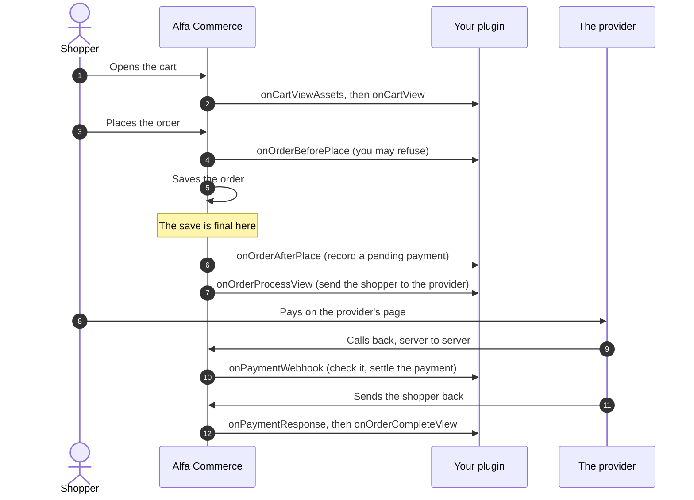
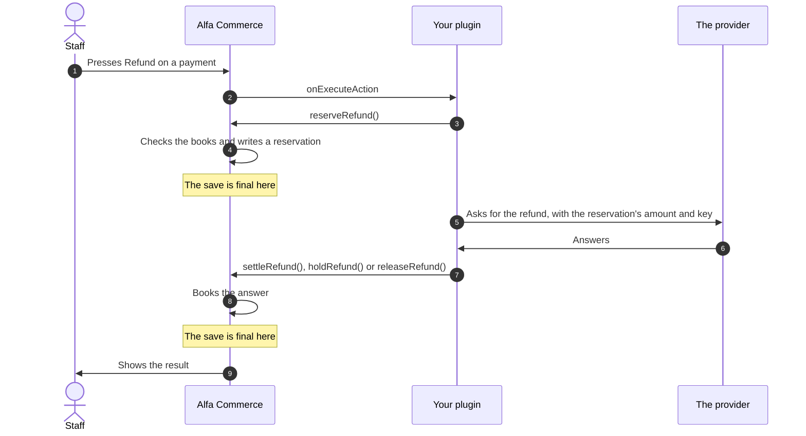

# Payment plugins

<AlfaVersion verified="2.2.0" />

A payment plugin connects Alfa Commerce to one way of paying: a bank transfer, cash on delivery, or a payment
provider's hosted page. This page is for the author of such a plugin, called a **gateway** below.

Read [How events reach a plugin](../events/how-events-reach-a-plugin.md) first. Words such as "method", "plugin of
record", "ledger" and "commit" are explained in the [Glossary](../reference/glossary.md).

## What it does

A payment plugin is a Joomla plugin in the group `alfa-payments` whose class extends the base class
`Alfa\Component\Alfa\Administrator\Plugin\PaymentsPlugin`. It does four jobs:

- it draws its part of the item page, the cart and the order pages;
- it records a payment for each order placed with one of its methods, and settles that payment when the money
  arrives;
- it answers its provider's return and callback;
- it gives staff the buttons to act on a payment (mark as paid, cancel, refund).

**Plugin and method.** The plugin is the code. A [method](../reference/glossary.md#plugins-and-events) is one
configured use of it, the record a shopper picks at checkout, with its own name and its own settings. One plugin can
serve several methods.

**The plugin of record.** When an order is placed, Alfa writes the plugin's element on the order, and on every
payment row the plugin writes. From then on Alfa asks that plugin, and only that plugin, about that order and that
row. It never asks another plugin instead, whatever the method's settings say later.

**The base class is the whole payment API.** A gateway records, reads and refunds payments through methods of
`PaymentsPlugin`. It never calls the ledger class `PaymentLedger` and never reads or writes the table
`#__alfa_order_payments` itself. A need the base class does not cover is a request to the Alfa Commerce project, not a
query of your own.

## When it is used

Write a payment plugin when the shop needs a way of paying that the Standard plugin (`alfa-payments.standard`, the
offline method that ships with Alfa Commerce) does not cover. Use the Standard plugin as your model: it is in
`plugins/alfa-payments/standard`. Trust its code over its comments: some of its comments describe older wiring.

## What you must provide

| You provide | Where | Notes |
|---|---|---|
| A manifest | `<element>.xml` | `group="alfa-payments"`, a `<namespace>` for `src` |
| A service provider | `services/provider.php` | Builds your class from `PluginHelper::getPlugin('alfa-payments', '<element>')` |
| The plugin class | `src/Extension/<Name>.php` | Extends `PaymentsPlugin` |
| Layouts | `tmpl/*.php` | What your plugin draws |
| Method settings | `params/params.xml` | Optional. See [Method settings](#method-settings) |
| A log table description | `params/logs.xml` | Optional. See [Logging](#logging) |
| Language files | `language/en-GB/plg_alfa-payments_<element>.ini` and `.sys.ini` | See [Language](#language) |

Your class **must** write these four methods, because the base classes declare them abstract:

```php
public function onItemView($event): void;
public function onCartView($event): void;
public function onOrderProcessView($event): void;
public function onOrderCompleteView($event): void;
```

Every other event is optional. You take part in an event by writing a public method with the event's name. Nothing
is listed in `getSubscribedEvents()`: all payment events are addressed to one plugin (targeted), and the base class
reports your methods to Alfa.

Changed in 2.2.0. The base class's `getSubscribedEvents()` returns an empty list. If your plugin needs a Joomla
event of its own, override it and merge with `parent::getSubscribedEvents()`.

:::warning A written method is a live endpoint
Because writing the method is the declaration, a method you add "for later" is called. The Standard plugin has no
`onPaymentWebhook` for that reason: with it, the shop would accept callbacks for a method that has no provider.
:::

:::warning Access must be Public
A provider calls your plugin as a guest. Set the plugin's Access (Extensions: Plugins) to Public, or callbacks are
answered "try again later".
:::

## What happens next: the life of a payment



What the picture means:

- **Before step 5 nothing is saved.** Refusing in `onOrderBeforePlace` costs one failed checkout and leaves no order.
- **After step 5 the order exists for good.** `onOrderAfterPlace` cannot undo it. If your plugin fails there, the
  order stays, without a payment row.
- **Steps 9 and 11 can arrive in either order**, and each can arrive twice. The callback is the proof of payment. The
  shopper's return only decides which page the shopper sees.
- **An offline method stops after step 7.** It sets nothing in `onOrderProcessView`, the shopper goes to the
  completed page, and staff settle the payment later with a button.
- **Settling is its own save.** When your plugin settles a payment, Alfa writes the payment row and makes that save
  final. Only then, and after Alfa's locks are released, does the order move to the status the method's settings name
  (see [The order's status](#the-orders-status)).

The other events are not part of this timeline: `onItemView` (the item page), `onGetActions` and `onExecuteAction`
(staff), `onAdminOrderDelete`, `onPaymentCheckup` (the method's settings page), `onClearData` (Tools), and the two
stored credential events.

### The life of a refund through a provider



The reservation (step 4) is saved before the provider is asked, so a second click, or a second member of staff,
cannot start the same refund twice. The provider is called with no lock and no database transaction open. The verbs
are explained under [Refunds](#refunds).

## The events

All sixteen events of `PaymentsPlugin::TARGETED_EVENTS` are addressed to one plugin. Which plugin depends on the
event: the plugin of an offered method, the plugin recorded on the order, the plugin recorded on the payment row, or
the plugin named in the address. If that plugin cannot be used, Alfa never asks another one:

| What was asked | What Alfa does when your plugin is unavailable |
|---|---|
| A new order with one of your methods | Refuses the order before anything is saved |
| The item page or the cart | Does not offer your method and draws nothing for it. The page is shown. |
| An order page (process or completed) | Shows a neutral line in place of your part and changes nothing |
| The shopper's return | Shows an error message and sends the shopper to the shop's home page |
| A provider's callback | Answers "503 Service Unavailable" with `Retry-After: 600`, and raises one alert for staff |
| A staff action, or deleting an order | Refuses it, names the plugin as Extensions: Plugins does, and says how to restore it |

The event classes are in the namespace `Alfa\Component\Alfa\Administrator\Event\Payments`, except `ClearDataEvent`.

:::warning Keep the parameter untyped where the base class declares the method
The base classes declare `onItemView`, `onCartView`, `onCartViewAssets`, `onOrderProcessView`, `onOrderCompleteView`,
`onGetActions`, `onExecuteAction` and `onAdminOrderDelete` with an untyped `$event`. PHP does not let a child class
narrow a parameter, so write `($event)` for these eight. A class name before `$event` there stops your plugin from
loading. The other events are yours to type.
:::

### onItemView

Event class: `ItemViewEvent`. You must write this method.

**When it fires.** While the item page is built, once for each payment method of the item that is set to show on
the item page.

**Who receives it.** One plugin: the plugin of that method.

**What you are given.**

| Getter | Meaning |
|---|---|
| `getItem()` | The item being shown |
| `getMethod()` | The method's record: `id`, `name`, `description`, and `params` already decoded to an array |

**What you are expected to do.** Call `setLayout('<file in tmpl, without .php>')` and `setLayoutData([...])`. To draw
somewhere else on the page, ask for a place and set its layout: `paymentMethods()` (the default place),
`title()` (beside the item's title) or `nearAddToCart()`; each returns a builder with `setLayout()` and `setData()`.
Change nothing on the item.

**What happens next.** Alfa draws your layout in the payment methods area of the item page.

**If you are missing or you fail.** Nothing is drawn for your method, the error is written to Joomla's log (category
`com_alfa`), and the page is shown.

### onCartViewAssets

Event class: `CartViewAssetsEvent`. Optional.

**When it fires.** Once per plugin while the cart page, or the administrator's order builder, is built as HTML. It
fires for every plugin that owns a published method, whether the cart offers that method now or not. It never fires
inside a JSON answer.

**Who receives it.** One plugin at a time: each plugin that owns a published payment method.

**What you are given.**

| Getter | Meaning |
|---|---|
| `getWebAssetManager()` | Joomla's asset manager, to declare your script and stylesheet |
| `getDocument()` | The page being built, for `addScriptOptions()` |
| `getMethods()` | Your published methods, keyed by id, each a `Method` object (see [Method settings](#method-settings)) |
| `getKind()` | `'payment'` |
| `getRequest()` | The kind, the methods and the document as one `CartAssetsRequest` object (`->kind`, `->methods`, `->document`) |

**What you are expected to do.** Declare the scripts and styles your cart panel needs. Name only dependencies from a
registry file you add here, or Alfa's own.

**What happens next.** Your assets are in the page's head before the shopper's first click.

**If you are missing or you fail.** Nothing is declared, the failure is logged, and the page is shown.

### onCartView

Event class: `CartViewEvent`. You must write this method.

**When it fires.** Once for each offered method, every time the cart is worked out. That includes the JSON answers
that replace the methods block after the shopper changes something.

**Who receives it.** One plugin: the plugin of that offered method.

**What you are given.**

| Getter | Meaning |
|---|---|
| `getMethod()` | The method as a `Method` object: `id()`, `name()`, `description()`, `isSelected()`, `params()`, `param('key', $default)` |
| `getCart()` | The cart as it is now, read only. It cannot change the cart. |
| `getRequest()` | Both of the above as one `MethodViewRequest` object (`->method`, `->cart`) |

**What you are expected to do.** Call `setLayout()` and `setLayoutData()`. Pass only what the layout prints. The
layout must be markup and `data-` attributes only: a script declared or printed there is lost the first time the
block arrives as JSON. Declare scripts in `onCartViewAssets`.

**What happens next.** Alfa draws your layout beside the method in the cart.

**If you are missing or you fail.** Your markup is left out and the failure is logged as a warning (category
`com_alfa.cart`). The method stays offered and the cart is shown. With Joomla's Debug System on, the error is thrown
instead of logged.

### onOrderBeforePlace

Event class: `OrderBeforePlaceEvent`. Optional.

**When it fires.** When the shopper (or staff) places an order with one of your methods, before anything is saved.

**Who receives it.** One plugin: the plugin of the chosen payment method.

**What you are given.** `getContext()` returns a `PlacementEventContext` with read only values: `cartId`, `lines`,
`customerId` (0 for a guest) and `shipmentMethodId`. The cart itself cannot be reached or replaced.

**What you are expected to do.** Check what you need. To refuse the order, throw an exception.

**What happens next.** If you return normally, Alfa saves the order.

**If you are missing or you fail.** The order is refused and nothing is saved. A thrown error is written to Joomla's
log (category `com_alfa.orders`).

### onOrderAfterPlace

Event class: `OrderAfterPlaceEvent`. Optional, but this is where almost every gateway starts.

**When it fires.** Once per order, right after the order's save is final. The shipment row does not exist yet.

**Who receives it.** One plugin: the plugin of the order's payment method.

**What you are given.** `getOrder()` returns the order as an `Order` object. Read it with methods, not properties:
`id()`, `reference()`, `total()`, `currency()`, `paymentMethodId()`.

**What you are expected to do.** Record the first payment attempt, as pending:

```php
public function onOrderAfterPlace($event): void
{
    $order = $event->getOrder();

    // Only an order this plugin takes.
    if ($this->getPaymentMethod(orderId: $order->id()) === null) {
        return;
    }

    // Nothing left to collect: write no row.
    if ($this->amountToCollect($order) <= 0.000001) {
        return;
    }

    $paymentId = $this->payment($order)->pending()->save();
}
```

Do not throw: the order is already saved.

**What happens next.** The shopper is sent to the order process page, where `onOrderProcessView` fires.

**If you are missing or you fail.** The order stays. No payment row is written, and the failure is written to
Joomla's log (category `com_alfa.orders`), as critical when your method threw.

### onOrderProcessView

Event class: `OrderProcessViewEvent`. You must write this method.

**When it fires.** When the order process page is shown, right after placement, and again each time the shopper
opens that page.

**Who receives it.** One plugin: the plugin recorded on the order.

**What you are given.**

| Getter | Meaning |
|---|---|
| `getOrder()` | The order, as an `Order` object |
| `getMethod()` | The order's method record (`params` decoded to an array), or `null` |

**What you are expected to do.** One of three things:

| You do | The shopper |
|---|---|
| Nothing | Goes straight to the completed page. Right for an offline method, and when there is nothing to collect. |
| `setRedirectUrl($url)` | Is sent to that address, for example the provider's payment page |
| `setLayout()` and `setLayoutData()` | Sees your layout on the process page: a form that posts to the provider, or a "payment was cancelled" message with a retry button |

**What happens next.** As in the table. A redirect uses the code you set with `setRedirectCode()`, or 303.

**If you are missing or you fail.** The page shows a neutral line with the order's number and a link to try again.
It does not move on to the completed page, because that would read as a payment taken.

### onOrderCompleteView

Event class: `OrderCompleteViewEvent`. You must write this method.

**When it fires.** When the order completed page is shown.

**Who receives it.** One plugin: the plugin recorded on the order.

**What you are given.** `getOrder()` (an `Order` object) and `getMethod()` (the method record, or `null` when the
method no longer exists).

**What you are expected to do.** Call `setLayout()` and `setLayoutData()` to add your part, such as bank details for
a transfer. You may redirect with `setRedirectUrl()` instead.

**What happens next.** Alfa draws your layout on the completed page.

**If you are missing or you fail.** The page is shown without your part, with a neutral line. It never states a
payment the order does not hold.

### onPaymentResponse

Event class: `PaymentResponseEvent`. Optional. Write it when your provider sends the shopper back to the shop.

**When it fires.** When the shopper's browser arrives at your return address (see
[Return and webhook addresses](#return-and-webhook-addresses)).

**Who receives it.** One plugin: the plugin named by `method=<element>` in the address.

**What you are given.**

| Getter | Meaning |
|---|---|
| `getMethod()` | Your plugin's element, as the address named it |
| `getOrder()` | Always `null` in 2.2.0. Alfa does not load an order from an untrusted address. |

Everything else you read from the request yourself. The request is untrusted: anyone can type the address.

**What you are expected to do.** Find the order yourself, from your provider's own signed data or with
`orderFromReturnLink()`. Decide where the shopper goes and call `setRedirectUrl()`:
`$this->getCompletePageUrl()` when the payment succeeded, `$this->getProcessPageUrl()` with a flag of your own
(for example `&mygateway_result=cancelled`) when it did not. This event has no page and no layout: it can only
redirect, so always set a redirect. Never mark a payment paid because the shopper came back. Settle only what your
provider has proved.

**What happens next.** Alfa redirects the shopper to the address you set. A plain `index.php?...` address of this
site is turned into a friendly address for you.

**If you are missing or you fail.** If the plugin is unavailable, the shopper sees an error message and the home
page. If your plugin has no `onPaymentResponse`, the shopper is sent to the cart. An error your method throws reaches
Joomla's error page.

### onPaymentWebhook

Event class: `PaymentWebhookEvent`. Optional. Write it when your provider calls the shop server to server.

**When it fires.** When your provider's server calls your webhook address. There is no shopper, no session and no
page.

**Who receives it.** One plugin: the plugin named by `method=<element>` in the address.

**What you are given.**

| Getter or setter | Meaning |
|---|---|
| `getMethod()` | Your plugin's element |
| `getOrder()` | Always `null` in 2.2.0 |
| `setResponseCode(int)` | The HTTP status answered to the provider. Default 200. |
| `setResponseBody(string)` | The body. Default `OK`. Plain machine text, never translated. |
| `setContentType(string)` | Default `text/plain; charset=utf-8` |
| `setJsonResponse(array $payload, int $code = 200)` | Sets code, body and content type in one call |

**What you are expected to do.** In this order: read the raw body, prove the provider sent it, find your payment row
by the provider's reference, check the amount against that row, settle once, answer. A full example is under
[Authenticating a callback](#authenticating-a-callback).

**What happens next.** Alfa sends your code, body and content type to the provider and ends the request.

**If you are missing or you fail.**

| Situation | Alfa answers the provider |
|---|---|
| The plugin is disabled, missing, not loaded for a guest, or fails to start, and a method of the shop uses it | 503 with `Retry-After: 600`, an alert for staff, a warning in the log (category `com_alfa.plugins`) |
| Your method throws an error | 500, and the error is logged, so the provider tries again |
| Your plugin has no `onPaymentWebhook`, the element in the address is not a valid name, or the plugin cannot be used and no method of the shop uses it | 404 |

A callback that was not processed is never answered with a 2xx code.

### onGetActions

Event class: `GetPaymentActionsEvent`. Optional. The base class registers no buttons.

**When it fires.** When the administrator's order page draws the action buttons of a payment row.

**Who receives it.** One plugin: the plugin recorded on that payment row.

**What you are given.**

| Getter | Meaning |
|---|---|
| `getPayment()` | The payment row, with among others `id`, `payment_type`, `transaction_status`, `transaction_id`, `payment_method_type` and `amount` |
| `getOrder()` | The order, as an `Order` object |
| `add(string $id, string $label)` | Adds a button and returns a `PluginAction` to describe it |

**What you are expected to do.** Add only the buttons that make sense for the row's status. See
[Staff actions](#staff-actions).

**What happens next.** Alfa draws the buttons, highest `priority()` first.

**If you are missing or you fail.** No buttons are offered. When the plugin is unavailable, the order page says so
at its top and in the row's Actions cell.

### onExecuteAction

Event class: `ExecutePaymentActionEvent`. Optional. The base class answers "Unknown action".

**When it fires.** When staff press one of your buttons, or a button of your action page.

**Who receives it.** One plugin: the plugin recorded on the payment row.

**What you are given.**

| Getter or setter | Meaning |
|---|---|
| `getAction()` | The id of the button pressed |
| `getPayment()` | The payment row. `amount` is a `Money` object and `params` is the method record. |
| `getOrder()` | The order, as an `Order` object |
| `getData()` | Always an empty array for payments. Read posted values from the request input. |
| `setMessage(string)` | A success message for staff |
| `setError(string)` | Marks the action failed and sets the message |
| `setRefresh(bool)` | Reload the order page afterwards |
| `setRedirectUrl(string)` | Send staff to another address. Overrides the reload. |
| `setLayout(string)`, `setLayoutData(array)` | Draw one of your layouts on the action page (details, a form) |
| `addButton(string $label, array $opts = [])` | A footer button on the action page. `$opts`: `action` (run another action of this payment), `data`, `reload`, `class` |

**What you are expected to do.** Do the work through the base class, then report with `setMessage()` or
`setError()`.

**What happens next.** Staff see your message, your layout, or the reloaded order page.

**If you are missing or you fail.** Before your plugin runs, Alfa refuses the request when the plugin is
unavailable, when the button is no longer offered for the row, when an action that changes something is not a POST
with an unused one-time key, or when the refund block holds for an action that starts a refund. An error your method
throws is yours: catch what you can explain and report it with `setError()`.

### onAdminOrderDelete

Event class: `AdminOrderDeleteEvent`. Optional. The base class allows the deletion.

**When it fires.** When staff delete an order, once for each payment row of the order that records your plugin.
Rows that record a reversal, a chargeback or store credit are not asked about.

**Who receives it.** One plugin: the plugin recorded on the payment row.

**What you are given.**

| Getter or setter | Meaning |
|---|---|
| `getOrder()` | The order, as an `Order` object |
| `getMethod()` | In this event, the **payment row**, not the method |
| `setResult(bool)` | `false` refuses the deletion. The default is `true`. |

**What you are expected to do.** Call `setResult(false)` when the order must stay, for example while it holds money
you captured.

**What happens next.** If no plugin refuses, the order is deleted.

**If you are missing or you fail.** While your plugin is unavailable its answer cannot be asked, so the order is not
deleted and staff are told which plugin to restore.

### onPaymentCheckup

Event class: `PaymentCheckupEvent`. Optional.

**When it fires.** When the settings page of one of your methods draws its setup checkup, and when staff press
"Check connection" there. The checkup appears where your `params.xml` places a field of type `paymentcheckup`.

**Who receives it.** One plugin: the plugin of that method.

**What you are given.**

| Getter or setter | Meaning |
|---|---|
| `getMethodId()` | The method's id |
| `getParams()` | The method's **saved** settings, as a Joomla `Registry` |
| `getVariant()` | `'sandbox'`, `'live'` or `'general'` (the `variant` attribute of the field) |
| `isInUse()` | Whether this variant is the one new payments use. Always `false` for `'general'`. |
| `isCheck()` | `true` only when staff pressed "Check connection". Call your provider only then. |
| `offerCheck()` | Shows the "Check connection" button |
| `addStep(string $title, string $status, string $help = '', string $detail = '')` | Adds a step. `$status` is `PaymentCheckupEvent::DONE`, `TODO`, `FAILED`, `MANUAL` or `UNAVAILABLE`. In `$help`, `{webhook}` and `{return}` are replaced by this site's addresses. |
| `setLastChecked(string)` | One line shown beside the button |
| `webhookUrl()`, `returnUrl()` | Your addresses in the form a provider can reach |

**What you are expected to do.** Add your setup steps in order. A checkup only reads: it never moves money and never
changes the method.

**What happens next.** Alfa draws the steps on the method's settings page.

**If you are missing or you fail.** Staff see one notice in place of the steps, and a thrown error is logged
(category `com_alfa.payments`).

### onPaymentStoreReference and onPaymentChargeReference

Event classes: `StoreReferenceEvent` and `ChargeReferenceEvent`. Optional. They are for a gateway that can charge a
saved card or mandate without the shopper present, and that says so by returning `true` from `supportsRecurring()`.

**When they fire.** The core repository of 2.2.0 defines both events and their contract, but contains no code that
sends them. See [Not documented yet](#not-documented-yet).

**Who receives them.** One plugin.

**What you are given.**

| Event | Getters | Setters |
|---|---|---|
| `StoreReferenceEvent` | `getOrder()`, `getPayment()` (the completed payment row) | `setReference(array $reference, string $label = '', ?string $expiresAt = null)` |
| `ChargeReferenceEvent` | `getOrder()`, `getAmount()` (`Money`), `getCurrencyCode()`, `getReference()` (the array you stored), `getOperation()` | Exactly one of `setSuccess(string $transactionId)`, `setFailure(string $error)`, `setPending(string $reference, string $reason)` |

**What you are expected to do.** In the first, hand back whatever you need to charge again later. You do not store
it. In the second, charge the amount against the stored reference and answer exactly once: success when the provider
confirmed this charge, failure when you know no money moved, pending whenever the request may have reached the
provider and you hold no definite answer. Never throw, and never return without answering.

**What happens next.** The caller keeps the reference, and writes the payment row for a charge.

**If you are missing or you fail.** For a charge, a handler that throws or does not answer is treated as an unknown
outcome: nothing is booked and nothing is charged again.

### onClearData

Event class: `Alfa\Component\Alfa\Administrator\Event\Tools\ClearDataEvent`. Optional.

**When it fires.** When staff run Clear Data, or "Remove extension and its data", for your plugin under Tools >
Extensions, or run Clear everything.

**Who receives it.** One plugin: yours. It can be called while your plugin is disabled.

**What you are given.** `getSource()`: `ClearDataEvent::CLEAR_DATA`, `REMOVE_WITH_DATA` or `CLEAR_EVERYTHING`.

**What you are expected to do.** Remove the data your plugin owns. Report with `setMessage()` (what was removed) or
`setError()` (what may remain and why), both already translated. Leave no database transaction open.

**What happens next.** Staff see your line on the result page.

**If you are missing or you fail.** A plugin without this method is shown as "Automatic Clear Data not supported" and
none of its data is touched. A thrown error, or a transaction left open, is reported as a failure.

## Recording and settling a payment

A payment row is one attempt to pay. An order can hold several: a retry, a deposit and its balance. The order counts
as paid from the sum of its completed rows.

You write a row with a **builder**: an object you describe the row to, ending with `save()`.

```php
// A new row for an order. The amount is what is still to collect.
$paymentId = $this->payment($order)->pending()->transactionId($myReference)->save();

// A change to an existing row. Only what you set is written.
$this->paymentUpdate($paymentId)->cancelled()->note('Customer request')->save();
```

| Builder call | Meaning |
|---|---|
| `pending()`, `authorized()`, `completed()`, `failed()`, `cancelled()`, `refunded()` | The row's status. A new row must have one: without it `save()` throws a `RuntimeException`. |
| `amount(Money\|string\|int\|float $amount)` | The amount. Left out, a new row takes the amount still to collect. |
| `transactionId(string $id)` | Your reference first, the provider's id once it is known |
| `processedAt(string $datetime)` | When the money moved, in UTC |
| `note(string $note)`, `gatewayResponse(string $json)` | A note for staff, the provider's raw answer |
| `method(int $methodId)` | Another method of your plugin |
| `pluginData(array $data)`, `removePluginData(array $keys)` | Your own data on the row, merged key by key. Read it through the `Payment` reader (`Alfa\Component\Alfa\Site\Service\Order\Payment`): `Payment::of($payment)->pluginData()->getString('key')`. The rows of `$order->payments()` are already such readers. |
| `expectStatus(string $status)` | Write only if the row still has this status (see `settleAttempt()`) |
| `bookkeeping()` | Change the row without moving the order or telling the customer |
| `save()` | Writes. Returns the row's id, or `false`. |

### The verbs

| Verb | What it does | When to use it | What it guarantees | What it refuses |
|---|---|---|---|---|
| `amountToCollect(object $order): float` | The amount your gateway should charge: the order's total less what is already collected | Before every charge | Never negative | Nothing. `0.0` means: charge nothing and write no row. |
| `payment(object $order)` | Starts a builder for a new row | `onOrderAfterPlace`, a new attempt | The row records your plugin as its writer | `save()` answers `false` when the method is not one of your plugin's |
| `paymentUpdate(int $paymentId)` | Starts a builder for an existing row | Any change to a row | Only what you set is written | Throws `RuntimeException` when the row does not exist. Refuses a row that is not your plugin's. |
| `settleAttempt(PaymentLedger $write, int $orderId, string $reference = ''): int` | Writes a builder that has `expectStatus()` set, and tells you which of three things happened | Every time a provider confirms a payment | Of two callers, exactly one changes the row. When the books refuse money that has moved, a CRITICAL line goes to your log. | Returns `self::WRITE_OK`, `self::WRITE_RACED` (the other caller won, agree with it) or `self::WRITE_FAILED` (not in the books) |
| `claimPendingAttempt(int $paymentId, string $reference): bool` | Writes a provider reference on a pending row that has none, once | When two visits or two deliveries could both take the same attempt | Exactly one caller gets `true`. No money and no status move. | A blank reference and an id under 1 throw `InvalidArgumentException`. `false` when the row is not, or no longer, your pending attempt without a reference. |
| `supersedeAttempt(int $paymentId, string $reason = ''): int` | Closes a pending attempt nobody will pay | The shopper left, or started a new attempt | The order does not move and the customer is told nothing | Returns the same three `WRITE_` values. Another plugin's row is `WRITE_FAILED`. |
| `recordChargeback(int $paymentId, Money $amount, array $options = []): array` | Records money the customer's bank took back | A dispute your provider reports | Never moves the order | Another plugin's payment |
| `recordReversal(int $rowId, ?Money $amount = null, array $options = []): array` | Records that a booked refund or a chargeback did not stand | A reversed refund, a dispute you won | The original row is never edited. A new row names it. | Another plugin's row |
| `deletePayment(int $id, int $orderId): bool` | Deletes a payment row | Rarely | Only your own rows | Another plugin's row, or one that records no plugin |
| `orderTransition(int $orderId)` | Moves the order to a status, in your plugin's name: `->to($statusId)->save()` | Only for a moment the method's status settings cannot express | The same steps as any status change | |

Since 2.2.0. Every call above that changes or deletes a row acts only on a row your plugin wrote.

### Reading

| Verb | Returns |
|---|---|
| `getOrder(int $orderId): ?Order` | The order, the same kind of object the events hand you |
| `orderLanguage(Order\|int $order): string` | The language tag of the order's customer, for example `el-GR` |
| `gatewayPayments(int $orderId, int\|array $methodId = 0): array` | Your plugin's payment rows on the order, newest first. Refund rows are left out. |
| `latestPendingPayment(int $orderId, int $methodId = 0): ?object` | Your newest pending attempt on the order, or `null` |
| `gatewayPaymentByReference(array $references, int $orderId = 0, int\|array $methodId = 0): ?object` | Your row whose `transaction_id` is exactly one of these references, or `null` |
| `getPayment(int $id): ?object` | One payment row |
| `getPaymentsByOrder(int $orderId): array` | Every row of the order, from every plugin. Right for totals, wrong for "which attempt is mine". |
| `orderBalance(int $orderId): Money` | Since 2.2.0. The order's total less what the shop still holds. Above zero: still owed. Zero: settled. Below zero: overpaid. Throws when the order does not exist. |
| `countReferenceHolders(string $reference, array $types): int` | Since 2.2.0. How many of your rows of those types hold exactly this reference. Anything but 1 proves nothing. |
| `findOwnRowByReference(string $reference, array $types): ?int` | Since 2.2.0. The id of the one row of yours that holds the reference, or `null` when none or several do |
| `findLinkedRow(int $paymentId, string $type, string $reference): ?object` | The refund or chargeback row of a payment with this exact provider reference |
| `firstMethodRow(int $methodId, string $kind): ?array` | Since 2.2.0. For the checkup only: a method's first settled payment (`self::FIRST_PAID`) or first refund (`self::FIRST_REFUND`), as `id`, `order`, `moment` |

Amounts on the rows you read are `Money` objects in the order's currency. The one exception is the row
`findLinkedRow()` returns: it holds only `id`, `amount`, `transaction_status` and `transaction_id`, and its `amount`
is the stored figure, not `Money`. A reference is compared whole: letter case
and spaces count. The `$types` are `self::TYPE_PAYMENT`, `TYPE_AUTHORIZATION`, `TYPE_REFUND`, `TYPE_REVERSAL` and
`TYPE_CHARGEBACK`.

### The order's status

You never move the order yourself when a payment changes. A method's settings can name an order status for each
payment status, in fields called `status_on_<payment status>` (the Standard plugin has `status_on_completed`,
`status_on_cancelled` and `status_on_refunded`). When a row **changes** to that status, Alfa moves the order.

- A new row never moves the order, whatever its status. Write the row as pending, then change it with
  `paymentUpdate()`. `payment($order)->completed()->save()` counts in the totals but moves nothing.
- Only a row that takes money in moves the order. A refund, reversal or chargeback row does not.
- A full refund moves the order (through `status_on_refunded`). A partial refund does not.

Changed in 2.2.0. The order moves after the payment row's save is final and Alfa's locks are released, not before
`save()` returns when your code holds a lock or a transaction of its own.

## Refunds

There are two ways to refund, and they must not be mixed.

| Your method | Use |
|---|---|
| Has no provider (cash, bank transfer): the refund moves no money through your plugin | `refundPayment()` |
| Refunds through a provider | `reserveRefund()`, then the provider, then `settleRefund()`, `holdRefund()` or `releaseRefund()` |

Never start a refund with the builder (`payment($order)->refund()...`).

**The refund block.** A provider can report a refund that Alfa's books do not hold, for example one made in the
provider's own portal. While such a report is open on an order, no new refund may start on it. Staff resolve the
report first.

### Before the refund: what may be refunded

| Verb | What it tells you | When to use it |
|---|---|---|
| `refundableNow(object $order): Money` | What the order may still give back, less everything reserved | To decide whether to offer a Refund button |
| `refundableRemainder(int $paymentId): Money` | What is left on one payment, less its reservations | To decide whether to offer a Refund button |
| `refundFormMaximum(int $paymentId): Money` | What is left on the payment, held to what the order may still refund. Zero for a payment that is not completed. | The maximum of every refund form. Use this figure and do no arithmetic of your own. |
| `refundStartRefusal(object $order): ?string` | Why no refund may start on the order now (translated), or `null` | To explain the refund block to staff |
| `refundTypeFor(int $paymentId, ?Money $amount = null): string` | Since 2.2.0. `self::REFUND_FULL` or `self::REFUND_PARTIAL` for a refund of this amount. `null` means all that is left. | For your log or your message. Throws when the row is not a payment of yours or the amount is not positive. |

### A refund with no provider

```php
$result = $this->refundPayment((int) $payment->id, null, ['reason' => $reason]);

if ($result['outcome'] !== self::OUTCOME_OK) {
    $event->setError($result['reason']);
}
```

`refundPayment(int $paymentId, ?Money $amount = null, array $options = []): array`

- **What it does.** Writes the refund row and, once the settled refunds cover the payment, marks the payment
  refunded. One call, decided under the order's lock.
- **The amount.** `null` is the only way to say "everything that is left". A partial refund is a positive `Money` in
  the order's currency.
- **What it guarantees.** A second call on a refunded payment writes nothing (`OUTCOME_ALREADY_REFUNDED`). The same
  provider refund reference twice writes nothing (`OUTCOME_DUPLICATE`).
- **What it refuses.** Zero or a negative amount (`OUTCOME_NOT_REFUNDABLE`), a payment of another plugin
  (`OUTCOME_REFUSED`), a start while the refund block holds (`OUTCOME_BLOCKED`).
- **What it returns.** `['outcome' => ..., 'refund_id' => int, 'reason' => string, 'amount' => float]`.

`$options`: `reason`, `transaction_id` (the provider's id of **the refund**, never the payment's),
`gateway_response`, `document` (the credit document the refund settles), and for money a provider already moved:
`gateway_moved`, `request_key`, `report_id`.

With `'gateway_moved' => true` the same verb books a refund the provider **already made** and that no reservation
covers, such as one made in the provider's portal. That money is never refused: when the books cannot take it, Alfa
keeps it on a row for staff and answers `OUTCOME_UNRECONCILED`.

### A refund through a provider

| Verb | What it does | What it guarantees | What it refuses or returns |
|---|---|---|---|
| `reserveRefund(int $paymentId, ?Money $amount = null, array $options = []): array` | Decides whether the refund may start and sets the amount aside as a pending refund row. `null` means the form's maximum. `$options`: `mark`, `reason`, `document`. | The reservation is saved before it returns, so every other start counts it. It never marks the payment refunded. | Returns `outcome`, `reservation` (its id), `key` (send it to the provider as the idempotency key), `amount` (send exactly this), `full`, `reason`. Anything but `self::OUTCOME_RESERVED` means: send nothing. |
| `settleRefund(int $reservationId, Money $amount, ?string $providerRefundId, array $options = []): array` | The provider completed the refund: books it | Booked once per provider refund id. The provider's figure is booked as it is, also above the reservation. | `OUTCOME_UNRECONCILED` when the books cannot hold it: Alfa keeps it for staff |
| `holdRefund(int $reservationId, ?string $providerRefundId, ?Money $amount = null, array $options = []): array` | The provider accepted the refund but has not completed it: it stays reserved under the provider's id | Nothing is booked yet | |
| `releaseRefund(int $reservationId, string $reason, array $options = []): array` | The provider definitely refused: gives the reserved amount back | Nothing is booked | Never use it for an unknown outcome |
| `refundReservation(int $reservationId): ?array` | Reads one reservation: `reservation`, `payment`, `order`, `amount`, `status`, `key`, `providerRefundId` | Read only | `null` when there is none |
| `reportOutcome(int $paymentId, string $reportId): ?array` | Reads what Alfa keeps for one of your provider refund reports | Read only. It never calls your plugin. | `null` when Alfa keeps none |

`settleRefund()`, `holdRefund()` and `releaseRefund()` each return
`['outcome' => ..., 'refund_id' => int, 'reason' => string, 'amount' => float]`. The outcome of a call that did its
work is `self::OUTCOME_OK` for a settle, `self::OUTCOME_RESERVED` for a hold and `self::OUTCOME_RELEASED` for a
release. `self::OUTCOME_DUPLICATE` means it was already so and nothing was written. `self::OUTCOME_RACED` and
`self::OUTCOME_FAILED` mean nothing was written and a retry may succeed. `self::OUTCOME_REFUSED` means a retry cannot
help.

The `$options` of `settleRefund()` are `final`, `gateway_response`, `reason`, `processed_at` and `report_id`. Pass
`'final' => true` when this is the last, or the only, refund your provider makes for the reservation: what the
reservation still holds beyond the provider's figure is then given back. `holdRefund()` takes `final`,
`gateway_response` and `report_id`. `releaseRefund()` takes `status` (`self::STATUS_FAILED`, the default, or
`self::STATUS_CANCELLED`), `provider_refund_id` and `gateway_response`.

```php
$reserved = $this->reserveRefund((int) $payment->id, $amountOrNull, ['reason' => $reason]);

if ($reserved['outcome'] !== self::OUTCOME_RESERVED) {
    $event->setError($reserved['reason']);

    return;
}

// Ask your provider here for exactly $reserved['amount'], with the key $reserved['key'].
// Then report the answer:
//   completed:        $this->settleRefund($reserved['reservation'], $providerAmount, $providerRefundId, ['final' => true]);
//   accepted, pending: $this->holdRefund($reserved['reservation'], $providerRefundId);
//   refused for good:  $this->releaseRefund($reserved['reservation'], $providerReason);
//   no clear answer:   report nothing. The reservation stays until a callback or staff resolve it.
```

Four rules for a gateway:

1. Call every refund verb **outside any database transaction**. Inside one, `settleRefund()`, `holdRefund()`,
   `releaseRefund()` and `refundPayment()` with `gateway_moved` answer `OUTCOME_FAILED` and write nothing, and a
   reservation is saved only when that transaction is.
2. Hold no lock and no transaction while you call the provider.
3. Sending the same request again uses the same reservation and the same key. Never reserve again for a resend.
4. Declare the buttons that start a refund with `startsRefund()` (see [Staff actions](#staff-actions)).

### Telling Alfa about refunds it does not hold

`public function unbookedProviderRefunds(int $paymentId): array`

Override it when your provider can report refunds that did not start in the shop. It returns the refunds your
provider reported on this payment and that the books do not hold, oldest first, one entry per refund:

| Key | Value |
|---|---|
| `reportId` | A stable identity built only from the provider's facts: `'refund:'` and the provider's refund id, or else `'txn:'` and the id of the provider transaction that carries the refund, or else `'facts:'` and a SHA-256 of the payment reference, amount, currency and the provider's own time of the refund. The same refund always gives the same `reportId`, pending or settled. |
| `id` | The provider's refund id, or `null` |
| `amount` | A `Money` in the order's currency, or `null` when none can be derived exactly |
| `providerAmount`, `providerCurrency` | The figure and currency as the provider stated them |
| `reportedOn` | When your plugin first kept the report (`Y-m-d H:i`, site time) |
| `status` | `self::REPORT_STATUS_SETTLED` or `self::REPORT_STATUS_PENDING` |

The method only reads your own log and the books. It writes nothing and never calls the provider. A refund your
plugin started through `reserveRefund()` is never listed. The base class answers an empty list, which is right for a
method with no provider.

## Return and webhook addresses

A plugin has no address of its own. Alfa provides two and finds your plugin by the `method` parameter:

| Address | Built with | Form |
|---|---|---|
| Return (the shopper's browser) | `$this->returnUrl($order, $extra)` | `index.php?option=com_alfa&task=payment.response&method=<element>` plus your `$extra` |
| Webhook (the provider's server) | `$this->webhookUrl()` | `index.php?option=com_alfa&task=payment.webhook&method=<element>` |

Both come from `HasTransportUrlsTrait`, which the base class uses. Both are absolute and use https.

- The **return address** carries only what you add. If your provider's return message names the order by itself,
  add nothing. If it does not, add the order's id and its payment token, and read them back with
  `orderFromReturnLink()`:

```php
use Alfa\Component\Alfa\Administrator\Helper\PaymentToken;

$url = $this->returnUrl($order, [
    'id_order' => $order->id(),
    'token'    => PaymentToken::for($order->id(), $order->secureKey()),
]);

// Later, in onPaymentResponse():
$order = $this->orderFromReturnLink();   // the order, or null when the link proves nothing
```

- The **webhook address** carries no order and no secret. It is one fixed address you give your provider.
  `webhookUrl('sandbox')` or `webhookUrl('live')` adds `&environment=...` so that test and live callbacks arrive at
  different addresses (see [Sandbox and live](#sandbox-and-live)).
- Give your provider the address exactly as the setup checkup prints it (`PaymentCheckupEvent::webhookUrl()`). On a
  multilingual site with friendly addresses, the plain `index.php` form is redirected and the callback is lost.

### Authenticating a callback

Alfa checks nothing about a callback except which plugin it is for. Proving that the provider sent it is your
plugin's job:

- Use **the provider's own mechanism**: its signature over the raw body, a digest, or a verification call to the
  provider.
- Never use the return link's `id_order` and `token` for a callback. That pair answers "may this browser see this
  order", and every customer holds it for their own order.
- Find the **payment row** from the provider's reference, then take the order from the row. Never start from an
  order id in the request.
- Take the amount from your row. The callback may confirm it. It never supplies it.

```php
use Alfa\Component\Alfa\Site\Service\Pricing\Money;
use Joomla\CMS\Factory;

public function onPaymentWebhook($event): void
{
    $raw    = (string) file_get_contents('php://input');
    $notice = $this->verifiedNotice($raw);

    if ($notice === null) {
        $event->setResponseCode(401);
        $event->setResponseBody('Invalid signature');

        return;
    }

    // This plugin's row with that reference, or nothing.
    $payment = $this->gatewayPaymentByReference([$notice['reference'], $notice['transactionId']]);

    if ($payment === null) {
        $event->setResponseCode(200);   // trying again will not make it known
        $event->setResponseBody('Unknown payment');

        return;
    }

    if ($payment->transaction_status !== self::STATUS_PENDING) {
        $event->setResponseCode(200);   // a repeated delivery
        $event->setResponseBody('Already processed');

        return;
    }

    $paid = Money::ofMinor($notice['amountMinor'], $payment->amount->getCurrency());

    if (!$paid->equals($payment->amount)) {
        $event->setResponseCode(200);   // settle nothing, leave it to staff
        $event->setResponseBody('Amount mismatch');

        return;
    }

    $write = $this->paymentUpdate((int) $payment->id)
        ->expectStatus(self::STATUS_PENDING)
        ->completed()
        ->transactionId($notice['transactionId'])
        ->processedAt(Factory::getDate('now', 'UTC')->toSql());

    $verdict = $this->settleAttempt($write, (int) $payment->id_order, $notice['transactionId']);

    if ($verdict === self::WRITE_FAILED) {
        $event->setResponseCode(500);   // not in the books: let the provider try again
        $event->setResponseBody('Ledger rejected');

        return;
    }

    $event->setResponseCode(200);       // written, or the other delivery won
    $event->setResponseBody('OK');
}

/**
 * Your own code: check the provider's signature over $raw and return
 * ['reference' => string, 'transactionId' => string, 'amountMinor' => int], or null.
 */
private function verifiedNotice(string $raw): ?array
{
    return null;
}
```

### Callbacks arrive twice

Providers repeat deliveries, and the callback and the shopper's return can run at the same moment. Write every
handler so that running it twice does no harm:

- settle with `expectStatus()` and `settleAttempt()`, never with a plain `save()`;
- answer 2xx for what a retry cannot fix (an unknown reference, a type you do not handle), and 5xx only when a
  retry can help;
- for refunds, pass the provider's refund id: the same id is booked once.

## Method settings

**Where they live.** Each method is a row of the table `#__alfa_payments`. Its settings are stored as JSON in the
row's `params` column. The fields come from your plugin's `params/params.xml`, inside a group named
`paymentsparams`. Only that group is saved as the method's settings:

```xml
<?xml version="1.0" encoding="UTF-8"?>
<form>
	<fields name="paymentsparams" addfieldprefix="Alfa\Component\Alfa\Administrator\Field">
		<fieldset name="paymentsparams" label="PLG_ALFA_PAYMENTS_OFFLINE_FIELDSET_SETTINGS">
			<field
					name="status_on_completed"
					type="model"
					model="orderstatuses"
					column_value="id"
					column_text="name"
					orderBy="ordering"
					label="PLG_ALFA_PAYMENTS_OFFLINE_STATUS_ON_COMPLETED_LABEL"
			>
				<option value="">PLG_ALFA_PAYMENTS_OFFLINE_STATUS_NO_CHANGE</option>
			</field>
		</fieldset>
	</fields>
</form>
```

**How you read them.** The settings reach you in three shapes. In all three they are already a plain array.

| Where you are | What you hold | How you read a setting |
|---|---|---|
| `onCartView`, `onCartViewAssets` | A `Method` object | `$event->getMethod()->param('api_key', '')`, or `->params()` for the array |
| `onItemView`, `onOrderProcessView`, `onOrderCompleteView`, and anywhere through `getPaymentMethod()` | The method record | `$method->params['api_key'] ?? ''` |
| `onExecuteAction` | The payment row, whose `params` is the method record | `$payment->params->params['api_key'] ?? ''` |

The `Method` object also has `id()`, `type()` (the plugin's element), `name()`, `description()`, `isSelected()`, and
`get('column', $default)` for any other column of the record.

**How `getPaymentMethod()` finds the method.**

`protected function getPaymentMethod(int $orderId = 0, int $methodId = 0): ?object`

| You ask | You get |
|---|---|
| With a method id: `getPaymentMethod($orderId, (int) $payment->id_payment_method)` | Exactly that method, while it is one of your plugin's. Otherwise `null`. |
| By order alone: `getPaymentMethod($orderId)` | The order's own method, while the order records your plugin and the method is still your plugin's. Otherwise `null`. |

Changed in 2.2.0. There is no fallback. It never answers another method of your plugin, because another method is
another set of credentials. An order paid through another plugin gives `null`. Treat `null` as "this is not mine"
and stop.

Pass the method id whenever a payment row names one: on an order with several attempts, the row is the only record
of which method took that money. Asking twice in one request costs nothing: the answer is kept.

### Sandbox and live

Alfa has one contract for a method with a test set and a live set of credentials, in the class
`Alfa\Component\Alfa\Administrator\Service\Order\PaymentEnvironment`:

- Store both sets side by side in the method's settings, as `sandbox_<key>` and `live_<key>`.
- A switch named `is_production` chooses the set a **new** payment uses. `PaymentEnvironment::active($params)`
  returns `PaymentEnvironment::SANDBOX` or `PaymentEnvironment::LIVE`. Anything but exactly 1 is sandbox.
- `PaymentEnvironment::credentials($params, $environment, ['api_key', 'secret'])` returns one set, without the
  prefix.
- Record the set on each attempt when you create it, under the key `self::PAYLOAD_ENVIRONMENT`:
  `->pluginData([self::PAYLOAD_ENVIRONMENT => $environment])`.
- Everything that follows an existing payment (a refund, a callback) uses the set that payment recorded, never the
  switch. `$this->paymentEnvironment($payment)` returns it, or `null` when none was recorded.
- `PaymentEnvironment::fromAddress($input)` reads the set a webhook address names.

The Standard plugin has no credentials and does not use this.

## Staff actions

Two events give staff buttons on a payment row: `onGetActions` registers them and `onExecuteAction` runs the one
pressed.

```php
public function onGetActions($event): void
{
    $payment = $event->getPayment();

    if (($payment->transaction_status ?? '') === self::STATUS_PENDING) {
        $event->add('mark_paid', Text::_('PLG_ALFA_PAYMENTS_OFFLINE_MARK_PAID'))
            ->mutating()
            ->icon('checkmark')->css('btn-success')
            ->confirm(Text::_('PLG_ALFA_PAYMENTS_OFFLINE_CONFIRM_MARK_PAID'))
            ->priority(200);
    }
}
```

`$event->add()` returns a `PluginAction` (`administrator/src/Plugin/PluginAction.php`):

| Call | Meaning |
|---|---|
| `icon(string)`, `css(string)`, `tooltip(string)` | How the button looks. Defaults: icon `cog`, class `btn-primary`. |
| `confirm(string $message)` | Ask before running |
| `priority(int)` | Higher is drawn first. Default 100. |
| `mutating()` | The action changes something. This is the default for every action. |
| `readOnly()` | The action writes nothing whatever the request carries (details, logs). Only such an action may be opened by a plain link. |
| `startsRefund()` | The action starts a new refund. Alfa hides it, and refuses it and its form's `_do` step, while the refund block holds. |
| `data(array $fields)` | Fields posted with the action, such as the figure the confirmation showed |
| `modal(string $layout, string $title = '', string $size = 'md')` | Records a layout, a title and a size on the action. Nothing in 2.2.0 reads them: every button opens the action page, its title is the button's label, and the layout drawn is the one your `onExecuteAction` sets with `setLayout()`. |
| `disabled()` | Takes the action off the list: no button is drawn and the action cannot be run |
| `meta(string $key, mixed $value)`, `buttonLayout(string $layout)` | Attach your own data, use your own button layout (a layout of your `tmpl` folder; the default is `action_button`) |

What Alfa does for you before `onExecuteAction` runs:

- An action that changes something must arrive as a POST with a one-time key. A second submit of the same key is
  refused, so a double click runs once.
- The action must still be on the list your `onGetActions` gives for the row as it is now. If the row changed
  meanwhile, the click is refused.
- The action runs on the plugin recorded on the row, or not at all.

In `onExecuteAction`, refuse a row that is not yours before you read or write anything, as the Standard plugin does:
`(string) ($payment->payment_method_type ?? '') !== $this->_name`.

A form on the action page is two action ids. The button's own id draws the form (`setLayout()`). The form submits
to the same id with the suffix `_do`, which does the work. The `_do` id is never registered as a button: Alfa admits
it exactly when the button that opens it is on offer. The Standard plugin's partial refund works this way
(`refund_partial` and `refund_partial_do`).

## Logging

A plugin has two logs of its own, both from the base class.

**The text log**, for staff who run the server. The base class registers it when your plugin starts:

| | Value for `alfa-payments` / `mygateway` |
|---|---|
| Category | `com_alfa.payments.mygateway` |
| File | `alfa_payments_mygateway.php` in Joomla's log folder |

```php
use Joomla\CMS\Log\Log;

Log::add('Order #' . $order->id() . ': the provider refused the charge.', Log::WARNING, $this->logCategory());
```

Always pass `$this->logCategory()`. A category typed by hand, or shared with another plugin, sends your lines to the
wrong file or to none. `settleAttempt()` writes its CRITICAL "the money moved and the books did not" line here.

**The log table**, for the merchant, shown by your own "Logs" action. Describe its columns in `params/logs.xml`,
inside `<fields name="paymentslogs">` and one `<fieldset>` within it, as the Standard plugin does (Alfa reads the
fields of the first fieldset). Give each field a `mysql_type`; without one the column is `VARCHAR(255)`. Alfa creates
the table
`#__alfa_payments_<element>_logs` on first use, with `id`, `id_order`, `id_order_payment` and `id_payment_method`
of its own.

| Verb | What it does |
|---|---|
| `log(array $data): int` | Writes a row. `id_order` is required. With an `id` it changes that row, and only the columns you pass. Returns the row's id, or 0 when nothing was written. |
| `loadLogs(int $orderId, int $identifierId = 0, array $filters = [], bool $asArray = true): ?array` | Rows of an order, or of one payment of it |
| `deleteLog(int $orderId, int $identifierId = 0): void` | Deletes them |
| `logForMethod(int $methodId, array $data): int`, `loadMethodLogs(int $methodId, array $filters = [], int $limit = 0): array` | Rows about a method and no order, such as a connection check |
| `getLogsSchema(): ?SimpleXMLElement` | Your `logs.xml`, for a layout that draws the rows |

The table is never created or changed while a database transaction is open. A log write that needs a missing table
or column inside one is reported and skipped; the next write outside a transaction completes the table. A failed log
write is never shown to a shopper.

## Language

Your plugin carries its own texts and loads them.

- The files are `plg_alfa-payments_<element>.ini` and `plg_alfa-payments_<element>.sys.ini`. The file name keeps
  the hyphen of the group.
- The keys drop the hyphen: `PLG_ALFA_PAYMENTS_<ELEMENT>_...`.
- Packaged under `language/en-GB/` in your zip, they are installed to `administrator/language/en-GB/`.
- The base class sets `$autoloadLanguage = true`, so your texts are loaded whenever your plugin is started, on the
  storefront and in the administrator. Alfa also loads your file for the method's settings form.
- Bodies you answer to a provider (`setResponseBody()`) are plain machine text, never translated.

## A complete minimal plugin

This plugin takes an offline payment, such as a bank transfer. When an order is placed it records a pending payment.
When the money arrives, staff press "Mark as paid", and the order moves to the status the method's settings name. It
is modelled on the Standard plugin. Its element is `offline`.

```text
plugins/alfa-payments/offline/
  offline.xml
  services/provider.php
  src/Extension/Offline.php
  params/params.xml
  tmpl/default_item_view.php
  tmpl/default_cart_view.php
  tmpl/default_order_completed.php
  language/en-GB/plg_alfa-payments_offline.ini
  language/en-GB/plg_alfa-payments_offline.sys.ini
```

**`offline.xml`**

```xml
<?xml version="1.0" encoding="UTF-8"?>
<extension type="plugin" group="alfa-payments" method="upgrade">
	<name>PLG_ALFA_PAYMENTS_OFFLINE</name>
	<author>Acme</author>
	<creationDate>2026-11-12</creationDate>
	<license>GNU General Public License version 3 or later</license>
	<version>1.0.0</version>
	<description>PLG_ALFA_PAYMENTS_OFFLINE_XML_DESCRIPTION</description>
	<namespace path="src">Acme\Plugin\AlfaPayments\Offline</namespace>
	<files>
		<folder plugin="offline">services</folder>
		<folder>src</folder>
		<folder>tmpl</folder>
		<folder>params</folder>
	</files>
	<languages folder="language">
		<language tag="en-GB">en-GB/plg_alfa-payments_offline.ini</language>
		<language tag="en-GB">en-GB/plg_alfa-payments_offline.sys.ini</language>
	</languages>
</extension>
```

**`services/provider.php`**

```php
<?php

\defined('_JEXEC') or die;

use Acme\Plugin\AlfaPayments\Offline\Extension\Offline;
use Joomla\CMS\Extension\PluginInterface;
use Joomla\CMS\Factory;
use Joomla\CMS\Plugin\PluginHelper;
use Joomla\DI\Container;
use Joomla\DI\ServiceProviderInterface;

return new class () implements ServiceProviderInterface {
    public function register(Container $container)
    {
        $container->set(
            PluginInterface::class,
            function (Container $container) {
                $plugin = new Offline(
                    (array) PluginHelper::getPlugin('alfa-payments', 'offline'),
                );
                $plugin->setApplication(Factory::getApplication());

                return $plugin;
            },
        );
    }
};
```

**`src/Extension/Offline.php`**

```php
<?php

namespace Acme\Plugin\AlfaPayments\Offline\Extension;

use Alfa\Component\Alfa\Administrator\Plugin\PaymentsPlugin;
use Joomla\CMS\Factory;
use Joomla\CMS\Language\Text;
use Joomla\CMS\Log\Log;

\defined('_JEXEC') or die;

final class Offline extends PaymentsPlugin
{
    /**
     * Staff may place an order with this method: it needs no shopper, no browser and no provider.
     */
    public function supportsOperatorPlacement(): bool
    {
        return true;
    }

    public function onItemView($event): void
    {
        $event->setLayout('default_item_view');
        $event->setLayoutData(['method' => $event->getMethod()]);
    }

    public function onCartView($event): void
    {
        // The layout prints nothing, so nothing is passed to it.
        $event->setLayout('default_cart_view');
        $event->setLayoutData([]);
    }

    public function onOrderAfterPlace($event): void
    {
        $order = $event->getOrder();

        // Only an order this plugin takes.
        if ($this->getPaymentMethod(orderId: $order->id()) === null) {
            return;
        }

        // Nothing left to collect: write no row.
        if ($this->amountToCollect($order) <= 0.000001) {
            return;
        }

        // One pending payment for the amount still to collect.
        $paymentId = $this->payment($order)->pending()->save();

        // The order is already saved, so report and do not throw.
        if (!$paymentId) {
            Log::add('Offline payment: no payment row was created for order #' . $order->id(), Log::ERROR, $this->logCategory());
        }
    }

    public function onOrderProcessView($event): void
    {
        // Offline: nothing to do. The shopper goes straight to the completed page.
    }

    public function onOrderCompleteView($event): void
    {
        $event->setLayout('default_order_completed');
        $event->setLayoutData([]);
    }

    public function onGetActions($event): void
    {
        $payment = $event->getPayment();

        if (($payment->transaction_status ?? '') === self::STATUS_PENDING) {
            $event->add('mark_paid', Text::_('PLG_ALFA_PAYMENTS_OFFLINE_MARK_PAID'))
                ->mutating()
                ->icon('checkmark')->css('btn-success')
                ->confirm(Text::_('PLG_ALFA_PAYMENTS_OFFLINE_CONFIRM_MARK_PAID'))
                ->priority(200);
        }
    }

    public function onExecuteAction($event): void
    {
        $payment = $event->getPayment();

        if ($event->getAction() !== 'mark_paid') {
            $event->setError(Text::sprintf('PLG_ALFA_PAYMENTS_OFFLINE_ERROR_UNKNOWN_ACTION', $event->getAction()));

            return;
        }

        // Only a payment this plugin wrote.
        if ((string) ($payment->payment_method_type ?? '') !== $this->_name) {
            $event->setError(Text::sprintf('PLG_ALFA_PAYMENTS_OFFLINE_ERROR_NOT_OWN', (int) $payment->id));

            return;
        }

        // Changing the row to completed is what moves the order (status_on_completed).
        $saved = $this->paymentUpdate((int) $payment->id)
            ->completed()
            ->processedAt(Factory::getDate('now', 'UTC')->toSql())
            ->save();

        if ($saved === false) {
            $event->setError(Text::sprintf('PLG_ALFA_PAYMENTS_OFFLINE_ERROR_MARK_PAID', (int) $payment->id));

            return;
        }

        $event->setMessage(Text::sprintf('PLG_ALFA_PAYMENTS_OFFLINE_MSG_MARKED_PAID', (int) $payment->id));
        $event->setRefresh(true);
    }
}
```

**`params/params.xml`** is printed in full under [Method settings](#method-settings).

**`tmpl/default_item_view.php`**

```php
<?php

\defined('_JEXEC') or die;

extract($displayData);

if (!isset($method)) {
    return;
}
?>
<div>
    <h5><?= htmlspecialchars((string) $method->name, ENT_QUOTES, 'UTF-8'); ?></h5>
</div>
```

**`tmpl/default_cart_view.php`**

```php
<?php

\defined('_JEXEC') or die;
```

**`tmpl/default_order_completed.php`**

```php
<?php

use Joomla\CMS\Language\Text;

\defined('_JEXEC') or die;
?>
<p><?= Text::_('PLG_ALFA_PAYMENTS_OFFLINE_COMPLETED_NOTE'); ?></p>
```

**`language/en-GB/plg_alfa-payments_offline.ini`**

```ini
PLG_ALFA_PAYMENTS_OFFLINE="Offline payment"
PLG_ALFA_PAYMENTS_OFFLINE_FIELDSET_SETTINGS="Offline payment settings"
PLG_ALFA_PAYMENTS_OFFLINE_STATUS_ON_COMPLETED_LABEL="Order status when paid"
PLG_ALFA_PAYMENTS_OFFLINE_STATUS_NO_CHANGE="No change"
PLG_ALFA_PAYMENTS_OFFLINE_COMPLETED_NOTE="We will confirm your order as soon as your payment arrives."
PLG_ALFA_PAYMENTS_OFFLINE_MARK_PAID="Mark as paid"
PLG_ALFA_PAYMENTS_OFFLINE_CONFIRM_MARK_PAID="Mark this payment as paid?"
PLG_ALFA_PAYMENTS_OFFLINE_MSG_MARKED_PAID="Payment #%d marked as paid"
PLG_ALFA_PAYMENTS_OFFLINE_ERROR_MARK_PAID="Payment #%d could not be marked as paid"
PLG_ALFA_PAYMENTS_OFFLINE_ERROR_NOT_OWN="Payment #%d was not taken through this payment method. Nothing was changed."
PLG_ALFA_PAYMENTS_OFFLINE_ERROR_UNKNOWN_ACTION="Unknown action: %s"
```

**`language/en-GB/plg_alfa-payments_offline.sys.ini`**

```ini
PLG_ALFA_PAYMENTS_OFFLINE="Offline payment"
PLG_ALFA_PAYMENTS_OFFLINE_XML_DESCRIPTION="Takes a payment outside the shop and lets staff mark it as paid."
```

After installing: enable the plugin, leave its Access on Public, create a payment method of type `offline` under
Alfa Commerce, and choose the order status for "Order status when paid".

A site template can override any of your plugin's layouts at
`templates/<template>/html/plg_alfa-payments_<element>/<layout>.php`. Alfa looks there first, then in your plugin's
`tmpl/` folder.

## What can go wrong

| What you see | The usual cause |
|---|---|
| The plugin does not load at all after you added a method | You typed the `$event` parameter of a method the base class declares untyped, or you wrote a private method with the name of a base class method |
| The provider's callbacks are answered 503 | The plugin is disabled, or its Access is not Public |
| The provider's callbacks are answered 404 | Your class has no `onPaymentWebhook`, the element in the address is wrong, or the plugin is disabled and no method of the shop uses it |
| Callbacks never arrive on a multilingual site | The provider was given the plain `index.php` address. Give it the address the setup checkup prints. |
| The payment is completed but the order did not move | The row was created as completed instead of changed to completed, or the method has no `status_on_completed` setting |
| `getPaymentMethod()` returns `null` | The order records another plugin, or the method id you passed is not one of your plugin's. There is no fallback since 2.2.0. |
| A setting is always empty in `onCartView` | You read `$method->params[...]`. There the method is an object: use `->param('key')`. |
| A setting you added is never saved | Its field is outside `<fields name="paymentsparams">` |
| `$order->id` is empty | The order is an `Order` object: use `$order->id()` |
| `getOrder()` is `null` in `onPaymentResponse` or `onPaymentWebhook` | It always is. Find the order from your provider's data. |
| A refund verb answers `OUTCOME_FAILED` and nothing is written | It was called inside a database transaction |
| A refund button disappeared from a completed payment | The refund block holds: a provider reported a refund the books do not hold. Staff resolve that report first. |
| `save()`, `settleAttempt()` or `deletePayment()` refuses a row | The row was written by another plugin. Since 2.2.0 a plugin changes only its own rows. |
| Your cart panel works once and then stops | Its script was declared in the `onCartView` layout. Declare it in `onCartViewAssets`. |
| A staff action is refused as "already submitted" | The same one-time key was posted twice. The first submit ran. |

## Not documented yet

- **Charging a saved card or mandate.** `onPaymentStoreReference`, `onPaymentChargeReference`,
  `supportsRecurring()`, `renewalsAllowed()` and the related `StoredCredentialIntentEvent` exist in 2.2.0, but the
  core repository contains no code that sends these events, so when they fire and what the shopper sees cannot be
  documented from it.
- **The action page.** How a layout set in `onExecuteAction` is shown, and the script helper a form uses to submit
  its `_do` step. The title and size given to `modal()` and `setModalTitle()` are read by nothing in 2.2.0.
- **Locks for a capture.** `OrderMoneyLock` and when a gateway that captures an authorization should hold it.
- **Deposits and instalments**: several payment rows for one order, written by one plugin.
- **The texts shoppers and staff see** when a plugin is unavailable or an order is refused. This page describes
  what Alfa does, not the exact wording.
- **Carriers.** Shipping plugins have the same return and webhook channels. See
  [Shipping plugins](./shipment-plugins.md).
