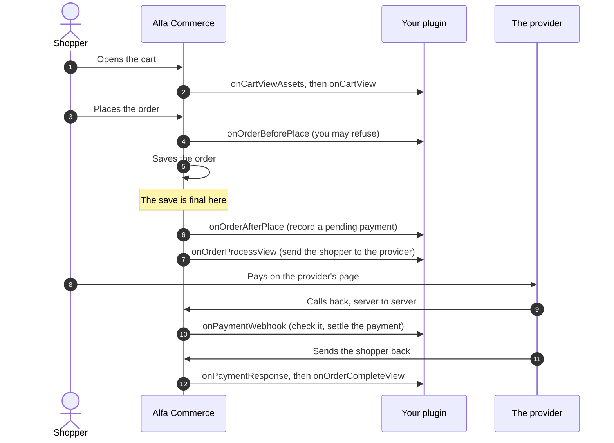
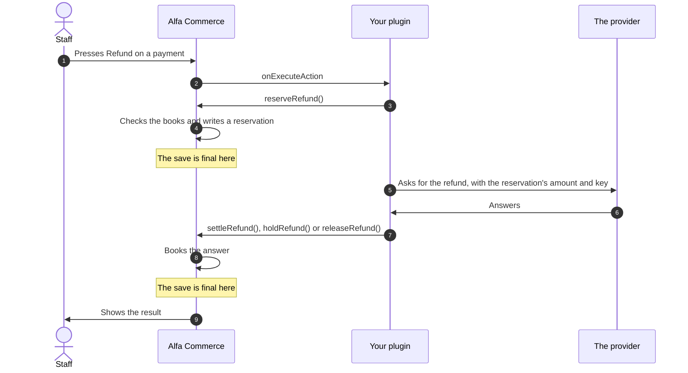

# Payment plugins

<CreatePluginButton type="payment" />

<AlfaVersion verified="2.2.0" />

**The pages of this guide:**

- **Payment plugins** (this page)
- [Payment plugin events](./payment-plugin-events.md)
- [Payments, refunds and webhooks](./payment-plugin-money.md)
- [A complete payment plugin](./payment-plugin-example.md)

A payment plugin connects Alfa Commerce to one way of paying: a bank transfer, cash on delivery, or a payment
provider's hosted page. This page is for the author of such a plugin, called a **gateway** below.

Read [How events reach a plugin](../events/how-events-reach-a-plugin.md) first. Words such as "method", "plugin of
record", "ledger" and "commit" are explained in the [Glossary](../reference/glossary.md).

## What it does

A payment plugin is a Joomla plugin in the group `alfa-payments` whose class extends the base class
`Alfa\Component\Alfa\Administrator\Plugin\PaymentsPlugin`. It does four jobs:

- it draws its part of the item page, the cart and the order pages;
- it records a payment for each order placed with one of its methods, and settles that payment when the money
  arrives;
- it answers its provider's return and callback;
- it gives staff the buttons to act on a payment (mark as paid, cancel, refund).

**Plugin and method.** The plugin is the code. A [method](../reference/glossary.md#plugins-and-events) is one
configured use of it, the record a shopper picks at checkout, with its own name and its own settings. One plugin can
serve several methods.

**The plugin of record.** When an order is placed, Alfa writes the plugin's element on the order, and on every
payment row the plugin writes. From then on Alfa asks that plugin, and only that plugin, about that order and that
row. It never asks another plugin instead, whatever the method's settings say later.

**The base class is the whole payment API.** A gateway records, reads and refunds payments through methods of
`PaymentsPlugin`. It never calls the ledger class `PaymentLedger` and never reads or writes the table
`#__alfa_order_payments` itself. A need the base class does not cover is a request to the Alfa Commerce project, not a
query of your own.

## When it is used

Write a payment plugin when the shop needs a way of paying that the Standard plugin (`alfa-payments.standard`, the
offline method that ships with Alfa Commerce) does not cover. Use the Standard plugin as your model: it is in
`plugins/alfa-payments/standard`. Trust its code over its comments: some of its comments describe older wiring.

## What you must provide

| You provide | Where | Notes |
|---|---|---|
| A manifest | `<element>.xml` | `group="alfa-payments"`, a `<namespace>` for `src` |
| A service provider | `services/provider.php` | Builds your class from `PluginHelper::getPlugin('alfa-payments', '<element>')` |
| The plugin class | `src/Extension/<Name>.php` | Extends `PaymentsPlugin` |
| Layouts | `tmpl/*.php` | What your plugin draws |
| Method settings | `params/params.xml` | Optional. See [Method settings](#method-settings) |
| A log table description | `params/logs.xml` | Optional. See [Logging](#logging) |
| Language files | `language/en-GB/plg_alfa-payments_<element>.ini` and `.sys.ini` | See [Language](#language) |

Your class **must** write these four methods, because the base classes declare them abstract:

```php
public function onItemView($event): void;
public function onCartView($event): void;
public function onOrderProcessView($event): void;
public function onOrderCompleteView($event): void;
```

Every other event is optional. You take part in an event by writing a public method with the event's name. Nothing
is listed in `getSubscribedEvents()`: all payment events are addressed to one plugin (targeted), and the base class
reports your methods to Alfa.

Changed in 2.2.0. The base class's `getSubscribedEvents()` returns an empty list. If your plugin needs a Joomla
event of its own, override it and merge with `parent::getSubscribedEvents()`.

:::warning A written method is a live endpoint
Because writing the method is the declaration, a method you add "for later" is called. The Standard plugin has no
`onPaymentWebhook` for that reason: with it, the shop would accept callbacks for a method that has no provider.
:::

:::warning Access must be Public
A provider calls your plugin as a guest. Set the plugin's Access (Extensions: Plugins) to Public, or callbacks are
answered "try again later".
:::

## What happens next: the life of a payment



What the picture means:

- **Before step 5 nothing is saved.** Refusing in `onOrderBeforePlace` costs one failed checkout and leaves no order.
- **After step 5 the order exists for good.** `onOrderAfterPlace` cannot undo it. If your plugin fails there, the
  order stays, without a payment row.
- **Steps 9 and 11 can arrive in either order**, and each can arrive twice. The callback is the proof of payment. The
  shopper's return only decides which page the shopper sees.
- **An offline method stops after step 7.** It sets nothing in `onOrderProcessView`, the shopper goes to the
  completed page, and staff settle the payment later with a button.
- **Settling is its own save.** When your plugin settles a payment, Alfa writes the payment row and makes that save
  final. Only then, and after Alfa's locks are released, does the order move to the status the method's settings name
  (see [The order's status](./payment-plugin-money.md#the-orders-status)).

The other events are not part of this timeline: `onItemView` (the item page), `onGetActions` and `onExecuteAction`
(staff), `onAdminOrderDelete`, `onPaymentCheckup` (the method's settings page), `onClearData` (Tools), and the two
stored credential events.

### The life of a refund through a provider



The reservation (step 4) is saved before the provider is asked, so a second click, or a second member of staff,
cannot start the same refund twice. The provider is called with no lock and no database transaction open. The verbs
are explained under [Refunds](./payment-plugin-money.md#refunds).

## Method settings

**Where they live.** Each method is a row of the table `#__alfa_payments`. Its settings are stored as JSON in the
row's `params` column. The fields come from your plugin's `params/params.xml`, inside a group named
`paymentsparams`. Only that group is saved as the method's settings:

```xml
<?xml version="1.0" encoding="UTF-8"?>
<form>
	<fields name="paymentsparams" addfieldprefix="Alfa\Component\Alfa\Administrator\Field">
		<fieldset name="paymentsparams" label="PLG_ALFA_PAYMENTS_OFFLINE_FIELDSET_SETTINGS">
			<field
					name="status_on_completed"
					type="model"
					model="orderstatuses"
					column_value="id"
					column_text="name"
					orderBy="ordering"
					label="PLG_ALFA_PAYMENTS_OFFLINE_STATUS_ON_COMPLETED_LABEL"
			>
				<option value="">PLG_ALFA_PAYMENTS_OFFLINE_STATUS_NO_CHANGE</option>
			</field>
		</fieldset>
	</fields>
</form>
```

**How you read them.** The settings reach you in three shapes. In all three they are already a plain array.

| Where you are | What you hold | How you read a setting |
|---|---|---|
| `onCartView`, `onCartViewAssets` | A `Method` object | `$event->getMethod()->param('api_key', '')`, or `->params()` for the array |
| `onItemView`, `onOrderProcessView`, `onOrderCompleteView`, and anywhere through `getPaymentMethod()` | The method record | `$method->params['api_key'] ?? ''` |
| `onExecuteAction` | The payment row, whose `params` is the method record | `$payment->params->params['api_key'] ?? ''` |

The `Method` object also has `id()`, `type()` (the plugin's element), `name()`, `description()`, `isSelected()`, and
`get('column', $default)` for any other column of the record.

**How `getPaymentMethod()` finds the method.**

`protected function getPaymentMethod(int $orderId = 0, int $methodId = 0): ?object`

| You ask | You get |
|---|---|
| With a method id: `getPaymentMethod($orderId, (int) $payment->id_payment_method)` | Exactly that method, while it is one of your plugin's. Otherwise `null`. |
| By order alone: `getPaymentMethod($orderId)` | The order's own method, while the order records your plugin and the method is still your plugin's. Otherwise `null`. |

Changed in 2.2.0. There is no fallback. It never answers another method of your plugin, because another method is
another set of credentials. An order paid through another plugin gives `null`. Treat `null` as "this is not mine"
and stop.

Pass the method id whenever a payment row names one: on an order with several attempts, the row is the only record
of which method took that money. Asking twice in one request costs nothing: the answer is kept.

### Sandbox and live

Alfa has one contract for a method with a test set and a live set of credentials, in the class
`Alfa\Component\Alfa\Administrator\Service\Order\PaymentEnvironment`:

- Store both sets side by side in the method's settings, as `sandbox_<key>` and `live_<key>`.
- A switch named `is_production` chooses the set a **new** payment uses. `PaymentEnvironment::active($params)`
  returns `PaymentEnvironment::SANDBOX` or `PaymentEnvironment::LIVE`. Anything but exactly 1 is sandbox.
- `PaymentEnvironment::credentials($params, $environment, ['api_key', 'secret'])` returns one set, without the
  prefix.
- Record the set on each attempt when you create it, under the key `self::PAYLOAD_ENVIRONMENT`:
  `->pluginData([self::PAYLOAD_ENVIRONMENT => $environment])`.
- Everything that follows an existing payment (a refund, a callback) uses the set that payment recorded, never the
  switch. `$this->paymentEnvironment($payment)` returns it, or `null` when none was recorded.
- `PaymentEnvironment::fromAddress($input)` reads the set a webhook address names.

The Standard plugin has no credentials and does not use this.

## Staff actions

Two events give staff buttons on a payment row: `onGetActions` registers them and `onExecuteAction` runs the one
pressed.

```php
public function onGetActions($event): void
{
    $payment = $event->getPayment();

    if (($payment->transaction_status ?? '') === self::STATUS_PENDING) {
        $event->add('mark_paid', Text::_('PLG_ALFA_PAYMENTS_OFFLINE_MARK_PAID'))
            ->mutating()
            ->icon('checkmark')->css('btn-success')
            ->confirm(Text::_('PLG_ALFA_PAYMENTS_OFFLINE_CONFIRM_MARK_PAID'))
            ->priority(200);
    }
}
```

`$event->add()` returns a `PluginAction` (`administrator/src/Plugin/PluginAction.php`):

| Call | Meaning |
|---|---|
| `icon(string)`, `css(string)`, `tooltip(string)` | How the button looks. Defaults: icon `cog`, class `btn-primary`. |
| `confirm(string $message)` | Ask before running |
| `priority(int)` | Higher is drawn first. Default 100. |
| `mutating()` | The action changes something. This is the default for every action. |
| `readOnly()` | The action writes nothing whatever the request carries (details, logs). Only such an action may be opened by a plain link. |
| `startsRefund()` | The action starts a new refund. Alfa hides it, and refuses it and its form's `_do` step, while the refund block holds. |
| `data(array $fields)` | Fields posted with the action, such as the figure the confirmation showed |
| `modal(string $layout, string $title = '', string $size = 'md')` | Records a layout, a title and a size on the action. Nothing in 2.2.0 reads them: every button opens the action page, its title is the button's label, and the layout drawn is the one your `onExecuteAction` sets with `setLayout()`. |
| `disabled()` | Takes the action off the list: no button is drawn and the action cannot be run |
| `meta(string $key, mixed $value)`, `buttonLayout(string $layout)` | Attach your own data, use your own button layout (a layout of your `tmpl` folder; the default is `action_button`) |

What Alfa does for you before `onExecuteAction` runs:

- An action that changes something must arrive as a POST with a one-time key. A second submit of the same key is
  refused, so a double click runs once.
- The action must still be on the list your `onGetActions` gives for the row as it is now. If the row changed
  meanwhile, the click is refused.
- The action runs on the plugin recorded on the row, or not at all.

In `onExecuteAction`, refuse a row that is not yours before you read or write anything, as the Standard plugin does:
`(string) ($payment->payment_method_type ?? '') !== $this->_name`.

A form on the action page is two action ids. The button's own id draws the form (`setLayout()`). The form submits
to the same id with the suffix `_do`, which does the work. The `_do` id is never registered as a button: Alfa admits
it exactly when the button that opens it is on offer. The Standard plugin's partial refund works this way
(`refund_partial` and `refund_partial_do`).

## Logging

A plugin has two logs of its own, both from the base class.

**The text log**, for staff who run the server. The base class registers it when your plugin starts:

| | Value for `alfa-payments` / `mygateway` |
|---|---|
| Category | `com_alfa.payments.mygateway` |
| File | `alfa_payments_mygateway.php` in Joomla's log folder |

```php
use Joomla\CMS\Log\Log;

Log::add('Order #' . $order->id() . ': the provider refused the charge.', Log::WARNING, $this->logCategory());
```

Always pass `$this->logCategory()`. A category typed by hand, or shared with another plugin, sends your lines to the
wrong file or to none. `settleAttempt()` writes its CRITICAL "the money moved and the books did not" line here.

**The log table**, for the merchant, shown by your own "Logs" action. Describe its columns in `params/logs.xml`,
inside `<fields name="paymentslogs">` and one `<fieldset>` within it, as the Standard plugin does (Alfa reads the
fields of the first fieldset). Give each field a `mysql_type`; without one the column is `VARCHAR(255)`. Alfa creates
the table
`#__alfa_payments_<element>_logs` on first use, with `id`, `id_order`, `id_order_payment` and `id_payment_method`
of its own.

| Verb | What it does |
|---|---|
| `log(array $data): int` | Writes a row. `id_order` is required. With an `id` it changes that row, and only the columns you pass. Returns the row's id, or 0 when nothing was written. |
| `loadLogs(int $orderId, int $identifierId = 0, array $filters = [], bool $asArray = true): ?array` | Rows of an order, or of one payment of it |
| `deleteLog(int $orderId, int $identifierId = 0): void` | Deletes them |
| `logForMethod(int $methodId, array $data): int`, `loadMethodLogs(int $methodId, array $filters = [], int $limit = 0): array` | Rows about a method and no order, such as a connection check |
| `getLogsSchema(): ?SimpleXMLElement` | Your `logs.xml`, for a layout that draws the rows |

The table is never created or changed while a database transaction is open. A log write that needs a missing table
or column inside one is reported and skipped; the next write outside a transaction completes the table. A failed log
write is never shown to a shopper.

## Language

Your plugin carries its own texts and loads them.

- The files are `plg_alfa-payments_<element>.ini` and `plg_alfa-payments_<element>.sys.ini`. The file name keeps
  the hyphen of the group.
- The keys drop the hyphen: `PLG_ALFA_PAYMENTS_<ELEMENT>_...`.
- Packaged under `language/en-GB/` in your zip, they are installed to `administrator/language/en-GB/`.
- The base class sets `$autoloadLanguage = true`, so your texts are loaded whenever your plugin is started, on the
  storefront and in the administrator. Alfa also loads your file for the method's settings form.
- Bodies you answer to a provider (`setResponseBody()`) are plain machine text, never translated.

## What can go wrong

| What you see | The usual cause |
|---|---|
| The plugin does not load at all after you added a method | You typed the `$event` parameter of a method the base class declares untyped, or you wrote a private method with the name of a base class method |
| The provider's callbacks are answered 503 | The plugin is disabled, or its Access is not Public |
| The provider's callbacks are answered 404 | Your class has no `onPaymentWebhook`, the element in the address is wrong, or the plugin is disabled and no method of the shop uses it |
| The provider's check of the webhook address fails, on a multilingual site with friendly addresses or with URL rewriting and "Remove index.php" on | In 2.2.0 the provider was given the plain `index.php` address and checks it with a GET, which Joomla redirects. Give it the address the setup checkup prints. A POST to the plain address reaches your plugin. |
| Planned for 2.2.1, which is not released: a provider that checks the address with a GET gets a redirect | "System - Alfa Commerce Sync" is disabled, or its Access is not Public. Enable it with its Access set to Public. A POST reaches your plugin either way. See [Return and webhook addresses](./payment-plugin-money.md#return-and-webhook-addresses). |
| The payment is completed but the order did not move | The row was created as completed instead of changed to completed, or the method has no `status_on_completed` setting |
| `getPaymentMethod()` returns `null` | The order records another plugin, or the method id you passed is not one of your plugin's. There is no fallback since 2.2.0. |
| A setting is always empty in `onCartView` | You read `$method->params[...]`. There the method is an object: use `->param('key')`. |
| A setting you added is never saved | Its field is outside `<fields name="paymentsparams">` |
| `$order->id` is empty | The order is an `Order` object: use `$order->id()` |
| `getOrder()` is `null` in `onPaymentResponse` or `onPaymentWebhook` | It always is. Find the order from your provider's data. |
| A refund verb answers `OUTCOME_FAILED` and nothing is written | It was called inside a database transaction |
| A refund button disappeared from a completed payment | The refund block holds: a provider reported a refund the books do not hold. Staff resolve that report first. |
| `save()`, `settleAttempt()` or `deletePayment()` refuses a row | The row was written by another plugin. Since 2.2.0 a plugin changes only its own rows. |
| Your cart panel works once and then stops | Its script was declared in the `onCartView` layout. Declare it in `onCartViewAssets`. |
| A staff action is refused as "already submitted" | The same one-time key was posted twice. The first submit ran. |

## Not documented yet

- **Charging a saved card or mandate.** `onPaymentStoreReference`, `onPaymentChargeReference`,
  `supportsRecurring()`, `renewalsAllowed()` and the related `StoredCredentialIntentEvent` exist in 2.2.0, but the
  core repository contains no code that sends these events, so when they fire and what the shopper sees cannot be
  documented from it.
- **The action page.** How a layout set in `onExecuteAction` is shown, and the script helper a form uses to submit
  its `_do` step. The title and size given to `modal()` and `setModalTitle()` are read by nothing in 2.2.0.
- **Locks for a capture.** `OrderMoneyLock` and when a gateway that captures an authorization should hold it.
- **Deposits and instalments**: several payment rows for one order, written by one plugin.
- **The texts shoppers and staff see** when a plugin is unavailable or an order is refused. This page describes
  what Alfa does, not the exact wording.
- **Carriers.** Shipping plugins have the same return and webhook channels. See
  [Shipping plugins](./shipment-plugins.md).
