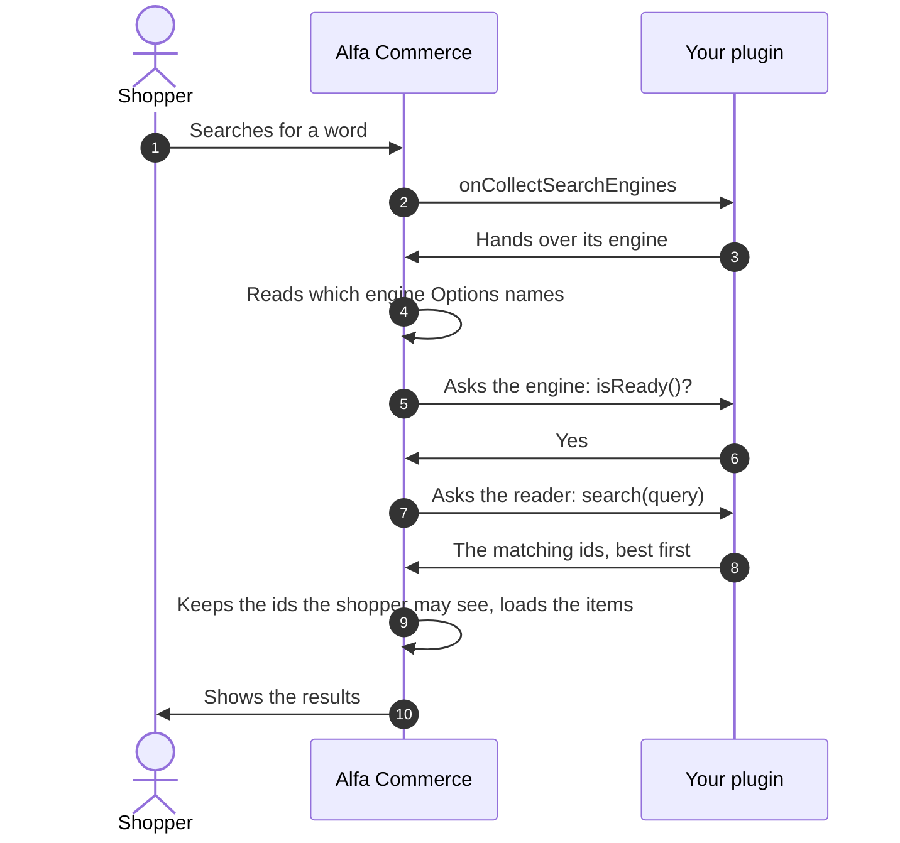
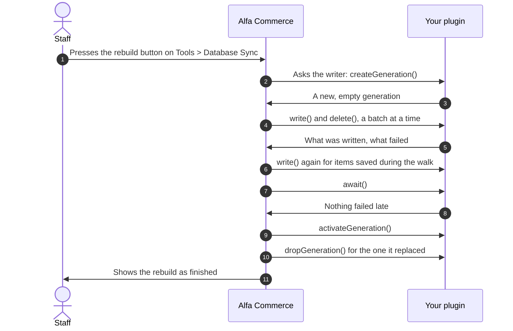

# Search engine plugins

<AlfaVersion verified="2.2.0" />

Alfa Commerce always has a working search. It reads the item tables directly and needs nothing installed. Options
calls it "Database search (built into Alfa Commerce)".

A **search engine** is a plugin that answers the same searches from its own prepared copy of the catalogue (its
**index**), usually faster on a large shop. An engine is a plugin of the group `alfa-search`.

No search engine ships with Alfa Commerce 2.2.0, on purpose: the core package carries the rules an engine follows
(the **contract**), and no engine. So this page prints only what the base class and the contract classes prove. It
could not be compared with a shipped engine. The plugin's own storage and matching code is yours and is not shown.

Read [How events reach a plugin](../events/how-events-reach-a-plugin.md) first. The words used here are explained in
the [Glossary](../reference/glossary.md).

## What it does

An engine plugin gives Alfa one object, the **engine**, with two halves:

- a **reader** (the provider), which takes a search and returns the ids of the matching items, best match first;
- a **writer** (the indexer), which Alfa calls to put items into the index and take them out.

Alfa keeps everything else: who may see an item, prices, the page that shows the results, and the walk through the
whole catalogue when the index is rebuilt.

## When it is used

Staff choose the engine in Options, Search, Search engine. The list shows the built-in search and every engine an
enabled plugin registered. An engine that is not ready is listed with the words "not ready".

| The setting | Who answers a search | Who receives item changes |
|---|---|---|
| Database search (the default) | Alfa's own search over the live tables | No engine |
| Your engine, and it says it is ready | Your engine's reader | Your engine's writer |
| Your engine, and it says it is not ready | Alfa's own search over the live tables | Your engine's writer |

Installing or enabling an engine plugin never switches the shop to it. Staff choose it.

## What you must provide

| You write | What it is |
|---|---|
| A plugin class that extends `SearchEnginePlugin` | One method, `engine()`, which returns your engine |
| A class that implements `SearchEngineInterface` | The engine: its key, its name, its reader, its writer, and whether it is ready |
| A class that implements `SearchProviderInterface` | The reader |
| A class that implements `SearchIndexerInterface` | The writer |

All four contract types are in `administrator/src/Service/Search`. The base class is
`administrator/src/Plugin/SearchEnginePlugin.php`.

The base class does the registration for you. It listens to `onCollectSearchEngines` and hands Alfa your engine
together with your plugin's name as **group.element** (for example `alfa-search.example`) and the version from your
manifest.

### The engine (`SearchEngineInterface`)

| Method | What it must return |
|---|---|
| `key(): string` | A fixed name for the engine, with your vendor name first, for example `acme.example`. It is the value saved in Options. Two engines with the same key: the first one registered is kept, the second is ignored and logged. |
| `label(): string` | The name shown in the engine list in Options. |
| `provider(): SearchProviderInterface` | The reader. |
| `indexer(): SearchIndexerInterface` | The writer. |
| `isReady(): bool` | `true` only when the engine can answer correctly now. Answer `false` when the index is empty, was never built, or the service behind it cannot be reached. Do not throw here: answer `false`. |

`engine()` is called each time engines are collected, and that happens on storefront pages. Do not open a network
connection in your engine's constructor. Open it when it is first needed.

### The reader (`SearchProviderInterface`)

One method: `search(SearchQuery $query): SearchResult`.

What you are given, as read-only properties of `SearchQuery`:

| Property | Meaning |
|---|---|
| `keyword` | The search text, already cleaned up by Alfa. |
| `lang` | The language to search, in lower case with an underscore, for example `en_gb`. |
| `limit` | The largest number of ids to return. 1000 unless the caller says otherwise. |
| `userId`, `groups` | Who is asking: the user's id (0 for a guest) and the ids of the user groups they belong to. |
| `intent` | Why the search runs (`SearchIntent`): `TYPEAHEAD` while the shopper is typing, `SEARCH` for a search the shopper sent, `SYSTEM`, or `CONTINUATION`. Only `SEARCH` is meant to be counted in statistics (`recordsAnalytics()`). |
| `entity` | What is searched (`SearchEntity`): `ITEM`, `CATEGORY` or `MANUFACTURER`. |
| `context` | A `ResultSetContext` when this search fills a list the shopper will see: its `order` (`relevance`, or `sort:` followed by the key and the direction) and its `offset` (the position of the first row, minus one). `null` for any other search. |

What you return, a `SearchResult`:

| Constructor argument | Meaning |
|---|---|
| `entity` | The same entity the query asked for. If you cannot search that entity, return an empty result that still names it. |
| `ids` | The matching ids, best match first. The order is the ranking. |
| `limitApplied` | `true` when there were more matches than `limit`. |
| `eventId` | Your own reference for this list of results (a number or a text), or `null`. See [Telling which results a shopper saw](#telling-which-results-a-shopper-saw). |
| `responseSpecific` | `true` when that reference belongs to this one visitor or response. Alfa then keeps the page out of Joomla's page cache. |

Who may see an item is decided by Alfa's catalogue rules, never by the engine. Alfa filters the ids you return with
those rules. An engine may use `userId` and `groups` to apply the same rules earlier. It must not make rules of its
own.

Within one request Alfa remembers the answer to a query and does not ask the reader twice for the same one.

### The writer (`SearchIndexerInterface`)

A **generation** is one complete copy of the index. A rebuild fills a new generation while the old one keeps
answering, then switches. Alfa passes generations around as `IndexGeneration` objects: a `handle` (a text only your
engine understands) and `active` (whether it is the one answering searches).

| Method | What Alfa expects |
|---|---|
| `createGeneration(): IndexGeneration` | Open a new, empty generation and return it. An engine that keeps only one copy may return the active one; a rebuild then writes in place. |
| `writeTargets(): array` | Every generation a single item change must be written to: the active one, plus any being built. An empty list means "nowhere to write" and Alfa reports that nothing was indexed. |
| `write(IndexGeneration $generation, array $documents): IndexWriteResult` | Store these `SearchDocument` objects, each replacing an earlier document with the same id. |
| `delete(IndexGeneration $generation, array $ids): IndexWriteResult` | Remove the documents with these `DocumentId` objects. |
| `activateGeneration(IndexGeneration $generation): void` | Make this generation the one that answers searches. |
| `dropGeneration(IndexGeneration $generation): void` | Delete this generation and its storage. |
| `await(IndexGeneration $generation, float $timeoutSeconds = 30.0): IndexWriteResult` | Wait until everything written to this generation is stored and searchable, and return any documents that failed late. An engine that writes at once returns an empty result. Throw a `RuntimeException` when the wait runs out. |
| `preferredBatchSize(): int` | How many documents you want in one `write()` call during a rebuild. |

`IndexWriteResult` has two properties: `written`, the number of documents accepted, and `failures`, a list of
document key to reason for each document refused. The document key is `DocumentId::key()`.

A `SearchDocument` is one item in one language. Its properties are `id` (a `DocumentId`), `title`, `alias`, `sku`,
`gtin`, `mpn`, `manufacturers`, `categories`, `itemFields`, `combinations`, `version` and `descriptions`. Its methods
`itemId()` and `language()` read the item and the language from the id. `version` is the time the item was last
changed; an engine that can compare versions should refuse a write older than the one it holds.

### Optional abilities

Each of these is a separate interface your engine class may also implement. Alfa checks for them and uses them only
when they are there.

| Interface | What it adds |
|---|---|
| `RebuildableEngine` | A rebuild button for your engine on Tools > Database Sync. `rebuildLabel()` returns the language key of the button's text. `isRebuildOwed()` returns `true` when the index no longer matches the shop's search settings; the button then turns to a warning colour and a notice is shown. It must never throw. |
| `SuggestionProviderInterface` | Word suggestions while the shopper types. `suggest(string $prefix, string $lang, int $limit = 10)` returns `SearchSuggestion` objects, best first. |
| `EntitySearchInterface` | Searching categories and manufacturers through the engine. `canSearch(SearchEntity $entity)` returns whether the active index can search that entity now. Without it, Alfa searches those itself. |

Without `RebuildableEngine` there is no rebuild button and the rebuild job refuses to run for your engine. Your
engine must then fill its index by its own means.

## What happens next

### A search



On a storefront page the engines are collected once. If the engine answers "not ready" at step 6, Alfa skips
steps 7 and 8 and searches the live tables itself. Alfa never falls back to a different engine.

### One item changes

When staff save, unpublish or delete an item, Alfa rebuilds what it keeps about that item. As part of that it builds
the item's `SearchDocument` in every content language and calls the **configured** engine's writer, ready or not:

1. `writeTargets()`, to learn where to write.
2. `write()` on each generation returned, with the item's documents.
3. `delete()` on each generation, for a language in which the item must not be found (unpublished, or nothing to
   search).

You do not listen to any event for this. A failure in one generation is recorded and does not stop the save.

### The whole index is rebuilt



The walk is background work (the job `search.rebuild`), done a part at a time, so it survives a closed browser. The
size of a batch is your `preferredBatchSize()`. Alfa refuses to switch (step 9) when any document was refused, when
the items saved during the walk could not be written again, or when `await()` reports a late failure or throws. The
old generation then keeps answering.

## Events an engine plugin can handle

### onCollectSearchEngines

**When it fires.** Whenever Alfa needs the list of engines: for a search, for the engine list in Options, for an
item save, for the rebuild. A storefront page asks once.

**Who receives it.** Announced to everyone (broadcast), after the plugins of `alfa-search` are loaded.

**What you are given.** `CollectSearchEnginesEvent`, with `addEngine(SearchEngineInterface $engine, string
$contributor, string $version = '')`.

**What you are expected to do.** Nothing. `SearchEnginePlugin` handles it and calls `addEngine()` with your engine,
your plugin's group.element and your manifest's version.

**What happens next.** Alfa asks each engine for its key and keeps one engine per key.

**If you are missing or you fail.** Your engine is not in the list. The error is logged (category
`com_alfa.search`) and the other engines are kept. If your engine was the configured one, searches are answered from
the live tables.

### onAlfaSearchInputLayout

**When it fires.** When the storefront draws the search box above a list (the items list and the manufacturers
list).

**Who receives it.** Addressed to one plugin (targeted): the plugin that registered the configured engine, and only
when that plugin is in the group `alfa-search`. `SearchEnginePlugin` lists this event in its `TARGETED_EVENTS`, so
you declare it by writing a public method with this name.

**What you are given.** `SearchInputLayoutEvent`.

| Getter | Meaning |
|---|---|
| `getView()` | The list view being drawn. |
| `getEngineKey()` | The engine key saved in Options. |
| `getContext()` | Which list: `com_alfa.items` or `com_alfa.manufacturers`. |

**What you are expected to do.** To draw your own search box, name a layout file of your plugin:
`setLayout()` with the file's name without `.php`, `setLayoutPluginType()` with your group, `setLayoutPluginName()`
with your element, and optionally `setLayoutData()` with an array for the layout. To keep the standard box, set
nothing.

**What happens next.** When a layout was set, Alfa renders that file from your plugin's `tmpl` folder (a template
may override it in `html/plg_alfa-search_ELEMENT/`). The layout receives your data plus `view` and `context`. A
redirect set on this event is ignored.

**If you are missing or you fail.** The standard search box is drawn. A failure is logged (category
`com_alfa.search`).

```php
use Alfa\Component\Alfa\Administrator\Event\Search\SearchInputLayoutEvent;

public function onAlfaSearchInputLayout(SearchInputLayoutEvent $event): void
{
    if ($event->getContext() !== 'com_alfa.items') {
        return;
    }

    $event->setLayout('input');
    $event->setLayoutPluginType('alfa-search');
    $event->setLayoutPluginName('example');
}
```

### onAlfaResultSetRender

**When it fires.** Each time the storefront items view draws a list of results: a full page, the part of a page
that a filter change swaps in, or one item card that is drawn again.

**Who receives it.** Announced to everyone (broadcast), after the plugins of `alfa-search` are loaded. List it in
`getSubscribedEvents()`.

**What you are given.** `ResultSetRenderEvent`.

| Getter | Meaning |
|---|---|
| `getView()` | The items view. Its document is where you add scripts and script options. |
| `getContext()` | `com_alfa.items`. |
| `getKind()` | `ResultSetRenderEvent::KIND_PAGE`, `KIND_FRAGMENT` or `KIND_CARD`. |
| `getEngineKey()` | The engine key saved in Options. Act only when it is your own. |
| `getAttribution()` | A `ResultAttribution`: `handle` (your `eventId`, or `null`), `order`, `responseSpecific`, `engine`, and `hasHandle()`. |
| `getPosition()` | For a single card only: the position that card had. Otherwise `null`. |

**What you are expected to do.** Add your own scripts if you have any. Print nothing.

**What happens next.** The list is drawn.

**If you are missing or you fail.** The list is drawn all the same. A failure is logged.

A plugin that needs this event merges it into the base class's list:

```php
public static function getSubscribedEvents(): array
{
    return array_merge(parent::getSubscribedEvents(), [
        'onAlfaResultSetRender' => 'onAlfaResultSetRender',
    ]);
}
```

### onAlfaCatalogEntityChanged

**When it fires.** After categories or manufacturers were created, renamed, changed, published, unpublished or
deleted. Items are not announced here: they reach your writer directly, as described above.

**Who receives it.** Announced to everyone (broadcast), after the plugins of `alfa-search` and `alfa` are loaded.

**What you are given.** `CatalogEntityChangedEvent`.

| Method | Meaning |
|---|---|
| `entity()` | `category` or `manufacturer`. |
| `ids()` | The ids of the rows that changed. |
| `removed()` | `true` only when the rows were deleted. |

**What you are expected to do.** If your index keeps a copy of categories or manufacturers, update it. Otherwise do
not listen.

**What happens next.** Nothing depends on your answer. It is a notice: it is sent once and not repeated.

**If you are missing or you fail.** The save is not affected. Your copy stays as it was until the next rebuild.

### onCatalogVisibilityChanged

**When it fires.** After the list of users or user groups allowed to see an item or a category was changed.

**Who receives it.** Announced to everyone (broadcast), after the plugins of `alfa-search` and `alfa` are loaded.

**What you are given.** `VisibilityChangedEvent`.

| Method | Meaning |
|---|---|
| `changeType()` | The kind of change. In 2.2.0 always `VisibilityChangedEvent::AUDIENCE_CHANGED`. |
| `itemIds()` | Items whose own list changed. |
| `categoryIds()` | Categories whose list changed. |
| `affectedItemIds()` | Every item whose visibility changed as a result, worked out by Alfa. |

**What you are expected to do.** Only an engine that stores who may see each item needs this: update the stored
copy for `affectedItemIds()`. An engine that returns ids and lets Alfa filter them does not listen.

**What happens next.** Nothing depends on your answer.

**If you are missing or you fail.** The save is not affected.

### onCollectCatalogProjections

**When it fires.** When Alfa prepares to rebuild what it keeps about items (a **projection** is stored data derived
from the catalogue).

**Who receives it.** Announced to everyone (broadcast), after the plugins of `alfa-search` and `alfa` are loaded.

**What you are given.** `CollectCatalogProjectionsEvent`, with `addProjection(ProjectionInterface $projection,
string $contributor, string $version = '')`. The contributor is your plugin's group.element.

**What you are expected to do.** Only if your plugin keeps item data of its own besides the search index: add an
object that implements `ProjectionInterface` (`syncItem(int $itemId)`, `syncItems(array $itemIds)`,
`deleteForItem(int $itemId)`).

**What happens next.** Alfa calls your projection with the same item ids, at the same moments, as its own.

**If you are missing or you fail.** Alfa's own projections still run.

The search index itself needs no projection of yours. Alfa's own search projection already calls your writer.

### onClearData

`SearchEnginePlugin` also lists `onClearData` in its `TARGETED_EVENTS`. A plugin that writes a public
`onClearData(ClearDataEvent $event)` method is asked to remove the data it owns when staff clear an extension's data
or clear the whole shop. It is the same event for every plugin type.

## Telling which results a shopper saw

An engine that keeps statistics needs to know which list of results a click came from. Alfa carries one value for
you, without reading it:

1. A query that fills a visible list carries a `ResultSetContext`. For such a query your reader may return an
   `eventId`.
2. Alfa prints it on the list's container as `data-alfa-search-event`, with the order shown as
   `data-alfa-search-order`. Each item card gets `data-position`, its place in the whole result set counted across
   pages, starting at 1.
3. With no `eventId`, none of the three attributes is printed.
4. The list's JSON answer and the search endpoint's JSON answer carry the same values.

Your scripts, loaded on `onAlfaResultSetRender`, read these attributes. When a filter change swaps the list, the
browser event `alfa:results:updated` is sent on the element `#alfa-app[data-view="items"]`.

## If no engine is installed

Nothing is missing. The setting stays on the built-in search, every search is answered from the live tables, no
rebuild button is shown, the standard search box is drawn, and item saves write to no engine.

## What can go wrong

| What you see | The cause |
|---|---|
| The engine is in the list but searches are slow as before | `isReady()` answers `false`. Joomla's log (category `com_alfa.search`) says "not ready". |
| The engine is not in the list | The plugin is disabled, its `engine()` threw, or `key()` returned an empty text. |
| Items found by the old search are missing | The reader returned ids in the wrong entity, or the index was never rebuilt after the engine was chosen. |
| A rebuild ends with "Refusing to activate" | The writer reported failures in `write()` or `await()`. |
| Your search box is not drawn | The plugin is not the one that registered the configured engine, or its handler threw. |
| The Options screen stops with an error | An engine's `label()` or `isReady()` threw. The engine list in Options calls both without catching an error. |
| The rebuild job says the engine changed | The engine named when the job started is no longer the configured one, or it does not implement `RebuildableEngine`. |

## The plugin's files

Every file is printed. The plugin class and the engine class are complete. The reader and the writer are printed
as **stubs**: each method has the exact signature the contract asks for, and a body that does no real work and
says so. Your own storage and matching code goes where the comments say "Yours".

```text
plugins/alfa-search/example/
    example.xml
    services/provider.php
    src/Extension/Example.php
    src/Engine/ExampleEngine.php
    src/Engine/ExampleProvider.php      (a stub: implements SearchProviderInterface)
    src/Engine/ExampleIndexer.php       (a stub: implements SearchIndexerInterface)
    language/en-GB/plg_alfa-search_example.ini
    language/en-GB/plg_alfa-search_example.sys.ini
```

### example.xml

```xml
<?xml version="1.0" encoding="UTF-8"?>
<extension type="plugin" group="alfa-search" method="upgrade">
    <name>PLG_ALFA_SEARCH_EXAMPLE</name>
    <author>Acme</author>
    <creationDate>2026-11-12</creationDate>
    <copyright>(C) 2026 Acme</copyright>
    <license>GNU General Public License version 3 or later; see LICENSE</license>
    <version>1.0.0</version>
    <description>PLG_ALFA_SEARCH_EXAMPLE_XML_DESCRIPTION</description>
    <namespace path="src">Acme\Plugin\AlfaSearch\Example</namespace>
    <files>
        <folder plugin="example">services</folder>
        <folder>src</folder>
    </files>
    <languages folder="language">
        <language tag="en-GB">en-GB/plg_alfa-search_example.ini</language>
        <language tag="en-GB">en-GB/plg_alfa-search_example.sys.ini</language>
    </languages>
</extension>
```

### services/provider.php

```php
<?php

\defined('_JEXEC') or die;

use Acme\Plugin\AlfaSearch\Example\Extension\Example;
use Joomla\CMS\Extension\PluginInterface;
use Joomla\CMS\Factory;
use Joomla\CMS\Plugin\PluginHelper;
use Joomla\DI\Container;
use Joomla\DI\ServiceProviderInterface;

return new class () implements ServiceProviderInterface {
    public function register(Container $container)
    {
        $container->set(
            PluginInterface::class,
            function (Container $container) {
                $plugin = new Example(
                    (array) PluginHelper::getPlugin('alfa-search', 'example'),
                );
                $plugin->setApplication(Factory::getApplication());

                return $plugin;
            },
        );
    }
};
```

### src/Extension/Example.php

```php
<?php

namespace Acme\Plugin\AlfaSearch\Example\Extension;

use Acme\Plugin\AlfaSearch\Example\Engine\ExampleEngine;
use Alfa\Component\Alfa\Administrator\Plugin\SearchEnginePlugin;
use Alfa\Component\Alfa\Administrator\Service\Search\SearchEngineInterface;

\defined('_JEXEC') or die;

final class Example extends SearchEnginePlugin
{
    protected function engine(): SearchEngineInterface
    {
        return new ExampleEngine();
    }
}
```

### src/Engine/ExampleEngine.php

```php
<?php

namespace Acme\Plugin\AlfaSearch\Example\Engine;

use Alfa\Component\Alfa\Administrator\Service\Search\SearchEngineInterface;
use Alfa\Component\Alfa\Administrator\Service\Search\SearchIndexerInterface;
use Alfa\Component\Alfa\Administrator\Service\Search\SearchProviderInterface;

\defined('_JEXEC') or die;

final class ExampleEngine implements SearchEngineInterface
{
    public function key(): string
    {
        return 'acme.example';
    }

    public function label(): string
    {
        return 'Example search';
    }

    public function provider(): SearchProviderInterface
    {
        return new ExampleProvider();
    }

    public function indexer(): SearchIndexerInterface
    {
        return new ExampleIndexer();
    }

    public function isReady(): bool
    {
        // True only when your index holds the catalogue and can be reached.
        return false;
    }
}
```

As printed, `isReady()` answers `false`, so this engine can be chosen in Options and never answers a search. Change
it when your reader and writer exist.

### src/Engine/ExampleProvider.php

A stub. It finds nothing.

```php
<?php

namespace Acme\Plugin\AlfaSearch\Example\Engine;

use Alfa\Component\Alfa\Administrator\Service\Search\SearchProviderInterface;
use Alfa\Component\Alfa\Administrator\Service\Search\SearchQuery;
use Alfa\Component\Alfa\Administrator\Service\Search\SearchResult;

\defined('_JEXEC') or die;

final class ExampleProvider implements SearchProviderInterface
{
    public function search(SearchQuery $query): SearchResult
    {
        // Yours: find $query->keyword in your index, in the language $query->lang, and return
        // at most $query->limit ids, best match first.
        // As printed: an empty result that names the entity that was asked for.
        return new SearchResult(entity: $query->entity);
    }
}
```

### src/Engine/ExampleIndexer.php

A stub. It stores nothing, and it reports that honestly: it offers no generation to write to, and a document handed
to `write()` comes back as refused.

```php
<?php

namespace Acme\Plugin\AlfaSearch\Example\Engine;

use Alfa\Component\Alfa\Administrator\Service\Search\IndexGeneration;
use Alfa\Component\Alfa\Administrator\Service\Search\IndexWriteResult;
use Alfa\Component\Alfa\Administrator\Service\Search\SearchIndexerInterface;

\defined('_JEXEC') or die;

final class ExampleIndexer implements SearchIndexerInterface
{
    private const NOT_STORED = 'The example engine stores nothing yet.';

    public function createGeneration(): IndexGeneration
    {
        // Yours: open a new, empty copy of your index and return its handle.
        return new IndexGeneration(handle: 'example');
    }

    public function writeTargets(): array
    {
        // Yours: the generation that answers searches, plus any generation being built.
        // As printed: nowhere to write. Alfa records that nothing was indexed.
        return [];
    }

    public function write(IndexGeneration $generation, array $documents): IndexWriteResult
    {
        // Yours: store each SearchDocument, replacing an earlier one with the same id.
        // As printed: every document is reported as refused, under its document key.
        $failures = [];

        foreach ($documents as $document) {
            $failures[$document->id->key()] = self::NOT_STORED;
        }

        return new IndexWriteResult(written: 0, failures: $failures);
    }

    public function delete(IndexGeneration $generation, array $ids): IndexWriteResult
    {
        // Yours: remove the documents with these DocumentId objects.
        // As printed: nothing is stored, so there is nothing to remove.
        return new IndexWriteResult();
    }

    public function activateGeneration(IndexGeneration $generation): void
    {
        // Yours: make this generation the one that answers searches.
    }

    public function dropGeneration(IndexGeneration $generation): void
    {
        // Yours: delete this generation and its storage.
    }

    public function await(IndexGeneration $generation, float $timeoutSeconds = 30.0): IndexWriteResult
    {
        // Yours, if your engine stores later than it answers: wait, then return what failed late.
        // As printed: nothing was accepted, so nothing can fail late.
        return new IndexWriteResult();
    }

    public function preferredBatchSize(): int
    {
        // Yours: how many documents you want in one write() call.
        return 100;
    }
}
```

With these stubs chosen in Options, an item save still succeeds. Alfa records that nothing was indexed, and searches
are answered from the live tables.

### The language files

`language/en-GB/plg_alfa-search_example.ini` and `language/en-GB/plg_alfa-search_example.sys.ini`, both with:

```ini
PLG_ALFA_SEARCH_EXAMPLE="Alfa Search - Example"
PLG_ALFA_SEARCH_EXAMPLE_XML_DESCRIPTION="An example search engine for Alfa Commerce."
```

The base class loads the plugin's language file by itself (`$autoloadLanguage`).

## Changed in 2.2.0

- `onAlfaSearchInputLayout` is addressed to the configured engine's plugin only. It is declared through
  `TARGETED_EVENTS` and must not be listed in `getSubscribedEvents()`.
- `addEngine()` takes the plugin's group.element as its second argument, in place of an extension name.
- `onAlfaResultSetRender` is new. An engine loads its scripts there, no longer from its search box layout.
- `SearchQuery::$context`, `SearchResult::$responseSpecific`, `ResultSetContext` and `ResultAttribution` are new.
- The rebuild runs as the background job `search.rebuild`. The base class no longer offers a rebuild tool of its
  own; an engine says what it can through `RebuildableEngine`.
- A template override of `com_alfa/items/default.php` or `default_item.php` written before 2.2.0 prints the
  attributes only once it calls the view's `resultSetAttributes()` and `resultAttributes()`.

## Not documented yet

- A complete, working engine (reader and writer). None ships in 2.2.0 to take it from. The reader and the writer
  printed above are stubs.
- The inside of `SearchDocument`'s parts (`FacetRef`, `FieldValue`, `SearchCombination`, `SearchDescriptions`) and
  the helper classes `LanguageTag`, `SearchScope`, `QueryNormalizer` and `PlainText`.
- The search module (`mod_alfa_search`) and the JSON format of the search endpoint.
- Running a rebuild from the command line. No console command for it ships in 2.2.0.
- The background work engine. It will be described on the page "Background work"
  (../architecture/background-work.md), which is not written yet.
