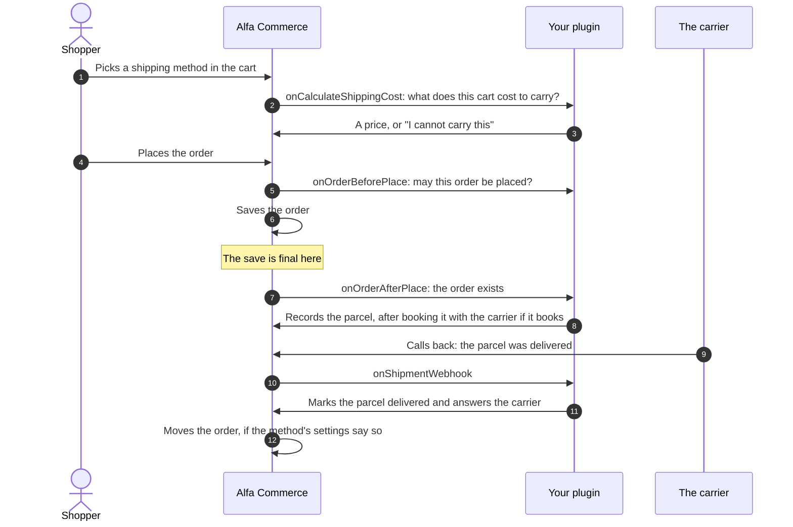

# Shipping plugins

<AlfaVersion verified="2.2.0" />

**The pages of this guide:**

- **Shipping plugins** (this page)
- [Shipping plugin events](./shipment-plugin-events.md)
- [A complete shipping plugin](./shipment-plugin-example.md)

A **shipping plugin** is the code that speaks for one carrier. It tells the cart what carrying an order costs, records
the parcel when the order is placed, follows the parcel until it is delivered, and gives staff their buttons on the
order page.

Read [How events reach a plugin](../events/how-events-reach-a-plugin.md) first. This page uses its words.

## What it does

A shipping plugin lives in the plugin group `alfa-shipments` and extends the base class `ShipmentsPlugin`
(`administrator/src/Plugin/ShipmentsPlugin.php`). The shipping plugin that ships with Alfa Commerce is
`alfa-shipments.standard`. It is the reference for everything on this page.

**Plugin and method.** The plugin is the code. A [method](../reference/glossary.md#plugins-and-events) is one
configured use of it, the record a shopper picks at checkout ("Courier", "Pick up from the shop"). One plugin can
serve several methods, each with its own settings.

**Plugin of record.** When an order is placed, Alfa writes the plugin's element on the order, and again on every
shipment row (the column `shipment_method_type`). From then on Alfa asks **that** plugin about the order and its
parcels, whatever the method's settings say later. See
[plugin of record](../reference/glossary.md#plugins-and-events) in the glossary.

| What Alfa wants to know | Which plugin it asks |
|---|---|
| The price for a cart, the plugin's part of the cart page and the item page | The plugin of the method |
| May this order be placed, and the order was placed | The plugin of the method the order is placed with |
| Staff buttons, a staff action, may the order be deleted | The plugin recorded on the shipment row |
| A shopper's return, a carrier's callback | The plugin named in the address (`method=<element>`) |

Changed in 2.2.0: once an order uses a method, the method's plugin (its Type) can no longer be changed.

## When it is used

The picture shows one parcel from the cart to the door. The events are the lines that go to "Your plugin".



Each write your plugin makes to a parcel (steps 8 and 11) is a save of its own, final when the method returns.

All twelve events of a shipping plugin, in the order a parcel meets them:

| Event | The moment | Must you write it? |
|---|---|---|
| `onItemView` | An item page is drawn | Yes |
| `onCartViewAssets` | The cart page is built | No |
| `onCartView` | The cart is drawn or refreshed | Yes |
| `onCalculateShippingCost` | The cart's totals are worked out | Yes |
| `onOrderBeforePlace` | Just before an order is saved | No |
| `onOrderAfterPlace` | Just after an order is saved | In practice yes: this is where the parcel is recorded |
| `onShipmentResponse` | The shopper comes back from the carrier's page | Only if you send shoppers away |
| `onShipmentWebhook` | The carrier's server calls the shop | Only if the carrier calls back |
| `onGetActions` | Staff open an order | No |
| `onExecuteAction` | Staff press one of your buttons | If you offer buttons |
| `onAdminOrderDelete` | Staff delete an order | No |
| `onClearData` | Staff clear your plugin's data | No |

All twelve are **addressed to one plugin** (targeted). No other plugin sees them.

## What you must provide

| File | What it is for |
|---|---|
| `<element>.xml` | The manifest: group `alfa-shipments`, your namespace, your files |
| `services/provider.php` | Tells Joomla how to create your plugin |
| `src/Extension/<Name>.php` | Your class, which extends `ShipmentsPlugin` |
| `params/params.xml` | The settings of a method of your plugin (optional) |
| `params/logs.xml` | The columns of your plugin's own log table (optional) |
| `tmpl/*.php` | The layouts your plugin draws |
| `language/en-GB/plg_alfa-shipments_<element>.ini` and `.sys.ini` | Your texts |

Your class must contain three methods: `onItemView()`, `onCartView()` and `onCalculateShippingCost()`. PHP refuses
to load the class without them, because the base classes declare them abstract.

**How you declare an event.** Write a public method with the event's name. Nothing else. The base class holds the
list of the twelve names (`ShipmentsPlugin::TARGETED_EVENTS`) and reports to Alfa each one your class has a method
for.

Changed in 2.2.0: do not list these events in `getSubscribedEvents()`. The base class returns an empty list there. Add
to it only for an event of Joomla itself:

```php
public static function getSubscribedEvents(): array
{
    return array_merge(parent::getSubscribedEvents(), [
        'onBeforeCompileHead' => 'onBeforeCompileHead',
    ]);
}
```

A complete plugin is printed in [A complete minimal shipping plugin](./shipment-plugin-example.md).

## Recording and changing a parcel

A parcel is one **shipment row** of an order. Your plugin never writes the table. It calls the methods below, which
the base class gives it. Behind them is the [ledger](../reference/glossary.md#saving) (`ShipmentLedger`).

Changed in 2.2.0: every write made through these methods carries your plugin's name. A new row records your plugin
as its plugin of record. Every later change, delete or line assignment works only on a row recorded as yours.

### Starting a write

Both methods return a **builder**: an object on which you chain the calls listed under "What you chain on the
builder", and which writes nothing until you call `save()`.

| Method | What it does | What it refuses |
|---|---|---|
| `$this->shipment($order)` | Starts a **new** parcel for the order. Fills in the order, the order's shipping method and the weight (weight times quantity of the order's lines). Returns a builder. | At `save()`: a method that is not a method of your plugin. Nothing is written. |
| `$this->shipmentUpdate($shipmentId)` | Starts a **change** to an existing parcel. Only what you set is written. Returns a builder. | Throws an error if the row does not exist. At `save()`: a parcel that is not recorded as yours, or a move to another plugin's method. |

### What you chain on the builder

| Call | What it does |
|---|---|
| `pending()`, `shipped()`, `delivered()`, `cancelled()`, `onHold()`, `returned()` | Sets the status. `shipped()` also stamps the shipped time. `delivered()` stamps the delivered time, and the shipped time if the parcel has none. A new parcel must have a status: without one `save()` throws a `RuntimeException`. |
| `withAllItems()` | Puts every unit that is not yet in a parcel into this one. On a second parcel that is only what is left. |
| `withItems([101, 102])` | Puts these order lines in the parcel. The numbers are order line ids, not item ids. |
| `withItems([101 => 3])` | Puts exactly three units of line 101 in the parcel. A number above what is left is lowered to what is left. |
| `withNoItems()` | An empty parcel. Staff assign the lines later. |
| `cost($taxIncl, $taxExcl, $taxRate)` | The charge: gross, net and the tax rate in percent. Each amount may be `Money`, decimal text, or a number. `cost($taxIncl)` alone means an untaxed charge. |
| `trackingNumber($number)` | The carrier's tracking number |
| `carrier($name)` | The name of the carrier that handles this parcel, as free text |
| `weight($weight)` | Replaces the weight worked out from the lines |
| `method($methodId)` | Another shipping method of your plugin |
| `pluginData([...])` | Keeps facts of your own on the row. See below. |
| `removePluginData(['key'])` | Removes facts of your own |
| `set($column, $value)` | Sets any other column of the row. It refuses `plugin_data`. |
| `save()` | Writes. Returns the shipment id, or `false` when the write was refused. |
| `saveVerdict($expectedStatus)` | Writes only if the parcel still has the expected status. Use it through `settleAttempt()`. |

There is no call for a tracking link, and no column for one. The standard plugin builds the link when it is shown,
from the tracking number and a pattern in its method settings (`tracking_url_template`), so that changing the pattern
repairs every old order.

### What `save()` guarantees and what it refuses

| | |
|---|---|
| **One save** | Since 2.2.0 the row, its lines and its entry in the order's History are saved together or not at all. |
| **A taxed charge names its rate** | If the gross is above the net and the rate is 0, the save is refused. The rate cannot be worked back from rounded amounts. |
| **The net is never above the gross** | Refused. |
| **Shipping is charged once per order** | The order's shipping total is the sum of its parcels. When another parcel of the order already carries a charge, the charge of a new parcel is set to 0, with a notice. |
| **The order's currency** | An amount in another currency is refused. For an order that names no currency, an error is thrown and nothing is written. |
| **Parcels that do not count** | A cancelled or returned parcel does not count in the order's total. |
| **When a write is refused** | `save()` returns `false`, the reason is written to the log (category `com_alfa.orders`) and shown as an error message. Check the return value. |

### Lines and several parcels

An order can have several parcels, and one order line can be split over them: "three now, two on Monday" is two
parcels holding parts of the same line.

```php
$this->shipment($order)->pending()->withItems([101 => 3])->save();
$this->shipment($order)->pending()->withItems([101 => 2])->save();
```

Nothing marks an order as partly shipped. Alfa works it out from the units on shipped and delivered parcels.

| Method | What it does | What it refuses |
|---|---|---|
| `$this->assignShipmentItems($shipmentId, $orderId, $items)` | Replaces the lines of a parcel. `$items` is a list of order line ids or a map of line id to quantity. Quantities above what is left are lowered. Returns `true` or `false`. | A parcel that is not recorded as yours. Lines of another order are skipped. |
| `$this->deleteShipment($shipmentId, $orderId)` | Deletes a parcel, its lines and writes the History entry, in one save | A parcel that is not recorded as yours |
| `$this->getShipment($shipmentId)` | Reads one parcel, with its method's record on `->params`, or `null` | |
| `$this->getShipmentsByOrder($orderId)` | Reads the rows of an order's parcels | |
| `$this->getOrder($orderId)` | Loads an order as the same `Order` reader the events hand over, or `null`. For a webhook, which has no order. | |
| `$this->orderLanguage($order)` | The language tag of the order's buyer (`el-GR`), for a message or a carrier's page | |

### Tracking and status

```php
$this->shipmentUpdate($id)->shipped()->trackingNumber('TRACK123')->carrier('Carrier A')->save();
$this->shipmentUpdate($id)->delivered()->save();
```

A carrier may send the same callback twice, or send "delivered" while staff press "Mark as delivered". Both must
change the parcel once. `settleAttempt()` does that:

```php
$write   = $this->shipmentUpdate($id)->delivered();
$verdict = $this->settleAttempt($write, $orderId, self::STATUS_SHIPPED, $reference);

if ($verdict === self::WRITE_RACED) {
    // Somebody already moved the parcel. Nothing was written. Answer the carrier 200.
}
```

| | |
|---|---|
| **Signature** | `settleAttempt(ShipmentLedger $write, int $orderId, string $expected, string $reference = ''): int` |
| **What it does** | Writes the change only while the parcel still has the status `$expected`. The check and the write happen with the row held, so of two callers exactly one writes. |
| **What it returns** | `self::WRITE_OK` (written), `self::WRITE_RACED` (the parcel had already left that status, nothing written), `self::WRITE_FAILED` (refused or failed) |
| **What it refuses** | The same as `save()`: a parcel that is not recorded as yours gives `WRITE_FAILED`. |

The status names are constants of the base class: `STATUS_PENDING`, `STATUS_SHIPPED`, `STATUS_DELIVERED`,
`STATUS_CANCELLED`, `STATUS_ON_HOLD`, `STATUS_RETURNED`.

### Facts of your own on a parcel

A carrier has facts to remember about a parcel: a pickup point, a label address, the last thing a callback said. They
go in the row's plugin data. Alfa never looks inside.

```php
$this->shipmentUpdate($shipmentId)
    ->pluginData(['parcel_id' => $parcelId, 'status' => 'booked'])
    ->save();

$data = $event->getOrderShipment()->pluginData();
$data->has('parcel_id');
$data->getString(key: 'parcel_id', default: '');
```

| Rule | Why it matters |
|---|---|
| Pass arrays, never JSON | Alfa encodes |
| Only the keys you name change | The merge happens at `save()` with the row held, so a callback and a staff action cannot erase each other's keys |
| The merge is one level deep | A key you write replaces everything stored under it |
| Use text keys | Number keys are appended, not replaced |
| `null` keeps the key, `removePluginData()` removes it | `has()` tells them apart |
| A value that cannot be read as the type you ask for throws an error | A default answers only a missing or `null` key |

## What happens next

### A parcel's status can move the order

A merchant can decide that a delivered parcel completes the order. This is **status automation**, and your plugin
only declares it. A method setting named `status_on_<status>` holds the order status to move to. From the standard
plugin's `params/params.xml`:

```xml
<field
        name="status_on_delivered"
        type="model"
        model="orderstatuses"
        column_value="id"
        column_text="name"
        orderBy="ordering"
        label="PLG_ALFA_SHIPMENTS_STANDARD_STATUS_ON_DELIVERED_LABEL"
        description="PLG_ALFA_SHIPMENTS_STANDARD_STATUS_ON_DELIVERED_DESC"
>
    <option value="">PLG_ALFA_SHIPMENTS_STANDARD_STATUS_NO_CHANGE</option>
</field>
```

Declare one field for each status your plugin's parcels can reach: `status_on_shipped`, `status_on_delivered`,
`status_on_returned`, `status_on_cancelled`.

| | |
|---|---|
| **When it runs** | When a **change** to a parcel gives it a new status, and the parcel's method has a setting for that status. A new parcel never moves the order, whatever its status. |
| **What Alfa does** | Moves the order the same way a status change by staff does, so stock, e-mails, documents and History follow. |
| **When** | Changed in 2.2.0: the move is recorded in the same save as the parcel, and carried out after that save is final. Your `save()` returns before the order has moved. If the request stops, [background work](../reference/glossary.md#background-work) carries it out. |
| **What it guarantees** | The same change arriving twice moves the order once. An order that staff moved in the meantime is left alone, with a line in its History. A busy order is tried again. An order in a cancelled status is never moved out of it. |
| **What you must not do** | Never move the order yourself for a status the settings can map. |

## Method settings

A method's settings are yours to define. Staff fill them in on the method's form under the tab your fieldset makes.

**Where they live.** Declare the fields in `params/params.xml`, inside `<fields name="shipmentsparams">`. A field
outside that group is shown, filled in and then thrown away on save. Each `<fieldset>` becomes a tab. The values are
stored as JSON in the method's row (`#__alfa_shipments.params`).

**How you read them.** Where an event hands you a `Method` reader (`onCartView`, `onCartViewAssets`,
`onCalculateShippingCost`):

| Call | Meaning |
|---|---|
| `$method->param('key', $default)` | One setting, already decoded |
| `$method->params()` | All settings, as an array |
| `$method->id()`, `type()`, `name()`, `description()`, `isSelected()` | The method's id, its plugin's element, its texts in the shopper's language, whether the cart has it chosen |
| `$method->get('column', $default)` | Any other column of the method's record |

The other events are different in 2.2.0:

| Where | How you read a setting |
|---|---|
| `onItemView` | `getMethod()` is the method's record as an object, not a `Method` reader |
| `onGetActions`, `onExecuteAction` | The shipment row carries the method's record on `->params`. The settings are one level down: `$shipment->params->params['tracking_url_template']` |

**What you do not define.** The price entry mode ("Shipping prices entered") and the taxes ("Shipping taxes") are
fields of the method's own form since 2.1.0, not of your `params.xml`. Your plugin does not read them. Alfa applies
them to the price you answer.

Field types for your settings that Alfa provides (each needs
`addfieldprefix="Alfa\Component\Alfa\Administrator\Field"`): `checkoutfield` lets the merchant pick one of the shop's
checkout fields and saves the field's id, which you read with `$cart->delivery()->field($id)`. `telephone` validates
and stores a phone number the merchant types.

## Return and webhook addresses

A Joomla plugin has no address of its own. Alfa provides two, and routes each by the plugin's element in `method=`.

| | Address | Build it with |
|---|---|---|
| The shopper comes back | `index.php?option=com_alfa&task=shipment.response&method=<element>` | `$this->returnUrl($order, $extra)` |
| The carrier's server calls | `index.php?option=com_alfa&task=shipment.webhook&method=<element>` | `$this->webhookUrl()` |

Both methods return a full `https` address. `returnUrl()` adds the pairs of `$extra` to the address, for a plugin whose
carrier does not send back what identifies the order. The webhook address carries nothing about an order: a carrier
is given one address and uses it for every parcel.

What the carrier's server is answered:

| The case | The answer |
|---|---|
| Your handler ran | The status, body and content type you set on the event (200 and `OK` if you set nothing) |
| Your handler threw an error | 500 with an empty body, and a line in the log (category `com_alfa.plugins`). The carrier tries again. |
| Your plugin is disabled, missing or cannot start, and a shipping method uses it | Changed in 2.2.0: **503 Service Unavailable** with the header `Retry-After: 600` and an empty body. Staff get one alert in the notification bell. Nothing is handed to the plugin. |
| The same, but no shipping method uses that plugin | 404 |
| The plugin has no `onShipmentWebhook` method, or the element is not a valid name | 404 |

Alfa never answers 2xx for a callback it did not process.

:::warning Callbacks need Access Public
The carrier's server calls as a guest. If your plugin's Access (Extensions: Plugins) is anything but Public, Joomla
does not load it for that call. The carrier is answered 503, and the alert tells staff to set the Access to Public.
:::

## Logging

You have three places to write to. They are for three different readers.

| Call | Who reads it | Use it for |
|---|---|---|
| `$this->log([...])` | Staff, in a popup you draw on the order page | One row per thing that happened to a parcel. Your own table, `#__alfa_shipments_<element>_logs`, with the columns of your `params/logs.xml`. `id_order` is required. Returns the row id, or 0. |
| `Log::add($message, Log::ERROR, $this->logCategory())` | The developer | The carrier's answers and your errors. The file `alfa_shipments_<element>.php` in Joomla's log folder is registered for you. Never write a password or a key. |
| `NotificationHelper::push($dedupKey, $title, $options)` | Staff, in the notification bell | A problem that lasts longer than one request, such as keys the carrier no longer accepts. Withdraw it with `NotificationHelper::clear($dedupKey)` when it is over. |

More about the log table:

- Alfa adds four columns of its own: `id`, `id_order`, `id_order_shipment` and `id_shipment_method`.
- `$this->loadLogs($orderId, $shipmentId)` reads the rows, `$this->deleteLog($orderId, $shipmentId)` removes them,
  `$this->getLogsSchema()` returns your `logs.xml` for the popup's headings.
- `$this->logForMethod($methodId, [...])` and `$this->loadMethodLogs($methodId, $filters, $limit)` keep facts about a
  method instead of an order, such as the result of a connection test.
- Create the table when the plugin is installed, as the standard plugin does (`sql/install.mysql.utf8.sql` and
  `script.php`). Alfa can create a missing table on the first write, but never while a save is open, and then the row
  is not written.

When a staff action fails, say so on the event with `setError()`, so that the person who pressed the button is told.

## Language

Your plugin owns its texts. Alfa Commerce does not carry them.

- The files are `plg_alfa-shipments_<element>.ini` and `plg_alfa-shipments_<element>.sys.ini`. The file name keeps the
  hyphen of the group.
- The keys start with `PLG_ALFA_SHIPMENTS_<ELEMENT>_`, with an underscore in place of the hyphen.
- The base class loads your language file when your plugin starts.
- A refusal reason is a key of your own file. `$this->refusalKey('TOO_HEAVY')` builds
  `PLG_ALFA_SHIPMENTS_<ELEMENT>_TOO_HEAVY` for you.
- If you use `costFromZones()`, give your file the four keys it can refuse with: `..._NO_ZONE_FOR_DESTINATION`,
  `..._NO_BAND_FITS`, `..._PARCEL_TOO_HEAVY` and `..._PARCEL_TOO_LARGE`. The last two are used only when you pass
  `limits`. The standard plugin passes none and its language file has only the first two.

## What can go wrong

| What you see | The usual cause |
|---|---|
| The method disappears from the cart with "did not return a price" | `onCalculateShippingCost()` returned without calling one of the three answers |
| The method disappears with "could not work out a price" | Your quote threw an error, the price was negative, or the amounts of `setShippingAmounts()` did not add up. With Joomla's Debug System on, the error is shown instead. |
| The shopper sees a raw key such as `PLG_ALFA_SHIPMENTS_FLAT_NO_PRICE` | The key is missing from your language file |
| Shipping is free although a price is configured | Your code answered `setShippingCost(0.0)`. Zero means free. Refuse with `setUnavailable()` instead. |
| The shopper pays tax twice, or none | You added or removed tax in your price. Answer the price as configured and let the method's settings do the rest. |
| The order has no shipping charge and no parcel | `onOrderAfterPlace()` is missing, threw an error, or its `save()` returned `false`. Look in the log, categories `com_alfa.orders` and your own. |
| `save()` returns `false` on a new parcel | The charge has tax but no rate, the net is above the gross, or the order's method is not a method of your plugin |
| `save()` throws a `RuntimeException` on a new parcel | No status was set. Call `pending()` or another status before `save()`. |
| `save()` returns `false` on a change | The parcel is not recorded as your plugin's. A plugin changes only its own parcels. |
| A second parcel is saved with a charge of 0 | Shipping is charged once per order. The first parcel carries it. |
| A setting is never saved | Its field is outside `<fields name="shipmentsparams">` |
| A setting reads as `null` in a staff action | On the action events the settings are at `$shipment->params->params[...]` |
| The order does not move when a parcel is delivered | The method has no `status_on_delivered` value, the parcel was created as delivered and not changed to it, or the order was already cancelled |
| The order moves a moment after your `save()`, not during it | Expected since 2.2.0. The move runs after the save is final. |
| The carrier's callbacks are answered 503 | The plugin is disabled, or its Access is not Public |
| The carrier's callbacks are answered 404 | The address names another element, the class has no `onShipmentWebhook()`, or the plugin is disabled and no shipping method uses it |
| An event method is never called | It is not public, or its name is not exactly the event's name |
| An order cannot be deleted, and the message names your plugin | The plugin of record is disabled or missing. Enable it again, then delete. |
| A log row is not written | The log table is missing a column and the write happened inside an open save. Create the table at install. |

## Not documented yet

- The price helpers of the base class in full: the settings format that `costFromZones()` reads (zones, bands,
  limits), `cheapestMatchingCost()`, `parcelRefusal()`, `packageOf()`, `isWithinLimits()` and `placesFor()`. The
  standard plugin's `params/params.xml` and `Standard.php` show them in use.
- Making sure a parcel is booked with the carrier only once. Alfa has a lock for it (`ShipmentBookingLock`), but the
  base class has no method that reaches it in 2.2.0.
- The address reader in full (`role()`, `firstFilled()`, `fields()`, `getName()`, `getEmail()`), and the `Order` and
  `Shipment` readers.
- The shipment row that `onAdminOrderDelete` is about. The event has no named getter for it in 2.2.0.
- An address of your own for your cart script (Joomla's `com_ajax`), and the cart's script events.
- What a layout may contain on the action popup, and the script side of staff actions.
- Notifications in full (`NotificationHelper`, `NotificationText`).
- Testing a shipping plugin.
