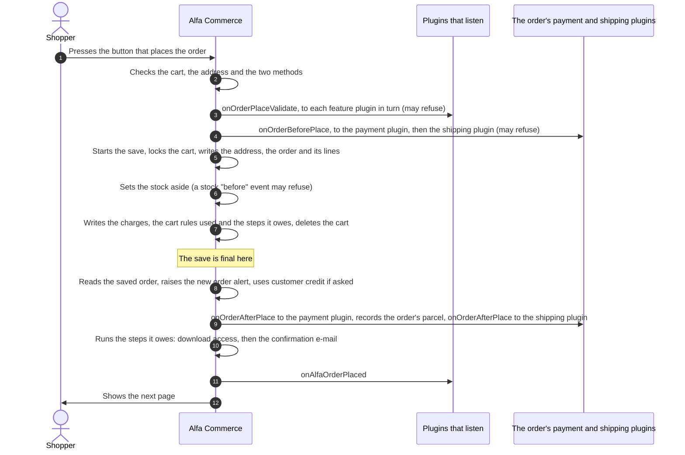

# Cart and checkout

<AlfaVersion verified="2.3.0" />

A shopper's cart is calculated again on every request that shows it. When the shopper places the order, the cart is
turned into an order as one unit and then deleted. This page explains the classes that do this, and says for each
whether an extension may use it.

The cart is priced at its delivery place. Its goods and its carriage are
priced at one place: the place the request bound, else the place field of the delivery address. Item lists and
item pages keep the visitor's own place.

The events of the cart and the checkout are on [Order and cart events](../events/order-and-cart-events.md). The
order of the events is on [Event flows](../events/flows.md#placing-an-order). This page does not repeat them.

## What it does

| Class | In plain words | For extensions? |
|---|---|---|
| `Cart` (`site/src/Service/Cart/Cart.php`) | The cart as a plugin reads it | **Read only.** Events hand it to you. |
| `CartLine` (`site/src/Service/Cart/CartLine.php`) | One line of that cart | **Read only** |
| `CartContributionBuilder` (`administrator/src/Service/Cart/Plugin/`) | Describes one charge a plugin adds to the cart | **Yes**, through `onCartTotals`. You never create it yourself. |
| `CartService` (`site/src/Service/Cart/CartService.php`) | What a page or a module may ask of a cart: add, change, read | **Yes, for a module or a page of your own.** Not from inside a cart event. |
| `CartSnapshot`, `CartTotalsView` | What `CartService` answers: the cart at one moment, with its totals | **Read only** |
| `CartTotals` | Adds the cart up | No, core's own |
| `CartRepository` (`administrator/src/Service/Cart/CartRepository.php`) | Every write to the cart tables | **No. Do not call it.** |
| `CartRulesEngine`, `CartRules` (`site/src/Service/CartRules`) | Work out which cart rules apply | No, core's own |
| `OrderPlacement` (`site/src/Service/Checkout/OrderPlacement.php`) | Turns a cart into an order | No, core's own. You take part through its events. |
| `PlacementCart`, `PlacementCommand`, `PlacementOutcome` | The cart, the request and the result of one placement | No, core's own |

## When it is used

- Your payment or shipping plugin is handed a cart and you want to know what you can read from it.
- Your feature plugin adds a charge to the cart.
- Your module shows the cart.
- You want to know what is already saved when your plugin is called during a placement.

## The cart reader

### What it does

`Cart` is the cart as it stood when the event fired. It has no method that changes anything. Reading it three times
gives the same answer three times.

### When it is used

These events hand it to you with `getCart()`:

| Event | Who receives it | Page |
|---|---|---|
| `onCartTotals` | Each admitted plugin of the `alfa` group | [Order and cart events](../events/order-and-cart-events.md#oncarttotals) |
| `onCalculateShippingCost` | The shipping plugin of a method | [Shipping plugins](../plugins/shipment-plugin-events.md#oncalculateshippingcost) |
| `onCartView` | The payment or shipping plugin of an offered method | [Payment plugins](../plugins/payment-plugin-events.md#oncartview), [Shipping plugins](../plugins/shipment-plugin-events.md#oncartview) |

### What you are given

| Method | Returns | Meaning |
|---|---|---|
| `id()` | `int` | The cart's id. 0 when the cart has no row yet. |
| `isEmpty()` | `bool` | Nothing is in it |
| `itemCount()` | `int` | How many lines |
| `quantity()` | `int` | How many units over all lines |
| `isVirtual()` | `bool` | Nothing in the cart needs shipping. Read from the items' own "virtual" setting, never guessed from a weight of zero. |
| `lines()` | `CartLine[]` | The lines, in cart order |
| `currency()` | `Currency` | The currency the cart is priced in |
| `customer()` | `User` | Whose cart it is |
| `shipmentId()` | `int` | The chosen shipping method, 0 for none |
| `paymentId()` | `int` | The chosen payment method, 0 for none |
| `delivery()` | `AddressView` | The delivery address, read by field |
| `invoice()` | `AddressView` | The invoice address, read the same way |
| `getSubtotal()` | `Money` | The sum of the line prices, tax included |
| `getTotal()` | `Money` | What the shopper pays in total |
| `state()` | | For Alfa. Do not call it. |

`getTotal()` throws a `LogicException` in `onCartTotals` and in `onCalculateShippingCost`, because the charges and
the shipping cost are what is being decided there. Use `getSubtotal()` in those two. In `onCartView` the total
exists and `getTotal()` answers.

In `onCartTotals` and `onCalculateShippingCost` the cart holds only the lines that are paid for: an unavailable line
(see `isUnavailable()` below) is not in it and not in its counts.

A cart line (`CartLine`):

| Method | Returns | Meaning |
|---|---|---|
| `id()` | `int` | The cart line's id |
| `itemId()` | `int` | The item on the line |
| `combinationId()` | `?int` | The chosen combination, or `null` for an item without one |
| `quantity()` | `int` | How many units |
| `name()` | `string` | The item's name in the active language |
| `width()`, `height()`, `depth()`, `weight()` | `float` | The measurements of one unit: the item's own, replaced by the combination's where the combination sets them. Plain numbers in the shop's units. |
| `isVirtual()` | `bool` | Nothing here to carry |
| `isUnavailable()` | `bool` | The line cannot be bought as it stands. It stays in the cart, named, the shopper can remove it, and the checkout refuses it by name. A line is unavailable when its item has left the catalogue (the line has no price); when a field the line carries, or a required field, has a plugin that cannot answer (no price); when no price applies at its quantity (in the order builder the line waits for its custom price); when its quantity is too small to be charged (the line says from which quantity it can be); and when its unit cannot be bought now (out of stock, a stored combination that was unpublished, archived or removed, or a line without a combination on an item that now has combinations). |

The address reader (`AddressView`) gives the checkout fields. Two of the examples in the comment of `Cart::delivery()`:

```php
$postcode = $cart->delivery()->field($postcodeFieldId)->value();
$placeId  = $cart->delivery()->role('country')->int();
```

`$postcodeFieldId` is the id of a checkout field that your method's settings name. A new shop ships a Postcode
field (role `postcode`), with Address and City. A carrier still
names the field it reads in its settings, and a setting of type `checkoutfield` may start on a
role's field with `defaultrole` (see [onCalculateShippingCost](../plugins/shipment-plugin-events.md#oncalculateshippingcost)).

### What you are expected to do

Read. To change a cart, a page or a module calls `CartService` (below). A handler of a cart event must not change
the cart it is being asked about.

## The charge builder

`$event->contribution('group.element', $code)` in `onCartTotals` returns a `CartContributionBuilder`. Its methods
and a full sample are on [Order and cart events](../events/order-and-cart-events.md#oncarttotals).

| What it guarantees | What it refuses |
|---|---|
| A charge that reaches the totals is complete: it has a label and either an amount or a percentage | A blank code, an amount of 0 or less, a percentage of 0 or less or above 100, a tax rate outside 0 to 100, and `amount()` together with `percent()`. Each throws at the call. |
| The charge is stored with the order when the order is placed | A charge without a label, or without `amount()` or `percent()`. It is dropped when Alfa collects the charges, and so is every other charge of the same plugin. |

## CartService

### What it does

`CartService` is the one class a page, a controller or a module asks when it wants something of a cart. Each method
is one thing a person does: add an item, change a quantity, choose a method, look. It answers with a result and a
reading, never with the cart itself.

You get one with a static method:

| Method | Whose cart |
|---|---|
| `CartService::ambient(): self` | The current visitor's own cart |
| `CartService::forSubject(CartSubject $subject): self` | A cart that one person operates for another. Alfa's back office uses it when staff work a customer's cart. That cart is priced at its delivery place, the place the order builder shows and the order is placed at. |

### When it is used

Alfa's own cart controller and cart page use it, and so does the cart module that ships with Alfa
(`modules/mod_alfa_cart`). Use it the same way in a module or a page of your own.

Do not call it from a handler of `onCartTotals`, `onCalculateShippingCost` or `onCartView`. Those run while the cart
is being calculated. This is this manual's advice: no check in the code refuses such a call, and what it would do
is not documented.

`CartService` checks no user right. `ambient()` always works on the current visitor's own cart.

### Which amounts the cart shows: CartShows

`Alfa\Component\Alfa\Site\Helper\CartShows::options()` reads the shop's **Options**, **Cart**, **The cart shows**: five
switches for the amounts and one for the coupon field, each on unless the shop hides it. The cart page with its
checkout summary with its rules progress, the cart module and the added-to-cart card read them; `CartSummary::rows()`
gives only the rows the switches show, and none for a subtotal or a total of zero that **Zero price display** hides
(see [Pricing](./pricing.md#a-price-of-zero-and-a-product-with-no-price-pricedisplay)).

| Property | When true |
|---|---|
| `linePrice` | Each line's price, discount and total |
| `subtotal` | The subtotal row and the discount row under it, and a cart rule's amount goal |
| `shipping` | The shipping row |
| `tax` | Each line's tax and the tax row |
| `total` | The total row, with the fee and cart rule rows |
| `coupon` | The coupon field; when false, the storefront's `cart.applyCoupon` refuses every code |

`rows(array $rows)` keeps the summary rows the switches show; `shows(SummaryRow $row)` answers for one row, and throws
`UnexpectedValueException` for a row of a type no switch covers. Only the showing changes: the cart's totals, the
placement and the order carry every amount. An override of the cart's lines, of the rules progress, of the cart module
or of the added-to-cart card shows what the shop chose when it reads `CartShows::options()`.

```php
use Alfa\Component\Alfa\Site\Helper\CartShows;

$shows = CartShows::options();

if ($shows->total) {
    // the total row
}
```

### Reading the cart in a module

This is how the shipped cart module reads the cart (`modules/mod_alfa_cart/src/Dispatcher/Dispatcher.php`):

```php
use Alfa\Component\Alfa\Administrator\Service\Cart\CartResolution;
use Alfa\Component\Alfa\Site\Service\Cart\CartService;

$cart     = CartService::ambient();
$snapshot = $cart->canHaveCart() ? $cart->summary(CartResolution::Current) : null;

if ($snapshot !== null && !$snapshot->isEmpty()) {
    $units = $snapshot->quantity;                    // int
    $lines = $snapshot->itemCount;                   // int
    $total = $snapshot->totals->grand->format();     // text, with the currency symbol
}
```

`CartResolution::Current` means "look only": a visitor who has no cart still has none afterwards.

`summary()` is the reading for a module that shows no method: the lines and the totals, with no offers
(`$snapshot->offers` is null), so no shipping method is asked to quote for a list on every page. A template override
of the shipped module's layouts reads no offers.

`canHaveCart(): bool` says whether the visitor can have a cart at all (an account, or a well-formed cart key of the
browser), reading nothing. A module shown on every page asks it before it reads the cart, as the shipped cart module does, so
a first-time visitor costs it no query. The shipped module then hands
its layouts no reading (`$snapshot` is `null`): a template override of `tmpl/default.php` or `tmpl/default_items.php`
must accept `null`. An override of `default_items.php` is drawn only when the page loads: every refresh of the cart
draws the module's own `default_items.php`. Keep the element with `data-cart-items` in what it draws: without it the
module's script stops before it binds the cart button, and the drawer never opens. See
[The cart module](../modules/cart.md).

### The methods

Every method below is public. **Looks** never create a cart. **Changes** may create one where the table says so.

| Method | What it does | What it guarantees | What it refuses |
|---|---|---|---|
| `read(CartResolution $mode, int $cartId = 0): CartSnapshot` | Reads a cart | Creates no cart. It is not free of writes: it adopts a guest's cart after sign-in, and lowers a quantity that is no longer in stock. | A mode that may create a cart, `CartResolution::Mutable` or `Fresh`, throws `InvalidArgumentException` before any cart is read |
| `summary(CartResolution $mode, int $cartId = 0): CartSnapshot` | Reads a cart for a module that shows no method | The same as `read()`, with no offers (null): no method list is read, and the chosen shipping method is asked only for the shipping total. | Throws `InvalidArgumentException` for `CartResolution::Mutable` and `Fresh`, as `read()` does |
| `add(int $itemId, int\|float $quantity): CartAddResult` | Puts an item in the cart. Reads the chosen field values and uploads from the current request. The line and its chosen options are written together, or not at all. | Creates a cart for a first-time visitor. Its comment calls it the only method that may; in the code `chooseShipment()` and `choosePayment()` open the cart the same way, and `createNamedCart()` always makes one. The result carries the line as the cart now prices it. | A request it cannot read, or a write that fails: `added` is `false` and the shopper gets one sentence. When the cart already holds every available unit of the item, nothing is added and the shopper reads one notice naming the available quantity ("Your cart already holds the available quantity (1)."); `stockLimit` says so. In the order builder the same case reads, to the member of staff, "The cart already holds the available quantity (1)." |
| `addCommand(AddToCartCommand $command): CartAddResult` | Puts an item in the cart as a built command says it: the item, the quantity and the configuration (`selection`, `optionValueIds`, `payloads`), with no request read. `add()` reads the request into such a command and calls it. Order again uses it (see [The customer's account](./customer-account.md#order-again)). | As `add()`. | As `add()`: a configuration the item does not offer, a refused quantity or a failed write answers `added` `false`. |
| `setLineQuantity(int $lineId, int $quantity): CartMutationResult` | Sets how many of one line | The quantity is held to stock and to the item's own rules. The line is removed when it reaches 0. A quantity cut to the stock is said in one notice naming the available quantity. A reading with no offers, as `summary()` gives. | A line of another cart |
| `setLineQuantityAtCheckout(int $lineId, int $quantity, ?int $placeId): CartMutationResult` | The same at checkout, and then checks the chosen methods against what is still offered | A reading only when the change was written | The same |
| `clear(): bool` | Takes everything out and keeps the cart | Returns `false` only for a storage failure | |
| `applyCoupon(string $code): string` | Enters a coupon code | Returns one of the `CouponOutcome` constants, which says what happened | A code is kept on the cart only when it applied, or when its rule is real and its conditions are not met yet. Any other code is refused and not kept. |
| `removeCoupon(string $code): void` | Takes a code off | | Reports nothing. A storage failure is logged. |
| `pointAtSavedDetails(int $deliveryId, ?int $invoiceId = null): void` | Points the cart at a saved address | | Reports nothing. A storage failure is logged. |
| `chooseShipment(int $shipmentId, ?int $placeId): CartMutationResult` | Chooses the shipping method | The delivery place is applied first, because it decides which methods are offered and the prices of the cart's goods. May create a cart for a first-time visitor. | A choice that could not be written: `succeeded` is `false` and no reading is taken |
| `choosePayment(int $paymentId, ?int $placeId): CartMutationResult` | Chooses the payment method | The same order of steps | The same |
| `checkout(?int $placeId): CartSnapshot` | The checkout as it stands, with the offered methods | Creates no cart and sets no cookie | |
| `openCheckout(): CheckoutCart` | The checkout page's look: first whether the cart is empty, then the reading | Creates no cart | |
| `lineConfiguration(object $item, int $lineId): ?array` | What the shopper chose on one line, so that the item page can open it again | `null` for a line that is not the visitor's | |
| `createNamedCart(): NamedCartEditor` | A new cart for the subject's customer. For the back office. | Always a new cart, never one that already exists, opened in the shop's default currency, never the session's. | |
| `editCart(int $cartId): NamedCartEditor` | A handle on a cart known by its id. For the back office. | | |

### What you are given back

`CartSnapshot` is the cart at one moment. All of its properties are read only.

| Property | Type | Meaning |
|---|---|---|
| `cartId` | `int` | The cart, or 0 for none |
| `lines` | `object[]` | The lines as the cart page reads them |
| `itemCount`, `quantity` | `int` | Lines, and units over all lines |
| `isVirtual` | `bool` | Nothing needs shipping |
| `currency` | `Currency` | The cart's currency |
| `totals` | `CartTotalsView` | What it costs, see below |
| `rules` | `CartRulesView` | The cart rules applied (`applied`), the codes held (`codes`), rules the shopper is close to (`progress`), and their sum (`total`) |
| `offers` | `?CartOffersView` | The payment and shipping methods offered (on the storefront, a shipping method only when its plugin answers a price for the cart as the checkout stands), the chosen ones, and `shipmentNeeds` with `needsKey()`: what the checkout has not given yet that a withheld method waits for. Null on the cart module's reading, `CartService::summary()`, which reads the lines and the totals only. |
| `customer` | `User` | Whose cart it is |
| `placeId` | `?int` | The delivery place of this request, and the place the cart's goods are priced at. |
| `shipmentId` | `int` | The chosen shipping method, or 0, on every reading. |

Its methods are `isEmpty()`, `exists()` and `shippingAwaitsChoice()`: the cart needs shipping and no
shipping method is chosen yet, so the shipping cost is not known. It is not zero.

A checkout form override wraps the delivery fields in an element with `data-cart-delivery-fields`, so a change to
any of them reads the methods again.

`CartTotalsView`, each amount a `Money` object:

| Property | Meaning |
|---|---|
| `goods`, `goodsExcl` | The line totals, with and without tax |
| `beforeDiscount` | What the lines came to before catalogue discounts |
| `tax` | The tax of the lines |
| `discount` | What the catalogue discounts took off |
| `shipment` | The shipping cost as the cart pays it, after shipping rules |
| `shipmentGross` | The shipping cost before shipping rules |
| `shippingBenefit` | The shipping rule's own summary, as an object. Its properties are not documented here. |
| `contributions` | The charges the order carries beside its goods and shipping, as a list: the plugins' charges, then the chosen payment method's fee (code `payment_fee`) |
| `grand`, `grandExcl` | What the shopper pays, with and without tax |
| `contributionsNotLoaded` | The plugins whose charge is missing because Joomla did not load them for the current user. See [When staff operate a customer's cart](../events/order-and-cart-events.md#when-staff-operate-a-customers-cart). |

`CartMutationResult` has `succeeded`, `cartId` and `snapshot` (which is `null` when no reading was taken).
`CartAddResult` has `added`, `lineId`, `line`, `itemCount`, `quantity`, `grandTotal` and `stockLimit`: a `StockLimit`
when the stock limited the add (its `added` is false when the cart already held the available quantity and true when
the request was cut to it; its `quantity` is what the cart holds of that stock; its `lowered` is true when a line was
lowered to that quantity), otherwise null. When nothing was added, `itemCount` and `quantity` are 0, except when the
cart already held the available quantity: then they are what the cart holds.

### How the cart is added up

`CartTotals` holds the sum. An extension does not call it; the figures reach you in `CartTotalsView`.

```text
grand total = line totals + shipping after shipping rules + charges - cart rules
```

The charges are the plugins' charges and then the chosen payment method's fee
([A payment method's fee](./payments-and-shipments.md#a-payment-methods-fee)); they and the cart rules are part of the
total, not only the items and the shipping. The fee's percentage is taken of the rest of the total: the line totals,
the shipping and the plugins' charges, less the cart rules. The offers reading (`CartOffersView`) gives each offered
payment method's fee before it is chosen: `feeFor($methodId)` answers it as a `Money` with tax, or `null` for none.
Its `shipmentRefusals` holds, by method id, why the cart's goods keep a shipping method off the list
([Shipping restrictions per category](./payments-and-shipments.md#shipping-restrictions-per-category)).

## CartRepository

Core's own. It is the single class that writes the cart tables, and it knows nothing of a request, a session or a
user. It throws `CartPersistenceException` and leaves the wording for the shopper to its caller.

**Do not call it and do not write the cart tables.** How many units a cart may hold is decided above it, by the
classes `CartService` uses, so a quantity written straight through the repository is not held to stock or to the
item's own limits.

## Cart rules

A **cart rule** is a promotion applied in the cart, with or without a code. `CartRulesEngine` receives the cart's
lines as plain data and returns the rules that apply. It is core's own.

What an extension author needs to know:

| Fact | Meaning for you |
|---|---|
| There are three classes of rule: item, order and shipping, applied in that order | An item or order rule lowers the goods only. A shipping rule lowers the shipping cost only. |
| Within a class the rule that gives the shopper most wins. Others join only when both rules allow combining. | You cannot predict the discount from one rule alone |
| Amounts are tax included | |
| The rules used are stored with the order when it is placed (table `#__alfa_order_cart_rule`) | An order keeps its discounts whatever happens to the rule later |
| An item or order rule is stored with its share of each line it lowered (table `#__alfa_order_item_cart_rule`), as the engine shared it out, tax included and excluded; the rule's row is the sum of its shares | The order's documents state each line's share, and a change to a line's quantity moves its shares with it ([Documents](documents.md#discounts-line-by-line)) |
| How often a rule was used is counted from those stored rows; a code removed from an order is not counted | There is no counter to update |
| Staff can add a code to a placed order, put one in place of another, or remove one | The engine decides as it does for a cart, on what the order's lines have left after its discounts ([Orders](orders.md#coupons-on-a-placed-order)) |

A plugin cannot add a cart rule or lower a total through an event. A charge added in `onCartTotals` only adds.

## Placing an order

### What it does

`OrderPlacement` turns one cart into one order. It checks, asks the plugins that may refuse, saves the order as one
unit, and then lets the payment plugin write its row, records the order's parcel and hands it to the shipping plugin
to complete.

It is core's own. Alfa calls it from the storefront's cart controller, and from the back office when staff place an
order for a customer. An extension takes part through the events in the picture, and never calls it.

In catalogue-only mode (see [Online sales](../getting-started/store-setup.md#online-sales)), every storefront cart
task but the price recalculation answers 403 with the shop's sentence, and a placement on the storefront is refused;
the administrator's cart builder and its checkout place orders in either mode.

### What happens



[Event flows](../events/flows.md#placing-an-order) shows the same placement in two pictures, with the stock events
drawn one by one.

### The steps, and what each guarantees

| Step in the picture | What is true |
|---|---|
| 2 to 4 | Nothing is written. A refusal costs one failed checkout and leaves no order. Before the payment and shipping plugins are asked, the order's total is compared with the total the cart page showed, and an order whose total differs is refused, with both totals in the shopper's sentence. |
| 5 | The cart's row is locked first. A second request with the same cart (a double click, a browser retry) waits here. |
| 5 | The order and its lines are written by `OrderCreator`, the same class every other source of orders uses. See [Orders](./orders.md#ordercreator). |
| 6 | If the stock cannot be set aside, the placement fails and everything is undone. |
| 7 | The plugin charges and the cart rules used are stored with the order. If one of them cannot be written, the placement fails: an order is never saved with money rows that disagree with its total. |
| 7 | Two steps are recorded as [background work](../reference/glossary.md#background-work): download access and the confirmation e-mail, both for the status the order landed in. |
| 7 | The cart is deleted **inside** the save. Cart and order never exist together. |
| The line | The save is final (the commit, `OrderPlacement.php` line 554). The order exists, and nothing after this line can make that untrue. |
| 9 | The payment plugin writes its row. Alfa records the order's parcel, with the shipping charge and every item, and the shipping plugin completes it. Each is a save of its own. |
| 10 | The two recorded steps run after both plugins are done, so the confirmation e-mail shows the order with its payment and its parcel. |
| 11 | `onAlfaOrderPlaced` is announced last, so a listener sees the order as the shopper completed it. |

### The status an order is placed in

An order lands in the store's initial status. An operator placing it in the administrator may name another. An order
whose total is zero, when no operator names a status, lands in the status the shop names in **Options**, **Cart**,
**Order status when nothing is to be collected** (`zero_total_status`), when it names one: a request for offer in a
catalogue priced at zero (see [A catalogue with requests for offer](../getting-started/requests-for-offer.md)). An
order the customer's credit pays in full is not such an order: its total is not zero. The confirmation e-mail is that
status's own, and the download access is that status's. `OrderCreator` checks the status: one that does not exist or
is not published lands the order in the initial status with a notice to staff, and one that requires payment refuses
the placement unless it allows the unpaid exception (**Allow unpaid exception**).

### What happens to the cart

The cart is deleted in step 7, before the save is final, and for two reasons.

1. **No double order.** The second of two requests for the same cart takes the lock after the first has finished,
   finds the cart gone and is refused as an empty cart. This is why an order holds no reference to the cart
   it came from.
2. **No in-between state.** If the save is undone, the cart is back with it.

So in every event after the line (`onOrderAfterPlace`, `onAlfaOrderPlaced`) there is no cart any more. Read the
order.

### What a failure after the save leaves

The save is final at one point, and what happens after it cannot undo it.

| What fails | What is left | What the person sees |
|---|---|---|
| Anything before the line | No order. Nothing was written. The cart is as it was. | The reason, as a message |
| Reading the saved order back | The order, without a payment row and without a parcel. `onAlfaOrderPlaced` is not announced. | A warning that part of the order could not be set up |
| The payment plugin in step 9 | The order without a payment row. The shipping plugin is still called. | The same warning, naming what failed |
| Recording the parcel in step 9 | The order without a parcel. The shipping plugin is not called, and staff get a notice naming the charge to add by hand. | The same warning |
| The shipping plugin in step 9 | The order with its parcel, without what the plugin adds to it | The same warning |
| Customer credit could not be used | The order. The payment plugin is asked to collect the full total. | A warning that the credit was not used |
| A listener of `onAlfaOrderPlaced` | The order, complete. The error is logged and the next listener runs. | Nothing |
| Any other error after the line | The order | A warning. The placement still answers "placed". |

The recorded steps of step 10 are not lost when the request stops: Alfa carries them out later.

### How Alfa's own callers read the result

This is for understanding the flow. `OrderPlacement` and `PlacementOutcome` are core's own.

| Method of `OrderPlacement` | Meaning |
|---|---|
| `place(PlacementCommand $command): bool` | Places the order. `true` when the order exists. |
| `placeOrder(array $data, array $billing = []): bool` | The same for the storefront: reads the chosen methods from the request and calls `place()` |
| `getOutcome(): PlacementOutcome` | What happened, see below |
| `isCommitted(): bool`, `getCommittedOrderId(): int` | Whether the order exists, and its id |
| `getWarnings(): array`, `getFailures(): array` | What did not finish after the save, and why a placement was refused, each as a language key with its values |
| `getOrder(): ?object` | The saved order as it was read back. It can be `null` for an order that exists. |

`PlacementOutcome` has three states: `REJECTED` (no order), `COMMITTED` (the order exists and everything after the
save finished) and `COMMITTED_WITH_WARNINGS` (the order exists, something after the save did not finish). Its
methods are `isCommitted()`, `hasWarnings()`, `orderId()`, `state()`, `failures()` and `warnings()`.

`PlacementCart` is the cart as the placement needs it: its lines, its money, its rules, its charges, the offered
methods, and `discard()`. Its class comment says it is "not a plugin API and not the application API".

## The order builder in the administrator

Staff build an order for a customer on the screen of one cart (Sales > Carts, a cart opened). It is one page, in the
order an order is worked:

1. **Customer and addresses.** Who the cart is for (read from the cart, never changed on it), the customer's address
   book, and the delivery and invoice addresses the cart points at.
2. **Items.** The cart's lines in one table: each line's configuration, quantity, unit price without and with tax,
   tax, discount and total, and an Edit button that opens the line in a popup (quantity, configuration, a custom price,
   Remove). The Add item button is in the section's heading. Under the lines, the goods before and after rules, each
   rule that applied (a coupon code with its remove button), tax, shipping, every plugin's charge and the total; under
   the table, the coupon box. A code that is not taken comes back with the reason, worded for staff: no rule has it,
   its rule is unpublished, not started or ended, its uses are spent, this customer may not use it, a better discount
   already applies and the two do not combine, or the cart does not meet its conditions yet (the code is then kept). A
   code that applied says nothing: its rule's row in the table shows it.
3. **Shipment and payment.** The methods the engine offers this cart. They differ from the storefront's in two ways:
   only the payment methods whose plugin allows staff to place orders are listed, and the shipping methods are listed
   without asking their plugins for a price (only the chosen one is priced).
4. **Summary and placement.** The cart's state and activity, the codes it holds, and the placement card: the facts the
   order will carry, the checkout fields, the status the order lands in and whether the customer's credit is spent.

A plugin's section follows these four (a fieldset added in `onAlfaAdminForm` for the target `cart`, see
[Admin screen events](../plugins/admin-screen-events.md)). Each form on the page posts on its own and the page is drawn
again from the cart. When the reply to a form of the first three sections has nothing to say, the page opens again at
that section; otherwise it opens at the top, where Joomla prints a message.

The screen reads the administrator's language file. The checkout's notices and refusals it prints come from the
storefront's file, which it loads first, with the administrator's loaded again over it: a key both files carry reads
as the administrator's file says it.

### Overriding the builder's layouts

The pieces the builder prints in more than one place are layouts, which an administrator template overrides in
`html/layouts/com_alfa/`:

| Layout | What it prints | Printed by |
|---|---|---|
| `cart.line_selection` | A line's configuration, as a list of "field: value" | The items table |
| `cart.line_discount` | A priced line's discount, or the saving of its negotiated price | The items table and the line popup's figures |
| `cart.line_total` | A priced line's total, with the amount it would have been struck through above it | The items table and the line popup's figures |
| `order.checkout_details` | The customer details, the choice of different invoice details and the billing details | The builder's placement card and the order screen's Order tab |

The page itself (`tmpl/cart/default.php`) and its sections (`default_customer.php`, `default_lines.php`,
`default_methods.php`, `default_place.php`) are overridden in `html/com_alfa/cart/` of the administrator template.

## What you must provide

| You are writing | What you provide |
|---|---|
| A plugin that reads the cart | A handler for one of the events above. Nothing else. |
| A plugin that adds a charge | Its public method `onCartTotals(CartTotalsEvent $event): void` |
| A module that shows the cart | A call to `CartService::ambient()->summary(CartResolution::Current)` (or `read()` when your module shows the offered methods), after `canHaveCart()`. Load the language file `com_alfa` if your module draws Alfa's own layouts, as the shipped module does. |

## What can go wrong

| What you see | The usual cause |
|---|---|
| A `LogicException` "The final cart total is not available at this stage" | `getTotal()` was called in `onCartTotals` or `onCalculateShippingCost`. Use `getSubtotal()`. |
| A cart row appears for every visitor | A module read the cart with a method that may create one. Use `summary()` or `read()` with `CartResolution::Current`. |
| `read()` or `summary()` throws `InvalidArgumentException` | It was called with a mode that may create a cart, `CartResolution::Mutable` or `Fresh`. A reading never creates one. |
| Your plugin is called in `onOrderAfterPlace` and finds no cart | The cart is deleted before the save is final. Read the order. |
| An order exists but has no payment row | The payment plugin failed after the save was final. See the table above. |
| Every order is refused with "its total is now" | A template override of the cart's items layout (`default_cart_items.php`) prints a `shown_total` other than the cart's grand total. The field is `<input type="hidden" form="cart-form" name="shown_total" value="CODE:minor units">`, for example `EUR:34720`. An override that lacks the field is not compared at all, so the check is lost: add the field. |

## Not documented yet

- The address reader (`AddressView`) in full.
- The properties of the line objects in `CartSnapshot::lines` and of the method lists in `CartOffersView`.
- `NamedCartEditor` and `CartSubject`, which the back office uses to work a customer's cart.
- The `CouponOutcome` values one by one.
- Whether a plugin may call `CartService` to change a cart outside the cart events, for example from a handler of
  its own page. The class comment of `Cart` says a plugin that must change a cart goes through `CartService`; no
  shipped plugin does it.
