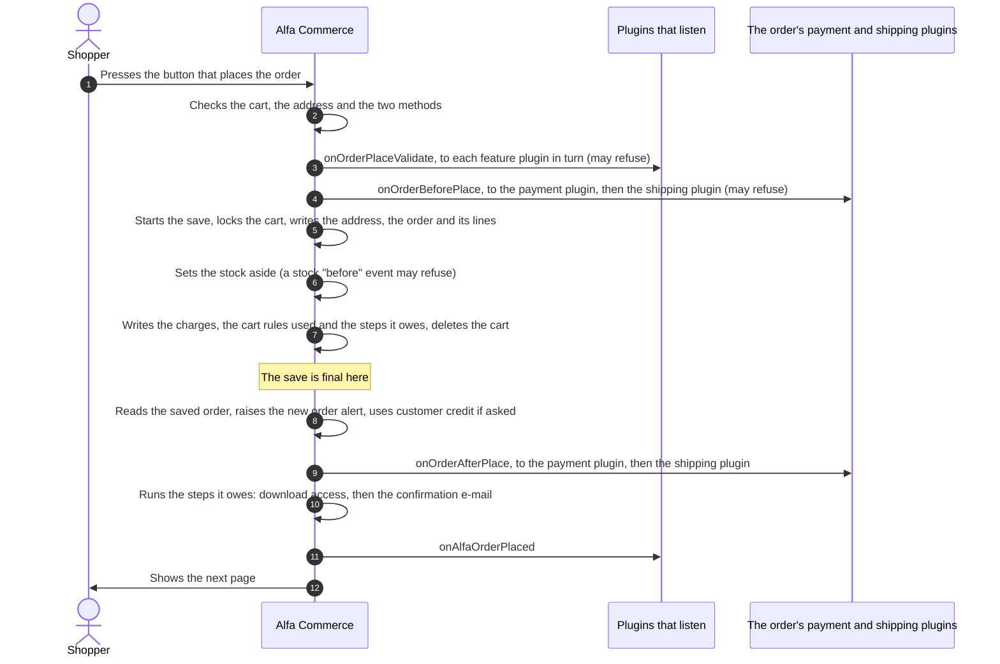

# Cart and checkout

<AlfaVersion verified="2.2.0" />

A shopper's cart is calculated again on every request that shows it. When the shopper places the order, the cart is
turned into an order as one unit and then deleted. This page explains the classes that do this, and says for each
whether an extension may use it.

The events of the cart and the checkout are on [Order and cart events](../events/order-and-cart-events.md). The
order of the events is on [Event flows](../events/flows.md#placing-an-order). This page does not repeat them.

## What it does

| Class | In plain words | For extensions? |
|---|---|---|
| `Cart` (`site/src/Service/Cart/Cart.php`) | The cart as a plugin reads it | **Read only.** Events hand it to you. |
| `CartLine` (`site/src/Service/Cart/CartLine.php`) | One line of that cart | **Read only** |
| `CartContributionBuilder` (`administrator/src/Service/Cart/Plugin/`) | Describes one charge a plugin adds to the cart | **Yes**, through `onCartTotals`. You never create it yourself. |
| `CartService` (`site/src/Service/Cart/CartService.php`) | What a page or a module may ask of a cart: add, change, read | **Yes, for a module or a page of your own.** Not from inside a cart event. |
| `CartSnapshot`, `CartTotalsView` | What `CartService` answers: the cart at one moment, with its totals | **Read only** |
| `CartTotals` | Adds the cart up | No, core's own |
| `CartRepository` (`administrator/src/Service/Cart/CartRepository.php`) | Every write to the cart tables | **No. Do not call it.** |
| `CartRulesEngine`, `CartRules` (`site/src/Service/CartRules`) | Work out which cart rules apply | No, core's own |
| `OrderPlacement` (`site/src/Service/Checkout/OrderPlacement.php`) | Turns a cart into an order | No, core's own. You take part through its events. |
| `PlacementCart`, `PlacementCommand`, `PlacementOutcome` | The cart, the request and the result of one placement | No, core's own |

## When it is used

- Your payment or shipping plugin is handed a cart and you want to know what you can read from it.
- Your feature plugin adds a charge to the cart.
- Your module shows the cart.
- You want to know what is already saved when your plugin is called during a placement.

## The cart reader

### What it does

`Cart` is the cart as it stood when the event fired. It has no method that changes anything. Reading it three times
gives the same answer three times.

### When it is used

These events hand it to you with `getCart()`:

| Event | Who receives it | Page |
|---|---|---|
| `onCartTotals` | Each admitted plugin of the `alfa` group | [Order and cart events](../events/order-and-cart-events.md#oncarttotals) |
| `onCalculateShippingCost` | The shipping plugin of a method | [Shipping plugins](../plugins/shipment-plugin-events.md#oncalculateshippingcost) |
| `onCartView` | The payment or shipping plugin of an offered method | [Payment plugins](../plugins/payment-plugin-events.md#oncartview), [Shipping plugins](../plugins/shipment-plugin-events.md#oncartview) |

### What you are given

| Method | Returns | Meaning |
|---|---|---|
| `id()` | `int` | The cart's id. 0 when the cart has no row yet. |
| `isEmpty()` | `bool` | Nothing is in it |
| `itemCount()` | `int` | How many lines |
| `quantity()` | `int` | How many units over all lines |
| `isVirtual()` | `bool` | Nothing in the cart needs shipping. Read from the items' own "virtual" setting, never guessed from a weight of zero. |
| `lines()` | `CartLine[]` | The lines, in cart order |
| `currency()` | `Currency` | The currency the cart is priced in |
| `customer()` | `User` | Whose cart it is |
| `shipmentId()` | `int` | The chosen shipping method, 0 for none |
| `paymentId()` | `int` | The chosen payment method, 0 for none |
| `delivery()` | `AddressView` | The delivery address, read by field |
| `invoice()` | `AddressView` | The invoice address, read the same way |
| `getSubtotal()` | `Money` | The sum of the line prices, tax included |
| `getTotal()` | `Money` | What the shopper pays in total |
| `state()` | | For Alfa. Do not call it. |

`getTotal()` throws a `LogicException` in `onCartTotals` and in `onCalculateShippingCost`, because the charges and
the shipping cost are what is being decided there. Use `getSubtotal()` in those two. In `onCartView` the total
exists and `getTotal()` answers.

A cart line (`CartLine`):

| Method | Returns | Meaning |
|---|---|---|
| `id()` | `int` | The cart line's id |
| `itemId()` | `int` | The item on the line |
| `combinationId()` | `?int` | The chosen combination, or `null` for an item without one |
| `quantity()` | `int` | How many units |
| `name()` | `string` | The item's name in the active language |
| `width()`, `height()`, `depth()`, `weight()` | `float` | The measurements of one unit: the item's own, replaced by the combination's where the combination sets them. Plain numbers in the shop's units. |
| `isVirtual()` | `bool` | Nothing here to carry |
| `isUnavailable()` | `bool` | The item has left the catalogue. The line stays, and nothing may be priced against it. |

The address reader (`AddressView`) gives the checkout fields. The examples in the class comment are:

```php
$postcode = $cart->delivery()->field($postcodeFieldId)->value();
$placeId  = $cart->delivery()->role('country')->int();
```

`$postcodeFieldId` is the id of a checkout field that your method's settings name. Alfa has no postcode field of its
own.

### What you are expected to do

Read. To change a cart, a page or a module calls `CartService` (below). A handler of a cart event must not change
the cart it is being asked about.

## The charge builder

`$event->contribution('group.element', $code)` in `onCartTotals` returns a `CartContributionBuilder`. Its methods
and a full sample are on [Order and cart events](../events/order-and-cart-events.md#oncarttotals).

| What it guarantees | What it refuses |
|---|---|
| A charge that reaches the totals is complete: it has a label and either an amount or a percentage | A blank code, an amount of 0 or less, a percentage of 0 or less or above 100, a tax rate outside 0 to 100, and `amount()` together with `percent()`. Each throws at the call. |
| The charge is stored with the order when the order is placed | A charge without a label, or without `amount()` or `percent()`. It is dropped when Alfa collects the charges. |

## CartService

### What it does

`CartService` is the one class a page, a controller or a module asks when it wants something of a cart. Each method
is one thing a person does: add an item, change a quantity, choose a method, look. It answers with a result and a
reading, never with the cart itself.

You get one with a static method:

| Method | Whose cart |
|---|---|
| `CartService::ambient(): self` | The current visitor's own cart |
| `CartService::forSubject(CartSubject $subject): self` | A cart that one person operates for another. Alfa's back office uses it when staff work a customer's cart. |

### When it is used

Alfa's own cart controller and cart page use it, and so does the cart module that ships with Alfa
(`modules/mod_alfa_cart`). Use it the same way in a module or a page of your own.

Do not call it from a handler of `onCartTotals`, `onCalculateShippingCost` or `onCartView`. Those run while the cart
is being calculated. This is this manual's advice: no check in the code refuses such a call, and what it would do
is not documented.

`CartService` checks no user right. `ambient()` always works on the current visitor's own cart.

### Reading the cart in a module

This is how the shipped cart module reads the cart (`modules/mod_alfa_cart/src/Dispatcher/Dispatcher.php`):

```php
use Alfa\Component\Alfa\Administrator\Service\Cart\CartResolution;
use Alfa\Component\Alfa\Site\Service\Cart\CartService;

$snapshot = CartService::ambient()->read(CartResolution::Current);

if (!$snapshot->isEmpty()) {
    $units = $snapshot->quantity;                    // int
    $lines = $snapshot->itemCount;                   // int
    $total = $snapshot->totals->grand->format();     // text, with the currency symbol
}
```

`CartResolution::Current` means "look only": a visitor who has no cart still has none afterwards.

### The methods

Every method below is public. **Looks** never create a cart. **Changes** may create one where the table says so.

| Method | What it does | What it guarantees | What it refuses |
|---|---|---|---|
| `read(CartResolution $mode, int $cartId = 0): CartSnapshot` | Reads a cart | Creates no cart. It is not free of writes: it adopts a guest's cart after sign-in, and lowers a quantity that is no longer in stock. | `CartResolution::Mutable` throws `InvalidArgumentException` |
| `add(int $itemId, int\|float $quantity): CartAddResult` | Puts an item in the cart. Reads the chosen field values and uploads from the current request. | Creates a cart for a first-time visitor. Its comment calls it the only method that may; in the code `chooseShipment()` and `choosePayment()` open the cart the same way, and `createNamedCart()` always makes one. The result carries the line as the cart now prices it. | A request it cannot read, or a write that fails: `added` is `false` and the shopper gets one sentence |
| `setLineQuantity(int $lineId, int $quantity): CartMutationResult` | Sets how many of one line | The quantity is held to stock and to the item's own rules. The line is removed when it reaches 0. | A line of another cart |
| `setLineQuantityAtCheckout(int $lineId, int $quantity, ?int $placeId): CartMutationResult` | The same at checkout, and then checks the chosen methods against what is still offered | A reading only when the change was written | The same |
| `clear(): bool` | Takes everything out and keeps the cart | Returns `false` only for a storage failure | |
| `applyCoupon(string $code): string` | Enters a coupon code | Returns one of the `CouponOutcome` constants, which says what happened | A code is kept on the cart only when it applied, or when its rule is real and its conditions are not met yet. Any other code is refused and not kept. |
| `removeCoupon(string $code): void` | Takes a code off | | Reports nothing. A storage failure is logged. |
| `pointAtSavedDetails(int $deliveryId, ?int $invoiceId = null): void` | Points the cart at a saved address | | Reports nothing. A storage failure is logged. |
| `chooseShipment(int $shipmentId, ?int $placeId): CartMutationResult` | Chooses the shipping method | The delivery place is applied first, because it decides which methods are offered. May create a cart for a first-time visitor. | A choice that could not be written: `succeeded` is `false` and no reading is taken |
| `choosePayment(int $paymentId, ?int $placeId): CartMutationResult` | Chooses the payment method | The same order of steps | The same |
| `checkout(?int $placeId): CartSnapshot` | The checkout as it stands, with the offered methods | Creates no cart and sets no cookie | |
| `openCheckout(): CheckoutCart` | The checkout page's look: first whether the cart is empty, then the reading | Creates no cart | |
| `lineConfiguration(object $item, int $lineId): ?array` | What the shopper chose on one line, so that the item page can open it again | `null` for a line that is not the visitor's | |
| `createNamedCart(): NamedCartEditor` | A new cart for the subject's customer. For the back office. | Always a new cart, never one that already exists | |
| `editCart(int $cartId): NamedCartEditor` | A handle on a cart known by its id. For the back office. | | |

### What you are given back

`CartSnapshot` is the cart at one moment. All of its properties are read only.

| Property | Type | Meaning |
|---|---|---|
| `cartId` | `int` | The cart, or 0 for none |
| `lines` | `object[]` | The lines as the cart page reads them |
| `itemCount`, `quantity` | `int` | Lines, and units over all lines |
| `isVirtual` | `bool` | Nothing needs shipping |
| `currency` | `Currency` | The cart's currency |
| `totals` | `CartTotalsView` | What it costs, see below |
| `rules` | `CartRulesView` | The cart rules applied (`applied`), the codes held (`codes`), rules the shopper is close to (`progress`), and their sum (`total`) |
| `offers` | `CartOffersView` | The payment and shipping methods offered, and the chosen ones |
| `customer` | `User` | Whose cart it is |
| `placeId` | `?int` | The delivery place of this request |

Its methods are `isEmpty()`, `exists()` and, since 2.2.0, `shippingAwaitsChoice()`: the cart needs shipping and no
shipping method is chosen yet, so the shipping cost is not known. It is not zero.

`CartTotalsView`, each amount a `Money` object:

| Property | Meaning |
|---|---|
| `goods`, `goodsExcl` | The line totals, with and without tax |
| `beforeDiscount` | What the lines came to before catalogue discounts |
| `tax` | The tax of the lines |
| `discount` | What the catalogue discounts took off |
| `shipment` | The shipping cost as the cart pays it, after shipping rules |
| `shipmentGross` | The shipping cost before shipping rules |
| `shippingBenefit` | The shipping rule's own summary, as an object. Its properties are not documented here. |
| `contributions` | The charges plugins added, as a list |
| `grand`, `grandExcl` | What the shopper pays, with and without tax |
| `contributionsNotLoaded` | Since 2.2.0. The plugins whose charge is missing because Joomla did not load them for the current user. See [When staff operate a customer's cart](../events/order-and-cart-events.md#when-staff-operate-a-customers-cart). |

`CartMutationResult` has `succeeded`, `cartId` and `snapshot` (which is `null` when no reading was taken).
`CartAddResult` has `added`, `lineId`, `line`, `itemCount`, `quantity` and `grandTotal`.

### How the cart is added up

`CartTotals` holds the sum. An extension does not call it; the figures reach you in `CartTotalsView`.

```text
grand total = line totals + shipping after shipping rules + plugin charges - cart rules
```

Changed in 2.2.0. The old helper page said "items plus shipping". Plugin charges and cart rules are part of the
total.

## CartRepository

Core's own. It is the single class that writes the cart tables, and it knows nothing of a request, a session or a
user. It throws `CartPersistenceException` and leaves the wording for the shopper to its caller.

**Do not call it and do not write the cart tables.** How many units a cart may hold is decided above it, by the
classes `CartService` uses, so a quantity written straight through the repository is not held to stock or to the
item's own limits.

## Cart rules

A **cart rule** is a promotion applied in the cart, with or without a code. `CartRulesEngine` receives the cart's
lines as plain data and returns the rules that apply. It is core's own.

What an extension author needs to know:

| Fact | Meaning for you |
|---|---|
| There are three classes of rule: item, order and shipping, applied in that order | An item or order rule lowers the goods only. A shipping rule lowers the shipping cost only. |
| Within a class the rule that gives the shopper most wins. Others join only when both rules allow combining. | You cannot predict the discount from one rule alone |
| Amounts are tax included | |
| The rules used are stored with the order when it is placed (table `#__alfa_order_cart_rule`) | An order keeps its discounts whatever happens to the rule later |
| How often a rule was used is counted from those stored rows | There is no counter to update |

A plugin cannot add a cart rule or lower a total through an event. A charge added in `onCartTotals` only adds.

## Placing an order

### What it does

`OrderPlacement` turns one cart into one order. It checks, asks the plugins that may refuse, saves the order as one
unit, and then lets the payment and shipping plugins write their rows.

It is core's own. Alfa calls it from the storefront's cart controller, and from the back office when staff place an
order for a customer. An extension takes part through the events in the picture, and never calls it.

### What happens



[Event flows](../events/flows.md#placing-an-order) shows the same placement in two pictures, with the stock events
drawn one by one.

### The steps, and what each guarantees

| Step in the picture | What is true |
|---|---|
| 2 to 4 | Nothing is written. A refusal costs one failed checkout and leaves no order. |
| 5 | The cart's row is locked first. A second request with the same cart (a double click, a browser retry) waits here. |
| 5 | The order and its lines are written by `OrderCreator`, the same class every other source of orders uses. See [Orders](./orders.md#ordercreator). |
| 6 | If the stock cannot be set aside, the placement fails and everything is undone. |
| 7 | The plugin charges and the cart rules used are stored with the order. If one of them cannot be written, the placement fails: an order is never saved with money rows that disagree with its total. |
| 7 | Two steps are recorded as [background work](../reference/glossary.md#background-work): download access and the confirmation e-mail. |
| 7 | The cart is deleted **inside** the save. Cart and order never exist together. |
| The line | The save is final (the commit, `OrderPlacement.php` line 528). The order exists, and nothing after this line can make that untrue. |
| 9 | The payment plugin and the shipping plugin each write their row. Each row is a save of its own. |
| 10 | The two recorded steps run after both plugins are done, so the confirmation e-mail shows the order with its payment and its parcel. |
| 11 | `onAlfaOrderPlaced` is announced last, so a listener sees the order as the shopper completed it. |

### What happens to the cart

The cart is deleted in step 7, before the save is final, and for two reasons.

1. **No double order.** The second of two requests for the same cart takes the lock after the first has finished,
   finds the cart gone and is refused as an empty cart. This is why an order holds no reference to the cart
   it came from.
2. **No in-between state.** If the save is undone, the cart is back with it.

So in every event after the line (`onOrderAfterPlace`, `onAlfaOrderPlaced`) there is no cart any more. Read the
order.

### What a failure after the save leaves

The save is final at one point, and what happens after it cannot undo it.

| What fails | What is left | What the person sees |
|---|---|---|
| Anything before the line | No order. Nothing was written. The cart is as it was. | The reason, as a message |
| Reading the saved order back | The order, without a payment row and without a parcel. `onAlfaOrderPlaced` is not announced. | A warning that part of the order could not be set up |
| The payment plugin in step 9 | The order without a payment row. The shipping plugin is still called. | The same warning, naming what failed |
| The shipping plugin in step 9 | The order without a parcel | The same warning |
| Customer credit could not be used | The order. The payment plugin is asked to collect the full total. | A warning that the credit was not used |
| A listener of `onAlfaOrderPlaced` | The order, complete. The error is logged and the next listener runs. | Nothing |
| Any other error after the line | The order | A warning. The placement still answers "placed". |

The recorded steps of step 10 are not lost when the request stops: Alfa carries them out later.

### How Alfa's own callers read the result

This is for understanding the flow. `OrderPlacement` and `PlacementOutcome` are core's own.

| Method of `OrderPlacement` | Meaning |
|---|---|
| `place(PlacementCommand $command): bool` | Places the order. `true` when the order exists. |
| `placeOrder(array $data, array $billing = []): bool` | The same for the storefront: reads the chosen methods from the request and calls `place()` |
| `getOutcome(): PlacementOutcome` | What happened, see below |
| `isCommitted(): bool`, `getCommittedOrderId(): int` | Whether the order exists, and its id |
| `getWarnings(): array`, `getFailures(): array` | What did not finish after the save, and why a placement was refused, each as a language key with its values |
| `getOrder(): ?object` | The saved order as it was read back. It can be `null` for an order that exists. |

`PlacementOutcome` has three states: `REJECTED` (no order), `COMMITTED` (the order exists and everything after the
save finished) and `COMMITTED_WITH_WARNINGS` (the order exists, something after the save did not finish). Its
methods are `isCommitted()`, `hasWarnings()`, `orderId()`, `state()`, `failures()` and `warnings()`.

`PlacementCart` is the cart as the placement needs it: its lines, its money, its rules, its charges, the offered
methods, and `discard()`. Its class comment says it is "not a plugin API and not the application API".

## What you must provide

| You are writing | What you provide |
|---|---|
| A plugin that reads the cart | A handler for one of the events above. Nothing else. |
| A plugin that adds a charge | A handler of `onCartTotals`, declared in `getTargetedHandlers()` |
| A module that shows the cart | A call to `CartService::ambient()->read(CartResolution::Current)`. Load the language file `com_alfa` if your module draws Alfa's own layouts, as the shipped module does. |

## What can go wrong

| What you see | The usual cause |
|---|---|
| A `LogicException` "The final cart total is not available at this stage" | `getTotal()` was called in `onCartTotals` or `onCalculateShippingCost`. Use `getSubtotal()`. |
| A cart row appears for every visitor | A module read the cart with a method that may create one. Use `read()` with `CartResolution::Current`. |
| `read()` throws `InvalidArgumentException` | It was called with `CartResolution::Mutable` |
| Your plugin is called in `onOrderAfterPlace` and finds no cart | The cart is deleted before the save is final. Read the order. |
| An order exists but has no payment row | The payment plugin failed after the save was final. See the table above. |

## Changed in 2.2.0

- **Changed in 2.2.0.** `CartHelper` and `OrderPlaceHelper` no longer exist. `CartService` and `OrderPlacement`
  replaced them, with other method names.
- **Changed in 2.2.0.** The cart is deleted inside the save of the order, not after the "after place" events.
- **Changed in 2.2.0.** A placement that fails after the save is final reports "placed, with warnings". It no
  longer reports a failure for an order that exists.
- **Changed in 2.2.0.** Placing an order does not write the `stock` column of an item. Stock is set aside through
  the stock service. See [Stock events](../events/stock-events.md).
- **Since 2.2.0.** `CartSnapshot::shippingAwaitsChoice()` and `CartTotalsView::contributionsNotLoaded`.

## Not documented yet

- The address reader (`AddressView`) in full.
- The properties of the line objects in `CartSnapshot::lines` and of the method lists in `CartOffersView`.
- `NamedCartEditor` and `CartSubject`, which the back office uses to work a customer's cart.
- The `CouponOutcome` values one by one.
- Whether a plugin may call `CartService` to change a cart outside the cart events, for example from a handler of
  its own page. The class comment of `Cart` says a plugin that must change a cart goes through `CartService`; no
  shipped plugin does it.
