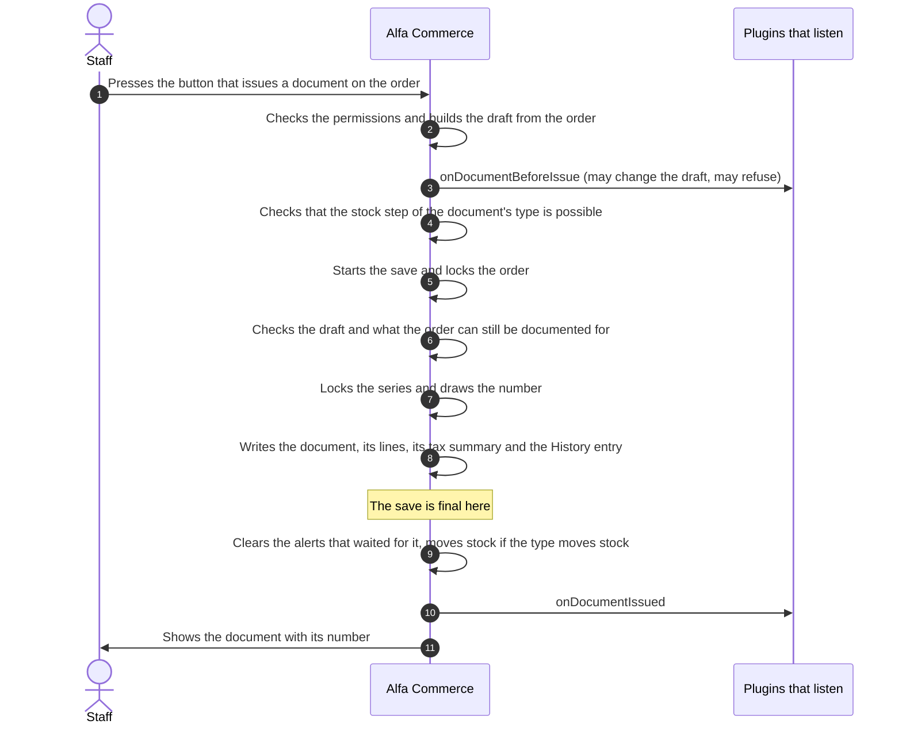

# Documents

<AlfaVersion verified="2.2.0" />

A **document** is an invoice, a receipt, a credit note or a delivery note issued for an order. Every document is
issued and voided by one class, `DocumentIssuer` (`administrator/src/Service/Document/DocumentIssuer.php`). This page
explains what that class guarantees, so that you know what your listener can rely on and what a draft must pass.

The events are on [Document events](../events/document-events.md). The words **document type**, **series** and
**draft** are explained there and in the [Glossary](../reference/glossary.md#documents-and-languages).

## What it does

| The act | The method | In plain words |
|---|---|---|
| Issue | `DocumentIssuer::issue()` | Gives a draft a number and stores it for good |
| Preview | `DocumentIssuer::preview()` | Says what a draft would become, and stores nothing |
| Void | `DocumentIssuer::void()` | Withdraws an issued document. The number and the content stay. |
| Void and replace | `DocumentIssuer::replace()` | Voids a document and issues its replacement as one act |
| Credit | `DocumentIssuer::issue()` with a credit type | A credit note is a document of a credit type that names the document it corrects. There is no separate method. |

### May an extension call it

| | |
|---|---|
| **The doors this manual documents** | The three events `onDocumentBeforeIssue`, `onDocumentIssued` and `onDocumentVoided`, and a document type provider. See [Document events](../events/document-events.md). |
| **What the code allows** | `DocumentIssuer` is a public class with static methods and plain arrays as arguments. Nothing in it forbids a call from an extension, and its comments name callers outside core (a returns workflow, a scheduled job). |
| **What the code does not give you** | No extension that ships with Alfa Commerce calls it, so there is no shipped example. `issue()` and `void()` check no permission: Alfa's own controllers check the member of staff before they call. A caller that skips that check lets anyone issue a numbered document. |
| **What follows** | Prefer the events. If your extension issues or voids, everything on this page binds it, and it must check the user's rights itself. The classes around the issuer (`CreditCalculator`, `IncrementalCorrection`, `VoidAndReplace`, `AutoIssuePolicy`, `StockBridge`, `OrderItemLines`, `OrderChargeLines`) are core's own. |

## When it is used

| Who asks | When |
|---|---|
| Staff | On the order's screen: issue a document, issue a credit note, void, void and replace |
| Alfa Commerce | When an order enters a status that issues documents, or when a payment settles on an order whose status issues only once the order is paid. This is [background work](../reference/glossary.md#background-work). |
| The REST API | To void a document and to read one as a PDF |

When the shop's setting says an outside system issues its documents (`documents_issuer` set to `external`), Alfa
issues nothing automatically.

## A staff issue, step by step



What the picture means:

- **Steps 3 and 4 run before the save is open.** A refusal there uses no number.
- **The order is locked first (step 5).** Two documents for the same order are issued one after the other, never
  at the same moment.
- **The number is drawn last (step 7), inside the save.** If the save fails, the number is not used.
- **The save is final at `DocumentIssuer.php` line 485** (the commit). The document exists from there.
- **Steps 9 and 10 run only after the save is final.** When the document is issued inside a bigger save, they wait
  for that save. If that save is undone, they never run.
- **The stock step (step 9) cannot undo the document.** If it fails, the document stays, the stock step stays owed
  and staff are told.

The same flow with a later void is on [Event flows](../events/flows.md#documents).

## issue()

### What it does

```php
public static function issue(array $draft, bool $manageTransaction = true, bool $applyStockEffect = true): object
```

Takes a draft, asks `onDocumentBeforeIssue`, checks the draft, draws the next number of the series and writes the
document. Returns the stored document row.

### What you must provide

The draft's required keys are `doc_type`, `id_order` and `lines` (at least one). A credit also needs `id_corrects`.
The main keys are listed on [Document events](../events/document-events.md#ondocumentbeforeissue); the full list is
in the comment above `issue()`.

| Argument | Meaning |
|---|---|
| `$manageTransaction` | `true`: `issue()` saves as one unit of its own. `false`: the caller has already opened a database transaction. Then the draft must have been answered by `beforeIssue()` **before** that transaction was opened. |
| `$applyStockEffect` | `true`: the stock step of the document's type is applied. `false`: only for a caller that has already moved these goods through the stock service itself, so that they are not moved twice. |

### What it guarantees

| | |
|---|---|
| **One document at a time per order** | The order's row is locked for the whole issue |
| **Numbers without gaps** | The number is drawn at the last moment, inside the save. A failed issue never uses one. |
| **The draft is checked after the listeners** | A listener of `onDocumentBeforeIssue` may change the draft. The changed draft passes every check, as if staff had typed it. |
| **The order is never over-documented** | The quantities and amounts of all issued sales documents together never exceed the order. Credits draw on issued sales documents. Delivery notes are counted on their own. |
| **Kept as issued** | The stored document is never edited or deleted. See [Kept as issued](#kept-as-issued). |
| **Totals from the lines** | The document's totals and its summary per tax rate are worked out from its own stored lines |
| **A delivery note carries no money** | Its amounts are stored as zero whatever the draft says |
| **Announced only when final** | `onDocumentIssued` is announced after the save the document belongs to is final, and never for a document that was undone |

### What it refuses

`issue()` refuses by throwing. Nothing is stored and no number is used.

| It refuses | When it is checked |
|---|---|
| A listener of `onDocumentBeforeIssue` that throws, or that leaves a database transaction open | Before the save |
| An unknown `doc_type`, a draft without `id_order`, a draft without lines | Before the save |
| `id_replaces` set by anyone but `replace()` | Before the save |
| A stock step that is not possible: for example a deduction that would take stock set aside for other orders | Before the save |
| An order that names no currency | Inside the save |
| A draft that breaks a rule: a credit without `id_corrects`, `id_corrects` on a type that is not a credit, a type that requires the buyer's name or tax number and has none, a delivery note without the purpose of the movement, a line without a name, without a quantity above 0 or without unit prices, a shipping, fee or adjustment line of a sales document or a credit without the charge it bills (`id_source`) | Inside the save |
| More than the order holds, or for a credit more than the corrected document can still give back | Inside the save |
| A type with no series given and no default series, a series that is unpublished, or a series of another type | Inside the save |
| A call inside an open transaction with a draft that `beforeIssue()` did not answer, or a draft changed after it was answered | Before anything |

Every refusal reaches the caller as a `RuntimeException` whose message starts with `DocumentIssuer: issue failed:`
or `DocumentIssuer:`. Where Alfa has a sentence for staff, the exception chain holds a `DocumentRefusedException`
(below).

## preview()

```php
public static function preview(array $draft): object
```

Runs the same checks and the same arithmetic as `issue()` and stops. It opens no save, takes no lock, draws no
number, checks no stock and announces no event. It never throws for something `issue()` would refuse: the answer
has `valid` (`false` for a refusal) and `reason`.

The answer's properties: `valid`, `reason`, `lines`, `totals`, `tax_summary`, `currency_code`, `currency_scale`,
`number_formatted` (always `null`), `buyer`, `refusal_key` and `refusal_values`.

A preview is a look at one moment. `issue()` checks everything again with the order locked.

## void()

### What it does

```php
public static function void(int $documentId, string $reason, ?int $actorId = null, bool $manageTransaction = true): object
```

Marks an issued document as voided and records who voided it, when and why. The number and the content are not
touched. There is no way back: a voided document is never issued again.

### What it guarantees

| | |
|---|---|
| **The number stays used** | The series has no gap |
| **A credit note gives back what it claimed** | If the credit note paid customer credit, that credit is taken back. If it put goods back in stock, that movement is reversed. Both happen inside the same save as the void. |
| **A delivery note's stock stays out** | Voiding the paper does not bring the parcel back. The order's status decides about that stock. |
| **Announced only when final** | `onDocumentVoided` is announced after the save is final |

### What it refuses

| It refuses | |
|---|---|
| An empty reason | |
| A document that is not issued (already voided) | |
| A document that a credit note which is not voided still corrects | Void the credit note first |
| A document whose order names no currency | |
| A credit note whose customer credit cannot be taken back, for example because the customer has spent it | |
| A credit note whose stock movement cannot be reversed, for example because the goods were sold again | |

Each is a `RuntimeException` whose message starts with `DocumentIssuer: void failed:`, except the empty reason, which
is refused before anything else.

There is no "before void" event. A plugin cannot refuse a void.

## replace(): void and replace

### What it does

```php
public static function replace(
    int $sourceId,
    string $reason,
    callable $draftBuilder,
    string $expectedFingerprint,
    ?int $actorId = null,
    ?callable $beforeNumbering = null,
): object
```

Voids a document and issues its replacement as **one save**. There are only two results: the old document still
issued and no replacement, or the old document voided and the replacement issued and naming the old one
(`id_replaces`).

It is built for Alfa's order screen, which previews the replacement in one request and confirms it in the next.
The class `VoidAndReplace` prepares the call. It is core's own.

### What it guarantees

| | |
|---|---|
| **Its own permission** | The acting user must hold "Void and replace sales documents" (`documents.replace`). The rights to issue and to void do not include it. `replace()` checks this itself. |
| **What staff confirmed is what is issued** | The replacement is built again with the order locked and compared with the preview staff confirmed (`draftFingerprint()`). A difference is refused and staff review again. |
| **A new number** | The replacement takes the next number of its type's default series and today's date. The old document's number is never reused. |
| **Listeners are asked first** | `onDocumentBeforeIssue` is asked about the replacement before the save opens. After the save is final, `onDocumentVoided` is announced, then `onDocumentIssued`. |
| **Only `replace()` writes `id_replaces`** | A manual void followed by an ordinary issue is not a replacement |

### What it refuses

Every refusal carries a `DocumentRefusedException`, itself or in the exception's chain, with a sentence for staff:
an empty reason, a missing permission, a
call inside another `replace()`, inside `envelope()` or inside an open transaction, a source that is not issued,
that moved stock, that a live credit note corrects, that a refund has settled, or whose customer credit can no
longer be taken back, a replacement with nothing left to cover, and a replacement that no longer matches the
confirmed preview. Nothing is voided and nothing is issued.

## Credit

A credit note is issued with `issue()`: a draft whose `doc_type` is a credit type (`core.credit_invoice`,
`core.credit_receipt`, or a credit type a provider added) and whose `id_corrects` names the document it corrects.

| What the issuer guarantees | |
|---|---|
| **A credit corrects a sales document** | The corrected document must be issued, belong to the same order, and be a sales document. A delivery note cannot be credited. `guardCorrectable()` states this rule. |
| **Never more than was charged** | The lines of a credit cannot total more than the corrected document's total less the credits already issued against it (`creditLeft()`). |
| **The corrected document's language and money** | A credit is stored in the language and the currency of the document it corrects. A draft that names another language is refused. |
| **Where the money goes is kept** | `credit_destination` says whether the credit is paid into the customer's credit. It is kept with the number and cannot be set on any other type. |

On the order screen, Alfa sizes a credit with `CreditCalculator` while the order is locked, so that two credits
drafted at the same moment cannot both take the same amount. That workflow is core's own.

## Numbering and series

| Rule | Meaning |
|---|---|
| A document is numbered in a **series** | The draft's `id_series`, or the default series of its type when the draft names none |
| The series is locked while a number is drawn | Two documents never get the same number |
| The number is drawn inside the save, as the last step before writing | A refused or failed issue uses no number |
| The formatted number is kept as text on the document | Changing the series' format later does not change issued documents |
| A series can restart each year | For a series scoped by year, the counter restarts at 1 when the first document of a new year is issued. The year is read in the shop's time zone. |
| A new series keeps its starting number | A series that has never issued keeps the starting number the merchant typed, also in its first year |
| Dates are set by the server | If the server's clock is earlier than the series' last issue, the issue is refused |

## Kept as issued

Once a document has its number, its content never changes. It can only be voided. There is no edit, no delete and
no "un-void" anywhere in Alfa Commerce. A mistake is corrected with a credit note or with void and replace.

What is kept on the document, as it was at the issue:

| Kept | From |
|---|---|
| The buyer: name, tax number, tax office, activity, country, e-mail, address | The draft |
| Each line's name, quantity, prices, tax rate and totals | The draft |
| Each line's item, combination and the limit of its stock movement | The draft. The stock step later moves what the document kept, not what the order holds then. |
| The formatted number, the series, the issue date | The issue |
| The currency | The order's. For a credit, the corrected document's. |

### Tax names are kept at issue

Since 2.2.0 each document line keeps the **name** of the tax it was charged with, next to the rate. A draft cannot
state it; the issuer takes it from where the line's money comes from:

| The line | Its tax name comes from |
|---|---|
| An item line | The order line, as kept when the order was placed |
| A shipping line | The parcel's own kept taxes |
| A line of a credit | The document it corrects, and nowhere else |
| A fee, an adjustment or a free-text line | None |

A document issued before 2.2.0 has no tax names. A credit that corrects such a document has none either. The tax
rules are never read again at issue, so renaming a tax later does not change a document.

## A PDF needs a library that is installed separately

`PdfRenderer::pdfBytes(int $documentId): string` returns a document as PDF bytes. It draws the same page as the
print view (`DocumentRenderer::render(int $documentId): string`) and hands it to the **dompdf** library.

| | |
|---|---|
| **What you must provide** | The Joomla library `lib_dompdf`, installed so that `libraries/dompdf/autoload.inc.php` exists. It is not part of the Alfa Commerce package. |
| **What happens without it** | `pdfBytes()` throws a `RuntimeException`: "the dompdf library is not installed (install lib_dompdf)". The print view still works. |
| **What it guarantees** | Nothing is stored. The PDF is made again from the stored document on every request, so it cannot differ from the document. A voided document is drawn with its "voided" mark. |
| **What a layout may use** | The same page feeds the print view, the PDF and the e-mail attachment, and the library draws a limited set of CSS. The rules are in the comment at the top of `layouts/documents/partials/style.php`. |

Both renderers are core's own. They read; they change nothing.

## DocumentRefusedException

Many refusals carry two texts: a technical message for the log, and a sentence for the member of staff. The second
travels as a language key with its values in `DocumentRefusedException`
(`Alfa\Component\Alfa\Administrator\Service\Document\DocumentRefusedException`).

| Member | Meaning |
|---|---|
| `__construct(string $message, string $key, array $values = [], ?Throwable $previous = null)` | The technical message, the language key of the sentence, its values |
| `DocumentRefusedException::in(Throwable $e): ?self` | The first such refusal in an exception's chain, or `null`. The issuer wraps what it refuses in its own exception, so look in the chain. |
| `operatorText(): string` | The sentence, translated. Not escaped. |
| `key(): string`, `values(): array` | The language key and its values |

This is how Alfa's own order screen shows a refused issue (`administrator/src/Controller/OrderController.php`):

```php
} catch (Throwable $e) {
    $refusal = DocumentRefusedException::in($e);
    $app->enqueueMessage(htmlspecialchars($refusal?->operatorText() ?? $e->getMessage(), ENT_QUOTES, 'UTF-8'), 'error');
}
```

A listener of `onDocumentBeforeIssue` that wants staff to read a translated sentence throws this exception. See
[onDocumentBeforeIssue](../events/document-events.md#ondocumentbeforeissue).

## The other public methods

They exist for Alfa's own screens and workflows. They are listed so that you can follow the code.

| Method | What it does |
|---|---|
| `beforeIssue(array $draft): array` | Asks `onDocumentBeforeIssue` about a draft and returns the answered draft, sealed. Refuses when a database transaction is open. For a caller that issues inside its own transaction: ask first, open the transaction, then hand the answer to `issue()`. |
| `envelope(callable $work): mixed` | Runs a caller's issuing work in one save, and what that work owes after it. Cannot run inside another `envelope()` or inside `replace()`. |
| `previewReplacement(int $sourceId, callable $draftBuilder): object` | What a replacement would be, with the source counted as voided. Stores nothing. |
| `guardCorrectable(object $target, int $orderId): void` | Throws when a document cannot be corrected by a credit |
| `creditLeft(object $target): Money` | What a sales document can still be credited for |
| `linesTotal(array $lines): float` | What a credit's lines give back in total, tax included |
| `draftFingerprint(array $draft, object $preview): string` | The identity of a previewed draft, used by `replace()` |
| `buyerBlock(array $draft): array`, `frozenBuyer(object $document): array` | The buyer as a draft states it, and as a stored document keeps it |
| `DocumentIssuer::ASKED` | The draft key that carries the seal of `beforeIssue()`. Leave it alone. |

## What happens next

| After | Alfa does |
|---|---|
| An issue | Clears the notices that waited for this document, applies the stock step of the document's type, announces `onDocumentIssued` |
| A void | Announces `onDocumentVoided` |
| A void and replace | Announces `onDocumentVoided`, then `onDocumentIssued` |

All of it only after the save is final. A listener that throws there is logged, and the others still run.

## What can go wrong

| What you see | The usual cause |
|---|---|
| "inside an open transaction a document is issued only from a draft onDocumentBeforeIssue answered before that transaction began" | `issue()` was called inside a transaction without `beforeIssue()` first |
| "the draft was changed after onDocumentBeforeIssue answered it" | The answered draft was changed before it was handed to `issue()` |
| "an onDocumentBeforeIssue subscriber left a database transaction changed" | A listener opened a transaction and did not close it. Alfa undid it and refused the issue. |
| A document is issued and the stock did not move | The stock step failed after the save was final. It stays owed. Staff find it under Tools > Database Sync. |
| "the dompdf library is not installed" | `lib_dompdf` is missing |
| A document type cannot be issued automatically | The type has no default series |
| `onDocumentIssued` did not fire | The save the document belonged to was undone, or the shop's documents are issued by an outside system |

## Changed in 2.2.0

- **Since 2.2.0.** Each document line keeps its tax name, taken from the order line, the parcel or the corrected
  document.

## Not documented yet

- The full list of draft and line keys, with the rule each must pass.
- Issuing, voiding or crediting from an extension, with a checked sample. No shipped extension does it.
- The credit calculation (`CreditCalculator`), the proposed corrections (`IncrementalCorrection`,
  `CorrectionStrategies`) and the order screen's void and replace workflow (`VoidAndReplace`).
- Automatic issue on a status (`AutoIssuePolicy`) beyond what [Document events](../events/document-events.md) says.
- Document layouts: where a layout file goes and how a series chooses one.
- How the `lib_dompdf` library is obtained and installed.
