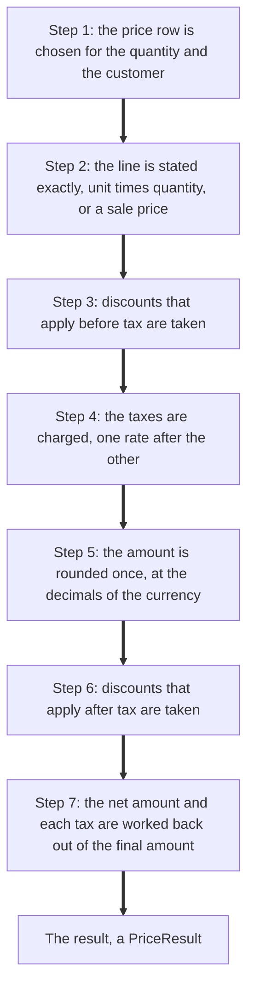

# Pricing

<AlfaVersion verified="2.2.0" />

Every price a shopper sees comes from one place: the pricing engine in `site/src/Service/Pricing`. This page explains
the order in which a price is worked out, the classes you may use from an extension or a template, the shape of the
price data, and the stored prices that lists and filters read (the **price index**).

The words **price index**, **customer group**, **place** and **combination** are explained in the
[glossary](../reference/glossary.md#catalogue-and-prices).

## What it does

The engine takes an item, a quantity and a description of the visitor, and returns one result that holds every
figure of the line: the price before discounts, the discounts, the tax of each rate, and what the customer pays.

Not every class in the folder is meant to be called. This table says which is which.

| Class | What it is | Who it is for |
|---|---|---|
| `PriceCalculator` | The one entry that works out a price | Core calls it. The code does not say whether an extension may. See [Asking for a price](#asking-for-a-price-pricecalculator). |
| `PriceContext` | Who the price is for: currency, customer, customer groups, place | Extensions may build one. A shipped module does (`mod_alfa_items`). |
| `PricingIntent` | Which quantities a list of items is priced at | Core's cart passes one to the site items model. The code does not say whether an extension may. |
| `PriceResult` | The answer: every figure of one line | Extensions and templates read it. Never build one. |
| `Money`, `Currency` | An amount in a currency, and the currency | Extensions and templates use them freely. The shipped payment plugin does. |
| `PriceSettings`, `PriceSettingsBuilder` (`site/src/Helper`) | Which figures a price block shows | Templates and extensions |
| `PriceUnits` (`site/src/Helper`) | The per unit figures of a result, as text | Templates |
| `PriceIndexSyncService` (`administrator/src/Service`) | Writes the stored price index | Core's own writer. See [The stored price index](#the-stored-price-index). |
| `PriceComputationEngine`, `PriceDataLoader`, `TaxChain`, `ExactAmount`, `ExactMoney`, `StoredDecimal`, `PublishedDecimal`, `PriceBreakdown`, `PriceReference`, `ChargeableQuantity` and the other classes of the folder | The inside of the engine | Core's own. They are described here only so that you understand the result. Do not call them. |
| `ExplicitPriceInstruction`, `CustomPriceCommand` | A price that staff agreed for one line of a customer's cart | Core's own. Do not build one. |

All the classes of the engine live in the namespace `Alfa\Component\Alfa\Site\Service\Pricing`.

## When it is used

| Where | What happens |
|---|---|
| An item page, a cart line, the checkout | The price is worked out live by `PriceCalculator`, for the visitor and the quantity at hand |
| A list of items | The prices shown on the cards are worked out live too, for all the items of the page in one pass |
| A price filter, an "on sale" or discount filter, a sort by price or by discount | They read the stored price index, which was worked out in advance by the same engine |
| The REST API's catalogue | It publishes the result's data, as `PriceResult::toArray()` gives it, with the unit figures stated exactly (see [The price data](#the-price-data-toarray)) |
| An item field plugin | It adds its own lines to the price of a configured item. See [How an item field changes a price](#how-an-item-field-changes-a-price). |

## How a price is worked out

### The order



Each step in plain words:

1. **The price row.** An item can have several price rows: for a quantity range, for one customer, for a customer
   group, with or without publish dates. One row wins (see [Which price row is used](#which-price-row-is-used)).
2. **The line.** The row's unit price is multiplied by the quantity before anything is rounded. If the row carries a
   sale price (`override_value`), the sale replaces every regular discount of step 3 and step 6.
3. **Discounts before tax** are taken from that exact amount.
4. **The taxes** are charged in order. Each rate charges on what the rate before it left.
5. **One rounding.** Only now is the amount rounded to the currency's decimals. This rounded amount with tax is the
   figure everything else is derived from: the net amount and the tax of each rate are the split of it.
6. **Discounts after tax** are taken from the amount with tax.
7. **Tax follows the final amount.** When a discount after tax removed something, the net amount and each rate's tax
   are worked back out of the final amount, so the tax shown is the tax on what the customer really pays.

Staff can also set an agreed price for one line of a customer's cart. That is a separate, later stage that only core
uses (`ExplicitPriceInstruction`). With no such instruction it does not run.

### Which price row is used

Rows are first filtered by currency, customer, customer group, place and period (publish dates). Among the rows whose quantity range
holds the quantity, the winner is decided in this order (`PriceComputationEngine::selectBaseRow()`):

1. A row for this customer, before a row for a customer group, before a general row.
2. Between two group rows, the row of the group nearest to the customer's own group.
3. The narrower quantity range.
4. A row with a period (publish dates) before a row without one.
5. A row with a sale price before a row without one.
6. The lower price.

If no row matches, the line has no price and every figure is zero.

### Which discounts and taxes apply (the scope)

A discount and a tax each have a **scope** of five parts: categories, manufacturers, places, customer groups and
customers. A rule applies to an item only when all five match. One part matches when:

- the rule has no entry for that part, or
- the rule's entry is 0, which means "all", or
- the rule names a value the item or the visitor has (one of the item's categories or manufacturers, the visitor's
  place, one of the visitor's groups, the visitor's own account).

A rule must also be published and inside its period (its publish dates). The customer groups compared are the
visitor's own groups, not the groups that may see the item.

### When several discounts or taxes apply (the behaviour)

Rules are read in their ordering, then by id. Each rule has a **behaviour**:

| Behaviour | Value | For discounts | For taxes |
|---|---|---|---|
| Only this | `0` | The rules read before it are dropped and reading stops. This rule applies alone. | This tax applies alone |
| Combine | `1` | The combined rules of a stage form one pool. Their percentages are added and taken once from the amount that enters the stage. Their fixed amounts are added to that. | The combined rates are added into one rate, which is charged first |
| Sequential | `2` | Each rule is taken from what the rule before it left | Each rate charges on the amount plus the tax of the rates before it |

"Only this" is decided by position, not by size: nothing compares amounts.

A stage is "before tax" or "after tax" (the discount's `apply_before_tax`). Inside one stage the pool is taken
first, then the sequential rules.

Two 10 percent discounts on 100.00 show the difference. Combined, they are one 20 percent, and 80.00 is left.
Sequential, the first takes 10.00 and the second takes 10 percent of 90.00, and 81.00 is left.

Limits that always hold:

- A percentage is never above 100 and never below 0. A negative discount never becomes a surcharge.
- A fixed discount is **per unit**: it is multiplied by the quantity.
- A stage never takes more than the amount that entered it, so a price never goes below zero.

### Rounding and precision

These rules are the code's own (`PriceComputationEngine::compute()`, `Money`, `TaxChain`):

- A unit price is a decimal of at most **eight** places. It is read as text and never held as a floating point
  number.
- Inside the line nothing is rounded. The unit times the quantity, every discount and every tax are carried exactly.
- The line is rounded **once**, when it becomes money: half away from zero, at the currency's number of decimals.
- The net amount and each rate's tax are the split of that one rounded amount, so net plus tax always equals the
  amount with tax, to the last minor unit.

The code's own example: a net unit of 9.95161290 at 24 percent, quantity 3. The exact amount with tax is
37.019999988, which is 37.02. The net is 29.85 and the tax 7.17. Rounding the unit first would have charged 7.16.

A currency's number of decimals is its `decimal_place`, chosen by the shop owner, from 0 to 8
(`Currency::SCALE_MIN`, `Currency::SCALE_MAX`). A currency with no decimals is valid.

### A worked example

An item with a net unit price of 10.00, quantity 3, one discount of 10 percent that applies before tax, one tax of
24 percent, a currency with two decimals.

| Step | Calculation | Figure |
|---|---|---|
| The line | 10.00 times 3 | 30.00 |
| Discount before tax | 10 percent of 30.00 is 3.00 | 27.00 left |
| Tax | 27.00 times 1.24 | 33.48 with tax |
| Rounding | 33.48 has two decimals already | 33.48 |
| Split | 33.48 divided by 1.24 | 27.00 net, 6.48 tax |
| Price before discounts | 30.00 net, 37.20 with tax | shown struck through |

The result then gives:

| Method | Value |
|---|---|
| `getBaseTotal()` | 30.00 |
| `getSubtotal()` | 27.00 |
| `getTaxTotal()` | 6.48 |
| `getTotal()` | 33.48 |
| `getBaseTotalWithTax()` | 37.20 |
| `getSavingsTotalWithoutTax()` | 3.00 |
| `getSavingsTotalWithTax()` | 3.72 |

## What you must provide

### Asking for a price: PriceCalculator

`PriceCalculator` is how core asks for a price: the item models, the cart and the order screens call it. In 2.2.0
no shipped plugin, module or template calls it, and its comments do not say whether an extension may. So this
section describes the class and does not recommend the call. A template reads the result that the item already
carries (see [In a template](#in-a-template)). The sample shows the call as core makes it.

```php
use Alfa\Component\Alfa\Site\Service\Pricing\PriceCalculator;
use Alfa\Component\Alfa\Site\Service\Pricing\PriceContext;

$calculator = new PriceCalculator();

// One item, quantity 3, for the current visitor.
$result = $calculator->calculate(12, 3);

echo $result->getTotal()->format();

// Several items, each with its own quantity. The map is keyed by item id.
$results = $calculator->calculate([12, 15], [12 => 3, 15 => 1], PriceContext::fromSession());

echo $results[15]->getTotal()->format();
```

| Method | What it does | What it guarantees | What it refuses |
|---|---|---|---|
| `__construct(?PriceDataLoader $loader = null, ?PriceComputationEngine $calculator = null)` | Builds the calculator. Core passes no arguments. | | |
| `calculate($productIds, $quantities = 1, ?PriceContext $context = null, ?VariantSelection $selection = null, ?ExplicitPriceInstruction $price = null)` | Prices one item or many | One id gives one `PriceResult`. An array of ids gives an array of results keyed by item id. Without a context it uses the current visitor's (`PriceContext::fromSession()`). The data of all the items is loaded together. | An agreed price (`$price`) together with an array of ids: `InvalidArgumentException`. Planned for 2.2.1, which is not released: also a map of quantities that leaves out one of the items, or gives one a quantity that is not a whole number of at least 1: `InvalidArgumentException` naming the item. A single quantity given for all items is still taken as at least 1. |
| `calculateVariant(int $itemId, int $quantity, VariantSelection $selection, ?PriceContext $context = null, ?ExplicitPriceInstruction $price = null): PriceResult` | Prices one item for a chosen combination or chosen options | The item's own taxes and discounts apply as for the plain item. An empty selection gives the same as `calculate()`. | |
| `calculateBatch(array $itemIds, $quantities = 1, ?PriceContext $context = null, array $selections = []): array` | Prices many items in one pass, each with its own selection | Results keyed by item id. A fixed number of queries for the whole list. | Planned for 2.2.1, which is not released: a map of quantities that leaves out one of the items, or gives one a quantity that is not a whole number of at least 1: `InvalidArgumentException` naming the item |
| `tierStarts(int $itemId, ?int $combinationId, PriceContext $context): array` | Lists the quantities at which the unit price of a line may change | Ascending, without repeats. It may list more quantities than really change the price. | |
| `breakdownVariant(int $itemId, int $quantity, VariantSelection $selection, ?PriceContext $context = null): array` | Gives the net base and one line for each adjustment of a variant | The keys `base_net`, `base_sale`, `tax_factor` and `lines` | |

A `VariantSelection` is built with `new VariantSelection(int $combinationId = 0, array $optionValueIds = [], array
$contributions = [])`.

Leave the last argument of `calculate()` and `calculateVariant()` out. It is core's agreed price for one line.

### Saying who the price is for: PriceContext

A `PriceContext` cannot be changed. Every `with...()` method returns a new one.

```php
use Alfa\Component\Alfa\Site\Service\Pricing\PriceContext;

$context = PriceContext::fromSession();      // the current visitor
$other   = $context->withCurrency(2);        // the same visitor, another currency
```

| Method | What it does | What it guarantees |
|---|---|---|
| `fromSession(): self` | The current visitor: currency and place from the session, the signed in account and its groups | A place that is unpublished, or inside an unpublished place, counts as "no place". The currency falls back to the shop's default. |
| `forIndex(int $currencyId, int $placeId, int $usergroupId, ?int $userId = null): self` | One customer group alone, in one currency and place. It is what the index writer uses. | The group is taken with every group above it |
| `withCurrency(int $currencyId): self` | Another currency | The id is the row id in `#__alfa_currencies`, not the ISO number |
| `withLocation(?int $placeId): self` | Another place, or `null` for "no place" | A place that may not price a visitor becomes "no place" |
| `withCustomer(User $customer): self` | The price for one customer account: its id and its groups | A guest, or an account that no longer exists, is priced as a visitor with no account |
| `withUserGroups(array $groups): self` | Other customer groups | The value 0 ("any group") is always added |
| `withUserId(?int $userId): self` | Another user id only. To price for an account use `withCustomer()`. | |
| `withoutUser(): self` | No account | |
| `withReferenceDate(?string $referenceDate): self`, `getReferenceDate(): ?string` | The moment the price is worked out for | |
| `getCurrencyId(): int`, `getUserId(): ?int`, `getUserGroups(): array`, `getLocationId(): ?int`, `isLoggedIn(): bool`, `hasLocation(): bool` | Read the context | |
| `toCacheKey(): string` | A text that is the same for two contexts that price alike. Use it in your own cache keys. | |
| `toArray(): array`, `getUserGroupsSql(): string`, `groupDistances(): array` | Used by the engine | |
| `customerGroups(User $customer): array`, `groupLineage(int $groupId): array`, `groupLineages(array $groupIds): array` (static) | The groups a customer holds, and a group with every group above it | |

The session keys are `alfa.currency_id` and `alfa.location_id`. A plugin that detects the visitor's country sets
the second one to the id of the place. Planned for 2.2.1, which is not released: a page priced for a visitor whose
session holds either key is kept out of Joomla's page cache, whatever the state of "System - Alfa Commerce Sync".
While that plugin runs for visitors who are not logged in, such a visitor is also never given a page stored for
another visitor. See [Caches](../architecture/caches.md#the-page-cache-rule).

### Saying which quantities a list is priced at: PricingIntent

The site items model prices its list with a `PricingIntent`. By default it is `PricingIntent::catalog()`: each item
at its minimum quantity. Core's cart passes another one with the model's `setPricingIntent()` (`CartHydrator`). It
is the only caller in 2.2.0, and the code does not say whether an extension may call it.

```php
use Alfa\Component\Alfa\Site\Service\Pricing\PricingIntent;

// The map is keyed by the item id, as an integer.
$intent = PricingIntent::cart([123 => 3, 124 => 1]);
```

| Method | What it does |
|---|---|
| `catalog(): self` | Each item at its own minimum quantity |
| `cart(array $quantities): self` | The quantities of a cart. A map of item id to quantity. |
| `checkout(array $quantities): self` | The quantities being checked out. The same map. |
| `quote(array $quantities, int $minQuantity = 1): self` | Quantities for a quote, with a minimum of your own |
| `getQuantityForItem(object $item): int` | The quantity for one item. It reads `$item->id`, and never answers less than 1. |
| `getQuantities(): array`, `getScope(): string` | Read the intent |
| `isTransactional(): bool`, `requiresStockValidation(): bool`, `isCacheable(): bool` | True or false by the kind of intent. Nothing outside the class reads them in 2.2.0. |

A key that is not the item's integer id, such as `'item_123'`, never matches, and the item is priced at its minimum
quantity without an error.

## What happens next

### The result: PriceResult

A `PriceResult` holds the whole line. Amounts are `Money` objects.

| For the whole line | For one unit | Meaning |
|---|---|---|
| `getBaseTotal()` | `getBasePrice()` | Before discounts, without tax |
| `getBaseTotalWithTax()` | `getBasePriceWithTax()` | Before discounts, with tax (the struck through price) |
| `getSubtotal()` | `getSubtotalPrice()` | After discounts, without tax |
| `getTaxTotal()` | `getTaxPrice()` | The tax |
| `getTotal()` | `getPrice()` | What the customer pays |
| `getSavingsTotalWithoutTax()` | `getSavingsPriceWithoutTax()` | What the discounts saved, without tax |
| `getSavingsTotalWithTax()` | `getSavingsPriceWithTax()` | What the discounts saved, with tax |
| `getSavingsTotal()` | `getSavingsPrice()` | What the discount stages removed, each on its own basis |

Other readers:

| Method | Meaning |
|---|---|
| `hasDiscount(): bool` | Whether a discount took money from the line |
| `getSavingsPercent(): float` | The saving as a percentage, two decimals |
| `getSavingsPercentBreakdown(): array` | The same by stage: `before_tax`, `after_tax`, `total` |
| `getQuantity(): int`, `getCurrency(): Currency` | The quantity and the currency of the line |
| `getDiscounts(): DiscountSummary`, `getTaxes(): TaxSummary`, `getBreakdown(): PriceBreakdown` | The rules that applied and the steps of the calculation |
| `getAuthoritativeUnit(): string` | The unit the line is priced from, exactly as stated, as decimal text |
| `getPayableUnit(): string`, `getPayableUnitExact(): string` | What one piece costs with tax before discounts, as decimal text |
| `getListUnit(): string`, `getDiscountedUnitExact(bool $withTax): ?string` | The list unit, and one piece after discounts, as decimal text |
| `getStatedOrigin(): UnitOrigin`, `getStatedAxis(): UnitAxis`, `isReduced(): bool` | Where the unit comes from and on which side of the tax it is stated. For display only. |
| `hasExplicitPrice()`, `getExplicitPrice()`, `getExplicitPriceTotal()`, `getExplicitPriceTotalWithTax()`, `getLineSaving()`, `getLineSavingWithTax()`, `getLineSavingPercent()`, `getReference()` | About a price staff agreed for the line. `hasExplicitPrice()` is false for every ordinary price. |
| `toArray(): array`, `toJson(int $options = JSON_PRETTY_PRINT): string`, `toMinimalArray(): array`, `formatAll(bool $includeSymbol = true, bool $includeUnitPrices = false): array` | The result as data. See below. |

:::warning The per unit methods lose small prices
`getBasePrice()`, `getPrice()` and the other "for one unit" methods divide the rounded line by the quantity. A unit
of 0.004 reads 0.00 through them. To print a unit price, use `PriceUnits::page()` or the layout `item.price`, as
Alfa's own templates do.
:::

### In a template

The item a template receives carries its result in `$item->price`. Alfa's own templates print it with the layout
`item.price`, which shows the figures the shop owner switched on:

```php
use Alfa\Component\Alfa\Site\Helper\Layout;
use Alfa\Component\Alfa\Site\Helper\PriceSettings;

echo Layout::render('item.price', ['item' => $item, 'settings' => PriceSettings::get()]);
```

To print single figures yourself:

```php
use Alfa\Component\Alfa\Site\Helper\PriceUnits;

$price = $item->price;

// A line total is money: format it.
echo $price->getTotal()->format();

// A unit price is text made for display.
$unit = PriceUnits::page(price: $price, figures: ['final', 'base_with_tax']);

echo $unit['final'];

if ($price->hasDiscount()) {
    echo $unit['base_with_tax'];
}
```

The figure names `PriceUnits::page()` knows are `base`, `discount`, `subtotal`, `tax`, `base_with_tax`,
`discount_with_tax` and `final` (`PriceUnits::FIGURES`). How many decimals a unit price shows follows the shop's
setting "unit display precision" (`unit_display_precision`).

Keep the attribute `data-item-prices` on the element that wraps the prices. Alfa's scripts use it to refresh the
price when the quantity or an option changes.

### Which figures are shown: PriceSettings

`Alfa\Component\Alfa\Site\Helper\PriceSettings` answers which figures a price block shows. The shop owner sets them
in the component's options, and can set them again for a customer group.

```php
use Alfa\Component\Alfa\Site\Helper\PriceSettings;

$settings = PriceSettings::get();          // for the current visitor
$minimal  = PriceSettings::minimal();      // the final price only, without its label
$custom   = PriceSettings::make()->show('final')->show('base', false)->get();
```

| Method | What it does | What it guarantees |
|---|---|---|
| `PriceSettings::get(?int $userId = null): array` | The settings for the current visitor, or for one account | When several of the customer's groups have their own settings, the nearest group in the group tree decides. With none, the component's options apply. On any error it falls back to the component's options. The answer is kept for the request. |
| `PriceSettings::minimal(): array` | Only the final price, without label | |
| `PriceSettings::make(): PriceSettingsBuilder` | Starts a builder with everything hidden | |
| `PriceSettingsBuilder::show(string $element, bool $withLabel = true): self` | Shows one figure | A name it does not know is ignored, without an error |
| `PriceSettingsBuilder::hide(string $element): self` | Hides one figure | |
| `PriceSettingsBuilder::withoutLabels(): self` | Hides every label | |
| `PriceSettingsBuilder::get(): array` | The finished settings | |

`PriceSettings` has no other public method. The names the builder accepts include `base`, `subtotal`, `discount`,
`tax`, `base_with_tax`, `final` and `breakdown` (the full list is `PriceSettings::ALIASES`).

The settings array has these keys (`PriceSettings::FIELDS`), each 1 or 0: `base_price_show`,
`base_price_with_discounts_show`, `discount_amount_show`, `tax_amount_show`, `base_price_with_tax_show` and
`final_price_show`, each with a `..._show_label` twin, and `price_breakdown_show`.

### The price data: toArray()

`PriceResult::toArray()` is the data the REST API's catalogue publishes. Every amount is exact decimal text, never a
floating point number, with its formatted text beside it. The catalogue replaces three unit figures with exact unit
values (`PriceUnits::published()`): `price` becomes `amount`, `formatted` and `minor_units`, and
`savings.price_amount` and `savings.price_formatted` are stated the same way.

| Key | Content |
|---|---|
| `base_total`, `subtotal`, `tax_total`, `total` | Each `['amount' => '30.00', 'formatted' => ...]`, for the whole line |
| `price` | The same pair for one unit of the final price |
| `currency` | `id`, `name`, `code`, `number`, `symbol`, `decimal_places`, `decimal_separator`, `thousand_separator`, `format_pattern` |
| `quantity` | The quantity priced |
| `savings` | `basis` (always `tax_excluded`), `total_amount`, `total_formatted`, `price_amount`, `price_formatted`, `percent`, `has_discount` |
| `has_explicit_price`, `explicit_price` | `false` and `null` for every ordinary price |
| `discounts` | `basis` (always `tax_excluded`), `total` (`amount`, `formatted`), `count`, `has_discounts`, `applied` |
| `taxes` | `total` (`amount`, `formatted`), `effective_rate`, `count`, `applied` (each `id`, `name`, `rate`, `jurisdiction`, `amount`) |
| `breakdown` | `steps`, the steps of the calculation |

Each entry of `discounts.applied` has `id`, `name`, `code`, `amount`, `percent`, `type` (`percentage` or
`fixed_amount`), `timing` (`before_tax` or `after_tax`) and the badge settings (`tag_list_show`, `tag_list_slot`,
`tag_item_show`, `tag_item_slot`, `tag_bg`, `tag_color`, `tag_class`). For a fixed discount, `amount` is
`['value' => ..., 'formatted' => ..., 'basis' => ...]`. Its `basis` is `tax_excluded` for a rule applied before tax
and `tax_included` for a rule applied after tax. For a percentage, `amount` is `null`.

**Changed in 2.2.0.** Every saving and discount figure of this data is stated without tax, and says so:
`savings.basis` and `discounts.basis` are `tax_excluded`, and `discounts.total` is the same figure as
`savings.total_amount`. For a discount applied after tax, 2.1.4 gave the amount with tax there. A discount of 5
percent applied after tax on 200.00 net under a tax of 24 percent now reads 10.00, where 2.1.4 read 12.40.

The other forms:

| Method | Content |
|---|---|
| `toMinimalArray()` | `total` (decimal text), `formatted`, `currency` (the code), `quantity` |
| `toJson()` | `toArray()` as JSON |
| `formatAll($includeSymbol, $includeUnitPrices)` | Formatted text only: `base_total`, `subtotal`, `tax_total`, `total`, `savings_total`, and with the second argument `base_price`, `subtotal_price`, `tax_price`, `price`, `savings_price`. The savings are without tax. The code marks this method as a helper for data exports, not for templates. |

## Money and Currency

A `Money` is an amount in one currency. It is stored as a whole number of the currency's smallest unit, so it has
no rounding noise, and it cannot be changed: every operation returns a new `Money`.

```php
use Alfa\Component\Alfa\Site\Service\Pricing\Currency;
use Alfa\Component\Alfa\Site\Service\Pricing\Money;

$currency = Currency::getDefault();

$price = Money::of('19.99', $currency);
$line  = $price->multiply(3);
$parts = $line->allocate(2);         // two Money objects that add up to $line exactly

echo $line->format();                // with the currency symbol
echo $line->format(false);           // without it
```

| Method | What it does | What it refuses |
|---|---|---|
| `Money::of(string\|int\|float $amount, Currency $currency): self` | An amount in major units. Rounded once, half away from zero, at the currency's decimals. Pass text when you have text. | An amount that is not a finite number, or too large: `InvalidArgumentException` |
| `Money::ofMinor(int $minorUnits, Currency $currency): self` | An amount in the smallest unit (1999 for 19.99 at two decimals) | |
| `Money::zero(Currency $currency): self` | Zero | |
| `Money::parse(string $amount, Currency $currency, ?MoneyInputFormat $format = null): self` | Reads an amount as a person typed it, in the currency's own separators | |
| `add(Money $other): self`, `subtract(Money $other): self` | Sum and difference | Two different currencies: `InvalidArgumentException` |
| `multiply(string\|int\|float $multiplier): self` | Times a factor, rounded once | A factor that is not a finite number |
| `percentage(string\|int\|float $percent): self`, `timesRatio($numerator, $denominator): self`, `divide($divisor): self` | A percentage, a ratio or a quotient of the amount | |
| `allocate(int $n): array` | Splits the amount into `$n` parts that add up exactly | `$n` below 1 |
| `allocateByRatios(array $ratios): array` | Splits the amount by weights, with nothing lost | |
| `isZero()`, `isPositive()`, `isNegative()`, `equals()`, `compareTo()`, `greaterThan()`, `greaterThanOrEqual()`, `lessThan()`, `lessThanOrEqual()` | Comparisons | |
| `getAmount(): float`, `getMinorUnits(): int`, `getCurrency(): Currency` | Read the amount | |
| `toScale(int $scale): int` | The amount as a whole number at another number of decimals, for a provider that asks for one | |
| `format(bool $includeSymbol = true): string` | The amount as the currency writes it | |
| `Money::sum(Money ...$amounts)`, `min()`, `max()` | Over several amounts | |

`Money` has more public methods (`abs()`, `negate()`, `nonNegative()`, `round()`, `convertTo()`, `avg()`,
`allocateToTargets()`, `toArray()` and helpers the engine uses). They are listed under "Not documented yet".

| `Currency` method | What it does |
|---|---|
| `Currency::getDefault(): self` | The shop's default currency |
| `Currency::loadById(int $id): self` | By row id. Throws `RuntimeException` when there is none. |
| `Currency::loadByCode(string $code): self`, `Currency::loadByNumber(int $number): self` | By ISO code (`EUR`) or ISO number (`978`) |
| `getId()`, `getName()`, `getCode()`, `getNumber()`, `getSymbol()`, `getDecimalPlaces()`, `getDecimalSeparator()`, `getThousandSeparator()`, `getFormatPattern()` | Read the currency |
| `format(float $amount, bool $includeSymbol = true): string` | A number as the currency writes it |
| `equals(Currency $other): bool`, `is(string $code): bool` | Comparisons |
| `toArray(): array` | The currency as data, as in `toArray()` above |

## The stored price index

### What it does

A price filter or a sort by price has to compare the prices of every item of the catalogue, and working each one
out live would be far too slow. So Alfa works the prices out in advance and stores them in the table
`#__alfa_items_price_index`. The price filter, the "on sale" and discount filters, and the sorts by price and by
discount of a list read that table.

One stored row is the price of:

| Part of the key | Column | Meaning |
|---|---|---|
| The item | `item_id` | |
| The combination | `combination_id` | 0 for the item's own row |
| The currency | `currency_id` | 0 for any |
| The place | `place_id` | 0 for any, or unknown |
| The customer group set | `group_set_id` | One list of the customer groups that prices, discounts or taxes name and that some customers hold together |
| The period | `valid_from` | When the row starts to apply. `valid_until` is its end, empty for "no end". |

Each row stores the same figures the price settings name: `base_price`, `discount_amount`,
`base_price_with_discounts`, `tax_amount`, `base_price_with_tax`, `final_price` and `discount_percent`. They are
unit prices at quantity 1.

The prices a shopper sees on an item page, on the cards of a list and in the cart are not read from the index.
They are worked out live.

### When it is rebuilt

Core rebuilds the rows that a change touches, in the same request:

| What staff do | What is rebuilt |
|---|---|
| Save an item, or publish it | That item's rows |
| Unpublish, trash or delete an item | That item's rows are removed |
| Save, publish, unpublish or delete a discount or a tax | The rows of the items in its scope. A rule for every category rewrites every item. |
| Delete a category or a manufacturer | The rows of the items that lost it |
| Change which groups customers hold | New group sets are requested, unused ones are removed |

A customer group set that customers hold for the first time is not written by the request that brought it. The
background job `price.set.prepare` prepares it, a part of the items at a time. Until it is finished, the set is not
read at all.

A failure never blocks the save. It is logged as a warning, the item is marked as owed, and the background job
`catalogue.rebuild` rebuilds it.

### The rebuild lock

Two rebuilds of one item must not overlap, or the older one could write last. So every writer of an item's rows
first takes a lock on that item (`IndexRebuildLock`), reads the item only after it holds the lock, and saves before
it lets go.

- A writer waits up to 10 seconds for the lock (`IndexRebuildLock::WAIT_SECONDS`).
- If it does not get the lock, it does not write. The item is marked as owed and the `catalogue.rebuild` job
  rebuilds it later.

`PriceIndexSyncService` takes the lock itself. A caller does not.

### PriceIndexSyncService

This class is the only writer of the index, and it is core's own. The code names only core callers: the item,
discount, tax and category models, `ProjectionManager`, the `price.set.prepare` job, the Tools screen, the update
script, and core's own system plugin (`alfasync`), which calls `syncGroupSets()` when the groups customers hold
change. The class comment lists a "Public API" and maps each method to the core model that calls it. It does not
address extensions, and no shipped payment, shipping or field plugin, module or template calls it.

So the code does not settle whether an extension may call the sync methods, and this page does not recommend it.
What the code does establish:

- An extension that changes prices through Alfa's own screens or models needs no call. Core rebuilds the rows.
- Staff can rebuild the stored prices of every item with Tools > Database Sync, "Rebuild catalogue projections".
  It marks every item as owed and the `catalogue.rebuild` job rebuilds them.
- A plugin that keeps its own copy of prices listens to `onAlfaPricesChanged` (below).

The methods are described so that you can read core's code and its log lines. The sync methods are **instance
methods**: core builds the service first.

| Method | What it does | What it guarantees | What it refuses |
|---|---|---|---|
| `__construct(?PriceCalculator $calculator = null)` | Builds the service. Core passes no arguments. | | |
| `syncItem(int $itemId, string $cause = PricesChangedEvent::CAUSE_REBUILD, int $causeId = 0): void` | Rebuilds one item's rows | Never throws. A failure is logged and the item is owed to the background job. | An id of 0 or less does nothing |
| `syncItems(array $itemIds, string $cause = ..., int $causeId = 0): int` | Rebuilds the rows of a list of items | Returns the number of rows written. Never throws. A part that fails is skipped and logged, the others are written. | |
| `syncItemsOrFail(array $itemIds, string $cause = ..., int $causeId = 0): int` | The same, but a failure reaches the caller | Core's projection manager calls it | |
| `syncByDiscount(int $discountId): int`, `syncByTax(int $taxId): int` | Rebuilds the items a discount or a tax can touch | A rule for every category rebuilds everything | Not for a delete: the scope is gone by then. Core's models collect the ids first with `getItemIdsForDiscount()` or `getItemIdsForTax()` and call `syncItems()` after the delete. |
| `syncAll(string $cause = ..., int $causeId = 0): int` | Rewrites every published item | Safe to run again. It prepares no new group set. On a large catalogue with many group sets it can exceed the request's time limit. | |
| `syncGroupSets(): int` | Requests the group sets customers hold that the index does not know, and removes the ones nobody holds | Writes no price row itself | |
| `deleteForItem(int $itemId, ...): void`, `deleteForItems(array $itemIds, ...): void` | Removes the rows of items | | |
| `getItemIdsForDiscount(int $discountId): array`, `getItemIdsForTax(int $taxId): array` | The items a rule can touch | Read before the rule is deleted | |

The following public methods serve the preparation of group sets and the reading of the index. Do not call them:
`prepareSetChunk()`, `alignSets()`, `queueWaitingSets()`, `waitingSetId()`, `publishedItemCount()`, `preparationState()`, `accountGroupSet()`,
`holdsGroupSet()`, `announcing()`, and the read helpers `pricingGroups()`, `slotKey()`, `slotSetJoin()` and
`slotRanking()` that the site items model uses to read the index.

### What happens next: the event

After a write to the index is saved for good, Alfa announces `onAlfaPricesChanged` once for the whole write, with
the items and the rows that changed. A write that was undone is never announced. A plugin that keeps its own copy
of prices listens to it. The event is described on
[Item and catalogue events](../events/item-and-catalogue-events.md#onalfapriceschanged).

## How an item field changes a price

An item field plugin does not call the engine. When Alfa prices an item that the shopper configured, it hands the
event `onCalculateItemPrice` to the field's plugin, and the plugin adds **price lines**: "add 5.00 to the price
with tax", "take 10 percent off the net price". Alfa applies the lines in order and then runs the taxes and
discounts as for any item. Each line appears as a step of the price breakdown.

The event and the methods of a price line are described on
[Item field plugins](../plugins/item-field-plugin-events.md#oncalculateitemprice).

## A shipping charge's tax chain

The engine on this page prices items. A shipping charge is priced by the shipping classes, but it uses the same
tax rule: an ordered list of rates, each charged on what the one before left. That list is the charge's **tax
chain**.

**Changed in 2.2.0.** Each entry of a chain names the tax rule of its rate:

```php
[
    ['rate' => '24', 'name' => 'VAT'],
]
```

Before 2.2.0 the chain held the rate texts alone, for example `['10', '5']`.

| Where you read it | Shape |
|---|---|
| `ShippingCharge::$chain` | A list of `['rate' => string, 'name' => string]`. `name` is empty when no rule applied the rate. An empty list is an untaxed charge. |
| `CartTotals::shipmentCosts()['chain']`, `CartTotals::shipmentTaxChain()` | The same list |
| `PlacementCart::shipmentTaxChain()` | The same list |
| `Order::shipmentTaxChain()` | The same list, or `null` when the order states none |
| The column `#__alfa_order_shipments.shipping_tax_chain` | The same entries as JSON text |

A carrier plugin that passes its own `shipping_tax_chain` to the shipment ledger writes each entry either as a rate
text (`'24'`) or as exactly the two keys `rate` and `name`. A rate is plain decimal text above zero. Anything else
is refused. A chain stored before 2.2.0 is still read, as rates with no rule named.

## What can go wrong

| What you see | The usual cause |
|---|---|
| Every figure of a result is zero | No price row matched the quantity, the currency, the customer and the place |
| A discount never applies | One of the five parts of its scope does not match, or it is outside its period. Check the visitor's groups, not the groups that may see the item. |
| An item in a list is priced at its minimum quantity although you passed a quantity | The map given to `PricingIntent::cart()` is not keyed by the integer item id |
| `calculate()` fails for an array of ids | The quantity map does not hold every id of the array. Give each id a quantity. |
| A unit price prints as 0.00 | It was printed with a per unit method of the result. Use `PriceUnits::page()`. |
| `Call to private method PriceSettings::global()` or to an unknown method | `global()` is private, and `compact()`, `full()`, `only()` and `except()` do not exist in 2.2.0. Use `get()`, `minimal()` or `make()`. |
| `Non-static method ... cannot be called statically` on the index service | Its sync methods are instance methods. The service is core's own, see [PriceIndexSyncService](#priceindexsyncservice). |
| The price filter or the sort by price uses an old price after price data was written without Alfa's models | The index was not rebuilt for those items. Staff rebuild it with Tools > Database Sync, "Rebuild catalogue projections". |
| The price filter has no stored prices for some customers for a while | Their customer group set is still being prepared by the `price.set.prepare` job |
| `add()` or `subtract()` throws | The two `Money` objects are in different currencies |

## Changed in 2.2.0

- **Changed in 2.2.0.** In `toArray()` and `formatAll()` every saving is stated without tax, and `savings.basis` and
  `discounts.basis` say so.
- **Changed in 2.2.0.** A shipping charge's tax chain is a list of rate and name pairs, not of rate texts.
- **Since 2.2.0.** `onAlfaPricesChanged` is announced after each write to the price index.
- **Since 2.2.0.** A new customer group set is prepared by the background job `price.set.prepare`, and every write
  of an item's rows holds the item's rebuild lock.
- **Changed in 2.2.0.** A place prices a visitor only when it and every place above it are published.

## Not documented yet

- The remaining public methods of `Money` (`abs()`, `negate()`, `nonNegative()`, `round()`, `convertTo()`, `avg()`,
  `allocateToTargets()`, `toArray()`, `perUnitAtMaxScale()`, `ofRateTimesQuantity()`, `roundToCurrency()`,
  `timesRatioSum()`, `scaleCount()`, `percentOf()`, `floatDigits()`) and of `Currency` (`atScale()`, `formatRate()`,
  `formatUnit()`, `formatStored()`, `unitFigure()`, `rateDecimals()`, `groupFigure()`, `unitPrecisionIsAuto()`,
  `fromDatabase()`).
- The other methods of `PriceUnits` (`line()`, `publishedLine()`, `exact()`, `published()`).
- `DiscountSummary`, `TaxSummary` and `PriceBreakdown` beyond their data shape.
- How a combination's own price and adjustments form the unit price of a variant.
- The price staff agree for one line of a customer's cart (`ExplicitPriceInstruction`, `CustomPriceCommand`).
- The shipping classes themselves (`ShippingCharge`, `ShippingTaxResolver` and the others).
- `ProjectionManager` and the `catalogue.rebuild` job.
