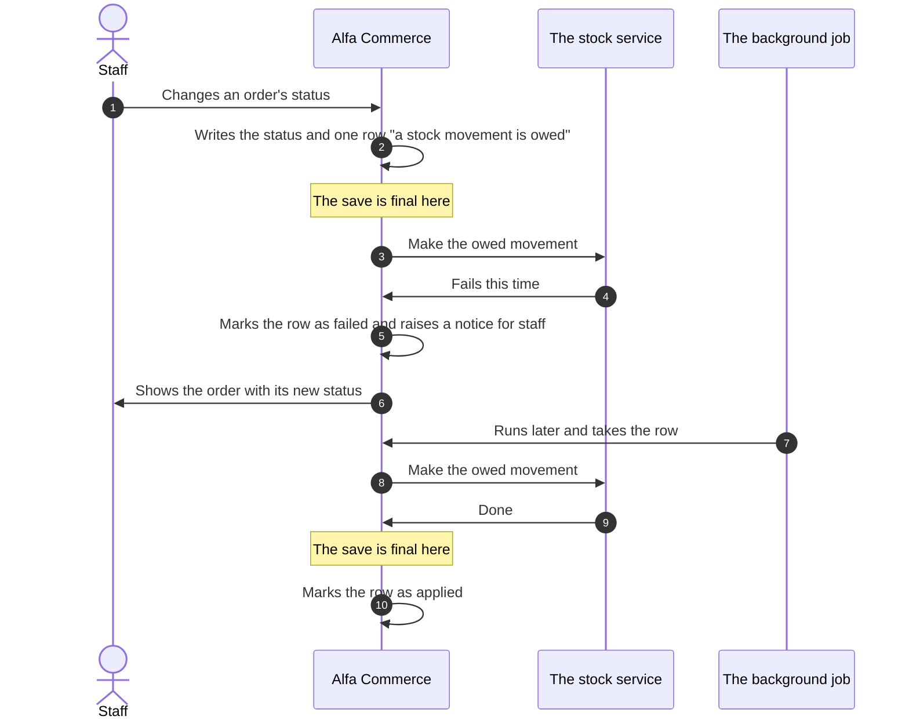

# Stock

<AlfaVersion verified="2.2.0" />

Alfa Commerce keeps stock through one service, `InventoryService`. Nothing else writes a stock quantity. This page
explains how stock is recorded, what an extension may read, what each command of the service does, guarantees and
refuses, and what happens when a stock movement cannot be made at once.

Read [Stock events](../events/stock-events.md) first. It explains, in plain words, what can happen to stock (set
aside, taken from stock, given back) and the events a plugin hears. This page is about the service behind those
events. The words **reservation**, **claim** and **stock movement** are in the
[glossary](../reference/glossary.md#stock).

:::warning "Commit" has two meanings
In the stock code, "commit" means **take the goods from stock** (`commitReservation()`). Everywhere else in this
manual "the commit" is the moment a save becomes final. This page says "taken from stock" for the first and "the
save is final" for the second.
:::

## What it does

### The record of truth

| What | Table | In plain words |
|---|---|---|
| A **stock record** | `#__alfa_inventory_stock` | How much of one unit is at one location (`quantity`), and how much of it is set aside (`reserved_quantity`) |
| A **stock movement** | `#__alfa_inventory_movements` | One change of a quantity, with its reason. Movements are only ever added. This is the ledger. |
| A **reservation** | `#__alfa_inventory_reservations` | A quantity set aside for an order line. It moves no goods. |
| A **location** | `#__alfa_inventory_locations` | A warehouse or a shop. Exactly one is the default. |
| An **operation** | `#__alfa_inventory_operations` | One row for each command that was carried out |

A **unit** is what is stocked: an item without combinations, or one combination of an item that has them. An item
with combinations holds stock only through its combinations. A unit is **tracked** when its "manage stock" setting
is on (a combination's own value, otherwise the item's).

### The figure on the item is a copy

The columns `stock` and `available_quantity` of an item and of a combination are **projections**: figures derived
from the stock records, kept for display and for sorting. The service updates them with each command.

- Do not write them. A figure that disagrees with the records is reported as a fault, and the unit can be locked
  until staff repair it.
- Do not use them to decide whether something can be sold. That is always answered from the stock records.

### The classes

All are in `Alfa\Component\Alfa\Administrator\Service\Inventory` (`administrator/src/Service/Inventory`).

| Class | What it is | Who it is for |
|---|---|---|
| `InventoryService` | Every command that changes stock | Core's own. Described here so that you understand what happens. See [What you must provide](#what-you-must-provide). |
| `InventoryAvailabilityService` | Every question about stock | Templates compare with its status constants, as the shipped layout does. For its methods the code names only core callers. See [Reading stock](#reading-stock). |
| `InventoryContext` | Who is acting, with a note | Passed to the commands. Plugins receive it in the stock events. |
| `CommitmentRequest` | What is to be taken from stock | Plugins receive it in `onInventoryBeforeCommit` and may replace it |
| `BackorderPolicy` | What happens when a unit cannot cover a line | Core's own. Readable. |
| `LocationPolicy` | What an enabled location is | Core's own. Readable. |
| `ReservationQueue` | In which order a stock record serves its reservations | Core's own |
| `InventoryEffectOutbox` | Stock movements that are owed and not made yet | Core's own. Do not call. |
| `InventoryIntegrityReader` | The read-only stock audit | Core's own. Run it through the console command or the audit page. |
| `OpenLineClaims`, `QuantityDecimal`, `CombinationState`, `ReconciliationIntent`, `InventoryIntegrityNotice`, `DefaultReservationPolicy` and the exception classes | Parts of the service | Core's own. Do not call. |

## When it is used

| What happens in the shop | Who calls the service | Which command |
|---|---|---|
| An order is placed | The order code (`InventoryBridge`) | `recordPlacement()`, `reserve()`, and `commitReservation()` when the first status takes goods |
| An order's status changes, a line is edited, an order is cancelled or deleted | The order code (`InventoryBridge`) | `commitReservation()`, `restore()`, `release()`, `releaseLine()`, `reserve()` |
| A document that moves stock is issued or voided | The document code (`StockBridge`, `DocumentIssuer`) | `commitReservation()`, `restore()`, `reverseRestores()` |
| Staff change a stock figure, a tracking setting or a combination on the item screen | The item model and the combinations editor | `adjustTo()`, `changeTracking()`, `changeCombinationState()`, `archiveUnits()`, `retireUnits()` and others |
| Staff enable or disable a location | The location model | `changeLocationState()` |
| Staff repair a fault on the Inventory audit page | The audit controller | `reconcile()`, `resolveLine()`, `writeOffStock()`, `prioritiseReservations()` |
| The storefront decides how many can go in the cart | The cart | `purchasableCeiling()` |

## What you must provide

What an extension does depends on what it wants.

| You want to | Do this |
|---|---|
| React when stock moves, or stop a movement | Listen to the stock events. See [Stock events](../events/stock-events.md). |
| Decide which location an order's stock comes from | Offer a stock allocation provider. See [Stock events](../events/stock-events.md#the-provider-contract-where-the-stock-comes-from). |
| Show stock in a template | Use what [Reading stock](#reading-stock) lists |
| Change a quantity | Never write to the stock tables or to the item's stock figure |

The commands of `InventoryService` are core's own. The code names none of them as an interface for extensions, and
no shipped plugin calls one. They are described below because a plugin author must understand them to read the
stock events correctly. Calling them from a plugin is listed under "Not documented yet".

Two small objects travel with the commands and reach your plugin through the events:

| Class | How it is built | Its properties (all read-only) |
|---|---|---|
| `InventoryContext` | `new InventoryContext(int $userId = 0, string $correlationId = '', string $note = '', array $metadata = [])`, or `InventoryContext::ambient()` for the signed-in user (0 when nobody is signed in) | `userId` (0 is the system), `correlationId`, `note`, `metadata` |
| `CommitmentRequest` | `new CommitmentRequest(string $sourceType, int $sourceId, array $lines)` | `sourceType`, `sourceId`, `lines`. The keys of a line are on the stock events page. |

## The commands of the stock service

Every command runs as one save: either all of it is stored, or none of it. A command that runs inside a larger save
(an order being placed) becomes part of that save. The "after" events of a command are announced only when the
outermost save is final.

A command that changes stock, a reservation or the structure of an item's stock writes one row to
`#__alfa_inventory_operations` and returns its `operation_id`. Two exceptions: `recordPlacement()` writes no
operation, and `expireDueReservations()` writes one without returning its id. A command that found nothing to change
(`adjustTo()` with an equal figure) returns `operation_id` as `null`.

"No caller in 2.2.0" means that nothing in Alfa Commerce 2.2.0 calls the method.

### Reservations

| Method | What it does | What it guarantees | What it refuses |
|---|---|---|---|
| `reserve(array $lines, string $sourceType, int $sourceId, ?InventoryContext $context = null, ?string $expiresAt = null, bool $additive = false): array` | Sets quantities aside for the lines of a source (an order). Decides the location of each. | Moves no goods. Running it twice sets a line aside once. A line on an untracked unit is skipped. Returns `reserved`, `skipped`, `operation_id`. | A line the unit cannot cover when backorders are denied (`RuntimeException`). A line whose unit is gone or archived (`InventoryLineUnresolvedException`). A unit whose figures claim stock it has no records for (`InventoryIntegrityException`). Any of these refuses the whole call. |
| `release(string $sourceType, int $sourceId, string $toState = self::STATE_RELEASED, ?InventoryContext $context = null): array` | Lets go what is still set aside for a source | Running it twice changes nothing more. Returns `released_quantity`, `reservations`, `operation_id`. | A `$toState` that is not released, cancelled or expired (`RuntimeException`) |
| `releaseLine(string $sourceType, int $sourceId, int $lineId, ?float $quantity = null, string $toState = self::STATE_RELEASED, ?InventoryContext $context = null, ?int $onlyItemId = null, ?int $onlyCombinationId = null): array` | Lets go up to a quantity of one order line | The line gives up what it reserved last and keeps its first place in the queue. Announces no event. | A `$toState` that is not released, cancelled or expired (`RuntimeException`) |
| `expireDueReservations(int $limit = 200, ?InventoryContext $context = null): array` | Lets go reservations whose time ran out | Each is settled on its own. Reservations of core's orders have no end time and are never touched. Returns `expired` and `released_quantity`. No caller in 2.2.0. | |
| `prioritiseReservations(string $sourceType, int $sourceId, ?int $lineId, string $reason, InventoryContext $context): array` | Puts one order's reservations first in the queue of their stock records | Moves no stock. A repeat changes nothing. | No signed-in member of staff, a reason that is not 1 to 255 characters, or nothing set aside for the source (`RuntimeException`) |
| `recordPlacement(array $lineIds, InventoryContext $context): int` | Notes, for each new order line, whether its unit tracks stock at that moment | That note later decides whether the line takes goods from stock, whatever the unit's setting is by then | An order line that does not exist (`RuntimeException`) |

### Taking from stock and putting back

| Method | What it does | What it guarantees | What it refuses |
|---|---|---|---|
| `commitReservation(CommitmentRequest $request, ?InventoryContext $context = null): array` | Takes goods from stock: the reservations of the lines become stock movements. The one entry for orders and documents. | Running the same request twice takes the goods once. Goods are taken from the locations the reservation was placed on. It never takes stock that is set aside for an order ahead in the queue. Returns `deducted_quantity`, `over_shipment`, `lines`, `operation_id`. | More than was ordered while the shop's over-shipment setting is strict, or stock below zero while that is not allowed (`RuntimeException`). Stock that other reservations hold (`InventoryReservedFloorException`). A line whose unit is gone (`InventoryLineUnresolvedException`). Any of these undoes the whole call. |
| `restore(string $sourceType, int $sourceId, array $lines, ?InventoryContext $context = null): array` | Puts goods that were taken back on the shelf | At most what was taken and not yet put back, to the locations it left from. Works on archived units too. Announces no event. Returns `restored_quantity`, `lines`, `operation_id`, `held_units`. | A line whose unit is gone (`InventoryLineUnresolvedException`). A return that would leave a record below zero or below its reservations. |
| `reverseRestores(string $sourceType, int $sourceId, ?InventoryContext $context = null): array` | Undoes what one source (a voided credit document) put back | A second call finds nothing left and does nothing | Goods that were sold again in the meantime: a record would go below zero or below its reservations |
| `scrapRestored(string $restoreOperationId, string $sourceType, int $sourceId, InventoryContext $context): array` | Writes off exactly what one restore put back (returned goods that are discarded) | A repeat writes off only what is left. No caller in 2.2.0. | A record that would go below its reservations (`InventoryReservedFloorException`) |

### Changing a quantity by hand

| Method | What it does | What it guarantees | What it refuses |
|---|---|---|---|
| `adjustTo(int $itemId, ?int $combinationId, int $locationId, float $target, string $sourceType, int $sourceId, InventoryContext $context): ?array` | Sets the quantity of one unit at one location to a figure. Every stock editor of Alfa uses it. | The figure is compared with the record as it is now, so only the difference moves. An equal figure writes nothing. Returns `null` when the unit is not tracked. | Adding stock at a disabled location. A figure below what is set aside there (`InventoryReservedFloorException`). A figure below zero while that is not allowed. |
| `adjust(int $itemId, ?int $combinationId, float $quantityDelta, ?int $locationId = null, string $sourceType = 'manual', int $sourceId = 0, ?InventoryContext $context = null): array` | Changes a quantity by a signed amount | No caller in 2.2.0 | An untracked or missing unit (`InventoryUnitException`). A change of zero. The same limits as `adjustTo()`. |
| `receive(int $itemId, ?int $combinationId, float $quantity, ?int $locationId = null, string $sourceType = 'manual', int $sourceId = 0, ?InventoryContext $context = null): array` | Adds received goods at a location | Without a location it uses the default one. No caller in 2.2.0. | An untracked or missing unit, the item itself when it has combinations (`InventoryUnitException`). A quantity that is not above zero. A disabled location. |
| `transfer(int $itemId, ?int $combinationId, float $quantity, int $sourceLocationId, int $destinationLocationId, ?InventoryContext $context = null): array` | Moves a quantity from one location to another | One "out" and one "in" movement, saved together. No caller in 2.2.0. | An untracked unit. A quantity that is not above zero. The same location twice. A disabled destination. A source that would go below its reservations. |
| `writeOffStock(int $itemId, int $combinationId, string $reason, InventoryContext $context): array` | Sets to zero the stock left on a unit that can no longer be sold (an archived combination, an archived item, stock left on an item that now has combinations) | One adjustment for each record. The records stay, at zero. | A unit that is still for sale. No reason or no signed-in member of staff. Stock that is set aside or that open order lines still wait for. |

### The structure of an item's stock

| Method | What it does | What it refuses |
|---|---|---|
| `changeTracking(int $itemId, ?int $combinationId, ?int $value, ?array $openingTargets, InventoryContext $context): array` | Switches "manage stock" on or off for an item or one combination. Switching on sets the opening quantity of each location. | Switching off while something is set aside or open order lines rely on the unit. Switching on without an opening quantity. Figures that disagree with the records (`InventoryProjectionMismatchException`). A unit that is gone or archived (`InventoryUnitException`). A unit going on that is held (`InventoryIntegrityException`). An opening quantity below what is set aside (`InventoryReservedFloorException`). The other cases are `InventoryTrackingException`. |
| `changeCombinationState(int $itemId, array $states, InventoryContext $context): ?string` | Publishes or unpublishes combinations | An archived combination. A state other than 0 or 1. |
| `changeLocationState(array $locationIds, callable $write, InventoryContext $context): mixed` | Runs the caller's save of locations and corrects the available figures of the units stocked there | |
| `archiveUnits(int $itemId, array $combinationIds, string $sourceType, int $sourceId, InventoryContext $context): array` | Takes combinations out of the catalogue and keeps them for the orders that name them | A combination that still holds stock, a reservation or an owed movement (`InventoryUnitRetirementException`) |
| `reactivateUnits(int $itemId, array $combinationIds, InventoryContext $context): ?string` | Brings archived combinations back, with the stock records they kept | A combination that is not archived. An archived item. |
| `retireUnits(int $itemId, ?array $combinationIds, string $sourceType, int $sourceId, InventoryContext $context): array` | Deletes the stock records of units, once every one is at zero | A unit that still holds stock (`InventoryUnitRetirementException`). It never writes stock off. |
| `changeItemArchive(array $itemIds, bool $archive, callable $write, InventoryContext $context): array` | Archives items, or brings archived items back, around the caller's own save | An item that still holds stock, reservations or open order lines. Figures that disagree with the records. |
| `recordSaleRules(int $itemId, InventoryContext $context): string` | Notes that an item's quantity rules, backorder setting or safety stock changed, so that stored answers are worked out again | No item named (`RuntimeException`) |

### Repair

| Method | What it does | What it refuses |
|---|---|---|
| `reconcile(int $itemId, string $sourceType, int $sourceId, InventoryContext $context): array` | Sets the stock figures of an item and its combinations to what the stock records say. Ends every lock on the item's units. Writes no stock record and no movement. | An item that does not exist (`InventoryUnitException`) |
| `resolveLine(int $orderItemId, string $action, int $resolvedCombinationId, string $reason, ?int $supersedes, InventoryContext $context): array` | Records which unit an order line acts on when the combination it was sold as no longer exists. Nothing is ever mapped by itself. | Every case it does not accept: `InventoryLineResolutionException`, with nothing written |

### Questions the service answers

These change nothing.

| Method | What it answers |
|---|---|
| `purchasableCeiling(int $itemId, ?int $combinationId = null): ?float` | How many of a unit can be added to a cart now. `null` means no limit. |
| `defaultLocationId(): int` | The id of the default location. It creates one when the table has none. |
| `commitmentProblems(CommitmentRequest $request): array` | What would stop `commitReservation()` for this request, one entry for each problem, with a code: `identity_gone`, `over_shipment`, `physical_floor`, `reserved_floor`. An empty array means it would go through. |
| `validateCommitment(CommitmentRequest $request): array` | The same problems as plain texts. No caller in 2.2.0. |
| `validateRestore(string $sourceType, array $lines): array` | What would stop `restore()`, as texts |
| `validateTargets(int $itemId, ?int $combinationId, array $targets, bool $assumeTracked): array` | What would stop stock figures typed in an editor, with codes such as `not_tracked`, `location_disabled`, `reserved_floor`, `negative_floor` |
| `lineIdentities(array $lines, bool $current): array`, `lineRole(int $lineId, int $itemId, int $combinationId, bool $current, bool $lockIdentity): string` | Which unit an order line acts on, and whether that unit is current, kept for history only, or gone (`ROLE_CURRENT`, `ROLE_HISTORICAL`, `ROLE_UNRESOLVED`) |
| `sourceLineState(string $sourceType, int $sourceId, ReconciliationIntent $intent, array $lineIds = [], bool $current = false): array`, `lineUnitNets(string $sourceType, int $sourceId, array $lineIds = [], bool $current = false): array`, `foreignUnitNets(string $sourceType, int $sourceId, array $lineIds = [], bool $current = false): array` | For each line of a source: what is still set aside and what is out of stock |
| `retirementBlockers(int $itemId, ?array $combinationIds): array`, `assertUnitsClear(int $itemId, array $combinationIds): void` | Which units still hold stock and so cannot be deleted or archived |
| `countActiveReservations(int $itemId, array $combinationIds, bool $lock): int`, `relyingOpenLines(int $itemId, array $combinationIds, bool $lock): array` | How much is set aside on units, and which open order lines still wait for them |
| `projectionCorrections(int $itemId, bool $lock): array`, `assertProjectionsAgree(int $itemId): void` | Where an item's stock figures disagree with its stock records |
| `lockItemStock(int $itemId): array`, `lockedUnitTracking(array $units): array` | Take database locks for a caller's own save. Only meaningful inside a save. |
| `effectiveResolutionSql(DatabaseInterface $db, string $alias): string`, `resolutionConsumedSql(DatabaseInterface $db, string $resolutionAlias): string` (static) | SQL fragments for core's own queries |

## Reading stock

### In a template

The item a storefront template receives already carries the answer for the unit on display:

| Property | Meaning |
|---|---|
| `$item->stockStatus` | `in_stock`, `backorder` or `out_of_stock`. `null` while the shopper has not finished choosing a combination. |
| `$item->stockSalable` | How much can be sold, for a tracked unit. Otherwise `null`. |
| `$item->stockLowAt` | The quantity at or below which the unit counts as low, for a tracked unit. Otherwise `null`. |

Alfa's own layout `item.stock_info` prints the message from them. A template compares the status with the constants
of the availability service:

```php
use Alfa\Component\Alfa\Administrator\Service\Inventory\InventoryAvailabilityService;

if ($item->stockStatus === InventoryAvailabilityService::STATUS_OUT_OF_STOCK) {
    echo $item->stock_zero_message;
}
```

Keep the attribute `data-item-stock-info` on the element that wraps the message, as the layout does.

### The availability service: InventoryAvailabilityService

What the code establishes about who uses this class:

- A shipped layout compares with its status constants (`site/layouts/item/stock_info.php`), as the sample above
  does. A template may do the same.
- The shipped console plugin calls `formatQuantity()`.
- Every caller of its other methods is core: the item screens, the stock editors and the item models. The class
  comment does not address extensions.

So the code does not settle whether a plugin may call the methods below, and this page does not recommend it. They
are described so that you understand the figures. This is how core reads the figures of one unit:

```php
use Alfa\Component\Alfa\Administrator\Service\Inventory\InventoryAvailabilityService;

$figures = (new InventoryAvailabilityService())->availability(itemId: 12, combinationId: 34);

// $figures['salable'] is what the shop may sell.
```

| Method | What it gives |
|---|---|
| `availability(int $itemId, ?int $combinationId = null, ?int $locationId = null, ?InventoryContext $context = null): array` | The figures of one unit: `rows` (how many stock records), `physical` (on the shelves, every location), `reserved`, `available` (physical less reserved, every location) and `salable` (what may be sold: enabled locations only) |
| `byLocation(int $itemId, ?int $combinationId = null): array` | The same for each location: `location_id`, `physical`, `reserved`, `available` |
| `locationBreakdown(int $itemId, ?int $combinationId = null): array` | Each location with its `title`, `published`, `is_default` and figures. For a screen that edits stock by location. |
| `unitFactsForItems(array $itemIds): array` (static) | For many items at once, for each unit: `rows`, `physical`, `reserved`, `salable`, `held` |
| `combinationAggregate(int $itemId): array` (static) | The totals of an item over its current combinations |
| `statusFrom(float $salable, bool $managed, bool $ledgerPresent, bool $projectionNonZero, bool $integrityHold, ?string $backorder, float $minQty, ?int $saleMinimum): string` (static) | The status of a unit from its facts: one of `STATUS_IN_STOCK`, `STATUS_BACKORDER`, `STATUS_OUT_OF_STOCK`, `STATUS_LEDGER_MISSING` |
| `sellableStatus(string $status): bool` (static) | Whether a status lets a shopper buy: in stock or on backorder |
| `isSellable(...)`, `ceilingFrom(...)` (static) | The same rule as yes or no, and as the most that can be sold. They take the facts `statusFrom()` takes. |
| `formatQuantity(float $value): string` (static) | A quantity as the administrator prints it, without rounding noise |
| `quantitiesAgree(float $a, float $b): bool` (static) | Whether two stock quantities are the same within the tolerance (`QUANTITY_TOLERANCE`) |
| `lowStockThreshold(?float $combination, ?float $item): float`, `safetyStockBinds(?string $itemBackorder, float $minQty): bool` (static) | The low stock level that applies to a unit, and whether safety stock holds anything back |
| `inventoryVersion(DatabaseInterface $db): int` (static) | The id of the last command. It changes whenever stock or a stock rule changed, so it can be part of a cache key. |

`STATUS_LEDGER_MISSING` is for the administrator. The storefront shows such a unit as out of stock.

The other public static methods (`sellableSql()`, `ledgerSalableSql()`, `integrityHoldSql()`, `backorderActionSql()`,
`projectionNonZeroSql()`, `ledgerMissingSql()`, `wholeUnits()`, `wholeUnitsSql()`, `projectionNonZero()`) build the
same rule for core's own queries.

### When a unit can be sold

One rule decides, and every screen uses it (`statusFrom()`). In this order:

1. A unit that is locked until its figures are repaired cannot be sold.
2. A unit whose quantity rules accept no quantity cannot be sold.
3. A unit that is not tracked can always be sold.
4. A tracked unit with no stock record, whose figure still shows stock, is a fault and cannot be sold.
5. Otherwise the backorder setting decides (next section).

## The rules behind the commands

### Backorders: BackorderPolicy

A **backorder** is an order for goods the shop does not have on the shelf.

| Value | Constant | Meaning |
|---|---|---|
| `deny` | `InventoryService::BACKORDER_DENY` | A line the unit cannot cover is refused. The unit is in stock while the quantity above its safety stock covers the smallest quantity that can be bought. |
| `allow` | `BACKORDER_ALLOW` | The line is accepted. The unit shows "backorder" when the shelf does not cover it. |
| `allow_notify` | `BACKORDER_ALLOW_NOTIFY` | Accepted, and staff get a notice |

The value is looked up in this order: the combination, then the item, then the shop's setting (`backorder` in the
component's options). `BackorderPolicy` has four public methods: `__construct(?string $global = null)`,
`globalAction(): string`, `effective(?string $stored): string` and `normaliseStoredValue(mixed $value): ?string`
(static).

**Safety stock** (`min_qty`) is a quantity kept back from sale. It only has an effect when backorders are denied.

### Locations: LocationPolicy

A location can be disabled. `LocationPolicy` holds what that means:

| For a disabled location | |
|---|---|
| Its stock counts toward what the shop can sell | No |
| New reservations are placed there | No |
| Stock can be added or moved in | No |
| Stock can be moved out | Yes |
| Reservations already placed there can be taken from stock | Yes |
| It is shown in the administrator, with its stock | Yes |

Its public methods are static: `enabledIds(DatabaseInterface $db): array` (enabled location ids, the default
first), `isEnabled(DatabaseInterface $db, int $locationId, bool $lockInShareMode): bool` (pass `false` as the last
argument when you only read) and `enabledPredicate(DatabaseInterface $db, string $column): string` (an SQL
condition).

A location that holds stock, reservations or movements cannot be deleted. Disabling is how it is retired.

### The reservation queue: ReservationQueue

When backorders are allowed, a stock record can have more set aside than it holds. Its reservations are then served
in one order: the higher priority first, then the older, then the lower id. Every reservation starts at priority 0,
so the first to reserve is the first served. Only `prioritiseReservations()`, used by staff on the Inventory audit
page, raises a priority.

Taking goods from stock respects the queue: an order never takes the stock that backs a reservation ahead of its
own.

Its public methods are static: `orderSql()`, `compare()`, `sorted()` and `backing()`.

### The floor under a record

The quantity set aside on a stock record is a floor. No command lowers the record below it: not an adjustment, not
a transfer, not a write-off. The refusal is an `InventoryReservedFloorException`.

## What happens next

### The events

| Command | "Before" event, which can refuse | "After" event |
|---|---|---|
| `reserve()` | `onInventoryBeforeReserve` | `onInventoryReserved` |
| `commitReservation()` | `onInventoryBeforeCommit` | `onInventoryCommitted` |
| `release()` | `onInventoryBeforeRelease` | `onInventoryReleased` |
| `expireDueReservations()` | None | `onInventoryReleased`, once, when at least one reservation expired |
| `adjustTo()`, `adjust()`, `receive()`, `changeTracking()` when it sets opening quantities | None | `onInventoryAdjusted` |
| `transfer()` | None | `onInventoryTransferred` |

No other command announces an event. A plugin reacts to stock through these events and nowhere else. See
[Stock events](../events/stock-events.md).

### Stock movements that are owed: the outbox

When an order's status changes, or a document is issued, the stock does not move in the same save. Alfa writes one
row that says "a stock movement is owed" together with the change (table `#__alfa_inventory_effect_outbox`, class
`InventoryEffectOutbox`). Then it makes the movement. If the request dies in between, the row is still there, and
the movement is made later. A movement is never lost and never made twice.



A row is in one of five states:

| State | Meaning |
|---|---|
| `pending` | Written, not tried yet |
| `claimed` | One worker is making the movement now. A claim older than 300 seconds counts as abandoned and can be taken again. |
| `applied` | The movement exists. Final. |
| `failed` | The try failed. It can be tried again. |
| `refused` | An order line names a unit that no longer exists, so trying again cannot help. The row waits until staff say which unit the line acts on, on the Inventory audit page. |

Until its row is applied, an owed movement counts as a claim on the units of its order: such a unit cannot be
deleted or archived.

### The job that makes owed movements

The background job `stock.effects.drain` (`StockEffectsDrainJob`) makes the movements that are still owed. It is
asked for whenever a movement is found owed. Staff can also apply them with Tools > Database Sync. A failed or
refused movement raises a notice in the notification bell for the order or the document.

For a plugin this means that a stock event can arrive in a later request than the one in which a person acted, with
nobody signed in.

## The stock audit

### What it does

The audit compares every stock figure with the stock records and reports what the service could not have produced:
a figure with no records behind it, a figure that disagrees with its records, stock on a unit that can no longer be
sold, a reservation on a unit that is gone, an order line whose unit is gone, and others. It only reads. It never
repairs.

`InventoryIntegrityReader` has two public methods: `__construct(?DatabaseInterface $db = null)` and
`audit(?array $itemIds): array`, which returns `findings`, `classifications` and `scanned`.

### How to run it

From the command line, with Joomla's console:

```bash
php cli/joomla.php alfa:inventory:audit
```

The command has two options, written as every option of Joomla's console is, with two hyphens in front of the
name: `item` takes an item id and limits the audit to that item (it can be given several times), and `json` prints
the report as JSON.

| Exit code | Meaning |
|---|---|
| 0 | Nothing found |
| 1 | At least one finding |
| 2 | The audit could not run |

The command has no option that repairs. It suits a scheduled check. In the administrator the same audit is the
Inventory audit page, where staff who hold the administration permission of Alfa Commerce (`core.admin` on `com_alfa`) take the repairs.

### A unit that is locked

When goods come back (a return, a cancellation) to a unit whose figure claims stock it has no records for, the
goods are recorded and the unit is **held**: it cannot be sold and takes in no stock until staff repair its figures
(`reconcile()`). Staff are told by a notice.

## What can go wrong

Each refusal of the service is its own exception class, in the same namespace.

| Exception | What it means |
|---|---|
| `InventoryIntegrityException` | The unit's figures claim stock its records do not hold, or the unit is held |
| `InventoryUnitException` | The unit is not a tracked, current unit |
| `InventoryLineUnresolvedException` | An order line names a unit that is gone. Nothing of the command moves. |
| `InventoryReservedFloorException` | A record would go below what is set aside on it |
| `InventoryTrackingException` | "Manage stock" cannot be switched as asked |
| `InventoryUnitRetirementException` | A unit still holds stock or claims and cannot be deleted or archived |
| `InventoryProjectionMismatchException` | An item's figures disagree with its records, so its structure cannot change |
| `InventoryLineResolutionException` | The unit named for an order line was not accepted |
| `InventoryOpenLinesException` | Open order lines still wait for the stock that was to be written off |
| `AllocationRefusedException` | A stock allocation provider refused. See the stock events page. |

| What you see | The usual cause |
|---|---|
| The stock figure on an item is not what you wrote into it | It is a copy. The next command writes it from the stock records again, or the audit reports it. |
| An order changed status but its stock did not move | The movement is owed. Look for the notice in the bell, and at the Inventory audit page. |
| An item that has stock shows as out of stock | The unit is held, its location is disabled, or its quantity rules accept no quantity |
| Your stock event listener runs with no user | The movement was made by the background job |

## Not documented yet

- Calling a command of `InventoryService`, or a method of `InventoryAvailabilityService`, from a plugin. The code
  does not say whether that is supported.
- The lock order of the commands, which matters only to code that runs several commands in one save.
- The classes `OpenLineClaims`, `QuantityDecimal`, `CombinationState`, `ReconciliationIntent`,
  `InventoryIntegrityNotice` and the public methods of `InventoryEffectOutbox`.
- The categories of the audit one by one, and the repairs of the Inventory audit page.
- `ReservationPolicyInterface`: it exists, and 2.2.0 always uses its own rule, "set aside when the order is placed".
- The REST API's list of stock movements (`v1/alfa/inventorymovements`).
