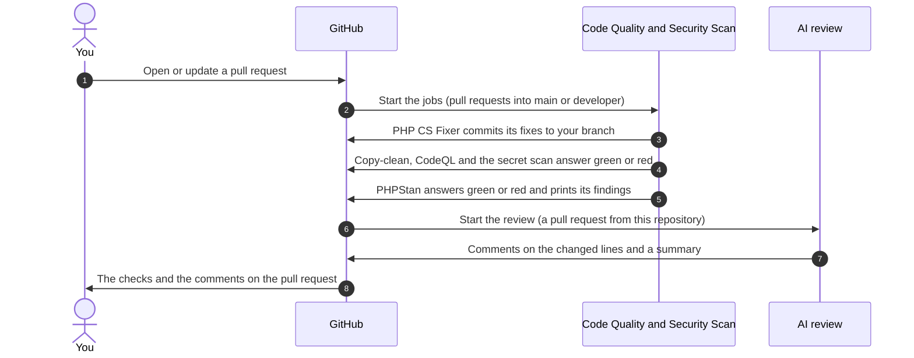

# Automated checks

<AlfaVersion verified="2.2.2" />

The code repository holds three **workflows**. A workflow is a file under `.github/workflows/` that tells GitHub to
run one or more **jobs** when something happens, for example when a pull request is opened. Each job shows on the
pull request as one check, green or red.

## What it does

| Check (workflow, job) | Runs on | Can a finding block a merge |
|---|---|---|
| Code Quality, **PHP CS Fixer** | Pull requests into `main` or `developer` | No: not a required check (see [Branch rules](#branch-rules)). It turns red when the tool or its commit step breaks. |
| Code Quality, **Copy-clean** | Pull requests into `main` or `developer`, and pushes to them | Yes: a required check (see [Branch rules](#branch-rules)). Any finding turns it red. |
| Code Quality, **Media forms** (a step of the Copy-clean job) | Pull requests into `main` or `developer`, and pushes to them | Yes: it fails the Copy-clean job, a required check. Any finding turns it red. |
| Code Quality, **PHPStan** | Pull requests into `main` or `developer`, and pushes to them | Yes: a required check (see [Branch rules](#branch-rules)). A finding beyond the baseline turns it red. See [PHPStan](./phpstan). |
| Security Scan, **CodeQL** (job `security-scan`) | Pull requests into `main` or `developer`, and pushes to them | Yes: a required check (see [Branch rules](#branch-rules)). |
| Security Scan, **PHP security scan** (job `php-security`) | Same | No: not a required check (see [Branch rules](#branch-rules)). Any finding turns it red. |
| Security Scan, **secret scan** (job `secret-scanning`) | Same | Yes: a required check (see [Branch rules](#branch-rules)). A secret confirmed as live turns it red. |
| Claude PR Review, **AI review** (job `claude-review`) | A pull request from a branch of this repository, opened by its owner, a member, a collaborator or a contributor, when it is opened, updated or reopened; and a comment that contains `@claude` on such a pull request, written by one of them. The job then goes on only for a person with write access. | No. It posts comments. |

Whether a red check stops a merge is decided by the repository's branch rules on GitHub, not by the workflow files.

### Branch rules

The rules of the two branches are settings of the repository, two rulesets named Develop and Main. They can change
without a change in the code.

| | `developer` | `main` |
|---|---|---|
| Changes only through a pull request | Yes | Yes |
| Approving reviews needed | 1 | 0 |
| The last push must be approved by someone else | No | Yes |
| Force push | Refused | Refused |
| Linear history | Not asked | Required |
| Required checks | Copy-clean, `security-scan` (CodeQL), `secret-scanning` and PHPStan | The same four |
| The branch must be up to date before the merge | Yes | Yes |

So these four checks must be green before a pull request is merged. PHP CS Fixer and the PHP security scan
(`php-security`) are not required: they inform the people who review and merge, as the AI review does.
Organisation and repository administrators may bypass these rules.

Apart from the media forms suite, which only reads files, no workflow runs a test suite, and none builds the
installable package or publishes a release.



The jobs do not wait for each other. No job names another as a condition, so GitHub starts them side by side and
their results can arrive in any order.

## When it is used

You do not start anything. GitHub starts the workflows by itself:

- **Code Quality** and **Security Scan** start for a pull request whose target is `main` or `developer`, and again
  when `main` or `developer` receives commits. A pull request into any other branch does not start them.
- **Claude PR Review** has no branch filter, but it starts only for the repository's own people: see
  [The AI review](#the-ai-review). A pull request from a fork gets no AI review.

## What you must provide

Nothing to make the checks run. To pass them: comments and texts that follow the
[Copy-clean rules](../getting-started/contributing#code-conventions), every changed style or script built with
`php build/media-min/build.php` and committed with what it wrote
([You changed a stylesheet or a script](../getting-started/contributing#you-changed-a-stylesheet-or-a-script)), and no
live secret anywhere in your commits.
After PHP CS Fixer commits to your branch, pull before you commit again.

## Code Quality

File: `.github/workflows/code-quality.yml`. Three jobs.

### PHP CS Fixer

| | |
|---|---|
| Runs | On pull requests only. It is skipped on a push to `main` or `developer`. |
| PHP | 8.3 |
| What it does | Checks out the branch of the pull request from the pull request's own repository (so a fork's branch is found), formats the PHP code with the rules of `.php-cs-fixer.php`, and commits the result to that branch as `github-actions[bot]` with the message `style: auto-fix code style with PHP CS Fixer`. |
| What makes it fail | Only a step that breaks: the tool cannot run, or the commit cannot be made. Badly formatted code does not fail it, it gets fixed. |

On a pull request from a fork the job cannot push to the fork's branch: when the fixer changes a file there, the
commit step fails and the job turns red. Running the fixer on your computer before you push is required. Details and the local command: [PHP CS Fixer](./php-cs-fixer).

### Copy-clean

| | |
|---|---|
| Runs | On pull requests and on pushes. |
| PHP | 8.3 |
| What it does | Runs `scripts/copy-clean/copy-clean-gate.php` over the checked-out code. The script reads every file the package ships (never tests, never the bundled libraries) and judges the comments and the texts a person reads. Code itself is never judged. It only reads files. |
| What makes it fail | Any comment or text that breaks a rule and is not in the allow list. An allow list entry that no longer matches anything. The run prints each finding with its file, line and rule. |

The rules, R1, R2, R3, R5 and R6, and the allow list are explained on
[Contributing](../getting-started/contributing#code-conventions). There is no rule R4: the rules keep the numbers
they were first given.

Run it yourself from the root of the repository, with the same command as the workflow:

```bash
php scripts/copy-clean/copy-clean-gate.php --package=. --allow=scripts/copy-clean/copy-clean-allow.json
```

A clean run ends with two lines like these:

```text
copy-clean gate: 1676 shipped files, 1666 judged; 44 occurrence(s) allowed by 44 entries; 0 not allowed
18 passed, 0 failed
```

The gate checks itself too: it fails when its planted test lines reach a rule its list does not name, or the list
names one no planted line reaches. The file counts follow the code.

A second step, the docblock lint (`scripts/docblock-lint/docblock-lint.php`), keeps the docblocks a plugin author
reads true to the code: no docblock left above another, and the samples name methods and entities that exist. Its
allow list (`scripts/docblock-lint/docblock-lint-allow.json`) names what waits for another change, each entry with how
many findings it covers. A finding the list does not cover, or an entry that matches another number of findings,
fails the job.

Run it yourself from the root of the repository, with the same command as the workflow:

```bash
php scripts/docblock-lint/docblock-lint.php
```

A clean run ends with two lines like these:

```text
docblock lint: 1031 files, 1029 classes; 0 finding(s) allowed by 0 entries; 0 not allowed
15 passed, 0 failed
```

Its first checks plant a sample of each rule and prove that the rule finds it. While the allow list has entries, one
more check counts: each entry matches exactly the findings its count gives.

### Media forms

| | |
|---|---|
| Runs | On pull requests and on pushes, as a step of the Copy-clean job. |
| PHP | 8.3 |
| What it does | Runs `scripts/media-forms/media-forms-suite.php` over the checked-out code. It reads the media folder of every manifest and checks that every source style and script has its `.min` file; that every `.min` file, made by the build or shipped minified by a library, has a `.gz` that decompresses byte for byte to it; that there is no `.gz` of a source, no `.gz` without its `.min` and no `._` file; that every registration names a `.min` file the package carries (the `joomla.asset.json` files, the registrations in PHP code, a media path written in a script); and that each `.min` file is the one `php build/media-min/build.php` made from its source as the source is now (the build's record, `build/media-min/media-min.lock.json`). It only reads files. |
| What makes it fail | A source changed without the build, a missing or stray file, a `.gz` that is not its `.min`, or a registration of a source. The run prints each finding with its file. |

Its first arm checks the suite itself: it plants each fault in a throwaway package and proves that the arm meant to
find it does, and that a clean package passes.

Run it yourself from the root of the repository, with the same command as the workflow:

```bash
php scripts/media-forms/media-forms-suite.php .
```

A clean run ends with this line:

```text
9 passed, 0 failed
```

The same suite reads a built package too (`php scripts/media-forms/media-forms-suite.php com_alfa-x.y.z.zip`). A
package carries no build record, so the last arm is skipped there.

### PHPStan

| | |
|---|---|
| Runs | On pull requests and on pushes. |
| PHP | 8.3 |
| What it does | Installs PHPStan 2.3.5 and downloads Joomla 6.2.0 into the folder `joomla`, each checked against its sha256, then analyses the code with `phpstan.neon` and prints its findings on the run's page. |
| What makes it fail | Any finding beyond the baseline, or a step that breaks. |

Details and the local command: [PHPStan](./phpstan).

## Security Scan

File: `.github/workflows/security-scan.yml`. Three jobs, on pull requests into `main` or `developer` and on pushes
to them.

| Job | What it does | What makes it fail |
|---|---|---|
| `security-scan` | CodeQL, GitHub's code scanner. It is set up for one language group, `javascript-typescript`, with the query set `security-extended`. It does not analyse the PHP code. | A step that breaks. What happens with the alerts it reports depends on the repository's settings, which are not part of the code. |
| `php-security` | Semgrep 1.185.0 (its image fixed by digest, run with no network and no metrics) with the PHP security rules of `semgrep/semgrep-rules` at a fixed commit, over the PHP Alfa Commerce ships (`administrator`, `site`, `api`, `plugins`, `modules` and `script.php`; not the bundled libraries). Three rules that flag every call of `md5()` and `sha1()`, `unlink()` and `unserialize()` are left out. | Any finding, or a step that breaks. |
| `secret-scanning` | Fetches the full history and runs TruffleHog, a scanner for secrets such as keys and passwords. It is told to report only secrets it could confirm as live (the option `--only-verified`). | A confirmed live secret. |

The actions of Code Quality and Security Scan run from a fixed commit. TruffleHog's action is fixed at v3.99.9; the
scanner it starts is still its `latest` image.

If the secret scan turns red, removing the secret from the file is not enough: it stays in the history. Replace the
secret at the service that issued it.

## The AI review

File: `.github/workflows/claude-pr-review.yml`. One job, `claude-review`.

| | |
|---|---|
| Runs | When a pull request is opened, when new commits are pushed to it, and when it is reopened, if the pull request comes from a branch of this repository (not a fork) and its author is the owner, a member, a collaborator or a contributor. Also when one of them writes a comment that contains `@claude` on a pull request (not on an issue). A member whose membership is private and who has never had a commit merged counts as none of these and is skipped. |
| What it needs | The repository secret `CLAUDE_CODE_OAUTH_TOKEN`. Its first step asks GitHub for the person's access and stops unless it is admin or write (maintain counts as write). The job holds only the permissions `contents: read` and `id-token: write`, its checkout keeps no credentials, and a new start for the same pull request cancels a run in progress. |
| What it reads first | The reviewer rulebook, `.github/review-guidelines.md`. It is told to review only the changes of the pull request against those rules. |
| What it posts | Comments on the exact lines, each with a severity mark, and a short summary on the pull request. |
| What it leaves alone | Formatting, which PHP CS Fixer handles, and findings of the kind PHPStan reports. It is told to say so when the pull request is clean and not to invent problems. |
| Can it block a merge | The file gives it tools to read the code, to read the pull request and to comment. It gives it no tool to approve or reject a pull request. |

The model it runs on is named in the file: `claude-sonnet-4-6`.

### The reviewer rulebook

[`.github/review-guidelines.md`](https://github.com/Easylogic-CO-LP/Alfa-Commerce/blob/main/.github/review-guidelines.md)
holds, in this order:

- How to review: three severity marks. Red breaks installations, data or security. Yellow is a likely bug or a
  broken convention. Blue is minor.
- The layout of the repository, the namespaces and the naming of classes.
- The rule groups: Release and migrations, Database, Joomla gotchas, Multilingual, Security, Conventions, i18n.
- What not to flag: style, PHPStan findings, and file differences on a development site.

One heading of the rulebook still reads "Namespaces (PSR-4, Joomla 6/7)": Joomla 7 is refused by the installer.
Trust this manual and the code where the rulebook differs.

## What happens next

On the pull request page:

| Where | What you find |
|---|---|
| The list of checks | One line for each job: green, red, or still running. Click a line to open its run. |
| The run's page | What the job printed. This is where PHPStan's findings and Copy-clean's findings are. |
| The conversation and the changed files | The AI review's summary and its comments on lines. |
| Your branch | A new commit by `github-actions[bot]` when PHP CS Fixer changed something. |

## What can go wrong

| What you see | What to do |
|---|---|
| Copy-clean is red | Open the run. Reword each comment or text it names, or add an exception with its reason to the allow list. |
| php-security is red | Open the run: it names the file, the line and the rule. Fix the code. A rule that is wrong for Alfa Commerce is left out in the workflow, with its reason, in a pull request. |
| The secret scan is red | Replace the secret at its service, then remove it from the code. |
| PHPStan is green | That says nothing about findings. Open the run and read them. |
| PHP CS Fixer added a commit | Pull, then continue. |
| The AI review commented | Read it, apply what is right. Its comments do not fail a check. |
| A comment with `@claude` started a new review | That is how the workflow is written: a comment containing `@claude` on a pull request, by a person with write access, starts the job again. |
| A comment with `@claude` started nothing | It was on an issue, on a pull request from a fork, or by a person without write access. |

## Versions the checks run on

- PHP 8.3 for PHP CS Fixer, PHPStan and Copy-clean. The PHP security scan sets up no PHP. The component itself
  needs PHP 8.3 or newer.
- Fixed versions: PHPStan 2.3.5, Joomla 6.2.0, Semgrep 1.185.0 and the rules' commit, TruffleHog's action at
  v3.99.9. PHP CS Fixer and TruffleHog's scanner image are not fixed, so their results can change by themselves.

## Not documented yet

- What the AI review answers when a comment with `@claude` asks a question. The workflow passes the same review
  instructions for every start.
- Whether a CodeQL alert turns the `security-scan` check red.
