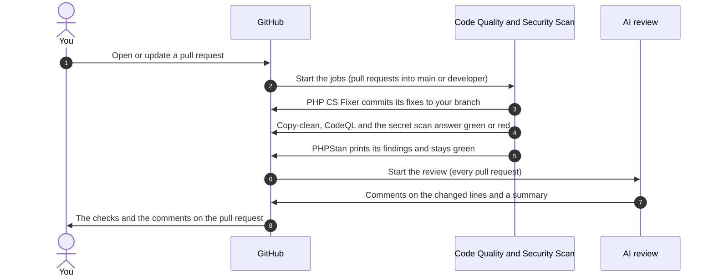

# Automated checks

<AlfaVersion verified="2.2.0" />

The code repository holds three **workflows**. A workflow is a file under `.github/workflows/` that tells GitHub to
run one or more **jobs** when something happens, for example when a pull request is opened. Each job shows on the
pull request as one check, green or red.

## What it does

| Check (workflow, job) | Runs on | Can a finding block a merge |
|---|---|---|
| Code Quality, **PHP CS Fixer** | Pull requests into `main` or `developer` | Not today: no check is required for a merge (see [Branch rules](#branch-rules)). It turns red only when the tool or its commit step breaks. |
| Code Quality, **Copy-clean** | Pull requests into `main` or `developer`, and pushes to them | Not today: no check is required for a merge (see [Branch rules](#branch-rules)). Any finding turns it red. |
| Code Quality, **PHPStan** | Pull requests into `main` or `developer`, and pushes to them | On `main` (2.2.0): no, it reports and does not fail the check. On `developer` since 13 November 2026: a finding turns the check red, but no check is required for a merge yet. See [PHPStan](./phpstan). |
| Security Scan, **CodeQL** (job `security-scan`) | Pull requests into `main` or `developer`, and pushes to them | Not today: no check is required for a merge (see [Branch rules](#branch-rules)). |
| Security Scan, **dependency check** (job `php-security`) | Same | No. It is skipped, because the repository has no `composer.lock`. |
| Security Scan, **secret scan** (job `secret-scanning`) | Same | Not today: no check is required for a merge (see [Branch rules](#branch-rules)). A secret confirmed as live turns it red. |
| Claude PR Review, **AI review** (job `claude-review`) | Every pull request when it is opened, updated or reopened, and any comment that contains `@claude` | No. It posts comments. |

Whether a red check stops a merge is decided by the repository's branch rules on GitHub, not by the workflow files.

### Branch rules

The rules of the two branches are settings of the repository (two rulesets), read on 13 November 2026. They can
change without a change in the code.

| | `developer` | `main` |
|---|---|---|
| Changes only through a pull request | Yes | Yes |
| Approving reviews needed | 1 | 0 |
| The last push must be approved by someone else | No | Yes |
| Force push | Refused | Refused |
| Linear history | Not asked | Required |
| Required checks | None | None |

So today no automated check has to be green for a merge. The checks inform the people who review and merge.
Organisation and repository administrators may bypass these rules.

No workflow runs a test suite, builds the installable package or publishes a release.



The jobs do not wait for each other. No job names another as a condition, so GitHub starts them side by side and
their results can arrive in any order.

## When it is used

You do not start anything. GitHub starts the workflows by itself:

- **Code Quality** and **Security Scan** start for a pull request whose target is `main` or `developer`, and again
  when `main` or `developer` receives commits. A pull request into any other branch does not start them.
- **Claude PR Review** has no branch filter. It starts for every pull request.

## What you must provide

Nothing to make the checks run. To pass them: comments and texts that follow the
[Copy-clean rules](../getting-started/contributing#code-conventions), and no live secret anywhere in your commits.
After PHP CS Fixer commits to your branch, pull before you commit again.

## Code Quality

File: `.github/workflows/code-quality.yml`. Three jobs.

### PHP CS Fixer

| | |
|---|---|
| Runs | On pull requests only. It is skipped on a push to `main` or `developer`. |
| PHP | 8.2 |
| What it does | Checks out the branch of the pull request, formats the PHP code with the rules of `.php-cs-fixer.php`, and commits the result to that branch as `github-actions[bot]` with the message `style: auto-fix code style with PHP CS Fixer`. |
| What makes it fail | Only a step that breaks: the tool cannot run, or the commit cannot be made. Badly formatted code does not fail it, it gets fixed. |

Details and the local command: [PHP CS Fixer](./php-cs-fixer).

### Copy-clean

| | |
|---|---|
| Runs | On pull requests and on pushes. |
| PHP | 8.3 |
| What it does | Runs `scripts/copy-clean/copy-clean-gate.php` over the checked-out code. The script reads every file the package ships (never tests, never the bundled libraries) and judges the comments and the texts a person reads. Code itself is never judged. It only reads files. |
| What makes it fail | Any comment or text that breaks a rule and is not in the allow list. An allow list entry that no longer matches anything. The run prints each finding with its file, line and rule. |

The rules, R1, R2, R3, R5 and R6, and the allow list are explained on
[Contributing](../getting-started/contributing#code-conventions).

Run it yourself from the root of the repository, with the same command as the workflow:

```bash
php scripts/copy-clean/copy-clean-gate.php --package=. --allow=scripts/copy-clean/copy-clean-allow.json
```

A clean run of 2.2.0 ends with these two lines:

```text
copy-clean gate: 1640 shipped files, 1630 judged; 44 occurrence(s) allowed by 44 entries; 0 not allowed
17 passed, 0 failed
```

### PHPStan

| | |
|---|---|
| Runs | On pull requests and on pushes. |
| PHP | 8.2 |
| What it does | Downloads the latest Joomla release into the folder `joomla`, then analyses the code with `phpstan.neon` and prints its findings on the run's page. |
| What makes it fail | Nothing PHPStan finds. The PHPStan step is marked so that its result does not fail the job (`continue-on-error: true`). The check is green whatever PHPStan answers. |

So a green PHPStan check does not mean that PHPStan found nothing. Open the run and read its findings. Details and
the local command: [PHPStan](./phpstan).

## Security Scan

File: `.github/workflows/security-scan.yml`. Three jobs, on pull requests into `main` or `developer` and on pushes
to them.

| Job | What it does | What makes it fail |
|---|---|---|
| `security-scan` | CodeQL, GitHub's code scanner. It is set up for one language group, `javascript-typescript`, with the query set `security-extended`. It does not analyse the PHP code. | A step that breaks. What happens with the alerts it reports depends on the repository's settings, which are not part of the code. |
| `php-security` | Sets up PHP 8.2 and installs a checker for known vulnerabilities in Composer dependencies. The checker runs only when a file `composer.lock` exists. The repository has none, so the job prints that it skips the scan. | Only a step that breaks. It checks nothing today. |
| `secret-scanning` | Fetches the full history and runs TruffleHog, a scanner for secrets such as keys and passwords. It is told to report only secrets it could confirm as live (the option `--only-verified`). | A confirmed live secret. |

If the secret scan turns red, removing the secret from the file is not enough: it stays in the history. Replace the
secret at the service that issued it.

## The AI review

File: `.github/workflows/claude-pr-review.yml`. One job, `claude-review`.

| | |
|---|---|
| Runs | When a pull request is opened, when new commits are pushed to it, and when it is reopened. Also when someone writes a comment that contains `@claude` on an issue or a pull request. |
| What it needs | The repository secret `CLAUDE_CODE_OAUTH_TOKEN`. |
| What it reads first | The reviewer rulebook, `.github/review-guidelines.md`. It is told to review only the changes of the pull request against those rules. |
| What it posts | Comments on the exact lines, each with a severity mark, and a short summary on the pull request. |
| What it leaves alone | Formatting, which PHP CS Fixer handles, and findings of the kind PHPStan reports. It is told to say so when the pull request is clean and not to invent problems. |
| Can it block a merge | The file gives it tools to read the code, to read the pull request and to comment. It gives it no tool to approve or reject a pull request. |

The model it runs on is named in the file: `claude-sonnet-4-6`.

### The reviewer rulebook

[`.github/review-guidelines.md`](https://github.com/Easylogic-CO-LP/Alfa-Commerce/blob/main/.github/review-guidelines.md)
holds, in this order:

- How to review: three severity marks. Red breaks installations, data or security. Yellow is a likely bug or a
  broken convention. Blue is minor.
- The layout of the repository, the namespaces and the naming of classes.
- The rule groups: Release and migrations, Database, Joomla gotchas, Multilingual, Security, Conventions, i18n.
- What not to flag: style, PHPStan findings, and file differences on a development site.

Some lines of the rulebook are older than 2.2.0. Trust this manual and the code where they differ:

| The rulebook says | 2.2.0 |
|---|---|
| The component is for "Joomla 6/7" | Joomla 7 is refused by the installer. |
| `sql/uninstall.mysql.utf8.sql` exists | There is no uninstall SQL, on purpose. |
| Removed files go in `files/removed/<ver>.json` | They are listed in `script.php`, see [Contributing](../getting-started/contributing#you-deleted-or-moved-a-file). |
| Its plugin and module lists | They lack the plugins `alfa-item-fields/choice`, `alfa-form-fields/country` and `console/alfa`, and the modules `mod_alfa_filters`, `mod_alfa_items` and `mod_easy_articles`. |

## What happens next

On the pull request page:

| Where | What you find |
|---|---|
| The list of checks | One line for each job: green, red, or still running. Click a line to open its run. |
| The run's page | What the job printed. This is where PHPStan's findings and Copy-clean's findings are. |
| The conversation and the changed files | The AI review's summary and its comments on lines. |
| Your branch | A new commit by `github-actions[bot]` when PHP CS Fixer changed something. |

## What can go wrong

| What you see | What to do |
|---|---|
| Copy-clean is red | Open the run. Reword each comment or text it names, or add an exception with its reason to the allow list. |
| The secret scan is red | Replace the secret at its service, then remove it from the code. |
| PHPStan is green | That says nothing about findings. Open the run and read them. |
| PHP CS Fixer added a commit | Pull, then continue. |
| The AI review commented | Read it, apply what is right. Its comments do not fail a check. |
| A comment with `@claude` started a new review | That is how the workflow is written: any comment containing `@claude` starts the job again. |

## Versions the checks run on

- PHP 8.2 for PHP CS Fixer, PHPStan and the dependency check. PHP 8.3 for Copy-clean. The component itself needs
  PHP 8.3 or newer.
- The workflows name no version for PHP CS Fixer or PHPStan, TruffleHog is taken from its `main` branch, and Joomla
  is the latest release on the day of the run. A result can therefore change without a change in the code.

## Not documented yet

- Whether PHP CS Fixer can commit to a pull request that comes from a fork, and whether the AI review's secret is
  available to such a pull request.
- What the AI review answers when a comment with `@claude` asks a question. The workflow passes the same review
  instructions for every start.
- Whether a CodeQL alert turns the `security-scan` check red.
